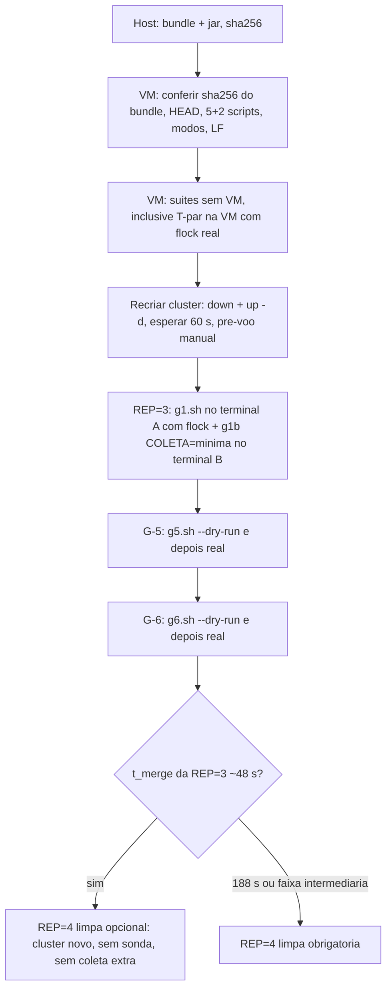

# Gate v3: correcoes de V-B2, g1b minimo, log de saude, T-g5/T-g6 e bundle (preparo, nada executado na VM) - 2026-10-16

Worker-2, branch `test/b29-gate-vm-v3`, worktree `wt-gate-v3`. **Nada foi levado a VM, nenhuma injecao foi executada, sem push.** Atende a V-B2 (`docs/validacao-rep2-2026-10-16.md`, secoes 3, 4 e 5). O Senior valida em V-B3.

## 1. De onde a branch foi montada

| Origem | O que entrou | Como |
|---|---|---|
| `feature/etapa-formal-integracao` (`e6e5985`) | base: `scripts/inject-partition.sh` **ja com A1+A3 e A2** (T-par-16/17/18), `inject-netdegrade.sh`, `inject-jitter.sh`, `g-lib.sh`, `g0.sh`, `g0b.sh`, `g1.sh` (ja com `extrair_logs` apos a fusao e nos aborts), workload B-33 | `git worktree add -b test/b29-gate-vm-v3 ../wt-gate-v3 e6e5985` |
| `tmp/vm-bundle-2` (`5448791`) | sonda Hot Rod (`SondaHotrod`, `SondaCsv`, testes), `g1b.sh`, `g1b.test.sh`, relatorio da sonda | `git merge --no-ff` (sem conflito) |
| `test/b29-gate-vm` (`8394843`) | `g56-lib.sh`, `g5.sh`, `g6.sh` (inalterados no primeiro commit; as correcoes vem em commits proprios) | `git checkout test/b29-gate-vm -- <3 arquivos>` |

A integracao e as outras branches **nao foram alteradas** (`git -C wt-integracao rev-parse HEAD` continua `e6e5985`).

Sobre 4.2.4: o fix A2 (`0f79256` na branch `fix/b29-guarda-netns-particao`, equivalente `ef197e6` na integracao) e A1+A3 **ja estao na base** `e6e5985`; nao foi preciso cherry-pick. Confirmado por teste: `inject-partition.test.sh` tem T-par-16/17/18 e passa 127/0/1 (WSL) e 125/0/2 (Git Bash). Consequencia a avisar ao Gestor (V-B2 secao 5): o `inject-partition.sh` deste bundle **difere** do da REP=2 (guarda de netns no alvo, nos pares e no `--heal`, exit 4; contadores por sentido). Para rc 0/137/143 o comportamento e o mesmo.

## 2. Correcoes de V-B2 e onde cada uma e testada

| V-B2 | Mudanca | Teste (sem VM) |
|---|---|---|
| 4.2.1 amostra +80 s apos o fim da F2 | `g6.sh` le o estado (`qd`) **antes** das sondas lentas e decide sobre o valor capturado; ultima amostra em **+70 s** (padrao `10 45 70`); `health` com `timeout 20`; amostra que comecaria a menos de `G6_MARGEM` (5) s do fim da F2 ou com a F2 encerrada e **PULADA** (registrada, nao e FAIL), com minimo de 2 amostras validas | T-g6-5 (saude lenta; reproduziu o falso FAIL no `g6.sh` antigo: 5 FAIL) |
| 4.2.2 `qd \| grep -q` com pipefail | `tem() { grep -q -e "$2" <<<"$1"; }` sobre variavel capturada; mesma troca em `sem_clsact` (g-lib) e `sem_netem` (g56-lib) | teste estatico em T-g6-1 (0 ocorrencias; o `g6.sh` antigo tinha 8) |
| 4.2.3 `abortar` com `PID2` nao inicializado | `PID1= PID2= PID3= INJETOU=0` e o `trap` vem **antes** de `pid_de`; abort so limpa se algo foi armado (`INJETOU=1`), senao informa "nada armado nem injetado"; `tc del` so se `PID2` setado | T-g6-6 (`isn2`/`isn3` ausentes: sem `unbound variable`, sem tc/injetor/dead-man) |
| 4.2.4 fix A2 + A1/A3 no bundle | ja na base (secao 1) | T-par-16/17/18 |
| 4.2.5 corpo do dead-man do netem | corpo em `DEADMAN_NETEM_CORPO` (g56-lib), com guarda completa (`p`, `a`, `b` nao vazios, `b != a`) e mensagem "NAO tocado" + exit 1 quando invalido; `armar_netem` passa o corpo ao `systemd-run` | T-g6-7: o teste extrai os argumentos reais do `systemd-run` (shim) e **executa o corpo** em (a) netns distinto: chama `tc qdisc del dev eth0 root` em 4002; (b) netns do host: nao chama `nsenter`; (c) container ausente; (d) netns ilegivel: nao chamam |
| 4.2.6 `espera_saudavel` no G-6 | `espera_saudavel [limite] [base-epoch-s] [rotulo]`: tempo **e limite** contados desde o fim da F2 (`T_F2FIM`, gravado em `tempos.txt` como `t_f2_fim_s`); mensagem "size=3 HEALTHY apos N s desde o fim da F2" | T-g6-8 e T-g6-1 |
| 3.2 g1b minimo | `COLETA=minima`: so `/health` (curl --digest) nas 3 portas + as 2 sondas (`sessions,counters`); sem `/caches`, `?action=stats`, `?action=get-availability`. Padrao segue `completa`; valor invalido aborta; `resumo.txt` registra `coleta=` | `g1b.test.sh` (+12 verificacoes: 25 ao todo) |
| 3.2 log de saude no g1.sh | `saude-log.csv` em `g1-repN/`, a cada 2 s, uma linha por porta: `t_epoch_ns,porta,http,status,size`; inclui `HEALTHY_REBALANCING`, `size`, http 000 quando o no nao responde (curl -m 2); inicia antes da injecao, para no fim e num `trap EXIT` (abort/erro). `G1_LOG_SAUDE_S=0` desliga | `g1.test.sh` T-g1-1..7 |

Extras que apareceram ao escrever os testes (todos pequenos): `g5.sh` aceita `G5_ESPERA_START` (padrao 40) e **nao morre** em `kill` quando o injetor ja terminou (segue para o rc real e dispara "FAIL KILL: rc=N (esperado 137)"); `exigir_go` nao falha fora de repositorio git; `g1.sh` passa a usar `exigir_go` (G_TESTE=1 so nos testes) e aceita `G1_DUR`, `G1_AMOSTRAS`, `G1_MERGE_LIM` (padroes 90, `8 25 45 65 82`, 600: iguais aos da REP=1/2).

## 3. Testes sem VM novos

Todos usam `gate-test-lib.sh`: shims de `podman`, `sudo`, `nsenter`, `tc` (estado clsact/netem por PID), `readlink` (netns por PID, `SHIM_HOSTNET`/`SHIM_SAMENS`/`SHIM_NO_NS`), `flock`, `curl` (saude), `systemd-run`/`systemctl` (timers armados) e **injetores falsos** (`inject-partition.sh`/`inject-jitter.sh` do tempo de teste) que fazem as mesmas chamadas `tc` via `nsenter` dos reais. Escala: janelas de 4 a 10 s.

| Arquivo | Casos | Cobre |
|---|---|---|
| `g5.test.sh` (50 verificacoes) | T-g5-1 TERM (rc 143, sem clsact, start+end); T-g5-2 KILL (rc 137, clsact fica, `--heal` rc 0 remove, sem end); T-g5-3 sem start; T-g5-4 sem clsact antes do sinal; T-g5-5 rc 7 no KILL; T-g5-6 ordem `systemd-run` -> injetor -> `systemctl stop` e abort sem desarmar; T-g5-7 sem GO / sem terminal / `--dry-run`: nenhuma chamada | guarda, armar, KILL+heal, abortos |
| `g6.test.sh` (70) | T-g6-1 ordem (2 dead-men, F3, F2); T-g6-2 netns iguais e netns do host; T-g6-3 coexistencia (clsact so em 4003, netem so em 4002, `del` de cada um so no seu pid, nada em isn1); T-g6-4 F3 acaba antes da F2; T-g6-5 amostra tardia; T-g6-6 abort sem PID2; T-g6-7 corpo do dead-man; T-g6-8 `espera_saudavel` desde a base | limpeza so da sua falha, abortos |
| `g1.test.sh` (48) | T-g1-1 formato da linha; T-g1-2 laco (HEALTHY -> REBALANCING -> porta caida, timestamps, para ao parar); T-g1-3 g1.sh completo (linhas antes do start, na janela, apos o end com size=2 e depois size=3); T-g1-4 abort deixa o dead-man e para o log; T-g1-5 sem GO; T-g1-6 cluster fora de size=3; T-g1-7 `G1_LOG_SAUDE_S=0` | log de saude |
| `g1b.test.sh` (25 `ok`) | minima x completa x invalida | g1b minimo |

Verificacao de que os testes pegam defeito (mutacao em copia): sem a tolerancia do `kill` no g5 -> T-g5-5 FAIL; `g1.sh` sem o `trap` -> T-g1-4 FAIL; dead-man sem a guarda de netns -> T-g6-7b/d FAIL; `g6.sh` anterior -> 12 FAIL. **A mutacao "abortar sem o teste `[ -z "$PID2" ]`" NAO e detectada**: a guarda e redundante (o abort ja retorna antes se nada foi armado); fica como defesa em profundidade.

## 4. Regressao (medida em 2026-10-16, esta branch)

| Suite | Git Bash | WSL (Ubuntu, `flock` real) |
|---|---|---|
| `inject-partition.test.sh` | 125/0/2 | 127/0/1 |
| `inject-netdegrade.test.sh` | 298/0/1 | 306/0/0 |
| `inject-jitter.test.sh` | 35/0 | 35/0 |
| `g1b.test.sh` | 25 ok, falhas=0 | 25 ok, falhas=0 |
| `g5.test.sh` / `g6.test.sh` / `g1.test.sh` (novos) | 50/0, 70/0, 48/0 (~55 s, ~60 s, ~40 s) | 50/0, 70/0, 48/0 (~27 s, ~39 s, ~30 s) |
| `mvn -f workload/pom.xml test` | 205 testes, 0 falhas, 0 erros, 3 skipped | |
| `python -m unittest` em `analysis/` | 9 OK | |

Os SKIP do Git Bash sao T-par-6 e T-par-15 (sem `flock`) e T-nd-21; o de WSL e T-par-6 (escopo B-29.1).

## 5. Integridade do bundle

Hashes dos blobs commitados (LF, 0 `\r` em `runs/gate-b29/*.sh` e `scripts/*.sh`):

| Arquivo | sha256 |
|---|---|
| `runs/gate-b29/g1.sh` | `92025f2f16e7f93f6c0bd685ce114a3506d5497a908458130d852fd36c3c21a4` |
| `runs/gate-b29/g1b.sh` | `546aa6b09a1a500650aa46a35600ca4f83f02b643d580f2b0b49ece8c0f26fd8` |
| `runs/gate-b29/g5.sh` | `813e254da46420c891739c3fd93919d53d5cc2ed13832bd050f8302190f5dd83` |
| `runs/gate-b29/g6.sh` | `b03617e985453eda92ebaff3653faf8242c7094b53e55b090e0d7fe9d5f66b84` |
| `runs/gate-b29/g56-lib.sh` | `4f750fe3cf59f299585c12f66b3020973976e0e979474fde6354bf6998a18e2a` |
| `runs/gate-b29/g-lib.sh` | `af3436d5ede54f5f2047ba48620130a803b4bbd8929e2cbc242fbbe0ebb922dd` |
| `scripts/inject-partition.sh` | `59dd2beee5b003d85f96cae71866227d7bca1c87a9ceeab034180ce4254d94e1` |
| `scripts/inject-jitter.sh` | `7e68962b1b7f508ee84ca7561a20c0bba36c43ea4597d7390e7c8091cd24e529` |
| `workload/target/session-workload-0.1.0-SNAPSHOT.jar` (build local, `-DskipTests`) | `3594c690cfacd2be1f88e58d2a65a4cd944a06688abcb9ae5b4d3df2f7dc7bee` |

Bit de modo no indice: `100755` em `g0.sh g0b.sh g1.sh g1b.sh g5.sh g6.sh` e nos `*.test.sh`; `100644` nas bibliotecas (`g-lib.sh`, `g56-lib.sh`, `gate-test-lib.sh`, so `source`); `scripts/inject-*.sh` ja eram `100755`.

O **HEAD** e o **sha256 do arquivo do bundle** nao podem constar neste documento (estao dentro do que ele descreve): ficam no arquivo `gate-v3.bundle.sha256` ao lado do bundle (`tcc/gate-v3.bundle`) e na resposta do Worker ao Senior. Quem confere na VM usa `git rev-parse HEAD` e `sha256sum` contra esses valores, e os hashes acima.

## 6. Comandos exatos (so apos V-B3 e go do Gestor)



### 6.1 No host (Git Bash), em `wt-gate-v3`

```bash
cd /c/Users/Francesco/Development/tcc/wt-gate-v3
git rev-parse HEAD                                              # = valor do .sha256
git bundle create ../gate-v3.bundle test/b29-gate-vm-v3 && git bundle verify ../gate-v3.bundle
sha256sum ../gate-v3.bundle
mvn -q -f workload/pom.xml package -DskipTests && sha256sum workload/target/session-workload-0.1.0-SNAPSHOT.jar
scp -i ~/.ssh/id_ed25519_tccf3 ../gate-v3.bundle workload/target/session-workload-0.1.0-SNAPSHOT.jar <vm>:~/
```

(O bundle ja foi criado; o `sha256sum` acima so repete a conferencia.)

### 6.2 Na VM, antes de qualquer go (nao toca no cluster)

```bash
sha256sum ~/gate-v3.bundle ~/session-workload-0.1.0-SNAPSHOT.jar            # = host
cd ~/tcc-gate && git status --short                                          # esperado: limpo (ou so runs/ antigos untracked)
git fetch ~/gate-v3.bundle test/b29-gate-vm-v3 && git checkout -B test/b29-gate-vm-v3 FETCH_HEAD
git rev-parse HEAD                                                           # = HEAD do .sha256
sha256sum runs/gate-b29/{g1,g1b,g5,g6,g56-lib,g-lib}.sh scripts/inject-partition.sh scripts/inject-jitter.sh   # = tabela da secao 5
ls -l runs/gate-b29/*.sh | awk '{print $1, $9}'                              # g0 g0b g1 g1b g5 g6 e *.test.sh: -rwxr-xr-x
grep -rlI $'\r' runs/gate-b29/*.sh scripts/*.sh | wc -l                      # 0
mkdir -p workload/target && cp ~/session-workload-0.1.0-SNAPSHOT.jar workload/target/ && java -version   # 17+
for t in g1b g1 g5 g6; do bash runs/gate-b29/$t.test.sh | tail -1; done       # g1b: falhas=0; demais: 0 FAIL
bash scripts/inject-partition.test.sh | tail -1                              # com flock real; incl. T-par-18 (A2)
bash scripts/inject-jitter.test.sh | tail -1
sudo -n true && echo sudo-ok                                                 # sudo sem senha (g-lib usa sudo podman/nsenter)
```

### 6.3 Recriar o cluster (ciencia/OK explicito do Gestor, V-B2 secao 5)

```bash
cd ~/tcc-gate
sudo podman-compose -f cluster/podman-compose.yml down
sudo podman-compose -f cluster/podman-compose.yml up -d
sleep 60 && sudo podman ps --format '{{.Names}} {{.Status}}'                 # isn1..3 Up (healthy)
for p in 11222 11223 11224; do curl -s --digest -u admin:infinispan "http://localhost:$p/rest/v2/cache-managers/default/health" | tr -d ' \n' | grep -o '"health_status":"[A-Z_]*","number_of_nodes":[0-9]*'; done   # HEALTHY / 3 x3
systemctl list-timers --all | grep -c tcc-heal                               # 0
for n in isn1 isn2 isn3; do sudo nsenter -t "$(sudo podman inspect -f '{{.State.Pid}}' $n)" -n tc qdisc show dev eth0; done   # so noqueue (sem clsact/netem)
```

### 6.4 REP=3 (g1.sh + g1b minimo; `flock` SO no terminal do g1.sh)

O `flock /var/lock/tcc-vm.lock` envolve **apenas** o shell do terminal A (g1.sh, que injeta). O terminal B (g1b.sh) **nao** pode estar sob o mesmo lock: ele corre ao mesmo tempo que o g1.sh e ficaria bloqueado. O g1b nao injeta nada.

```bash
# sessao tmux com duas janelas
tmux new -d -s g-gate -n A "flock /var/lock/tcc-vm.lock bash"        # A: segura o lock do gate
tmux new-window -t g-gate -n B bash                                   # B: sem flock
tmux attach -t g-gate
# janela B primeiro (espera event=start ate 600 s; sem ele aborta sem fazer nada)
cd ~/tcc-gate && REP=3 COLETA=minima bash runs/gate-b29/g1b.sh
# janela A (Ctrl-b n): pede GO, arma dead-man, injeta 90 s em isn3, mede t_merge, grava saude-log.csv
cd ~/tcc-gate && REP=3 bash runs/gate-b29/g1.sh
```

Saidas em `runs/gate-b29/g1-rep3/`: `marcadores.txt`, `saude-log.csv`, `t_merge.txt`, `janela.log`, `log-completo-*`/`log-vista-*`, `hotrod/` (`sonda-isn3.csv`, `sonda-isn1.csv`, `saude-*.json`, `indice.csv`, `resumo.txt` com `coleta=minima`). t_merge por porta a partir do log de saude (primeira linha HEALTHY e size=3 depois do `end`):

```bash
cd runs/gate-b29/g1-rep3 && END=$(awk -F't_epoch_ns=' '/event=end/{print $2}' marcadores.txt | tail -1)
awk -F, -v e="$END" 'NR>1 && $1>e && $4=="HEALTHY" && $5==3 && !($2 in t){t[$2]=1; printf "%s t_merge_s=%.1f\n",$2,($1-e)/1e9}' saude-log.csv
```

Regras de parada (uma de cada vez, parar na primeira): `g1.sh` aborta se nao reformar em 600 s; qualquer `RESIDUO clsact/netem`, timer `tcc-heal-*` restante ou cluster fora de size=3 HEALTHY apos a execucao interrompe a sequencia. Depois: copiar `runs/gate-b29/g1-rep3/` para o host; `exit` nas duas janelas (libera o lock).

### 6.5 G-5 (kill -TERM e kill -KILL do injetor em isn3, 40 s)

```bash
tmux new -d -s g-gate "flock /var/lock/tcc-vm.lock bash" && tmux attach -t g-gate
cd ~/tcc-gate && bash runs/gate-b29/g5.sh --dry-run                    # plano, nada executado
bash runs/gate-b29/g5.sh                                               # pede GO; resultado em runs/gate-b29/g5/resultado.txt
```

### 6.6 G-6 (F3 jitter em isn2 + F2 particao em isn3, ao mesmo tempo)

Somente apos G-5 e com o Gestor ciente de F3.

```bash
tmux new -d -s g-gate "flock /var/lock/tcc-vm.lock bash" && tmux attach -t g-gate
cd ~/tcc-gate && bash runs/gate-b29/g6.sh --dry-run
bash runs/gate-b29/g6.sh                                               # pede GO; resultado em runs/gate-b29/g6/resultado.txt (tempos.txt: t_f2_fim_s)
```

### 6.7 REP=4 limpa (condicional; go novo pedido ao Gestor)

Cluster novo (6.3), **sem g1b** (sem sonda, sem coleta REST extra), `G1_LOG_SAUDE_S=0` se o Senior quiser a REP=4 sem o log de saude (com o padrao, o log de 2 s fica ligado, como na REP=3; decisao do Senior).

```bash
tmux new -d -s g-gate "flock /var/lock/tcc-vm.lock bash" && tmux attach -t g-gate
cd ~/tcc-gate && REP=4 G1_LOG_SAUDE_S=0 bash runs/gate-b29/g1.sh
```

## 7. O que os testes nao provam e pontos para o Senior

- Shims e injetores falsos validam a **logica** (ordem, rc, limpeza, abortos, formato do log); nao provam o kernel (`clsact`, `netem`), o `systemd-run` real (aspas do corpo do dead-man: o teste executa o corpo exatamente como foi passado, mas nao o `systemd-run`), nem o `curl --digest` real. Isso so a VM mostra (as suites T-par e os `*.test.sh` rodam la antes do go).
- O log de saude de 2 s e carga REST extra em isn3 (3 requisicoes por ciclo, `curl -m 2`) **alem** do `/health` de 5 s do g1b minimo; na REP=3 ha, portanto, duas fontes de `/health`. Nao ha `/caches` nem `?action=`. Se o Senior quiser isolar ainda mais, `G1_LOG_SAUDE_S=5` (ou 0) e uma variavel, nao codigo.
- `g6.sh`: amostra PULADA nao e FAIL; exige 2 amostras validas. Se o Senior preferir exigir as 3, trocar `-ge 2`.
- `go.log` do g1.sh muda de formato: `go G-1 (REP=N, janela de 90 s em isn3) <data> vm=<ip> sha=<sha>` (antes `go <data> vm=... sha=...`).
- O `inject-partition.sh` do bundle tem a guarda A2 (secao 1): avisar o Gestor na ordem de execucao.
- `git fetch` de bundle na VM presume `~/tcc-gate` limpo; `runs/gate-b29/g1-rep1`/`g1-rep2` ja estao no historico do branch anterior e nao sao sobrescritos (o novo branch parte da integracao, que nao os contem; sao untracked na VM se la estiverem).
