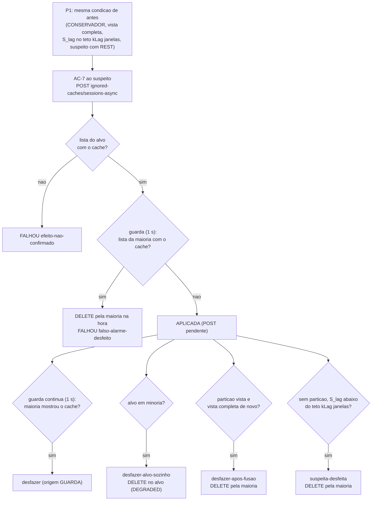

# Relatório P1-IC: o P1 manda o nó suspeito ignorar o cache de sessões (AC-7) (06/11/2026)

> Nota da integração (06/11, merge em `feature/controlador-integracao` depois da A1 e do W-5e): o TD-021 provisório
> deste relatório é o TD-022 da integração, e os P-P1IC.1 a P-P1IC.4 são os P-61 a P-64 do registro de problemas.

Autor: Worker. Branch `feature/p1-ignorar-cache`, da tag `int/2026-11-06-bench` (`cc2b71c`), worktree `wt-p1ic`. Sem
push. Decisões do coordenador sobre o A4 (06/11, sob a autorização do Gestor): **G-1** a ação do A4 substitui a parada
no P1; **G-2** só o `sessions-async`; **G-3** as regras de desfazer são validadas no smoke; **G-4** a
`CacheUnavailableException` passa a ser indisponibilidade e o sensor desconta os erros do nó sob ação; **G-5**
`k8s-file` nos harnesses locais. Regras R1 a R8: `docs/relatorio-a4-2026-11-06.md`, seção 8 (branch
`test/a4-ignored-caches`). Nada foi rodado na VM.

| Commit | O quê |
|---|---|
| `4f9edae` | `test:` testes do AC-7 antes da implementação (vermelho: não compilam) |
| `3008333` | `test:` ajustes durante a implementação (captura real do A4, S_lag calmo, `usadas_p1`) |
| `ae07fad` | `feat:` AC-7, adaptador, política, parâmetros, classificador, desconto do sensor |
| `c532215` | `fix:` tempo real da resposta do POST pendente no `lido` |
| `83e5496` | `test:` guarda contínua (vermelho) |
| `78a151d` | `feat:` guarda contínua do AC-7 |
| (seguintes) | `test:` brutos do smoke; `docs:` relatório, testes, registro |

## 0. Resposta curta

1. **Implementado e testado.** O P1 dispara pela mesma condição de antes e pede o **AC-7** (o nó suspeito passa a
   ignorar só o `sessions-async`, pela REST dele). A parada (AC-5) continua no código, desligada (`acaoP1 = AC-5` a
   religa). Surefire: 1207 testes, 0 falhas. TDD com os testes commitados vermelhos antes da implementação.
2. **Do disparo à recusa: dezenas de milissegundos.** Nos dois smokes de corte (`corte-r1`, `corte-r2`), o P1 decidiu
   14,6 e 15,0 s depois do corte, e a primeira recusa Hot Rod no alvo veio 38,9 e 18,7 ms depois do início da chamada
   (efeito na lista do alvo em 34 e 35 ms). O alvo não confirmou nenhuma escrita do `sessions-async` depois disso, e a
   maioria não recusou nada. Com a parada, o A4 mediu a recusa 13,1 s depois do pedido, e no I-3b o nó parou de
   responder 16,5 e 26,7 s depois do corte.
3. **Desfazer:** nos dois, a regra `desfazer-alvo-sozinho` agiu 4,4 e 5,1 s depois de o alvo se ver sozinho (vista de 1
   em +45,2 e +44,8 s), com o DELETE no próprio alvo (204 em 3 e 2 ms). Dali até a fusão o alvo recusou pelo
   `DENY_READ_WRITES`, e voltou a servir 20 ms depois da fusão, sem nenhum pedido a mais. A guarda contínua não agiu num
   corte de verdade (0 desfazeres no `corte-r2`).
4. **Guarda de falso alarme (sem corte, `falso-r1`):** o AC-7 forçado ao `isn3` foi desfeito pela guarda do adaptador
   em 112 ms (cache visto na lista do `isn1` em 83 ms, DELETE pela maioria em 9 ms); o `isn3` recusou o cache por ~34 ms
   (4 operações), e a carga teve 3 erros no segundo do falso alarme.
5. **Achado do smoke: corte curto.** Com um corte de 24 s curado antes da detecção (`curto-r1`), a gravação do alvo, que
   respondeu 500 sob o corte, chegou à maioria 7 a 9 s depois da cura, e o cache de sessões ficou recusado nos três nós
   por 11 a 13 s, até a regra `suspeita-desfeita`. Isso levou à **guarda contínua** (`78a151d`): no `curto-r2`, o
   desfazer veio 0,07 s depois de a maioria mostrar o cache, e a recusa no cluster inteiro durou ~0,1 s.
6. **Sensor:** a recusa do cache ignorado passou a contar como indisponibilidade (G-4), e os erros do servidor de
   aplicação do alvo durante a ação ficaram fora do laço (153 e 191 eventos nos dois cortes). Em shadow nada disso age.
7. **Para validar** (seção 5): as duas regras que o pedido não fixava (`suspeita-desfeita` e guarda contínua), o esquema
   da trilha (aditivo na 1.2 ou 1.3), o `acaoP1` opcional, e a adaptação do conferidor e da análise ao AC-7 antes da
   campanha.

## 1. O que mudou

| Peça | Mudança | Arquivo |
|---|---|---|
| Tipo de ação | `AC-7`: um nó, **um** cache (R1), reversível, prazo `T_cham + 15 s` (o pior caso do `T_enc` continua 21/19 s) | `controle/AcaoCluster.java` |
| Adaptador | `POST`/`DELETE /rest/v2/server/ignored-caches/{cache}`; regras R1 a R8 (seção 2) | `session/AtuadorIgnorarCache.java` |
| Guarda contínua | enquanto houver AC-7 ativo (só active), lê a lista dos outros nós a cada 1 s e pede o desfazer se alguma mostrar o cache (criada depois do `curto-r1`, seção 4.4) | `session/GuardaContinuaIgnorados.java` |
| Política | mesma condição de disparo; ação de `acaoP1` (AC-7 padrão; AC-5 fica para comparação); desfazer em qualquer perfil (`desfazer-alvo-sozinho`, `desfazer-apos-fusao`, `suspeita-desfeita`); `usadas_p1` em toda linha `politica` | `controle/PoliticaPorAssinatura.java` |
| Parâmetros | campo opcional `acaoP1` no bloco `politica` (com origem); ausente = AC-7, então o arquivo da calibração vale com o mesmo SHA-256 | `controle/ParametrosPolitica.java` |
| Classificador | `CacheUnavailableException` → `ERROR_UNAVAILABLE` (G-4), com a captura real do A4 como fonte | `session/ClassificadorDeErro.java` |
| Sensor | `DescontoSobAcao`: os erros do servidor de aplicação do nó sob o AC-7 não vão ao laço (só active; G-4); `eventos_descontados_sob_acao` no `fim` | `session/LigacaoControlador.java`, `WorkloadMain.java` |
| Trilha | aditivos na 1.2: tipo `AC-7`, `acao_p1`, `usadas_p1`, motivos de desfazer, origem `GUARDA`, `eventos_descontados_sob_acao`, `guarda_ac7_desfazeres` | `controle/FormatoJsonl.java`, `docs/contrato-jsonl-controlador-v1.md` |

O AC-5 continua no código e na tabela do braço B (`AtuadorPorTipo.bracoB`), desligado: só é pedido com
`"acaoP1": "AC-5"` no bloco `politica`.

## 2. Regras do A4 no código

| Regra | Como | Teste |
|---|---|---|
| R1 um cache | `AcaoCluster` recusa AC-7 com mais de um cache; a política passa só o de sessões | `AcaoIgnorarCacheTest.tipo`, `PoliticaIgnorarCacheTest.disparo` |
| R2 um pedido por vez | o adaptador guarda o pedido pendente e espera a resposta dele (sem cancelar) antes de outro POST ou DELETE; a guarda contínua desfaz pela fila única do executor | `AtuadorIgnorarCacheTest.desfazerNoAlvoSozinho` (nenhum pedido que muda lista sobreposto a outro) |
| R3 efeito pela lista | APLICADA só com o cache na lista do alvo; o POST pode estar pendente (sob corte, 500 em 15 s ou mais) | `corteAplica`, `efeitoNaoConfirmado` |
| R4 guarda | 1 s de leituras da lista dos outros nós junto com a do alvo (pelo menos uma); cache na maioria → DELETE pela maioria e FALHOU `falso-alarme-desfeito`; depois, a guarda contínua | `guardaDeFalsoAlarme`, `GuardaContinuaIgnoradosTest` |
| R5 só leituras locais | só `ignored-caches` e `?action=get-availability`; nenhum `/rest/v2/container` | todos os testes do adaptador e da guarda conferem os caminhos |
| R6 desfazer no alvo sozinho | `get-availability` do alvo = `DEGRADED_MODE` → DELETE no alvo | `desfazerNoAlvoSozinho` |
| R7 desfazer pela maioria | senão, DELETE a um nó da maioria que respondeu; se o alvo continuar com o cache depois de 1 s (corte não detectado), DELETE no alvo em sequência | `desfazerPelaMaioria`, `desfazerSobCorte` |
| R8 idempotência | sem o cache em nenhuma lista (e a do alvo lida), nenhum pedido | `guardaDeFalsoAlarme` (reverter depois do FALHOU) |

## 3. Testes

TDD: `4f9edae` e `83e5496` foram commitados vermelhos (não compilam sem as classes novas). Surefire na ponta:
**1207 testes, 0 falhas, 1 ignorado** (o mesmo da base), 172 classes; no `ae07fad`, 1205. Detalhe por classe em
`docs/testes.md`, seção P1-IC. **Não regressão do shadow:** a política é a mesma nos dois braços; em shadow o atuador
nunca é chamado, o desconto não age e a guarda contínua não existe (testes de ligação e de desconto); a única diferença
na trilha do braço A é a ação prevista do P1 (AC-7 em vez de AC-5). A suíte do W-2a ficou com `acaoP1 = AC-5` fixado e
continua sendo a regressão da parada.

## 4. Smoke local (tipo I-3b)

Cluster `p1ic` (portas 13001 a 13003, `k8s-file`), carga S3 ASYNC L+ com `--sweep` e `--s3-replay-probe`, controlador
**active** com o arquivo da calibração (P1 = AC-7), sondas Hot Rod pinadas (25 ms no alvo) e vigia das listas
(`runs/p1ic-smoke/comandos.md`). A A1 não está na base, então a regra de fusão é a atual. O alvo é o `isn3`, ou o
`isn2` quando o `isn3` era o coordenador. Instantes em segundos desde o início do corte.

### 4.1 Corte de verdade (`corte-r1`, `corte-r2`)

Corte de o+60 s a o+150 s, como no I-3b.

| | `corte-r1` | `corte-r2` |
|---|---|---|
| Jar | `ae07fad` | `78a151d` (com a guarda contínua) |
| Alvo | `isn2` (o `isn3` era o coordenador) | `isn3` |
| P1 na linha `politica` (`usadas_p1` = 1) | +14,59 | +14,97 |
| `lido` do APLICAR | `efeito_ms=34;guarda=limpa_43x_1001ms;post=pendente` | `efeito_ms=35;guarda=limpa_43x_1010ms;post=pendente` |
| Primeira recusa na sonda do alvo | +14,633 (38,9 ms depois do início da chamada) | +14,994 (18,7 ms) |
| Escritas do `sessions-async` confirmadas pelo alvo depois da chamada | 0 | 0 |
| Recusas do cache ignorado na maioria | 0 | 0 |
| Resposta do POST | 500 (lido em +49,59; o tempo real ficou sem registro, P-62, P-P1IC.2 na branch) | 500 em 15,013 s |
| Vista de 1 no alvo | +45,19 | +44,83 |
| `desfazer-alvo-sozinho` | +49,59 | +49,97 |
| REVERTER | 16,6 ms, `rota=alvo-sozinho`, DELETE 204 em 3 ms | 13,6 ms, `rota=alvo-sozinho`, 204 em 2 ms |
| Alvo depois do desfazer | `AvailabilityException` desde +49,61 | desde +49,99 |
| Fusão (`ISPN000093`) / primeiro put servido no alvo | +141,14 / +141,16 | +140,35 / +140,37 |
| Guarda contínua | não existia | 0 desfazeres |
| Erros descontados do sensor | 153 | 191 |
| Servidor de aplicação do alvo, da ação ao desfazer | 156 de 156 erros (134 `ERROR_UNAVAILABLE`) | 192 de 197 (170 `ERROR_UNAVAILABLE`) |
| Os outros dois servidores, no mesmo intervalo | 21 de 361 e 21 de 302 (transporte, do corte) | 34 de 373 e 24 de 304 (transporte) |
| Carga: varredura final / *replay* imediato VALID / auditor | 5 achados, REAL = {} / 4 / I1 4, I2 3 | 1 achado, REAL = {} / 5 / I1 17 |

Os `I1` do auditor (leitura VALID depois de um logout confirmado) não vêm de escrita confirmada pelo alvo depois da
ação: as chaves tiveram o logout feito por um servidor de aplicação da maioria (`13001`, `13002`) ou pelo alvo antes da
ação, e foram lidas antes da ação (+5,5 a +13,8 s) ou perto da detecção (+38 a +49 s). A ação só cobre o que viria
depois dela, como o A4 previu. A varredura final não achou perda permanente (REAL vazio) em nenhuma execução. Com
n = 1 por condição e sem controle pareado, nada disso mede efeito da ação sobre violações.

### 4.2 Falso alarme provocado sem corte (`falso-r1`)

Sem corte, o P1 não dispara (o S_lag não chega ao teto). O AC-7 foi mandado ao `isn3` em o+60 s pelo adaptador de
produção (`SmokeAc7.java`), como o executor mandaria, com a carga e o controlador active de pé.

| Medida | Valor |
|---|---|
| APLICAR | 112 ms, FALHOU `falso-alarme-desfeito`, HTTP 204 |
| `lido` | `efeito=nao-visto;guarda=falso-alarme@127.0.0.1:13001_83ms;anterior=POST:204@84ms;anterior=DELETE:204@9ms;rota=maioria@127.0.0.1:13001;` listas vazias nos três |
| REVERTER (o que o executor chama depois de um FALHOU) | 4 ms, `nada-a-desfazer`, nenhum pedido |
| Sonda do `isn3` (25 ms) | 4 recusas, de +0,068 a +0,102 s |
| Sondas do `isn1` e do `isn2` (100 ms) | nenhuma recusa |
| Vigia (100 ms) | `isn2` e `isn3` com o cache em +0,087/+0,091, listas vazias em +0,192/+0,197 |
| Carga | 3 erros no segundo do falso alarme (2 no servidor do `isn3`, 1 no do `isn2`); 0 nos 5 s antes e depois |

O `efeito=nao-visto` é esperado: a guarda achou o cache na maioria antes de a leitura do alvo ver o efeito, e o laço
para no primeiro achado.

### 4.3 Corte curto, curado antes da detecção (`curto-r1`, sem a guarda contínua)

Corte de 24 s (o+60 s a o+85 s). É o falso alarme realista: há corte, o P1 dispara, mas a rede volta antes de o
JGroups suspeitar.

| Instante | Evento |
|---|---|
| +14,26 | P1 (AC-7 ao `isn3`); `efeito_ms=37`, guarda limpa (43 leituras), POST pendente |
| +14,31 | primeira recusa no `isn3` (16,8 ms depois da chamada) |
| +24,0 a +27,6 | cura |
| ≈ +29,3 | POST responde **500** (15,017 s depois do envio) |
| +31,39 / +33,34 | a lista do `isn2` / do `isn1` passa a ter o `sessions-async`: a gravação chegou à maioria depois da cura |
| +31,4 a +44,3 | os três nós recusam o cache de sessões (sondas: 235 recusas no `isn2`, 201 no `isn1`; carga: 155 e 103 `ERROR_UNAVAILABLE` nos servidores da maioria) |
| +44,26 | `suspeita-desfeita` (sem partição vista, S_lag abaixo do teto por 2 janelas) |
| +44,30 a +44,42 | REVERTER pela maioria (`rota=maioria@127.0.0.1:13001`, DELETE 204 em 6 ms); listas vazias nos três |

Nenhuma vista mudou (o corte curou antes da detecção). A guarda do adaptador não podia ver isso (sob o corte, a
gravação não alcança a maioria), e o 500 não quer dizer "não replicou". Sem a regra `suspeita-desfeita`, a recusa no
cluster inteiro iria até o fim da execução.

### 4.4 Corte curto com a guarda contínua (`curto-r2`)

| Instante | Evento |
|---|---|
| +20,25 | P1 (AC-7 ao `isn3`); `efeito_ms=37`, guarda limpa; primeira recusa no `isn3` 26,6 ms depois da chamada |
| +25,1 a +28,1 | cura |
| ≈ +34,2 | POST responde **204** (13,945 s depois do envio): a gravação replicou depois da cura |
| +34,29 / +34,30 | a lista do `isn2` / do `isn1` passa a ter o cache |
| +34,36 | REVERTER com origem `GUARDA` (13,5 ms, pela maioria, DELETE 204 em 4 ms) |
| +34,39 a +34,43 | listas vazias nos três; a maioria teve 2 recusas em cada sonda; a carga, 1 `ERROR_UNAVAILABLE` na maioria |

`guarda_ac7_desfazeres` = 1 no `fim`. A recusa no cluster inteiro caiu de 11 a 13 s para ~0,1 s.

## 5. Pontos para validação

- **V-1. Regras que o pedido não fixava:** `suspeita-desfeita` (corte curto curado antes da detecção) e a guarda
  contínua (seção 4.4). As duas foram necessárias no smoke; sem elas, um falso alarme por corte curto derruba o cache de
  sessões no cluster inteiro até o fim da execução.
- **V-2. Esquema da trilha:** os campos novos foram aditivos na 1.2, mas já há dado de campanha na 1.2. Alternativa:
  `decisoes-controlador/1.3` junto com a adaptação do conferidor e da análise (P-63, P-P1IC.3 na branch).
- **V-3. `acaoP1` opcional com padrão AC-7:** é o único campo do bloco com padrão no código; o motivo é o arquivo da
  calibração continuar válido sem mudar de SHA-256. Se preferirem explícito, o arquivo da avaliação ganha
  `"acaoP1": "AC-7"` com a origem "G-1".
- **V-4. Orquestrador e análise** não foram tocados: o religamento depois do AC-5 não se aplica ao AC-7, e o conferidor
  e o `comparar_bracos.py` precisam conhecer a ação nova (P-63, P-P1IC.3 na branch) antes da campanha.
- **V-5. Na VM:** conferir o *log driver* do Podman (P-64, P-P1IC.4 na branch; P-A4.2) e repetir o smoke de corte uma vez antes da
  campanha.

## 6. Arquivos

- Código: `workload/src/main/java/br/unipampa/tcc/controle/{AcaoCluster,AtuadorPorTipo,FormatoJsonl,ParametrosPolitica,PlanoDeAcao,PoliticaPorAssinatura,RegistroAcao}.java`,
  `workload/src/main/java/br/unipampa/tcc/session/{AtuadorIgnorarCache,GuardaContinuaIgnorados,ClassificadorDeErro,LigacaoControlador,WorkloadMain}.java`.
- Testes: `AcaoIgnorarCacheTest`, `PoliticaIgnorarCacheTest`, `AtuadorIgnorarCacheTest`, `GuardaContinuaIgnoradosTest`,
  `LigacaoControladorDescontoTest` e os ajustes listados em `docs/testes.md`.
- Smoke: `runs/p1ic-smoke/` (`comandos.md`, `MANIFEST.sha256`, uma pasta por execução com `resumo.json`).
- Docs: `docs/implementacao.md` (TD-022; TD-021 provisório na branch), `docs/testes.md`, `docs/contrato-jsonl-controlador-v1.md`,
  `docs/registro-de-problemas.md` (P-61 a P-64; P-P1IC.1 a P-P1IC.4 na branch).
