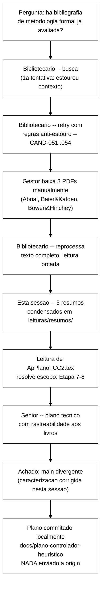

# Relatório do processo — busca bibliográfica, resumos e plano do controlador heurístico

> Registro do processo desta sessão (2026-09-24), do pedido inicial do Gestor ("há
> bibliografia já avaliada sobre metodologia de desenvolvimento de soluções formais?")
> até o plano de implementação das Etapas 7-8 (`tcc-escrita/ApPlanoTCC2.tex`). Complementa
> `docs/plano-controlador-heuristico-2026-09-24.md` — aqui está o *como se chegou lá* e
> as decisões tomadas no caminho; lá está o resultado técnico.

---

## 1. Ponto de partida

Antes de uma reunião do Gestor com o orientador, foi levantado o estado da bibliografia
de metodologia de pesquisa do TCC. Conclusão: o eixo G (`tcc-escrita/bibliografia.bib`)
cobria bem metodologia de **revisão de literatura** (Petersen 2008, PRISMA 2020, Neiva &
Silva 2016 — todos oficiais) mas não cobria metodologia de **desenvolvimento/engenharia
com métodos formais** — o processo de especificar, verificar e refinar, distinto da
metodologia de pesquisa em Engenharia de Software genérica (que já tinha duas
candidatas não aprovadas, CAND-019 Wieringa e CAND-020 Wohlin, registradas desde maio).

## 2. Busca bibliográfica (Bibliotecário)

**Decisão 1 — usar o agente Bibliotecário**, papel já estabelecido no projeto para gerir
fontes e candidatas, em vez de fazer a busca diretamente nesta sessão.

**Primeira tentativa falhou** — estouro de contexto (`Prompt is too long`). Nenhum
arquivo foi alterado (verificado por `mtime` antes de relançar). Causa provável: o agente
acumulou texto de PDFs grandes na própria conversa antes de salvar qualquer coisa em
disco.

**Decisão 2 — regras anti-estouro explícitas** na segunda tentativa: processar uma fonte
por vez, salvar em disco antes de prosseguir, nunca carregar um PDF grande inteiro via
`WebFetch` (usar `curl` direto pro disco + `Read` com `pages` em pedaços pequenos).
Funcionou. Resultado: 4 novas candidatas registradas em `tcc-escrita/memoria-tcc/05-referencias-candidatas.md`
(Eixo G) — CAND-051 (Woodcock & Davies, *Using Z*), CAND-052 (Abrial, *Modeling in
Event-B*), CAND-053 (Baier & Katoen, *Principles of Model Checking*), CAND-054 (Bowen &
Hinchey, *Ten Commandments of Formal Methods*) — todas com leitura parcial legítima
obtida (nunca pirataria — regra explícita e respeitada em ambas as tentativas).

**Nota de segurança:** durante a primeira tentativa, um resultado de ferramenta trouxe um
bloco de *prompt injection* se passando por instruções de servidor MCP. Identificado e
ignorado pelo próprio agente; nenhuma ação indevida tomada.

## 3. Downloads manuais do Gestor e reprocessamento

O Gestor conseguiu baixar manualmente 3 dos PDFs completos (Abrial, Baier & Katoen, Bowen
& Hinchey — faltando só Wohlin/CAND-020, bloqueado por *paywall* Springer sem canal
institucional funcional, mesmo problema já documentado desde maio para SpringerLink) e os
deixou na raiz do projeto.

**Decisão 3 — reacionar o Bibliotecário** (não processar os PDFs nesta sessão
diretamente) para mover os arquivos, extrair texto completo via `pdftotext` e ler, de
novo sob orçamento de páginas (o *Principles of Model Checking* tem ~985 páginas — ler
o livro inteiro não seria viável nem necessário). Resultado: leitura efetiva de ~60-80
páginas por obra, focada nos capítulos metodologicamente relevantes (ver
`tcc-escrita/memoria-tcc/17-leitura-integral-refs.md` para o detalhe de cada capítulo
lido). Verificado no disco antes de aceitar o relatório do agente (arquivos `.txt`
existem com os tamanhos declarados).

## 4. Resumos condensados

**Pedido do Gestor:** cada livro precisava de um resumo que coubesse em contexto sem
perder significado, para orientar o plano do Senior.

**Decisão 4 — fazer os resumos nesta sessão diretamente**, sem outro agente. Os 5 relatos
já recebidos dos dois ciclos do Bibliotecário continham pontos concretos e específicos
(citação de seções/teoremas, não generalidades) — reprocessar tudo por um terceiro agente
arriscava perder precisão (telefone-sem-fio). Duas exceções complementadas por leitura
direta nesta sessão: CAND-019 (Wieringa) lido por completo (arquivo pequeno, 45 KB) e o
capítulo de refinamento de CAND-051 (Woodcock & Davies) lido em detalhe — os dois relatos
anteriores para essas duas obras eram mais genéricos que os das outras três.

Resultado: `leituras/resumos/CAND-0{19,51,52,53,54}-*-resumo.txt`, cada um autocontido,
com seção explícita de "relevância para o TCC" e citando exatamente que trechos do livro
foram lidos (para não implicar cobertura que não existe).

## 5. Escopo do plano — decisão de interpretação

O pedido do Gestor citava tanto "plano de implementação... do controlador heurístico"
quanto a tabela completa do cronograma de TCC-II (todas as 6 etapas, semanas 1-12), com a
frase "não faremos mais experimentações" no meio.

**Decisão 5 — ler `tcc-escrita/ApPlanoTCC2.tex` antes de perguntar ou de assumir.** O
Apêndice B já detalha as 6 etapas oficiais (Quadro 2), e a tabela colada pelo Gestor é
exatamente essas 6 etapas, só que com algumas seções do Apêndice B desmembradas em 2
linhas cada (ex.: "Etapas 5 e 6" do Apêndice B = 2 linhas da tabela, ambas sobre
*baseline* experimental). Isso resolveu a ambiguidade sem precisar perguntar: "a segunda
etapa do cronograma" = TCC-II como um todo (a segunda etapa do *curso*, TCC-I sendo a
primeira), não uma linha específica da tabela; e o pedido de plano "do controlador
heurístico" mapeia precisamente para a Etapa 7-8 do Apêndice B, que já une "alinhamento
formal-experimental" e "controlador heurístico" num único parágrafo — os livros lidos
(sobre metodologia de métodos formais) são diretamente aplicáveis a essa etapa e não às
etapas de *baseline* experimental (que dependeriam de CAND-020/Wohlin, ainda ausente).
Interpretação comunicada ao Gestor antes de prosseguir, para correção barata se
estivesse errada.

## 6. Plano do Senior — achado não previsto e correção

**Decisão 6 — acionar o Senior** (papel do projeto para arquitetura/backlog/critérios de
aceite da frente de desenvolvimento), com instrução explícita de só planejar, nunca
implementar, e de rastrear cada decisão de desenho a um princípio de um dos 5 resumos.

O Senior investigou o estado real do repositório antes de planejar (em vez de presumir) e
encontrou um problema estrutural não previsto no pedido original: `main` está muito atrás
do trabalho real do projeto — a especificação TLA+ pós-P-15, o *baseline* F1/F3 real e a
instrumentação mais recente do *workload* vivem em branches nunca mergeadas
(`fix/broadcast-fantasma-contador-inc`, `origin/feature/f3-baseline`). Reportou isso como
"históricos sem relação de ancestralidade".

**Decisão 7 — verificar antes de repassar.** `git merge-base main fix/broadcast-fantasma-contador-inc`
retorna um commit real (`0df5383`, 27/05/2026) — existe, sim, ancestral comum. O
problema real é mais simples e mais comum: divergência normal de branch nunca
reconciliada (`main` +3 commits desde ali, a *fix* branch +37 commits de trabalho real).
A caracterização de "históricos não relacionados" no relatório do Senior e no documento
do plano estava tecnicamente incorreta — corrigida diretamente nesta sessão (commit
`5a43b93`, mesma branch) antes de reportar ao Gestor, para não passar adiante uma
alarmante mas equivocada leitura da situação. **O achado prático em si (`main`
desatualizado, plano referencia caminhos que só existem em outras branches) permanece
válido e é o ponto de decisão mais importante do plano (§9, item 1).**

## 7. Estado final desta rodada

Nada foi enviado a `origin/*`. Dois commits locais na branch `docs/plano-controlador-heuristico`
(`72ff7ca` do Senior, `5a43b93` de correção desta sessão). Nenhum arquivo de
`spec/*.tla`, código Java ou script foi alterado — só documentação. Nenhuma tentativa de
obter texto pirateado em nenhum momento, em nenhuma das rodadas.

### Pendências que ficam para o Gestor decidir (não resolvidas nesta rodada, de propósito)

1. Qual base de código vira o ponto de partida real das Etapas 7-8 (consolidar `main` +
   as branches divergentes, ou trabalhar explicitamente a partir de uma delas por
   enquanto) — decisão mais impactante, ver `docs/plano-controlador-heuristico-2026-09-24.md` §9.
2. Se deve adiantar a Atividade 2 (controlador) com o gatilho provisório de latência
   antes de B-23/B-24 (conectar I1/I4/I5/I6 reais) estarem prontos, ou esperar dado real
   de taxa de violação.
3. Mecanismo concreto de emissão/leitura de observáveis (arquivo *append-only* proposto
   vs. alternativa).
4. Obter CAND-020 (Wohlin et al.) — segue bloqueando o desenho estatístico das Etapas
   9-10 (fora do escopo desta rodada, mas registrado).
5. Inconsistência textual F1-F4+F5 (`ApPlanoTCC2.tex`) vs. F1-F3 (`Metodologia.tex`) —
   sinalizada, não resolvida.

