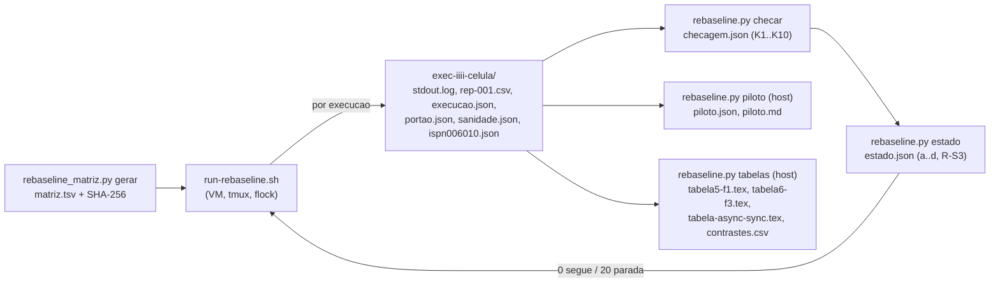

# Relatório do Worker: runner e análise do *rebaseline* (2026-10-23)

> Worker, 2026-10-23. Entrega do prompt `docs/prompt-rebaseline-runner-analise-2026-10-23.md`
> (branch `docs/plano-implementacao-controlador`, `d83e9e5`), com a adenda da **DT-011** aplicada
> (injeção a +49 s da âncora, F3 de 251 s, K6 em +48..+51 s). Base `9ddd5fe` (ponta de
> `feature/controlador-integracao`, B-43.9 + F-1). Branch `feature/rebaseline-runner-analise`,
> worktree `wt-rebaseline`. Commits só locais; **nenhum push, nenhuma integração, nada executado na VM,
> nenhum `tc`/`netem` no host.**

## 1. Resumo

| Peça | Arquivo | Testes | Estado |
|---|---|---|---|
| Matriz | `scripts/rebaseline_matriz.py` | `scripts/test_rebaseline_matriz.py` (M1..M5 + 3) | 8/8 verdes |
| Análise | `analysis/rebaseline.py` (`checar`, `estado`, `tabelas`, `piloto`) | `analysis/test_rebaseline.py` (A1..A13 + piloto + uso) | 55/55 verdes, A12 executado |
| Runner | `scripts/run-rebaseline.sh` | `scripts/run-rebaseline.test.sh` (R1..R12) | 95/95 asserções verdes |
| Mutantes | X1..X10 (script no *scratchpad*) | suíte completa por mutante | 10/10 mortos |

Só arquivos novos. `git diff --quiet 9ddd5fe HEAD -- scripts/run-baseline.sh scripts/inject-crash.sh
scripts/inject-jitter.sh analysis/percentis.py analysis/compare_scenarios.py analysis/bootstrap_ic.py
workload` vale. `mvn -q -o -f workload/pom.xml test`: **Surefire 746/0/0/1**, igual à base.

Commits (histórico linear sobre `9ddd5fe`):

| # | SHA | Commit |
|---|---|---|
| 1 | `48ba062` | test: M1..M5 (vermelho) |
| 2 | `4f2735b` | feat: `rebaseline_matriz.py gerar` |
| 3 | `efd01bd` | test: A1..A10 e A12 (vermelho) |
| 4 | `bfb77f8` | feat: `rebaseline.py checar/estado` |
| 5 | `07a93d3` | test: A11, A13 e piloto (vermelho) |
| 6 | `bfc3a0a` | feat: `rebaseline.py tabelas/piloto` |
| 7 | `a60cd77` | test: R1..R12 (vermelho) |
| 8 | `c501739` | feat: `run-rebaseline.sh` |
| 9 | este | docs: este relatório |

## 2. O que foi feito



### 2.1 `scripts/rebaseline_matriz.py`

`gerar --ordem-seed 231023 --s0 50000 --saida <tsv>` escreve cabeçalho + 132 linhas (piloto, depois
rodadas 1..10), colunas `i fase noite rodada posicao celula cenario modo falha seed`, e imprime o
SHA-256. Constantes do PR com a seção no comentário. A matriz gerada com os parâmetros do PR tem
SHA-256 **`8654900cd23b9b46e65163a5d106bd6f86113632d2ce621ff962f637cd645c35`** (Python 3.12.10;
o Senior registra o SHA da matriz commitada no complemento da DT-009).

### 2.2 `analysis/rebaseline.py`

- **`checar`** (só biblioteca padrão, `python3 -I`): K1..K10 por execução, cada critério com
  `{valor, limite, ok, papel}`; veredito ACEITA/RECUSADA/PARADA; exit 0/10/20; exit 2 se faltar
  `execucao.json`, `portao.json` ou `ispn006010.json` (o runner trata 2 como infraestrutura, exit 6).
  C1..C5, C8 e B438 copiados de `runs/b43-9-smoke/analise.py` para funções novas (o selado não é
  importado), com R7 (com falha, denominador de C1/C2 = Validate isolados VALID|INVALID; os outros
  desfechos ficam em `validate_isolados_outros`), K5 só reportado com falha, K6 pela DT-011
  (`INJ_TOL = (48.0, 51.0)`, injetor exit 0, F1 com `stop`/`start` de `isn2` no log e *cluster* de volta,
  F3 com netem nas amostras de +70 e +280 s e ausente depois), K7 contra a matriz e contra
  `S0 + 100*i`, K8 (>1 `ISPN006010` por nó: PARADA), K9 (SYNC sem falha: PARADA; SYNC com falha:
  reportado), K10 (ASYNC: reportado). Violações só do CSV, I2 só com rótulo `I2` e `REAL`;
  `Violacoes detectadas:` gravado como informativo.
- **`estado`**: paradas (a) duas recusas na mesma célula, (b) mais de 6 recusas, (c) qualquer
  PARADA, (d) duas reprovações de C3 ou C3 agregado (soma de k e n das aceitas) fora do IC, e R-S3 na
  matriz inteira (par seed/rep repetido entre execuções, semente repetida na matriz ou nas reposições).
  Só campanha e reposições contam; o piloto é avaliado à parte em `piloto_informativo`.
  `--listar-reposicoes` imprime `celula<TAB>i_recusado`, no máximo uma por célula, na ordem do i.
- **`tabelas`** (host, numpy/scipy): estatísticas por execução e operação (n, p50, p95, p99 com
  n ≥ 1000, p99,9 com n ≥ 10 000, taxas por `return_code`, vazão), resumo por célula, 63 contrastes
  com rótulos canônicos fixos `<tipo>|<cenario>|<modo ou falha>|<operacao>` (k = posição na lista
  ordenada, independente dos dados), bootstrap percentil de execuções com
  `default_rng(SeedSequence([231024, k]))`, Mann-Whitney sobre os p99 por execução, "não estimado" com
  menos de 8 execuções com p99. Saídas: `rebaseline-resultados.json`, `por-execucao.csv`,
  `contrastes.csv`, `tabela5-f1.tex`, `tabela6-f3.tex`, `tabela-async-sync.tex`, com o SHA-256 do jar
  (lido de `execucao.json`) e da matriz no cabeçalho.
- **`piloto`**: por célula da rodada 0, veredito, motivos, n por operação, Validate isolados por terço,
  chance aproximada de falsa recusa de C1 (aproximação normal da diferença de duas proporções, com a
  fração INVALID observada), operações sem p99, duração real e instante do disparo.

### 2.3 `scripts/run-rebaseline.sh`

Constantes (não são opções): `DURACAO=300 WARMUP_MIN=30 THREADS=4 INJ_OFFSET=49 F1_DUR=60
F3_DELAY=20ms F3_JITTER=13ms F3_DIST=normal F3_DUR=251 NO_ALVO=isn2 IFACE=eth0`, dead-man de 341 s,
amostras de netem em +70 e +280 s. Fluxo como no diagrama do prompt:

1. Pré-voo: reexecução sob `flock -n -F -E 4 /var/lock/tcc-vm.lock` (lock ocupado: exit 4); SHA-256
   da matriz e do jar (exit 4); dependências (exit 3); `isn1..3` running e `.Created` posterior a
   `--cluster-criado-apos` (exit 4); guarda de netns de cada nó contra o PID 1 (exit 4); linha de base
   de `ISPN006010`; `ambiente.md` (acrescentado a cada execução do runner).
2. Gate da noite: imprime o plano (i, célula, semente, hora estimada, primeira F3) e lê uma linha de
   `/dev/tty`; aceita só `go <fase> <date +%F da VM>`; senão exit 5 sem injetar nada. Gate f3
   (`go f3 <i>`) uma vez, antes da primeira F3 da fase. Os dois vão para `gates.json` com o instante UTC.
3. Por execução: portão K1 (3 endpoints HEALTHY com 3 nós e sem netem nos 3 netns em todas as amostras
   dos últimos 60 s, amostra a cada 5 s, até 10 min; senão exit 10 (e)); workload com exatamente a
   invocação do PR §2; âncora = instante em que `Warm-up ate +` aparece no `stdout.log` (polling de
   200 ms, leitura sem *fork*; 120 s sem âncora: mata o workload e registra `recusa_k6 = "sem ancora"`);
   F1 ou F3 a +49 s da âncora; F3 com dead-man `sudo systemd-run --unit tcc-heal-rb-<i>
   --on-active=341s nsenter -t <pid> -n tc qdisc del dev eth0 root` **antes** do injetor; amostras de
   `tc qdisc show` em +70 e +280 s; depois do injetor, netem ausente (uma tentativa de remoção; se
   persistir, exit 6) e só então desarme do dead-man (sem timer `tcc-heal-rb-*` restante, senão exit 6);
   F1 espera 3 nós HEALTHY em até 180 s (senão exit 10 (e)); pós: brutos movidos do *scratch*,
   `VerificadorSanidade`, `ispn006010.json` (desde a criação do container e desde o último start),
   `execucao.json`; `checar` (0/10 segue, 20 exit 10, outro exit 6) e `estado` (0 segue, 20 exit 10,
   outro exit 6).
4. Fim: `resumo.json`, `resumo.md`, última linha do `runner.log` com `FIM exit=<n> motivo=<...>` e
   `MANIFEST.sha256` da fase (todos os arquivos da fase, dos `exec-*` da fase e `matriz.tsv`, inclusive
   `.csv`/`.log`). Os arquivos versionáveis são `.json`/`.md`/`.tsv`/`.sha256`.
5. Trap de `EXIT`/`INT`/`TERM`: mata o injetor (e o `sleep` filho, via `pkill -P`), remove o netem e só
   então desarma o dead-man (se o netem não sair, o dead-man **fica armado**), `podman start isn2` se o
   F1 estava em curso, mata o workload, grava resumo, última linha e manifesto. Nunca apaga brutos.

Nenhum `|| true` no arquivo inteiro: todo exit de passo obrigatório é capturado com
`rc=0; cmd || rc=$?` e tratado.

## 3. Testes

### 3.1 Vermelhos registrados (antes de cada `feat:`)

| Commit `test:` | Vermelho |
|---|---|
| `48ba062` | `ModuleNotFoundError: No module named 'rebaseline_matriz'` |
| `efd01bd` | `ModuleNotFoundError: No module named 'rebaseline'` |
| `07a93d3` | 5 erros (`calcular_contrastes`/`bootstrap_diferenca` ausentes) e 2 falhas (`tabelas`/`piloto` não implementados, exit 2); 54 testes |
| `a60cd77` | `run-rebaseline.sh` ausente: 16 PASS triviais (asserções de "nada aconteceu"), **79 FAIL** |

### 3.2 Verdes (saída final)

```
python -I scripts/test_rebaseline_matriz.py                 Ran 8 tests ... OK
REBASELINE_ORACULO_DIR=.../wt-b43-9/runs/b43-9-smoke \
python analysis/test_rebaseline.py                          Ran 55 tests in 18.9s ... OK
  A12 Q3: C1 dif=0.0273 C2=5.1086% C3 k=5835 n=119230 C5 ok=True (confere com analise.json)
  A12 Q4: C1 dif=0.0367 C2=5.0349% C3 k=7609 n=156469 C5 ok=True (confere com analise.json)
  A12 Q5: C1 dif=0.0020 C2=5.0633% C3 k=23253 n=463653 C5 ok=True (confere com analise.json)
bash scripts/run-rebaseline.test.sh                         ==== RESULTADO: 95 PASS, 0 FAIL ==== (8 min 23 s)
bash scripts/inject-jitter.test.sh                          ==== RESULTADO: 35 PASS, 0 FAIL ====
python analysis/test_contrato_csv.py / test_contrato_csv_v2.py   OK / OK
mvn -q -o -f workload/pom.xml test                          Surefire 746 testes, 0 falhas, 0 erros, 1 pulado
```

R4 (relógio ×2): âncora do java falso, disparo do runner a **+49,27 s** e `podman stop` do injetor a
**+50,61 s** (dentro de K6).

### 3.3 A12 (regressão contra o *smoke* B-43.9)

Executado de fato, não pulado, lendo `REBASELINE_ORACULO_DIR=C:/Users/Francesco/Development/tcc/wt-b43-9/runs/b43-9-smoke`
(só leitura). Para Q3 (S1 sync), Q4 (S1 async) e Q5 (S2 sync), C1 (terços e diferença), C2 (fração e
denominador = `validate_isolados_csv`), C3 (k, n, n_csv, diferença, `ok_ic`, `ok_csv`, `ok`, fração) e
C5 (todas as contagens e `ok`) calculados pelas funções novas batem com o `analise.json` desse diretório:
contagens iguais e frações iguais na 4ª casa.

### 3.4 Mutantes (suíte completa por mutante, fonte restaurado byte a byte)

| Mutante | Mudança | Morto por |
|---|---|---|
| X1 | `{ java ... \|\| true; }` no lançamento do workload | **R5** (`workload_exit` 2, 3, 5 viraram 0; grep de `\|\| true`), R4 (workload sem âncora não morre) |
| X2 | alvo do disparo = lançamento + 49 s | **R4** (disparo, `podman stop` e `inj_inicio_offset_s` fora de N+49) |
| X3 | gate f3 omitido | **R3** (gates.json com 1 gate; `go f3` errado não para; netem e workload da F3 sem gate) |
| X4 | `systemd-run` depois do `inject-jitter` | **R6** (R6c: com o dead-man falhando, o netem já tinha sido aplicado) |
| X5 | R7 desligado (denominador com erros) | **A3** (`test_f1_com_erros`) |
| X6 | I2 contada sem filtrar `REAL` | **A8** (`test_contagem`) |
| X7 | K9 só reportado em SYNC | **A7** (4 testes de PARADA em SYNC sem falha), A10 (c) |
| X8 | bootstrap reamostrando eventos | **A11** (`test_reamostra_execucoes_e_nao_eventos`) |
| X9 | percentil interpolado | **A1** (2 testes), A2 |
| X10 | `Random(ORDEM_SEED)` sem `*1000 + r` | **M3** (`test_m3_ordem_congelada`), R1 |

Nota sobre X4: a asserção de ordem "systemd-run antes do primeiro `tc qdisc add`" (R6a) passou com o
mutante, porque o injetor leva centenas de ms para chegar ao primeiro `tc` e o runner arma o dead-man
nesse intervalo. Quem mata X4 de forma determinística é R6c (dead-man que não arma: nenhum netem pode
ter sido aplicado).

## 4. Ordem congelada (M3)

`random.Random(231023 * 1000 + r).shuffle` da lista canônica, Python 3.12.10, constante no teste
`ORDEM_CONGELADA` de `scripts/test_rebaseline_matriz.py`. Posição: célula.

| Rodada | Ordem |
|---|---|
| 0 (piloto) | 0:S2-sync-F1, 1:S2-async-none, 2:S1-sync-F1, 3:S1-async-none, 4:S2-async-F1, 5:S1-async-F3, 6:S2-async-F3, 7:S2-sync-F3, 8:S1-async-F1, 9:S1-sync-F3, 10:S2-sync-none, 11:S1-sync-none |
| 1 | 0:S2-sync-F1, 1:S1-sync-F1, 2:S1-sync-none, 3:S2-sync-none, 4:S1-async-F3, 5:S1-async-none, 6:S2-async-none, 7:S1-sync-F3, 8:S2-async-F3, 9:S1-async-F1, 10:S2-sync-F3, 11:S2-async-F1 |
| 2 | 0:S1-async-F3, 1:S2-sync-F1, 2:S1-async-none, 3:S1-sync-none, 4:S2-async-none, 5:S2-sync-none, 6:S1-sync-F1, 7:S2-sync-F3, 8:S2-async-F1, 9:S2-async-F3, 10:S1-async-F1, 11:S1-sync-F3 |
| 3 | 0:S1-sync-F1, 1:S2-sync-F3, 2:S2-sync-none, 3:S1-sync-F3, 4:S2-async-none, 5:S2-async-F1, 6:S1-async-F1, 7:S2-sync-F1, 8:S1-async-none, 9:S1-sync-none, 10:S2-async-F3, 11:S1-async-F3 |
| 4 | 0:S1-sync-F3, 1:S2-async-none, 2:S1-async-F1, 3:S1-sync-none, 4:S2-sync-F1, 5:S2-async-F3, 6:S1-async-F3, 7:S1-async-none, 8:S2-sync-none, 9:S2-async-F1, 10:S1-sync-F1, 11:S2-sync-F3 |
| 5 | 0:S1-sync-none, 1:S1-async-none, 2:S2-sync-F1, 3:S2-async-F3, 4:S2-async-none, 5:S1-async-F3, 6:S2-sync-F3, 7:S2-async-F1, 8:S1-sync-F3, 9:S1-async-F1, 10:S2-sync-none, 11:S1-sync-F1 |
| 6 | 0:S1-async-none, 1:S1-sync-F3, 2:S1-async-F1, 3:S2-sync-none, 4:S2-async-none, 5:S2-async-F3, 6:S2-async-F1, 7:S2-sync-F1, 8:S1-async-F3, 9:S1-sync-F1, 10:S2-sync-F3, 11:S1-sync-none |
| 7 | 0:S1-async-none, 1:S1-sync-none, 2:S2-sync-F1, 3:S1-async-F1, 4:S2-async-none, 5:S2-async-F3, 6:S2-sync-F3, 7:S1-async-F3, 8:S2-sync-none, 9:S2-async-F1, 10:S1-sync-F3, 11:S1-sync-F1 |
| 8 | 0:S2-sync-F1, 1:S1-sync-F3, 2:S2-sync-F3, 3:S1-async-none, 4:S2-async-F1, 5:S1-async-F3, 6:S1-sync-F1, 7:S2-async-none, 8:S2-sync-none, 9:S1-sync-none, 10:S2-async-F3, 11:S1-async-F1 |
| 9 | 0:S1-sync-none, 1:S1-async-none, 2:S2-sync-F3, 3:S2-async-none, 4:S2-async-F1, 5:S1-async-F3, 6:S1-sync-F1, 7:S2-sync-none, 8:S1-async-F1, 9:S2-async-F3, 10:S2-sync-F1, 11:S1-sync-F3 |
| 10 | 0:S1-sync-F1, 1:S2-async-F1, 2:S1-async-F3, 3:S2-sync-F1, 4:S2-sync-none, 5:S1-sync-none, 6:S1-sync-F3, 7:S2-sync-F3, 8:S2-async-F3, 9:S2-async-none, 10:S1-async-F1, 11:S1-async-none |

## 5. `--dry-run` (host, relógio real; horários estimados a 420 s por execução)

### 5.1 Piloto

```
DRY-RUN fase=piloto matriz=<scratchpad>/matriz.tsv (SHA-256 confere) duracao=300s warmup-min=30s threads=4 injecao=+49 s da ancora 'Warm-up ate' F1=60s F3=251s
PLANO i=1000 celula=S2-sync-F1 seed=150000 hora_estimada=2026-10-23T08:24:41.514Z F1: inject-crash.sh --node isn2 --duration 60 a +49 s da ancora
      java -jar <jar> --scenario S2 --mix v3 --replication sync --reset-state on --duration 300 --warmup-min-sec 30 --threads 4 --ops 0 --rep 1 --seed 150000 --servers 127.0.0.1:11222,127.0.0.1:11223,127.0.0.1:11224 --username admin --password *** --csv-dir <repo>/runs/rebaseline/exec-1000-S2-sync-F1/.scratch
PLANO i=1001 celula=S2-async-none seed=150100 hora_estimada=2026-10-23T08:31:41.514Z sem falha
      java -jar <jar> --scenario S2 --mix v3 --replication async --reset-state on --duration 300 --warmup-min-sec 30 --threads 4 --ops 0 --rep 1 --seed 150100 --servers 127.0.0.1:11222,127.0.0.1:11223,127.0.0.1:11224 --username admin --password *** --csv-dir <repo>/runs/rebaseline/exec-1001-S2-async-none/.scratch
PLANO i=1002 celula=S1-sync-F1 seed=150200 hora_estimada=2026-10-23T08:38:41.514Z F1: inject-crash.sh --node isn2 --duration 60 a +49 s da ancora
      java -jar <jar> --scenario S1 --mix v3 --replication sync --reset-state on --duration 300 --warmup-min-sec 30 --threads 4 --ops 0 --rep 1 --seed 150200 --servers 127.0.0.1:11222,127.0.0.1:11223,127.0.0.1:11224 --username admin --password *** --csv-dir <repo>/runs/rebaseline/exec-1002-S1-sync-F1/.scratch
PLANO i=1003 celula=S1-async-none seed=150300 hora_estimada=2026-10-23T08:45:41.514Z sem falha
      java -jar <jar> --scenario S1 --mix v3 --replication async --reset-state on --duration 300 --warmup-min-sec 30 --threads 4 --ops 0 --rep 1 --seed 150300 --servers 127.0.0.1:11222,127.0.0.1:11223,127.0.0.1:11224 --username admin --password *** --csv-dir <repo>/runs/rebaseline/exec-1003-S1-async-none/.scratch
PLANO i=1004 celula=S2-async-F1 seed=150400 hora_estimada=2026-10-23T08:52:41.514Z F1: inject-crash.sh --node isn2 --duration 60 a +49 s da ancora
      java -jar <jar> --scenario S2 --mix v3 --replication async --reset-state on --duration 300 --warmup-min-sec 30 --threads 4 --ops 0 --rep 1 --seed 150400 --servers 127.0.0.1:11222,127.0.0.1:11223,127.0.0.1:11224 --username admin --password *** --csv-dir <repo>/runs/rebaseline/exec-1004-S2-async-F1/.scratch
PLANO i=1005 celula=S1-async-F3 seed=150500 hora_estimada=2026-10-23T08:59:41.514Z F3: inject-jitter.sh --node isn2 --iface eth0 --delay 20ms --jitter 13ms --distribution normal --duration 251 a +49 s da ancora; dead-man 341 s
      java -jar <jar> --scenario S1 --mix v3 --replication async --reset-state on --duration 300 --warmup-min-sec 30 --threads 4 --ops 0 --rep 1 --seed 150500 --servers 127.0.0.1:11222,127.0.0.1:11223,127.0.0.1:11224 --username admin --password *** --csv-dir <repo>/runs/rebaseline/exec-1005-S1-async-F3/.scratch
PLANO i=1006 celula=S2-async-F3 seed=150600 hora_estimada=2026-10-23T09:06:41.514Z F3: inject-jitter.sh --node isn2 --iface eth0 --delay 20ms --jitter 13ms --distribution normal --duration 251 a +49 s da ancora; dead-man 341 s
      java -jar <jar> --scenario S2 --mix v3 --replication async --reset-state on --duration 300 --warmup-min-sec 30 --threads 4 --ops 0 --rep 1 --seed 150600 --servers 127.0.0.1:11222,127.0.0.1:11223,127.0.0.1:11224 --username admin --password *** --csv-dir <repo>/runs/rebaseline/exec-1006-S2-async-F3/.scratch
PLANO i=1007 celula=S2-sync-F3 seed=150700 hora_estimada=2026-10-23T09:13:41.514Z F3: inject-jitter.sh --node isn2 --iface eth0 --delay 20ms --jitter 13ms --distribution normal --duration 251 a +49 s da ancora; dead-man 341 s
      java -jar <jar> --scenario S2 --mix v3 --replication sync --reset-state on --duration 300 --warmup-min-sec 30 --threads 4 --ops 0 --rep 1 --seed 150700 --servers 127.0.0.1:11222,127.0.0.1:11223,127.0.0.1:11224 --username admin --password *** --csv-dir <repo>/runs/rebaseline/exec-1007-S2-sync-F3/.scratch
PLANO i=1008 celula=S1-async-F1 seed=150800 hora_estimada=2026-10-23T09:20:41.514Z F1: inject-crash.sh --node isn2 --duration 60 a +49 s da ancora
      java -jar <jar> --scenario S1 --mix v3 --replication async --reset-state on --duration 300 --warmup-min-sec 30 --threads 4 --ops 0 --rep 1 --seed 150800 --servers 127.0.0.1:11222,127.0.0.1:11223,127.0.0.1:11224 --username admin --password *** --csv-dir <repo>/runs/rebaseline/exec-1008-S1-async-F1/.scratch
PLANO i=1009 celula=S1-sync-F3 seed=150900 hora_estimada=2026-10-23T09:27:41.514Z F3: inject-jitter.sh --node isn2 --iface eth0 --delay 20ms --jitter 13ms --distribution normal --duration 251 a +49 s da ancora; dead-man 341 s
      java -jar <jar> --scenario S1 --mix v3 --replication sync --reset-state on --duration 300 --warmup-min-sec 30 --threads 4 --ops 0 --rep 1 --seed 150900 --servers 127.0.0.1:11222,127.0.0.1:11223,127.0.0.1:11224 --username admin --password *** --csv-dir <repo>/runs/rebaseline/exec-1009-S1-sync-F3/.scratch
PLANO i=1010 celula=S2-sync-none seed=151000 hora_estimada=2026-10-23T09:34:41.514Z sem falha
      java -jar <jar> --scenario S2 --mix v3 --replication sync --reset-state on --duration 300 --warmup-min-sec 30 --threads 4 --ops 0 --rep 1 --seed 151000 --servers 127.0.0.1:11222,127.0.0.1:11223,127.0.0.1:11224 --username admin --password *** --csv-dir <repo>/runs/rebaseline/exec-1010-S2-sync-none/.scratch
PLANO i=1011 celula=S1-sync-none seed=151100 hora_estimada=2026-10-23T09:41:41.514Z sem falha
      java -jar <jar> --scenario S1 --mix v3 --replication sync --reset-state on --duration 300 --warmup-min-sec 30 --threads 4 --ops 0 --rep 1 --seed 151100 --servers 127.0.0.1:11222,127.0.0.1:11223,127.0.0.1:11224 --username admin --password *** --csv-dir <repo>/runs/rebaseline/exec-1011-S1-sync-none/.scratch
PLANO execucoes=12 primeira_F3=1005 hora_estimada_primeira_F3=2026-10-23T08:59:41.514Z fim_estimado=2026-10-23T09:48:41.514Z
DRY-RUN: nada executado (sem java, podman, sudo, tty)
```

### 5.2 Noite 1 (linhas `PLANO`; o comando java de cada uma segue o mesmo formato do piloto)

```
DRY-RUN fase=noite1 matriz=<scratchpad>/matriz.tsv (SHA-256 confere) duracao=300s warmup-min=30s threads=4 injecao=+49 s da ancora 'Warm-up ate' F1=60s F3=251s
PLANO i=0 celula=S2-sync-F1 seed=50000 hora_estimada=2026-10-23T08:24:42.090Z F1
PLANO i=1 celula=S1-sync-F1 seed=50100 hora_estimada=2026-10-23T08:31:42.090Z F1
PLANO i=2 celula=S1-sync-none seed=50200 hora_estimada=2026-10-23T08:38:42.090Z sem falha
PLANO i=3 celula=S2-sync-none seed=50300 hora_estimada=2026-10-23T08:45:42.090Z sem falha
PLANO i=4 celula=S1-async-F3 seed=50400 hora_estimada=2026-10-23T08:52:42.090Z F3
PLANO i=5 celula=S1-async-none seed=50500 hora_estimada=2026-10-23T08:59:42.090Z sem falha
PLANO i=6 celula=S2-async-none seed=50600 hora_estimada=2026-10-23T09:06:42.090Z sem falha
PLANO i=7 celula=S1-sync-F3 seed=50700 hora_estimada=2026-10-23T09:13:42.090Z F3
PLANO i=8 celula=S2-async-F3 seed=50800 hora_estimada=2026-10-23T09:20:42.090Z F3
PLANO i=9 celula=S1-async-F1 seed=50900 hora_estimada=2026-10-23T09:27:42.090Z F1
PLANO i=10 celula=S2-sync-F3 seed=51000 hora_estimada=2026-10-23T09:34:42.090Z F3
PLANO i=11 celula=S2-async-F1 seed=51100 hora_estimada=2026-10-23T09:41:42.090Z F1
PLANO i=12 celula=S1-async-F3 seed=51200 hora_estimada=2026-10-23T09:48:42.090Z F3
PLANO i=13 celula=S2-sync-F1 seed=51300 hora_estimada=2026-10-23T09:55:42.090Z F1
PLANO i=14 celula=S1-async-none seed=51400 hora_estimada=2026-10-23T10:02:42.090Z sem falha
PLANO i=15 celula=S1-sync-none seed=51500 hora_estimada=2026-10-23T10:09:42.090Z sem falha
PLANO i=16 celula=S2-async-none seed=51600 hora_estimada=2026-10-23T10:16:42.090Z sem falha
PLANO i=17 celula=S2-sync-none seed=51700 hora_estimada=2026-10-23T10:23:42.090Z sem falha
PLANO i=18 celula=S1-sync-F1 seed=51800 hora_estimada=2026-10-23T10:30:42.090Z F1
PLANO i=19 celula=S2-sync-F3 seed=51900 hora_estimada=2026-10-23T10:37:42.090Z F3
PLANO i=20 celula=S2-async-F1 seed=52000 hora_estimada=2026-10-23T10:44:42.090Z F1
PLANO i=21 celula=S2-async-F3 seed=52100 hora_estimada=2026-10-23T10:51:42.090Z F3
PLANO i=22 celula=S1-async-F1 seed=52200 hora_estimada=2026-10-23T10:58:42.090Z F1
PLANO i=23 celula=S1-sync-F3 seed=52300 hora_estimada=2026-10-23T11:05:42.090Z F3
PLANO i=24 celula=S1-sync-F1 seed=52400 hora_estimada=2026-10-23T11:12:42.090Z F1
PLANO i=25 celula=S2-sync-F3 seed=52500 hora_estimada=2026-10-23T11:19:42.090Z F3
PLANO i=26 celula=S2-sync-none seed=52600 hora_estimada=2026-10-23T11:26:42.090Z sem falha
PLANO i=27 celula=S1-sync-F3 seed=52700 hora_estimada=2026-10-23T11:33:42.090Z F3
PLANO i=28 celula=S2-async-none seed=52800 hora_estimada=2026-10-23T11:40:42.090Z sem falha
PLANO i=29 celula=S2-async-F1 seed=52900 hora_estimada=2026-10-23T11:47:42.090Z F1
PLANO i=30 celula=S1-async-F1 seed=53000 hora_estimada=2026-10-23T11:54:42.090Z F1
PLANO i=31 celula=S2-sync-F1 seed=53100 hora_estimada=2026-10-23T12:01:42.090Z F1
PLANO i=32 celula=S1-async-none seed=53200 hora_estimada=2026-10-23T12:08:42.090Z sem falha
PLANO i=33 celula=S1-sync-none seed=53300 hora_estimada=2026-10-23T12:15:42.090Z sem falha
PLANO i=34 celula=S2-async-F3 seed=53400 hora_estimada=2026-10-23T12:22:42.090Z F3
PLANO i=35 celula=S1-async-F3 seed=53500 hora_estimada=2026-10-23T12:29:42.090Z F3
PLANO i=36 celula=S1-sync-F3 seed=53600 hora_estimada=2026-10-23T12:36:42.090Z F3
PLANO i=37 celula=S2-async-none seed=53700 hora_estimada=2026-10-23T12:43:42.090Z sem falha
PLANO i=38 celula=S1-async-F1 seed=53800 hora_estimada=2026-10-23T12:50:42.090Z F1
PLANO i=39 celula=S1-sync-none seed=53900 hora_estimada=2026-10-23T12:57:42.090Z sem falha
PLANO i=40 celula=S2-sync-F1 seed=54000 hora_estimada=2026-10-23T13:04:42.090Z F1
PLANO i=41 celula=S2-async-F3 seed=54100 hora_estimada=2026-10-23T13:11:42.090Z F3
PLANO i=42 celula=S1-async-F3 seed=54200 hora_estimada=2026-10-23T13:18:42.090Z F3
PLANO i=43 celula=S1-async-none seed=54300 hora_estimada=2026-10-23T13:25:42.090Z sem falha
PLANO i=44 celula=S2-sync-none seed=54400 hora_estimada=2026-10-23T13:32:42.090Z sem falha
PLANO i=45 celula=S2-async-F1 seed=54500 hora_estimada=2026-10-23T13:39:42.090Z F1
PLANO i=46 celula=S1-sync-F1 seed=54600 hora_estimada=2026-10-23T13:46:42.090Z F1
PLANO i=47 celula=S2-sync-F3 seed=54700 hora_estimada=2026-10-23T13:53:42.090Z F3
PLANO i=48 celula=S1-sync-none seed=54800 hora_estimada=2026-10-23T14:00:42.090Z sem falha
PLANO i=49 celula=S1-async-none seed=54900 hora_estimada=2026-10-23T14:07:42.090Z sem falha
PLANO i=50 celula=S2-sync-F1 seed=55000 hora_estimada=2026-10-23T14:14:42.090Z F1
PLANO i=51 celula=S2-async-F3 seed=55100 hora_estimada=2026-10-23T14:21:42.090Z F3
PLANO i=52 celula=S2-async-none seed=55200 hora_estimada=2026-10-23T14:28:42.090Z sem falha
PLANO i=53 celula=S1-async-F3 seed=55300 hora_estimada=2026-10-23T14:35:42.090Z F3
PLANO i=54 celula=S2-sync-F3 seed=55400 hora_estimada=2026-10-23T14:42:42.090Z F3
PLANO i=55 celula=S2-async-F1 seed=55500 hora_estimada=2026-10-23T14:49:42.090Z F1
PLANO i=56 celula=S1-sync-F3 seed=55600 hora_estimada=2026-10-23T14:56:42.090Z F3
PLANO i=57 celula=S1-async-F1 seed=55700 hora_estimada=2026-10-23T15:03:42.090Z F1
PLANO i=58 celula=S2-sync-none seed=55800 hora_estimada=2026-10-23T15:10:42.090Z sem falha
PLANO i=59 celula=S1-sync-F1 seed=55900 hora_estimada=2026-10-23T15:17:42.090Z F1
PLANO execucoes=60 primeira_F3=4 hora_estimada_primeira_F3=2026-10-23T08:52:42.090Z fim_estimado=2026-10-23T15:24:42.090Z
DRY-RUN: nada executado (sem java, podman, sudo, tty)
```

O comando java montado bate argumento por argumento com o PR §2 (R12, também para o
`VerificadorSanidade`), sem `--marker`, `--convergence`, `--sweep`, `--stop-at-fault-end` nem
`--controller` (o jar da base não tem essa opção).

## 6. Desvios e escolhas de implementação

| # | Ponto | O que fiz | Por quê |
|---|---|---|---|
| D1 | DT-011 | `INJ_OFFSET=49`, `F3_DUR=251`, dead-man 341 s, amostras em +70/+280 s, `INJ_TOL=(48.0, 51.0)`; R4 espera N+49 e A9 usa 47,9/51,1 (recusa) e 49,2 (ok), mais as bordas 48,0 e 51,0 (ok) | decisão do Gestor (prevalece sobre o corpo do prompt) |
| D2 | Escala do relógio nos testes | R4 roda a ×2 e R6 a ×10 (os demais a ×50); a janela do `podman stop` em R4 é a de K6 (+48..+51 s); o disparo do runner continua em ±1 s. Ajuste feito depois do commit vermelho e incluído no `feat:` do runner | o custo de *fork* do Git Bash (~50 ms), multiplicado pela escala, deslocava os instantes simulados; na VM ele é desprezível |
| D3 | `test_rebaseline.py` sem `-I` | o teste roda com `python analysis/test_rebaseline.py`; `checar`/`estado` são chamados com `-I` (como na VM) e `tabelas`/`piloto` sem | numpy/scipy estão no *site-packages* do usuário, que o `-I` desliga; no primeiro registro do vermelho A11/A13 apareceram como *skip*; corrigi e refiz o commit `test:` local (`--amend`) antes do `feat:` |
| D4 | Exit do injetor | exits documentados (0..5) ficam em `injetor_exit` e viram recusa K6 (A9); exit fora disso (por exemplo 126, 127, 137) é exit 6 | o prompt lista "injetor com exit inesperado" como infraestrutura e o A9 pede recusa para exit 4; separei os dois casos |
| D5 | Retomada | `exec-*` com `checagem.json` é pulado; `exec-*` sem `checagem.json` (interrompido) recusa a fase com exit 4 | nunca sobrescrever brutos; a decisão sobre uma execução interrompida é do Gestor |
| D6 | Netem residual | se o runner (ou o trap) não remove o netem, o dead-man **fica armado** e o runner sai com 6 | o dead-man é a última defesa; desarmá-lo com netem presente deixaria o nó degradado |
| D7 | Gate | data esperada = `date +%F` da VM, impressa no prompt; sem resposta em 1 h, exit 5 | evita ambiguidade UTC × hora local à noite; não segurar o lock indefinidamente |
| D8 | Gate f3 depois do K1 | segue o diagrama do prompt (K1, depois `go f3`) | se o Gestor demorar, o K1 já passou; pode ser invertido se preferir |
| D9 | Sem âncora | `recusa_k6 = "sem ancora"` vale também em `none` | o prompt manda registrar recusa K6 por "sem âncora" sem distinguir a falha |
| D10 | Configuração lida | cenário, replicação, `mix`, duração e *threads* do stdout são comparados com a matriz e só **reportados** em `metricas.configuracao_confere` (com aviso nos motivos) | não acrescentar critério de recusa fora do PR |
| D11 | Contrastes | só nas 9 linhas de operação principais (63 contrastes); isolado × tríade de Validate/Logout só por execução | o PR §7 trata as subdivisões como secundárias |
| D12 | Senha | `--password` ou `RB_PASSWORD`; mascarada como `***` no `execucao.json`, no log e no plano | sem segredo no repositório nem nos brutos versionáveis |
| D13 | `ispn006010.json` | grava `por_no` (podman logs desde a criação do container, usado por K8), `por_no_desde_ultimo_start` e a linha de base do pré-voo | ver P1 |
| D14 | Teste do piloto | acrescentei um teste do subcomando `piloto` (não estava na lista A1..A13) | o subcomando é insumo do parecer do Senior |

## 7. Pontos para o Gestor

**P1 (bloqueia o piloto como está): K8 × F1.** O `ISPN006010` é um WARN que o servidor emite uma vez
por JVM (1 por nó em todos os *smokes*). O F1 faz `podman stop`/`start` de `isn2`, que sobe uma JVM nova;
na primeira escrita condicional ela emite outro `ISPN006010`, e `podman logs isn2` mostra as duas vidas
do container. Com a regra literal ("no máximo 1 por nó por vida do *cluster*", que implementei),
**a primeira execução F1 já dá K8 = 2 em `isn2` e PARADA**; no piloto isso é a execução i = 1000
(S2-sync-F1), a primeira da noite. Não testei isso num *cluster* real (não usei a VM), mas a leitura
do código e dos logs dos *smokes* aponta nessa direção. O runner já grava `por_no_desde_ultimo_start`;
mudar K8 para "no máximo 1 por nó por vida do processo do nó" é trocar uma chave em `checar`. Por ser
critério pré-registrado, isso pede entrada nova em `decisoes-tecnicas.md` **antes** do piloto. Alternativa:
manter a regra e verificar empiricamente no ensaio da VM (seção 8, passo 6) com um F1 sem medição.

**P2: exit do injetor (D4).** Confirmar a separação "exit documentado = recusa K6; outro = exit 6".

**P3: retomada (D5) e netem residual (D6).** Confirmar as duas políticas.

**P4: compatibilidade na VM (não verificável no host).** `flock -F` (util-linux ≥ 2.34),
`podman inspect -f '{{.Created.Unix}}'` e `'{{.State.StartedAt.Unix}}'`, `podman logs --since <unix>`,
`systemctl list-timers --all --no-legend 'tcc-heal-rb-*'`, `curl --digest` no endpoint REST de *health*.
Todos são exercitados pelo ensaio de pré-voo da seção 8 sem injetar nada, exceto os dois de F3/dead-man,
que só aparecem na primeira F3 (por isso o Gestor acompanha essa execução).

**P5: tempo.** A estimativa de 420 s por execução dá ≈ 1 h 24 min para o piloto e ≈ 7 h para cada noite
de 60 execuções; a primeira F3 cai na posição 5 do piloto (i = 1005, ≈ 35 min depois do `go`) e na
posição 4 da noite 1 (i = 4, ≈ 28 min).

## 8. Checklist do Gestor na VM

**Antes da noite do piloto (de dia):**

1. Conferir o IP da VM pelo MAC `00-15-5D-03-AC-00` (`Get-NetNeighbor -InterfaceAlias 'vEthernet (Default Switch)'`).
2. Levar o *bundle* conferido por *hash*: jar, `scripts/run-rebaseline.sh`, `scripts/rebaseline_matriz.py`,
   `scripts/inject-crash.sh`, `scripts/inject-jitter.sh`, `analysis/rebaseline.py`, `runs/rebaseline/matriz.tsv`.
3. *Cluster* recriado depois do S7 com o XML do B-42.1; anotar o instante (vai em `--cluster-criado-apos`).
4. Na VM: `sudo -n true` sem senha; `flock --help | grep -- --no-fork`; `python3 --version`; `tmux`.
5. `bash scripts/run-rebaseline.sh --dry-run --matriz runs/rebaseline/matriz.tsv --matriz-sha256 <sha> --fase piloto`
   e conferir as 12 linhas com a seção 5.1.
6. Ensaio de pré-voo sem injeção: rodar o comando real do piloto (passo 8) e, no gate, digitar **qualquer
   coisa diferente** do pedido. Esperado: plano impresso, `exit 5`, nada injetado, nenhum `exec-*`; confere
   flock, hashes, dependências, *cluster*, guarda de netns, `ISPN006010` e `ambiente.md`. Os arquivos de
   `runs/rebaseline/piloto/` gerados no ensaio ficam (o `ambiente.md` e o `gates.json` acumulam).
7. Decidir P1 (e, se mudar K8, a entrada nova em `decisoes-tecnicas.md` e o *bundle* refeito).

**Na noite (sessão `tmux`):**

8. `export RB_PASSWORD=<senha>` e
   `bash scripts/run-rebaseline.sh --matriz runs/rebaseline/matriz.tsv --matriz-sha256 <sha da matriz>
   --jar <jar> --jar-sha256 <sha do jar> --fase piloto --cluster-criado-apos <instante ISO-8601>`
   (`PODMAN` padrão `sudo podman`).
9. Gate da noite: digitar exatamente o texto pedido, `go piloto <AAAA-MM-DD>` (data da VM, impressa na tela).
10. Primeira F3 (piloto: i = 1005): no prompt, digitar `go f3 1005`. Acompanhar no `runs/rebaseline/piloto/runner.log`:
    `F3 disparada a +49.xxx s da ancora`; `sudo systemctl list-timers 'tcc-heal-rb-*'` mostra o timer;
    `sudo nsenter -t $(sudo podman inspect -f '{{.State.Pid}}' isn2) -n tc qdisc show dev eth0` mostra `netem`;
    por volta de +300 s, `injetor saiu com 0`, o netem some e o timer desaparece. Depois disso a noite pode
    seguir sem o Gestor.

**Na manhã seguinte:**

11. Última linha de `runs/rebaseline/piloto/runner.log` (`FIM exit=0 motivo=fase piloto concluida` ou o
    motivo da parada); `resumo.md`; `cd runs/rebaseline && sha256sum -c piloto/MANIFEST.sha256`.
12. Se o runner parou com exit 6 por netem residual: o dead-man continua armado; conferir o netem de `isn2`
    e o timer antes de qualquer outra coisa.
13. Copiar `runs/rebaseline/` para o *host* e rodar `python analysis/rebaseline.py piloto --saida runs/rebaseline
    --matriz runs/rebaseline/matriz.tsv` (insumo do parecer do Senior). Nada é apagado; um `exec-*` sem
    `checagem.json` impede a retomada (exit 4) até a decisão do Gestor.

## 9. Sugestão de próximo passo

Senior valida esta entrega (inclusive a ordem congelada da seção 4 antes do complemento da DT-009) e
leva P1 ao Gestor; depois, integração por *fast-forward* junto com o B-43.5, como no prompt.

## 10. Adenda de 2026-10-23: correções da V-RB (C1..C5, DT-013, DT-014), estabilidade e rebase

> Parecer: `docs/validacao-rebaseline-runner-2026-10-23.md` (branch `docs/plano-implementacao-controlador`,
> `246c87c`). Decisões do Gestor de 23/10 em `decisoes-tecnicas.md` (`4a8d461`): DT-013 aprovada, DT-014,
> Q1..Q5. As seções 1..9 ficam como na entrega original. Onde divergirem, vale esta adenda, em especial
> nos pontos P1..P5 e na checklist da seção 8.

### 10.1 Commits novos (sem `--amend`), depois do *rebase* sobre `642d81f`

| Correção | `test:` (vermelho) | `fix:` | Vermelho registrado |
|---|---|---|---|
| C1 / DT-013 (K8 por vida do processo) | `4224863` | `95c0a5e` | A14: 3 FAIL (duas vidas com 1 aviso cada saía PARADA; contagem `null` e chave ausente não davam exit 2). R13: 4 FAIL (sem `vidas_por_no`; `podman logs --since` ilegível não parava) |
| C2 (gate `go f3` antes do diretório e do K1) | `774e791` | `f6173c0` | R3: 4 FAIL (gate depois do K1; `go f3` errado deixava `exec-1001`; nova tentativa saía com exit 4) |
| C3 / P2 (exits do injetor) | `98e095e` | `1eba929` | R14: 3 FAIL (injetor F3 com exit 5 seguia a fase) |
| C4 (`remocao_extra` falha K6) | `d3e5026` | `696a565` | A9: 1 FAIL (ACEITA em vez de RECUSADA) |
| C5 (instante efetivo da falha, só relatório) | `91cd0fe` | `66305e7` | piloto: KeyError `falha_efetiva`. R4 e R6: 3 FAIL |
| DT-014 (execução interrompida) | `64bc9e5` | `0923700` | A15: 2 FAIL. R15: 11 FAIL (exit 4 nos dois casos) |
| Estabilidade da suíte no Git Bash | `53c1d04` (só teste) | | |

Os 9 commits originais foram reaplicados sem conflito sobre `642d81f` (B-43.5): `48ba062` virou `ba1162a`, …,
`599ea5e` virou `1b7ddab`. Só mudaram arquivos novos em `scripts/` e `analysis/`, e `docs/`. A verificação
`git diff --quiet 642d81f HEAD -- scripts/run-baseline.sh scripts/inject-crash.sh scripts/inject-jitter.sh analysis/percentis.py analysis/compare_scenarios.py analysis/bootstrap_ic.py workload`
continua passando.

### 10.2 O que mudou

- **C1 / DT-013.**
  - O `checar` lê `por_no`, `por_no_desde_ultimo_start` e `vidas_por_no` de `ispn006010.json`.
  - K8 passa, por nó, se houver no máximo 1 `ISPN006010` na vida atual e o total for menor ou igual ao
    número de vidas (linhas `ISPN080001`). O papel continua "parada".
  - Contagem ausente ou que não seja inteiro: `checar` sai com 2 sem gravar `checagem.json`.
  - O runner conta, por nó, o total (`podman logs`), as vidas (`ISPN080001`) e a vida atual
    (`podman logs --since <.State.StartedAt.Unix>`). Qualquer leitura que falhe leva a exit 6
    ("K8 ilegivel (DT-013)") antes do `checar`.
- **C2.**
  - O gate `go f3 <i>` vem antes do `mkdir exec-<i>` e antes do K1.
  - Um `go f3` errado sai com 5 sem deixar diretório. Na nova tentativa, a F1 já checada é pulada e a F3
    roda.
  - A mensagem do gate avisa que o K1 (≥ 60 s) vem depois.
- **C3 / P2.**
  - Exits do injetor que deixam a fase seguir: 0, 1 e 4. O 1 e o 4 já eram recusa K6 no `checar`.
  - Exit 2, 3, 5 ou qualquer outro: o runner espera o workload, grava `execucao.json` e sai com 6
    ("so 0, 1 e 4 seguem; C3/P2").
- **C4.** K6 de F3 exige `netem_pos.remocao_extra == false`. O `null` da vida atual está no C1.
- **C5 (só relatório, K6 não muda).**
  - F1: `execucao.json.falha_efetiva` traz `f1_parado_desde_ancora_s` e `f1_reiniciado_desde_ancora_s`,
    calculados de `{{.State.FinishedAt.UnixMilli}}` e `{{.State.StartedAt.UnixMilli}}` de `isn2`.
  - F3: `falha_efetiva.netem_efetiva` traz a amostra de `tc qdisc show` a +51 s.
  - O `checar` copia o campo para `metricas.falha_efetiva_informativo`, e o `piloto` para `falha_efetiva`
    de cada célula.
  - Se a leitura falhar, o campo fica `null`, com um aviso no log.
- **DT-014.** Na retomada, um `exec-<i>` sem `checagem.json` é tratado assim:
  - sem `stdout.log`: o diretório é renomeado para `exec-<i>-<celula>.abortada-<UTC>` e mantido; o mesmo
    i roda de novo, com a mesma semente;
  - com `stdout.log`: o runner grava `interrompida.json` e chama `checar`, que devolve RECUSADA
    ("interrompida (DT-014)") sem exigir os outros arquivos. A recusa entra nas paradas (a)/(b) e nas
    reposições;
  - `estado` e `--listar-reposicoes` ignoram os `.abortada-*`;
  - o resumo marca essas execuções como `ABORTADA (DT-014)` e o `MANIFEST.sha256` as inclui.
- **Estabilidade.**
  - Os casos com várias execuções rodam a ×20 (antes ×50). O R4 continua a ×2 e R6/R8 a ×10.
  - No R4, a asserção do `podman stop` do injetor real passa a exigir só "nunca antes de N + 48 s".
    Acima de N + 51 s sai um aviso, porque pode ser pausa do host (V-RB 2.1).
  - O disparo do runner continua com tolerância de ±1 s. O instante efetivo vai para `falha_efetiva` (C5).

### 10.3 Testes antes e depois

| Suíte | Entrega original (base `9ddd5fe`) | Depois das correções e do *rebase* (base `642d81f`) |
|---|---|---|
| Matriz (`python -I scripts/test_rebaseline_matriz.py`) | 8/8 | 8/8 |
| Análise (`python analysis/test_rebaseline.py`, A12 com `REBASELINE_ORACULO_DIR`) | 55/55 | **64/64**, A12 executado (Q3/Q4/Q5 iguais ao `analise.json`) |
| Runner (`bash scripts/run-rebaseline.test.sh`) | 95/0 em 1 rodada (o Senior teve 92/3 e 94/1) | **130 PASS / 0 FAIL em 3 rodadas seguidas**: 15 min 16 s, 15 min 19 s, 15 min 17 s |
| Surefire (`mvn -q -o -f workload/pom.xml test`) | 746/0/0/1 | **761/0/0/1** (o do B-43.5) |

No R4 das três rodadas, o disparo do runner ficou a +49,29, +49,35 e +49,35 s da âncora, e o `podman stop`
a +49,98, +49,97 e +50,05 s. Na primeira rodada, o C5 registrou `isn2` parado a +49,94 s e reiniciado a
+110,34 s. Nenhum aviso de pausa.

### 10.4 Mutantes novos (suíte completa por mutante, fonte restaurado byte a byte)

| Mutante | Mudança | Morto por |
|---|---|---|
| XC1 | K8 contado só pela vida atual (sem a regra "total ≤ vidas") | **A14** `test_vida_atual_ok_mas_total_maior_que_as_vidas_para` e **A7** `test_k8_ispn_para` (análise 62/64) |
| XC2 | `mkdir exec-<i>` antes do gate `go f3` | **R3** "(C2) go f3 errado nao deixa exec-1001" (runner 129/130) |

Sobre o XC2: com o mutante, a nova tentativa não sai mais com exit 4, porque a DT-014 renomeia o
diretório sem `stdout.log` para `.abortada-*` e roda o mesmo i. A DT-014 atenua o defeito, mas quem mata o
mutante é a asserção de C2 sobre o diretório. Os mutantes X1..X10 da entrega original não foram
reaplicados nesta adenda. O código que eles tocam mudou só nos pontos acima, e as suítes completas
continuam verdes.

### 10.5 Desvios desta adenda

| # | Ponto | O que fiz |
|---|---|---|
| D15 | C3 com exit 2, 3 ou 5 | o runner espera o workload terminar antes de sair com 6, para os brutos ficarem completos. Com F3, segue o mesmo fluxo de amostras e de desarme do dead-man; sem netem, o dead-man é desarmado normalmente |
| D16 | C5 | uso `UnixMilli` (Go ≥ 1.17) no template do `podman inspect`, que nunca rodou no podman 4.9.3 da VM. Se falhar, fica `null` e um aviso, sem efeito em critério. Conferir no passo 4 da 10.6 |
| D17 | DT-014 (2) | a checagem "interrompida" tem `criterios = {}` e não avalia K1..K10, porque os brutos podem estar truncados. Só grava o veredito RECUSADA e o motivo |
| D18 | estabilidade | a escala padrão do `novo_caso` passou de ×50 para ×20. A suíte leva ≈ 15 min (antes ≈ 8 min) |
| D19 | mutantes C1/C2 | o primeiro disparo do script de mutantes falhou por erro de sintaxe no próprio script, antes de aplicar qualquer mutação (`git status` limpo). Corrigi e rodei depois das 3 rodadas |

### 10.6 Checklist do Gestor na VM (substitui a seção 8)

**De dia, antes da noite do piloto:**

1. Conferir o IP da VM pelo MAC `00-15-5D-03-AC-00` (`Get-NetNeighbor -InterfaceAlias 'vEthernet (Default Switch)'`).
2. Levar o *bundle* conferido por *hash*:
   - o jar construído da ponta integrada;
   - `scripts/run-rebaseline.sh`, `scripts/rebaseline_matriz.py`, `scripts/inject-crash.sh` e `scripts/inject-jitter.sh`;
   - `analysis/rebaseline.py`;
   - `runs/rebaseline/matriz.tsv` (`8654900cd23b9b46e65163a5d106bd6f86113632d2ce621ff962f637cd645c35`).
3. **Antes** de subir o *cluster* depois do S7, anotar o instante UTC com `date -u +%FT%TZ`. Ele vai em
   `--cluster-criado-apos`, e o runner exige `.Created` maior ou igual a esse instante.
4. Na VM, só leitura, sem injeção:
   - `sudo -n true` (sem senha), `python3 --version`, `tmux -V`;
   - `podman --version`;
   - `flock --version` (util-linux ≥ 2.34, por causa do `-F`);
   - `sudo podman inspect -f '{{.Created.Unix}} {{.State.StartedAt.Unix}} {{.State.StartedAt.UnixMilli}}' isn1`: três números;
   - `sudo podman logs --since $(sudo podman inspect -f '{{.State.StartedAt.Unix}}' isn1) isn1 | grep -c ISPN080001`: esperado 1;
   - `systemctl list-timers --all --no-legend 'tcc-heal-rb-*' | wc -c`: esperado **0**. Se não der 0, parar
     e avisar o Senior antes do piloto, porque a primeira F3 terminaria com exit 6.
5. Rodar `bash scripts/run-rebaseline.sh --dry-run --matriz runs/rebaseline/matriz.tsv --matriz-sha256 <sha> --fase piloto`
   e conferir as 12 linhas com a seção 5.1.
6. Ensaio de pré-voo sem injeção: rodar o comando do passo 9 com **`--saida runs/rebaseline-ensaio`** e,
   no gate, digitar qualquer coisa diferente do pedido.
   - Esperado: plano impresso, `exit 5`, nada injetado e nenhum `exec-*`.
   - Isso confere flock, hashes, dependências, *cluster*, netns, `ISPN006010`/`ISPN080001` e `ambiente.md`.
   - Os arquivos do ensaio ficam fora da pasta real do piloto.

**Na noite:**

7. Manter o host Windows em silêncio a noite inteira (PR §5): nada de TLC, `mvn test` ou carga.
8. Abrir a sessão com `tmux new -s rebaseline` e, dentro dela, rodar `read -rs RB_PASSWORD && export RB_PASSWORD`,
   para a senha não ir para o histórico. Não pôr outro `flock` do mesmo arquivo em volta do runner: ele
   mesmo pega `/var/lock/tcc-vm.lock`, e com um `flock` externo sairia com exit 4.
9. Rodar `bash scripts/run-rebaseline.sh --matriz runs/rebaseline/matriz.tsv --matriz-sha256 <sha da matriz> --jar <jar> --jar-sha256 <sha do jar> --fase piloto --cluster-criado-apos <instante do passo 3>`
   (`PODMAN` padrão `sudo podman`).
10. No gate da noite, digitar exatamente `go piloto <AAAA-MM-DD>`, com a data da VM impressa na tela.
11. Primeira F3 do piloto (i = 1005, cerca de 35 min depois do `go`):
    1. Antes do `go f3`, conferir em outro painel do `tmux` que
       `systemctl list-timers --all --no-legend 'tcc-heal-rb-*'` está vazio.
    2. Quando o runner pedir, digitar `go f3 1005`. A partir daí o runner faz o portão K1 (60 s ou mais de
       *cluster* saudável) e só então lança o workload; essa espera é esperada (C2).
    3. Acompanhar em `runs/rebaseline/piloto/runner.log` a linha `F3 disparada a +49.xxx s da ancora`.
    4. Conferir que o timer `tcc-heal-rb-1005` aparece em `systemctl list-timers`.
    5. Conferir que `sudo nsenter -t $(sudo podman inspect -f '{{.State.Pid}}' isn2) -n tc qdisc show dev eth0`
       mostra `netem`.
    6. Por volta de +300 s, esperar `injetor saiu com 0`, o netem sumir e o timer desaparecer.

    Daí em diante a noite segue sem o Gestor, com as paradas automáticas.

**Na manhã seguinte:**

12. Ler a última linha de `runs/rebaseline/piloto/runner.log` (`FIM exit=... motivo=...`) e o `resumo.md`,
    e rodar `cd runs/rebaseline && sha256sum -c piloto/MANIFEST.sha256`.
13. Se o runner saiu com exit 6 por netem residual, o dead-man continua armado de propósito. Nesse caso:
    1. `P=$(sudo podman inspect -f '{{.State.Pid}}' isn2)`;
    2. `sudo nsenter -t $P -n tc qdisc show dev eth0`;
    3. se aparecer `netem`, rodar `sudo nsenter -t $P -n tc qdisc del dev eth0 root` e conferir de novo;
    4. só depois que o netem sumir, `sudo systemctl stop tcc-heal-rb-<i>.timer`.

    **Nunca desarmar o dead-man antes de o netem sair.**
14. Um `exec-*` sem `checagem.json` não pede decisão na hora: a DT-014 é aplicada sozinha na próxima
    execução do runner.
    - Sem `stdout.log`: vira `.abortada-<UTC>` e o mesmo i roda de novo.
    - Com `stdout.log`: vira RECUSADA "interrompida" e é reposto no fim.

    Nada é apagado.
15. Copiar `runs/rebaseline/` para o host e rodar
    `python analysis/rebaseline.py piloto --saida runs/rebaseline --matriz runs/rebaseline/matriz.tsv`.
    É o insumo do parecer do Senior, que confere `falha_efetiva` (C5) e `configuracao_confere` nas 12
    execuções.
