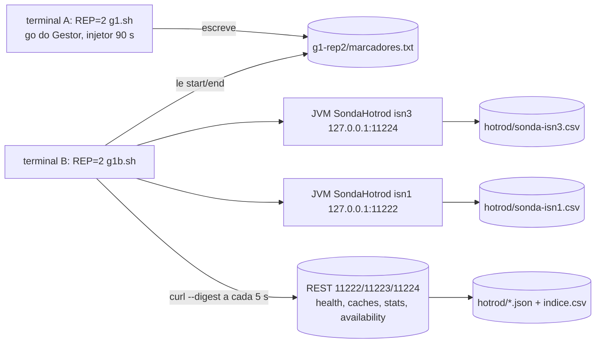

# Sonda Hot Rod para a REP=2 do G-4 (preparo, nada executado na VM) — 2026-10-16

Worker-4, branch `feature/b33-2-sonda-hotrod` (a partir de `feature/b33-instrumentacao-particao`, `7ca5dfa`), worktree `wt-sonda`. **Sem push. Nada foi executado na VM, nenhuma injecao foi iniciada.** Fecha, no que depende de ferramenta, a lacuna "Hot Rod em isn3 durante a particao" (validacao V-B, secao 4) e prepara o C-2/RAST-G3-1 (secao 3, tarefa de V-B). O criterio G-1 "Hot Rod a isn3 devolve erro, nao timeout" **continua nao verificado** ate a REP=2 rodar com esta sonda e o Senior ler os CSV.

## 1. O que foi feito

| Item | Arquivo | Estado |
|---|---|---|
| (a) Sonda Java | `workload/src/main/java/br/unipampa/tcc/session/SondaHotrod.java`, `SondaCsv.java` | pronta, testada em memoria; fumaca local contra porta fechada (ver 5) |
| (b) Coleta na VM | `runs/gate-b29/g1b.sh` (LF) e `g1b.test.sh` | `bash -n` ok, teste com `java`/`curl` falsos ok; nunca rodou com cluster |
| (c) Testes | `SondaCsvTest` (7), `SondaHotrodTest` (10), `g1b.test.sh` (13 verificacoes) | verdes |
| (d) Esqueleto C-2 | `ClassificadorMensagemRealTest` | `@Disabled` mantidos nos 3 testes que dependem da captura; 3 testes ativos novos |

`mvn -f workload/pom.xml test`: **205 testes, 0 falhas, 3 skipped** (antes: 184, 0 falhas, 2 skipped; +17 da sonda, +4 do esqueleto (3 ativos e 1 `@Disabled` novo)). Sem regressao.



### Sonda (comportamento)

- Um no por JVM: `--no isn3=127.0.0.1:11224`. Cliente pinado: `ClientIntelligence.BASIC`, um servidor, `socketTimeout=connectionTimeout=2000 ms`, `maxRetries=1`, `JavaSerializationMarshaller` com a allow-list do workload (mesmo mecanismo de `WorkloadMain`/`S3Clientes`).
- A cada `--intervalo-s` (5): `put`, `get`, `entrySet(IntSet)` (segmentos 0..3, ate 10 entradas) e `remove` da chave `sonda-<no>` em cada cache de `--caches` (padrao `sessions`; o `g1b.sh` usa `sessions,counters`). O valor tem o tipo do cache (`SessionState`/`IdentityState`), para nao quebrar `VarreduraFinal`/auditor com `ClassCastException`.
- Falha ao abrir o cliente vira uma linha `connect` e a proxima rodada tenta de novo; `Error` nao e engolido; no encerramento (SIGTERM ou `--duracao-s`) faz `remove-final` da chave.
- A senha so entra por `SONDA_SENHA` (variavel de ambiente), nunca na linha de comando.
- CSV (`SondaCsv.CABECALHO`): `t_epoch_ns,no,cache,operacao,duracao_ns,resultado,excecao_classe,mensagem,causas`. **Desvio do pedido:** acrescentei a coluna `cache`. `resultado` e `OK`/`ERRO`; `causas` e `classe: mensagem` de cada causa, separadas por ` | ` (sem a excecao de topo, que ja esta nas duas colunas anteriores); mensagens integrais; quebras de linha viram `\n` literal; campos com virgula/aspas seguem RFC 4180. `t_epoch_ns` e lido antes da operacao; `duracao_ns` vem do relogio monotonico.

### Coleta (`g1b.sh`)

Segundo terminal; **nao chama injetor, `tc`, `nsenter`, `systemd-run` nem `--heal`** (verificado por teste estatico). Espera `event=start` em `runs/gate-b29/g1-rep$REP/marcadores.txt` (ate 600 s; sem ele, aborta sem iniciar nada), liga as duas sondas e, a cada 5 s e nas tres portas, grava em `runs/gate-b29/g1-rep$REP/hotrod/`:
`saude-<porta>-<ns>.json` (`/rest/v2/cache-managers/default/health`, corpo integral), `caches-<porta>-<ns>.json` (`/rest/v2/cache-managers/default/caches`), `stats-<cache>-<porta>-<ns>.json` (`/rest/v2/caches/<cache>?action=stats`), `avail-<cache>-<porta>-<ns>.json` (`...?action=get-availability`), `indice.csv` (codigo HTTP e tempo de cada requisicao) e `resumo.txt` (sha256 do jar, versao do Java, marcas, contagens). Para 75 s depois de `event=end` (cobre a fusao, ~46-48 s) ou em `MAX_S=400`. **Os endpoints `caches?` e `get-availability` nao foram verificados contra o servidor 15.0**; se devolverem 404, o `indice.csv` mostra e o `saude-*.json` (que o `HealthRest` ja le) continua sendo a fonte principal.

## 2. Comando exato para a VM (so apos o go do Gestor)

No host (Git Bash), na raiz do clone com o bundle combinado. Os scripts de gate (`g1.sh`, `inject-partition.sh`) estao em `test/b29-gate-vm`/`tmp/tb-vm-bundle`; a sonda, nesta branch. `git merge-tree` indica fusao **sem conflitos** entre as duas.

```bash
# 1) ponta combinada em worktree temporario (nao integrar), como em T-B
git worktree add ../wt-sonda-tmp -b tmp/sonda-vm-bundle feature/b33-2-sonda-hotrod
cd ../wt-sonda-tmp && git merge --no-ff tmp/tb-vm-bundle -m "chore: combina sonda + gate-b29 (so bundle da VM, nao integrar)"
git rev-parse HEAD                       # anotar o sha (vai para go.log)

# 2) jar com a sonda (JDK 17+; o pom alveja 17), sem rodar nada
mvn -q -f workload/pom.xml package -DskipTests
sha256sum workload/target/session-workload-0.1.0-SNAPSHOT.jar

# 3) bundle e transferencia (mesma chave de T-B; <vm> = usuario@ip da VM)
git bundle create ../sonda-vm.bundle tmp/sonda-vm-bundle && git bundle verify ../sonda-vm.bundle
sha256sum ../sonda-vm.bundle
scp -i ~/.ssh/id_ed25519_tccf3 ../sonda-vm.bundle workload/target/session-workload-0.1.0-SNAPSHOT.jar <vm>:~/
```

Na VM (sem tocar no cluster):

```bash
sha256sum ~/sonda-vm.bundle ~/session-workload-0.1.0-SNAPSHOT.jar      # conferir com o host
cd ~/tcc-gate && git fetch ~/sonda-vm.bundle tmp/sonda-vm-bundle && git merge --ff-only FETCH_HEAD   # se nao for ff, git checkout -B ... FETCH_HEAD
mkdir -p workload/target && cp ~/session-workload-0.1.0-SNAPSHOT.jar workload/target/
java -version                                  # precisa ser 17+ (a sonda e classe 61)
grep -rlI $'\r' runs/gate-b29/*.sh | wc -l     # esperado 0
bash runs/gate-b29/g1b.test.sh                 # sem cluster; esperado falhas=0
```

Execucao da REP=2 (com o go do Gestor registrado; dois terminais tmux, ambos sob o `flock /var/lock/tcc-vm.lock` como em T-B):

```bash
# terminal B primeiro (fica esperando event=start, nao faz nada ate la)
cd ~/tcc-gate && REP=2 bash runs/gate-b29/g1b.sh
# terminal A: o g1.sh de sempre (pede GO, arma dead-man, injeta 90 s em isn3)
cd ~/tcc-gate && REP=2 bash runs/gate-b29/g1.sh
```

Depois, trazer `runs/gate-b29/g1-rep2/` inteiro (inclui `hotrod/`) para `runs/gate-b29/g1-rep2/` no host.

## 3. O que a sonda NAO prova

- **Nao e a carga do workload.** Uma chave por no, uma operacao a cada 5 s; nao mostra comportamento sob 100 req/s, filas, retentativas do `UsuarioVirtual`, nem divergencia/perda de dados no merge (ISPN000517).
- **Nao classifica.** Ela registra a excecao; quem decide `ERROR_UNAVAILABLE` x `ERROR_TRANSPORT` e o `ClassificadorDeErro`, ainda sem marca confirmada.
- **Uma chave nao representa todas as chaves.** Com `DENY_READ_WRITES`, o resultado de `put/get` depende de quais segmentos o no isolado perdeu; a chave `sonda-<no>` pode ter dono na minoria e dar resultado diferente de outras. `entrySet(IntSet)` cobre so os segmentos 0..3 (tipicamente 256 segmentos): e prova de existencia do erro, nao de abrangencia. Para G-1 completo convem variar a chave (pendencia declarada, nao implementada).
- **Cliente BASIC pinado em isn3 nao e o cliente do S3 em producao** (S3 usa tambem `topology` como contraste), e `maxRetries=1` com 2000 ms e escolha da sonda, nao do workload (padroes do workload: `socketTimeout=2000`, `maxRetries=3`).
- **Uma janela (REP=2).** Nao da variancia, nao cobre particao de outro no, G-5 nem G-6.
- **Sonda e coleta rodam no host da VM falando com `127.0.0.1`**: o caminho Hot Rod host -> container nao e o das aplicacoes reais; a sonda nao exercita o trafego entre nos.
- **A sonda e a coleta tocam o cluster** (um put/remove por ciclo e requisicoes REST). Na REP=2 isso perturba pouco, mas e perturbacao: o relatorio da REP=2 deve dizer que elas estavam ligadas.
- Os endpoints `caches` e `get-availability` e a coluna `cache` nao foram validados com servidor real; so o CSV e o JSON de saude seguem formato ja confirmado em T-B.

## 4. Checklist para preencher o C-2 apos a REP=2

1. Conferir `hotrod/resumo.txt` (`jar_sha256`, Java, `start_ns`/`end_ns`) e `indice.csv` (HTTP 200 nas tres portas durante a janela; 404/000 anotados).
2. Em `sonda-isn3.csv`, filtrar `resultado=ERRO` dentro de [`start_ns` + t_split(isn3) ~ +40 s, `end_ns` + t_merge ~ +46 s]. Anotar por operacao (`put/get/entrySet/remove`) e cache: `excecao_classe`, `mensagem`, `causas` e se o erro foi **rapido** (`duracao_ns` bem abaixo de 2 s: recusa do servidor) ou **estourou** o timeout (~2 s x tentativas: transporte). Fazer o mesmo para `sonda-isn1.csv` (controle: a maioria nao deve falhar).
3. Cruzar com `saude-11224-*.json` (esperado `DEGRADED`/`number_of_nodes:1`) e `saude-11222/11223` (`HEALTHY`/2): a primeira amostra DEGRADED deve coincidir com os primeiros ERRO. Guardar os tres JSON integrais (DEGRADED/1, HEALTHY/2, apos-fusao HEALTHY/3) como fixtures.
4. Copiar para `ClassificadorMensagemRealTest`: `CLASSES_CAPTURADAS`/`MENSAGENS_CAPTURADAS` (topo primeiro, depois cada item de `causas`), `CLASSE_CAPTURADA`, `MENSAGEM_CAPTURADA`, `OPERACAO_CAPTURADA`. Se a classe nao tiver construtor `(String)` ou `(String,Throwable)`, criar subclasse de teste e registrar.
5. Preencher `ESPERADO_POR_MENSAGEM_DE_SERVIDOR[*].esperadoIndisponivel` (decisao do Senior: ISPN000319/`DEGRADED_MODE` sao de **log**, nao devem virar marca do cliente).
6. Rodar o teste **antes** de mexer em `MARCAS_DE_INDISPONIBILIDADE`; se ficar vermelho, acrescentar so a marca que a captura mostrar (TDD) e manter o caso negativo (`caso_negativo_timeoutRealDeTransporteNuncaViraErrorUnavailable`).
7. Remover os `@Disabled` apenas apos 4-6 e `mvn -f workload/pom.xml test` verde; o teste do `HealthRest` usa os JSON do passo 3 (`number_of_nodes=1` + `DEGRADED` = no na minoria).
8. Registrar no relatorio: ocorrencias de `connect` (falha ao abrir), `remove-final` e se alguma chave `sonda-*` ficou residual em `sessions`/`counters` (limpar antes da proxima REP).

## 5. Verificacoes feitas e limites

- `SondaHotrod --no isn3=127.0.0.1:1` (porta fechada, JDK 22 local): CSV com cabecalho e linhas `connect,ERRO,...TransportException,...,Connection refused...` com cadeia de causas; confirma formato e a captura de excecao real do cliente. Nao e captura de DEGRADED.
- O `java` do PATH do host de desenvolvimento e Java 8; usei o JDK 22 do Maven. Na VM e preciso 17+.
- Os arquivos novos estao em LF no repositorio (`core.autocrlf=true` no Windows converte a copia de trabalho); o bundle de T-B ja inclui `.gitattributes` com `eol=lf`.
