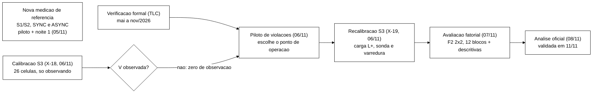
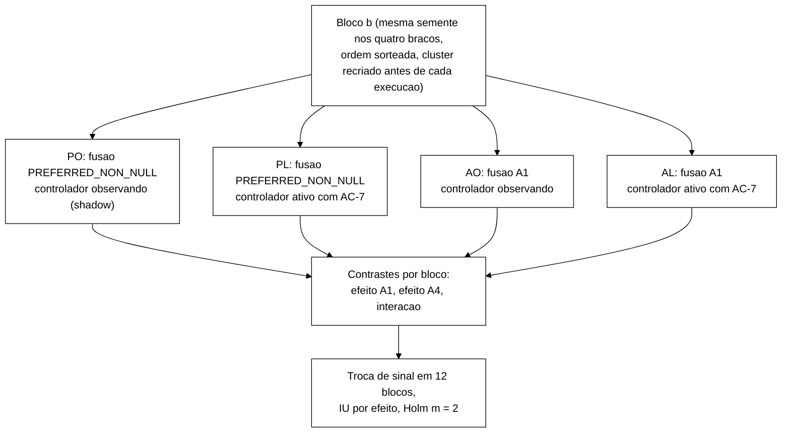

# 1. Objetivos, perguntas, hipóteses e desenho final

> Relatório técnico final da parte prática, capítulo 1. Escrito pelo Senior em 11/11/2026 para o Escritor.
> Escopo: o que o trabalho quis responder, como as hipóteses foram de fato testadas, o desenho que rodou e o que mudou
> desde o TCC I, com data e decisão. Resultados numéricos da avaliação ficam no capítulo 5 (coordenador); protocolo e
> instrumentação no capítulo 6; o controlador no capítulo 4; histórico, desvios e rastreabilidade nos capítulos 7 a 9.
> Siglas e códigos estão explicados no capítulo 10 (glossário).

**Convenção de fontes.** `wt-bench/docs/...` é a worktree do pré-registro do benchmark refeito
(`C:\Users\Francesco\Development\tcc\wt-bench`); `crônica` é a memória do coordenador
(`estado-2026-10-retomada-controlador.md`, linha citada); `ENTREGA` é
`dados-vm/cs3-2026-11/fat-20261108T051402Z/ENTREGA-ANALISE.txt`. Todo número de protocolo citado aqui foi conferido no
arquivo indicado; os que não puderam ser conferidos estão marcados.

---

## 1.1 Objetivo geral e objetivos específicos

O objetivo geral do texto (`Introducao.tex:42`) não mudou: especificar e verificar invariantes do estado de sessão sob
replicação assíncrona e *failover* em *data grids*, e avaliar um mecanismo de decisão heurístico que modifique políticas
ou ações operacionais para reduzir violações desses invariantes e controlar a latência sob falhas.

A execução interpretou os cinco objetivos específicos (`Introducao.tex:49-55`) da forma abaixo. A coluna "Como foi
executado" é o que o Escritor pode afirmar; a coluna "Ressalva" é o que precisa aparecer junto.

| Objetivo específico (texto) | Como foi executado | Onde está a evidência | Ressalva |
|---|---|---|---|
| (1) modelo formal do estado de sessão e das operações, com atraso, reordenação e falhas | Especificação TLA+ `SessionStore.tla` com as operações O1 e O3 a O7 (O2 é leitura, sem ação), canal assíncrono por fila de mensagens por réplica, ações de queda (`Cair`, `Reviver`) e de partição (`Particionar`, `Mesclar`) | capítulo 3; `spec/SessionStore.tla` | renovação de sessão nunca entrou (fora desde o recorte do TCC I, `Desenvolvimento.tex:224`) |
| (2) declarar invariantes e verificá-los por *model checking*, com contraexemplos | I1 a I6 em forma global e em formas por réplica; TLC 2.19; contraexemplos para I1, I2, I5, I6 e para as formas por réplica de I1, I2 e I4 | capítulo 3 | verificação só até as cotas; I3 e I4 globais são formas de domínio (tipagem) |
| (3) arquitetura experimental com Infinispan em *cluster*, topologia e replicação variáveis, carga que detecta violações | 3 nós Infinispan 15.0.21 em contêineres, modos `DIST_SYNC` e `DIST_ASYNC`, quatro injetores de falha, programa de carga com cenários S1, S2 e S3, auditor *online*, sonda de *replay* e varredura final | capítulo 2 | a avaliação do controlador rodou só em `DIST_ASYNC` |
| (4) controlador heurístico que selecione entre políticas e aplique ações | Controlador do *cluster* com estados NORMAL e CONSERVADOR e políticas P0 (não agir) e P1 (isolar o nó suspeito). Na avaliação, a ação de P1 foi a AC-7: o nó suspeito passa a ignorar o *cache* de sessões | capítulo 4 | "selecionar entre políticas" virou escolher entre políticas de reação operacional, porque o Infinispan 15.0.21 não troca a política de replicação sem recriar o *cache* (`Desenvolvimento.tex:206`); P2 saiu do braço ativo |
| (5) comparar o modelo estático com o modelo com controlador sob falhas, com taxa de violações, recuperação, convergência e latência | Avaliação fatorial 2×2 na partição (regra de fusão atual ou A1, controlador observando ou ativo), 12 blocos, mais quatro células descritivas; desfechos co-principais V e p99; recuperação, convergência, erros, CPU e energia como secundários | este capítulo, seção 1.4; resultados no capítulo 5 | o "modelo estático" é o braço PO (regra atual, controlador observando). A comparação ganhou um segundo fator (A1), que não estava nos objetivos |

## 1.2 Perguntas de pesquisa

O texto tem uma questão central (`Introducao.tex:21`) e sete questões de mapeamento (`Metodologia.tex:16-36`, QM1 a
QM7), que são da revisão da literatura. A parte prática não declarou perguntas numeradas. Ela respondeu à questão
central por quatro perguntas operacionais, implícitas nos pré-registros. As formulações abaixo são deste relatório; o
Escritor pode usá-las ou não, mas cada uma corresponde a um conjunto de execuções e a uma regra de decisão.

1. **Pergunta formal.** Quais invariantes de sessão o modelo do protocolo viola, sob quais falhas, e por qual
   mecanismo? Respondida pelo TLC (capítulo 3): sem falha e com queda, a irreversibilidade por réplica (I1F) não foi
   violada até as cotas; sob partição, ela é violada em 4 estados (*logout* no lado isolado desfeito na fusão).
2. **Pergunta de existência.** O mecanismo previsto pelo modelo acontece no Infinispan 15.0.21 real, em `DIST_ASYNC`,
   e é observável? Respondida pelo piloto de violações de 06/11 e pela recalibração (capítulo 3, seção 3.8, e capítulo
   7): a primeira I1 real foi observada em 06/11 numa partição com varredura final (crônica:209).
3. **Pergunta de eficácia.** Uma ação do controlador sobre o *cluster* (AC-7) e uma regra de fusão de partições própria
   (A1) reduzem a taxa de violações sem piorar o p99 em mais de 10 % e sem perder mais de 10 % da vazão útil? Respondida
   pelo teste fatorial na partição (resultado no capítulo 5).
4. **Pergunta de custo e especificidade.** Qual o custo dessas intervenções (erros, falhas percebidas, CPU, energia
   estimada) e o controlador age quando não deve? Respondida pelos secundários da partição e pelas células descritivas
   (sem falha, F3, F1, F4).

## 1.3 Hipóteses, como foram executadas

### 1.3.1 Desfechos co-principais

- **V, taxa de violações.** Por execução, o número de **pares distintos (chave, invariante)** com ao menos uma detecção
  de I1, I4 ou I2 classificado como real, nas fases durante a falha e recuperação, somando três instrumentos (auditor
  *online*, sonda de *replay* e varredura final, esta só com rótulo REAL), dividido pelo número de ações S3 e
  multiplicado por mil. As leituras da sonda (`ReplayValidate`) ficam fora do denominador, da latência, da vazão e da
  taxa de erro. Fonte: `wt-bench/docs/pre-registro-benchmark-refeito-2026-11-06.md` §2.2 a §2.6 (DT-026), regra
  conferida no campo `parametros.regra_v` de `analise-oficial/comparacao-principal.json`.
- **L, latência.** p99 da ação S3 com espera (inclui as retentativas da aplicação), pelo posto mais próximo, com ao
  menos 1000 ações. Fonte: `comparacao-principal.json`, `parametros.co_principal_l = acao_s3_p99_com_espera` e
  `parametros.p99`.

### 1.3.2 Contrastes por bloco e testes

Cada bloco tem quatro execuções com a mesma semente, uma por braço (PO, PL, AO, AL; seção 1.4). Para um desfecho `y`
(diferença para V e taxas, logaritmo da razão para p99), os contrastes por bloco são:

- efeito da A1 (regra de fusão): `d_A1 = ½[(y_AO − y_PO) + (y_AL − y_PL)]`;
- efeito da A4 (controlador ativo com a ação AC-7): `d_A4 = ½[(y_PL − y_PO) + (y_AL − y_AO)]`;
- interação: `d_int = (y_AL − y_AO) − (y_PL − y_PO)`.

Fonte: `wt-bench/docs/pre-registro-benchmark-refeito-complemento-1-2026-11-06.md` §1 (DT-027) e
`comparacao-principal.json`, `parametros.fatorial.regra`.

| Hipótese | Enunciado executado | Teste e decisão | Fonte |
|---|---|---|---|
| H_V (por efeito principal) | a média de `d` em V é negativa | permutação exata por troca de sinal, bilateral, α = 0,05, identidade incluída; `p_V = 1` se a média for ≥ 0 | DT-021 §5.1; DT-027 §2.1 |
| H_L (não inferioridade do p99) | o p99 do braço tratado não passa de 1,10 vez o do controle | limite superior do IC 95 % *t* de `exp(média d)` ≤ 1,10; `p_L` na escala bilateral | DT-021 §5.1 (decisão D3 de 27/10: IC *t* primário) |
| Interseção-união | melhoria só se H_V e H_L forem rejeitadas | `p_IU = max(p_V, p_L)` (Berger, 1982) | DT-021 §5.1 |
| Correção múltipla | dois efeitos principais na única célula de teste | Holm com m = 2 sobre `p_IU` (efeito A1 e efeito A4) | DT-027 §2.1 |
| Condições adicionais | vazão útil não inferior e rastreabilidade | limite inferior do IC 95 % da razão da vazão útil > 0,90; cada ação dos braços PL e AL com regra, sinais e leitura de volta | DT-021 §5.1; DT-027 §2.1 |
| Interação | descritiva | IC e p da troca de sinal, sem Holm e fora da regra de sucesso | DT-027 §1 e §2.1 |
| H_V não avaliável | quando o braço de referência do efeito não tem violação em nenhum bloco (A1: PO e PL; A4: PO e AO) | relatar "não observada em N ações", limite superior ≈ 3/N | DT-027 nota de 06/11; Hanley e Lippman-Hand (1983) |

**Poder mínimo do teste por troca de sinal.** Com k blocos de `d` diferente de zero, o menor valor-p bilateral é
`2/2^k`. Com Holm sobre dois efeitos, o primeiro precisa de p < 0,025, o que exige k ≥ 7 (2/2^7 = 0,0156); o segundo
precisa de p < 0,05, o que exige k ≥ 6. Fonte: DT-021 §5.1. Com 12 blocos há 2^12 = 4096 arranjos de sinal (a
Metodologia ainda fala em 8 blocos e 256 arranjos, `Metodologia.tex:349`).

**Sem previsão de efeito.** Nenhum pré-registro fixou tamanho de efeito esperado. Ganhos e custos são relatados lado
a lado, com IC, qualquer que seja o sinal (decisão do Gestor de 05/11, DT-021; repetida na DT-027 §2.3).

### 1.3.3 Secundários, sensibilidades e descritivos

**Família de secundários com Holm, por efeito principal.** O pré-registro fixou nove desfechos: os sete da DT-021 §5.3
(tempo de recuperação Δ_rec, tempo de convergência Δ_conv, divergência persistente, taxa de erro, falhas percebidas por
mil ações, CPU por mil ações úteis, energia estimada com fração ociosa 0,3) mais os dois da DT-027 §2.2 (perda
permanente e exposição na janela). O p99 por operação e cada invariante em separado seriam só descritivos, "para a
família não crescer" (DT-021 §5.3).

**Como foi executado.** A análise oficial aplicou Holm a **onze** secundários por efeito (campo
`n_secundarios_holm = 11` em `comparacao-principal.json`; lista na tabela F2 de `comparacao-principal.md`): os nove
acima mais o p99 da ação S3 sem espera e o p99 do `Validate`. O código (`analysis/comparar_bracos.py`, função
`familia_de`, linhas 1393-1405 da tag `4b96798`) põe na família todo desfecho classificado como secundário que tenha
dado; os p99 das outras operações ficaram fora só porque não tinham amostra suficiente na fase. A diferença deixa o
Holm mais conservador. Recalculei o Holm com a família de nove a partir dos valores-p brutos impressos com quatro casas
em `comparacao-principal.md`: nenhuma conclusão muda (os valores de conferência estão na seção 1.9). Isso precisa ser
declarado como desvio no capítulo 8 e no texto.

**Sensibilidades, sem Holm.** V sem a forma 2 de I1 (`taxa_violacoes_por_1000:sem_forma2`), energia com fração ociosa
0,5, razões em vez de diferenças para taxa de erro e falhas percebidas, *bootstrap* por blocos e IC hierárquico. Fonte:
`comparacao-principal.md`, coluna "Familia".

**Células descritivas.** Sem falha e F3 (no núcleo), F1 e F4 (na fase extra), cada uma com dois braços (controlador
observando e ativo) e a regra de fusão atual. Medem falso acionamento e custo da AC-7. O critério de falso acionamento
é "zero ocorrências", com o limite 3/N relatado, porque validar uma taxa de 10⁻³ exigiria cerca de 60 execuções sem
falha (~8 h de VM), custo que o Gestor recusou em 05/11 (DT-020; `BRIEFING-ESCRITOR-AVALIACAO-2026-11-05.md` §1).

## 1.4 Desenho final

### 1.4.1 As campanhas da parte prática



| Campanha | O que mede | Execuções | Situação | Fonte |
|---|---|---|---|---|
| Verificação formal | invariantes no modelo | rodadas do TLC de 26/05 a 06/11 | concluída | capítulo 3 |
| Nova medição de referência (*rebaseline*) | latência e violações de S1 e S2 em `DIST_SYNC` e `DIST_ASYNC`, sem falha, F1 e F3, sem controlador | piloto de 12 e noite 1 com 60 execuções da campanha (56 aceitas, 4 recusas) | **incompleta**: a noite 2 (rodadas 6 a 10) não rodou | `dados-vm/rebaseline-2026-11/noite1-completa-20261105/rb/rb-20805b0/runs/rebaseline/estado.json` (`execucoes_campanha` 60, `aceitas_campanha` 56, `total_recusas` 4); crônica:204-205 |
| Calibração S3 (X-18) | limiares do controlador, só com o controlador observando | 27 (26 da matriz e 1 reposição): 26 aceitas, 1 descartada pelo critério h4 | concluída; nenhuma violação de V observada | `dados-vm/cs3-2026-11/x18-20261106T050100Z/ENTREGA-W9.txt`; crônica:199 |
| Piloto de violações | escolher um ponto de operação em que V seja observável | ver capítulo 7 | concluído; escolhido F2 com carga L+, sonda e varredura | DT-026 |
| Recalibração S3 (X-19) | limiares com a carga e os instrumentos da avaliação | 29: 25 aceitas, 4 descartadas pelo h4 | concluída | `dados-vm/cs3-2026-11/rc-20261106T144744Z/ENTREGA-W9.txt` linhas 41-46 |
| Avaliação fatorial | efeito da A1 e da A4 | 90 (80 aceitas, 6 descartadas pelo h4, 4 puladas) | concluída | ENTREGA item 3; contagem por célula no capítulo 5, tabela R1 |

### 1.4.2 A avaliação fatorial



| Célula | Falha (nó, duração nominal) | Braços | Blocos planejados | Execuções planejadas | Fase | Papel |
|---|---|---|---|---|---|---|
| ASYNC F2 | partição: `isn3` isolado dos outros dois, 90 s, a +49 s da âncora | PO, PL, AO, AL | 12 | 48 | núcleo | teste |
| ASYNC sem falha | nenhuma | A (observando), B (ativo) | 4 | 8 | núcleo | descritiva (falso acionamento) |
| ASYNC F3 | *jitter* em `isn2`: 20 ms ± 13 ms, normal, 251 s | A, B | 4 | 8 | núcleo | descritiva |
| ASYNC F1 | queda silenciosa de `isn2`, 60 s | A, B | 4 | 8 | extra | descritiva |
| ASYNC F4 | 20 % de perda (N3) na saída de `isn3`, 90 s | A, B | 4 | 8 | extra | descritiva |
| Total | | | | 80 | | |

Fontes: DT-027 §1 e §3; parâmetros das falhas em
`dados-vm/cs3-2026-11/fat-20261108T051402Z/campanha-s3-fatorial/nucleo/ambiente.md` (bloco `parametros`). Nas
descritivas a regra de fusão é a atual, porque não há fusão de partições nelas (no F1 o nó volta por entrada nova na
vista, sem resolução de conflitos; DT-027 §3).

**Elementos fixos em todas as execuções** (todos de `nucleo/ambiente.md`, conferidos):

- modo `DIST_ASYNC` (`--replication async`), cenário S3, 300 s de carga, aquecimento mínimo de 30 s, falha disparada a
  +49 s da âncora "Warm-up até";
- carga L+: 40 usuários, tempo de pensar de 500 ms, sessão com mediana de 10 s, *logout* ao fim com probabilidade 0,9,
  bloqueio administrativo com média de 5 s entre eventos (os padrões do programa são 20, 1000 ms, 20 s, 0,7 e 15 s,
  `workload/.../S3Parametros.java`);
- instrumentos: sonda de *replay* (`--s3-replay-probe`, 1 a 3 s depois do *logout*, até 306 sessões no *replay*
  tardio) e varredura final (`--sweep`, com espera da fusão de até 72 s);
- sementes a partir de 800000, passo 100, ordem sorteada com semente 20261106 (ENTREGA item 2);
- *cluster* recriado do zero antes de cada execução, com os seis *caches* criados pela REST (capítulo 2).

**Por que fatorial e não duas comparações.** Com as mesmas 48 execuções, cada efeito principal é estimado com os 12
blocos, e a interação responde se o controlador ainda acrescenta algo quando a A1 já está ligada (DT-027 §1).

**Por que V continua co-principal.** A perda permanente e a exposição na janela são decomposições de V no tempo (depois
e antes da fusão). Elas foram propostas depois de ver os testes curtos da A1 e da A4, e promovê-las a desfecho principal
seria escolher o critério olhando os dados; por isso ficaram secundárias (DT-027 §2.1).

## 1.5 O que mudou desde o TCC I e por quê

A tabela vai da versão do TCC I (texto da banca, julho de 2026) até a análise validada de 11/11. Cada linha tem a data
da decisão, quem decidiu e a fonte. O histórico operacional detalhado (quedas de energia, travamentos, reposições) é do
capítulo 7; aqui ficam só as mudanças de desenho.

| # | Tema | Plano no TCC I | O que foi executado | Data e decisão | Motivo | Fonte |
|---|---|---|---|---|---|---|
| 1 | Modo de replicação | `DIST_ASYNC` alvo, `DIST_SYNC` controle (T1) | tudo o que rodou até out/2026 era `DIST_SYNC`; *caches* assíncronos criados; avaliação só em `DIST_ASYNC` | 22/10, Gestor aprova o perfil ASYNC (B-42) | a configuração só tinha *caches* síncronos | crônica:18-24; `Desenvolvimento.tex:73` |
| 2 | Carga S1 e S2 | bateria de junho como *baseline* parcial | bateria de junho invalidada (100 % dos *logins* recusados); carga corrigida (B-43.1 a B-43.9); tabelas de junho retiradas | 22/10, Gestor aprova B-43 e a substituição das tabelas | identidade única por *thread* bloqueada, chaves nunca gravadas, sem limpeza, códigos mascarados | `wt-plano-ctrl/docs/diagnostico-login-blocked-2026-10-22.md`; crônica:28-34 |
| 3 | Nova medição de referência | 30 repetições de 10⁶ operações (T9, T10) | pré-registro de 120 execuções de 300 s (DT-009); rodaram o piloto e a noite 1 (60) | 23/10 pré-registro; 06/11 a noite 2 foi segurada para gerar violações no S3 | prazo e prioridade do controlador | DT-009; crônica:204-205; `estado.json` |
| 4 | Falha F1 | parada do nó | queda silenciosa: interface `eth0` desligada e `SIGKILL`, 60 s | 28/10, DT-017 | a parada ordenada (`SIGTERM`) não exercita o detector de falhas | `wt-bench/docs/decisoes-tecnicas.md` DT-017; `Desenvolvimento.tex:228` |
| 5 | Conjunto de falhas | F1 e F3 no TCC I; F2 e F4 (mudança de topologia) no TCC II | F2 com injetor real; F4 redefinida como degradação parcial (perda, atraso, duplicação, reordenação); F3 com distribuição normal | out/2026, decisão do autor sobre F4 | falhas parciais são relatadas em produção; o `tc-netem` não tem tabela lognormal pronta | `Desenvolvimento.tex:232-234` |
| 6 | Cenário da avaliação | misturas S1 e S2 | cenário S3 (ciclo de vida de sessões com servidores de aplicação, administrador e bloqueio por limite) | out/2026 (B-33) | S1 e S2 não exercitam I2 nem a escrita no nó isolado | `Metodologia.tex:311-313` |
| 7 | Onde o controlador roda e onde age | processo externo que lê observáveis em arquivo | *thread* na JVM do programa de carga (22/10); age só no *cluster* pela API administrativa (04/11) | 22/10 e 04/11, Gestor | custo de serializar eventos; o Gestor recusou ações no cliente | crônica:20-24; `feedback-controlador-do-cluster.md` |
| 8 | Peso das violações | violação como gatilho primário (Proposta) | out/2026: gatilho secundário; 04/11: violação volta a pesar como gatilho e passa a desfecho co-principal com o p99 | 04/11, Gestor (opção A) | o objetivo é reduzir violações, não só latência | crônica:118; `Desenvolvimento.tex:236-238` |
| 9 | Teste estatístico | Mann-Whitney sobre a taxa de violação, margem de 10 % no p95 e p99 | blocos pareados com a execução como unidade, troca de sinal exata, IC *t* (27/10), interseção-união (04/11), Holm | 22/10, 27/10 e 04/11 | o teste por evento trata como independentes observações da mesma execução | `Desenvolvimento.tex:238`; crônica:89 |
| 10 | Políticas | perfis de configuração | 05/11: P0, P1 (parar o nó suspeito, AC-5) e P2 (suspender rebalanceamento, AC-2); 05/11: P2 sai do braço ativo; 06/11: a ação de P1 passa a ser a AC-7 | 05/11 e 06/11, coordenador com autorização do Gestor | a AC-2 deixou o rebalanceamento desligado depois da fusão; a AC-5 levava ~13 s para valer sob corte, e as perdas se concentram nos primeiros segundos | crônica:163, 240-245; capítulo 4 |
| 11 | Regra de fusão | fora do escopo (política fixa) | condição nova A1: política de fusão própria no *cache* de sessões, por ordem de conteúdo, carregada como extensão do servidor | 06/11, Gestor ("A1 ... A4 ... TLC em paralelo") | a fusão com `PREFERRED_NON_NULL` desfaz o *logout* do lado isolado | crônica:241-242; DT-027 |
| 12 | Desenho da avaliação | baseline estático × controlador | 22/10: 4 células × 8 blocos; 05/11: F2 e F4 de teste com 12 blocos, 96 execuções (DT-021); 06/11: fatorial 2×2 na F2 com 12 blocos e descritivas, 80 execuções (DT-027) | 05/11 e 06/11 | a calibração não observou V, a F4 não tem fusão (sem o mecanismo), e a A1 entrou como fator | DT-021; DT-026; DT-027 |
| 13 | Observação das violações | auditor *online* | auditor, sonda de *replay* e varredura final em todas as execuções; V por pares distintos | 06/11, DT-026 | a calibração deu zero violações por falta de observação, não de fenômeno | DT-026; crônica:206-211 |
| 14 | Carga S3 | padrões do programa | carga L+ (40 usuários, 500 ms, 10 s, 0,9, 5 s) | 06/11, regra 6.5 do piloto | ponto em que V aparece em ao menos duas execuções e duas chaves | DT-026 (P-1) |
| 15 | Critério de descarte por infraestrutura | não existia | critério h4 (travamento de E/S ou pausa da VM), pré-registrado antes do piloto | 04/11 e 05/11, DT-018 | travamentos do disco do hospedeiro sem efeito nos critérios de recusa | DT-018; `Desenvolvimento.tex:92` |
| 16 | Energia | não prevista | estimada por modelo linear a partir do tempo de CPU; fração ociosa 0,3 (sensibilidade 0,5) | 22/10 (proxy) e 05/11 (0,3) | a VM não expõe contadores de energia | `Metodologia.tex:333-335`; crônica:143 |
| 17 | Modelo formal | sem falhas no TCC I | falhas incluídas; desempate de `ts` pelo conteúdo (B-45); variante de fusão por máximo (`MesclarJoin`) | 03/10, 04/11 e 06/11 | ver capítulo 3 | capítulo 3 |
| 18 | Ensaio da anomalia `exec-0037` | não existia | descartado; vira limitação e trabalho futuro | 11/11, Gestor | prazo; resultado principal não depende dele | crônica:288 |

## 1.6 Tabelas para a monografia

O desenho da Metodologia (`Metodologia.tex:337-353`, seções "Políticas de reação" e "Desenho da avaliação") descreve o
plano de 05/11, que não rodou. As tabelas abaixo substituem a descrição por células e completam a definição das
hipóteses. A tabela de execuções por célula (contagens efetivas) é a R1 do capítulo 5; não repetir aqui.

### T1-01. Hipóteses e regra de decisão da avaliação (NOVA)

**Onde entra:** Metodologia, seção "Desenho da avaliação do controlador" (`Metodologia.tex:344`), no lugar da
descrição em prosa de MET-72 (`Metodologia.tex:349-351`), logo depois da tabela de desfechos. **Coordenação com o
capítulo 6:** a definição dos desfechos é a T6.2 (`qd-desfechos-avaliacao`) e o desenho de células e braços é a T6.1
(`qd-desenho-avaliacao`); esta tabela cobre só as hipóteses e a regra de decisão, sem repetir definições.

| Hipótese ou regra | Enunciado | Teste e decisão |
|---|---|---|
| H_V (por efeito principal) | a média dos contrastes por bloco da taxa de violações é negativa | troca de sinal exata, bilateral, α = 0,05; p_V = 1 se a média for ≥ 0 |
| H_L (por efeito principal) | o p99 da ação S3 não piora mais que 10 % | limite superior do IC 95 % *t* da razão ≤ 1,10 |
| Regra de sucesso | melhoria só com H_V e H_L rejeitadas, vazão útil não inferior e ações rastreáveis | p_IU = max(p_V, p_L); limite inferior do IC 95 % da razão da vazão útil > 0,90 |
| Correção múltipla | dois efeitos principais (regra A1 e controlador ativo) na partição | Holm com m = 2 sobre p_IU; o menor exige k ≥ 7 blocos com contraste não nulo |
| Interação | o efeito do controlador muda com a A1 ligada? | IC e p, fora da regra de sucesso |
| Secundários | família por efeito principal | Holm dentro do efeito (11 desfechos na análise oficial; 9 no pré-registro, seção 1.3.3) |
| Não avaliável | braços de referência do efeito sem violação em todos os blocos | relato "não observada em N ações", limite ≈ 3/N |

```latex
\begin{table}[htbp]
\captionsetup{type=table, name=Quadro}
\caption{Hipóteses e regra de decisão da avaliação do controlador}
\label{qd-hipoteses-avaliacao}
\centering
\footnotesize
\begin{tabular}{p{3.0cm}p{5.6cm}p{5.4cm}}
\hline
\textbf{Hipótese ou regra} & \textbf{Enunciado} & \textbf{Teste e decisão} \\
\hline
\raggedright $H_V$, por efeito & a média dos contrastes por bloco da taxa de violações é negativa & troca de sinal exata, bilateral, $\alpha = 0{,}05$ \\
\raggedright $H_L$, por efeito & o p99 da ação S3 não piora mais que 10\,\% & limite superior do intervalo $t$ de 95\,\% da razão entre os braços de até 1,10 \\
\raggedright Regra de sucesso & melhoria só com as duas hipóteses rejeitadas, vazão útil não inferior e ações rastreáveis & $p_{IU} = \max(p_V, p_L)$; limite inferior do intervalo de 95\,\% da razão da vazão útil acima de 0,90 \\
\raggedright Correção múltipla & dois efeitos principais na partição, o da regra A1 e o do controlador ativo & correção de Holm com $m = 2$; o menor valor-$p$ exige ao menos sete blocos com contraste não nulo \\
\raggedright Interação & o efeito do controlador muda quando a regra A1 está ligada & intervalo e valor-$p$, fora da regra de sucesso \\
\raggedright Secundários & família de desfechos secundários de cada efeito & correção de Holm dentro do efeito \\
\raggedright Não avaliável & braços de referência do efeito sem violação em todos os blocos & relato como ``não observada em $N$ ações'', com limite próximo de $3/N$ \\
\hline
\end{tabular}
\fonte{O autor, com base em \citet{berger_iut_1982}, \citet{holm_sequential_1979}, \citet{good_permutation_tests_2005}, \citet{student_probable_error_1908} e \citet{hanley_lippmanhand_zero_1983}}
\end{table}
```

### T1-02. Células, braços e blocos da avaliação (USAR A T6.1 DO CAPÍTULO 6)

A tabela de desenho é a T6.1 do capítulo 6 (`qd-desenho-avaliacao`), no mesmo lugar (`Metodologia.tex:347`, no lugar
da lista de quatro células com oito blocos de MET-43). Conferi o conteúdo dela contra a seção 1.4.2 deste capítulo: as
células, os papéis e os blocos coincidem. Duas informações que a T6.1 não tem e que podem ir na legenda ou no texto:
(a) as durações nominais das falhas (F2 de 90 s, F3 de 251 s, F1 de 60 s, F4 de 90 s, todas disparadas a +49 s da âncora,
`nucleo/ambiente.md`); (b) nas descritivas a regra de fusão é a atual. As execuções efetivas (blocos perdidos de F1 e F4)
estão na tabela R1 do capítulo 5.

### T1-03. Revisões do desenho em relação ao TCC I (NOVA)

**Onde entra:** Desenvolvimento, subseção "Revisões em relação ao planejamento" (`Desenvolvimento.tex:221`), como
síntese no início da subseção; a prosa atual (DES-52 a DES-56) passa a comentar a tabela. É a versão curta da tabela da
seção 1.5.

```latex
\begin{table}[htbp]
\captionsetup{type=table, name=Quadro}
\caption{Revisões do desenho experimental em relação ao Trabalho de Conclusão de Curso~I}
\label{qd-revisoes-desenho}
\centering
\footnotesize
\begin{tabular}{p{2.4cm}p{3.6cm}p{4.6cm}p{3.4cm}}
\hline
\textbf{Tema} & \textbf{Plano} & \textbf{Executado} & \textbf{Motivo} \\
\hline
\raggedright Modo de replicação & \texttt{DIST\_ASYNC} como alvo & execuções até outubro de 2026 em \texttt{DIST\_SYNC}; avaliação em \texttt{DIST\_ASYNC} & a configuração só tinha \emph{caches} síncronos \\
\raggedright Carga & bateria de junho como referência & bateria descartada e carga corrigida & nenhuma sessão foi criada \\
\raggedright Falha F1 & parada do nó & queda silenciosa & a parada ordenada não aciona o detector \\
\raggedright Falhas F2 e F4 & reservadas & partição com injetor; F4 como degradação parcial & falhas parciais ocorrem em produção \\
\raggedright Cenário & misturas S1 e S2 & ciclo de vida de sessões (S3) & S1 e S2 não exercitam I2 nem o nó isolado \\
\raggedright Controlador & processo externo, perfis & controlador do \emph{cluster}, ação sobre o nó suspeito & o Infinispan não troca a política de replicação em execução \\
\raggedright Regra de fusão & fixa & fator do experimento (regra A1) & a fusão desfaz \emph{logouts} do lado isolado \\
\raggedright Observação & auditor da carga & auditor, sonda de \emph{replay} e varredura final & a calibração não observou violações \\
\raggedright Estatística & Mann-Whitney por evento & blocos pareados, troca de sinal, interseção-união e Holm & eventos da mesma execução não são independentes \\
\raggedright Desenho & controlador desligado e ligado & fatorial 2\,$\times$\,2 na partição e quatro células descritivas & mede a regra de fusão e o controlador juntos \\
\hline
\end{tabular}
\fonte{O autor}
\end{table}
```

### T1-04. Objetivos específicos e sua execução (NOVA)

**Onde entra:** capítulo de considerações finais (hoje `ConclusoesParciais.tex`), na síntese, para fechar o ciclo
objetivo, execução e ressalva. É a seção 1.1 condensada.

```latex
\begin{table}[htbp]
\captionsetup{type=table, name=Quadro}
\caption{Objetivos específicos e forma de execução}
\label{qd-objetivos-execucao}
\centering
\footnotesize
\begin{tabular}{p{4.2cm}p{5.6cm}p{4.2cm}}
\hline
\textbf{Objetivo} & \textbf{Execução} & \textbf{Ressalva} \\
\hline
\raggedright (1) Modelo formal do estado de sessão & especificação TLA+ com operações, canal assíncrono, queda, partição e fusão & sem renovação de sessão \\
\raggedright (2) Invariantes e \emph{model checking} & I1 a I6 e formas por réplica verificados pelo TLC, com contraexemplos & resultados válidos só até as cotas verificadas \\
\raggedright (3) Arquitetura experimental & três nós Infinispan 15.0.21, dois modos de replicação, quatro injetores de falha, carga com detecção de violações & avaliação só em \texttt{DIST\_ASYNC} \\
\raggedright (4) Controlador heurístico & controlador do \emph{cluster} com as políticas P0 e P1, aplicada pela ação de ignorar o \emph{cache} de sessões no nó suspeito & políticas de reação, não de replicação \\
\raggedright (5) Comparação experimental & fatorial na partição com regra de fusão e controlador; células descritivas & a regra de fusão entrou como segundo fator \\
\hline
\end{tabular}
\fonte{O autor}
\end{table}
```

## 1.7 Já está na monografia × novo ou mudou

| Tema | O que o texto diz (arquivo:linha) | Situação | O que fazer |
|---|---|---|---|
| Objetivo geral e específicos | `Introducao.tex:42` e `:49-55` | correto como objetivo | manter; acrescentar onde for preciso a leitura de (4) e (5) da seção 1.1 (o texto já faz isso para (3), (4) e (5) em `Desenvolvimento.tex:224`) |
| Questão central | `Introducao.tex:21` | correta | manter; se quiser perguntas operacionais, usar a seção 1.2 |
| Definição de V | `Metodologia.tex:219` (MET-62) e `:349` (MET-72): "soma das violações de I1, das de I4 e das de I2 classificadas como reais, por mil ações" | **desatualizado** | trocar por pares distintos (chave, invariante), três origens, `ReplayValidate` fora do denominador (seção 1.3.1). O capítulo 5 (5.13) aponta o mesmo ponto |
| Instrumentos de observação | ausentes; o texto só tem o auditor (`Metodologia.tex:219`, `Desenvolvimento.tex:14`) | **novo** | descrever sonda de *replay* e varredura final como instrumentos do método (capítulo 6) e as duas formas de I1 |
| Número de blocos e arranjos | "oito blocos ... 2^8 = 256 arranjos ... k = 6" (`Metodologia.tex:347` e `:349`) | **desatualizado** | 12 blocos, 4096 arranjos; com Holm m = 2, k ≥ 7 para o primeiro efeito e k ≥ 6 para o segundo |
| Holm | "aos valores-p de interseção-união das células" (`Metodologia.tex:351`) | **desatualizado** | Holm sobre os dois efeitos principais na célula F2 |
| Família de secundários | lista de `Metodologia.tex:351` com "p99 por operação" e "cada invariante" | **incompleto e diferente do executado** | acrescentar perda permanente e exposição; declarar que o Holm usou 11 desfechos (p99 sem espera e p99 do `Validate` entraram) e que a família de 9 do pré-registro dá as mesmas conclusões |
| Desenho (células, braços, SYNC) | `Metodologia.tex:347` (MET-43, MET-71): dois braços, quatro células, oito blocos, SYNC F2 e F4 de referência, "cerca de 80 execuções, 16 a 27 horas" | **desatualizado** | fatorial 2×2 na F2 com A1 e quatro descritivas, sem SYNC (Quadro T6.1 do capítulo 6, que também detalha o protocolo) |
| Modelo estático | "braço em que o controlador só observa" (`Desenvolvimento.tex:224`, `Metodologia.tex:347`) | correto, precisa de precisão | no fatorial, o modelo estático é o braço PO (regra atual e controlador observando) |
| P1 e P2 | P1 = `server?action=stop`, P2 = suspender rebalanceamento (`Metodologia.tex:340-342`, `Desenvolvimento.tex:171`, `ConclusoesParciais.tex:13`) | **desatualizado** | P1 executada pela AC-7, P2 fora do braço ativo (capítulo 4) |
| Vazão e P1 | "o servidor ligado ao nó parado passa a receber erros até o fim da execução" (`Metodologia.tex:353`, MET-73) | **desatualizado** | com a AC-7 a ação é desfeita depois da detecção ou da fusão; o efeito na vazão está no capítulo 5 |
| Estado da avaliação | "desenhada, mas não foi pré-registrada nem executada" (`Desenvolvimento.tex:217`, DES-50) | **errado hoje** | pré-registrada (DT-026, DT-027, DT-028), executada em 07/11, analisada em 08/11 e validada em 11/11 |
| Nova medição de referência | "soma 120 execuções" (`Metodologia.tex:318`); "ainda não foi executada" (`Desenvolvimento.tex:79`, `:83`, `:219`) | **desatualizado** | rodaram o piloto e a noite 1 (60 execuções da campanha, 56 aceitas, 4 recusas); a noite 2 não rodou. Declarar como medição incompleta |
| Revisões | `Desenvolvimento.tex:221-238` | correto até 05/11 | acrescentar regra de fusão A1, fatorial, instrumentos, carga L+, troca de P1 para AC-7 e saída de P2 (tabela da seção 1.5, linhas 10 a 14) |
| Energia | `Metodologia.tex:333-335` e `Desenvolvimento.tex:224` | correto | manter; o capítulo 5 acrescenta a exclusão por *steal* sem medida |

## 1.8 Fontes bibliográficas necessárias

| Afirmação | Chave no `bibliografia.bib` | Situação |
|---|---|---|
| Interseção-união; valor-p como o maior dos dois | `berger_iut_1982` | já no `.bib` e citado |
| Correção de Holm | `holm_sequential_1979` | já no `.bib` |
| Troca de sinal exata | `fisher_design_experiments_1935` (seção 21), `good_permutation_tests_2005` | já no `.bib` |
| Intervalo *t* | `student_probable_error_1908` | já no `.bib` |
| *Bootstrap* | `efron_tibshirani_bootstrap_1993` | já no `.bib` |
| Zero eventos, limite ≈ 3/N | `hanley_lippmanhand_zero_1983` | já no `.bib` |
| Pré-registro | `nosek_preregistration_2018` | já no `.bib` |
| Desenho fatorial em blocos (efeitos principais e interação) | `fisher_design_experiments_1935` cobre o desenho fatorial (capítulo sobre experimentos fatoriais) | **Bibliotecário confirmar capítulo e página**; se não servir, buscar um texto de planejamento de experimentos (por exemplo, Montgomery, *Design and Analysis of Experiments*) |
| Margem de não inferioridade de 10 % | nenhuma; o texto a apresenta como escolha do autor | **opcional**: Bibliotecário pode buscar uma referência de testes de não inferioridade se o Revisor pedir |
| Reuso de sessão depois do *logout* (forma 2 de I1) | `owasp_session_mgmt_cheatsheet`, `nist_sp_800_63b4_2025` | já no `.bib`; **Bibliotecário indicar a seção exata** (pendência registrada no pré-registro, §2.5) |

## 1.9 Pendências e o que não pôde ser verificado

- **Família de secundários (11 em vez de 9).** Conferência feita por mim com os valores-p brutos arredondados a quatro
  casas (`comparacao-principal.md`, tabela F2): com a família de 9, Holm do efeito A1 na perda permanente ≈ 0,035
  (oficial com 11: 0,043); efeito A4 na exposição ≈ 0,018 (oficial 0,0215); efeito A4 em falhas percebidas e taxa de
  erro ≈ 0,054 (oficial 0,0684). As conclusões a 0,05 não mudam. **Fechado pelo coordenador em 11/11** com os
  valores-p sem arredondamento do `comparacao-principal.json`: 0,0352, 0,0176 e 0,0547 (validação, seção 4b). O
  capítulo 5 usa a família de 9, e o desvio vai ao capítulo 8.
- **Perguntas operacionais (seção 1.2).** São formulação deste relatório, não de documento aprovado pelo Gestor.
- **Datas do TCC I.** Uso "julho de 2026" para a versão da banca, pela memória do projeto
  (`fusao-banca-tcc1-2026-11-01.md`); a data exata da defesa não foi conferida em documento.
- **Contagens da calibração e da recalibração** vêm dos arquivos `ENTREGA-W9.txt` (conferidos); as do piloto de
  violações não foram recontadas por mim (capítulo 7).
- **Ensaio da `exec-0037`.** Descartado em 11/11 (crônica:288); a hipótese de cérebro dividido pelo desfazer na
  minoria fica sem teste (capítulos 5 e 8).
