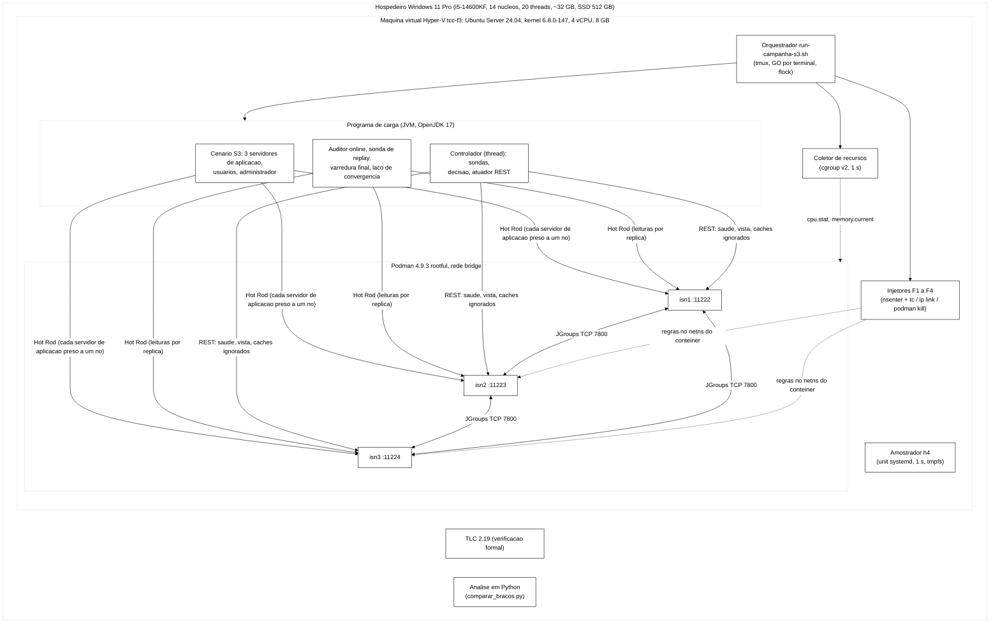
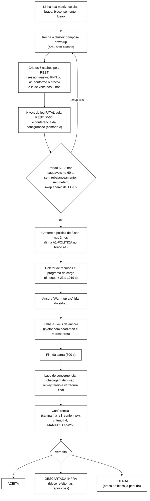

# 2. Arquitetura do sistema e ambiente experimental

> Relatório técnico final da parte prática, capítulo 2. Senior, 11/11/2026, para o Escritor.
> Descreve o sistema que rodou na avaliação fatorial (tag `int/2026-11-06-aval`, commit `4b96798`) e o ambiente físico.
> A árvore conferida é `dados-vm/cs3-2026-11/bundle-fat-4b96798/arv/cs3-4b96798/` (o mesmo conteúdo do *bundle* levado à
> VM, `cs3-4b96798.tar`, SHA-256 `e880fd6e…`, ENTREGA item 2). Caminhos relativos começam nessa árvore, salvo indicação.
> O controlador em detalhe está no capítulo 4; o protocolo de execução e as regras de medição no capítulo 6.

---

## 2.1 Visão geral



O sistema medido é o *cluster* Infinispan de três nós. O programa de carga simula a aplicação web e mede o que o
*cluster* entrega. O controlador roda dentro do programa de carga, mas só lê a saúde e a vista dos nós e só age no
*cluster*, por chamadas administrativas REST (capítulo 4). Injetores, amostrador e coletor rodam na VM, fora do
programa de carga e do *cluster*.

## 2.2 *Cluster* Infinispan

### 2.2.1 Nós, imagem e rede

| Item | Valor | Fonte |
|---|---|---|
| Imagem | `quay.io/infinispan/server:15.0.21.Final` (ID local `da9c871b…`) | `cluster/podman-compose-sem-caches.yml`; `fat-infra/cluster-antes-20261107T002640Z/inspect-isn1.json` |
| Nós | `isn1`, `isn2`, `isn3`, um contêiner cada | idem |
| Portas no hospedeiro da VM | 11222, 11223 e 11224 (Hot Rod e REST na mesma porta de cada nó) | idem |
| Endereço anunciado ao cliente | `127.0.0.1` com a porta externa de cada nó (`-Dinfinispan.hotrod.external-port`) | `cluster/infinispan-sem-caches.xml`, comentário do `hotrod-connector`; P-05 em `docs/registro-de-problemas.md` |
| Rede entre os nós | *bridge* do Podman (`NetworkMode: bridge`) | `inspect-isn1.json` |
| Credenciais | usuário administrativo de teste definido no *compose*; a REST exige autenticação Digest (Basic responde 403) | `podman-compose-sem-caches.yml` (*healthcheck* com `--digest`); P-04 |
| Registro do servidor | arquivo do contêiner (`k8s-file`) com teto de 512 MB; duas categorias de log das pilhas de recusa em FATAL pela REST, nos três nós e nos quatro braços (P-64) | `podman-compose-sem-caches.yml`; `cluster/log/loggers-avaliacao.tsv`; `scripts/ajusta-log.sh` |
| Extensão do servidor | `tcc-extensao-servidor.jar` montado em `server/lib` nos três nós, em todos os braços (SHA-256 `83588127…`) | `podman-compose-sem-caches.yml`; ENTREGA item 2 |

### 2.2.2 Pilha de comunicação (JGroups)

A pilha é a TCP padrão do Infinispan 15.0.21 com uma troca: a descoberta por *multicast* (MPING) virou lista estática
(TCPPING), porque a rede *bridge* não garantia *multicast* entre contêineres (`cluster/jgroups-tcp.xml`, comentário
inicial).

| Protocolo | Configuração | Papel no experimento |
|---|---|---|
| TCP | porta 7800, `bind_addr` `SITE_LOCAL`; canal de diagnóstico desligado (`diag.enabled=false`) | transporte entre nós |
| TCPPING | `isn1[7800], isn2[7800], isn3[7800]` | formação do *cluster* com 3 membros |
| MERGE3 | `min_interval` 10 000 ms, `max_interval` 30 000 ms | descobre partições curadas e dispara a fusão |
| FD_SOCK2 | padrão | suspeita imediata quando a conexão TCP com o vizinho fecha |
| FD_ALL3 | padrão (sem atributos no arquivo) | suspeita por falta de mensagens de presença; o texto registra 8 s e 40 s (T16) |
| VERIFY_SUSPECT2 | `timeout` 1000 ms | confirma a suspeita antes de excluir o nó |
| NAKACK2, UNICAST3 | retransmissão a cada 200 ms | entrega confiável; perda leve vira atraso |
| GMS | `join_timeout` 2000 ms | instalação de vistas |

Fonte: `cluster/jgroups-tcp.xml` da tag. Os valores padrão do FD_ALL3 não estão no arquivo; vêm do texto (T16,
`Metodologia.tex:272`, "conferido na configuração do *cluster*") e não foram reconferidos por mim no código do JGroups.

### 2.2.3 *Caches*

O XML do servidor não declara nenhum *cache* (`cluster/infinispan-sem-caches.xml`). Os seis *caches* são criados pela
REST a cada recriação do *cluster*, a partir dos arquivos `cluster/caches/<nome>.json`, por `scripts/cria-caches.sh`,
que lê a configuração de volta em cada nó e compara byte a byte. Motivo (P-30, B-44.1b): um *cache* declarado no XML que
teve atributo alterado em execução impede o reinício do nó, o que quebrava a F1.

| *Cache* | Modo | Uso | Diferença em relação aos demais |
|---|---|---|---|
| `sessions` | `SYNC` | sessões, modo síncrono (S1, S2, referência SYNC da calibração) | `remote-timeout` 17 500 ms |
| `counters` | `SYNC` | identidades e contadores, modo síncrono | `remote-timeout` 17 500 ms |
| `sessions-async` | `ASYNC` | sessões, modo assíncrono (avaliação) | política de fusão `PREFERRED_NON_NULL` (braços PO e PL) ou a classe da A1 (braços AO e AL, arquivo `sessions-async-a1.json`) |
| `counters-async` | `ASYNC` | identidades e contadores, modo assíncrono | sempre `PREFERRED_NON_NULL` |
| `canario` e `canario-async` | `SYNC` e `ASYNC` | escrita e leitura da sonda de defasagem do controlador, fora dos invariantes | nenhuma |

**Comum aos seis:** distribuído, `owners` 2, `segments` 64, estatísticas ligadas, `locking` com `concurrency-level` 1000,
`acquire-timeout` 15 000 ms e sem *striping*, `state-transfer` ligado com `timeout` 60 000 ms, `partition-handling` com
`when-split` `DENY_READ_WRITES`. Nenhum é transacional (os JSON não têm bloco de transação; o texto já declara isso em
`Desenvolvimento.tex:101` e `Metodologia.tex:298`). Fonte: os sete arquivos de `cluster/caches/`.

O número de segmentos (64) difere do valor de T4 (256). É desvio declarado (DT-016, 27/10), mantido por
comparabilidade com as baterias anteriores (`Desenvolvimento.tex:230`).

## 2.3 Extensão do servidor: a regra de fusão A1

A regra A1 é uma política de fusão própria para o `sessions-async`, carregada pelo servidor na partida como classe do
JAR em `server/lib` e escolhida pelo nome no campo `merge-policy` do JSON do *cache*
(`br.unipampa.tcc.servidor.PoliticaFusaoSessoes`). O servidor a encontra pelo registro de serviço
`META-INF/services/org.infinispan.conflict.EntryMergePolicy`.

- **Quando age.** Na resolução de conflitos que o coordenador faz depois da fusão de partições: para cada chave com
  cópias diferentes, o servidor entrega à política a cópia preferida (da maioria) e as outras.
- **Regra.** Devolve a cópia **máxima numa ordem de conteúdo** (`extensao-servidor/.../OrdemSessao.java`): estado
  (ausente < `VALID` < `INVALID`), depois motivo (nenhum < `LOGOUT` < `EXPIRADA` < `ADMIN_BLOCK`), depois versão e
  instante de atualização. A invalidação vence a validade, sem olhar qual lado é a maioria. O máximo numa ordem total é
  associativo, comutativo e idempotente (um semirreticulado), então a ordem de fusão não muda o resultado.
- **Saída de segurança.** Se não for possível decidir (valor ilegível, tipo inesperado, empate que a ordem não resolve,
  erro interno), a política devolve nulo e o servidor remove a chave em todos os donos. Cada uso gera uma linha `WARN`
  com o prefixo `A1-SAIDA-SEGURANCA` (`Decisao.java:28`). A sessão some e o usuário precisa entrar de novo, mas uma
  sessão invalidada nunca volta a valer.
- **Escopo.** Só o `sessions-async`. O `counters-async` fica com `PREFERRED_NON_NULL`, porque desbloqueio e reposição
  tornam o registro de identidade não monótono, e escolher pela ordem desfaria um desbloqueio legítimo
  (`PoliticaFusaoSessoes.java`, Javadoc).
- **Relação com o modelo.** É a mesma ordem do desempate T2 do modelo TLA+ (capítulo 3), com o conteúdo antes da versão.
  O modelo `MesclarJoin` verifica essa fusão no TLC (capítulo 3, seção 3.7).
- **Testes.** 47 testes da extensão passaram na tag (crônica:266, medido pelo coordenador; não reexecutei).

## 2.4 Programa de carga

### 2.4.1 Estrutura

Programa Java 17 (Maven), JAR único `session-workload-0.1.0-SNAPSHOT.jar` (SHA-256 `6fda9330…`, ENTREGA item 2), com dois
pacotes: `br.unipampa.tcc.session` (68 classes: operações, cenários, auditor, sondas, varredura, convergência, atuador
REST) e `br.unipampa.tcc.controle` (45 classes: núcleo de decisão, agregador de janelas, trilha JSONL). O cliente Hot Rod é
`infinispan-client-hotrod` **15.0.0.Final** (`workload/pom.xml:21`), enquanto o servidor é 15.0.21.Final. A extensão do
servidor compila contra 15.0.21.Final (`extensao-servidor/pom.xml:29`).

### 2.4.2 Cenário S3

Três servidores de aplicação, cada um preso a um nó (modo `pinned`), atendem usuários virtuais fixados a eles; um
quarto cliente faz o papel de administrador (`Metodologia.tex:311-313`). Os parâmetros abaixo são as opções do
programa (`workload/.../S3Parametros.java`); a coluna "Avaliação" é a da carga L+ (`nucleo/ambiente.md`, bloco
`carga_s3`).

| Parâmetro | Padrão do programa | Avaliação (L+) |
|---|---|---|
| Usuários do conjunto U (`--s3-users`) | 20 | 40 |
| Identidades do conjunto L, senha errada (`--s3-limit-accounts`) | 10 | 10 |
| Tempo de pensar entre páginas, média exponencial (`--s3-think-ms`) | 1000 ms | 500 ms |
| Duração da sessão, mediana lognormal, σ 0,6 (`--s3-session-median-sec`) | 20 s | 10 s |
| Probabilidade de *logout* ao fim da sessão (`--s3-logout-prob`) | 0,7 | 0,9 |
| Tempo ocioso para expiração no cliente | 30 s | 30 s |
| Janela do "voltar" depois do *logout* (validações repetidas) | 10 s, uma validação a cada 1 a 3 s | igual |
| Intervalo entre bloqueios administrativos, média (`--s3-admin-mean-sec`) | 15 s | 5 s |
| Tempo de bloqueio antes do desbloqueio | 20 s mais exponencial de média 10 s | igual |
| Retentativas da aplicação por operação | 2, com espera de 500 ms que dobra | igual |
| Tempo-limite e retentativas do cliente Hot Rod | 2000 ms e 1 | igual |

### 2.4.3 Instrumentos de observação

| Instrumento | O que faz | Opção |
|---|---|---|
| Auditor *online* | confere cada leitura da carga contra as invalidações e bloqueios confirmados (I1, I4, I2 com classificação por marcos do bloqueio) | sempre ligado |
| Sonda de *replay* imediato | para cada *logout* confirmado, valida a sessão antiga pelo servidor de aplicação do nó seguinte, 1 a 3 s depois | `--s3-replay-probe` |
| Sonda de *replay* tardio | depois da carga, valida por outro nó as sessões com *logout* confirmado na falha ou na recuperação, até 306 | `--s3-replay-late-max 306` |
| Checagem de fusão | espera a vista de 3 nós depois do fim da falha, até 72 s; sem fusão, a varredura não roda e grava erro | `--sweep-merge-timeout-sec 72` |
| Varredura final | lê todas as chaves dos dois *caches* e confronta com as invalidações confirmadas (I1 REAL, I4 REAL, I2 por classe) | `--sweep` |
| Laço de convergência | depois da carga, compara as réplicas a cada 4 s até três rodadas seguidas sem divergência, com teto de 600 s | `--convergence --convergence-period-sec 4 --convergence-timeout-sec 600` |

Fonte das opções: campo `comando` de `campanha-s3-fatorial/exec-0000-ASYNC-F2-PO/execucao.json`. As regras de contagem
estão no capítulo 6; a definição de V no capítulo 1, seção 1.3.1.

### 2.4.4 Saídas por execução

Por execução, o orquestrador guarda (lista de `exec-0000-ASYNC-F2-PO/`): eventos (`rep-001.csv`), ações S3
(`s3-acoes-rep-001.csv`), violações (`violacoes-rep-001.csv`, com origem), varredura (`varredura-rep-001.csv` e de
identidades), convergência (`convergencia-rep-001.csv` e resumo), trilha de decisões do controlador
(`decisoes-rep-001.jsonl`), observáveis do controlador (`observaveis-rep-001.jsonl`), recursos (`recursos-rep-001.csv` e
`recursos-podman-rep-001.jsonl`), marcadores da falha (`marcadores.txt`), registro da fusão (`fusao-rep-001.json`,
`fusao-ispn000093.txt`), configuração dos *caches* da execução (`caches/`), h4 (`h4.txt`), conferência
(`checagem.json`), metadados (`execucao.json`) e `MANIFEST.sha256`.

## 2.5 Controlador (resumo; detalhes no capítulo 4)

*Thread* na JVM do programa de carga, com núcleo de decisão independente do Infinispan. Sensores: janelas de eventos da
própria carga (latência, erro, violação), sonda de topologia pela REST a cada 2 s e sonda de defasagem pelos *caches*
`canario*`. Atuador: chamadas REST administrativas ao nó suspeito. Na avaliação, o braço ativo usou a ação AC-7 (o nó
passa a ignorar o `sessions-async`, `POST /rest/v2/server/ignored-caches/sessions-async`) e P2 ficou desligada
(`p2_habilitada false`, `nucleo/ambiente.md`). Arquivo de parâmetros `controlador-avaliacao-s3.json` (SHA-256
`163b88b0…`), derivado da recalibração (DT-028).

## 2.6 Coletor de recursos e amostrador h4

- **Coletor de recursos** (`scripts/collect-resources.sh`, contrato `recursos/1`): a cada 1 s lê o tempo de CPU e a
  memória de cada contêiner pelo cgroup v2 (`cpu.stat`, `memory.current`), o processo do programa de carga por `/proc`
  e a VM inteira por `/proc/stat`, com o *steal* separado; a cada 10 s, `podman stats` para conferência cruzada. Na
  avaliação, `nproc` = 4 e o atraso máximo de amostra foi 3,6 ms na `exec-0000` (`recursos-meta-rep-001.json`). A
  conversão em energia está no capítulo 6.
- **Amostrador h4** (`scripts/amostrador-infra.sh`): unidade de sistema própria, como root, fora do orquestrador; a
  cada 1 s grava em memória (`/run/tccdiag`, tmpfs) o relógio, o tempo desde a inicialização, a pressão de E/S, CPU e
  memória do *kernel* (`/proc/pressure/*`) e os contadores do disco; uma segunda unidade copia para o disco a cada
  300 s. Gravar em memória evita que o próprio amostrador pare quando o disco trava. As regras de descarte h4a, h4b e
  h4c estão no capítulo 6 e em `Desenvolvimento.tex:92`.

## 2.7 Injetores de falha

Todos rodam no sistema da VM e entram no *network namespace* do contêiner com `nsenter`, porque a imagem do
Infinispan não tem `tc` nem a permissão de rede necessária. Cada injetor grava marcadores `start` e `end` com o relógio
em nanossegundos, remove as regras ao terminar (também ao receber sinal) e tem um temporizador de segurança do sistema
(`systemd-run`, margem de 90 s) que limpa as regras se o injetor morrer.

| Falha | Script | Mecanismo | Parâmetros na avaliação | Por que assim |
|---|---|---|---|---|
| F1, queda silenciosa | `inject-crash.sh` | desliga `eth0` no *namespace* do nó e logo depois `podman kill --signal KILL`; após a duração, `podman start` | `isn2`, 60 s | com a interface desligada, nenhum FIN sai e só o FD_ALL3 detecta a queda; com `SIGTERM` o nó sairia de forma ordenada (DT-017) |
| F2, partição | `inject-partition.sh` | disciplina `clsact` com filtros `u32` que descartam, na entrada e na saída do nó isolado, os pacotes dos outros dois nós | `isn3`, 90 s nominais | o tráfego Hot Rod do cliente não casa o filtro, então a minoria continua alcançável e responde "indisponível" em vez de sumir |
| F3, atraso com *jitter* | `inject-jitter.sh` | `netem delay 20ms 13ms distribution normal` na raiz de `eth0` do nó | `isn2`, 251 s | p99 do atraso por pacote ≈ 20 + 2,326 × 13 ≈ 50 ms (T18) |
| F4, degradação parcial | `inject-netdegrade.sh` | disciplina `prio` na raiz, `netem` numa banda e filtro `u32` por endereço dos pares; perda, atraso, duplicação ou reordenação, simétrica ou assimétrica | `isn3`, saída, severidade N3 (20 % de perda), 90 s | só o tráfego entre nós é afetado; cliente e SSH passam |

Fontes: cabeçalhos dos quatro *scripts* em `scripts/`; parâmetros em `nucleo/ambiente.md`. Nas execuções da partição, a
duração efetiva entre os marcadores foi de cerca de 96 s (`exec-0000`: `start` 1794011751,485 s e `end` 1794011847,553 s
em `marcadores.txt`, 96,07 s); o valor por célula está no capítulo 5 (tabela R1).

## 2.8 Orquestrador e o fluxo de uma execução

`scripts/run-campanha-s3.sh` (2037 linhas) executa uma fase da matriz por invocação (calibração, núcleo, extra ou
reposições), dentro de `tmux` na VM, contra o Podman do root, sob trava `flock`. Pede um GO digitado no terminal no
início da fase e antes da primeira falha de rede, aceita parar entre execuções por um arquivo `PARAR`, e grava o
progresso por troca atômica para poder retomar (cabeçalho do *script*). Na avaliação, um supervisor na VM digitava os GO
e vigiava o progresso, e um Senior conferia cada execução (capítulo 7).



Fontes: cabeçalho de `scripts/run-campanha-s3.sh` (requisitos 1 a 8, W-6c, W-10, DT-027 itens 1 a 4) e o `comando` de
`execucao.json`. Os critérios do portão K1 e da conferência estão no capítulo 6.

## 2.9 Ambiente físico e de software

### 2.9.1 Hospedeiro

| Item | Valor | Fonte |
|---|---|---|
| Processador | Intel Core i5-14600KF, 14 núcleos, 20 *threads* lógicas | `Get-CimInstance Win32_Processor`, lido em 11/11; `intel_i5_14600kf` no `.bib` |
| Memória | 34 142 937 088 bytes (~32 GB) | `Win32_ComputerSystem.TotalPhysicalMemory`, lido em 11/11 |
| Sistema | Windows 11 Pro, versão 10.0.26300 | `Win32_OperatingSystem`, lido em 11/11 (a versão durante as campanhas não foi registrada; os registros do TLC dizem "Windows 11 10.0 amd64") |
| Disco | SSD NVMe XrayDisk 512 GB | `Win32_DiskDrive`, lido em 11/11; modelo e *firmware* V0926A0 na crônica:125 |
| Placa-mãe | MSI PRO H610M-G, BIOS 1.O0 de 07/2025 | crônica:100 (não reconferido) |
| Perfis de uso | H0 (silêncio: nada além da medição, sem TLC, Maven ou contêineres locais), H1 (carga limitada), H2 (livre) | `wt-plano-ctrl/docs/plano-execucao-continua-2026-11-04.md:20` e `:90-92` |
| Ajustes para a medição | economia de energia do barramento PCIe (ASPM) desligada, TRIM do SSD, exclusão dos arquivos da VM do antivírus, indexador de busca desligado e desabilitado | `Desenvolvimento.tex:90` (DES-82); crônica:128, 193 |

### 2.9.2 Máquina virtual

| Item | Valor | Fonte |
|---|---|---|
| Hipervisor e VM | Hyper-V, geração 2, VM `tcc-f3`, rede *Default Switch* (NAT) | `wt-plano-ctrl/docs/runbook-vm-hyperv.md:7`; cabeçalho de `run-campanha-s3.sh` |
| CPU | 4 vCPU | `nproc` 4 em `recursos-meta-rep-001.json` |
| Memória | 8 GB configurados; 7940 MB visíveis; *swap* de 4 GB | `runbook-vm-hyperv.md:7`; `free -m` em `fat-infra/inicio-20261107T002832Z.txt` |
| Disco | volume lógico raiz de 34 GB (12 GB livres no início do fatorial) | `df -h` no mesmo arquivo |
| Sistema | Ubuntu Server 24.04, *kernel* `6.8.0-147-generic` retido (`apt-mark hold`), atualizações automáticas desligadas | `uname -a` em `campanha-s3-fatorial/nucleo/ambiente.md`; `apt-mark showhold` e `systemctl` em `inicio-20261107T002832Z.txt` |
| Contêineres | Podman 4.9.3 no modo *rootful* (`sudo podman`), `podman-compose` 1.0.6 | `nucleo/ambiente.md`; `fat-infra/compose-dry-run.txt` |
| Java e Python | OpenJDK 17.0.20.1 (Ubuntu); Python 3.12.3 | `nucleo/ambiente.md` |
| Desligamento | `AutomaticStopAction` = desligar, `AutomaticStartAction` = iniciar se estava ligada | `feedback-controlador-do-cluster.md` (X-02) |

**Por que uma VM.** O WSL2 usado no início não tinha o módulo `sch_netem`, necessário ao `tc-netem`
(`runbook-vm-hyperv.md:3`; `Desenvolvimento.tex:12`).

**Instabilidades do ambiente** que afetam a leitura dos dados (detalhe no capítulo 7): o hospedeiro desligou de forma
abrupta várias vezes por queda de energia da região (a quinta em 07/11, entre as fases núcleo e extra, ENTREGA item 8),
e o SSD do hospedeiro teve episódios de latência de escrita que travavam o disco virtual da VM, origem do critério h4
(DT-018) e de todas as execuções descartadas da avaliação (capítulo 5, R1). A cada reinício da VM o endereço IP muda
(crônica:96, 114, 119, 273).

### 2.9.3 Ferramentas no hospedeiro

| Ferramenta | Versão | Uso | Fonte |
|---|---|---|---|
| TLC (`tla2tools.jar`) | TLC2 2.19 de 08/08/2024, revisão `5a47802` | verificação formal | cabeçalho dos `.out` em `runs/tlc/` |
| Java para o TLC | 1.8.0_503 nas rodadas de 03/10; 17.0.2 nas do B-32, B-45 e `MesclarJoin` | idem | cabeçalho dos `.out`; `.meta` do B-45 |
| Python da análise oficial | Python 3.12.6, numpy 2.2.0, scipy 1.16.0, executado com `python -E -P` | `comparar_bracos.py` | `analise-oficial/LEIAME.txt` |
| Maven e JUnit | Surefire 1224 testes, 0 falhas na tag | testes do programa de carga | crônica:266 (medido pelo coordenador, não reexecutado) |

## 2.10 Reprodutibilidade e identidade dos artefatos

- O *bundle* da VM é o `git archive` da tag mais o JAR do programa e o JAR da extensão, cada um com SHA-256 conferido nas
  duas pontas (ENTREGA itens 1 e 2). O JAR da extensão **não é reprodutível byte a byte**; vale o SHA-256 do construído
  na VM (crônica:263).
- O orquestrador grava em cada `execucao.json` o SHA-256 do *bundle*, do JAR, dos parâmetros, do controlador e da
  referência de p99. Na avaliação, as 86 execuções com MANIFEST têm um único valor de cada (validação de 11/11, seção 1,
  `wt-plano-ctrl/docs/validacao-analise-oficial-2026-11-11.md`).
- A tag `4b96798` contém a especificação TLA+ na revisão `20805b0`, **sem** o desempate do B-45 e sem a variante
  `MesclarJoin`, que estão nos ramos `fix/b45-desempate-ts` e `feature/tla-mesclar-join` (capítulo 3, seção 3.1).

## 2.11 Tabelas para a monografia

### T2-01. Parâmetros do experimento: linhas a atualizar na `tab-parametros-baseline` (ATUALIZAR)

**Onde está:** `Metodologia.tex:236-283`. A tabela descreve o desenho do TCC I. Proponho manter a estrutura (faixa
observada, fonte, valor adotado, justificativa) e trocar o "valor adotado" pelo executado, com uma coluna nova ou nota
"(executado)". As linhas de protocolo (T6 a T14, T17, T18 e T22) são do capítulo 6; abaixo, só o resumo do que muda nelas
para o Escritor não perder.

| ID | Valor atual na tabela | Valor executado | Ação | Fonte |
|---|---|---|---|---|
| T1 | `DIST_ASYNC` (alvo) e `DIST_SYNC` (controle) | os dois na nova medição de referência e na calibração; avaliação só em `DIST_ASYNC` | atualizar justificativa | capítulo 1, seção 1.4 |
| T2 | 3 nós | 3 nós (`isn1` a `isn3`) | manter | `podman-compose-sem-caches.yml` |
| T3 | `numOwners` 2 | `owners` 2 | manter | `cluster/caches/*.json` |
| T4 | 256 | **64** | **corrigir** (desvio declarado, DT-016) | `cluster/caches/*.json` |
| T5 | *payload* de 1 KB fixo | objeto de sessão serializado (sete campos: id, identidade, estado, motivo, versão, criação, atualização), **sem enchimento**; tamanho não medido | **corrigir** | `workload/.../SessionState.java:21-27`; nenhuma opção de tamanho no programa |
| T15 | MTU 1500 | não conferido | manter com nota | nenhuma |
| T16 | FD_ALL3 com padrões (8 s, 40 s) | padrões mantidos (sem atributos em `jgroups-tcp.xml`), mais FD_SOCK2, VERIFY_SUSPECT2 de 1 s e MERGE3 de 10 a 30 s | ampliar a linha | `cluster/jgroups-tcp.xml` |
| T19 | M1 a M7 pelo OpenMetrics | eventos, ações S3, violações, varredura, convergência, trilha do controlador, recursos por cgroup e amostrador h4; o coletor OpenMetrics não foi usado | **corrigir** | seção 2.4.4; `Desenvolvimento.tex:136` |
| T20 | OpenMetrics, Prometheus opcional | não usado; saúde e vista pela REST | **corrigir** | seção 2.5 |
| T21 | 2 a 3 identidades, sessões e réplicas | 1 a 3 identidades, 2 a 3 sessões, 2 a 3 réplicas | **corrigir** | capítulo 3, seção 3.4 |

Resumo das linhas do capítulo 6: T6 a T9 só valem para S1 e S2 (S3 tem sessões com UUID e usuários próprios); T10 virou
12 blocos na avaliação e 10 repetições na nova medição; T11 virou 30 s; T12 não se aplica (laço fechado); T14 virou
300 s; T17 virou queda silenciosa de 60 s; T18 virou 20 ± 13 ms com distribuição normal; T22 virou troca de sinal,
interseção-união e Holm.

Linhas em LaTeX, no formato da *longtable* atual (seis colunas), para substituir as existentes:

```latex
T1 & Modo de replicação & DIST\_SYNC, DIST\_ASYNC, REPL\_SYNC, REPL\_ASYNC & \citealt{infinispan_docs_stable} & DIST\_ASYNC e DIST\_SYNC na medição de referência; DIST\_ASYNC na avaliação & objeto de estudo é a replicação assíncrona \\
T4 & \texttt{numSegments} & 256 (padrão); $20 \times N$ para $N>20$ & \citealt{infinispan_tuning} & 64 & valor herdado da configuração inicial, mantido por comparabilidade (desvio declarado) \\
T5 & Tamanho do valor & 1 KB típico de sessão; 1 KB--2 MB em estudos de cauda & \citealt{jaiman_tailx_2020} & objeto de sessão serializado, sem enchimento & valor real do registro de sessão do programa de carga \\
T16 & Detecção de falha & FD\_ALL3 com \emph{heartbeat} de 8\,000\,ms e \emph{timeout} de 40\,000\,ms; FD\_SOCK2; VERIFY\_SUSPECT2; MERGE3 & \citealt{jgroups_manual_5} & padrões do FD\_ALL3 e FD\_SOCK2; confirmação de 1\,s; fusão procurada a cada 10 a 30\,s & reproduz a pilha padrão do servidor \\
T19 & Métricas coletadas & latência, vazão, \emph{hit ratio}, RPC, \emph{state transfer} & \citealt{infinispan_metrics} & eventos, ações S3, violações, convergência, decisões do controlador e CPU por \emph{container} & medidas no programa de carga e no cgroup, sem o coletor OpenMetrics \\
T20 & Fonte de saúde e topologia & JMX; OpenMetrics; REST & \citealt{infinispan_rest_15} & API REST do servidor & é a mesma interface usada pelo controlador \\
T21 & Espaço de estados (TLC) & cardinalidades pequenas (2--3 por \emph{sort}) em verificações industriais & \citealt{yu_lamport_tla_modelchecking_1999, newcombe_aws_tla_2014, yuan_simple_testing_2014} & 1 a 3 identidades, 2 a 3 sessões e 2 a 3 réplicas & a menor configuração fecha de forma exaustiva \\
```

Observação para o Escritor: as faixas com dois números já usam `--` (traço de intervalo do LaTeX) na tabela atual; não
há travessão no texto. Se o Revisor pedir, trocar `1--2 MB` por `1 a 2 MB`.

### T2-02. Ambiente de execução (NOVA)

**Onde entra:** Desenvolvimento, seção "Arquitetura experimental" (`Desenvolvimento.tex:5-14`), depois do parágrafo
DES-01, no lugar de listar versões em prosa.

```latex
\begin{table}[htbp]
\captionsetup{type=table, name=Quadro}
\caption{Ambiente de execução do experimento}
\label{qd-ambiente-execucao}
\centering
\footnotesize
\begin{tabular}{p{3.4cm}p{6.8cm}p{3.6cm}}
\hline
\textbf{Componente} & \textbf{Configuração} & \textbf{Papel} \\
\hline
\raggedright Hospedeiro & Intel Core i5-14600KF (14 núcleos, 20 \emph{threads}), cerca de 32\,GB de memória, SSD NVMe de 512\,GB, Windows 11 Pro & executa a máquina virtual, o TLC e a análise \\
\raggedright Máquina virtual & Hyper-V, 4 vCPU, 8\,GB de memória, Ubuntu Server 24.04 com \emph{kernel} 6.8.0-147 fixado & executa o \emph{cluster}, a carga e os injetores \\
\raggedright \emph{Containers} & Podman 4.9.3 no modo \emph{rootful}, rede \emph{bridge}, \texttt{podman-compose} 1.0.6 & isolam os três nós \\
\raggedright \emph{Data grid} & Infinispan Server 15.0.21.Final, três nós, JGroups sobre TCP com lista fixa de membros & sistema medido \\
\raggedright Programa de carga & Java 17 (OpenJDK 17.0.20.1), cliente Hot Rod 15.0.0.Final & simula a aplicação e observa violações \\
\raggedright Verificação formal & TLC 2.19 (revisão de 8 de agosto de 2024) & verifica o modelo TLA+ \\
\raggedright Análise & Python 3.12, numpy 2.2 e scipy 1.16 & testes e intervalos \\
\hline
\end{tabular}
\fonte{O autor}
\end{table}
```

### T2-03. Configuração dos *caches* (NOVA)

**Onde entra:** Desenvolvimento, seção "Estado dos artefatos", logo depois de DES-18 e DES-35
(`Desenvolvimento.tex:99-101`), substituindo a descrição em prosa dos *caches*.

```latex
\begin{table}[htbp]
\captionsetup{type=table, name=Quadro}
\caption{Caches do \emph{cluster} e suas configurações}
\label{qd-caches}
\centering
\footnotesize
\begin{tabular}{p{2.8cm}p{1.5cm}p{4.4cm}p{5.0cm}}
\hline
\textbf{\emph{Cache}} & \textbf{Modo} & \textbf{Uso} & \textbf{Política de fusão} \\
\hline
\raggedright \texttt{sessions} & síncrono & sessões nas medições síncronas & \texttt{PREFERRED\_NON\_NULL} \\
\raggedright \texttt{counters} & síncrono & identidades e contadores nas medições síncronas & \texttt{PREFERRED\_NON\_NULL} \\
\raggedright \texttt{sessions-async} & assíncrono & sessões na avaliação & \texttt{PREFERRED\_NON\_NULL} ou a regra A1, conforme o braço \\
\raggedright \texttt{counters-async} & assíncrono & identidades e contadores na avaliação & \texttt{PREFERRED\_NON\_NULL} \\
\raggedright \texttt{canario} e \texttt{canario-async} & síncrono e assíncrono & sonda de defasagem do controlador & \texttt{PREFERRED\_NON\_NULL} \\
\hline
\end{tabular}
\fonte{O autor. Todos com duas cópias por chave, 64 segmentos, sem transação, \texttt{DENY\_READ\_WRITES} diante de partição e transferência de estado com tempo-limite de 60\,s; os síncronos com tempo-limite remoto de 17,5\,s}
\end{table}
```

Se a classe abnTeX2 não aceitar a nota longa no `\fonte`, mover o texto depois de "O autor" para uma frase do parágrafo.

### T2-04. Injetores de falha (NOVA)

**Onde entra:** Metodologia, seção "Modelo de falhas" (`Metodologia.tex:156-169`), depois da descrição de F4; ou
Desenvolvimento, DES-21 (`Desenvolvimento.tex:134`). Prefiro a Metodologia, porque dá o mecanismo junto da definição.

```latex
\begin{table}[htbp]
\captionsetup{type=table, name=Quadro}
\caption{Injetores de falha e parâmetros usados na avaliação}
\label{qd-injetores}
\centering
\footnotesize
\begin{tabular}{p{2.6cm}p{6.8cm}p{4.4cm}}
\hline
\textbf{Falha} & \textbf{Mecanismo} & \textbf{Parâmetros na avaliação} \\
\hline
\raggedright F1, queda silenciosa & interface de rede do nó desligada e processo encerrado por \texttt{SIGKILL}; reinício do \emph{container} depois da duração & \texttt{isn2}, 60\,s \\
\raggedright F2, partição & filtros \texttt{tc} que descartam, na entrada e na saída do nó isolado, os pacotes dos outros nós; o cliente continua alcançando o nó & \texttt{isn3}, 90\,s \\
\raggedright F3, atraso com \emph{jitter} & \texttt{tc-netem} com atraso de 20\,ms e desvio de 13\,ms, distribuição normal & \texttt{isn2}, 251\,s \\
\raggedright F4, degradação parcial & \texttt{tc-netem} numa banda de prioridade, com filtro pelos endereços dos outros nós & \texttt{isn3}, saída, 20\,\% de perda, 90\,s \\
\hline
\end{tabular}
\fonte{O autor, com base em \citet{netem_manpage}}
\end{table}
```

### T2-05. Alterações do Infinispan 15.0.21 verificadas em tempo de execução (ATUALIZAR `qd-reconfig-infinispan`)

**Onde está:** `Desenvolvimento.tex:180-204`. O quadro reflete o estado de 05/11. Mudanças linha a linha (se o capítulo 4
propuser outra coluna "Uso", vale a do 4; os fatos de verificação vêm das fontes indicadas):

| Linha atual | Mudança | Fonte |
|---|---|---|
| Modo, donos, segmentos, estratégia de partição e política de fusão: imutáveis, "fora" | manter, e separar a política de fusão numa linha nova (abaixo) | `Desenvolvimento.tex:206` |
| (nova) Política de fusão própria | "classe própria aceita em `merge-policy` na criação do *cache*, com o JAR instalado antes da partida; não muda em execução", uso "regra A1 (fator do experimento)" | seção 2.3; `wt-cs3-4b96798/docs/relatorio-a1-2026-11-06.md` |
| (nova) Ignorar o *cache* no nó (`ignored-caches`) | "pedido ao nó isolado vale só nele, que passa a recusar o *cache* em 16 a 70 ms; sem partição, a lista se propaga aos três nós em 19 a 51 ms; desfeito por `DELETE`", uso "P1 (AC-7)" | `wt-a4/docs/relatorio-a4-2026-11-06.md` §0, itens 1, 3 e 4 |
| Rebalanceamento global: "P2" | "mutável; a suspensão sobrevive à queda do coordenador, mas depois da fusão o rebalanceamento ficou desligado nos três nós", uso "fora (P2 retirada)" | `wt-cs3-4b96798/docs/relatorio-b44-2-2026-11-05.md:18`; crônica:163 |
| Parada do servidor pela REST: "P1" | "local; sob corte, o nó isolado ainda aceita escritas por cerca de 13 s depois do pedido", uso "substituída pela AC-7" | relatório A4 §0 item 2 (13,1 s, n = 2); P-42 |
| Exclusão forçada da vista do JGroups: "verificação em curso" | "funciona nos dois lados em cerca de 25 ms; no falso positivo em modo assíncrono, a fusão desfez um *logout* confirmado", uso "fora (não adotada)" | `wt-b44-3/docs/b44-3-ac6-jgroups.md:22-24` |
| (nova, opcional) Nível de log por categoria | "mutável pela REST, por nó; não sobrevive ao reinício", uso "ambiente (igual nos braços)" | `scripts/ajusta-log.sh`, cabeçalho |

Versão LaTeX completa:

```latex
\begin{table}[!htb]
\captionsetup{type=table, name=Quadro}
\caption{Alterações do Infinispan 15.0.21 verificadas em tempo de execução}
\label{qd-reconfig-infinispan}
\centering
\footnotesize
\begin{tabular}{p{3.8cm}p{7.4cm}p{2.4cm}}
\hline
\textbf{Alteração} & \textbf{Resultado da verificação} & \textbf{Uso} \\
\hline
\raggedright Modo de replicação, número de donos e de segmentos e estratégia de partição & imutáveis; o servidor recusa a alteração & fora \\
\raggedright Política de fusão própria & classe aceita como política de fusão na criação do \emph{cache}, com o arquivo instalado antes da partida do servidor; não muda em execução & regra A1 \\
\raggedright Apelido de \emph{cache} & reatribuível, mas o Hot Rod não resolve apelidos, e a troca exige duas chamadas não atômicas & fora \\
\raggedright Remoção e recriação do \emph{cache} & apaga os dados; no intervalo, os clientes recebem \emph{cache} inexistente & fora \\
\raggedright Disponibilidade forçada (\texttt{DEGRADED\_MODE}) & vale para o \emph{cache} no \emph{cluster} inteiro; não recusa operações por chave com os três nós presentes; quebra a cascata do bloqueio & fora \\
\raggedright \texttt{remote-timeout} & mutável; curto em modo síncrono, deixa escritas indeterminadas e réplicas divergentes & fora \\
\raggedright \texttt{acquire-timeout} e expiração & mutáveis; nenhum dos dois reduz violações & fora \\
\raggedright Rebalanceamento por \emph{cache} & mutável; a suspensão se perde quando o coordenador cai & fora \\
\raggedright Rebalanceamento global & mutável; a suspensão sobrevive à queda do coordenador, mas depois da fusão o rebalanceamento ficou desligado nos três nós & fora \\
\raggedright Parada do servidor pela API REST & local; sob corte, o nó isolado ainda aceita escritas por cerca de 13\,s depois do pedido & substituída \\
\raggedright Ignorar o \emph{cache} no nó & pedido ao nó isolado vale só nele, que recusa o \emph{cache} em 16 a 70\,ms; sem partição, a lista se propaga aos três nós; desfeito por remoção do pedido & P1 \\
\raggedright Exclusão forçada da vista do JGroups & funciona nos dois lados em cerca de 25\,ms; num falso positivo em modo assíncrono, a fusão desfez um \emph{logout} confirmado & fora \\
\raggedright Atributos do FD\_ALL3 & graváveis, sem efeito sobre os membros já existentes & fora \\
\hline
\end{tabular}
\fonte{O autor, com base em \citet{infinispan_rest_15}, \citet{infinispan_cli_15}, \citet{infinispan_configuring_15}, \citet{infinispan_server_15}, no código-fonte do Infinispan 15.0.21 e do JGroups 5.3.16 e na verificação em \emph{cluster} local}
\end{table}
```

## 2.12 Já está na monografia × novo ou mudou

| Tema | O que o texto diz (arquivo:linha) | Situação | O que fazer |
|---|---|---|---|
| Nós, Podman, rede, VM Hyper-V, WSL2 sem `sch_netem` | `Desenvolvimento.tex:10-12` (DES-01), `:71` | correto | manter; acrescentar versões (Quadro T2-02) |
| JGroups TCP com TCPPING e FD_ALL3/FD_SOCK2 | `Desenvolvimento.tex:12`, `:73` | correto, incompleto | acrescentar MERGE3 (10 a 30 s) e VERIFY_SUSPECT2 (1 s), que importam para o tempo de fusão |
| Carga via Hot Rod, marcas em ns, auditor | `Desenvolvimento.tex:14` | correto | acrescentar sonda de *replay*, varredura e checagem de fusão (seção 2.4.3) |
| *Caches* `sessions`/`counters` SYNC e `*-async` | `Desenvolvimento.tex:99-101` | **desatualizado** | o XML não tem mais *caches*; os seis são criados pela REST a cada recriação (P-30); acrescentar `canario*` e a variante A1 (Quadro T2-03). "Só será instalada na máquina virtual quando o *cluster* for recriado" (DES-35) já não vale |
| `numSegments` 64 × T4 256 | `Desenvolvimento.tex:99` e `:230`; `Metodologia.tex:259` | texto correto em `Desenvolvimento`, tabela errada | corrigir a linha T4 |
| *Payload* de 1 KB | `Metodologia.tex:260` (T5) e `Desenvolvimento.tex:107` ("conforme T5") | **errado** | não há enchimento; o valor é o objeto de sessão serializado (seção T2-01) |
| Coletor OpenMetrics | `Desenvolvimento.tex:132`, `:136` (DES-47); `Metodologia.tex:227`, T19, T20 | `Desenvolvimento` correto ("nunca integrado"); Metodologia desatualizada | corrigir T19, T20 e a frase de `Metodologia.tex:227` (métricas secundárias pelo OpenMetrics não foram coletadas) |
| Coletor de recursos | `Desenvolvimento.tex:136` ("nenhum consumo foi medido em campanha") | **desatualizado** | o coletor rodou em todas as execuções da calibração, recalibração e avaliação; resultado de energia no capítulo 5 |
| Injetores F1 a F4 | `Desenvolvimento.tex:134` (DES-21) | correto | acrescentar os parâmetros usados (Quadro T2-04) |
| Orquestrador | `Desenvolvimento.tex:134` cita `run-baseline.sh` e `run-rebaseline.sh` | **incompleto** | acrescentar `run-campanha-s3.sh` (calibração e avaliação) e o fluxo da seção 2.8 |
| Extensão do servidor | `Desenvolvimento.tex:208` diz que a troca da política de replicação por código no servidor fica como trabalho futuro | correto para a replicação; **novo**: uma extensão foi instalada, para a política de fusão | descrever a A1 (seção 2.3) e deixar claro que a extensão muda o sistema avaliado nos braços AO e AL |
| Cliente Hot Rod 15.0.0 com servidor 15.0.21 | ausente | **novo** | declarar a versão do cliente; não testei se a diferença afeta algo |
| Quadro `qd-reconfig-infinispan` | `Desenvolvimento.tex:180-204` | **desatualizado** | Quadro T2-05 |
| Suítes de teste | `Desenvolvimento.tex:138` (DES-22, sem números) | correto | se quiser números, usar os da tag (Surefire 1224, extensão 47; crônica:266) depois de reexecutar ou com a fonte |

## 2.13 Fontes bibliográficas necessárias

| Afirmação | Chave | Situação |
|---|---|---|
| Imagem, servidor, TCPPING, diretório de bibliotecas do servidor, canal de diagnóstico | `infinispan_server_15` (seções 12.2.2, 14.1, 12.5) | já no `.bib` e citadas |
| Criação de *cache* pela REST, saúde, parada do servidor | `infinispan_rest_15` (seções 2.1.x, 2.4.2, 2.5.12) | já no `.bib` |
| Endpoint `ignored-caches` e REST de *logging* | `infinispan_rest_15` | **Bibliotecário: localizar as seções** |
| Política de fusão própria (`EntryMergePolicy`) | `infinispan_configuring_15` (o Javadoc da A1 cita "seção 7.6, Configuring custom merge policies") | **Bibliotecário: confirmar seção e página** |
| Perda na fusão de escritas do lado minoritário | `infinispan_configuring_15` (seção 7.1.1) | já citada |
| Cliente Hot Rod | `infinispan_hotrod_java_15` | já no `.bib` |
| MERGE3, FD_ALL3, FD_SOCK2, VERIFY_SUSPECT2 | `jgroups_manual_5` | já no `.bib`; **Bibliotecário: seções de MERGE3 e VERIFY_SUSPECT2**, e conferir os padrões de 8 s e 40 s do FD_ALL3 |
| `tc-netem` | `netem_manpage` | já no `.bib` |
| Filtros `tc` (`clsact`, `u32`, `prio`) | nenhuma | **Bibliotecário: manuais `tc(8)`, `tc-u32(8)`, `tc-prio(8)`** (opcional; dá para descrever sem citar) |
| Podman *rootful*, `k8s-file` | `podman_docs` | já no `.bib`; confirmar que cobre o driver de log |
| Hyper-V | nenhuma | **Bibliotecário (opcional)**: documentação Microsoft do Hyper-V |
| cgroup v2 e PSI | `linux_cgroup_v2`, `linux_psi_6_8` | já no `.bib` |
| Processador do hospedeiro | `intel_i5_14600kf` | já no `.bib` |
| Semirreticulado e convergência pela junção | `shapiro_crdt_2011` | já no `.bib` |
| Maven, JUnit, HdrHistogram, numpy, scipy | `maven_apache`, `junit5`, `hdrhistogram`, `numpy_harris_2020`, `scipy_virtanen_2020` | já no `.bib` |

## 2.14 Pendências e o que não pôde ser verificado

- **Rede `netavark`** (`Desenvolvimento.tex:12`): não encontrei registro do *backend* de rede nos artefatos da
  avaliação; o `inspect` só diz `bridge`. Conferir com `sudo podman info` na VM antes de manter a palavra.
- **Padrões do FD_ALL3 (8 s, 40 s) e MTU 1500:** não reconferidos por mim; vêm do texto.
- **Tamanho do valor de sessão:** não medido; se o Escritor quiser um número, medir o tamanho serializado de um
  `SessionState` típico.
- **Cliente Hot Rod 15.0.0 com servidor 15.0.21:** não há teste específico de compatibilidade; o comportamento medido
  é o do par usado.
- **Versão do Windows e do disco** foram lidas em 11/11, depois das campanhas; não há registro equivalente dos dias da
  medição.
- **Disco virtual (VHDX):** o *runbook* fala em 40 GB dinâmico, e a crônica registra duas ampliações do volume lógico
  (+10 GB e +6 GB); o tamanho final do VHDX não foi conferido.
- **Contagens de testes** (Surefire 1224, extensão 47) são da crônica do coordenador; não reexecutei as suítes.
