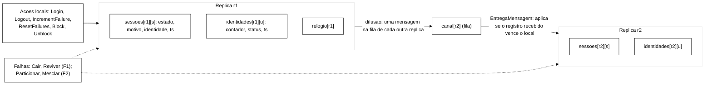

# 3. Verificação formal (TLA+ e TLC)

> Relatório técnico final da parte prática, capítulo 3. Senior, 11/11/2026, para o Escritor.
> Todos os números deste capítulo foram conferidos nos registros brutos do TLC (`.out`) ou nos `resumo.tsv` gerados pelos
> roteiros, nos caminhos indicados. Pela regra do autor (`feedback-verificar-numeros-contra-logs.md`), nada aqui vem só de
> outro texto. "Traço de N estados" conta o estado inicial (N − 1 passos).

**Onde estão os brutos.**

| Rodada | Revisão da especificação | Brutos |
|---|---|---|
| Invariantes globais com falhas, 03/10 | `32af7f8` (tiny, small, medium) e `dc64154` (full) | `wt-plano-ctrl/runs/tlc/inv-{tiny,small,medium,full}/` (idênticos em todas as worktrees; SHA de conteúdo conferido em seis delas) |
| Propriedades por réplica (B-32), 09/10 | `48d1571` | `wt-plano-ctrl/runs/tlc/prop-*/` e `audit-b32/` |
| Variantes de perda (B-35) e relógio (B-36), 16/10 | ramos próprios | `wt-b35/runs/tlc/perda-*`, `wt-b36/runs/tlc/relogio-*` |
| Desempate de `ts` (B-45), 04/11 a 06/11 | ANTES `20805b0`, DEPOIS `a2ce4c9`, controle FIFO `8f25803` | `wt-b45/runs/tlc/b45-*/resumo.tsv` e `.out` (parte só no disco, seção 3.10) |
| Fusão por máximo de conteúdo (`MesclarJoin`), 06/11 | `58ecd38` e `682bc4b` (ramo `feature/tla-mesclar-join`, ponta `4abd157` com o relatório) | `wt-tla-join/runs/tlc/join-*/` |

---

## 3.1 Ferramental, arquivos e revisões

- **Verificador.** TLC2 2.19 de 08/08/2024, revisão `5a47802` (primeira linha de todos os `.out`). Busca em largura.
  Nas rodadas de 03/10, 20 *workers* em Java 1.8.0_503; no B-32, no B-45 e na `MesclarJoin`, 4 *workers* (ou 1, para o
  traço mínimo) em Java 17.0.2 (`.meta` do B-45). Com mais de um *worker* o TLC não garante o traço mais curto; por isso
  os tamanhos de traço citados como mínimos são das execuções com 1 *worker* (`relatorio-b32-tlc-propriedades-2026-10-09.md`
  §1).
- **Arquivos.**
  - `spec/SessionStore.tla`: o modelo do protocolo (variáveis, ações, invariantes I1 a I6).
  - `spec/MCSession.tla`: o módulo de verificação (limites de canal, relógio e eventos de falha; simetria; propriedades
    por réplica; cenário semeado; colunas de falha).
  - `spec/MCFifo.tla` (ramo do B-45): cópia do modelo sem desempate e com canal FIFO, usada como controle.
  - `spec/MCSessionJoin.tla` (ramo `feature/tla-mesclar-join`): variante com a fusão por máximo de conteúdo.
  - `spec/MCPerda.tla` e `spec/MCRelogio.tla` (ramos do B-35 e do B-36): variantes de perda de mensagem e de relógio.
- **Revisão em cada lugar.** A tag da avaliação `4b96798` contém `SessionStore.tla` na revisão `20805b0` (SHA-256
  `7dde4bb1…`, igual ao de `git show 20805b0:spec/SessionStore.tla`). O desempate (`a2ce4c9`) e a `MesclarJoin`
  (`3c47ccf` a `4abd157`) **não estão** na tag nem no ramo de integração (`git merge-base --is-ancestor`, conferido); estão
  em `fix/b45-desempate-ts` e `feature/tla-mesclar-join`.

## 3.2 O modelo



- **Estado.** Por réplica, um registro por sessão (estado `NONE`, `VALID` ou `INVALID`; motivo `NONE`, `LOGOUT`,
  `EXPIRADA` ou `ADMIN_BLOCK`; identidade dona; marca de tempo `ts`) e um registro por identidade (contador, `OPEN` ou
  `BLOCKED`, `ts`). Cada réplica tem um relógio próprio, e cada escrita local recebe `ts = relogio + 1`. O registro único
  por chave espelha o objeto que o programa de carga grava como unidade (revisão de 02/10, commit `e424c8a`).
- **Canal.** Uma fila de mensagens pendentes por réplica de destino. Cada escrita local é difundida às outras réplicas;
  qualquer mensagem pendente pode ser entregue a qualquer momento, o que captura atraso e reordenação.
- **Regra de aplicação.** Na entrega e nas escritas locais, o registro recebido só substitui o local se vencer a
  comparação. Até a revisão `20805b0`, vencer era ter `ts` estritamente maior. Na revisão `a2ce4c9` (B-45, variante T2),
  vencer é ser maior na ordem lexicográfica da tupla `(ts, estado, motivo, identidade)` para sessões e
  `(ts, status, contador)` para identidades, com `NONE < VALID < INVALID`, `NONE < LOGOUT < EXPIRADA < ADMIN_BLOCK` e
  `OPEN < BLOCKED` (`wt-b45/docs/relatorio-b45-desempate-ts.md` §2). Com `ts` diferente, nada muda; só o empate passa a ter
  vencedor, e ele não depende da réplica de origem nem da ordem de entrega.
- **Falhas.** `Cair` e `Reviver` (F1) tiram e devolvem uma réplica; `Particionar` divide as réplicas em dois lados; o lado
  perdedor não age durante a partição (predicado `PodeAgir`); `Mesclar` termina a partição copiando para o lado perdedor
  os registros de uma réplica `rf` do lado vencedor, sem comparar marcas de tempo. Queda e partição se excluem
  (correção P-24, 03/10). O número de partições é limitado (P-25).
- **O que o modelo não tem.** Retransmissão, transferência de estado e resolução de conflitos real; escrita condicional
  por versão (o programa usa, `Metodologia.tex:298`); escrita parcial com erro (um nó aplica, o cliente recebe erro);
  atendimento pelo lado isolado entre o corte e a detecção (aproximado por uma escrita feita antes de `Particionar` e
  ainda não propagada).

### 3.2.1 Evolução do modelo

```mermaid
%%{init: {'theme':'base','themeVariables':{'background':'#ffffff','primaryColor':'#ffffff','primaryTextColor':'#000000','primaryBorderColor':'#000000','lineColor':'#000000','secondaryColor':'#ffffff','tertiaryColor':'#ffffff'}}}%%
flowchart LR
    A["26/05<br/>especificacao I1-I6<br/>primeiros TLC"] --> B["09/07<br/>modulo MCSession,<br/>configuracao tiny"]
    B --> C["16/09<br/>difusao a todas as replicas,<br/>relogio de Lamport, cascata"]
    C --> D["02/10<br/>registro unico por chave<br/>(sem desempate)"]
    D --> E["03/10<br/>queda e particao<br/>no modelo"]
    E --> F["09/10<br/>propriedades por replica,<br/>cenario semeado"]
    F --> G["16/10<br/>variantes de perda e relogio;<br/>auditoria"]
    G --> H["04/11<br/>desempate pelo conteudo (T2)<br/>e controle FIFO"]
    H --> I["06/11<br/>fusao por maximo (MesclarJoin);<br/>fim da rodada do B-45"]
```



| Data | Mudança | Commit | Por quê |
|---|---|---|---|
| 26/05 | especificação com I1 a I6 e primeiras execuções | `9ce2f15`, `3d7a3b0`, `3b762f5` | TCC I |
| 09/07 | módulo `MCSession.tla`, configuração `tiny`, verificação por invariante | execução em 09/07 (relógio do `.out`), versionada em `bb38ddc` (16/09) | fechar ao menos uma configuração de forma exaustiva |
| 16/09 | difusão a todas as réplicas (antes a mensagem ia a uma só, P-08), relógio de Lamport por campo, cascata do bloqueio propagada | `7ce78ca`, `aefe391`, `b9c46e2` e seguintes | defeitos de modelagem achados na rodada de 09/07 |
| 02/10 | registro único por chave; retirada do desempate por réplica | `e424c8a` | espelhar o objeto gravado pelo programa (Achado E) |
| 03/10 | ações `Cair`/`Reviver` e `Particionar`/`Mesclar`; P-24 e P-25 | `0d997f5`, `b9acd56`, `96fcf3c`, `b7d8e0a` | incluir falhas |
| 09/10 | propriedades por réplica e cenário semeado (B-32) | `48d1571` | separar a divergência transitória do efeito das falhas |
| 16/10 | variantes de perda (B-35) e de relógio (B-36); auditoria do B-32 | `6faa6f8`, `498c2f8`, `2788273` | testar hipóteses sobre I5/I6 e o artefato do relógio |
| 04/11 | desempate T2 (B-45) e controle FIFO | `a2ce4c9`, `8f25803` | corrigir o empate de `ts` (P-16), decisão D-8 do autor |
| 06/11 | variante `MesclarJoin` | `3c47ccf`, `bdbbd76`, `682bc4b` | dar argumento formal à regra de fusão A1 |

## 3.3 Invariantes

### 3.3.1 Forma global (em `SessionStore.tla`)

| Invariante | Definição informal | Forma no modelo | Tipo |
|---|---|---|---|
| I1, irreversibilidade do *logout* | uma sessão invalidada por *logout* não volta a ser válida | se alguma réplica tem a sessão `INVALID` com motivo `LOGOUT`, nenhuma réplica a tem `VALID` | segurança, estado |
| I2, consistência de bloqueio | identidade bloqueada não tem sessão válida | se alguma réplica tem a identidade `BLOCKED`, nenhuma réplica tem sessão dela `VALID` | segurança, estado |
| I3, monotonicidade do contador | o contador não diminui sem reposição ou desbloqueio | **forma de domínio**: o contador fica em `0..LIMITE` em toda réplica | tipagem |
| I4, unicidade do motivo | o motivo de invalidação não é reescrito | **forma de domínio**: o motivo pertence ao conjunto declarado | tipagem |
| I5, convergência da sessão | sob quiescência, as réplicas concordam sobre cada sessão | canal vazio implica estado, motivo e identidade iguais em todas as réplicas | convergência |
| I6, convergência da identidade | sob quiescência, as réplicas concordam sobre cada identidade | canal vazio implica contador e status iguais em todas as réplicas | convergência |

Fonte: `SessionStore.tla:668-725` (revisão de `wt-tla-join`, igual a `a2ce4c9` nessas linhas). As formas globais de I1 e
I2 comparam réplicas diferentes; por isso são violadas pela simples divergência transitória enquanto há mensagem em
trânsito. As de I3 e I4 são consequência da tipagem e não verificam monotonicidade nem imutabilidade (o texto já diz isso
em `Desenvolvimento.tex:38` e `:62`).

### 3.3.2 Formas por réplica e por transição (em `MCSession.tla`, desde o B-32)

| Propriedade | O que exige | Para que serve |
|---|---|---|
| I1F | numa réplica, sessão `INVALID` continua `INVALID` no passo seguinte | irreversibilidade como o auditor do programa a vê |
| I1M | I1F só nos passos `Mesclar` | atribuir a violação à fusão |
| I1P | um `Logout` deixa a sessão `INVALID` na própria réplica | detectar *logout* aceito e perdido |
| I2Fa | nos passos `Mesclar`, identidade `BLOCKED` continua `BLOCKED` | bloqueio que se perde na fusão |
| I2Fb | numa réplica, identidade `BLOCKED` não tem sessão `VALID` | consistência local do bloqueio |
| I4F | numa réplica, o motivo de uma sessão `INVALID` não muda no passo seguinte | unicidade do motivo (inclui a volta a `VALID`) |
| I4Fp | como I4F, só enquanto a sessão continua `INVALID` | troca de motivo pura |
| I4M, I4Mp | I4F e I4Fp só nos passos `Mesclar` | atribuir à fusão |
| MesclarPerdeChave | nos passos `Mesclar`, chave existente não vira ausente | perda de chave na fusão |

Fonte: `MCSession.tla:95-153`. As propriedades restritas a `Mesclar` são vazias por construção nas colunas sem partição
(nenhum passo `Mesclar` é alcançável); no catálogo isso aparece como "vácuo" (`docs/catalogo-operacao-falha-invariante.md`
§6).

## 3.4 Configurações

| Nome | Identidades | Sessões | Réplicas | Limite de bloqueio | Cotas (fila / relógio / eventos de falha) | Uso |
|---|---|---|---|---|---|---|
| `tiny` | 1 | 2 | 2 | 2 | 1 / 3 / 1 | invariantes globais; fecha de forma exaustiva |
| `small` | 2 | 3 | 2 | 3 | 1 / 3 / 1 | invariantes globais |
| `medium` | 3 | 3 | 2 | 3 | 1 / 3 / 1 | invariantes globais |
| `full` | 3 | 3 | 3 | 3 | 1 / 3 / 1 | invariantes globais |
| semeado r2 / r3 | 1 | 2 (já válidas, `Login` desabilitado) | 2 ou 3 | 2 | 3 / 5 / 2 (cotas do plano) ou 2 / 3 / 2 (reduzidas) | propriedades por réplica, I5/I6 no B-45 |

Fontes: `runs/tlc/inv-*/<config>-I1.cfg`; `MCSession.tla:156-173`; `relatorio-b32-tlc-propriedades-2026-10-09.md` §1.
Colunas de falha: sem falha (`quedas + particoes = 0`, só atraso de canal), só queda, só partição. Simetria:
`Permutations(SIDS) ∪ Permutations(REPLICAS)` depois do T2 (antes incluía `IDS`).

## 3.5 Resultados dos invariantes globais

### 3.5.1 Rodada de 03/10 (a citada hoje na monografia)

| Invariante | `tiny` | `small` | `medium` | `full` |
|---|---|---|---|---|
| I1 | violado, 4 estados | violado, 4 | violado, 4 | violado, 5 |
| I2 | violado, 4 | violado, 4 | violado, 4 | violado, 3 |
| I3 | sem violação, **exaustivo**: 570 089 distintos, 11 243 221 gerados, profundidade 21, 6 s | sem violação até o tempo-limite: 30 474 782 distintos em ~9 min | sem violação até o tempo-limite: 23 710 038 distintos | sem violação até o tempo-limite: 5 466 292 distintos em ~4 min |
| I4 | sem violação, exaustivo (mesmos números) | sem violação até o tempo-limite: 31 134 111 | 23 446 569 | 5 288 120 |
| I5 | violado, 5 | violado, 5 | violado, 5 | violado, 7 |
| I6 | violado, 6 | violado, 7 | violado, 5 | violado, 6 |

Fonte: `runs/tlc/inv-*/<config>-I<n>.out` (linha `Error: Invariant ... is violated`, contagem de `State N:`, linha final de
estados; horários de início e fim em `Starting...` e no último `Progress`). Esses números batem com `Desenvolvimento.tex:54-62`
(DES-08). Duas ressalvas: foram obtidos com 20 *workers*, então os tamanhos não são necessariamente mínimos; e a pasta
`inv-full/` é da revisão `dc64154`, anterior ao limite de partições P-25 (`relatorio-b45-desempate-ts.md` §1).

### 3.5.2 Resultado final, com o desempate (B-45, revisão `a2ce4c9`)

| Invariante | `tiny` | `small` | `medium` | `full` | Ações do traço mínimo (1 *worker*) |
|---|---|---|---|---|---|
| I1 | violado, 4 | violado, 4 | violado, 4 | violado, 4 | `Login`, `Login`, `Logout` (divergência transitória) |
| I2 | violado, 3 | violado, 3 | violado, 3 | violado, 3 | `Login`, `Block` (divergência transitória) |
| I3 | sem violação, exaustivo: 635 404 distintos, 12 067 609 gerados, profundidade 21 | sem violação até 600 s (7 787 442 distintos) | até 600 s (11 318 939) | até 600 s (6 730 083 antes de uma pausa) | não se aplica |
| I4 | sem violação, exaustivo (mesmos números) | até 600 s (12 477 665) | até 600 s (11 191 772) | até 600 s (8 526 399) | não se aplica |
| I5 | violado, 5 | violado, 5 | violado, 5 | violado, 6 | sempre com `Particionar` e `Mesclar` |
| I6 | violado, 5 | violado, 5 | violado, 5 | violado, 6 | sempre com `Particionar` e `Mesclar` |

Fontes: tamanhos de traço em `wt-b45/runs/tlc/b45-inv-w1/resumo.tsv` (linhas `d-inv1-*`, 1 *worker*); ações extraídas dos
`.out` da mesma pasta (`State N: <Ação`); I3 e I4 em `b45-inv/resumo.tsv` e `.out` (4 *workers*; o de `full-I3` foi
retomado de *checkpoint*, e a contagem de gerados reinicia na retomada, então cito o maior número de distintos antes da
pausa, `Progress(13)` de 04/11 23:59:51). A mesma pasta tem o ANTES (`a-inv*`, revisão `20805b0`, 1 *worker*): I1 4 estados
e I2 3 estados nas quatro configurações; I5 e I6 com 5, 5, 5 e 6 estados, mas com traços **sem** fusão em `small`, `medium`
e no I6 de `tiny` (por exemplo `small-I5`: `Login`, `Login`, `Entrega`, `Entrega`).

### 3.5.3 I5 e I6: o defeito de modelagem e a correção

1. **O defeito.** Com o registro único por chave (02/10) e sem desempate, duas escritas concorrentes na mesma chave em
   réplicas com o mesmo relógio recebem o mesmo `ts`. Com a regra "estritamente maior" nos dois sentidos, cada réplica
   recusa o registro da outra, as filas esvaziam e as réplicas ficam diferentes: I5 ou I6 violado sob quiescência. É um
   defeito do modelo, não do protocolo nem do Infinispan (registrado como P-16; traço de referência em
   `relatorio-b45-desempate-ts.md` §1: `Logout(r1,s1)` e `Block(r2,u1)`, ambos com `ts = 2`, e duas entregas).
2. **A correção (T2).** Desempate pelo conteúdo do registro, com a ordem da seção 3.2.
3. **O controle.** O canal FIFO sem desempate (`MCFifo.tla`) continua violando I5 e I6 sem fusão possível
   (`b45-iso/resumo.tsv`, linhas `f-iso-*`; `b45-semeado/resumo.tsv`, linhas `f-sem-*`), o que mostra que a causa era o
   empate, não a ordem de entrega.
4. **O efeito, sem fusão possível** (restrições `SemFalha` e `SoQueda`, `b45-iso/resumo.tsv`):

   | Configuração | ANTES (`20805b0`) | DEPOIS (`a2ce4c9`) |
   |---|---|---|
   | `tiny`, sem falha | I5 violado (9 estados), I6 violado (5) | I5 e I6 sem violação, exaustivo (6 764 distintos) |
   | `tiny`, só queda | I5 violado (9), I6 violado (5) | exaustivo (26 507 distintos) |
   | `small`, sem falha | I5 e I6 violados (5) | exaustivo (228 004 distintos) |
   | `small`, só queda | I5 e I6 violados (5) | exaustivo (887 850 distintos) |

   No cenário semeado com 2 réplicas, DEPOIS: sem falha, I5 e I6 sem violação, exaustivo (3 379 036 distintos); só queda,
   I5 exaustivo (27 022 168 distintos) e I6 sem violação até 602 s; só partição, I5 e I6 violados em 5 estados
   (`b45-semeado/resumo.tsv`, `b45-semeado-w1/resumo.tsv`). Com 3 réplicas, sem falha e só queda ficaram sem violação até
   o tempo-limite (10,7 a 20,9 milhões de distintos), e a partição violou em 6 estados.
5. **O que sobra.** Depois do desempate, **todo** contraexemplo de I5 e I6 passa pela fusão: `Mesclar` copia o registro
   do lado vencedor sobre uma escrita local ainda não propagada, e as mensagens dessa escrita, entregues depois, só
   alcançam as outras réplicas. É um resultado do modelo sob partição, coerente com a advertência do Infinispan de que a
   fusão pode perder escritas do lado minoritário (`infinispan_configuring_15`, seção 7.1.1).

## 3.6 Propriedades por réplica

### 3.6.1 Vereditos no cenário semeado (3 réplicas, revisão final `a2ce4c9`, traço com 1 *worker*)

| Propriedade | Sem falha (só atraso) | Só queda | Só partição |
|---|---|---|---|
| I1F | sem violação; **exaustivo** com 2 réplicas nas cotas do plano (3 379 036 distintos) e com 3 réplicas nas cotas reduzidas (1 190 078) | sem violação; exaustivo com 3 réplicas, cotas reduzidas e até duas quedas (13 894 032 distintos) | **violada, 4 estados** |
| I1M | vazia (sem fusão) | vazia | violada, 4 |
| I2Fa | vazia | vazia | violada, 4 |
| I2Fb | violada, 3 (bloqueio por limite sem cascata) | violada, 3 | violada, 3 |
| I4F | violada, 4 | violada, 4 | violada, 4 |
| I4Fp | violada, 4 | violada, 4 | violada, 4 |
| I4M | vazia | vazia | violada, 4 |
| I4Mp | vazia | vazia | violada, 5 |
| MesclarPerdeChave (modelo livre) | não se aplica | não se aplica | violada, 4 |

Fontes: `wt-b45/runs/tlc/b45-prop-w1/resumo.tsv` (traços), `b45-prop/resumo.tsv` (I1F com 2 réplicas, 3/5/2) e
`b45-prop41/resumo.tsv` (fechamentos com cotas reduzidas: sem falha 2/3/2 com 3 réplicas; só queda 2/3/2 com 2 réplicas,
16 202 distintos, e com 3 réplicas e uma ou duas quedas, 5 821 422 e 13 894 032). A rodada ANTES (B-32, revisão `48d1571`)
dá os mesmos vereditos; os fechamentos de I1F tinham 2 968 799 (2 réplicas, sem falha), 1 627 731 (3 réplicas, sem falha,
reduzidas) e 19 229 901 distintos (3 réplicas, duas quedas), conferidos em `wt-plano-ctrl/runs/tlc/prop-sem/`,
`prop-sem-c2r3/` e `prop-queda-c2r3-ev2-longo/`. O desempate encurtou I4F e I4Fp sem falha de 5 para 4 estados, como a
expectativa E-9 do B-45 previa (agora o empate troca o motivo, `ADMIN_BLOCK` vence `LOGOUT`).

### 3.6.2 O traço central: I1F sob partição

```mermaid
%%{init: {'theme':'base','themeVariables':{'background':'#ffffff','primaryColor':'#ffffff','primaryTextColor':'#000000','primaryBorderColor':'#000000','lineColor':'#000000','secondaryColor':'#ffffff','tertiaryColor':'#ffffff'}}}%%
sequenceDiagram
    participant r1 as r1 (fica isolada)
    participant r2 as r2
    participant r3 as r3
    Note over r1,r3: estado 1: s1 VALID (ts 1) nas tres
    r1->>r1: estado 2: Logout(s1): INVALID/LOGOUT, ts 2; mensagens em fila para r2 e r3
    Note over r1,r3: estado 3: Particionar {r1} | {r2, r3}
    r2-->>r1: estado 4: Mesclar copia o registro de r2 (VALID, ts 1) para r1
    Note over r1: o logout confirmado foi desfeito: I1F e I1M violadas
```

Fonte: `relatorio-b32-tlc-propriedades-2026-10-09.md` §3.4 e o `.out` de `prop-particao-w1` (468 gerados, 162 distintos,
`resumo-r3.tsv`); reproduzido na revisão final (`b45-prop-w1`, `d-prop1-particao-r3-I1F`, 4 estados). É o mecanismo que o
projeto chama de M1: escrita aceita pelo lado que vai perder, entre o corte e a detecção, e perdida na fusão.

### 3.6.3 Leitura dos outros contraexemplos

- **I2Fb é violada por construção.** O bloqueio por limite (`IncrementFailure` até o limite) não invalida as sessões
  existentes, no modelo e no código (`SessionOps.incrementFailure`, P-27). O auditor do programa separa esse caso do
  bloqueio administrativo (`Desenvolvimento.tex:58`).
- **I4F e I4Fp sem falha** vêm da corrida entre `Logout` e `Block` em réplicas diferentes: a réplica que aplicou o
  bloqueio recebe depois o *logout* (ou o contrário) e troca o motivo sem passar por `VALID`. O programa de carga evita
  isso com escrita condicional à versão (a primeira invalidação vence, `Metodologia.tex:298`), mecanismo que o modelo não
  tem.
- **I1P e I1F no modelo livre** (com `Login`) violam sem falha por um artefato: `EntregaMensagem` não atualiza o relógio
  da réplica, então um `Logout` pode receber `ts` não maior que o registro local e ser descartado (P-26). Na variante com
  relógio pelo máximo (B-36, `MCRelogio.tla`), I1F continua violada, agora por *logins* concorrentes da mesma sessão em
  réplicas diferentes (`wt-b36/docs/relatorio-b36-relogio-2026-10-16.md` §3). Nenhum dos dois casos ocorre no programa,
  que usa a versão do registro lido e identificador único de sessão (`Desenvolvimento.tex:58`).
- **Perda de mensagem** (B-35, `MCPerda.tla`) é ilustrativa: sem retransmissão no modelo, qualquer perda diverge por
  construção; nas colunas sem falha e com queda, nenhuma propriedade por réplica que valia passou a violar
  (`wt-b35/docs/relatorio-b35-perda-canal-2026-10-16.md` §3 e §4).

## 3.7 Variante com fusão por máximo de conteúdo (`MesclarJoin`, a regra A1 no modelo)

`MCSessionJoin.tla` troca só a fusão das sessões: para cada sessão, o máximo das cópias de **todas** as réplicas, escrito
em todas, na ordem `(estado, motivo, ts, identidade)`. As identidades continuam com a fusão publicada. Controle negativo:
a mesma variante com a ordem invertida (`VALID > INVALID`).

| Propriedade | `Mesclar` publicado | `MesclarJoin` (ordem de conteúdo) | Ordem invertida |
|---|---|---|---|
| I1F | violada, 4 estados | **sem violação**: fechou com 2 réplicas e cotas 2/3/2 (79 224 distintos, profundidade 13); com 3 réplicas nas cotas do plano, sem violação até 600 s (20 458 469 distintos) | violada, 4 |
| I1M / I1MJ (só fusão) | violada, 4 | sem violação; fechou com 2 réplicas (79 224) | violada, 4 |
| MesclarPerdeChave(J), modelo livre | violada, 4 | sem violação; fechou com 2 réplicas (5 210 736 distintos, profundidade 17) | não rodada |
| I4M / I4MJ | violada, 4 (a reversão para `VALID`) | **violada, 5**: `Logout`, `Block`, `Particionar`, `MesclarJoin`; o motivo de uma sessão troca de `LOGOUT` para `ADMIN_BLOCK` | não rodada |
| I4Mp / I4MpJ | violada, 5 | violada, 5 (mesmo traço) | não rodada |
| I2Fa / I2FaJ | violada, 4 | violada, 4 (a identidade volta a `OPEN` no lado perdedor) | não rodada |

Fontes: `wt-tla-join/runs/tlc/join-ctrl-w1/`, `join-join-w1/`, `join-join/`, `join-join-red/` e `join-inv-w1/`
(conferidos os `.out` de I1F, I1MJ, I4MJ, I2FaJ, MesclarPerdeChaveJ e dos controles); relatório
`wt-tla-join/docs/relatorio-tla-mesclar-join-2026-11-06.md` §5. As oito expectativas pré-registradas no relatório (E-J1 a
E-J8) se confirmaram.

**Leitura.** `INVALID` é o maior estado na ordem, e o máximo de um conjunto com uma cópia `INVALID` é `INVALID`; por isso
nenhuma fusão desfaz uma invalidação. O custo previsto é a troca de motivo quando os dois lados invalidaram a mesma
sessão por motivos diferentes: toda fusão que converge para um registro troca o motivo em alguma réplica nesse caso. O
coordenador decidiu manter a definição de I4 e relatar a troca, se ocorrer, como custo da A1 (DT-027, nota de 06/11). A
variante não modela a exposição na janela (leitura de `VALID` na maioria antes da fusão), porque o lado isolado do modelo
não atende leituras.

## 3.8 O que o modelo previu e o que o experimento mostrou

| # | Previsão do modelo | Evidência no modelo | No experimento | Situação |
|---|---|---|---|---|
| 1 | Sob partição, o *logout* confirmado no lado isolado é desfeito na fusão | I1F e I1M, 4 estados (B-32, B-45) | primeira I1 real observada em 06/11 numa partição com varredura final (sessão `715b6c6c…`, `dados-vm/piloto-violacoes-2026-11-06/manual/f2-sweep-2/varredura*.csv`, rótulo REAL); na avaliação, perda permanente nos braços com a regra atual (capítulo 5) | **confirmado** |
| 2 | Sem falha, com queda e com atraso de canal, a irreversibilidade por réplica vale até as cotas | I1F fechada sem falha e com queda (seção 3.6.1) | células sem falha, F1 e F3 sem violação em nenhum braço (capítulo 5) | **compatível**; ausência de violação no experimento não prova ausência do fenômeno |
| 3 | A fusão pelo máximo de conteúdo elimina a reversão na fusão e a perda de chave | `MesclarJoin` (seção 3.7) | braços com a A1 sem perda permanente (capítulo 5) | **confirmado** |
| 4 | A A1 não age antes da fusão | o modelo não tem leitura no lado isolado | a taxa V, dominada pela exposição antes da fusão, não caiu com a A1 (capítulo 5) | **compatível** |
| 5 | Com a A1, o motivo pode trocar de `LOGOUT` para `ADMIN_BLOCK` na fusão | I4MJ, 5 estados | nenhuma linha de I4 nos arquivos de violação e de varredura das 90 execuções da avaliação (contado por mim nos brutos de `campanha-s3-fatorial/exec-*/`) | **não observado**; exige *logout* e bloqueio da mesma sessão em lados opostos da partição |
| 6 | A fusão pode desfazer o bloqueio da identidade no lado isolado (com ou sem A1) | I2Fa e I2FaJ, 4 estados | I2 real foi raro na avaliação (capítulo 5) | **pouco observado**; o caminho existe no modelo |
| 7 | Bloqueio por limite deixa sessão válida de identidade bloqueada | I2Fb, 3 estados, por construção | a varredura rotula esses casos como "esperada por desenho" e o auditor os deixa fora de V | **coerente por construção** |
| 8 | Corrida entre `Logout` e `Block` troca o motivo sem falha | I4F e I4Fp, 4 estados | I4 não observado | **artefato do modelo**: o programa usa escrita condicional à versão |
| 9 | Sem fusão, as réplicas convergem; com fusão, a divergência pode ser permanente | B-45 (seção 3.5.3) | divergência persistente em duas execuções da avaliação (`exec-0034`, F2, braço PO; `exec-0081`, F1, braço ativo), com linha I5 em `violacoes-rep-001.csv`; na `exec-0034` o mecanismo foi um *logout* que voltou erro de transporte ao cliente mas ficou aplicado numa réplica, sem reparo de leitura (`analise-preliminar-avaliacao-fatorial-2026-11-07.md` §1.3) | **parcial**: a divergência real existe, mas por escrita parcial com erro, que o modelo não representa; o mecanismo da `exec-0081` não foi analisado |
| 10 | (não previsto) leitura defasada na troca de vista e releitura `VALID` pelo nó isolado depois de um *logout* confirmado pela maioria (forma 2 de I1) | o lado isolado não atende no modelo | observadas no piloto (condição d, execução 2) e na avaliação | **lacuna do modelo** |

As previsões 1, 3 e 5 a 8 vêm do catálogo operação × falha × invariante (`docs/catalogo-operacao-falha-invariante.md`
§2 e §3), que listava as observações esperadas no sistema real como "pendente" em 16/10.

## 3.9 Tabelas para a monografia

A seção "Verificação formal" (`Desenvolvimento.tex:47-64`) não tem tabela; os resultados estão em prosa (DES-07 a DES-09,
DES-80). A prosa cita a rodada de 03/10 e diz que a verificação com o desempate "ainda não terminou". Proponho três
tabelas novas nessa seção e uma na discussão.

### T3-01. Resultados do TLC para I1 a I6 no modelo com falhas (NOVA)

**Onde entra:** `Desenvolvimento.tex`, seção "Verificação formal", depois de DES-07 (linha 52), substituindo a enumeração
de traços de DES-08 (linha 54) e o primeiro período de DES-80 (linha 60). Usa a revisão final (com desempate) e os traços
mínimos.

```latex
\begin{table}[htbp]
\captionsetup{type=table, name=Tabela}
\caption{Resultados do TLC para os invariantes I1 a I6 no modelo com falhas}
\label{tab-tlc-invariantes}
\centering
\footnotesize
\begin{tabular}{p{1.4cm}p{2.6cm}p{2.6cm}p{2.6cm}p{2.6cm}}
\hline
\textbf{Invariante} & \textbf{\texttt{tiny}} & \textbf{\texttt{small}} & \textbf{\texttt{medium}} & \textbf{\texttt{full}} \\
\hline
I1 & violado (4 estados) & violado (4) & violado (4) & violado (4) \\
I2 & violado (3) & violado (3) & violado (3) & violado (3) \\
I3 & sem violação, exaustivo (635\,404 estados) & sem violação até 600\,s & sem violação até 600\,s & sem violação até 600\,s \\
I4 & sem violação, exaustivo (635\,404 estados) & sem violação até 600\,s & sem violação até 600\,s & sem violação até 600\,s \\
I5 & violado (5), com fusão & violado (5), com fusão & violado (5), com fusão & violado (6), com fusão \\
I6 & violado (5), com fusão & violado (5), com fusão & violado (5), com fusão & violado (6), com fusão \\
\hline
\end{tabular}
\fonte{O autor. Entre parênteses, o número de estados do menor contraexemplo, incluído o inicial; ``com fusão'' indica que todo contraexemplo passa por partição e fusão}
\end{table}
```

Texto de apoio (não redação final): sem o desempate, I5 e I6 também eram violados sem nenhuma falha; com ele, sem
partição possível, a busca fechou sem violação em `tiny` e `small`, e o controle com canal FIFO sem desempate continuou
violando, o que atribui o defeito ao empate de marcas de tempo.

### T3-02. Propriedades por réplica por coluna de falha (NOVA)

**Onde entra:** `Desenvolvimento.tex`, seção "Verificação formal", no lugar da prosa de DES-08, segundo e terceiro
parágrafos (linhas 56-58).

```latex
\begin{table}[htbp]
\captionsetup{type=table, name=Quadro}
\caption{Propriedades avaliadas réplica a réplica, por coluna de falha, no cenário semeado}
\label{qd-tlc-por-replica}
\centering
\footnotesize
\begin{tabular}{p{2.6cm}p{3.6cm}p{3.6cm}p{3.6cm}}
\hline
\textbf{Propriedade} & \textbf{Sem falha} & \textbf{Só queda} & \textbf{Só partição} \\
\hline
\raggedright Irreversibilidade (I1 por réplica) & sem violação; busca exaustiva até as cotas & sem violação; busca exaustiva até as cotas & violada (4 estados) \\
\raggedright Irreversibilidade na fusão & não se aplica & não se aplica & violada (4) \\
\raggedright Bloqueio preservado na fusão & não se aplica & não se aplica & violada (4) \\
\raggedright Bloqueio local (I2 por réplica) & violada (3), por construção & violada (3), por construção & violada (3), por construção \\
\raggedright Motivo único (I4 por réplica) & violada (4) & violada (4) & violada (4) \\
\raggedright Motivo único na fusão & não se aplica & não se aplica & violada (4) \\
\raggedright Chave preservada na fusão & não se aplica & não se aplica & violada (4) \\
\hline
\end{tabular}
\fonte{O autor. ``Não se aplica'': a propriedade só restringe passos de fusão, inalcançáveis sem partição. A violação ``por construção'' vem do bloqueio por limite, que não invalida sessões}
\end{table}
```

### T3-03. Variante do modelo com fusão por máximo de conteúdo (NOVA)

**Onde entra:** `Desenvolvimento.tex`, seção "Verificação formal", num parágrafo novo depois de DES-80; ou junto da
descrição da regra A1, se o capítulo do controlador a apresentar antes.

```latex
\begin{table}[htbp]
\captionsetup{type=table, name=Quadro}
\caption{Fusão das sessões no modelo: regra publicada, máximo de conteúdo e ordem invertida}
\label{qd-tlc-fusao-maximo}
\centering
\footnotesize
\begin{tabular}{p{3.2cm}p{2.4cm}p{5.2cm}p{2.4cm}}
\hline
\textbf{Propriedade} & \textbf{Fusão publicada} & \textbf{Máximo de conteúdo} & \textbf{Ordem invertida} \\
\hline
\raggedright Irreversibilidade por réplica & violada (4) & sem violação; exaustiva com 2 réplicas (79\,224 estados) e sem violação até 600\,s com 3 réplicas & violada (4) \\
\raggedright Chave preservada na fusão & violada (4) & sem violação; exaustiva com 2 réplicas & não verificada \\
\raggedright Motivo único na fusão & violada (4) & violada (5): \emph{logout} e bloqueio em lados opostos trocam o motivo & não verificada \\
\raggedright Bloqueio preservado na fusão & violada (4) & violada (4): a identidade volta a desbloqueada no lado perdedor & não verificada \\
\hline
\end{tabular}
\fonte{O autor}
\end{table}
```

### T3-04. Previsões do modelo e observação no experimento (NOVA)

**Onde entra:** no capítulo de resultados e discussão (a definir com o capítulo 5), como fechamento do alinhamento
formal-experimental prometido no Apêndice (`ApPlanoTCC2.tex:23`). Versão condensada da seção 3.8; não leva números do
experimento.

```latex
\begin{table}[htbp]
\captionsetup{type=table, name=Quadro}
\caption{Previsões do modelo formal e observação no experimento}
\label{qd-modelo-experimento}
\centering
\footnotesize
\begin{tabular}{p{5.2cm}p{5.0cm}p{3.4cm}}
\hline
\textbf{Previsão do modelo} & \textbf{Observação no experimento} & \textbf{Situação} \\
\hline
\raggedright \emph{Logout} no lado isolado desfeito na fusão & invalidações perdidas depois da fusão com a regra atual & confirmada \\
\raggedright Irreversibilidade preservada sem falha, com queda e com atraso & nenhuma violação nessas células & compatível \\
\raggedright Fusão pelo máximo de conteúdo preserva as invalidações & nenhuma perda permanente com a regra A1 & confirmada \\
\raggedright Fusão pelo máximo troca o motivo em invalidações concorrentes & troca de motivo não observada & não observada \\
\raggedright Fusão desfaz o bloqueio da identidade no lado isolado & bloqueio violado raramente & pouco observada \\
\raggedright Divergência permanente só com fusão & divergência persistente rara, por escrita parcial com erro & parcial \\
\raggedright Lado isolado não atende (abstração do modelo) & releitura válida pelo nó isolado depois do \emph{logout} & lacuna do modelo \\
\hline
\end{tabular}
\fonte{O autor}
\end{table}
```

### T3-05. Linha T21 da `tab-parametros-baseline` (ATUALIZAR)

Está no capítulo 2, Tabela T2-01: "1 a 3 identidades, 2 a 3 sessões e 2 a 3 réplicas" no lugar de "2–3 identidades,
sessões e réplicas" (`Metodologia.tex:277`), porque `tiny` tem uma identidade.

## 3.10 Já está na monografia × novo ou mudou

| Tema | O que o texto diz (arquivo:linha) | Situação | Evidência e o que fazer |
|---|---|---|---|
| Quando a configuração `tiny` e o `MCSession.tla` entraram | "As cinco rodadas, de maio a julho de 2026, usaram só essas três configurações; a configuração `tiny` foi acrescentada depois, nas verificações de setembro de 2026, com o módulo `MCSession.tla`" (`Desenvolvimento.tex:50`, DES-60 e DES-77; repetido em `:138`, DES-70 e DES-78) | **errado** | o `.out` de `tiny` com `MCSession.tla` tem `Starting... (2026-07-09 23:55:01)` e 424 398 distintos / 4 210 488 gerados (`git show bb38ddc:runs/tlc/inv-tiny/tiny-I3.out`); a rodada de 09/07 já usou `tiny`, só versionada em 16/09 (`bb38ddc`). Corrigir para "acrescentada na rodada de julho de 2026 e versionada em setembro" |
| Verificação de I5/I6 com o desempate | "a nova verificação de I5 e I6 com ele ainda não terminou" (`Desenvolvimento.tex:60`, DES-80); "falta concluir a nova verificação" (`ApPlanoTCC2.tex:64`, APX-15); "a pendência da especificação é a correção do empate" (`Desenvolvimento.tex:64`, DES-09) | **desatualizado** | terminou em 06/11 (`wt-b45/runs/tlc/b45-retomada-2026-11-06.log`, última linha `fim rc=0 2026-11-06T16:37:59`, hora local); resultado na seção 3.5.3 e na Tabela T3-01 |
| Traços de I1 e I2 | 4 estados em `tiny`, `small` e `medium` e 5 em `full` (I1); 4 e 3 (I2) (`Desenvolvimento.tex:54`) | correto para a rodada de 03/10 com 20 *workers*; **não mínimo** | traços mínimos (1 *worker*, ANTES e DEPOIS): I1 com 4 e I2 com 3 nas quatro configurações (`b45-inv-w1/resumo.tsv`). Usar os mínimos |
| I5/I6: "5 a 7 estados", "cinco dos oito traços mínimos", "I5 em `tiny` e I6 em `small` e em `full`" pela fusão (`Desenvolvimento.tex:60`) | números conferidos nos `.out` de 03/10 (20 *workers*) | **precisão**: não são mínimos | com 1 *worker* na revisão `20805b0`, também 5 de 8 são de empate, mas os de fusão são I5 de `tiny` e I5 e I6 de `full`. Como o desempate já está verificado, trocar o parágrafo pelo resultado final (seção 3.5.3) |
| Contagens de I3 e I4 | `tiny` exaustivo, 570 089 distintos, 11 243 221 gerados, profundidade 21; `small` 30 474 782 em ~9 min; `full` 5 466 292 em ~4 min (`Desenvolvimento.tex:62`) | **correto** (conferido nos `.out` de 03/10) | com o desempate, `tiny` fecha com 635 404 distintos e 12 067 609 gerados, profundidade 21; atualizar se a tabela usar a revisão final |
| Regra de aplicação no canal | "aplica o registro recebido somente se a marca de tempo da mensagem for maior que a local" (`Desenvolvimento.tex:21`, DES-04) | **desatualizado** para a revisão final | com o desempate, vence o registro maior na ordem da tupla (seção 3.2); declarar que a revisão final está no ramo do B-45 |
| "28 contraexemplos" de I2 por réplica, todos do bloqueio por limite (`Desenvolvimento.tex:58`, DES-61) | 28 linhas `I2Fb` violadas em `wt-b36/runs/tlc/prop-*/resumo*.tsv` (21) e `relogio-*/resumo*.tsv` (7) | correto para as rodadas até 16/10 | o B-45 acrescentou mais contraexemplos de I2Fb (seção 3.6.1), cujo mecanismo não li traço a traço. Sugiro "todos os contraexemplos examinados" em vez do número |
| I1 por réplica sob partição, 4 estados; preservada sem falha e com queda até as cotas | `Desenvolvimento.tex:56` | **correto** | manter; acrescentar os fechamentos da seção 3.6.1 |
| Fusão por máximo de conteúdo | ausente | **novo** | Tabela T3-03 e seção 3.7 |
| Alinhamento modelo × experimento | prometido em `ApPlanoTCC2.tex:23` e `ConclusoesParciais.tex:93`, não feito | **novo** | seção 3.8 e Quadro T3-04 |
| Revisão da especificação que acompanha a avaliação | o texto descreve "a especificação" sem revisão | **precisa declarar** | a tag `4b96798` tem `SessionStore.tla` em `20805b0`; desempate e `MesclarJoin` em ramos não integrados (seção 3.1) |
| Variantes de perda e relógio | "nenhuma das duas corrige o problema de I5 e I6" (`Desenvolvimento.tex:40`, DES-05) | **correto** | manter; acrescentar que o problema de I5/I6 sem fusão foi corrigido pelo desempate |
| Conclusões parciais | "contraexemplos para I1, I2, I5 e I6 e ausência de violação para I3 e I4" (`ConclusoesParciais.tex:74`) | **correto** | manter |
| T21 | "2–3 identidades, sessões e réplicas" (`Metodologia.tex:277`) | **impreciso** | `tiny` tem 1 identidade (Tabela T2-01) |

## 3.11 Fontes bibliográficas necessárias

| Afirmação | Chave | Situação |
|---|---|---|
| TLA+, invariância `□P`, TLC, restrições de estado e simetria | `lamport_specifying_systems_2002`, `yu_lamport_tla_modelchecking_1999` | já no `.bib`; **Bibliotecário: capítulo do TLC sobre simetria e restrição de estado**, e se a obra diz que a busca em largura com um *worker* dá o contraexemplo mais curto |
| Uso industrial do TLA+ em replicação | `newcombe_aws_tla_2014`, `newcombe_aws_formal_methods_2015` | já no `.bib` |
| Cardinalidades pequenas | `yuan_simple_testing_2014`, `jackson_software_abstractions_2012` | já no `.bib` |
| Ordem total com desempate (como em relógios lógicos com desempate pelo processo) | `lamport_time_clocks_1978` | já no `.bib`; útil para justificar o T2 como ordem total |
| Semirreticulado e convergência pela junção (máximo) | `shapiro_crdt_2011` | já no `.bib` |
| Perda na fusão de escritas do lado minoritário | `infinispan_configuring_15` (seção 7.1.1) | já citada |
| Política de fusão própria no Infinispan | `infinispan_configuring_15` | **Bibliotecário: confirmar a seção de políticas de fusão personalizadas** |
| TLC2 2.19 como ferramenta | `lee_tla_tlc_2021` está no `.bib`, mas não conferi o conteúdo | **Bibliotecário: verificar se serve para citar a versão e o funcionamento do TLC** |

## 3.12 Pendências e o que não pôde ser verificado

- **Brutos do B-45 não commitados.** O commit `ade41c7` tem 142 de 197 execuções; as restantes (inclusive `b45-prop`,
  `b45-prop-w1`, `b45-prop41` e partes de `b45-semeado`) estão só no disco de `wt-b45` (`git status`: pastas não
  rastreadas e arquivos modificados). Os números das seções 3.5.2, 3.5.3 e 3.6.1 vêm desses arquivos no disco. É preciso
  commitar antes de citar no texto e antes do envio ao repositório público.
- **Seção 6 do relatório do B-45 vazia.** `wt-b45/docs/relatorio-b45-desempate-ts.md` §6 diz "(preenchido depois da
  rodada)". Os resultados estão nos `resumo.tsv`; ninguém confrontou formalmente as expectativas E-1 a E-9 com eles.
  Conferi E-1 (traços DEPOIS de I5/I6 passam por fusão), E-3 (isolamento fechou), E-5 (FIFO viola) e E-9 (I4Fp encurta
  para 4); as demais não conferi uma a uma.
- **Integração das especificações.** Desempate e `MesclarJoin` estão em ramos fora da integração; decidir se entram em
  `main` antes do texto final (plano de fechamento git, fora deste capítulo).
- **Fechamento com 3 réplicas na `MesclarJoin`** com cotas 2/3/2 foi pausado aos 516 s (8,9 milhões de distintos, sem
  violação) e não foi retomado.
- **I2Fb depois do desempate:** mecanismo dos novos traços não lido; o tamanho mínimo segue 3.
- **`exec-0081`:** o mecanismo da divergência persistente na célula F1 não foi analisado.
- **Contagem de I4 na avaliação (zero):** feita por mim com `awk` sobre a coluna `invariante` de
  `violacoes-rep-001.csv` e a primeira coluna de `varredura-rep-001.csv` das 90 pastas; o capítulo 5 deve trazer a
  contagem oficial por desfecho.
