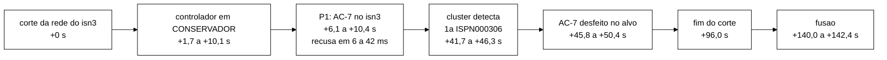

# 4. O controlador heurístico do *cluster*

**Situação dos números.** Os números de comportamento do controlador na avaliação (seção 4.12) foram
**recontados pelo Senior em 11/11 direto dos brutos** (`decisoes-rep-001.jsonl`, `observaveis-rep-001.jsonl`,
`stdout.log`, `marcadores.txt` e `rep-001.csv` de cada execução em
`dados-vm/cs3-2026-11/fat-20261108T051402Z/campanha-s3-fatorial/`) com o *script*
`docs/relatorio-tecnico-final/scripts/trilhas_controlador.py`, cuja saída completa está em
`scripts/trilhas_controlador-saida.txt` (versionada junto). Onde batem com a pré-análise de 07/11, isso é dito.
Os números de desenho, parâmetros e testes vêm do código da *tag* `int/2026-11-06-aval` (`4b96798`), lido na árvore
`dados-vm/cs3-2026-11/bundle-fat-4b96798/arv/cs3-4b96798/`, e dos pré-registros (DT-020 a DT-028). **Os resultados da
comparação entre braços (taxa de violações, p99, custo, energia) não estão aqui: ver o capítulo 5.**

**Nomes que confundem.** Três famílias de rótulos convivem no projeto e a monografia precisa separá-las:

| Rótulo | O que é | Onde |
|---|---|---|
| R1 a R4 | as quatro regras do **núcleo de decisão** (perfis NORMAL e CONSERVADOR) | `controle/Controlador.java`, `Decisao.Regra` |
| R1 a R8 do AC-7 | os oito **cuidados do atuador** que manda o nó ignorar o *cache* (relatório A4 §8) | `session/AtuadorIgnorarCache.java` |
| P0, P1, P2 | as três **políticas de reação** escolhidas a cada janela em CONSERVADOR | `controle/PoliticaPorAssinatura.java` |
| AC-1 a AC-7 | as **ações** candidatas sobre o *cluster* (só AC-7 foi usada na avaliação) | `controle/AcaoCluster.java` |
| A1 | a **política de fusão** própria do `sessions-async` (extensão do servidor; não é ação do controlador) | `extensao-servidor/` |
| A4 | o nome da alternativa "ignorar o *cache*" no estudo de 06/11; no código ela é o AC-7, e o "efeito A4" da análise é o efeito do controlador ativo com o AC-7 | `wt-a4/docs/relatorio-a4-2026-11-06.md` |

Recomendação ao Escritor, alinhada ao glossário (capítulo 10, §10.1): na monografia, manter R1 a R4 para o núcleo;
**não dar código** aos oito cuidados do AC-7 (C1 a C3 já são os critérios da mistura no texto), só numerá-los numa
tabela; e usar "efeito do controlador" e "efeito da regra de fusão" em vez de "efeito A4" e "efeito A1".

## 4.1 Resumo

O controlador é uma *thread* dentro do processo Java do programa de carga, mas age só sobre o Infinispan, por
chamadas à API REST de administração. A cada janela de 4 s ele agrega cinco sinais (latência relativa, erro,
topologia, defasagem de replicação e violações), decide entre dois perfis (NORMAL e CONSERVADOR) por quatro regras com
histerese e intervalo mínimo entre transições, e, no perfil CONSERVADOR, escolhe uma de três políticas de reação. Na
avaliação só a P1 tinha ação: quando a sonda de defasagem aponta o mesmo nó no teto e a vista ainda tem os três nós, o
controlador manda esse nó **ignorar o *cache* de sessões** (`POST /rest/v2/server/ignored-caches/sessions-async`,
AC-7). O nó isolado passa a recusar as operações de sessão em dezenas de milissegundos, e o controlador desfaz a ação
quando o próprio nó se vê em minoria (dali até a fusão o `DENY_READ_WRITES` recusa sozinho). Na avaliação, o AC-7 foi
aplicado e desfeito nas 24 execuções ativas da partição, de +6,1 a +10,4 s depois do corte, de 31,5 a 38,5 s antes de o
*cluster* recusar por conta própria, sempre no nó certo, sem nenhuma ação fora da partição. A política de fusão A1 é
outra coisa: uma extensão do servidor, escolhida na criação do *cache*, que faz a fusão ficar com a versão mais
avançada da sessão.

## 4.2 Onde o controlador roda e por que ele é do *cluster*

- **Processo.** O controlador roda como *thread* na JVM do programa de carga (plano aprovado em 22/10,
  `docs/plano-implementacao-controlador-2026-10-22.md`, `5dd15b0`). O motivo registrado é que o observável primário é
  por evento e serializar os eventos para outro processo custaria CPU, que é métrica avaliada (DES-56,
  `Desenvolvimento.tex:236`).
- **Alvo da ação.** Toda ação vai ao servidor Infinispan pela API REST de administração
  (`session/AtuadorRestInfinispan.java` para AC-2 e AC-5, `session/AtuadorIgnorarCache.java` para AC-7, ambos sobre
  `ClienteAdminRest`, autenticação Digest). Nenhuma operação Hot Rod da carga muda de destino, de *cache*, de
  quantidade ou de ordem por decisão dele. O teste `session/ArquiteturaSemAcaoNoClienteTest.java` confere essa
  restrição, e as quatro ações antigas sobre o cliente (limite de admissão, ritmo, adiamento das escritas
  administrativas, espera entre retentativas) foram retiradas em 04/11 (W-1, `int/2026-11-04-w1` = `098900f`). É a
  regra do autor de 04/11: "o controlador age no Infinispan, não no cliente" (memória
  `feedback-controlador-do-cluster.md`).
- **Núcleo puro.** As classes de decisão (`br.unipampa.tcc.controle`) não dependem do Infinispan nem do código de
  sessão (`ArquiteturaControleTest`, `ArquiteturaDefasagemTest`, `ArquiteturaSondaTest`) e usam como tempo o fim da
  janela, não o relógio. Por isso o mesmo código decide ao vivo e sobre registros gravados.
- **MAPE-K.** Monitoramento: agregador de janela, sonda de topologia e sonda de defasagem. Análise: comparação com os
  limiares. Planejamento: núcleo R1 a R4 e política por assinatura. Execução: executor de ações e atuadores REST.
  Conhecimento: arquivo de parâmetros com origem de cada valor e referência de p99.

```mermaid
%%{init: {'theme':'base','themeVariables':{'background':'#ffffff','primaryColor':'#ffffff','primaryTextColor':'#000000','primaryBorderColor':'#000000','lineColor':'#000000','secondaryColor':'#ffffff','tertiaryColor':'#ffffff','fontFamily':'Arial'}}}%%
sequenceDiagram
    participant C as Carga S3 (usuarios, admin)
    participant A as Agregador de janela (W = 4 s)
    participant ST as Sonda de topologia (REST, 2 s)
    participant SD as Sonda de defasagem (canario, a cada W)
    participant N as Nucleo (R1 a R4)
    participant P as Politica por assinatura (P0, P1, P2)
    participant E as Executor de acoes (fila unica)
    participant I as Infinispan isn1, isn2, isn3
    participant T as Trilha JSONL
    C->>A: evento por operacao (latencia, codigo, no) e violacoes do auditor
    ST->>I: GET health e numero de nos de cada no
    SD->>I: cada no grava um valor; os outros dois leem a cada 20 ms
    A->>N: janela fechada: excedencias, erros, violacoes
    ST->>N: estado de topologia da janela
    SD->>N: S_lag e no suspeito da janela
    N->>T: linha decisao (sinais, limiares, regra, perfil)
    N->>P: decisao da janela
    P->>T: linha politica (P0, P1 ou P2 e o motivo)
    alt modo active e plano com acao
        P->>E: aplicar ou desfazer AC-7
        E->>I: POST ou DELETE ignored-caches (REST de administracao)
        E->>T: linha acao (pedido, efeito lido nas listas, rota)
    else modo shadow
        P->>T: acao PREVISTA, sem chamada ao cluster
    end
```

## 4.3 Sensores: de onde vem cada sinal

Fonte: `controle/Controlador.java`, `controle/AgregadorDeJanela.java`, `controle/SondaTopologia.java`,
`controle/SondaDefasagem.java`, `session/LigacaoControlador.java` (constantes `PERIODO_SONDA_NS` = 2 s,
`PERIODO_GUARDA_NS` = 1 s, `periodoTick` = mín(W/5; 1 s)), e o arquivo de parâmetros da avaliação
`entrada-fat/controlador-avaliacao-s3.json` (SHA-256 `163b88b0…`).

| Sinal | De onde vem | Definição na janela | Limiar na avaliação | Papel |
|---|---|---|---|---|
| Latência (S_lat) | eventos do CSV da carga, por ouvinte no gravador de eventos | fração de eventos com latência acima do p99 de referência da operação (`referencia-S3-async.json`, `dec07fb7…`, regra 7.1: execuções ASYNC sem falha da recalibração); indeterminada com menos de 100 eventos | alta se ≥ 0,0578; calma se ≤ 0 | entra no perfil conservador com 2 janelas altas seguidas (R2) |
| Erro (S_err) | os mesmos eventos | fração de eventos com `ERROR_TRANSPORT` ou `ERROR_UNAVAILABLE`; indeterminada com menos de 100 eventos | alta com qualquer erro (θ = 5 × 10⁻³²⁴, o menor *double* positivo); calma com zero | idem, 2 janelas seguidas |
| Topologia (S_top) | sonda de topologia: `GET` de saúde de cada nó pela REST a cada 2 s, em paralelo, com prazo | anômala se algum nó não respondeu, viu menos de 3 membros ou algum *cache* fora de `HEALTHY`; registra também vistas divergentes e nó sem resposta | basta uma amostra anômala na janela | entra no perfil conservador na própria janela (R2) e alimenta a escolha da política |
| Defasagem (S_lag) | sonda de defasagem: a cada W, cada nó grava um valor no *cache* `canario-async` (chave com dono primário no próprio nó) e os outros dois o leem a cada 20 ms, até o prazo do Hot Rod (2 000 ms) | o tempo de um par (quem grava, quem lê) vai do início da rodada até a leitura do valor novo, ou é o teto; o tempo de um nó é o menor dos pares em que ele aparece; S_lag é o maior tempo de nó, e o **nó suspeito** é o que o atinge, se único (com o `isn3` isolado, todos os pares dele chegam ao teto e os da maioria não) | alta se ≥ 6,88 ms; calma se ≤ 0,94 ms; teto 2 000 ms | entra no perfil conservador com 2 janelas altas (R2); no teto com o mesmo suspeito por 1 janela, dispara P1 |
| Violação (S_viol) | auditor *online* da carga (I1, I4 e I2 real); as violações atrasadas além da tolerância de 100 ms passam à janela seguinte | número de novas violações | qualquer violação | R1: perfil conservador na própria janela, mesmo no *cooldown* |
| Indisponível (S_unav) | eventos | fração de `ERROR_UNAVAILABLE` entre os erros | só registro | nenhum |

Dois ajustes de sensor que a monografia ainda não tem:

- **Desconto sob ação** (`LigacaoControlador`, classe `DescontoSobAcao`; decisão G-4 de 06/11): no braço ativo,
  enquanto o AC-7 vale, os erros do servidor de aplicação ligado ao nó sob ação não entram no laço, para o controlador
  não ler a própria ação como falha. Contagem por execução no campo `eventos_descontados_sob_acao` da linha `fim`
  (133 a 248 por execução ativa da partição, seção 4.12). No braço que só observa, nada é descontado.
- **Recusa do *cache* ignorado como indisponibilidade** (`ClassificadorDeErro`; G-4): a `CacheUnavailableException`
  passou a `ERROR_UNAVAILABLE`, e não `ERROR_TRANSPORT` (P-A4.4 do relatório A4 §7.3).

## 4.4 Núcleo de decisão: perfis, regras e histerese

Fonte: `controle/Controlador.java` (método `avaliar`), `controle/Decisao.java`, `controle/Perfil.java`,
`controle/Motivo.java`.

O núcleo é uma máquina de dois estados, **NORMAL** e **CONSERVADOR**, avaliada uma vez por janela fechada, na ordem
R1 a R4. Os motivos têm severidade decrescente: VIOLACAO, TOPOLOGIA, DEFASAGEM, ERRO, LATENCIA e ESTAVEL. A severidade
não cria um terceiro perfil, só fica registrada.

| Regra | Perfil de partida | Condição | Efeito |
|---|---|---|---|
| R1 | qualquer | houve violação de segurança na janela (I1, I4 ou I2 real) | NORMAL passa a CONSERVADOR mesmo no *cooldown*; em CONSERVADOR mantém e zera as janelas calmas; registra o instante da última violação |
| R2 | NORMAL | *cooldown* expirado e (topologia anômala na janela, ou latência alta em k janelas seguidas, ou erro alto em k seguidas, ou defasagem alta em k seguidas) | passa a CONSERVADOR |
| R3 | CONSERVADOR | algum sinal alto | zera a contagem de janelas calmas |
| R4 | CONSERVADOR | *cooldown* expirado, m janelas calmas seguidas, nenhuma topologia anômala há `T_estavel` e nenhuma violação há `T_hold_viol` | volta a NORMAL |

- **Janela calma:** sem violação, sem topologia anômala, latência e erro no limiar de saída ou indeterminados e
  defasagem calma ou indeterminada. Entre o limiar de saída e o de entrada a janela não é alta nem calma (histerese).
- ***Cooldown*:** conta desde qualquer transição e começa expirado (decisão do Gestor de 22/10, validação do B-28.1).
- **Persistência:** os contadores de latência, erro e defasagem zeram na primeira janela que não for alta.
- **Avaliação:** k = 2, m = 35 janelas (140 s), `T_cooldown` = 140 s, `T_estavel` = 2 s, `T_hold_viol` = 69,5 s (seção
  4.9). Com m = 35, a saída R4 praticamente não ocorre: a DT-028 já declarava isso antes dos dados ("uma vez em
  CONSERVADOR, fica até o fim"), e na avaliação **R4 ocorreu 0 vezes nas 80 execuções aceitas** (seção 4.12).

## 4.5 Políticas de reação P0, P1 e P2

Fonte: `controle/PoliticaPorAssinatura.java` (W-2a, P1-IC), especificação em
`docs/acoes-controlador-cluster-2026-11-05.md` §5 (`cc08644`).

A política é escolhida a cada janela. Fora do perfil CONSERVADOR só roda o desfazer de uma ação ativa.

| Política | Quando vale | Ação na avaliação | Motivo gravado |
|---|---|---|---|
| P1, isolar o nó suspeito | CONSERVADOR, vista completa em todas as amostras da janela, S_lag no teto com o **mesmo** nó suspeito em `kLag` = 1 janela, o suspeito respondeu à REST em todas as amostras da janela e a cota (1 por execução) não foi usada | AC-7 no suspeito: ignorar só o `sessions-async` (`acaoP1` = AC-7) | `isolar-suspeito`; depois da cota, `cota-p1-esgotada` |
| P2, preservar na ausência de um membro | CONSERVADOR, um nó sem resposta e os outros respondendo, sem vistas divergentes | **nenhuma**: `p2Habilitada` = `false` (decisão D-B de 05/11) | `p2-desabilitada` |
| P0, operação normal | demais casos | nenhuma | `sem-assinatura` e outros |

**Desfazer do AC-7**, em qualquer perfil, pela primeira regra que valer na janela (`motivoDesfazerAc7`):

| Regra da política | Condição | Rota usada pelo atuador |
|---|---|---|
| `desfazer-alvo-sozinho` | o alvo respondeu e informou número de nós de minoria (≤ n/2) em alguma amostra | o atuador lê `?action=get-availability` do `sessions-async` no alvo: com `DEGRADED_MODE`, DELETE no próprio alvo (rota `alvo-sozinho`); com outro valor, DELETE pela maioria e, se a lista do alvo não esvaziar em 1 s, DELETE também no alvo (rota `maioria@…+alvo`) |
| `desfazer-apos-fusao` (reserva) | uma partição foi vista depois da ação e a vista está completa de novo | DELETE a um nó da maioria |
| `suspeita-desfeita` | nenhuma partição vista desde a ação e S_lag determinado e abaixo do teto, com vista completa, por `kLag` janelas seguidas (corte curto que curou antes da detecção) | DELETE pela maioria |

Além delas, a **guarda contínua** (`session/GuardaContinuaIgnorados.java`, a cada 1 s, só no braço ativo) pede o
desfazer se a lista de algum outro nó mostrar o *cache*, isto é, se a gravação replicou e o *cache* ficou recusado no
*cluster* inteiro. As duas últimas regras e a guarda contínua não estavam no estudo A4; foram criadas no P1-IC depois
do *smoke* do corte curto (seção 4.8) e aprovadas pelo coordenador (V-1, 06/11).

**Escolhas que a tabela de 05/11 não fixava** (relatório do W-2a): o AC-2 nunca vai a um nó parado pelo AC-5; a
persistência de `kLag` zera quando a política não foi consultada numa janela. Com o AC-7 o nó continua respondendo e
não entra na lista de "parados pela política".

## 4.6 Modos de operação

| Modo | Opção | O que faz | Uso |
|---|---|---|---|
| desligado | sem `--controller` | nenhum objeto do controlador é criado; a saída da carga é idêntica à anterior | *rebaseline* S1 e S2 |
| observando (`shadow`) | `--controller shadow` | observa, decide e grava a trilha; a ação vira linha `acao` com resultado `PREVISTA`, sem chamada ao *cluster*; sem desconto sob ação e sem guarda contínua | braços PO e AO da partição; braço A das células descritivas; calibração e recalibração |
| ativo (`active`) | `--controller active` | aplica e desfaz as ações pelo executor (fila única, prazos por tipo) | braços PL e AL; braço B das células descritivas |

`--controller-config` é obrigatório nos dois modos ativos (decisão de 22/10). Como o código é o mesmo, o custo de
observação é igual nos braços, e só a atuação difere.

## 4.7 Atuadores: o que foi considerado e o que ficou

Fontes: `docs/acoes-controlador-cluster-2026-11-05.md` (`cc08644`, com as atualizações de 05/11),
`docs/opcoes-arquitetura-configuracao-2026-11-05.md` (`155aa95`, `afd9cf5`), `docs/alternativas-tratamento-cluster-2026-11-06.md`,
`wt-a4/docs/relatorio-a4-2026-11-06.md` (`290ff40`), `docs/relatorio-b44-2-2026-11-05.md` e
`docs/relatorio-p1-ignorar-cache-2026-11-06.md` na árvore da *tag*.

| Ação | O que faz | Chamada | Situação final | Motivo |
|---|---|---|---|---|
| AC-1 | disponibilidade forçada em `DEGRADED_MODE` antes da detecção | `?action=set-availability` | retirada | vale para o *cache* no *cluster* inteiro; não recusa operação por chave com os três nós; recusa varredura em massa e deixou 59 `I2_CASCATA_INCOMPLETA` (B-44.1 §4.1) |
| AC-2 | suspender o rebalanceamento, forma global | `POST /rest/v2/container?action=disable-rebalancing` | implementada (P2), **fora da avaliação** | no teste de pausa a suspensão ficou ativa nos três nós depois da fusão (3 de 3) e houve 11 × I2 (I-2 do B-44.2); não atua sobre mecanismo de violação demonstrado |
| AC-3 | `remote-timeout` curto | alteração de atributo mutável | retirada | em SYNC deixou escrita indeterminada e réplicas divergentes (P-31) |
| AC-4 | trocar o apelido do *cache* entre um SYNC e um ASYNC | reatribuição de apelido | inviável | o Hot Rod não resolve apelidos; troca em duas chamadas não atômicas (B-44.1b) |
| AC-5 | parar o servidor suspeito | `POST /rest/v2/server?action=stop` ao próprio nó | implementada; foi a P1 até 06/11; mantida no código para comparação (`acaoP1` = AC-5) | sob corte, o nó só deixa de confirmar escritas 13,1 a 13,3 s depois do pedido (A4 §4; I-3 do B-44.2); na recalibração, a P1 vinha a ~+10 s e as perdas se concentravam antes de +15 s, com poder estimado de ~0,03 (validação da derivação da recalibração, `ddc7700`) |
| AC-6 | exclusão forçada do suspeito pela vista do JGroups | `GMS.suspect` pelo canal de diagnóstico (*probe*) | verificada e **não adotada** | isola em ~25 ms nos dois lados, mas o falso positivo em ASYNC virou divisão e fusão e reverteu um *logout* confirmado (4 × I1, 1 × I5, n = 1); exige o canal de diagnóstico ligado na partida, com senha fraca (B-44.3, `d73b01d`) |
| AC-7 | o suspeito passa a ignorar só o `sessions-async` | `POST` e `DELETE /rest/v2/server/ignored-caches/sessions-async` ao próprio nó | **P1 da avaliação** | recusa no alvo em 16 a 70 ms sob corte, contra 13,1 s da parada; reversível em milissegundos (A4 §0) |

### Por que a política de replicação não pode ser trocada em tempo de execução

O resultado está na monografia (`Desenvolvimento.tex:206`, Quadro `qd-reconfig-infinispan`) e não mudou: no
Infinispan 15.0.21, modo, número de donos e de segmentos, `when-split` e `merge-policy` são imutáveis num *cache*
existente; o apelido não serve porque o Hot Rod não o resolve; recriar o *cache* apaga os dados. A única via para
forçar replicação síncrona por operação seria um interceptador no servidor que ligasse `FORCE_SYNCHRONOUS` (E-1), que o
Gestor recusou em 05/11 ("não precisa disso, vamos com o que temos planejado"); fica como trabalho futuro. O que mudou
desde o texto de 05/11 é que **uma extensão do servidor foi adotada**, mas para outra coisa: a política de fusão A1
(seção 4.11), carregada na partida e escolhida na criação do *cache*. Ela não troca o modo de replicação nem é ação do
controlador.

### Como o AC-7 funciona no servidor

Conferido no código da *tag* `15.0.21.Final` pelo estudo A4 (§1): o pedido muda **primeiro** o conjunto em memória do
nó (`ServerStateManagerImpl.ignoreCache`) e **depois** grava o conjunto inteiro numa chave única do *cache* interno de
estado (`org.infinispan.CONFIG`, REPL_SYNC); um ouvinte copia o valor para a memória dos outros nós; o conector Hot Rod
confere o conjunto em memória a cada pedido e responde `CacheUnavailableException`. Sob corte, a gravação não alcança
a maioria e o `POST` responde 500 depois de 15 s (`ISPN000476`, o `remote-timeout` do *cache* de estado), mas o efeito
local já vale. Sem corte, a gravação replica e o *cache* fica recusado no *cluster* inteiro em menos de 60 ms. O guia
REST da versão 15.0 descreve a lista como forma de "temporarily exclude specific caches from client requests"
(`infinispan_rest_15`, §2.5.3 a §2.5.5, cópia local `leituras/CAND-091-Infinispan15-REST-API.txt:3410-3434`).

### Os oito cuidados do atuador do AC-7

Fonte: relatório A4 §8, implementados em `session/AtuadorIgnorarCache.java` e testados (`AtuadorIgnorarCacheTest`,
`PoliticaIgnorarCacheTest`, `AcaoIgnorarCacheTest`, `GuardaContinuaIgnoradosTest`; relatório P1-IC §2).

| Cuidado | O quê | Por quê (medida do A4) |
|---|---|---|
| R1 | um *cache* só, o `sessions-async` (`counters-async` fora, G-2) | pedidos de dois *caches* interferem (A4 §6.1) |
| R2 | um pedido de `ignored-caches` por vez, esperando a resposta do anterior sem cancelar | a lista é uma chave só, gravada inteira: dois POST viraram um *cache*; dois DELETE deixaram o `sessions-async` recusado no *cluster* inteiro até o fim |
| R3 | efeito conferido pela lista do alvo (`GET ignored-caches`, leitura local), não pelo código HTTP | sob corte o 500 depois de 15 s é o normal; o 204 não garante o efeito |
| R4 | guarda de falso alarme: por 1 s depois do POST, ler a lista dos outros nós; se algum mostrar o *cache*, DELETE na hora | sem corte a lista replicou em 30 a 157 ms; sob corte nunca (n = 8) |
| R5 | nenhuma chamada ao alvo que dependa do *cluster* (`/rest/v2/container`) | no nó isolado, um `GET` desses prendeu as *threads* que atendem `ignored-caches` (P-A4.3) |
| R6 | desfazer no alvo quando `get-availability` der `DEGRADED_MODE` nele | dali até a fusão o `DENY_READ_WRITES` recusa sozinho; o alvo volta a servir na fusão (n = 1 no A4) |
| R7 | senão, DELETE a um nó da maioria; se o alvo continuar com o *cache* depois de 1 s, DELETE também no alvo | um DELETE pela maioria zera a lista do alvo depois da fusão (n = 1); o 1 s vem do maior atraso medido, ~1,08 s |
| R8 | desfazer é idempotente; conferência final das três listas | evita pedido sem efeito e confere o fim |

Tempos do adaptador (`AtuadorIgnorarCache.Parametros.PADRAO`): guarda de 1 s, leitura a cada 20 ms, efeito em até
2 s, `GET` com prazo de 500 ms, espera pelo ouvinte de 1 s. Prazo da chamada inteira: `T_cham` + 15 s (`AcaoCluster`,
`AC_7`), com `T_cham` = 2 s.

```mermaid
%%{init: {'theme':'base','themeVariables':{'background':'#ffffff','primaryColor':'#ffffff','primaryTextColor':'#000000','primaryBorderColor':'#000000','lineColor':'#000000','secondaryColor':'#ffffff','tertiaryColor':'#ffffff','fontFamily':'Arial'}}}%%
sequenceDiagram
    participant P as Politica (P1)
    participant AT as Atuador do AC-7
    participant X as No suspeito (isn3)
    participant M as Maioria (isn1, isn2)
    P->>AT: aplicar AC-7 (isn3, sessions-async)
    AT->>X: POST ignored-caches/sessions-async
    Note over X: conjunto em memoria muda; Hot Rod recusa o cache de sessoes
    loop ate 1 s (guarda) e ate 2 s para o efeito, a cada 20 ms
        AT->>X: GET ignored-caches (efeito no alvo?)
        AT->>M: GET ignored-caches (a gravacao replicou?)
    end
    alt a maioria mostra o cache (falso alarme)
        AT->>M: DELETE na hora
        AT-->>P: FALHOU falso-alarme-desfeito
    else listas da maioria vazias
        AT-->>P: APLICADA (POST pendente; sob corte, 500 depois de ~15 s)
    end
    Note over P,M: a cada janela: regras de desfazer; a cada 1 s: guarda continua
    alt o alvo informa minoria (desfazer-alvo-sozinho)
        AT->>X: GET caches/sessions-async?action=get-availability
        alt DEGRADED_MODE
            AT->>X: DELETE (rota alvo-sozinho)
        else outro valor ou sem leitura
            AT->>M: DELETE (rota maioria)
            AT->>X: DELETE se a lista do alvo nao esvaziar em 1 s (+alvo)
        end
    else particao vista e vista completa de novo
        AT->>M: DELETE (desfazer-apos-fusao)
    else sem particao e S_lag abaixo do teto
        AT->>M: DELETE (suspeita-desfeita)
    end
```

## 4.8 Guardas e desfazer: o que foi testado antes da avaliação

Fonte: relatório P1-IC §4 (*cluster* local `p1ic`, carga S3 ASYNC L+ com sonda e varredura, controlador ativo).

| Caso | O que aconteceu | Consequência no desenho |
|---|---|---|
| corte verdadeiro (`corte-r1`, `corte-r2`) | P1 a +14,6 e +15,0 s do corte; primeira recusa no alvo 38,9 e 18,7 ms depois; nenhuma escrita de sessão confirmada pelo alvo depois disso; desfazer `desfazer-alvo-sozinho` 4,4 e 5,1 s depois de o alvo se ver sozinho, DELETE no alvo em 3 e 2 ms; o alvo voltou a servir 20 ms depois da fusão | R6 exercitada duas vezes |
| falso alarme forçado sem corte (`falso-r1`) | o AC-7 mandado ao `isn3` foi desfeito pela guarda de falso alarme em 112 ms (cache visto no `isn1` em 83 ms); 4 operações recusadas no `isn3`, 3 erros na carga | guarda de falso alarme confirmada |
| corte curto de 24 s sem guarda contínua (`curto-r1`) | a gravação do alvo chegou à maioria 7 a 9 s depois da cura, e o *cache* de sessões ficou recusado **nos três nós** por 11 a 13 s, até `suspeita-desfeita` | criação da guarda contínua (`78a151d`) |
| corte curto com guarda contínua (`curto-r2`) | desfazer 0,07 s depois de a maioria mostrar o *cache*; recusa no *cluster* inteiro de ~0,1 s | guarda contínua adotada |

A R7 (`desfazer-apos-fusao`) ficou como reserva, verificada uma vez no estudo A4 (§6.2), sem execuções extras (G-3
do coordenador). O teto de espera da R7 para corte assimétrico não foi medido: não há teto de tempo, as regras são por
evento, e um corte em que nenhuma regra valha mantém o AC-7 até o encerramento do processo, quando a pilha de
reversão desfaz tudo (nota [A4] da DT-027, item A4-3).

## 4.9 Parâmetros e de onde vieram

Fontes: `entrada-fat/controlador-avaliacao-s3.json` e `campanha-s3-avaliacao.json` (SHA-256 `163b88b0…` e
`5959a349…`), DT-028 (`wt-bench` `9ee94a6`, documento `8eadca7`), DT-025 (`b33aebf`), derivações
`dados-vm/cs3-2026-11/derivacao-20261106T050404Z/calibracao-s3-derivacao.json` (`e904b014…`) e
`derivacao-recal-20261106T145106Z/calibracao-s3-derivacao.json` (`b183527a…`), regras 7.1 a 7.18 do pré-registro da
calibração (DT-020, `1e4ff2c`) com os complementos 1, 2, 3 e 3a (DT-022 a DT-024). Valores provisórios: texto atual
(`Desenvolvimento.tex:169`).

| Parâmetro | Provisório (texto de 05/11) | Calibração cega X-18 (DT-025, superada) | **Avaliação (DT-028)** | Regra de origem |
|---|---|---|---|---|
| janela W | 5 s | 12 s | **4 s** | 7.3: W = máx(⌈100/λ₅⌉, ⌈teto + atraso⌉), λ₅ = quantil de 5 % dos eventos elegíveis por segundo; na recalibração λ₅ = 29,8/s |
| k (janelas seguidas para entrar) | 2 | 2 | **2** | 7.6: derivação binomial do plano de 22/10 §3.2 (n = 100, p = 0,01, falso acionamento ~10⁻⁵ por par) |
| `n_lat`, `n_err` (mínimo de eventos) | 100 e 50 | 100 e 100 | **100 e 100** | plano de 22/10 §3.2; 7.9 (`n_err` = `n_lat`) |
| θ_lat de entrada e de saída | 0,05 e 0,02 | 0,0308 e 0 | **0,0578 e 0** | 7.7 (menor valor com zero ocorrências de k janelas seguidas nas ASYNC sem falha); 7.8 com o complemento 1 |
| θ_err de entrada e de saída | 0,02 e 0,005 | 5 × 10⁻³²⁴ e 0 | **5 × 10⁻³²⁴ e 0** | 7.7: nenhum erro nas ASYNC sem falha, então qualquer erro é alto |
| `lag_in`, `lag_out` | a calibrar | 6,93 e 3,42 ms | **6,88 e 0,94 ms** | 7.11 (quantil de 99 % das amostras sem falha) e 7.12 (complemento 1) |
| teto do S_lag | prazo do Hot Rod | 2 000 ms | **2 000 ms** | `--hotrod-timeout-ms` = 2 000 ms (`S3Parametros.java:117`), igualdade exigida no carregamento |
| `kLag` (janelas no teto para P1) | a calibrar | 1 | **1** | 7.13 (menor k com zero ocorrências nas sem falha e F1, com a condição exata da P1), limitado pela viabilidade |
| m (janelas calmas para sair) | 6 | 7 | **35** | 7.8 com o complemento 1 (A-4, A-5) e o 3 (R-3) |
| `T_cooldown` | 30 s | 84 s | **140 s** | 7.8: m·W |
| `T_estavel` | 30 s | 2 s | **2 s** | 7.14: sem recaída, igual ao período da sonda (2 s) |
| `T_hold_viol` | 120 s | 12 s | **69,5 s** | 7.15: maior intervalo entre duas violações seguidas na mesma execução |
| cota da P1 | 1 | 1 | **1** | desenho: `owners` = 2 tolera um nó fora |
| `tReb` (teto do AC-2) | 60 s | 60 s | **60 s** (sem uso) | `state-transfer.timeout` do XML, acima da detecção medida de 46,8 s |
| `p2Habilitada` | sim | não | **não** | D-B do coordenador, 05/11 |
| `acaoP1` | AC-5 | AC-5 | **AC-7** | DT-028 §3: G-1 do coordenador sobre o A4 e V-3 (explícito no arquivo) |
| passo de leitura da sonda | não havia | 20 ms | **20 ms** | `wada_consistency_cloud_2011` §2 (leitores a 50 leituras por segundo) |
| teto e período da convergência | 600 s e 5 s | 600 s e 12 s | **600 s e 4 s** | 7.10 (Δ_conv máximo 11,09 s na recalibração, abaixo de 400 s) e "período = W" |

Declarações da DT-028, feitas antes dos dados: (1) **R-4 aplicada**, porque com W < 5 s as janelas sem rodada da sonda
são puladas e `kLag` e m ficam subestimados em ~1,25 vez; (2) a saída R4 praticamente não ocorre; (3) a P1 viria a
+9,9 a +10,1 s do corte na reprodução da recalibração (na avaliação veio entre +6,0 e +10,4 s, seção 4.12, porque a
fronteira das janelas não é alinhada com o corte); (4) com o AC-7, a viabilidade conta milissegundos de efeito em vez
dos 13,3 s da parada.

### Recalibrações

```mermaid
%%{init: {'theme':'base','themeVariables':{'background':'#ffffff','primaryColor':'#ffffff','primaryTextColor':'#000000','primaryBorderColor':'#000000','lineColor':'#000000','secondaryColor':'#ffffff','tertiaryColor':'#ffffff','fontFamily':'Arial'}}}%%
flowchart LR
    A["valores provisorios<br/>(ate 05/11)"] --> B["X-18, calibracao, 06/11 01:58Z a 04:59Z<br/>27 execucoes, braco shadow, carga padrao"]
    B --> C["derivacao e904b014 (DT-025)<br/>W 12 s; violacoes de V nao observadas (q = 0)"]
    C --> D["piloto de violacoes, 06/11<br/>ponto de operacao: F2 + carga L+ + sonda + varredura"]
    D --> E["X-19, recalibracao, 06/11 11:32Z a 14:46Z<br/>29 execucoes (25 aceitas)"]
    E --> F["derivacao b183527a, conferida (ddc7700)<br/>DT-028: W 4 s, m 35, kLag 1"]
    F --> G["avaliacao fatorial, 07/11<br/>acaoP1 = AC-7"]
```



O detalhe das campanhas está no capítulo 7. A recalibração continuou válida depois da troca do AC-5 pelo AC-7 e da
entrada da A1, porque a A1 não muda nenhum sinal e o AC-7 só troca a ação, não a decisão (DT-027, cabeçalho).

## 4.10 Implementação: onde está no código e como foi testada

Fonte: árvore da *tag* `int/2026-11-06-aval` (`4b96798`), `docs/testes.md:1815-1834` e `docs/implementacao.md`.

| Peça | Classe ou arquivo | Entrega |
|---|---|---|
| núcleo R1 a R4 | `controle/Controlador.java`, `Decisao`, `Perfil`, `Motivo`, `ParametrosControlador` | B-28.1 (22/10) |
| janelas e eventos | `controle/AgregadorDeJanela.java`, `Janela`, `LeitorCsvEventos`, `EventoOperacao` | B-26.1 (22/10) |
| sonda de topologia | `controle/SondaTopologia.java`, `session/SondaTopologiaCli.java` | B-26.2 (27/10) |
| sonda de defasagem | `controle/SondaDefasagem.java`, `session/CanalCanarioHotRod.java`, `cluster/caches/canario*.json` | W-4 (05/11) |
| laço e trilha | `controle/LacoDeControle.java`, `TrilhaJsonl`, `FormatoJsonl`; contrato `docs/contrato-jsonl-controlador-v1.md` (esquema `decisoes-controlador/1.3`) | W-3, W-2b (04 e 05/11) |
| política | `controle/PoliticaPorAssinatura.java`, `ParametrosPolitica` | W-2a (05/11), P1-IC (06/11) |
| ações e executor | `controle/AcaoCluster.java`, `ExecutorDeAcoes`, `AtuadorPorTipo` | W-2a, P1-IC |
| atuadores REST | `session/AtuadorRestInfinispan.java` (AC-2, AC-5), `session/AtuadorIgnorarCache.java` (AC-7), `session/GuardaContinuaIgnorados.java`, `session/ClienteAdminRest.java` | W-2a, W-2b, P1-IC |
| ligação à carga | `session/LigacaoControlador.java`, `ModoControlador`, `WorkloadMain` | W-3, W-4, P1-IC |
| política de fusão A1 | `extensao-servidor/…/PoliticaFusaoSessoes.java`, `OrdemSessao`, `LeitorSessao`, `RegistroFusao`, `MotivoSaida` | A1 (06/11) |

**Testes na *tag*** (todas as suítes rodaram uma vez na ponta `04aea52`, da qual a *tag* só difere em `docs/testes.md`
e `runs/aval-int/`; `docs/testes.md:1826-1834`):

| Suíte | Resultado |
|---|---|
| Surefire do `workload` | **1 224 testes, 0 falhas, 0 erros, 1 ignorado**, em 174 classes |
| `extensao-servidor` (A1) | 47 testes, 0 falhas, em 5 classes |
| orquestrador `run-campanha-s3.test.sh` (S1 a S37, SP1IC, SP64) | 760 PASS, 0 FAIL (10 126 s, sozinho no *host*) |
| `analysis` (Python) | 538 OK, 1 ignorado |
| Python de `scripts/` | 150 OK |
| injetores (`inject-crash`, `-partition`, `-netdegrade`, `-jitter`) | 141; 125 (2 ignorados); 298 (1 ignorado); 35; 0 falhas |
| `ajusta-log.test.sh` e `cria-caches.test.sh` | 36 e 26 PASS |

Contagem do Senior no código-fonte da *tag* (anotações `@Test` e `@ParameterizedTest`, não execuções): 301 no pacote
`controle` (37 classes de teste) e 81 nas classes de teste do controlador no pacote `session` (ligação, atuadores,
arquitetura, canário). O número que vale para o texto é o do Surefire. Evolução do Surefire da integração, para
contexto: 387 no núcleo (22/10), 761 (23/10), 905 (04/11), 1 059 (05/11), 1 175 (*tag* `bench`, 06/11), 1 224 (*tag*
`aval`, 07/11), pela crônica da memória do coordenador. Todo código novo foi feito com teste vermelho antes (TDD), e
cada entrega passou por validação independente com mutantes (pareceres `docs/validacao-*.md`).

## 4.11 A política de fusão A1

Fontes: `extensao-servidor/src/main/java/br/unipampa/tcc/servidor/PoliticaFusaoSessoes.java`, `OrdemSessao.java`,
`MotivoSaida.java`; relatório `docs/relatorio-a1-2026-11-06.md` (`288b01c`); `cluster/caches/sessions-async.json` e
`sessions-async-a1.json`; TD-020; DT-027.

**O problema.** Numa partição que isola o `isn3` com `DENY_READ_WRITES`, o `isn3` confirma *logouts* das chaves de que é
dono primário até detectar o corte. Na fusão, a resolução de conflitos do coordenador recebe a cópia da maioria
(`VALID`) como preferida e a do `isn3` (`INVALID`) entre as outras; com `PREFERRED_NON_NULL`, fica a da maioria e o
*logout* se perde de vez.

**O que a A1 faz.** Implementa `org.infinispan.conflict.EntryMergePolicy` e devolve, entre a preferida e as outras, a
entrada **máxima na ordem de conteúdo** (estado, motivo, versão, `atualizadaEm`), com os postos do desempate T2 do
modelo TLA+ (`spec/SessionStore.tla:233-235`, branch `fix/b45-desempate-ts`): VALID 1 < INVALID 2; NONE 0 < LOGOUT 1
< EXPIRADA 2 < ADMIN_BLOCK 3. Conteúdo vem antes da versão, então a invalidação é absorvente. O máximo numa ordem total
é associativo, comutativo e idempotente, um semirreticulado: fundir em qualquer ordem dá o mesmo resultado, e um valor
maior nunca é desfeito. A política não olha qual lado é a maioria, devolve a entrada original (sem reserializar) e,
com cópias iguais, fica a preferida. Chave ausente é o menor valor.

**Saída de segurança (A2, falha fechada).** Valor ilegível, tipo inesperado, empate com conteúdo diferente, sessões
diferentes sob a mesma chave ou erro interno: a política devolve `null`, a resolução remove a chave em todos os donos,
a sessão some e o usuário entra de novo. Uma sessão invalidada nunca volta a valer. A política nunca lança exceção.
Cada uso vai ao log em WARN (`A1-SAIDA-SEGURANCA`).

**Escopo e implantação.** Só o `sessions-async`. O `counters-async` fica com `PREFERRED_NON_NULL`, porque desbloquear
e repor tentativas tornam o estado da identidade não monótono (TD-020; D-2 aceito). O JAR
`tcc-extensao-servidor.jar` (SHA-256 `83588127…`, construído na VM, não reprodutível byte a byte por carimbo de
tempo) é montado em `server/lib` nos três nós **em todos os braços**; só o JSON do *cache* muda por braço
(`sessions-async.json`, `PREFERRED_NON_NULL`, `b68c3ca5…`; `sessions-async-a1.json`, `df3c290d…`). O orquestrador cria
os *caches* pela REST antes de cada execução, lê de volta a `merge-policy` nos três nós e confere a linha
`A1-POLITICA carregada`; política que não fica vira DESCARTADA-INFRA, e três seguidas param a fase (TD-023). Na
avaliação, `fusao_config.ok` = verdadeiro nas 48 execuções da partição.

**Não é ação do controlador.** A `merge-policy` é imutável num *cache* existente (seção 4.7). A A1 é um fator do
desenho, fixo em cada execução, cruzado com o controlador no fatorial (capítulo 6).

**O que se sabia antes da avaliação.** Teste dirigido no *cluster* local: 26 de 26 *logouts* do `isn3` preservados com a
A1, contra 21 a 23 de 23 desfeitos com `PREFERRED_NON_NULL`; sob carga, 0 desfeitos contra 3 (relatório A1 §4.4 e §5).
A A1 não reduz a exposição na janela, porque a maioria serve `VALID` desde o *logout* no `isn3` até a fusão. O TLC da
variante `MesclarJoin` (`wt-tla-join`, `4abd157`) mostrou que a fusão por máximo elimina as violações de fusão de I1,
mas troca o motivo LOGOUT por ADMIN_BLOCK quando *logout* e bloqueio da mesma sessão caem em lados opostos; a
definição da I4 não mudou e essa troca, se ocorresse, contaria em V como custo da A1 (DT-027 §7). Na avaliação nenhuma
I4 foi observada (pré-análise §3.3; ver o capítulo 5).

**Lacuna.** As linhas `A1-FUSAO` (cada escolha da política) vão ao log do servidor, que é apagado na recriação do
*cluster* antes de cada execução, e não foram preservadas (ENTREGA item 9f). Não se sabe quantas vezes a A1 escolheu
diferente do `PREFERRED_NON_NULL` nem se a saída de segurança foi usada na VM.

## 4.12 Comportamento observado na avaliação

Fonte: `scripts/trilhas_controlador-saida.txt` (recontagem do Senior, 11/11), salvo indicação. Instantes em segundos
desde o marcador `start` da falha. Só execuções ACEITA (80 de 90).

### Núcleo e políticas por célula

| Célula e braço | Execuções | Entradas em CONSERVADOR | 1ª entrada (mín.; mediana; máx.) | Motivos da 1ª entrada | R1 / R2 / R3 / R4 | P1 decidida | Ações executadas |
|---|---|---|---|---|---|---|---|
| F2 PO (observando) | 12 | 12 | +1,72; +9,74; +10,05 | DEF+ERRO+LAT 8, DEF 2, DEF+ERRO 1, LAT 1 | 4 / 12 / 399 / 0 | 12 (PREVISTA) | 0 |
| F2 PL (ativo) | 12 | 12 | +1,89; +7,85; +10,09 | DEF+ERRO+LAT 5, DEF 3, LAT 4 | 0 / 12 / 407 / 0 | 12 | AC-7 aplicado 12, desfeito 12 |
| F2 AO (observando) | 12 | 12 | +1,89; +7,86; +10,04 | DEF+ERRO+LAT 6, DEF 3, LAT 3 | 5 / 12 / 401 / 0 | 12 (PREVISTA) | 0 |
| F2 AL (ativo) | 12 | 12 | +2,10; +7,81; +10,12 | DEF+ERRO+LAT 10, DEF 1, LAT 1 | 3 / 12 / 404 / 0 | 12 | AC-7 aplicado 12, desfeito 12 |
| F3 A / B | 4 / 4 | 4 / 4 | A +6,37 a +6,51; B +2,51 a +6,56 | DEF+LAT 7, LAT 1 | 0 / 8 / 489 / 0 | 0 | 0 |
| F4 A / B | 4 / 4 | 4 / 4 | +5,81 a +9,93 | LAT 8 | 0 / 8 / 170 / 0 | 0 | 0 |
| F1 A / B | 3 / 5 | 3 / 5 | +2,43 a +2,46 | TOP 2, TOP+ERRO 1, TOP+ERRO+LAT 5 | 0 / 8 / 142 / 0 | 0 | 0; assinatura da P2 vista (`p2-desabilitada`: 45 e 75 janelas) |
| sem falha A / B | 4 / 4 | 0 / 2 | B: +8,0 e +36,0 da origem do controlador | LAT 2 | 0 / 2 / 3 / 0 | 0 | 0 |

DEF = DEFASAGEM, LAT = LATENCIA, TOP = TOPOLOGIA. Na F1 entram as 8 execuções aceitas, inclusive 2 do braço B em blocos
perdidos (26 e 31); na comparação contam só os 3 blocos completos. Os números do núcleo coincidem com a pré-análise
§4.1 (núcleo, 64 execuções) e acrescentam F1 e F4.

- **R4 nunca ocorreu** (0 em 80): o controlador fica em CONSERVADOR até o fim depois da primeira entrada, como a
  DT-028 declarava. O "tempo em CONSERVADOR" mede isso, não custo.
- **Entradas em CONSERVADOR sem partição:** F3 8 de 8, F4 8 de 8, F1 8 de 8 e sem falha 2 de 8 (só no braço B, por
  latência). Nenhuma levou a ação, porque a P1 exige S_lag no teto com vista completa e a P2 estava desabilitada.
- **AC-5 e AC-2 nunca foram pedidos** (nenhuma linha `acao` desses tipos).

### P1 e AC-7 nos 24 braços ativos da partição

| Medida | Valor |
|---|---|
| ações | AC-7 APLICADA 24 de 24, REVERTER APLICADA 24 de 24; nos braços observando, 24 e 24 PREVISTA |
| alvo | sempre o `isn3` (`127.0.0.1:11224`), o nó isolado, nas 48 execuções (ativas e observando) |
| decisão da P1 (48 execuções) | +6,03 a +10,39 s, **bimodal**: 23 entre +6,03 e +6,41 s e 25 entre +9,77 e +10,39 s (a fronteira das janelas de 4 s não é alinhada com o corte; pré-análise §4.2) |
| pedido do AC-7 (24 ativas) | +6,14 a +10,39 s, mediana +8,09 |
| efeito no alvo (cache na lista) | 6 a 42 ms, mediana 34 |
| duração da chamada de aplicar | 1 001,8 a 1 024,9 ms (inclui a guarda de falso alarme de 1 s) |
| guarda de falso alarme | limpa em 24 de 24; guarda contínua com 0 desfazeres em 24 |
| POST sob corte | 500 depois de ~15 s em 24 de 24 (efeito conferido pela lista) |
| detecção pelo próprio *cluster* (1ª `ISPN000306` vista pelo cliente) | +41,70 a +46,25 s, mediana +43,72 (24 ativas); +41,70 a +46,25 nas 48 |
| antecedência do AC-7 sobre a detecção | **31,5 a 38,5 s**, mediana 36,1 |
| desfazer | +45,77 a +50,40 s, 2,0 a 5,9 s depois da 1ª `ISPN000306`; política `desfazer-alvo-sozinho` em 24 de 24; rota `alvo-sozinho` em 23 e `maioria@127.0.0.1:11222+alvo` em 1 (`exec-0037`) |
| tempo com o AC-7 ativo | 36,0 a 44,0 s, mediana 40,0 |
| AC-7 ativo no fim da execução | 0 de 24 (também `ac7_ativo_fim` falso nas 90 linhas de `fat-infra/execucoes-final.tsv`) |
| eventos descontados sob ação | 133 a 248 por execução, mediana 209,5 |
| fim da partição e fusão | `end` a +96,04 a +96,07 s; fusão (`t_fusao_ns`) +43,98 a +46,33 s depois do `end`, isto é, +140,0 a +142,4 s do `start` (recontagem do Senior sobre `execucao.json` e `marcadores.txt` das 48) |



Fonte do diagrama: as faixas das 24 execuções ativas (AC-7) e das 48 da partição (os demais marcos), tabela acima.

### Observação da `exec-0037` (bloco 13, braço AL)

Registrada como **observação**, sem causa estabelecida. O ensaio local que testaria a hipótese (plano aprovado em 07/11,
seção 10 da pré-análise, item 2) **não foi feito**: o Gestor decidiu em 11/11 pular o ensaio e seguir para o relatório
(memória do coordenador, entrada de 11/11 ~08:45Z).

Fatos conferidos nos brutos (trilha e `rep-001.csv` da execução; seção 5 da saída do *script*):

1. É a única das 24 execuções ativas em que o desfazer seguiu a rota da maioria. A política decidiu
   `desfazer-alvo-sozinho` (o `isn3` informou vista de minoria), mas o atuador não leu `DEGRADED_MODE` no
   `get-availability` do alvo naquele instante e mandou o DELETE ao `isn1` (204 em 594 ms) e, como a lista do `isn3` não
   esvaziou em 1 s, também ao `isn3` (204 em 2 ms). O pedido saiu a +45,77 s, 2,75 s depois da 1ª `ISPN000306` vista
   pelo cliente (+43,03 s). O valor lido no `get-availability` não é gravado na trilha.
2. De +50 s até a fusão (+141,8 s), o servidor de aplicação ligado ao `isn3` teve **0 eventos com erro** e 1 180 com
   sucesso, entre eles **30 *logouts* confirmados**. Nas outras 47 execuções da partição, no mesmo intervalo, ele teve de
   364 a 509 eventos com erro e no máximo 50 com sucesso (no máximo 4 *logouts* confirmados, na `exec-0059`).
3. Pela pré-análise (§7.1): a sonda imediata leu as 30 sessões como `NOT_FOUND` pela maioria e a tardia como `INVALID`
   depois da fusão; a sonda de topologia do controlador mostrou o `isn3` com 1 nó até +139,8 s; a A1 reconciliou na fusão
   (perda permanente 0 nessa execução).

**Hipótese não testada** (pré-análise §7.1): o DELETE pela maioria, num nó já em minoria, teria religado o
`sessions-async` do `isn3` como disponível, isto é, os dois lados aceitando escritas (divisão do *cluster* em dois
lados ativos) por ~90 s num *cache* com `DENY_READ_WRITES`. Frequência: 1 em 24 desfazeres. Pela regra pré-registrada o
bloco fica na análise; a sensibilidade sem ele está no capítulo 5 (§5.9). Para a monografia: relatar como risco do
AC-7 ainda sem causa e como trabalho futuro, sem afirmar o mecanismo.

## 4.13 Tabelas para a monografia

As tabelas abaixo usam a terminologia do texto atual. Onde o texto tem tabela, a recomendação é **atualizar**; as novas
entram onde indicado. Todas sem travessão e sem dois-pontos em excesso.

### T4.1 Sinais observados pelo controlador (ATUALIZAR `qd-sinais-controlador`, `Desenvolvimento.tex:149-167`)

Muda: coluna nova "Origem"; S_err com mínimo de 100 eventos (não 50) e limiar "qualquer erro"; S_lag com os valores
finais e o papel do teto; violação com a tolerância de atraso.

| Sinal | Origem | Definição na janela | Papel |
|---|---|---|---|
| Latência (S_lat) | eventos da carga | fração de eventos acima do p99 de referência da operação; mínimo de 100 eventos | entrada com 2 janelas seguidas acima de 0,0578 |
| Erro (S_err) | eventos da carga | fração de eventos com `ERROR_TRANSPORT` ou `ERROR_UNAVAILABLE`; mínimo de 100 eventos | entrada com 2 janelas seguidas com algum erro |
| Topologia (S_top) | consulta de saúde de cada nó pela API REST a cada 2 s | falha da consulta, menos de três nós ou *cache* fora do estado saudável | entrada com uma amostra |
| Defasagem (S_lag) | sonda em que cada nó grava um valor e os outros dois o leem a cada 20 ms | maior tempo até um nó trocar o valor novo com outro, com teto de 2 s | entrada com 2 janelas acima de 6,88 ms; no teto com o mesmo nó, aponta o suspeito da P1 |
| Violação (S_viol) | auditor da carga | novas violações de I1, I4 ou I2 real | entrada na própria janela, mesmo no *cooldown* |

```latex
\begin{table}[htbp]
\captionsetup{type=table, name=Quadro}
\caption{Sinais observados pelo controlador heurístico}
\label{qd-sinais-controlador}
\centering
\footnotesize
\begin{tabular}{p{2.2cm}p{3.2cm}p{4.6cm}p{3.8cm}}
\hline
\textbf{Sinal} & \textbf{Origem} & \textbf{Definição na janela} & \textbf{Papel} \\
\hline
Latência ($S_\text{lat}$) & eventos registrados pelo programa de carga & fração de eventos com latência acima do p99 de referência da operação; mínimo de 100 eventos & entrada com duas janelas seguidas acima de 0,0578 \\
Erro ($S_\text{err}$) & eventos registrados pelo programa de carga & fração de eventos com \texttt{ERROR\_TRANSPORT} ou \texttt{ERROR\_UNAVAILABLE}; mínimo de 100 eventos & entrada com duas janelas seguidas com algum erro \\
Topologia ($S_\text{top}$) & consulta de saúde de cada nó pela API REST a cada 2\,s & consulta sem resposta, menos de três nós ou \emph{cache} fora do estado saudável & entrada com uma amostra anômala \\
Defasagem ($S_\text{lag}$) & sonda em que cada nó grava um valor e os outros dois o leem a cada 20\,ms & maior tempo até um nó trocar o valor novo com outro, com teto de 2\,s & entrada com duas janelas acima de 6,88\,ms; no teto, com o mesmo nó, indica o nó suspeito \\
Violação ($S_\text{viol}$) & auditor de invariantes do programa de carga & novas violações de I1, de I4 ou de I2 classificada como real & entrada na própria janela, mesmo durante o \emph{cooldown} \\
\hline
\end{tabular}
\fonte{O autor}
\end{table}
```

### T4.2 Regras de decisão e políticas de reação (NOVA, em `sec-controlador`, no lugar da enumeração em prosa de `Desenvolvimento.tex:169` e `171`)

| Elemento | Condição | Efeito |
|---|---|---|
| R1 | violação na janela | perfil conservador na própria janela, mesmo no *cooldown* |
| R2 | perfil normal, *cooldown* expirado, topologia anômala ou latência, erro ou defasagem altos em 2 janelas seguidas | perfil conservador |
| R3 | perfil conservador e algum sinal alto | zera as janelas calmas |
| R4 | *cooldown* de 140 s expirado, 35 janelas calmas, topologia estável há 2 s e nenhuma violação há 69,5 s | perfil normal |
| P0 | demais situações | nenhuma ação |
| P1 | perfil conservador, vista com os três nós, defasagem no teto com o mesmo nó suspeito, suspeito respondendo à API, uma vez por execução | o nó suspeito passa a ignorar o *cache* de sessões; desfeito quando ele se vê em minoria, depois da fusão ou se a suspeita se desfaz |
| P2 | perfil conservador, um nó sem resposta e os outros com a mesma vista | suspensão do rebalanceamento; desabilitada na avaliação |

```latex
\begin{table}[htbp]
\captionsetup{type=table, name=Quadro}
\caption{Regras de decisão e políticas de reação do controlador na avaliação}
\label{qd-regras-controlador}
\centering
\footnotesize
\begin{tabular}{p{1.2cm}p{7.0cm}p{5.6cm}}
\hline
\textbf{Item} & \textbf{Condição} & \textbf{Efeito} \\
\hline
R1 & violação de I1, I4 ou I2 real na janela & perfil conservador na própria janela, mesmo durante o \emph{cooldown} \\
R2 & perfil normal com \emph{cooldown} expirado e topologia anômala, ou latência, erro ou defasagem acima do limiar de entrada em duas janelas seguidas & perfil conservador \\
R3 & perfil conservador com algum sinal acima do limiar de entrada & zera a contagem de janelas calmas \\
R4 & \emph{cooldown} de 140\,s expirado, 35 janelas calmas seguidas, topologia estável há 2\,s e nenhuma violação há 69,5\,s & perfil normal \\
P0 & situações não cobertas por P1 e P2 & nenhuma ação sobre o \emph{cluster} \\
P1 & perfil conservador, vista com os três nós, defasagem no teto com o mesmo nó suspeito e suspeito respondendo à API REST, uma vez por execução & o nó suspeito passa a ignorar o \emph{cache} de sessões; a ação é desfeita quando ele se vê em minoria, depois da fusão ou quando a suspeita se desfaz \\
P2 & perfil conservador, um nó sem resposta e os outros dois com a mesma vista & suspensão do rebalanceamento; desabilitada na avaliação \\
\hline
\end{tabular}
\fonte{O autor}
\end{table}
```

### T4.3 Ações consideradas sobre o *cluster* (NOVA, em `sec-controlador-cluster`, depois do Quadro `qd-reconfig-infinispan`)

```latex
\begin{table}[htbp]
\captionsetup{type=table, name=Quadro}
\caption{Ações sobre o \emph{cluster} consideradas para o controlador}
\label{qd-acoes-controlador}
\centering
\footnotesize
\begin{tabular}{p{3.4cm}p{6.2cm}p{4.2cm}}
\hline
\textbf{Ação} & \textbf{Resultado da verificação} & \textbf{Destino} \\
\hline
\raggedright Disponibilidade forçada em modo degradado & vale para o \emph{cache} no \emph{cluster} inteiro e não recusa operações por chave com os três nós & retirada \\
\raggedright Suspensão global do rebalanceamento & ficou ativa nos três nós depois da fusão no teste de pausa & implementada, fora da avaliação \\
\raggedright \texttt{remote-timeout} curto & escrita indeterminada e réplicas divergentes em modo síncrono & retirada \\
\raggedright Troca de apelido de \emph{cache} & o Hot Rod não resolve apelidos & inviável \\
\raggedright Parada do nó suspeito & recusa só 13,1\,s depois do pedido, sob corte & substituída, mantida para comparação \\
\raggedright Exclusão forçada pela vista do JGroups & isola em cerca de 25\,ms, mas o falso positivo criou violação na fusão em modo assíncrono & não adotada \\
\raggedright Lista de \emph{caches} ignorados do nó suspeito & recusa no nó isolado em 16 a 70\,ms, reversível em milissegundos & ação da política P1 \\
\hline
\end{tabular}
\fonte{O autor}
\end{table}
```

### T4.4 Alterações verificadas em tempo de execução (ATUALIZAR `qd-reconfig-infinispan`, `Desenvolvimento.tex:180-204`)

**A versão LaTeX completa do quadro atualizado está no capítulo 2 (T2-05)**, com os mesmos fatos; o capítulo 2 remete a
este a coluna "Uso". Valem estes usos: lista de ignorados "P1"; parada do servidor "substituída pela lista de
ignorados, mantida para comparação"; rebalanceamento global "P2, desabilitada na avaliação"; exclusão pela vista do
JGroups "fora (não adotada)"; política de fusão própria "fator da avaliação (A1)"; níveis de registro "ambiente da
avaliação". Abaixo, as mudanças linha a linha e as três linhas novas, para quem preferir editar o quadro atual.

Mudanças linha a linha:

| Linha atual | Mudança |
|---|---|
| "Rebalanceamento global ... P2" | Uso: "P2, desabilitada na avaliação" |
| "Parada do servidor pela API REST ... P1" | Uso: "P1 até a troca pela lista de ignorados; comparação" |
| "Exclusão forçada da vista do JGroups ... verificação em curso" | Resultado: "isola em ~25 ms nos dois lados; o falso positivo em modo assíncrono reverteu um *logout* confirmado na fusão"; Uso: "fora" |
| nova | "Lista de *caches* ignorados por nó" · "mutável e local; sob corte, vale só no nó isolado; sem corte, replica aos três nós em menos de 60 ms" · "P1" |
| nova | "Níveis de *log* por categoria" · "mutáveis pela API REST, por nó, perdidos no reinício" · "ambiente da avaliação" |
| nova (opcional) | "Política de fusão própria" · "imutável num *cache* existente; carregada na partida do servidor e escolhida na criação do *cache*" · "fator da avaliação (A1)" |

Linhas novas em LaTeX, para inserir no `tabular` existente:

```latex
\raggedright Lista de \emph{caches} ignorados por nó & mutável e local; sob corte, vale só no nó isolado; sem corte, replica aos três nós em menos de 60\,ms & P1 \\
\raggedright Níveis de registro por categoria & mutáveis pela API REST, por nó, perdidos no reinício do nó & ambiente da avaliação \\
\raggedright Política de fusão própria & imutável num \emph{cache} existente; carregada na partida do servidor e escolhida na criação do \emph{cache} & fator da avaliação \\
```

E acrescentar ao `\fonte`: "e no estudo da lista de \emph{caches} ignorados em \emph{cluster} local".

### T4.5 Parâmetros do controlador na avaliação (NOVA, na Metodologia, `sec-avaliacao-controlador`, ou em apêndice)

```latex
\begin{table}[htbp]
\captionsetup{type=table, name=Tabela}
\caption{Parâmetros do controlador na avaliação e sua origem}
\label{tab-parametros-controlador}
\centering
\footnotesize
\begin{tabular}{p{4.4cm}p{2.4cm}p{7.0cm}}
\hline
\textbf{Parâmetro} & \textbf{Valor} & \textbf{Origem} \\
\hline
Janela de observação ($W$) & 4\,s & vazão das execuções sem falha da recalibração, com ao menos 100 eventos por janela \\
Janelas seguidas para entrar ($k$) & 2 & derivação binomial do falso acionamento por par de janelas \\
Limiar de latência, entrada e saída & 0,0578 e 0 & menor valor sem acionamento nas execuções sem falha \\
Limiar de erro, entrada e saída & qualquer erro e nenhum & nenhum erro nas execuções sem falha \\
Limiar de defasagem, entrada e saída & 6,88 e 0,94\,ms & quantil de 99\,\% e histerese das execuções sem falha \\
Teto da defasagem & 2\,s & tempo-limite do cliente Hot Rod \\
Janelas no teto para a P1 & 1 & menor valor sem acionamento sem partição \\
Janelas calmas para sair ($m$) & 35 & maior trecho calmo seguido de recaída depois da falha \\
\emph{Cooldown} & 140\,s & $m \cdot W$ \\
Estabilidade da topologia & 2\,s & período da sonda de topologia, sem recaída medida \\
Retenção depois de violação & 69,5\,s & maior intervalo entre duas violações na mesma execução \\
Usos da P1 por execução & 1 & duas cópias por chave toleram um nó fora \\
Guarda contra falso alarme & 1\,s & acima do maior tempo de replicação da lista medido sem corte, 157\,ms \\
\hline
\end{tabular}
\fonte{O autor}
\end{table}
```

### T4.6 Cuidados na aplicação e no desfazer da P1 (NOVA, em `sec-controlador`, depois de T4.2; opcional se o texto já descrever em prosa)

```latex
\begin{table}[htbp]
\captionsetup{type=table, name=Quadro}
\caption{Cuidados na aplicação e no desfazer da lista de \emph{caches} ignorados}
\label{qd-cuidados-p1}
\centering
\footnotesize
\begin{tabular}{p{0.9cm}p{6.5cm}p{6.4cm}}
\hline
\textbf{Item} & \textbf{Cuidado} & \textbf{Motivo medido} \\
\hline
1 & um \emph{cache} só, o de sessões & pedidos de dois \emph{caches} interferem entre si \\
2 & um pedido por vez no \emph{cluster} & a lista é uma chave única gravada inteira, e pedidos simultâneos perdem atualização \\
3 & efeito conferido pela lista do nó, não pelo código HTTP & sob corte, a resposta é um erro depois de 15\,s com o efeito já valendo \\
4 & por 1\,s, ler a lista dos outros nós e desfazer se ela aparecer & sem corte, a lista replicou em 30 a 157\,ms; sob corte, nunca \\
5 & nenhuma chamada ao nó suspeito que dependa do \emph{cluster} & no nó isolado, uma consulta assim prendeu a API REST \\
6 & desfazer no próprio nó quando ele estiver em modo degradado & dali até a fusão a estratégia de partição recusa sozinha \\
7 & senão, desfazer por um nó da maioria e, se preciso, também no nó & um pedido pela maioria zera a lista do nó depois da fusão \\
8 & desfazer idempotente e conferência final das três listas & evita pedidos sem efeito \\
\hline
\end{tabular}
\fonte{O autor}
\end{table}
```

### T4.7 Comportamento do controlador na avaliação (NOVA, no capítulo de resultados, ao lado das tabelas R1 a R4 do capítulo 5)

```latex
\begin{table}[htbp]
\captionsetup{type=table, name=Tabela}
\caption{Comportamento do controlador por célula da avaliação}
\label{tab-comportamento-controlador}
\centering
\footnotesize
\begin{tabular}{p{3.0cm}p{1.8cm}p{3.0cm}p{2.6cm}p{3.2cm}}
\hline
\textbf{Célula} & \textbf{Execuções} & \textbf{Entradas no perfil conservador} & \textbf{P1 decidida} & \textbf{Ações aplicadas} \\
\hline
Partição, braços que observam & 24 & 24 & 24 & nenhuma \\
Partição, braços ativos & 24 & 24 & 24 & 24, todas desfeitas \\
\emph{Jitter} & 8 & 8 & 0 & nenhuma \\
Degradação de 20\,\% & 8 & 8 & 0 & nenhuma \\
Queda de nó & 8 & 8 & 0 & nenhuma \\
Sem falha & 8 & 2 & 0 & nenhuma \\
\hline
\end{tabular}
\fonte{O autor}
\end{table}
```

E, no texto ao lado, os instantes (seção 4.12): P1 de +6,1 a +10,4 s do corte; detecção pelo *cluster* de +41,7 a
+46,3 s; antecedência de 31,5 a 38,5 s; efeito em 6 a 42 ms; desfazer 2,0 a 5,9 s depois da detecção; nenhuma ação ativa
no fim; saída do perfil conservador em nenhuma execução.

## 4.14 Já está na monografia × novo ou mudou

| Arquivo:linha | O que o texto diz | Situação | Evidência |
|---|---|---|---|
| `Desenvolvimento.tex:145` (DES-25, DES-87, DES-88) | *thread* na JVM, age só pela REST, teste de arquitetura, três modos; "A trilha e os modos dependem do laço ... em implementação" | **corrigir** a última frase: laço, trilha e modos estão implementados e foram usados na VM no ensaio X-17, na calibração X-18, na recalibração X-19 e nas 90 execuções da avaliação | `4b96798`; `testes.md:1826` |
| `Desenvolvimento.tex:147` | "janelas contíguas de 5 s" e saúde a cada 2 s | **corrigir** 5 s para 4 s na avaliação (W derivado); manter 2 s | DT-028 §1; `controlador-avaliacao-s3.json` `wNs` |
| `Desenvolvimento.tex:162` (Quadro, linha S_err) | "mínimo de 50 eventos" | **errado**: na avaliação o mínimo é 100 (`nErr`), e o limiar é qualquer erro | `controlador-avaliacao-s3.json`; DT-020 regra 7.9 |
| `Desenvolvimento.tex:162` (linha S_lag) | "em número a calibrar" | **atualizar**: 2 janelas acima de 6,88 ms para entrar; 1 janela no teto para a P1 | DT-028 §1 |
| `Desenvolvimento.tex:169` | R4 com "seis janelas calmas"; valores provisórios 0,05/0,02, 0,02/0,005, *cooldown* 30 s, estabilidade 30 s, retenção 120 s | **corrigir** com os valores finais (T4.5) e dizer que R4 não ocorreu em nenhuma execução | DT-028; seção 4.12 |
| `Desenvolvimento.tex:171` (DES-92) | P1 "para esse nó pela API REST"; P2 suspende o rebalanceamento; "A parada de P1 não é revertida" | **corrigir**: P1 aplica o AC-7 (ignorar o *cache* de sessões), reversível; a parada ficou para comparação; P2 desabilitada na avaliação | `PoliticaPorAssinatura`; DT-028 §3; D-B |
| `Desenvolvimento.tex:173` (DES-93) | "o atuador ... em implementação ... a sonda de defasagem está projetada. O controlador ainda não foi executado ... não há resultado" | **corrigir**: tudo implementado e executado; resultado no capítulo novo | seção 4.10, capítulo 5 |
| `Desenvolvimento.tex:180-204` (Quadro `qd-reconfig-infinispan`) | sem a lista de ignorados; exclusão pelo JGroups "em curso"; parada como P1 | **atualizar** (T4.4) | A4; B-44.3 |
| `Desenvolvimento.tex:208` | extensão no servidor só como "trabalho futuro" | **ajustar**: a troca do modo de replicação por interceptador continua futura, mas uma extensão de política de fusão foi adotada como fator da avaliação (A1), com o sistema avaliado passando a ser o Infinispan com essa extensão nos braços com A1 | seção 4.11 |
| `Desenvolvimento.tex:210` | "Restaram duas ações com efeito útil, que formam as políticas P1 e P2" | **corrigir**: a P1 passou à lista de ignorados (06/11), a parada ficou para comparação e a P2 saiu da avaliação | A4, P1-IC, D-B |
| `Desenvolvimento.tex:212` | exclusão forçada "em avaliação" | **corrigir**: verificada (B-44.3) e não adotada, com o motivo | `afd9cf5` |
| `Desenvolvimento.tex:217` (DES-96, DES-28) | controlador "em curso" | **corrigir** | seção 4.10 |
| `Metodologia.tex:340` (MET-70) | P1 para o nó com `server?action=stop`; exclusão forçada "em avaliação"; P2 com teto de 60 s | **corrigir** P1 (lista de ignorados, com `infinispan_rest_15` §2.5.3 a §2.5.5) e P2 (desabilitada); manter o argumento das *leases*, que continua válido (agora a ação é quase imediata, mas ainda sem prazo garantido) | seção 4.5 |
| `Metodologia.tex:353` (MET-73) | "a política P1 pode reduzir a vazão útil por construção, porque o servidor ... passa a receber erros até o fim da execução" | **errado** para o AC-7: o servidor recebe erros só enquanto a ação vale (36 a 44 s) e depois pela estratégia de partição até a fusão, como sem ação; e a frase "declara essa troca ... como expectativa" contradiz a decisão do Gestor de 05/11 (sem expectativa numérica) | seção 4.12; BRIEFING §4 |
| `Metodologia.tex:353` (MET-74) | rastreabilidade com leitura de volta | **mantém**; acrescentar que a trilha grava as listas lidas e a rota do desfazer | `AtuadorIgnorarCache` (`lido`) |
| `ConclusoesParciais.tex:32` (CON-39) | P1 "não desfaz o que o nó aceitou antes da parada"; "custa vazão ... até o fim da execução" | **ajustar** "parada" para "ação"; **corrigir** "até o fim da execução" | idem |
| não existe | desconto sob ação, guarda contínua, `suspeita-desfeita`, rota do desfazer, comportamento observado, `exec-0037`, A1 | **novo** | seções 4.3, 4.5, 4.8, 4.11, 4.12 |

## 4.15 Fontes bibliográficas necessárias

| Afirmação | Chave no `bibliografia.bib` | Situação |
|---|---|---|
| lista de *caches* ignorados: "temporarily exclude specific caches from client requests", POST, DELETE e GET | `infinispan_rest_15` (§2.5.3 a §2.5.5) | existe; seção conferida na cópia `leituras/CAND-091-Infinispan15-REST-API.txt:3410-3434` |
| disponibilidade do *cache* (`get-availability`) e níveis de registro pela REST | `infinispan_rest_15` (§2.1.31 e §2.7) | existe; números de seção no índice da cópia local (linhas 65 e 200) |
| parada do servidor pela REST | `infinispan_rest_15` (§2.5.12) | existe, já citada |
| estratégia de partição `DENY_READ_WRITES` e política de fusão | `infinispan_configuring_15` (§7) | existe, já citada |
| política de fusão própria (`EntryMergePolicy`) | `infinispan_configuring_15` (§7.6, "Configuring custom merge policies", citado pelo relatório A1) | existe; **a seção 7.6 não está na cópia local** (`leituras/REF-006` é um extrato do guia *stable*): Bibliotecário confere |
| extensão carregada na partida (`server/lib`) | `infinispan_server_15` (§14.1, já citada em `Desenvolvimento.tex:208`) | existe; conferir se cobre `EntryMergePolicy` |
| detector FD_ALL3, VERIFY_SUSPECT2, MERGE3 e canal de diagnóstico | `jgroups_manual_5` | existe |
| semirreticulado e fusão por máximo (convergência independente da ordem) | `shapiro_crdt_2011` | existe |
| troca de disponibilidade por consistência sob partição | `gilbert_lynch_cap_2002` | existe, já citada |
| MAPE-K | `kephart_chess_autonomic_2003` | existe |
| defasagem como sinal e leitores a 50 leituras/s | `bailis_pbs_2012`, `wada_consistency_cloud_2011` | existem, já citadas |
| falha percebida pelo cliente antes do detector | `huang_gray_failure_2017`, `huang_panorama_2018` | existem, já citadas |
| suspeita graduada | `hayashibara_phi_accrual_2004` | existe, já citada |
| neutralizar um lado da partição | `alfatafta_partial_partitioning_2020` | existe, já citada |
| contraste com *leases* | `gray_cheriton_leases_1989` | existe, já citada |
| "cérebro dividido" (*split brain*), se o Escritor usar o termo para a hipótese da `exec-0037` | nenhuma | **Bibliotecário**: definição em fonte de sistemas distribuídos ou no guia do Infinispan |

## 4.16 Pendências e o que não pôde ser verificado

- **`exec-0037`:** causa não estabelecida; o valor do `get-availability` lido pelo atuador não está na trilha; o ensaio
  foi descartado (11/11). Só entra como observação e risco.
- **Linhas `A1-FUSAO`:** perdidas na recriação do *cluster*; não há como contar escolhas da A1 nem usos da saída de
  segurança na VM.
- **R7 (`desfazer-apos-fusao`), `suspeita-desfeita` e guarda contínua** não foram exercitadas na avaliação (não houve
  falso alarme nem corte curto); a evidência delas é só dos *smokes* locais (n = 1 a 2 por caso).
- **Contagens de teste por classe** do controlador são contagem de anotações pelo Senior, não do Surefire; não rodei
  o Maven (o resultado oficial é o de `testes.md:1826`, medido pelo integrador).
- **Seções dos guias do Infinispan** citadas pelo relatório A1 (§7.6 do guia de configuração) não foram conferidas no
  texto do guia.
- **Evolução do Surefire** (387 a 1 224) vem da memória do coordenador; só o valor final foi conferido em `testes.md`.
