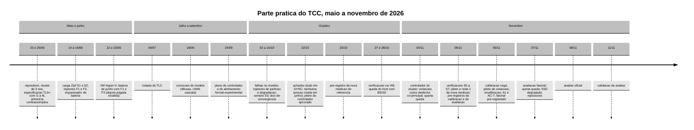

# 7. Histórico da parte prática e decisões

**Situação dos números.** As datas vêm do histórico do Git (`git log --all` do repositório `tcc-desenvolvimento`, datas
locais −03:00 convertidas a UTC onde indicado), dos registros de decisão (`decisoes-tecnicas.md` de `wt-bench`), da
crônica do coordenador (`memory/estado-2026-10-retomada-controlador.md`) e, para as quedas do *host*, do **log de
sistema do Windows**, que conferi em 11/11 (`Get-WinEvent`, eventos 41 do `Kernel-Power`, 1001 do
`WER-SystemErrorReporting` e 6008). As contagens de execução das campanhas foram conferidas nos `checagem.json` das
pastas de dados quando indicado. Este capítulo serve para o Escritor contar a trajetória (cronograma executado,
desvios do plano e revisões); os resultados ficam no capítulo 5.

## 7.1 Linha do tempo



### Maio e junho: base do código e primeira bateria

| Data | Marco | Evidência |
|---|---|---|
| 25/05 | repositório iniciado; configuração do *cluster* Infinispan migrada | `78d8bcc`, `20b80b1` |
| 26/05 | especificação TLA+ do `SessionStore` com I1 a I6; primeiros resultados do TLC (I1 violada); esqueleto Java com Hot Rod 15.0; variante `DIST_ASYNC` do *cache* de sessões | `9ce2f15`, `3d7a3b0`, `3dd1c1a`, `2cc5e4e` |
| 27 a 30/05 | códigos de retorno O1 a O7, *pipeline* Python, latência com HdrHistogram, auditor I5/I6 | `0df5383`, `27591ed`, `0b42338`, `a05db39` |
| 14 a 16/06 | gerador Zipf e cenários S1/S2, aquecimento, CLI, injetores F1 (`inject-crash.sh`) e F3 (`inject-jitter.sh`), coletor OpenMetrics, orquestrador da bateria; PR integrados em `main` | `5c736ad`, `3b57c93`, `e97b346`, `edd7eeb`; `main` = `14de422` (16/06) |
| 22/06 | *cluster* formado com 3 nós por TCPPING e imagem fixada em 15.0.21; bateria F1 real (S1/S2 × {sem falha, F1}) | `4d61fce`, `51a31f0` |
| 23/06 | VM Linux no Hyper-V (o WSL2 não tinha `sch_netem`); F3 por `nsenter` no *namespace* do contêiner; bateria homogênea S1/S2 × {sem falha, F1, F3}, 3 repetições × 90 s | `bdba005`, `d1b82ae` (publicado em `origin/feature/f3-baseline`) |

### Julho a setembro: vertente formal e plano do controlador

| Data | Marco | Evidência |
|---|---|---|
| 09/07 | rodada do TLC com o *harness* `MCSession.tla` | `docs/relatorio-tlc-2026-07-09.md` (commit `bb38ddc`, 16/09) |
| 14/09 | primeira parada do *host* por erro (bugcheck `0x1CA`) | log do Windows, evento 1001 de 14/09 00:25Z |
| 16/09 | correções do modelo: difusão a todas as réplicas, *last-writer-wins* por relógio de Lamport, cascata do bloqueio, mensagem fantasma | `aefe391`, `7ce78ca`, `b9c46e2`, `b6e0ec4` |
| 24/09 | plano do controlador heurístico e do alinhamento formal-experimental | `72ff7ca` |

### Outubro: etapa formal-experimental, achados e retomada

| Data | Marco | Evidência |
|---|---|---|
| 02 e 03/10 | auditor I1/I4 ligado às leituras; F1 (`Cair`/`Reviver`) e F2 (`Particionar`/`Mesclar`) no modelo | `858221a`, `0094cab`, `0d997f5`, `b9acd56` |
| 09/10 | injetor de partição F2 (`inject-partition.sh`); propriedades operacionais por transição no TLC | `0988348`, `48d1571` |
| 15/10 | injetor de degradação F4 (`inject-netdegrade.sh`); cenário S3 (atores, laço de convergência, varredura final); controlador travado até fechar a etapa formal | `0ce4ff8`, `11dff0f`, `16c3dba`, `2e40608`, `11d23af` |
| 16/10 | integração da etapa formal-experimental (Maven 275/0/0); verificações TB/TC e *gate* v3 | *tags* `int/2026-10-16-*` |
| 18/10 a 20/10 | *host* desligado por queda de energia; *cluster* da VM ficou parado | log do Windows: `Kernel-Power` 41 registrado em 20/10 16:31Z |
| **22/10** | **achados:** (a) todos os experimentos rodaram com os *caches* em `DIST_SYNC`, embora o texto dissesse `DIST_ASYNC`; (b) na bateria de junho 100 % dos *logins* voltaram `BLOCKED`, nenhuma sessão foi criada, e as tabelas de junho mediram recusa; o Gestor manda começar o controlador já; plano do controlador aprovado | `c4b5a78` (diagnóstico), `5dd15b0` (plano) |
| 22 e 23/10 | núcleo do controlador (B-28.1), agregador de janelas (B-26.1), perfil ASYNC (B-42.1), carga corrigida (B-43.1 a B-43.9: limpeza de estado, mistura v3 com gerações, *token* antigo por Bernoulli, escrita condicional, classificação de I2) | integração `feature/controlador-integracao`, 492 a 761 testes |
| 23/10 | pré-registro da nova medição de referência (DT-009 a DT-014): S1/S2, SYNC e ASYNC, {sem falha, F1, F3}, 10 repetições × 300 s, 120 execuções | `f25103b`, `0373ea1` |
| 27/10 | primeira verificação na VM (S1): o *cluster* estava parado desde a queda de 18/10 | `wt-gate-v4` `6834311` |
| 28/10 | segunda parada do *host* por erro (bugcheck `0x154`) no início da verificação S4; S4 repetida com sucesso; F1 passa a queda silenciosa (DT-017); integração `20805b0` | log do Windows, evento 1001 de 28/10 06:39Z; *tag* `int/2026-10-28-20805b0` |

### Novembro: controlador do *cluster*, campanhas e avaliação

| Data (UTC) | Marco | Evidência |
|---|---|---|
| 04/11 | ações sobre o cliente retiradas (W-1); laço que liga o controlador à carga (W-3); verificação do que o Infinispan 15.0.21 muda em tempo de execução (B-44.1); quarta queda (*host* desligado às 10:36:49Z); *cluster* recriado; verificações S5 e S6 válidas, S7 inválida (disco virtual travando) | *tags* `int/2026-11-04-w1`, `-w3`; log do Windows, evento 6008 |
| 05/11 | mitigações do *host* (ASPM, ReTrim, exclusão no Defender); S7 válida na terceira tentativa; critério h4 (DT-018); ensaio do F1 silencioso (3 de 4 válidas); piloto da nova medição (12 de 12 aceitas); **noite 1** (60 execuções); atuador REST (W-2a), sonda de defasagem (W-4), exclusão pelo JGroups verificada e rejeitada (B-44.3), P2 fora do braço ativo (B-44.2); pré-registros da calibração (DT-020) e da avaliação (DT-021); orquestrador S3 (W-6) | *tags* `int/2026-11-05-*`; `fbdb050`, `afd9cf5`, `a98d597`, `10b241b` |
| 06/11 01:37 a 04:59 | ensaio do orquestrador (X-17) e **calibração cega** (X-18): nenhuma violação de V observada nas células de teste | `dados-vm/cs3-2026-11/x18-20261106T050100Z/`; derivação `e904b014…` |
| 06/11 ~05:40 | o Gestor: "o nosso problema aqui é gerar as falhas de invariante de sessão"; noite 2 da nova medição suspensa; piloto de geração de violações | memória do coordenador |
| 06/11 06:03 | **primeira violação de I1 real observada na VM** (teste com varredura; *logout* confirmado pelo `isn3` isolado e sessão VALID depois da fusão) | `dados-vm/piloto-violacoes-2026-11-06/manual/f2-sweep-2` |
| 06/11 ~08:25 | piloto fechado (16 execuções; ponto de operação F2 + carga L+ + sonda + varredura); sonda de *replay* (W-10); pré-registro do *benchmark* refeito (DT-026) | tar `80a79265…`; `37a1099`, `d3d2988` |
| 06/11 11:32 a 14:46 | **recalibração** X-19 (29 execuções, 25 aceitas) | `rc-20261106T144744Z/`; derivação `b183527a…` |
| 06/11 ~15:30 | simulação do controlador recalibrado: a parada do nó viria tarde demais (poder ~0,03) | `wt-w9` `ddc7700` |
| 06/11 ~16:00 | o Gestor decide: política de fusão A1, lista de ignorados (A4) como ação rápida, TLC em paralelo | memória do coordenador |
| 06/11 ~18:00 a 22:45 | A1 funciona no *cluster* local; A4 medida; DT-027 (fatorial); AC-7 no controlador; logs do alvo reduzidos (P-64); DT-028 | `288b01c`, `290ff40`, `f6965ae`, `6e7a13c`, `e672051`, `9ee94a6` |
| 07/11 00:23 | *tag* da avaliação `int/2026-11-06-aval` = `4b96798` (Surefire 1 224/0/0/1; orquestrador 760/0) | `git log`; `docs/testes.md:1826-1834` |
| 07/11 00:33 a 07:41 | **avaliação, fase núcleo**: 64 de 64 aceitas, nenhum descarte h4 | `fat-infra/execucoes-final.tsv` |
| 07/11 07:54 a 14:06 | quinta queda de energia, entre as fases | log do Windows (evento 6008: desligamento às 04:54:08 locais) |
| 07/11 15:18 a 19:33 | fase extra (F1 e F4) com o SSD do *host* degradado; parada por regra h4 às 16:40:51; o Gestor manda tentar de novo; reposições de 18:17 a 19:33 | ENTREGA itens 8 e 9 |
| 07/11 ~18:45 a 19:05 | pré-análise do núcleo; o Gestor aprova os quatro pontos (bloco 13 mantido, ensaio da `exec-0037` depois, A1 relatada pela perda permanente, p99 só de sucesso como descritivo) e proíbe escrever antes de todos os dados | `51cf460`, `1732023` |
| 08/11 05:19 | cópia dos dados ao *host*; ENTREGA; análise oficial | `fat-20261108T051402Z/`; `LEIAME.txt` |
| 08/11 ~06:00 | o Gestor aprova o plano de fechamento e o envio ao repositório público; pede o relatório técnico | memória do coordenador |
| 11/11 ~08:45 | validação da análise oficial aprovada; o Gestor decide pular o ensaio da `exec-0037` e ir ao relatório | `da28b0c` |

## 7.2 Campanhas executadas

Fontes: pastas de dados em `dados-vm/` (contagens conferidas nos `checagem.json` onde marcado com ✓), roteiros em
`wt-plano-ctrl/docs/`, crônica do coordenador.

| Campanha | Quando | Execuções | Resultado | Uso |
|---|---|---|---|---|
| bateria de junho | 22 e 23/06 | S1/S2 × {sem falha, F1, F3}, 3 repetições × 90 s | inválida como medida: nenhuma sessão criada (100 % `BLOCKED`) e *caches* em SYNC | substituída; só história |
| verificações dos injetores S1 a S7 | 27/10 a 05/11 | sem carga ou com carga curta | S5, S6 e S7 válidas (S7 na terceira tentativa) | aprovação dos injetores |
| ensaio do F1 silencioso | 05/11 03:00 a 03:20 | 4 | 3 válidas | validação da queda silenciosa |
| nova medição, piloto | 05/11 04:03 a 05:19 | 12 | 12 aceitas | só verificação |
| nova medição, noite 1 | 05/11 05:57 a 21:56 (com paradas) | 60 ✓ | 56 aceitas, 4 recusadas ✓; 7 com h4a | medição de referência incompleta; situação no capítulo 1, §1.4.1; os resultados dela não estão neste relatório |
| nova medição, noite 2 | prevista para 06/11 | 0 | **não executada** (suspensa em 06/11 ~05:40Z e não retomada) | lacuna (capítulo 8) |
| X-17, ensaio do orquestrador S3 | 06/11 01:37 a 01:50 | 2 ✓ | aprovado | liberação da calibração |
| X-18, calibração | 06/11 01:58 a 04:59 | 27 ✓ | 26 aceitas, 1 h4a reposta ✓ | derivação `e904b014…` (DT-025, superada) |
| piloto de violações | 06/11 ~05:58 a 08:25 | 16 ✓, em duas passagens, mais 2 testes manuais | ponto de operação: F2 + L+ + sonda + varredura | DT-026 |
| X-19, recalibração | 06/11 11:32 a 14:46 | 29 ✓ | 25 aceitas, 4 h4a ✓ | derivação `b183527a…` (DT-028) |
| avaliação fatorial | 07/11 00:33 a 19:33 | 90 ✓ | 80 aceitas, 6 h4a, 4 puladas ✓ | análise oficial (capítulo 5) |

A campanha S3 separada que o apêndice do plano previa (Etapa C, "cerca de 120 execuções" com todas as falhas e SYNC
de referência, `ApPlanoTCC2.tex:51-54`) não rodou como campanha própria: suas funções foram absorvidas pela calibração,
pela recalibração e pela avaliação.

## 7.3 Problemas encontrados e soluções

| Problema | Quando | Efeito | Solução | Evidência |
|---|---|---|---|---|
| a bateria de junho não criou sessões | achado em 22/10 | tabelas de junho mediram recusa e leitura vazia | carga corrigida (limpeza de estado, mistura v3, guarda que aborta) e nova medição pré-registrada | `c4b5a78`; B-43 |
| experimentos em SYNC, texto dizendo ASYNC | achado em 22/10 | afirmação errada no texto e nos artigos | *caches* assíncronos, perfil ASYNC, nova medição nos dois modos | B-42.1 |
| quedas de energia do *host* | 19 eventos `Kernel-Power` 41 entre 14/09 e 07/11 (17 até 28/10), dois com bugcheck (`0x1CA` em 14/09 e `0x154` em 28/10) | *cluster* da VM parado (18/10), S4 interrompida (28/10), *cluster* perdido (04/11), pausa de 7 h 37 min entre as fases da avaliação (07/11) | o Gestor atribuiu as quedas a falta de energia na região, sem verificação de *hardware* (28/10); regras de execução interrompida (DT-014), *cluster* recriado e conferido por `boot_id`, retomada por fase sem misturar boots | log do Windows conferido em 11/11; ENTREGA item 8 |
| disco virtual da VM travando | 04 e 05/11 | S7 inválida duas vezes; pausas de E/S de segundos a minutos | mitigações no *host* (ASPM desligado, ReTrim com 91 GB, exclusão do Hyper-V no Defender); **critério h4** com amostrador em memória | DT-018; V-S7r |
| indexador do Windows religou sozinho | 05/11 14:49Z | rajadas de escrita no disco durante a noite 1 | serviço parado e depois desabilitado pelo Gestor | crônica; covariável da noite 1 |
| memória da VM e *swap* | noite 1, 05/11 | parada da noite 1 (i = 17) quando a limpeza do *cache* passou do prazo com *swap* alto | recriar o *cluster* quando o *swap* passa de 1 GiB no portão, com a mesma semente (G-3, DT-023) | `validacao-noite1-2026-11-05.md` |
| leitura final sem prazo | noite 1, i = 25 | carga presa por ~3 h | leitura por réplica com prazo na versão nova (P-41); vigia de 600 s | crônica |
| calibração cega | 06/11 | nenhuma violação de V observada; poder zero | sonda de *replay*, varredura e carga L+ em todas as execuções; recalibração | DT-026 |
| ação da P1 lenta | 06/11 | a parada do nó só agiria ~13 s depois do pedido, depois da maior parte das perdas | AC-7 (lista de ignorados) e política de fusão A1 | DT-027 |
| registros gigantes no alvo do AC-7 | 06/11 | ~268 MB e 2 milhões de linhas por execução só nos braços ativos (assimetria de E/S) e limite de taxa do `journald` | registro `k8s-file` com teto de 512 MB e as duas categorias ruidosas em FATAL pela REST, igual nos quatro braços (P-64): 268 MB → 0,09 MB | DT-028 §5 |
| topologia velha no cliente depois de F1 | 06/11 | a leitura por réplica errava 13 a 33 % das chaves e escondia divergência | consulta pelo cliente principal antes das leituras por réplica (P-48) | `3c57447` |
| CRLF nos arquivos do Windows | 05 e 06/11 | JSON com CRLF no *bundle* mudava os SHA-256 | `git -c core.autocrlf=false archive` e conferência na cópia LF do *tar* | roteiro X-17; `69eab57` |
| SSD do *host* com escrita lenta depois da queda de 07/11 | 07/11 tarde | 6 descartes h4a na extra e nas reposições; F1 com 5 blocos perdidos | pausa manual, ReTrim e 88 GB liberados, parada pela regra h4, retomada por decisão do Gestor | ENTREGA item 9 |
| linhas `A1-FUSAO` apagadas | toda a avaliação | descritivos da A1 indisponíveis | nenhuma (limitação) | ENTREGA item 9f |
| coletor de recursos começa depois da carga | toda a avaliação | 8 de 12 blocos da F2 sem CPU e energia oficiais | nenhuma na campanha; sensibilidade de 12 blocos na validação | validação de 11/11 §4 |

Lições operacionais registradas na crônica, que **não** são para a monografia: nunca usar `pkill -f` com padrão do
próprio comando (derrubou a sessão SSH duas vezes); vigias devem detectar falta de progresso, e não só o fim; depois de
um reboot, esperar o disco do *host* assentar antes de lançar uma fase; processos de monitoramento precisam de prazo
próprio.

## 7.4 Decisões do Gestor, com data

"Coordenador sob autorização" marca decisões técnicas tomadas pelo coordenador com a autorização geral do Gestor
(05/11 ~22:30Z: "Faça isso e depois teste na VM, não precisa do meu aval") ou pela regra permanente de 04/11 (aceitar
recomendação só se cada número tiver fonte no projeto). Na monografia, o sujeito das decisões é "o autor".

| Data | Decisão | Quem |
|---|---|---|
| 23/06 | F3 com distribuição normal calibrada (20 ms ± 13 ms); lognormal como sensibilidade | Gestor |
| 22/10 | começar o controlador já; gatilho primário por sinais compostos; energia por *proxy*; ASYNC como objeto, SYNC como controle; controlador como *thread* com núcleo puro; dois perfis; modo *shadow* | Gestor |
| 22/10 | tabelas de junho substituídas depois da nova medição; carga corrigida (B-43) | Gestor |
| 28/10 | quedas do *host* tratadas como falta de energia, sem verificação de *hardware* | Gestor |
| 04/11 | manter a medição de energia (motivação de sustentabilidade); manter o controlador mudando o *cluster* no trabalho, e não como trabalho futuro; violações como desfecho co-principal ao lado do p99; retirar o adiamento de bloqueios | Gestor |
| 05/11 | políticas P0, P1 e P2 aprovadas sob condição de verificar o que o Infinispan permite; interceptador de replicação síncrona (E-1) recusado | Gestor |
| 05/11 | 12 blocos; falso acionamento "zero ocorrências" com 3/N; F1 fora do teste; sem expectativa numérica de efeito; F3 descritiva | Gestor |
| 05/11 | aprovar as recomendações G-1 a G-8 da noite 1 (retomada, recriação por memória, indexador parado); vigia de 600 s | Gestor |
| 05/11 | P1 com a parada (AC-5); exclusão pelo JGroups fora; P2 fora do braço ativo (D-B) | coordenador sob autorização |
| 06/11 | "gerar as falhas de invariante é o principal problema"; noite 2 suspensa; piloto de violações | Gestor |
| 06/11 | sonda e varredura "não como medida, mas como método" | Gestor |
| 06/11 | "continue executando e siga o plano" (autonomia durante a noite) | Gestor |
| 06/11 | ponto de operação p2-d, V por pares, late-max 268 (DT-026) | coordenador sob autorização |
| 06/11 | A1 (política de fusão por ordem de conteúdo), A4 (lista de ignorados) e TLC em paralelo; "execute o suficiente para ter uma decisão" | Gestor |
| 06/11 | A4 substitui a parada na P1 (G-1); só o `sessions-async` (G-2); sem rodadas extras (G-3); recusa como indisponibilidade (G-4); guarda contínua e `suspeita-desfeita` (V-1); teto h4 de 20 blocos; ordem `20261106` | coordenador sob autorização |
| 07/11 | "o PC só roda o TCC, não vamos rodar só de noite; tentar de novo agora"; escrita só com todos os dados | Gestor |
| 07/11 | quatro pontos da pré-análise: bloco 13 fica, com sensibilidade sem ele; ensaio da `exec-0037` depois da VM; A1 relatada pela perda permanente, sem trocar desfecho; p99 só de sucesso como descritivo | Gestor |
| 08/11 | plano de fechamento (validação, ensaio, relatório) e envio ao repositório público `publico` | Gestor |
| 11/11 | validação pelo coordenador, conferida contra os brutos; **pular o ensaio da `exec-0037`** e os complementos; relatório técnico com tabelas para a monografia | Gestor |

## 7.5 Tabelas para a monografia

### T7.1 Cronograma executado (ATUALIZAR `tab-cronograma-tcc2`, `ConclusoesParciais.tex:80-102`, ou NOVA ao lado dela)

A tabela atual é o **plano** por semanas e deve ficar como plano. Recomendo uma tabela nova, "executado", por mês, e
trocar o parágrafo CON-12 (`ConclusoesParciais.tex:107`) por um resumo dela.

```latex
\begin{table}[!h]
\captionsetup{type=table, name=Tabela}
\caption{Execução da parte prática do Trabalho de Conclusão de Curso~II}
\label{tab-cronograma-executado}
\centering
\footnotesize
\begin{tabular}{p{2.2cm}p{11.6cm}}
\hline
\textbf{Período} & \textbf{Atividade} \\
\hline
maio e junho & repositório, \emph{cluster} de três nós, modelo formal inicial, programa de carga, injetores de queda e de atraso, primeira bateria na máquina virtual \\
julho a setembro & rodadas do TLC e correções do modelo; projeto do controlador \\
outubro & falhas no modelo; injetores de partição e de degradação; cenário S3; diagnóstico da primeira bateria; núcleo do controlador; carga corrigida; registro da nova medição de referência \\
1 a 5 de novembro & verificação dos injetores na máquina virtual; controlador do \emph{cluster}; piloto e primeira noite da nova medição; registros da calibração e da avaliação \\
6 de novembro & calibração, piloto de geração de violações, recalibração, política de fusão própria, nova ação da política de isolamento e registro do desenho fatorial \\
7 e 8 de novembro & avaliação do controlador e análise \\
\hline
\end{tabular}
\fonte{O autor}
\end{table}
```

### T7.2 Campanhas de medição (NOVA, no Desenvolvimento, perto de `sec-verificacao-injetores` ou no capítulo de resultados)

```latex
\begin{table}[htbp]
\captionsetup{type=table, name=Tabela}
\caption{Campanhas de medição na máquina virtual}
\label{tab-campanhas}
\centering
\footnotesize
\begin{tabular}{p{3.6cm}p{1.6cm}p{1.8cm}p{2.0cm}p{4.6cm}}
\hline
\textbf{Campanha} & \textbf{Data} & \textbf{Execuções} & \textbf{Aceitas} & \textbf{Uso} \\
\hline
Bateria inicial & 22 e 23/06 & 3 por célula & não se aplica & inválida, sem sessões criadas \\
Nova medição, piloto & 05/11 & 12 & 12 & verificação do protocolo \\
Nova medição, primeira noite & 05/11 & 60 & 56 & medição de referência, metade do planejado \\
Calibração & 06/11 & 27 & 26 & limiares, sem violações observadas \\
Piloto de violações & 06/11 & 16 & não se aplica & escolha do ponto de operação \\
Recalibração & 06/11 & 29 & 25 & limiares da avaliação \\
Avaliação & 07/11 & 90 & 80 & comparação entre braços \\
\hline
\end{tabular}
\fonte{O autor}
\end{table}
```

### T7.3 Problemas do ambiente e respostas (NOVA, nas limitações, `sec-limitacoes`, ou em apêndice)

```latex
\begin{table}[htbp]
\captionsetup{type=table, name=Quadro}
\caption{Problemas do ambiente de execução e respostas adotadas}
\label{qd-problemas-ambiente}
\centering
\footnotesize
\begin{tabular}{p{4.0cm}p{4.6cm}p{5.2cm}}
\hline
\textbf{Problema} & \textbf{Efeito} & \textbf{Resposta} \\
\hline
Quedas de energia do hospedeiro & \emph{cluster} parado, verificações interrompidas e pausa entre as fases da avaliação & recriação do \emph{cluster} antes de cada execução e retomada por fase sem misturar inicializações da máquina virtual \\
Disco virtual travando & cauda de latência exposta e verificações inválidas & mitigações no hospedeiro e critério h4 de descarte \\
Memória da máquina virtual & limpeza do \emph{cache} fora do prazo & recriação do \emph{cluster} com uso de \emph{swap} de 1\,GiB ou mais \\
Registros volumosos no nó isolado & assimetria de escrita em disco entre braços & registros com teto e categorias ruidosas desligadas nos quatro braços \\
SSD do hospedeiro lento depois de uma queda & descartes h4 na fase extra & reposição de blocos e retomada \\
\hline
\end{tabular}
\fonte{O autor}
\end{table}
```

## 7.6 Já está na monografia × novo ou mudou

| Arquivo:linha | O que o texto diz | Situação | Evidência |
|---|---|---|---|
| `ConclusoesParciais.tex:30` | "nenhum dado de latência ou de violação é ainda utilizável" | **errado** agora: há a nova medição (noite 1) e a avaliação | 7.2 |
| `ConclusoesParciais.tex:34` (CON-09, CON-40) | "dezessete desligamentos não ordenados desde setembro de 2026, dois deles com parada do sistema por erro" | **atualizar**: 19 até 07/11 (o último entre as fases da avaliação), mais 2 depois da avaliação (09 e 10/11); os dois com erro continuam os de 14/09 e 28/10 | log do Windows conferido em 11/11 |
| `ConclusoesParciais.tex:80-102` (`tab-cronograma-tcc2`) | plano por semanas | **mantém** como plano; acrescentar T7.1 | 7.5 |
| `ConclusoesParciais.tex:107` (CON-12) | medição de referência "ainda não executada"; controlador "implementado em parte" | **corrigir** | 7.1, 7.2 |
| `ConclusoesParciais.tex:109` (CON-31) | o controlador "projetado e implementado em parte"; partição e degradação "serão exercidas sob carga na campanha com o cenário S3" | **corrigir**: exercidas na calibração, na recalibração e na avaliação | 7.2 |
| `Desenvolvimento.tex:219` (DES-30, DES-85) | nova medição "pré-registrada e ainda não foi executada"; piloto executado | **corrigir**: piloto e noite 1 executados (60 execuções), noite 2 não | 7.2 |
| `ApPlanoTCC2.tex:37-70` (APX-03 a APX-09) | plano restante: Etapas A a F, "cinco a sete noites", campanha S3 de ~120 execuções, código "hoje em versões locais" | **reescrever** como execução (o que foi feito, o que não foi) ou retirar; o código segue local, fora do ramo principal (capítulo 9) | 7.2; 09 |
| `Desenvolvimento.tex:236` (DES-56, DES-99) | revisões do controlador até novembro | **acrescentar** as revisões de 05 e 06/11: P1 da parada para a lista de ignorados, P2 fora, A1 como fator | capítulo 4 |
| não existe | campanhas de calibração e recalibração, piloto de violações, primeira violação real observada, decisões de 06/11 | **novo** | 7.1 a 7.4 |

## 7.7 Fontes bibliográficas necessárias

Nenhuma afirmação deste capítulo exige citação nova. Para os termos técnicos que aparecem nas tabelas: PSI
(`linux_psi_6_8`), `tc-netem` (`netem_manpage`), Podman (`podman_docs`), pré-registro (`nosek_preregistration_2018`),
todas já no `bibliografia.bib`.

## 7.8 Pendências e o que não pôde ser verificado

- **Noite 2 da nova medição:** suspensa em 06/11 e nunca retomada; não há decisão escrita do Gestor sobre cancelá-la.
  O coordenador precisa perguntar ao Gestor como relatar (metade da campanha, ou campanha encerrada com 60 execuções).
- **Bateria de junho:** número exato de execuções não reconferido (os CSV estão em `dados-vm/baseline-2026-06-23/`).
- **Horários de 22/10 a 05/11:** da crônica do coordenador, não dos *logs* da VM.
- **Revisão da DT-026 pelo Gestor** ("revisa ao acordar"): sem registro escrito.
