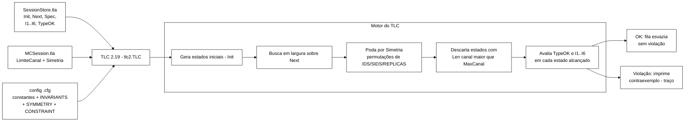
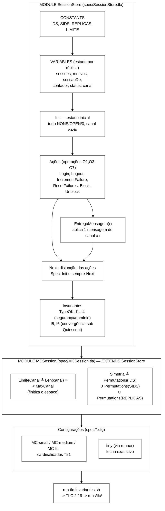
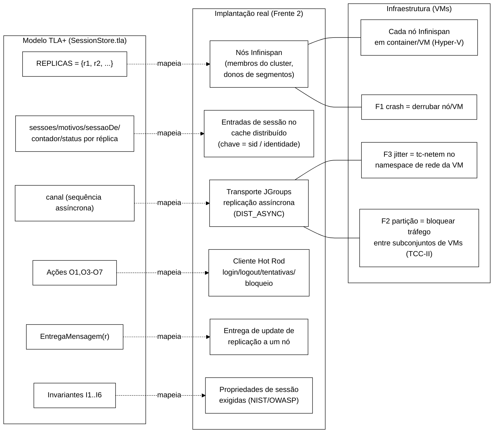

# Relatório de verificação formal — rodada TLA+/TLC

> Rodada de *model checking* do núcleo `SessionStore.tla` executada em 2026-07-09.
> Estrutura: **entradas → processamento → saídas**, seguida da organização do
> código TLA+, do mapeamento com Infinispan/VMs e da verificação do cronograma
> (falhas F1/F2/F3). Diagramas em Mermaid, tema branco.

Todos os diagramas usam fundo branco, contorno e fonte pretos
(`theme: base` com variáveis brancas/pretas). Renderizam no GitHub, VS Code e Obsidian.

---

## 1. Entradas

| Entrada | Valor |
|---|---|
| Especificação | `spec/SessionStore.tla` (MODULE SessionStore) — inalterada |
| *Harness* de verificação | `spec/MCSession.tla` (novo) — estende a spec com limite de canal e simetria |
| Configurações | `spec/MC-{small,medium,full}.cfg` (Tabela 1, linha T21) + `tiny` (gerada pelo runner) |
| Verificador | `tla2tools.jar` — **TLC2 Version 2.19** (rev 5a47802, 08/08/2024), baixado do release oficial `tlaplus/tlaplus` |
| Runtime | OpenJDK 22.0.2, Windows 11; TLC com 20 *workers*, heap ~7 GB, busca em largura (BFS) |
| Runner | `spec/run-tlc-invariantes.sh` (novo) — verifica cada invariante isoladamente |

### Cardinalidades (constantes do modelo)

| Config | IDS | SIDS | REPLICAS | LIMITE | MaxCanal | Papel |
|---|---|---|---|---|---|---|
| `tiny`   | 1 | 2 | 2 | 2 | 2 | fecha **exaustivamente** (referência de veredito) |
| `small`  | 2 | 3 | 2 | 3 | 2 | T21 — 1ª cardinalidade |
| `medium` | 3 | 3 | 2 | 3 | 2 | T21 — 2ª cardinalidade |
| `full`   | 3 | 3 | 3 | 3 | 3 | T21 — 3ª cardinalidade |

> **Por que `MaxCanal`?** A variável `canal` é uma **sequência não-limitada**.
> Operações como `ResetFailures`/`IncrementFailure` podem ciclar e fazer o canal
> crescer sem limite, tornando o espaço de estados **infinito**. O *state
> constraint* `LimiteCanal ≜ Len(canal) =< MaxCanal` finitiza o modelo. As
> configurações originais (`MC-*.cfg`) não têm esse limite e só terminam porque
> um invariante viola cedo e interrompe a busca — ver §3.

---

## 2. Processamento — o que o TLC fez



Passos executados:

1. **Parsing e checagem semântica** de `MCSession.tla` (que estende `SessionStore`,
   `Naturals`, `Sequences`, `FiniteSets`, `TLC`).
2. **Cálculo dos estados iniciais** a partir de `Init` (1 estado inicial distinto).
3. **Busca em largura** aplicando `Next` (as ações `Login`, `Logout`,
   `IncrementFailure`, `ResetFailures`, `Block`, `Unblock`, `EntregaMensagem`).
4. **Redução por simetria**: como `IDS`, `SIDS` e `REPLICAS` são intercambiáveis,
   o TLC explora um representante de cada classe de equivalência.
5. **Restrição de estado**: sucessores com `Len(canal) > MaxCanal` são descartados.
6. **Avaliação dos invariantes** em cada estado; ao primeiro estado que viola um
   invariante, o TLC imprime o traço (sequência de transições) e para.

Cada invariante foi verificado **isoladamente** (uma execução por invariante),
porque o TLC interrompe no primeiro invariante violado e, de outro modo, não se
obteria o veredito individual de I2..I6.

---

## 3. Saídas — resultados

### 3.1 Suíte original, como está no repositório

Rodando a configuração comprometida `MC-small.cfg` (todos os seis invariantes juntos,
**sem** limite de canal e **sem** simetria), via `run-tlc.sh small`:

```
Error: Invariant I1 is violated.
248 states generated, 243 distinct states found, 202 states left on queue.
The depth of the complete state graph search is 6.
Finished in 00s.   (código de retorno 12)
```

Ou seja, a suíte atual **não fecha em verde**: interrompe no invariante **I1** em
poucos estados. O motivo é que a busca para no primeiro invariante violado — não é
que os demais estejam certificados.

### 3.2 Matriz de vereditos por invariante

Veredito exaustivo obtido na configuração `tiny` (que fecha por completo — fila
zerada). As cardinalidades T21 (`small`/`medium`) confirmam as **violações** com a
mesma causa; os invariantes que **passam** não fecham dentro do *timebox* nessas
cardinalidades por explosão de estados (ver §3.4).

| Invariante | Tipo | Veredito (`tiny` 1-2-2, exaustivo) | Evidência |
|---|---|---|---|
| `TypeOK` | domínio | **OK** — 424.398 estados distintos, fila 0, profundidade 30 | tipos preservados por construção |
| `I1` | segurança | **VIOLADO** — contraexemplo de 4 estados | logout não propagado; réplica remota ainda `VALID` |
| `I2` | segurança | **VIOLADO** — contraexemplo de 4 estados | bloqueio não propagado; sessão remota ainda `VALID` |
| `I3` | domínio | **OK** — 424.398 estados distintos | contador sempre em `0..LIMITE` |
| `I4` | domínio | **OK** — 424.398 estados distintos | motivo sempre no tipo declarado |
| `I5` | convergência | **VIOLADO** — contraexemplo de 3 estados | réplicas divergem com canal vazio |
| `I6` | convergência | **VIOLADO** — contraexemplo de 3 estados | contador/status divergem com canal vazio |

Confirmação nas cardinalidades T21 (`small` 2-3-2, `MaxCanal=2`, com simetria):
I1 viola em profundidade 5; I2 em 4; I5 e I6 em 6. Mesmos padrões.

> **Resultado central:** no fluxo nominal (sem falhas explícitas), **4 dos 6
> invariantes são violados** — I1, I2 (segurança) e I5, I6 (convergência).
> Apenas os invariantes de domínio (I3, I4) e a tipagem (TypeOK) se sustentam.

### 3.3 Contraexemplos (o que o TLC encontrou)

**I1 — irreversibilidade de logout (contraexemplo de 4 estados):**

| Estado | Ação | `r1.s1` | `r2.s1` | `canal` |
|---|---|---|---|---|
| 1 | Init | NONE | NONE | vazio |
| 2 | `Login(r1,u1,s1)` | VALID | NONE | `[SESSAO_VALIDA(s1,u1)]` |
| 3 | `Login(r2,u1,s1)` | VALID | VALID | `[SV, SV]` |
| 4 | `Logout(r1,s1)` | **INVALID/LOGOUT** | **VALID** | `[…, SESSAO_INVALIDA(s1,LOGOUT)]` |

No estado 4, `r1` marcou a sessão como inválida por *logout*, mas `r2` ainda a vê
`VALID` porque a mensagem `SESSAO_INVALIDA` está pendente no canal. A forma de I1
(quantificada sobre réplicas, **sem** condicionar à quiescência) não tolera o
atraso de propagação.

**I5 — convergência sob quiescência (contraexemplo de 3 estados):**

| Estado | Ação | `r1.s1` | `r2.s1` | `canal` |
|---|---|---|---|---|
| 1 | Init | NONE | NONE | vazio |
| 2 | `Login(r1,u1,s1)` | VALID | NONE | `[SESSAO_VALIDA(s1,u1)]` |
| 3 | `EntregaMensagem` | VALID | **NONE** | **vazio (quiescente)** |

No estado 3 o canal está vazio (quiescência), mas `r1.s1 = VALID` e `r2.s1 = NONE`.
A ação `EntregaMensagem` **consumiu** a mensagem entregando-a a *uma* réplica e a
**removeu** do canal — `r2` nunca a recebeu. Ou seja: o canal modela *"entrega a uma
réplica e descarta"*, **não** *broadcast* para todas. Sem entrega a todas as réplicas
(e sem resolução de conflito por ordem causal/*last-writer-wins*), as réplicas não
convergem.

### 3.4 Nota sobre esforço computacional

Mesmo a configuração mínima `tiny` (1 identidade, 2 sessões, 2 réplicas) gera
**4.210.488 estados** (424.398 distintos após simetria) para fechar os invariantes
de domínio. Nas cardinalidades T21, os invariantes que sempre valem (TypeOK, I3, I4)
**não fecham** no *timebox* — o espaço cresce como produto de `sessoes`, `motivos`,
`sessaoDe`, `contador`, `status` por réplica vezes as ordenações do canal. Isso
confirma empiricamente a *explosão combinatória* discutida no Cap. 2 da monografia
e justifica manter as cardinalidades pequenas e limitar o canal.

### 3.5 Divergência frente à expectativa documentada

`docs/spec-formal.md` (§"Resultados esperados em TCC-I") prevê que **I1 a I4
fechem como OK** e que apenas I5/I6 possam ter contraexemplos fora da quiescência.
A execução real **contradiz** essa previsão: I1 e I2 violam mesmo no fluxo nominal,
e I5/I6 violam **inclusive sob quiescência**. Como não havia `tla2tools.jar` nem
`runs/` de TLC no repositório, é provável que o TLC nunca tivesse sido executado
sobre esta spec. **Recomendação:** atualizar aquela seção e tratar os contraexemplos
como alvos de refinamento (abaixo).

### 3.6 Alvos de refinamento sugeridos (não aplicados nesta rodada)

- **I1/I2:** condicionar a segurança à entrega, como já se faz com I5/I6
  (`Quiescent => …`), **ou** modelar a invalidação/bloqueio com barreira de
  propagação. A forma temporal do texto (Metodologia §I1, sobre um único estado
  lógico `σ_t`) é mais fraca que a tradução TLA+ *cross-réplica*; alinhar as duas.
- **I5/I6:** trocar `EntregaMensagem` por **entrega a todas as réplicas destino**
  (rastrear pendências por par `(réplica, mensagem)` ou *pending-set* por réplica)
  e adicionar **resolução de conflito** (ordem causal ou *last-writer-wins*), sem o
  que a convergência é inalcançável.

Estes refinamentos são exatamente o insumo que a monografia atribui às etapas 3–4
do TCC-II (Apêndice B).

---

## 4. Organização do código TLA+ (para reproduzir a arquitetura)



Pontos de leitura do modelo:

- **Estado por réplica.** Toda variável é uma função `[REPLICAS -> …]`: cada réplica
  tem sua própria cópia de `sessoes`, `motivos`, `sessaoDe`, `contador`, `status`.
  É isso que permite representar divergência entre réplicas.
- **Canal assíncrono.** `canal` é uma sequência de mensagens (`SESSAO_VALIDA`,
  `SESSAO_INVALIDA`, `CONTADOR_INC/RESET`, `ID_BLOQUEIA/DESBLOQUEIA`). As operações
  **produzem** mensagens (`Append`); `EntregaMensagem` **consome** uma mensagem
  qualquer e a aplica a uma réplica — capturando atraso e reordenação.
- **Operações = ações.** Cada operação do Cap. 3 (O1, O3–O7) vira uma ação TLA+ com
  pré-condição e efeito; O2 (validação) é leitura pura e não tem ação.
- **Invariantes.** I1–I4 devem valer em todo estado; I5–I6 valem sob `Quiescent`
  (`Len(canal)=0`).
- **Harness separado.** O limite de canal e a simetria vivem em `MCSession.tla`,
  que *estende* a spec sem alterá-la — a especificação original permanece intacta.

### Como reproduzir

```bash
cd tcc-desenvolvimento/spec
export TLA_TOOLS=./tla2tools.jar     # baixe de github.com/tlaplus/tlaplus/releases

# matriz por invariante (veredito individual):
./run-tlc-invariantes.sh tiny        # fecha exaustivo (segundos)
./run-tlc-invariantes.sh small       # T21 1a cardinalidade (I1/I2/I5/I6 violam rápido)

# suíte original como está (para no 1o invariante violado):
./run-tlc.sh small
```

As saídas vão para `runs/tlc/…` (`.out` = log do TLC; `.cfg` = configuração usada).

---

## 5. Onde entram o Infinispan e as VMs

O modelo TLA+ é uma **abstração** do sistema experimental (Frente 2). O diagrama
mapeia cada elemento do modelo ao componente real correspondente.



Leitura do mapeamento:

| Modelo TLA+ | Sistema real |
|---|---|
| `REPLICAS` | nós do *cluster* Infinispan (membros, donos de segmentos) |
| `sessoes`/`motivos`/`sessaoDe`/`contador`/`status` | entradas de sessão no cache distribuído, chaveadas por sid/identidade |
| `canal` | transporte assíncrono do JGroups propagando *updates* entre nós (modo DIST/REPL **ASYNC**) |
| ações `O1,O3-O7` | operações do cliente Hot Rod sobre o cache de sessão |
| `EntregaMensagem(r)` | entrega de um *update* de replicação a um nó |
| `I1..I6` | invariantes de sessão que o sistema real deve manter (derivados de NIST SP 800-63B e OWASP) |
| réplica ↔ **VM** | cada nó roda em container/VM (Hyper-V); as falhas são injetadas na VM/rede |

Os **contraexemplos** do TLC (§3.3) são previsões sobre o sistema real: onde o
modelo diverge, o *cluster* Infinispan sob replicação assíncrona tende a exibir a
mesma janela de inconsistência — é isso que o *baseline* experimental (F1, F3) mede
e que o controlador heurístico deverá atenuar.

> **Importante:** a versão atual de `SessionStore.tla` **não** modela nenhuma falha
> (crash/partição/jitter) — é o **fluxo nominal**. As falhas entram no *modelo* no
> TCC-II (Apêndice B, etapas 3–4). Portanto esta rodada exercita apenas o
> comportamento assíncrono nominal; ainda assim já expõe as violações de §3.

---

## 6. Verificação do cronograma — F1, F2, F3

A pergunta: *o cronograma da monografia previa apenas F1 e F3, ou F2 também entrava?*

**Existem dois catálogos de falhas na monografia, com a mesma rotulagem:**

- **Falhas do modelo formal** (`docs/spec-formal.md`; Apêndice B, etapas 3–4):
  F1 = *crash* silencioso, F2 = partição de rede, F3 = atraso/*jitter*. Todas
  previstas para o **TCC-II**.
- **Cenários experimentais da Frente 2** (Metodologia, §"Modelo de falhas"):
  **F1** *crash* silencioso, **F2** partição de rede, **F3** atraso/*jitter*,
  **F4** mudança de topologia (*state transfer*).

**Resposta (fonte primária, `Metodologia.tex`, §modelo de falhas):**

> *"**F2, partição de rede…** Esta classe fica **reservada para o Trabalho de
> Conclusão de Curso II** (Decisão 011, ponto 11), com **F1 e F3 cobrindo o escopo
> experimental do Trabalho de Conclusão de Curso I**."*

Portanto, para o TCC-I:

| Falha | Descrição | Escopo estipulado |
|---|---|---|
| **F1** | *crash* silencioso de nó | **TCC-I** (dentro do escopo) |
| **F3** | atraso/*jitter* no canal | **TCC-I** (dentro do escopo) |
| **F2** | partição de rede | **TCC-II** — explicitamente reservada (Decisão 011, ponto 11) |
| F4 | *state transfer* por mudança de topologia | ampliação **opcional** no TCC-I; completa no TCC-II |

Confirmação cruzada na **Tabela 1** (parâmetros): há linha **T17 (Falha F1)** e
**T18 (Falha F3)**; **não há** linha para F2 no conjunto do TCC-I.

**Conclusão:** o cronograma estipulou, para o TCC-I, **apenas F1 e F3**. **F2
(partição) não entrava** — está reservada para o TCC-II. Isso é coerente com o
modelo TLA+ atual, que ainda não implementa nenhuma falha explícita.

---

## 7. Síntese

- Foi baixado o `tla2tools.jar` oficial (TLC 2.19) e executada uma rodada completa
  de *model checking* sobre `SessionStore.tla`.
- Foi necessário criar um *harness* (`MCSession.tla`) com **limite de canal** (a
  spec tem canal não-limitado → espaço infinito) e **simetria** (para tratabilidade).
- **Vereditos:** TypeOK, I3, I4 **OK** (exaustivo em `tiny`, 424.398 estados);
  **I1, I2, I5, I6 VIOLADOS** já no fluxo nominal, com contraexemplos curtos.
- As violações de I1/I2 vêm do **atraso de propagação** (segurança *cross-réplica*
  não condicionada à quiescência); as de I5/I6, de o canal **não fazer *broadcast***
  a todas as réplicas nem resolver conflito. Ambas são alvos de refinamento (TCC-II).
- O resultado **contradiz** a expectativa em `spec-formal.md` (que previa I1–I4 OK) —
  recomenda-se atualizar aquela seção.
- **Cronograma:** o TCC-I previa **apenas F1 e F3**; **F2 é do TCC-II**.

### Artefatos gerados nesta rodada

| Arquivo | Conteúdo |
|---|---|
| `spec/MCSession.tla` | *harness* (limite de canal + simetria) sobre a spec original |
| `spec/run-tlc-invariantes.sh` | runner que verifica cada invariante isoladamente |
| `spec/tla2tools.jar` | TLC 2.19 (ignorado pelo git) |
| `runs/tlc/inv-tiny/*.out`, `*.cfg` | logs e configurações da rodada exaustiva `tiny` |
| `runs/tlc/small/output.txt` | suíte original (para no I1) |
| `docs/relatorio-tlc-2026-07-09.md` | este relatório |
