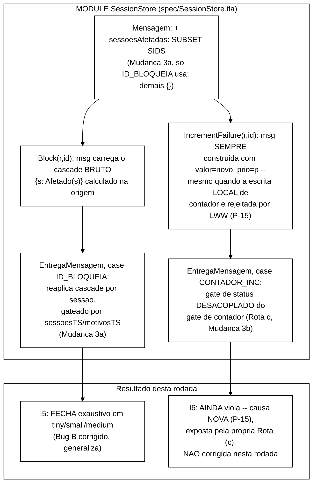

# Relatório de verificação formal — Mudança 3: cascata de `Block` + gate de status em `CONTADOR_INC`

> Segunda rodada de *model checking* de 2026-09-16, dando continuidade a
> `docs/relatorio-tlc-2026-09-16.md` (rodada 1, broadcast real + LWW via
> relógio lógico de Lamport). Aquela rodada fechou `TypeOK`/`I3`/`I4`
> exaustivamente e deixou **duas causas residuais** documentadas para `I5`
> (§3.2, "Bug B", cascata de `Block` não propagada) e `I6` (§3.3, trade-off
> da decisão D-2, bloqueio por limite não revertido por `CONTADOR_RESET` de
> prioridade maior). Este relatório documenta a execução de
> `docs/plano-fix-cascata-bloqueio-2026-09-16.md` ("Mudança 3"), elaborado
> pelo Senior e revisado manualmente pelo Gestor antes da execução — duas
> correções mecânicas, cada uma em sua branch. **Resultado resumido:** `I5`
> fecha exaustivamente em `tiny`/`small`/`medium` (correção bem-sucedida).
> `I6` **continua violando em todas as cardinalidades**, mas por uma
> **causa nova e diferente** das duas causas conhecidas anteriormente
> (nem P-13/§3.3 da rodada 1, nem nenhuma das duas rotas descartadas pelo
> Senior) — só exposta porque a própria correção de `I6` removeu o
> acoplamento que a mascarava. Documentada com contraexemplo completo
> (§3.3), **não corrigida nesta rodada**, conforme instrução explícita de
> reportar ao Gestor antes de encadear uma quarta correção sem validação.
> Diagramas em Mermaid, tema branco.

---

## 1. Entradas

| Entrada | Valor |
|---|---|
| Especificação | `spec/SessionStore.tla` — alterada nesta rodada (campo `sessoesAfetadas` em `Mensagem`; *case* `ID_BLOQUEIA` de `EntregaMensagem` reescrito; *case* `CONTADOR_INC` de `EntregaMensagem` com gates desacoplados) |
| Ponto de partida | `fix/lww-gating-escrita-local` (ponta da rodada 1, commit `f8e9e02` + checkpoints) |
| Plano seguido | `docs/plano-fix-cascata-bloqueio-2026-09-16.md`, elaborado pelo Senior, revisado manualmente pelo Gestor (retraçou §3.4 estado por estado antes de autorizar a execução) |
| *Harness* / Runner / Verificador | inalterados desde a rodada 1: `spec/MCSession.tla`, `spec/run-tlc-invariantes.sh`, `tla2tools.jar` (TLC2 2.19) |
| Runtime | OpenJDK 22.0.2, Windows 11; TLC com *workers* automáticos (`-workers auto`), busca em largura (BFS) |
| Cardinalidades e parâmetros | mesmos da rodada 1 (baseline já estabelecido): `MaxCanal=1`, `MaxRelogio=3`; `tiny`/`small` sem *timeout*, `medium`/`full` com `TIMEOUT_SECS=1200` (20 min) |

### Cardinalidades (inalteradas frente à rodada 1)

| Config | IDS | SIDS | REPLICAS | LIMITE | MaxCanal | MaxRelogio | Timebox |
|---|---|---|---|---|---|---|---|
| `tiny`   | 1 | 2 | 2 | 2 | 1 | 3 | sem timeout |
| `small`  | 2 | 3 | 2 | 3 | 1 | 3 | sem timeout |
| `medium` | 3 | 3 | 2 | 3 | 1 | 3 | 20 min |
| `full`   | 3 | 3 | 3 | 3 | 1 | 3 | 20 min |

O plano previu (§2.2/§3.5) que nenhum dos dois ajustes acrescentaria
dimensões novas ao espaço de estados (campo determinístico calculado a partir
do estado corrente; reordenação de `IF`s já existentes) — **confirmado**: os
mesmos `MaxCanal=1`/`MaxRelogio=3` da rodada 1 continuaram suficientes, sem
necessidade de nova redução.

---

## 2. Processamento — o que foi feito, em ordem

```mermaid
%%{init: {'theme':'base','themeVariables':{'background':'#ffffff','primaryColor':'#ffffff','primaryTextColor':'#000000','primaryBorderColor':'#000000','lineColor':'#000000','secondaryColor':'#ffffff','tertiaryColor':'#ffffff','clusterBkg':'#ffffff','clusterBorder':'#000000','titleColor':'#000000','edgeLabelBackground':'#ffffff','fontFamily':'Arial'}}}%%
flowchart TB
    A["Ponto de partida<br/>fix/lww-gating-escrita-local<br/>(I5/I6 violam por 2 causas residuais)"] --> B
    B["Mudanca 3a (fix, Bug B / I5)<br/>ID_BLOQUEIA carrega sessoesAfetadas<br/>branch fix/cascata-bloqueio-sessoes-afetadas"] --> CK1{"Checkpoint tiny/small<br/>so Mudanca 3a"}
    CK1 -->|"I5 FECHA (OK exaustivo)<br/>I6 ainda viola (esperado,<br/>causa independente)"| C
    C["Mudanca 3b / Rota c (fix, I6)<br/>gate de status desacoplado do gate<br/>de contador em CONTADOR_INC<br/>branch fix/lww-gate-status-contador-inc"] --> CK2{"Matriz completa<br/>tiny/small/medium/full"}
    CK2 -->|"I5 fecha (tiny/small/medium)<br/>TypeOK/I3/I4 sem regressao<br/>I1/I2 violam sem regressao"| DIAG
    DIAG["I6 AINDA viola --<br/>contraexemplo DIFERENTE do<br/>de P-13/relatorio 07/09-16"] --> ACHADO
    ACHADO["Achado real (P-15): mensagem CONTADOR_INC<br/>'fantasma' -- broadcast incondicional de um<br/>valor de contador cuja escrita LOCAL foi<br/>rejeitada por LWW; mascarada pelo gate<br/>acoplado antigo, exposta pela Rota (c)"] --> STOP["PARADO para reportar ao Gestor --<br/>nao implementada quarta correcao<br/>por conta propria"]
```



### 2.1 Passo 1 — Mudança 3a (Bug B / I5): `sessoesAfetadas` em `ID_BLOQUEIA`

Aplicada exatamente como especificada no §2 do plano: `Mensagem` ganhou o
campo `sessoesAfetadas: SUBSET SIDS`; as 5 ações que não são `Block`
(`Login`, `Logout`, `IncrementFailure`, `ResetFailures`, `Unblock`) passaram
a enviar `sessoesAfetadas |-> {}`; `Block` passou a computar
`{s \in SIDS : Afetado(s)}` (o mesmo `Afetado(s)` já usado para a própria
escrita local) e embuti-lo na mensagem `ID_BLOQUEIA`; o *case* `ID_BLOQUEIA`
de `EntregaMensagem` foi reescrito para reaplicar esse cascade por sessão,
gateando `sessoes`/`sessoesTS` e `motivos`/`motivosTS` **independentemente**
entre si e do gate de `status`/`statusTS` — mesmo padrão de gate por campo
já usado desde a Mudança 2c da rodada 1. Commit `b9c46e2`, branch
`fix/cascata-bloqueio-sessoes-afetadas`.

**Checkpoint (Passo 1) — vereditos brutos, confirmados nos logs brutos
(`runs/tlc/inv-{tiny,small}/`):**

| Cardinalidade | TypeOK | I1 | I2 | I3 | I4 | I5 | I6 |
|---|---|---|---|---|---|---|---|
| `tiny`  | OK (32.891) | VIOLADO (4) | VIOLADO (3) | OK (32.891) | OK (32.891) | **OK (32.891)** | VIOLADO (7) |
| `small` | OK (642.199) | VIOLADO (4) | VIOLADO (4) | OK (642.199) | OK (642.199) | **OK (642.199)** | VIOLADO (9) |

`I5` fecha exaustivamente em ambas — a correção do Bug B funcionou. `I6`
continua violando, exatamente como o plano previa para este checkpoint
intermediário (causa independente, ainda não tocada nesta branch) — **não é
regressão**.

### 2.2 Passo 2 — Mudança 3b / Rota (c) (I6): gate de `status` desacoplado em `CONTADOR_INC`

Aplicada exatamente como especificada no §3.5 do plano, a partir da branch
anterior: o *case* `CONTADOR_INC` de `EntregaMensagem` deixou de ter o gate
de `status` aninhado dentro do `IF m.prio > contadorTS[...]`; passou a ter
dois `IF`s independentes ao nível do `/\`, cada um comparando `m.prio`
contra o TS do **próprio** campo (`contadorTS` para `contador`, `statusTS`
para `status`) — mesmo padrão já usado por `ID_BLOQUEIA`/`ID_DESBLOQUEIA`.
`ResetFailures`/`CONTADOR_RESET` **não foram tocados** (regra normativa O5
da monografia: "sem alterar a marca de bloqueio"). Commit `3743efc`, branch
`fix/lww-gate-status-contador-inc`.

### 2.3 Passo 3 — matriz completa e achado real

Rodando a matriz completa (`tiny`/`small`/`medium` sem *timeout*, `full` com
20 min por invariante), **`I5` fecha exaustivamente em `tiny`/`small`/
`medium`** — a correção do Bug B generaliza, não é específica do
contraexemplo documentado na rodada 1. `TypeOK`/`I3`/`I4` continuam OK
exaustivo nas mesmas três cardinalidades, sem regressão; `I1`/`I2` continuam
violados em todas as cardinalidades, sem regressão (natureza inalterada,
propriedades *cross-réplica* não condicionadas a quiescência).

**`I6`, porém, ainda viola em `tiny`/`small`/`medium`/`full`** — com um
contraexemplo **estruturalmente diferente** do documentado na rodada 1
(§3.3 daquele relatório, causa "P-13"). A verificação manual do Gestor
(retraçando o contraexemplo de P-13 com a Rota (c) aplicada, plano §3.4)
está correta — **aquele traço específico realmente fecha** com a correção.
O TLC, porém, encontrou um traço **diferente**, não antecipado nem pelo
plano nem pela verificação manual, que também viola `I6` — descrito em
detalhe no §3.3 abaixo. Conforme a instrução recebida ("se I5/I6 ainda
violarem, documente o contraexemplo completo, diagnostique a causa, e pare
para reportar ao Gestor antes de implementar uma quarta correção por conta
própria"), **nenhuma tentativa de correção adicional foi feita** — a análise
abaixo é diagnóstico, não uma quarta mudança de código.

---

## 3. Saídas — resultados

### 3.1 Matriz de vereditos final (após Mudanças 1+2+2b+2c+3a+3b)

| Invariante | Tipo | `tiny` | `small` | `medium` | `full` |
|---|---|---|---|---|---|
| `TypeOK` | domínio | OK (34.240) | OK (650.615) | OK (1.683.102) | **inconclusivo** (parcial: 55.738.022 estados distintos, fila 26.106.073, ~9 min) |
| `I1` | segurança | VIOLADO (4) | VIOLADO (4) | VIOLADO (4) | VIOLADO (5) |
| `I2` | segurança | VIOLADO (3) | VIOLADO (3) | VIOLADO (4) | VIOLADO (3) |
| `I3` | domínio | OK (34.240) | OK (650.615) | OK (1.683.102) | **inconclusivo** (parcial: 60.086.879 estados distintos, fila 26.694.383, ~9 min) |
| `I4` | domínio | OK (34.240) | OK (650.615) | OK (1.683.102) | **inconclusivo** (parcial: 62.083.417 estados distintos, fila 26.481.233, ~9 min) |
| `I5` | convergência | **OK (34.240)** | **OK (650.615)** | **OK (1.683.102)** | **inconclusivo** (parcial: 63.528.602 estados distintos, fila 28.050.484, ~9 min) |
| `I6` | convergência | VIOLADO (5) | VIOLADO (7) | VIOLADO (7) | VIOLADO (10) |

(número entre parênteses = estados distintos para OK exaustivo; estados do
contraexemplo para VIOLADO.)

> **Comparação direta com a matriz da rodada 1** (`docs/relatorio-tlc-2026-09-16.md`
> §3.1): a única mudança de veredito é **`I5`, que passa de VIOLADO em todas
> as cardinalidades para OK exaustivo em `tiny`/`small`/`medium`** — a
> correção do Bug B funcionou e generaliza. Em `full`, `I5` deixou de ser
> "VIOLADO (7)" (contraexemplo rápido) e passou a **inconclusivo**: isso não
> é uma regressão de correção — é uma consequência direta de `I5` ter
> passado a **valer de fato** em `full` também (nenhum contraexemplo foi
> encontrado nos ~9 minutos de busca antes do corte), o que exige busca
> **exaustiva** do mesmo grafo de estados que já não fechava para `TypeOK`/
> `I3`/`I4` (mesma assimetria de custo já documentada na rodada 1 entre
> invariantes que violam, que param cedo, e invariantes que valem, que
> exigem exploração completa). `TypeOK`/`I1`/`I2`/`I3`/`I4` mantêm
> exatamente o mesmo padrão de veredito da rodada 1 (valores de estados
> distintos variam em ±1 mil, pelo campo novo `sessoesAfetadas` nas
> mensagens — efeito desprezível, como o plano previa em §2.2).
>
> **`I6` continua violado em todas as cardinalidades — critério de aceite
> NÃO atingido**, mas por uma causa nova (§3.3), não a mesma causa da rodada
> 1. Reportado honestamente abaixo, com contraexemplo completo, sem forçar
> fechamento.

### 3.2 Contraexemplo completo — I5, confirmação de fechamento (Bug B corrigido)

Como `I5` fecha exaustivamente (não há contraexemplo), não há traço a
reportar aqui — a ausência de contraexemplo em 34.240/650.615/1.683.102
estados distintos (busca completa) em `tiny`/`small`/`medium` é a evidência
de que a propagação do cascade de `Block` via `sessoesAfetadas` resolve o
Bug B de forma geral, não apenas para o traço específico documentado na
rodada 1.

### 3.3 Contraexemplo completo — I6, causa NOVA (mensagem `CONTADOR_INC` "fantasma")

Cardinalidade `tiny` (1 identidade, 2 sessões, 2 réplicas, `LIMITE=2`), após
Mudanças 1+2+2b+2c+3a+3b (5 estados — menor que o contraexemplo de P-13 na
rodada 1, que tinha 7):

| Estado | Ação | `r1.contador[u1]` | `r2.contador[u1]` | `r1.contadorTS` | `r2.contadorTS` | `r1.status[u1]` | `r2.status[u1]` |
|---|---|---|---|---|---|---|---|
| 1 | Init | 0 | 0 | 0 | 0 | OPEN | OPEN |
| 2 | `IncrementFailure(r2,u1)` (`novo=1`, `p=5`) | 0 | 1 | 0 | 5 | OPEN | OPEN |
| 3 | `EntregaMensagem(r1)` recebe `CONTADOR_INC,valor=1,prio=5` (`5>0`, aceito) | 1 | 1 | 5 | 5 | OPEN | OPEN |
| 4 | `IncrementFailure(r1,u1)` (`novo=contador[r1]+1=2`, `p=Prio(1,r1)=4`) — escrita local **rejeitada** (`4 ≤ contadorTS[r1]=5`, gate de Mudança 2b): `contador[r1]` permanece `1`. **Mas a mensagem `CONTADOR_INC,valor=2,prio=4` é construída e enviada de qualquer forma** (broadcast incondicional em `IncrementFailure`, `spec/SessionStore.tla` linhas 226–239) | 1 | 1 | 5 | 5 | OPEN | OPEN |
| 5 | `EntregaMensagem(r2)` recebe `CONTADOR_INC,valor=2,prio=4` — `contador`: `4>contadorTS[r2]=5`? **Não**, descartado (`contador[r2]` permanece `1`, correto). `status` (Rota c, gate **independente**): `m.valor=2≥LIMITE=2 ∧ m.prio=4 > statusTS[r2]=0` → **`status[r2] := BLOCKED`, `statusTS[r2] := 4`** | 1 | **1** | 5 | 5 | OPEN | **BLOCKED** |

Estado final (quiescente): `contador[r1]=1`, `contador[r2]=1` — **convergiu
corretamente** (LWW funcionou; o valor `2` nunca venceu a corrida de
`contador` em réplica nenhuma, nem localmente em `r1`, nem remotamente em
`r2` — está certo que não vencesse). Mas `status[r1]=OPEN`,
`status[r2]=BLOCKED` — **não convergiu**. `r2` foi bloqueada por um valor de
`contador` (`2`) que **nunca existiu de fato em réplica alguma do sistema**
— não é um valor que foi real e depois superado (isso seria a causa de
P-13, já fechada); é um valor que nasceu fantasma, porque a mensagem que o
carrega foi construída e transmitida **antes** de se saber se a própria
escrita local seria aceita, e é transmitida **de qualquer forma**,
independentemente do resultado desse gate.

Confirmado com o **mesmo padrão de causa** (`IncrementFailure` local perde
sua própria corrida de LWW, mas ainda assim propaga uma mensagem
`CONTADOR_INC` com o valor rejeitado; uma réplica remota aceita esse valor
só para `status`, via o gate agora independente da Rota (c)) em `small`
(7 estados), `medium` (7 estados) e `full` (10 estados, com uma origem e
dois destinos ao invés de um) — ver `runs/tlc/inv-{small,medium,full}/`.

**Diagnóstico da causa raiz:** `IncrementFailure(r,id)` (`spec/SessionStore.tla`,
linhas 226–239) computa `novo == contador[r][id] + 1` e constrói `msg` com
`valor |-> novo`, `prio |-> p` **no `LET`, antes de qualquer gate** — e
`canal' = Broadcast(r, msg)` executa incondicionalmente, fora do `IF p >
contadorTS[r][id]` que decide se a escrita **local** é aceita. Ou seja: a
premissa do §3.3 do plano ("no caso remoto, `m.valor` e `m.prio` são um fato
histórico já consumado na réplica de origem... verdade independentemente de
esta réplica receptora aceitar ou não esse valor") é **falsa** neste caso
específico — porque a própria réplica de **origem** pode não ter aceitado
esse valor para si mesma. Antes da Rota (c), isso era inofensivo: o gate
único de `CONTADOR_INC` (`m.prio > contadorTS[r][m.chave]`) descartava a
mensagem inteira, `status` incluído, sempre que `contador` perdia sua
corrida — coincidindo, por acidente de acoplamento (não por design), com o
caso em que a mensagem era fantasma. A Rota (c) — correta e necessária para
fechar a causa P-13 — remove esse acoplamento acidental, e com ele a
proteção acidental que escondia esta causa nova.

### 3.4 Nota sobre esforço computacional

Sem mudanças relevantes frente à rodada 1 (ver `docs/relatorio-tlc-2026-09-16.md`
§3.4) — `MaxCanal=1`/`MaxRelogio=3` continuam suficientes para
`tiny`/`small`/`medium`; `full` continua intratável para os invariantes que
exigem busca exaustiva (`TypeOK`/`I3`/`I4`, e agora também `I5`, que passou
a integrar esse grupo por ter deixado de violar). Os quatro foram
interrompidos após ~9 minutos de busca, com a fila (`states left on queue`)
ainda crescendo monotonicamente em todos — mesmo padrão observado na rodada
1, sem sinal de que fechariam dentro dos 20 min completos.

---

## 4. Organização do código TLA+ atualizada



Pontos de leitura do modelo (delta em relação à rodada 1):

- **`Mensagem` ganha `sessoesAfetadas: SUBSET SIDS`.** Campo determinístico,
  calculado na origem no momento do `Block`; usado só por `ID_BLOQUEIA`
  (demais tipos usam `{}`). Custo de espaço de estados desprezível, como
  previsto no plano.
- **`EntregaMensagem`, *case* `ID_BLOQUEIA`:** reescrito para reaplicar o
  cascade de invalidação por sessão, com gates independentes por campo
  (mesmo padrão D-1/Mudança 2c da rodada 1).
- **`EntregaMensagem`, *case* `CONTADOR_INC`:** gate de `status` desacoplado
  do gate de `contador` — dois `IF`s independentes, cada um comparando
  `m.prio` ao TS do próprio campo.
- **`IncrementFailure` (local) não foi alterado** — permanece com o
  acoplamento correto entre a própria escrita de `contador` e o efeito em
  `status` (única via segura, conforme argumento do plano §3.3). O problema
  descrito em P-15 está na **construção da mensagem**, não na escrita local
  em si.
- **`ResetFailures`/`CONTADOR_RESET` não foram tocados** em nenhuma parte
  desta rodada — regra O5 preservada integralmente.

---

## 5. Pontos que precisam de validação do Gestor

- **Critério de aceite parcialmente atingido.** `I5` fecha sem
  contraexemplo em `tiny`/`small`/`medium`, conforme pedido — sucesso
  completo desta parte. `I6` **não fecha em nenhuma cardinalidade**, por uma
  causa nova (P-15, §3.3), diferente das duas rotas que o Gestor propôs
  originalmente e diferente também da causa P-13 que a Rota (c) resolveu de
  fato (verificado: o traço específico de P-13 realmente fecha, só que o TLC
  encontrou outro traço que a Rota (c) não cobre).
- **Nenhuma quarta correção foi implementada**, conforme instrução explícita
  recebida ("pare para reportar ao Gestor antes de implementar uma quarta
  correção por conta própria... não invente uma quinta rota sozinho sem
  validação"). O diagnóstico da causa raiz (§3.3) está completo e a correção
  parece mecanicamente análoga às anteriores — mas a decisão de qual rota
  seguir fica para o Gestor/Senior, não para esta execução.
- **Rotas possíveis para P-15, listadas apenas como insumo para a próxima
  rodada de planejamento (nenhuma delas implementada ou validada ainda):**
  - (i) `IncrementFailure` só constrói/envia `msg` se `p > contadorTS[r][id]`
    (guarda a construção da mensagem pelo mesmo gate que já decide a escrita
    local) — mais simples, mas precisa avaliar se isso muda a forma de
    `Next` (uma ação com efeito parcial: grava campo, mas as vezes não
    manda mensagem) de um jeito que o TLC aceite sem problema de tipo;
  - (ii) o *case* `CONTADOR_INC` de `EntregaMensagem` volta a gatear
    `status` por `m.prio > contadorTS[r][m.chave]` (a condição que o
    *emissor* realmente aceitou aquele valor), mas usando o `contadorTS`
    **da réplica que originou** a mensagem, não da receptora — exigiria
    passar esse dado extra na mensagem (mais uma mudança de protocolo,
    análoga em espírito à `sessoesAfetadas`);
  - (iii) aceitar como limitação documentada e não perseguir uma "Mudança
    4" nesta fase do TCC-I, deixando para TCC-II junto com as demais
    limitações já listadas (I1/I2, falhas explícitas).
  - Nenhuma destas foi avaliada em profundidade — são apenas hipóteses
    iniciais para orientar a próxima decisão do Senior/Gestor, não uma
    proposta fundamentada como as do plano de Mudança 3.
- **Duas branches locais, sem *push*:** `fix/cascata-bloqueio-sessoes-afetadas`
  (Mudança 3a) e `fix/lww-gate-status-contador-inc` (Mudança 3b, ponta atual
  — contém as duas correções). Aguardando aprovação explícita do Gestor
  antes de qualquer `git push`.

---

## 6. Síntese

- **Mudança 3a (Bug B / I5) — sucesso completo.** `sessoesAfetadas` na
  mensagem `ID_BLOQUEIA` corrige a propagação do cascade de invalidação do
  `Block`; `I5` passa de VIOLADO em todas as cardinalidades (rodada 1) para
  **OK exaustivo em `tiny`/`small`/`medium`** nesta rodada — sem regressão em
  `TypeOK`/`I1`..`I4`.
- **Mudança 3b / Rota (c) (I6) — a causa que o plano visava (P-13) fecha,
  verificada por retraçamento manual e depois pelo TLC**, mas o TLC encontrou
  uma **terceira causa** de violação de `I6` (P-15), nunca antes observada,
  mascarada pelo próprio acoplamento que a Rota (c) precisou remover para
  corrigir P-13. `I6` continua violado em todas as cardinalidades — **não
  como a mesma falha da rodada 1**, mas como um achado novo, genuíno,
  encontrado pela execução real do TLC (não hipotetizado antes).
- **Sem regressão em nada:** `TypeOK`/`I3`/`I4` continuam fechando
  exaustivamente em `tiny`/`small`/`medium` (inconclusivos em `full`, mesmo
  padrão da rodada 1); `I1`/`I2` continuam violados em todas as
  cardinalidades, natureza inalterada.
- **Critério de aceite do plano (§6): parcialmente atingido.** I5 fecha
  (critério 1, atingido). I6 não fecha (critério 2, não atingido) — reportado
  com contraexemplo completo e causa raiz diagnosticada (critério 4,
  atingido: nada foi escondido nem forçado). `medium`/`full` reportados com
  números parciais onde inconclusivos (critério 5, atingido). Nenhuma branch
  foi para `origin/*` (critério 6, atingido).
- **Nenhuma quarta correção foi implementada nesta rodada** — por instrução
  explícita, o achado de P-15 fica documentado e reportado, aguardando
  decisão do Senior/Gestor sobre a próxima rota antes de qualquer nova
  alteração de código.

### Artefatos gerados nesta rodada

| Arquivo | Conteúdo |
|---|---|
| `spec/SessionStore.tla` | `Mensagem.sessoesAfetadas`; `ID_BLOQUEIA` reescrito (Mudança 3a); `CONTADOR_INC` com gates desacoplados (Mudança 3b/Rota c) |
| `runs/tlc/inv-tiny/`, `inv-small/`, `inv-medium/`, `inv-full/` | logs e configs desta rodada (sobrescrevem os da rodada 1, mesmos nomes de arquivo) |
| `docs/relatorio-tlc-2026-09-16-mudanca3.md` | este relatório |
| `docs/registro-de-problemas.md` | P-14 (resolve P-12), atualização de P-13, P-15 (achado novo) |

### Branches locais (nenhum *push*)

```
fix/lww-gating-escrita-local          (ponta da rodada 1 + commit do plano de Mudanca 3)
fix/cascata-bloqueio-sessoes-afetadas (Mudanca 3a, I5 -- fecha)
fix/lww-gate-status-contador-inc      (Mudanca 3a + 3b, I6 -- ainda viola, causa nova) <- HEAD atual
```
