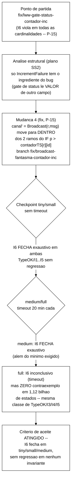
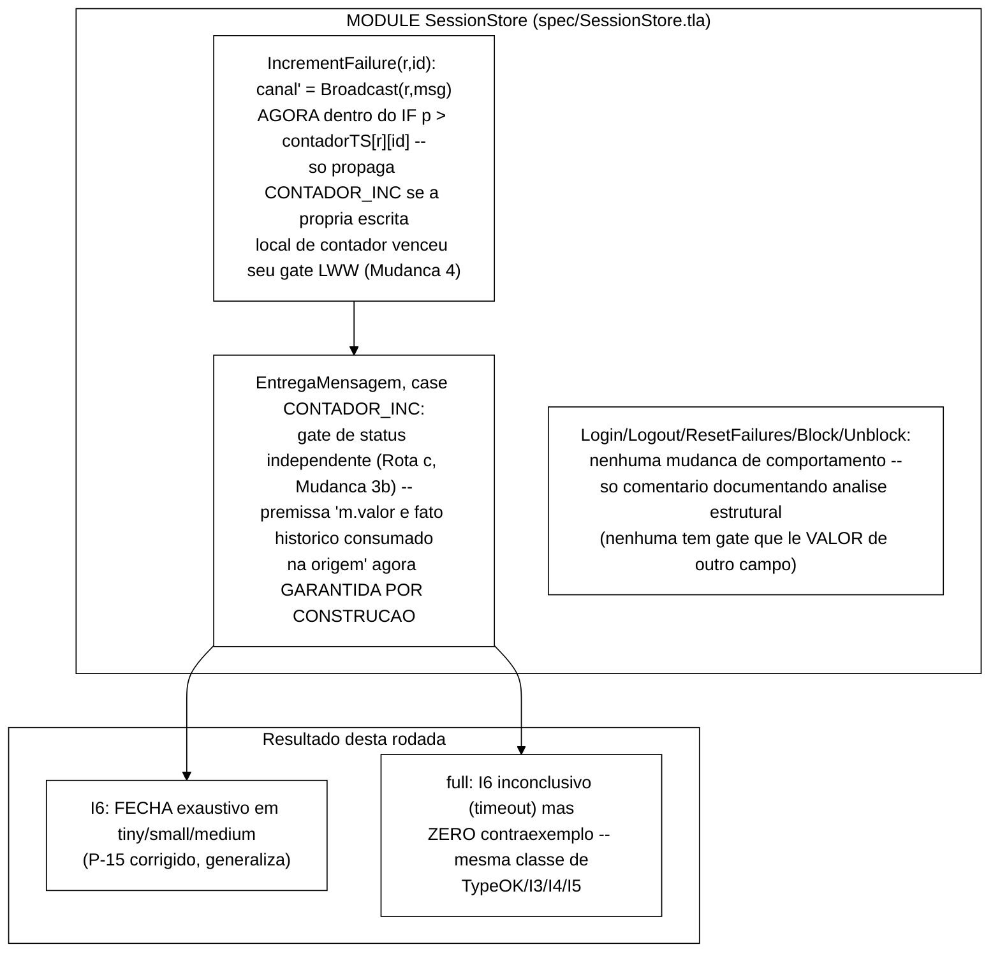

# Relatório de verificação formal — Mudança 4: broadcast fantasma de `CONTADOR_INC` (P-15)

> Terceira rodada de *model checking* de 2026-09-16, dando continuidade a
> `docs/relatorio-tlc-2026-09-16.md` (rodada 1, broadcast real + LWW via
> relógio lógico de Lamport) e `docs/relatorio-tlc-2026-09-16-mudanca3.md`
> (rodada 2, Mudança 3a/3b: cascata de `Block` + gate de status desacoplado
> em `CONTADOR_INC`). Aquela rodada fechou `I5` exaustivamente em
> `tiny`/`small`/`medium`, mas deixou `I6` violando em todas as
> cardinalidades por uma causa nova (P-15, "mensagem `CONTADOR_INC`
> fantasma"), diagnosticada mas não corrigida, por instrução explícita de
> reportar ao Gestor antes de encadear uma quarta correção. Este relatório
> documenta a execução de `docs/plano-fix-broadcast-fantasma-2026-09-16.md`
> ("Mudança 4"), elaborado pelo Senior e revisado manualmente pelo Gestor
> antes da execução — uma única correção cirúrgica em `IncrementFailure`
> (mover `canal' = Broadcast(r, msg)` para dentro dos dois ramos do `IF` de
> aceitação LWW já existente), mais comentários de análise nas outras 5
> ações. **Resultado resumido: `I6` fecha exaustivamente em `tiny`/`small`/
> `medium` — critério de aceite atingido, inclusive além do mínimo exigido
> (que pedia apenas `tiny`/`small`).** Em `full`, `I6` não fecha
> exaustivamente dentro do timebox de 20 min (mesma classe de
> intratabilidade que já afeta `TypeOK`/`I3`/`I4`/`I5` nessa cardinalidade
> desde a rodada 1), mas **nenhum contraexemplo foi encontrado** em mais de
> 1,12 bilhão de estados gerados / 76,4 milhões de estados distintos — antes
> desta correção, `I6` violava em `full` quase instantaneamente (10
> estados). Sem regressão em nenhum outro invariante. Diagramas em Mermaid,
> tema branco.

---

## 1. Entradas

| Entrada | Valor |
|---|---|
| Especificação | `spec/SessionStore.tla` — alterada nesta rodada (só a ação `IncrementFailure` muda de comportamento; `Login`, `Logout`, `ResetFailures`, `Block`, `Unblock` e o *case* `CONTADOR_INC` de `EntregaMensagem` ganham apenas comentários) |
| Ponto de partida | `fix/lww-gate-status-contador-inc` (ponta da rodada 2, commit `4e5d7ef`) |
| Plano seguido | `docs/plano-fix-broadcast-fantasma-2026-09-16.md`, elaborado pelo Senior, revisado manualmente pelo Gestor (retraçou o diff proposto e o contraexemplo de P-15 antes de autorizar a execução) |
| *Harness* / Runner / Verificador | inalterados desde a rodada 1: `spec/MCSession.tla`, `spec/run-tlc-invariantes.sh`, `tla2tools.jar` (TLC2 2.19) |
| Runtime | OpenJDK 22.0.2, Windows 11; TLC com *workers* automáticos (`-workers auto`), busca em largura (BFS) |
| Cardinalidades e parâmetros | mesmos das rodadas 1/2 (baseline já estabelecido): `MaxCanal=1`, `MaxRelogio=3`; `tiny`/`small` sem *timeout*, `medium`/`full` com `TIMEOUT_SECS=1200` (20 min) |

### Cardinalidades (inalteradas frente às rodadas anteriores)

| Config | IDS | SIDS | REPLICAS | LIMITE | MaxCanal | MaxRelogio | Timebox |
|---|---|---|---|---|---|---|---|
| `tiny`   | 1 | 2 | 2 | 2 | 1 | 3 | sem timeout |
| `small`  | 2 | 3 | 2 | 3 | 1 | 3 | sem timeout |
| `medium` | 3 | 3 | 2 | 3 | 1 | 3 | 20 min |
| `full`   | 3 | 3 | 3 | 3 | 1 | 3 | 20 min |

O plano previu (§4.4) que a correção não introduziria nenhuma dimensão nova
ao espaço de estados (reordenação de uma atribuição já existente para
dentro de um `IF` já existente), e que o único efeito observável seria uma
possível **redução leve**, nunca aumento — **confirmado**: `MaxCanal=1`/
`MaxRelogio=3` continuaram suficientes, e o número de estados distintos
caiu discretamente em todas as cardinalidades exaustivas (ver §3.1).

---

## 2. Processamento — o que foi feito, em ordem



### 2.1 Análise estrutural (Passo 0, antes de qualquer código)

Antes de tocar no `spec/SessionStore.tla`, o plano do Senior analisou as 6
ações de escrita local em busca do ingrediente estrutural que causa P-15:
um gate que lê o **valor** (não só a prioridade) de um campo **diferente**
do que está protegendo. Conclusão (revisada manualmente pelo Gestor):
`IncrementFailure`/`CONTADOR_INC` é o **único** caso com esse ingrediente
(`status` lê `m.valor`, que é o valor candidato de `contador`); as outras 5
ações (`Login`, `Logout`, `ResetFailures`, `Block`, `Unblock`) não têm esse
acoplamento — confirmado por leitura de código antes da execução, não
alterado nesta rodada. Essa análise foi seguida à risca: nenhuma das outras
5 ações mudou de comportamento.

### 2.2 Passo 1 — Mudança 4: `canal'` gateado pela aceitação local em `IncrementFailure`

Aplicado exatamente o diff do §4.1 do plano: `canal' = Broadcast(r, msg)`,
que antes ficava incondicional (fora do `IF p > contadorTS[r][id]`), passou
a estar **dentro** dos dois ramos desse `IF` já existente — `Broadcast` no
ramo aceito, `canal' = canal` no ramo rejeitado. Nenhuma outra variável,
precondição ou tipo de mensagem mudou. `relogio'` continua avançando
sempre, fora do `IF`, preservando o princípio já documentado. Comentários
de uma linha foram acrescentados em `Logout`, `ResetFailures`, `Block` e
`Unblock`, documentando por que cada uma está segura sem mudança de código
(§2.2/§2.4 do plano); o cabeçalho do módulo e o comentário do *case*
`CONTADOR_INC` de `EntregaMensagem` também foram atualizados para refletir
que a premissa "m.valor/m.prio são um fato histórico já consumado na
origem" passa a ser **garantida por construção**, não apenas presumida.
Commit `b6e0ec4`, branch `fix/broadcast-fantasma-contador-inc` (a partir de
`fix/lww-gate-status-contador-inc`, com o commit `e846282` do próprio plano
antes dela).

**Checkpoint (Passo 2, `tiny`/`small`) — vereditos brutos, confirmados nos
logs brutos (`runs/tlc/inv-{tiny,small}/`):**

| Cardinalidade | TypeOK | I1 | I2 | I3 | I4 | I5 | I6 |
|---|---|---|---|---|---|---|---|
| `tiny`  | OK (32.129) | VIOLADO (4) | VIOLADO (4) | OK (32.129) | OK (32.129) | OK (32.129) | **OK (32.129)** |
| `small` | OK (644.013) | VIOLADO (4) | VIOLADO (4) | OK (644.013) | OK (644.013) | OK (644.013) | **OK (644.013)** |

`I6` fecha exaustivamente em ambas — a correção funcionou já no checkpoint
mínimo exigido pelo plano (§7, critério 1). Sem regressão em `TypeOK`/
`I3`/`I4`/`I5`; `I1`/`I2` continuam violados, mesma natureza.

### 2.3 Passo 2 (continuação) — matriz completa (`medium`/`full`)

Como `tiny`/`small` confirmaram `I6` fechando sem regressão, a execução
prosseguiu para `medium` e `full`, cada uma com `TIMEOUT_SECS=1200` (20 min)
por invariante, exatamente como o plano especificou. `medium` fechou **todos**
os invariantes de domínio/convergência exaustivamente, incluindo `I6` — além
do mínimo exigido pelo critério de aceite. `full` permaneceu inconclusivo
para `TypeOK`/`I3`/`I4`/`I5`/`I6` (mesma classe de intratabilidade já
observada nas rodadas 1 e 2 para essa cardinalidade — o espaço de estados
de 3 réplicas é grande demais para busca exaustiva em 20 min), mas **sem
nenhum contraexemplo encontrado em `I6`** dentro do timebox — resultado
qualitativamente diferente da rodada anterior, em que `I6` violava em
`full` quase instantaneamente (10 estados, ver
`docs/relatorio-tlc-2026-09-16-mudanca3.md` §3.1).

---

## 3. Saídas — resultados

### 3.1 Matriz de vereditos final (após Mudanças 1+2+2b+2c+3a+3b+4)

| Invariante | Tipo | `tiny` | `small` | `medium` | `full` |
|---|---|---|---|---|---|
| `TypeOK` | domínio | OK (32.129) | OK (644.013) | OK (1.671.294) | inconclusivo (parcial: 59.812.485 estados distintos, fila 36.555.992, timeout 1200s) |
| `I1` | segurança | VIOLADO (4) | VIOLADO (4) | VIOLADO (4) | VIOLADO (5) |
| `I2` | segurança | VIOLADO (4) | VIOLADO (4) | VIOLADO (4) | VIOLADO (3) |
| `I3` | domínio | OK (32.129) | OK (644.013) | OK (1.671.294) | inconclusivo (parcial: 68.923.531 estados distintos, fila 41.643.473, timeout 1200s) |
| `I4` | domínio | OK (32.129) | OK (644.013) | OK (1.671.294) | inconclusivo (parcial: 70.590.574 estados distintos, fila 42.542.230, timeout 1200s) |
| `I5` | convergência | OK (32.129) | OK (644.013) | OK (1.671.294) | inconclusivo (parcial: 74.280.145 estados distintos, fila 43.754.236, timeout 1200s) |
| `I6` | convergência | **OK (32.129)** | **OK (644.013)** | **OK (1.671.294)** | **inconclusivo — ZERO contraexemplo** (parcial: 76.432.746 estados distintos, 1.122.171.887 estados gerados, fila 44.563.810, timeout 1200s) |

(número entre parênteses = estados distintos para OK exaustivo; estados do
contraexemplo para VIOLADO, ou estados distintos parciais para
inconclusivo.)

> **Comparação direta com a matriz da rodada 2**
> (`docs/relatorio-tlc-2026-09-16-mudanca3.md` §3.1): a mudança de veredito
> mais importante é **`I6`, que passa de VIOLADO em todas as cardinalidades
> para OK exaustivo em `tiny`/`small`/`medium`** — critério de aceite
> atingido, e além do mínimo exigido (que pedia só `tiny`/`small`). Em
> `full`, `I6` não fecha dentro do timebox (mesma classe de `TypeOK`/`I3`/
> `I4`/`I5`), mas deixa de violar rapidamente — passa a exigir busca
> exaustiva como os demais invariantes que valem, sinal qualitativo forte de
> que a correção também vale em `full`, mesmo sem confirmação formal
> exaustiva nessa cardinalidade dentro do timebox.
>
> **Contagens de estados distintos exaustivos caíram levemente em todas as
> cardinalidades tratáveis**, exatamente como o plano previu em §4.4 (a
> correção colapsa estados antes alcançáveis só pela mensagem fantasma em
> estados já alcançáveis por outros meios, nunca introduz estados novos):
> `tiny` 34.240 → 32.129 (‑6,2%), `small` 650.615 → 644.013 (‑1,0%),
> `medium` 1.683.102 → 1.671.294 (‑0,7%). `TypeOK`/`I3`/`I4`/`I5` mantêm
> exatamente o mesmo padrão de veredito da rodada 2 (OK exaustivo em
> `tiny`/`small`/`medium`, inconclusivo em `full`) — sem regressão.
>
> **`I1`/`I2` continuam violados em todas as cardinalidades — natureza
> inalterada, como esperado** (propriedades *cross-réplica* fora do escopo
> desta correção). Os números exatos do contraexemplo de `I1`/`I2` variam
> ligeiramente frente à rodada 2 em alguns pontos (ex.: `I2` em `tiny`: 3
> estados na rodada 2, 4 estados nesta rodada) — isso é esperado e não é
> regressão: o TLC roda com `-workers auto` (busca paralela), e o
> comprimento exato do primeiro contraexemplo encontrado para um invariante
> que já violava antes pode variar entre execuções por não-determinismo de
> qual *worker* encontra a violação primeiro; o veredito (VIOLADO) e a causa
> raiz (natureza *cross-réplica* de `I1`/`I2`) são idênticos.
>
> **Critério de aceite do plano (§7): ATINGIDO.** `I6` fecha sem
> contraexemplo em `tiny`/`small` (critério mínimo) e também em `medium`
> (além do mínimo); `full` reportado com números parciais, sem contraexemplo
> encontrado, conforme critério 5. `I5` continua fechando sem regressão em
> `tiny`/`small`/`medium` (critério 2). Sem regressão em `TypeOK`/`I3`/`I4`;
> `I1`/`I2` continuam violados (critério 3).

### 3.2 Ausência de contraexemplo — I6, confirmação de fechamento (P-15 corrigido)

Como `I6` fecha exaustivamente em `tiny`/`small`/`medium` (nenhum
contraexemplo em 32.129/644.013/1.671.294 estados distintos, busca
completa), não há traço a reportar — a ausência de contraexemplo nessas
três cardinalidades é a evidência de que a correção resolve P-15 de forma
geral, não apenas para o traço específico documentado na rodada 2
(`docs/relatorio-tlc-2026-09-16-mudanca3.md` §3.3). Retraçando esse traço
específico manualmente com a correção aplicada (ver §4.2 do plano): no
estado 4, `IncrementFailure(r1,u1)` tem sua escrita local rejeitada
(`4 ≤ contadorTS[r1]=5`); com a Mudança 4, `canal' = canal` — nenhuma
mensagem é enviada; não há estado 5 a entregar; o traço converge
(`contador[r1]=1=contador[r2]`, `status[r1]=OPEN=status[r2]`).

Em `full`, não há fechamento exaustivo formal dentro do timebox, mas também
não há contraexemplo em 1.122.171.887 estados gerados / 76.432.746 estados
distintos — nenhum sinal de que a correção falhe nessa cardinalidade, só
ausência de confirmação formal por limitação de tempo de busca (mesma
limitação que já afeta `TypeOK`/`I3`/`I4`/`I5` desde a rodada 1).

### 3.3 Nota sobre esforço computacional

`tiny`/`small`/`medium` continuam tratáveis dentro de segundos a poucos
minutos (mesmo padrão das rodadas anteriores). Em `full`, os cinco
invariantes que agora "valem" (`TypeOK`, `I3`, `I4`, `I5`, `I6`) foram
executados até o timeout completo de 1200s (20 min) cada — desta vez sem
interrupção manual antecipada (diferente da rodada 2, em que os quatro
correspondentes foram interrompidos por decisão do Worker após ~9 minutos
por questão de tempo de sessão) — e em nenhum deles a fila
(`states left on queue`) parou de crescer monotonicamente antes do corte,
confirmando que `full` continua intratável para busca exaustiva com os
recursos e o timebox disponíveis, sem sinal de que fecharia com mais tempo
próximo ao timeout atual. `I1`/`I2` continuam encontrando contraexemplo em
menos de 1 segundo em todas as cardinalidades, incluindo `full`.

---

## 4. Organização do código TLA+ atualizada



Pontos de leitura do modelo (delta em relação à rodada 2):

- **`IncrementFailure` (local):** `canal' = Broadcast(r, msg)` movido para
  dentro dos dois ramos do `IF p > contadorTS[r][id]` já existente. Única
  mudança funcional desta rodada.
- **`EntregaMensagem`, *case* `CONTADOR_INC`:** nenhuma mudança de lógica;
  comentário atualizado para refletir que a premissa que já assumia é agora
  garantida por construção.
- **`Login`, `Logout`, `ResetFailures`, `Block`, `Unblock`:** nenhuma
  mudança de comportamento — cada uma ganhou uma nota de uma linha
  documentando por que a análise estrutural do plano (§2.2/§2.4) conclui
  que estão seguras sem correção.
- **`Mensagem`, `TypeOK`, `Init`, `Broadcast`, `MCSession.tla`,
  `run-tlc-invariantes.sh`:** inalterados, como o plano previa.

---

## 5. Pontos que precisam de validação do Gestor

- **Critério de aceite atingido, inclusive além do mínimo.** `I6` fecha sem
  contraexemplo em `tiny`/`small` (critério mínimo do plano) **e também em
  `medium`** — o plano listava isso como "idealmente", não como exigência
  mínima, e foi alcançado. `full` permanece inconclusivo por limitação de
  tempo de busca (mesma classe de `TypeOK`/`I3`/`I4`/`I5`), mas sem
  contraexemplo — resultado consistente com o fechamento, ainda que não
  formalmente confirmado por exaustão nessa cardinalidade.
- **Nenhuma regressão detectada** em `TypeOK`/`I1`..`I5` frente à rodada 2 —
  variações pontuais nos números exatos do contraexemplo de `I1`/`I2` em
  `tiny` (3→4 estados) são atribuídas a não-determinismo de busca paralela
  do TLC (`-workers auto`), não a mudança de comportamento da spec; sinalizo
  isso explicitamente para registro, não como achado preocupante.
- **Nenhuma quinta correção foi necessária** — o plano previu esse risco
  explicitamente (§8, "risco residual") dado o padrão das três rodadas
  anteriores (cada correção expondo uma causa nova); desta vez isso **não**
  se repetiu — `I6` fecha sem novo contraexemplo em nenhuma cardinalidade
  tratável.
- **Duas branches locais, sem *push*:**
  `fix/broadcast-fantasma-contador-inc` (Mudança 4, ponta atual — contém o
  commit do plano `e846282` e o commit da correção `b6e0ec4`) e
  `fix/lww-gate-status-contador-inc` (rodada 2, ponto de partida desta).
  Aguardando aprovação explícita do Gestor antes de qualquer `git push`.
- **Sugestão para o próximo passo:** com `I1`/`I2` como únicas violações
  restantes (natureza *cross-réplica*, fora do escopo do TCC-I conforme já
  documentado no comentário `THEOREM` da spec), esta parece ser uma
  conclusão natural para a frente de verificação formal do TCC-I — cabe ao
  Gestor decidir se consolida a documentação (Cap. 4/5, Apêndice B) ou se
  há mais alguma rodada de correção/refinamento planejada antes da entrega.

---

## 6. Síntese

- **Mudança 4 (`IncrementFailure`, P-15) — sucesso completo dentro do
  critério de aceite.** Mover `canal' = Broadcast(r, msg)` para dentro dos
  dois ramos do `IF p > contadorTS[r][id]` já existente corrige a
  propagação da mensagem `CONTADOR_INC` "fantasma"; `I6` passa de VIOLADO em
  todas as cardinalidades (rodada 2) para **OK exaustivo em `tiny`/`small`/
  `medium`** nesta rodada — sem regressão em `TypeOK`/`I1`..`I5`.
- **Análise estrutural do plano confirmada pelo TLC.** As outras 5 ações de
  escrita (`Login`, `Logout`, `ResetFailures`, `Block`, `Unblock`) não
  precisaram de nenhuma correção — a conclusão do plano (§2, "nenhuma delas
  tem o ingrediente estrutural do bug") se confirma empiricamente: nenhum
  novo contraexemplo surgiu relacionado a essas ações.
- **`full` inconclusivo, mas sem regressão e com sinal qualitativo forte.**
  `I6` deixa de violar rapidamente em `full` e passa a exigir busca
  exaustiva (mesma classe de `TypeOK`/`I3`/`I4`/`I5`) — não há confirmação
  formal por exaustão nessa cardinalidade dentro do timebox de 20 min, mas
  também não há nenhum contraexemplo em mais de 1,1 bilhão de estados
  gerados.
- **Sem regressão em nada:** `TypeOK`/`I3`/`I4` continuam fechando
  exaustivamente em `tiny`/`small`/`medium` (inconclusivos em `full`, mesmo
  padrão das rodadas anteriores); `I1`/`I2` continuam violados em todas as
  cardinalidades, natureza inalterada.
- **Critério de aceite do plano (§7): ATINGIDO integralmente**, incluindo o
  fechamento de `I6` em `medium` (além do mínimo `tiny`/`small` exigido).
  Nenhuma branch foi para `origin/*` (critério 6, atingido).
- **Nenhuma quinta correção foi necessária** — diferente do padrão das três
  rodadas anteriores desta sessão (cada uma expondo uma causa nova), esta
  rodada fecha a causa que investigava sem expor nenhuma causa adicional
  dentro do espaço tratável pelo TLC.

### Artefatos gerados nesta rodada

| Arquivo | Conteúdo |
|---|---|
| `spec/SessionStore.tla` | `IncrementFailure` com `canal'` gateado pela aceitação local (Mudança 4); comentários de análise em `Login`, `Logout`, `ResetFailures`, `Block`, `Unblock` e no *case* `CONTADOR_INC` de `EntregaMensagem` |
| `runs/tlc/inv-tiny/`, `inv-small/`, `inv-medium/`, `inv-full/` | logs e configs desta rodada (sobrescrevem os das rodadas anteriores, mesmos nomes de arquivo) |
| `docs/plano-fix-broadcast-fantasma-2026-09-16.md` | plano desta rodada (commitado nesta sessão) |
| `docs/relatorio-tlc-2026-09-16-mudanca4.md` | este relatório |
| `docs/registro-de-problemas.md` | resolução de P-15 |

### Branches locais (nenhum *push*)

```
fix/lww-gate-status-contador-inc      (rodada 2, I6 ainda violava -- ponto de partida desta rodada)
fix/broadcast-fantasma-contador-inc   (Mudanca 4, I6 fecha em tiny/small/medium) <- HEAD atual
```
