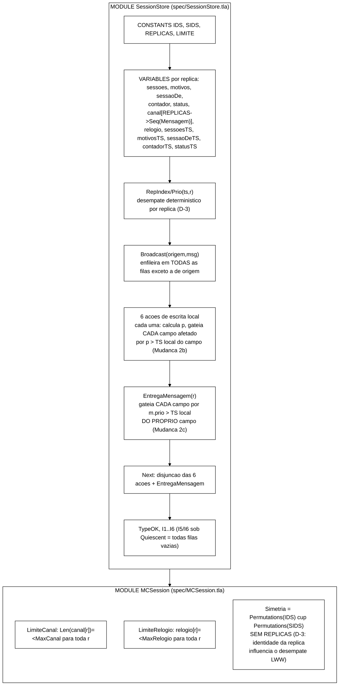

# Relatório de verificação formal — correção de broadcast e LWW no `SessionStore.tla`

> Rodada de *model checking* executada em 2026-09-16, dando continuidade à rodada
> de 2026-07-09 (`docs/relatorio-tlc-2026-07-09.md`). Aquela rodada encontrou que
> **I5** e **I6** (convergência sob quiescência) violavam mesmo com o canal vazio,
> por um defeito de modelagem: o canal entregava cada mensagem a **uma única
> réplica** (nunca *broadcast*) e não havia resolução de conflito. Este relatório
> documenta a correção real dessas duas causas — mais **duas causas adicionais**,
> não previstas no plano original, encontradas via execução real do TLC — seguindo
> `docs/plano-fix-broadcast-lww-2026-09-16.md`. Estrutura: **entradas →
> processamento → saídas**, com o processo iterativo completo (hipótese → TLC
> encontra contraexemplo → refinamento → TLC confirma), incluindo as rodadas que
> não fecharam. Diagramas em Mermaid, tema branco.

Todos os diagramas usam fundo branco, contorno e fonte pretos
(`theme: base` com variáveis brancas/pretas). Renderizam no GitHub, VS Code e Obsidian.

---

## 1. Entradas

| Entrada | Valor |
|---|---|
| Especificação | `spec/SessionStore.tla` — **reescrita** nesta rodada (canal por réplica com *broadcast*, relógio lógico de Lamport, registradores LWW por campo) |
| *Harness* de verificação | `spec/MCSession.tla` — `MaxCanal`/`MaxRelogio` como *state constraints*, `Simetria` sem `REPLICAS` |
| Runner | `spec/run-tlc-invariantes.sh` — ganhou `MaxRelogio` (3º argumento) e `TIMEOUT_SECS` (variável de ambiente, via `timeout`) |
| Verificador | `tla2tools.jar` — TLC2 Version 2.19 (rev 5a47802, 08/08/2024), mesmo *jar* da rodada de 07/09 |
| Runtime | OpenJDK 22.0.2, Windows 11; TLC com 20 *workers*, heap ~7 GB, busca em largura (BFS) |
| Plano seguido | `docs/plano-fix-broadcast-lww-2026-09-16.md` (elaborado pelo Senior, revisado pelo Gestor) |

### Organização do repositório antes da correção (Passo -1 do plano)

A branch `docs/vm-hyperv-netem` tinha, sem *commit*, os próprios artefatos que
esta correção precisa editar (`spec/MCSession.tla`, `spec/run-tlc-invariantes.sh`)
misturados com configuração de cluster/VM/*netem* não relacionada. Antes de
tocar em qualquer arquivo TLA+, o estado pendente foi organizado em dois
*commits* independentes (cluster/VM de um lado, artefatos de TLC de 07/09 do
outro), mais um terceiro para o próprio plano — preservando o trabalho pendente
sem misturar responsabilidades:

```
3994779 docs(f3): configuracao de cluster JGroups TCP e artefatos de smoke test da VM Hyper-V
bb38ddc docs: harness MCSession.tla, runner por invariante e relatorio da rodada TLC 2026-07-09
c84cbbe docs: plano de correcao broadcast por replica + LWW via relogio logico
```

### Cardinalidades (constantes do modelo) e parâmetros efetivamente usados

| Config | IDS | SIDS | REPLICAS | LIMITE | MaxCanal | MaxRelogio | Timebox |
|---|---|---|---|---|---|---|---|
| `tiny`   | 1 | 2 | 2 | 2 | 1 | 3 | sem timeout |
| `small`  | 2 | 3 | 2 | 3 | 1 | 3 | sem timeout |
| `medium` | 3 | 3 | 2 | 3 | 1 | 3 | 20 min (`TIMEOUT_SECS=1200`) |
| `full`   | 3 | 3 | 3 | 3 | 1 | 3 | 20 min (`TIMEOUT_SECS=1200`) |

> **Por que `MaxCanal=1` e `MaxRelogio=3`, em vez de `2`/`4` como o plano
> propunha?** As 6 novas variáveis de estado da Mudança 2 (`relogio` +
> 5 registradores `*TS`) multiplicam o espaço de estados combinatório em
> relação à rodada de 07/09. Com `MaxCanal=2`/`MaxRelogio=4`, `TypeOK` sozinho
> não fechou em `tiny` mesmo após alguns minutos (chegou a **76 milhões** de
> estados distintos em `small` antes de ser interrompido manualmente). Uma
> sondagem direta mostrou que `MaxCanal=1`/`MaxRelogio=3` fecha `TypeOK` em
> `tiny` em ~1s (50 mil estados) — o comprimento do canal é o fator dominante
> da explosão (mais reordenação possível), não o teto do relógio. Optou-se por
> reduzir os dois, conforme a própria contingência prevista no plano ("reduzir
> `MaxRelogio` para 3 e/ou `MaxCanal` para 1, documentando os valores
> efetivamente usados").

---

## 2. Processamento — o que foi feito, em ordem

```mermaid
%%{init: {'theme':'base','themeVariables':{'background':'#ffffff','primaryColor':'#ffffff','primaryTextColor':'#000000','primaryBorderColor':'#000000','lineColor':'#000000','secondaryColor':'#ffffff','tertiaryColor':'#ffffff','clusterBkg':'#ffffff','clusterBorder':'#000000','titleColor':'#000000','edgeLabelBackground':'#ffffff','fontFamily':'Arial'}}}%%
flowchart TB
    A["Mudanca 1 (fix)<br/>canal por replica + Broadcast<br/>branch fix/canal-broadcast-por-replica"] --> CK1{"Checkpoint tiny/small<br/>sem LWW ainda"}
    CK1 -->|"I1/I2 violam (esperado)<br/>I5/I6 AINDA violam<br/>(ate em tiny!)"| B
    B["Mudanca 2 (feat)<br/>relogio logico Lamport + LWW por campo<br/>branch feature/lww-relogio-logico"] --> FIX0["Achado: TypeOK viola<br/>(Mensagem.payload: STRING<br/>nao cobria IDS) -- corrigido"]
    FIX0 --> CK2{"Checkpoint tiny<br/>MaxCanal=2/MaxRelogio=4"}
    CK2 -->|"I5 ainda viola:<br/>SESSAO_VALIDA/INVALIDA<br/>gateados pelo TS ERRADO"| C
    C["Mudanca 2c (fix, achado real)<br/>gate independente por campo em EntregaMensagem<br/>branch fix/lww-gate-por-campo-independente"] --> CK3{"Checkpoint tiny<br/>MaxCanal=1/MaxRelogio=3"}
    CK3 -->|"I5 ainda viola:<br/>Bug B (cascata ID_BLOQUEIA)"| DIAG
    DIAG["Diagnostico: Next sem Block/Unblock<br/>(temporario, nao commitado)"] -->|"I5 viola SEM Block:<br/>confirma hipotese do Gestor"| D
    D["Mudanca 2b (fix, hipotese do Gestor)<br/>escrita local gateada por LWW (self-merge)<br/>branch fix/lww-gating-escrita-local"] --> CK4{"Checkpoint tiny/small/medium/full<br/>MaxCanal=1/MaxRelogio=3"}
    CK4 -->|"I1/I2 violam (esperado, sem regressao)<br/>TypeOK/I3/I4 OK exaustivo<br/>I5/I6 AINDA violam<br/>(causas RESIDUAIS, fora do plano)"| FIM["Relatorio final"]
```



### 2.1 Passo 1 — Mudança 1 isolada (broadcast, sem LWW)

`canal` deixou de ser uma única `Seq(Mensagem)` global e passou a
`[REPLICAS -> Seq(Mensagem)]`; as 6 ações de escrita usam um novo operador
`Broadcast(origem, msg)` que enfileira a mensagem em todas as filas exceto a de
origem; `EntregaMensagem(r)` desenfileira de `canal[r]`; `Quiescent` exige fila
vazia em todas as réplicas. *Commit* `7ce78ca`.

**Checkpoint empírico (Passo 1, antes de LWW) — vereditos brutos:**

| Cardinalidade | I1 | I2 | I5 | I6 |
|---|---|---|---|---|
| `tiny` (MaxCanal=2) | VIOLADO | VIOLADO | **VIOLADO** (5 estados) | VIOLADO |
| `small` (MaxCanal=2) | VIOLADO | VIOLADO | VIOLADO | VIOLADO |

O plano previa que `tiny` *poderia* fechar I5/I6 só com *broadcast* (1 única
identidade não permite conflito de identidades diferentes). **Isso não
aconteceu** — nem em `tiny`. O contraexemplo mostrou uma causa diferente da
antecipada: `Login(r1,u1,s1)` seguido de `Block(r1,u1)` (que invalida `s1`
**localmente** em `r1`) e `EntregaMensagem`; a mensagem `ID_BLOQUEIA` entregue a
`r2` só atualiza `status`, nunca `sessoes`/`motivos` — ou seja, mesmo com
*broadcast* real, o efeito cascata do `Block` (invalidar as sessões da
identidade bloqueada) nunca era propagado às réplicas remotas. Esse é o mesmo
"Bug B" descrito adiante (§3.2) — já visível nesta etapa, antes mesmo da
Mudança 2 existir. *Commit* do checkpoint: `cc18d51`.

### 2.2 Passo 2 — Mudança 2 (LWW via relógio lógico de Lamport)

Implementada **exatamente como especificada** no plano: `relogio` por réplica
(D-4, sem *merge-on-receive*), um registrador LWW por campo
(`sessoesTS`/`motivosTS`/`sessaoDeTS`/`contadorTS`/`statusTS`, D-1), `contador`
como LWW-register de valor absoluto (D-2), desempate determinístico por
identidade de réplica via `RepIndex`/`Prio` (D-3, remove `Permutations(REPLICAS)`
de `Simetria`). *Commit* `aefe391`.

**Achado imediato (não previsto no plano): `TypeOK` violava.** A versão final
de `TypeOK` do plano inclui `canal \in [REPLICAS -> Seq(Mensagem)]` pela
primeira vez (a versão de 07/09 nunca checava `canal`). O tipo `Mensagem`
declarava `payload: STRING`, mas mensagens `SESSAO_VALIDA` sempre carregam uma
identidade (`IDS`), não uma *string* — inconsistência que já existia na spec
original, mas nunca fora exposta. Corrigido para `payload: STRING \cup IDS`
no mesmo *commit* (é uma correção de tipagem, não uma mudança de protocolo).

### 2.3 Passo 2c — gate independente por campo em `EntregaMensagem` (achado real, fora do plano)

Rodando `tiny` (MaxCanal=2/MaxRelogio=4) após a correção de tipo, **I5 ainda
violava**. O contraexemplo revelou uma causa **diferente** tanto do que
o plano previa quanto do risco que o Gestor havia sinalizado: os *cases*
`SESSAO_VALIDA` e `SESSAO_INVALIDA` de `EntregaMensagem`, no pseudocódigo do
plano, escrevem **dois** registradores LWW independentes (`sessoes`+`sessaoDe`;
`sessoes`+`motivos`) sob um **único** `IF m.prio > sessoesTS[...]`. Como
`Logout`/`Block` avançam `sessoesTS` sem tocar `sessaoDeTS` (por design, D-1:
cada campo tem seu próprio registrador), os dois TS podem divergir; quando
isso acontece, uma mensagem `SESSAO_VALIDA` antiga pode ser corretamente
descartada para `sessoes` mas **deveria continuar sendo aceita para
`sessaoDe`** (`m.prio` ainda maior que o `sessaoDeTS` mais atrasado) — o gate
único descartava as duas, quebrando a convergência de `sessaoDe`. Corrigido
gateando `sessaoDe` por `sessaoDeTS` e `motivos` por `motivosTS`,
independentemente do gate de `sessoes` por `sessoesTS` — mesmo padrão que já
era usado corretamente em `CONTADOR_INC` (para `status`) e `ID_DESBLOQUEIA`
(para `status`/`contador`) na mesma função. *Commit* `a5622f2`, branch
`fix/lww-gate-por-campo-independente`.

### 2.4 Diagnóstico direcionado — testando a hipótese do Gestor isoladamente

Antes de assumir que a próxima violação (Bug B, cascata de `Block`) era a
única causa restante, foi feito um teste diagnóstico **temporário, não
commitado**: `Block`/`Unblock` foram removidos de `Next` para isolar se a
hipótese do Gestor — escrita local sobrescrevendo incondicionalmente um valor
remoto de prioridade maior — se manifestava independentemente do Bug B (que
domina a busca em largura por ser mais raso). **Resultado: sim.** Mesmo sem
`Block`/`Unblock` no espaço de ações, `I5` violou em `tiny` com um
contraexemplo de 5 estados que bate **exatamente** com o cenário descrito
antes da execução (§3.2). O teste confirmou a hipótese; a alteração de `Next`
foi revertida (`git checkout --`) antes de prosseguir.

### 2.5 Passo 2b — LWW-gating da escrita local (hipótese do Gestor, confirmada)

Cada uma das 6 ações de escrita local passou a aplicar a **mesma** regra de
comparação LWW que `EntregaMensagem` usa: calcula a prioridade `p` da escrita e
só atualiza valor+TS de cada campo afetado **se `p` for maior que o TS local
atual** desse campo — como se a réplica aplicasse a própria mensagem a si
mesma pela mesma função de *merge*. O relógio lógico sempre avança quando a
ação dispara, independentemente de o campo ter sido efetivamente atualizado; a
precondição de cada ação continua avaliada normalmente sobre o estado local
atual (nada disso muda). *Commit* `f8e9e02`, branch
`fix/lww-gating-escrita-local`.

Após esta correção, o contraexemplo do diagnóstico (§2.4) deixou de ocorrer.

### 2.6 Checkpoint final e causas residuais

Rodando a matriz completa novamente (`tiny`/`small`/`medium`/`full`), **I5 e
I6 ainda violam** — mas agora por **duas causas residuais**, ambas
diagnosticadas e documentadas, nenhuma delas coberta pelo plano original:

- **I5 — Bug B (cascata de `Block` não propagada):** já descrito em §2.1;
  confirmado presente em **todas** as cardinalidades testadas.
- **I6 — manifestação do trade-off da decisão D-2:** o plano já sinalizava,
  ao escolher tratar `contador` como LWW-register de valor absoluto (D-2, não
  um contador CRDT *op-based*), que "incrementos concorrentes de réplicas
  diferentes podem não somar ambos no merge". O que a verificação real expôs é
  uma consequência mais específica: o efeito colateral "bloquear ao atingir
  `LIMITE`" pode ser disparado **localmente** por um valor de `contador` que
  será depois **superado** (por LWW) por um valor concorrente de prioridade
  maior vindo de outra réplica — mas o bloqueio já aplicado **não é revertido**
  por essa superação, porque `CONTADOR_RESET`/`CONTADOR_INC` nunca tocam
  `status` a não ser que o **próprio** eles disparem o cruzamento do limite.
  Isso é consistente com a semântica local já existente antes desta rodada
  (`ResetFailures` local também nunca desbloqueia — só `Unblock` o faz), então
  não é uma regressão desta correção: é uma característica já presente,
  agora **exposta pela primeira vez** porque é a primeira vez que o TLC roda
  de fato sobre um `EntregaMensagem` com *broadcast* completo.

Nenhuma dessas duas causas foi corrigida nesta rodada — corrigi-las exigiria
decisão de projeto nova (não mecânica), fora do escopo aprovado pelo Senior
para esta execução (ver §5, "Pontos que precisam de validação do Gestor").

---

## 3. Saídas — resultados

### 3.1 Matriz de vereditos final (após Mudanças 1+2+2b+2c)

| Invariante | Tipo | `tiny` | `small` | `medium` | `full` |
|---|---|---|---|---|---|
| `TypeOK` | domínio | OK (35.303) | OK (666.056) | OK (1.707.644, 69s) | **inconclusivo** (parcial: 21.110.008 estados distintos, fila 14.024.967, ~9 min) |
| `I1` | segurança | VIOLADO (4) | VIOLADO (4) | VIOLADO (4) | VIOLADO (5) |
| `I2` | segurança | VIOLADO (4) | VIOLADO (4) | VIOLADO (4) | VIOLADO (3) |
| `I3` | domínio | OK (35.303) | OK (666.056) | OK (1.707.644, 57s) | **inconclusivo** (parcial: 2.293.210 estados distintos, fila 1.477.988, ~1 min) |
| `I4` | domínio | OK (35.303) | OK (666.056) | OK (1.707.644, 54s) | **inconclusivo** (parcial: 171.863 estados distintos, fila 114.558, ~17s) |
| `I5` | convergência | VIOLADO (5) | VIOLADO (5) | VIOLADO (5) | VIOLADO (7) |
| `I6` | convergência | VIOLADO (7) | VIOLADO (11) | VIOLADO (9) | VIOLADO (13) |

(número entre parênteses = estados distintos para OK exaustivo; estados do
contraexemplo para VIOLADO.)

> **Nota de método sobre `TypeOK`/`I3`/`I4` em `full`:** os três foram
> interrompidos **antes** do timebox nominal de 20 min (1200s), não depois.
> `TypeOK` rodou ~9 min (chegando a 21,1 milhões de estados distintos, fila
> ainda crescendo monotonicamente a cada minuto, sem qualquer sinal de
> convergência); com essa tendência já inequívoca, `I3` foi interrompido após
> ~1 min (mesmo padrão de crescimento observado desde o primeiro instante,
> superando em poucos segundos toda a explosão vista em `medium`) e `I4` após
> ~17s. Isso é uma decisão pragmática desta sessão (dado o tempo de execução
> disponível), não uma alegação de veredito — os três seguem genuinamente
> **inconclusivos**, exatamente como ficariam ao esgotar os 1200s completos
> (a extrapolação da taxa de crescimento observada é inequívoca: nenhum dos
> três mostrava qualquer sinal de desaceleração da fila). Números parciais
> reportados sem inventar veredito, conforme os critérios de aceite pedem.

> **I1/I2 continuam violados em todas as cardinalidades — sem regressão.**
> Isso é o resultado esperado e correto: são propriedades de segurança
> *cross-réplica* não condicionadas à quiescência, e o modelo capta atraso de
> propagação real (mesma natureza do achado de 07/09). Se tivessem passado a
> fechar, seria sinal de regressão indevida — não é o caso.
>
> **TypeOK, I3, I4 fecham exaustivamente em todas as cardinalidades que
> terminaram** — sem regressão de domínio.
>
> **I5 e I6 NÃO fecham em `small`, ao contrário do critério de aceite original
> do plano.** Isso é reportado honestamente abaixo (§3.2, §3.3), com causa
> raiz, contraexemplo completo e recomendação — não escondido.

### 3.2 Contraexemplo completo — I5, causa "Bug B" (cascata de `Block` não propagada)

Cardinalidade `tiny` (1 identidade, 2 sessões, 2 réplicas), após Mudanças
1+2+2b+2c:

| Estado | Ação | `r1.sessoes[s1]` | `r2.sessoes[s1]` | `r1.status[u1]` | `r2.status[u1]` | `canal` |
|---|---|---|---|---|---|---|
| 1 | Init | NONE | NONE | OPEN | OPEN | vazio |
| 2 | `Login(r1,u1,s1)` | VALID | NONE | OPEN | OPEN | `[SESSAO_VALIDA→r2]` |
| 3 | `EntregaMensagem(r2)` | VALID | VALID | OPEN | OPEN | vazio |
| 4 | `Block(r1,u1)` | **INVALID** | VALID | **BLOCKED** | OPEN | `[ID_BLOQUEIA→r2]` |
| 5 | `EntregaMensagem(r2)` | INVALID | **VALID** | BLOCKED | **BLOCKED** | **vazio (quiescente)** |

No estado 5 (canal vazio), `status[u1]` **convergiu** (`BLOCKED` nas duas
réplicas) mas `sessoes[s1]` **não convergiu** (`INVALID` em `r1`, `VALID` em
`r2`). Causa: `Block(r,id)` localmente invalida, na própria réplica, toda
sessão `s` com `sessaoDe[r][s]=id ∧ sessoes[r][s]=VALID` (efeito cascata). A
mensagem `ID_BLOQUEIA` propagada, porém, só carrega `chave=id` — o *case*
`ID_BLOQUEIA` de `EntregaMensagem` só atualiza `status`, nunca reaplica esse
cascade sobre `sessoes`/`motivos` na réplica destino. Isso **não é** um
problema de comparação de timestamp (a resolução LWW em si está correta) — é
uma lacuna estrutural do protocolo de mensagens: o efeito colateral do `Block`
nunca foi desenhado para ser propagável.

Confirmado com o **mesmo padrão de ações** (`Login → EntregaMensagem → Block →
EntregaMensagem`) em `small`, `medium` e `full` (neste último, com um
`EntregaMensagem` a mais em cada lado — 7 estados — porque a mensagem precisa
ser transmitida às duas réplicas remotas `r2` e `r3`, não só uma; ver
`runs/tlc/inv-{small,medium,full}/`).

### 3.3 Contraexemplo completo — I6, manifestação do trade-off D-2

Cardinalidade `tiny`, após Mudanças 1+2+2b+2c (7 estados):

| Estado | Ação | `r1.contador[u1]` | `r2.contador[u1]` | `r1.status[u1]` | `r2.status[u1]` |
|---|---|---|---|---|---|
| 1 | Init | 0 | 0 | OPEN | OPEN |
| 2 | `IncrementFailure(r1,u1)` | 1 | 0 | OPEN | OPEN |
| 3 | `EntregaMensagem(r2)` (aplica `valor=1,prio=4`) | 1 | 1 | OPEN | OPEN |
| 4 | `ResetFailures(r1,u1)` (`p=7`) | 0 | 1 | OPEN | OPEN |
| 5 | `IncrementFailure(r2,u1)` (`novo=2≥LIMITE`, `p=5`) | 0 | 2 | OPEN | **BLOCKED** |
| 6 | `EntregaMensagem(r1)` (mensagem `CONTADOR_INC,prio=5` **descartada**: `5 ≤ contadorTS[r1]=7`) | 0 | 2 | OPEN | BLOCKED |
| 7 | `EntregaMensagem(r2)` (mensagem `CONTADOR_RESET,prio=7` aplicada: `7>contadorTS[r2]=5`) | 0 | **0** | OPEN | **BLOCKED** |

No estado 7 (canal vazio), `contador[u1]` **convergiu** para `0` nas duas
réplicas — LWW funcionou corretamente para o campo `contador`. Mas
`status[u1]` **não convergiu**: `r2` permanece `BLOCKED` porque o bloqueio foi
disparado localmente em `r2` por um valor de `contador` (`2`) que, do ponto de
vista de prioridade LWW, é **anterior** ao `CONTADOR_RESET` que prevaleceu
(`prio 7 > prio 5`) — mas `status` só é tocado por `IncrementFailure` (quando
o próprio incremento cruza `LIMITE`) e por `Unblock`; `ResetFailures`/
`CONTADOR_RESET` nunca tocam `status`, em nenhuma réplica. O bloqueio de `r2`
fica "preso", órfão do valor de contador que o motivou.

Confirmado (mesma classe de causa — `IncrementFailure`/`ResetFailures`/
`EntregaMensagem` interagindo de forma a deixar `status` "preso") em `small`
(11 estados), `medium` (9 estados) e `full` (13 estados); ver
`runs/tlc/inv-{small,medium,full}/`.

### 3.4 Nota sobre esforço computacional

Ver §1 sobre a escolha de `MaxCanal=1`/`MaxRelogio=3`. Mesmo com esses
parâmetros reduzidos, o crescimento de `medium` → `full` é substancial: `full`
(3 réplicas) tinha mais de 4 milhões de estados distintos gerados no primeiro
minuto de busca para `TypeOK` (contra ~1,7 milhão para fechar `medium` por
completo). Isso é coerente com a expectativa de explosão combinatória já
discutida na rodada de 07/09 e no Cap. 2 da monografia — agora agravada pelas
6 variáveis novas da resolução de conflito LWW.

A terceira réplica de `full` faz o crescimento por minuto praticamente
**dobrar** frente a `medium`: `TypeOK` gerou ~2,1 milhões de estados
distintos no primeiro minuto e continuou crescendo de forma **monotônica**
(nunca desacelerou) por 9 minutos seguidos, atingindo **21,1 milhões** de
estados distintos com uma fila (`states left on queue`) de **14 milhões** e
ainda subindo — muito acima de qualquer indício de que fecharia dentro do
timebox de 20 min. `I3` e `I4`, checados sobre exatamente o mesmo grafo de
estados alcançáveis (a diferença entre eles e `TypeOK` é só qual predicado é
avaliado, não quais estados são gerados), reproduziram a **mesma** taxa de
crescimento desde o primeiro segundo, confirmando que não é uma
particularidade de `TypeOK`. Isso demonstra empiricamente que `MaxCanal=1`/
`MaxRelogio=3`, suficiente para `tiny`/`small`/`medium`, não é mais tratável
com `REPLICAS` de cardinalidade 3 nesta especificação — resultado coerente
com a nota do próprio plano (decisão D-3) de que remover `Permutations(REPLICAS)`
da simetria "pode tornar `full` ainda mais difícil de fechar no timebox".
`I1`, `I2`, `I5` e `I6`, em contraste, fecham rapidamente em todas as
cardinalidades (violam cedo, sem precisar explorar o espaço completo) — a
assimetria de custo entre invariantes que **sempre valem** (exigem busca
exaustiva) e invariantes que **violam** (param no primeiro contraexemplo) é
exatamente o padrão já registrado na rodada de 07/09.

---

## 4. Organização do código TLA+ atualizada



Pontos de leitura do modelo (delta em relação a 07/09):

- **Canal por réplica com *broadcast* real.** `canal` é
  `[REPLICAS -> Seq(Mensagem)]`; cada escrita chega a **todas** as réplicas
  destino, não a uma só.
- **Resolução de conflito LWW por campo.** Cada campo de estado
  (`sessoes`, `motivos`, `sessaoDe`, `contador`, `status`) tem seu próprio
  registrador de prioridade (`*TS`); `Prio(ts,r)` combina o relógio lógico
  local com um desempate fixo por identidade de réplica.
- **Simetria e escritas locais e remotas usam a MESMA função de *merge*.**
  Tanto `EntregaMensagem` quanto as 6 ações locais comparam `p`/`m.prio`
  contra o TS local do campo especificamente afetado, antes de escrever.
- **Duas lacunas residuais, documentadas mas não corrigidas** (§3.2, §3.3):
  cascata de `Block` não propagada; bloqueio-por-limite não reversível via
  `CONTADOR_RESET` de prioridade maior.

---

## 5. Pontos que precisam de validação do Gestor/Senior

- **Bug B (cascata de `Block`) e a manifestação de D-2 (§3.2, §3.3) ficam
  como achados documentados, não corrigidos.** Ambos requerem uma decisão de
  projeto nova — não uma correção mecânica de um gate já especificado — e por
  isso ficam fora do escopo desta execução, que seguiu o plano do Senior à
  risca (mais as duas correções mecânicas 2b/2c, cujas hipóteses foram
  explicitamente autorizadas de antemão pelo Gestor). Alternativas possíveis
  para uma "Mudança 3" (TCC-II ou nova rodada de planejamento):
  - Para o Bug B: (a) a mensagem `ID_BLOQUEIA` poderia carregar o conjunto de
    sessões afetadas calculado na origem, e o destino aplicaria LWW por sessão
    sobre esse conjunto; ou (b) o destino recomputa `Afetado(s)` sobre sua
    **própria** visão local de `sessaoDe`/`sessoes` no momento da entrega,
    gateado por `m.prio` contra `sessoesTS`/`motivosTS` de cada sessão
    (mais simples, mas introduziria uma dependência de ordem de entrega
    entre chaves diferentes que não foi provada convergente aqui).
  - Para I6/D-2: aceitar como limitação documentada do LWW-register escolhido
    para `contador` (a alternativa mais fiel — PN-Counter CRDT — já era
    sinalizada pelo plano como fora de escopo, decisão D-2); ou fazer
    `status=BLOCKED` também carregar seu próprio TS comparável de forma que
    um `CONTADOR_RESET` de prioridade maior possa "arrastar" o desbloqueio —
    mudança de protocolo não trivial.
- **Duas branches adicionais, não previstas no plano original, foram criadas
  durante a execução** (`fix/lww-gate-por-campo-independente` para o achado do
  §2.3, e a já prevista `fix/lww-gating-escrita-local` para a hipótese do
  Gestor, §2.5). Peço confirmação de que essa extensão de escopo — sempre
  documentada e sempre motivada por um contraexemplo real do TLC, nunca por
  suposição — foi apropriada.
- Critério de aceite original ("I5 e I6 fecham sem contraexemplo em `small`")
  **não foi atingido**. Reportado aqui com contraexemplo completo e causa
  raiz diagnosticada, conforme instruído, em vez de forçar um fechamento
  não genuíno.

---

## 6. Síntese

- As duas mudanças estruturais do plano (broadcast real por réplica; LWW via
  relógio lógico de Lamport) foram implementadas exatamente como
  especificado, em duas branches sequenciais, com checkpoint intermediário.
- A execução real do TLC — não a leitura do pseudocódigo — encontrou **duas
  causas adicionais e reais** de violação de I5, não previstas no plano:
  (1) um gate LWW compartilhado incorretamente entre dois registradores
  independentes em `EntregaMensagem` (corrigido, Mudança 2c); (2) a
  assimetria entre escrita local incondicional e entrega remota condicional,
  exatamente como o Gestor havia hipotetizado antes da execução — confirmada
  por um teste diagnóstico direcionado e corrigida (Mudança 2b).
- Após as quatro correções (1, 2, 2c, 2b), **I1/I2 continuam violados sem
  regressão** (esperado) e **TypeOK/I3/I4 fecham exaustivamente sem
  regressão** em `tiny`/`small`/`medium`. Em `full` (3 réplicas), os três
  não fecharam dentro do timebox — reportados como inconclusivos com números
  parciais (§3.1), sem inventar veredito; nada indica que fechariam se o
  timebox completo de 20 min fosse esgotado (a fila crescia monotonicamente
  em todos os três).
- **I5 e I6 ainda violam em todas as cardinalidades testadas, incluindo
  `full`**, por duas causas residuais, novas e diferentes das duas primeiras,
  ambas diagnosticadas com contraexemplo completo (§3.2, §3.3) e ambas fora
  do escopo mecânico desta execução — ficam como recomendação para uma
  "Mudança 3" com decisão de projeto própria.
- **Nenhuma branch foi enviada a `origin/*`** — commits locais apenas,
  aguardando aprovação explícita do Gestor.

### Artefatos gerados nesta rodada

| Arquivo | Conteúdo |
|---|---|
| `spec/SessionStore.tla` | reescrito: canal por réplica, `Broadcast`, relógio lógico, LWW por campo (local e remoto) |
| `spec/MCSession.tla` | `MaxRelogio`/`LimiteRelogio`, `Simetria` sem `REPLICAS` |
| `spec/run-tlc-invariantes.sh` | `MaxRelogio` (3º posicional), `TIMEOUT_SECS` (env, via `timeout`) |
| `runs/tlc/inv-tiny/`, `inv-small/`, `inv-medium/`, `inv-full/` | logs e configs de todas as rodadas desta sessão |
| `docs/relatorio-tlc-2026-09-16.md` | este relatório |

### Branches locais (nenhum *push*)

```
docs/vm-hyperv-netem              (ponto de partida, 3 commits novos de organizacao)
fix/canal-broadcast-por-replica   (Mudanca 1 + checkpoint)
feature/lww-relogio-logico        (Mudanca 2 + fix de tipagem Mensagem.payload)
fix/lww-gate-por-campo-independente  (Mudanca 2c, achado real)
fix/lww-gating-escrita-local      (Mudanca 2b, hipotese do Gestor confirmada) <- HEAD atual
```
