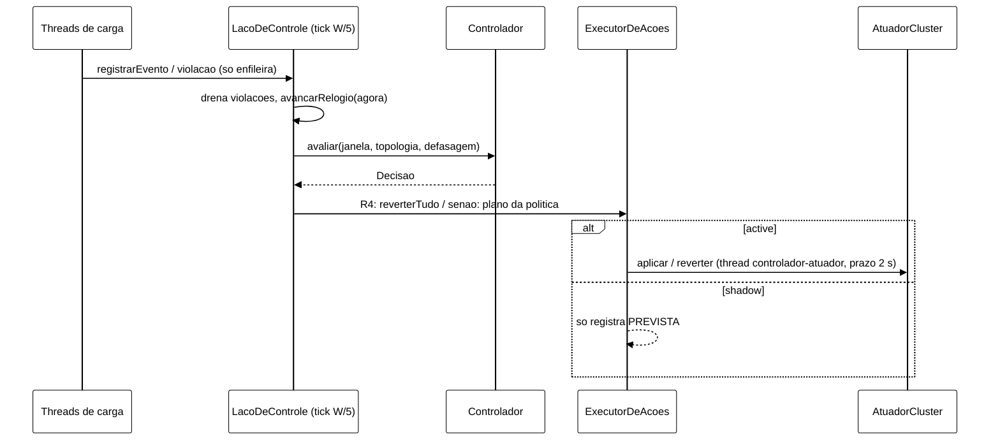

# Relatório W-3 (B-28.2): laço de controle do *cluster*, `--controller` e trilha JSONL (2026-11-04)

Prompt W-3 de `docs/plano-execucao-2026-11-04.md` (seção 9, commit `4e43602`), com o desenho da seção 4 e a
Parte B do Prompt 1 de `plano-alinhamento-objetivos-2026-11-04.md`. Branch `feature/w3-laco-controlador`,
worktree `wt-w3`, criada de `0f8b351` (ponta do W-1) e rebaseada em `098900f` (W-1 integrado, só docs a mais).
Sem push, sem VM.

## 1. O que foi feito

| Item do prompt | Onde | Estado |
|---|---|---|
| 1. `--controller off\|shadow\|active`, `--controller-config`, `--controller-reference`, `--controller-admin`; sem `--controller-knobs`; S3 exige `--marker` (exit 2 com o motivo); `--dry-run` com parâmetros e SHA-256 | `session/Cli`, `ModoControlador`, `LigacaoControlador.carregar/textoDryRun`, `WorkloadMain.main` | feito |
| 2. `LacoDeControle` com *tick* injetável, `SondaTopologia`, sonda de defasagem quando existir, `Controlador.avaliar`, política e atuador; atuador nulo até o W-2; tempo do núcleo = fim da janela | `controle/LacoDeControle`, `ExecutorDeAcoes`, `AtuadorCluster`, `AtuadorNulo`, `PoliticaDeAcao` | feito |
| 3. Sinal de defasagem no núcleo; assinatura antiga delega; `Motivo.DEFASAGEM` | `controle/Controlador`, `EstadoDefasagem`, `Motivo`, `Decisao.Sinais` | feito (ver 4.1) |
| 4. `observaveis-rep-NNN.jsonl` e `decisoes-rep-NNN.jsonl` com metadados | `controle/FormatoJsonl`, `TrilhaJsonl`; contrato em `docs/contrato-jsonl-controlador-v1.md` | feito |
| 5. H4, H6, H7, DT-001, DT-002, H8; R1 em *cooldown* | testes em `ControleArquivosTest`, `ControladorCliTest`, `LigacaoControladorTest`, `LacoDeControleTest` | feito; H8 não se aplica (4.3) |
| 6. `t_fim_carga_ns` no resumo da convergência | `session/ConvergenciaLoop.escreverResumo` | feito |
| 7. `off` não cria nada de `controle`; *golden* e `S3SimulacaoTest` inalterados | `WorkloadMain.ligarControlador` | feito |
| 8. Aceite: Surefire; *smoke* S3 ASYNC 120 s em shadow e active; partição local | — | Surefire feito; *smoke* **pendente** (4.4) |

Reversão (seção 4.4.3 do plano), sobre a interface: pilha LIFO idempotente no executor (camada 1, R4 desfaz
tudo), gancho de desligamento da JVM só em `active` (camada 2), encerramento normal no fim da carga e antes da
convergência, com prazo. A camada 3 (orquestrador) é do W-6.



## 2. Commits

| SHA | Tipo | Conteúdo |
|---|---|---|
| `12cca92` | test | defasagem no núcleo (vermelho) e `TiposBasicosTest` |
| `ae0e8fb` | feat | `EstadoDefasagem`, `Motivo.DEFASAGEM`, `avaliar(janela, topologia, defasagem)` |
| `a011caa` | test | laço, executor, trilha JSONL, H4 (vermelho) |
| `24bef83` | feat | `controle`: laço, executor, interface do atuador, JSONL, H4 |
| `715c449` | test | ligação à carga, `--controller*`, `t_fim_carga_ns`, R-C1 por pares (vermelho) |
| `f820e73` | feat | `session`: `Cli`, `LigacaoControlador`, ouvintes, `WorkloadMain`, `ConvergenciaLoop` |
| (este) | docs | contrato JSONL, TD-010, `testes.md`, este relatório |

## 3. Testes

```bash
cd workload && mvn -q -T1 clean test     # contagem somada dos target/surefire-reports/TEST-*.xml
cd .. && python -m unittest discover -s analysis
```

| Momento | Surefire | Arquivos | `unittest` analysis |
|---|---|---|---|
| base `0f8b351` | 825/0/0/1 | 116 | 187 OK, 1 *skip* |
| `f820e73` | 894/0/0/1 | 123 | 187 OK, 1 *skip* |

894 = 825 + 69 novos (detalhe por arquivo em `docs/testes.md`). Nenhum teste apagado.

**Testes existentes editados (2):**

| Teste | Mudança | Motivo |
|---|---|---|
| `controle/TiposBasicosTest.ordemDeSeveridade` | lista esperada de `Motivo.values()` ganha `DEFASAGEM` entre `TOPOLOGIA` e `ERRO`; `DisplayName` idem | o teste fixa o enum inteiro; o prompt pede `Motivo.DEFASAGEM`. As demais asserções do teste ficaram iguais |
| `session/ArquiteturaSemAcaoNoClienteTest` (R-C1) | lista de tipos permitidos virou mapa (classe de `session` → tipos de `controle`); `LigacaoControlador` autorizado com os 23 tipos que importa | ressalva 4 da validação do W-1 (pares classe, tipo), pedida pelo coordenador; o próprio Javadoc do W-1 previa a ampliação pelo W-3 |

Os outros testes do núcleo (`ControladorRegrasTest`, `ControladorComportamentoTest`, `ControladorPropriedadeTest`,
`AgregadorControladorIntegracaoTest`) passam sem edição. `GoldenS1S2Test`, `GoldenRodarClienteTest`,
`S3SimulacaoTest` e `src/test/resources` sem diferença contra `098900f`.

**Mutantes** (script temporário, um por vez, testes do pacote envolvido): pilha FIFO, shadow chamando o atuador,
R2 sem a defasagem, R4 sem reversão, violação do *warm-up* aceita. Os cinco morreram.

**`--dry-run` local** (JDK 22, `target/classes`): shadow em S3 sem `--marker` sai com 2 e a mensagem cita a I2;
active sem `--controller-reference` sai com 2; shadow em S3 com marcador imprime as cinco linhas do controlador
(SHA-256 do arquivo de parâmetros conferido); `off` imprime as quatro linhas de sempre.

## 4. Pontos para validação

### 4.1 "Todos os testes atuais do núcleo passam sem edição" e `Motivo.DEFASAGEM`

As duas exigências do prompt se contradizem num ponto: `TiposBasicosTest` fixa a lista inteira do enum. Editei
só essa asserção (tabela acima). Posição escolhida: `DEFASAGEM` logo abaixo de `TOPOLOGIA`, por ser o sinal que
antecipa a partição. Se o Senior preferir outra ordem, muda só o enum e esse teste.

### 4.2 Escolhas de desenho que não estavam fixadas

1. **Origem das janelas = início da medição.** O *warm-up* fica fora do controlador: eventos e violações antes
   da origem são descartados e contados. Fecha o ponto aberto da V-B26.1 (ressalvas, seção 6) sobre a violação
   do *warm-up* promovida à janela 0. Efeito: o controlador não age no *warm-up*.
2. **Encerramento no fim da carga, antes da convergência.** Assim nenhum DEGRADED forçado atravessa o laço de
   convergência. Também numa exceção da carga (`finally`).
3. **R4 desfaz tudo e a política não é consultada nessa janela.** Regra fixa do laço (camada 1), independente
   da política do W-2.
4. **Classificação das violações no *tick*, não na hora.** O auditor avisa com o rótulo; a classe da I2 é
   calculada pelo `RastroCliente` na *thread* do laço, com o instante em que a violação foi vista. Um Block que
   ainda estava em curso na hora já está no rastro no *tick*.
5. **`--csv-dir` obrigatório em shadow/active** (os JSONL precisam de lugar) e **`--controller-admin` com tantas
   URLs quanto `--servers`** (H6).
6. **Atuador nulo em `active`:** passa pela fila e pela pilha e grava `executada: false`, `NAO_EXECUTADA`.
7. **Convenções sem medida:** prazo do encerramento de 10 s; *tick* = W/5 (decisão de 22/10); sonda com período
   2 s e prazo 1,5 s (B-26.2).

### 4.3 H8 não se aplica

A cópia do `mix64` amarrada por `formulaMix64` era do jitter do K4 (`PortaoS3AplicacaoTest`), apagado no W-1.
O `mix64` que resta (`MisturaV3`) não tem cópia. Nada a fazer neste bloco.

### 4.4 *Smoke* local pendente

O aceite pede *smoke* S3 ASYNC de 120 s em shadow e active e uma partição local. O único *cluster* local de pé
(`b441-isn1..3`) é o do B-44.1, em uso por outro Worker; rodar o *smoke* nele esvaziaria os *caches* e
atrapalharia o levantamento. Não rodei. O teste ponta a ponta com `FakeCaches` cobre a cadeia na JVM; o *smoke*
real fica para quando houver um *cluster* livre (ou o do B-44.1, depois dele).

### 4.5 O que o W-2 precisa plugar

`LigacaoControlador.pecasPadrao`: trocar `new AtuadorNulo()` pelo adaptador REST e `PoliticaDeAcao.NENHUMA` pela
política da tabela 4.5 (que recebe `Decisao`, `EstadoTopologia`, `EstadoDefasagem` e as ações ativas). O teto
`T_cong` do AC-1 fica na política (pede a reversão quando estoura). `lerConfiguracao()`, que o prompt do W-2 lista
na interface, não entrou: o executor não precisa dela e o formato depende do B-44.1. Sugiro que fique no
adaptador (usado pelo orquestrador do W-6), não em `AtuadorCluster`.
