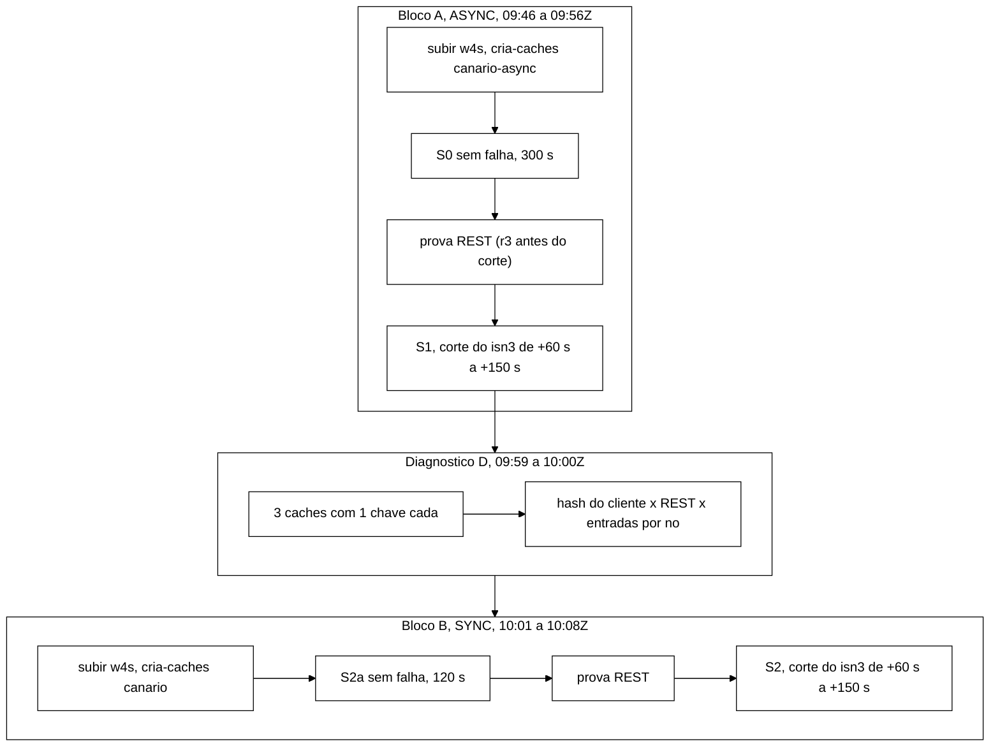

# Relatório do W-4 (B-26.3): sonda de defasagem S_lag, *caches* `canario*` e a fonte do controlador (2026-11-05)

> Worker, 2026-11-05. Branch `feature/w4-sonda-defasagem` (worktree `wt-w4`) sobre `9695511`, ponta do W-2a. Validação
> do Senior em `docs/validacao-w4-2026-11-05.md` (`ff7ab3c`), APROVADO COM RESSALVAS; este relatório é a R7. Nada foi
> para `origin`. Números conferidos contra os brutos de `runs/w4-h2/` e `runs/w4-smoke/`, cada um com
> `MANIFEST.sha256`.
>
> **Numeração.** O integrador renumera, no *merge* para `feature/controlador-integracao`, os problemas deste W-4 para
> não colidir com o W-2a: o P-39 da branch passa a **P-43** e o P-40 passa a **P-44**. Este relatório usa os números
> novos; `docs/registro-de-problemas.md` da branch ainda traz os antigos.
>
> **Contexto novo, sem efeito neste W-4.** O coordenador tirou o P2 (AC-2) do braço B e levou o prazo do AC-5 a 17 s.
> As duas coisas são do W-2a. O *smoke* rodou em `shadow`, sem chamada ao *cluster*, então nada aqui depende delas.

## 1. Resumo

A sonda escreve, a cada janela W, uma chave por nó pelo cliente Hot Rod fixado nele e lê essa chave pelos outros dois
até ver o valor novo ou até o prazo (`--hotrod-timeout-ms`, 2000 ms). O lag de nó é o menor lag dos pares em que ele
aparece, e o suspeito é o nó que atinge o maior lag de nó, se for único. Os *caches* `canario` e `canario-async` são
criados pela REST a partir de JSON versionado. A ligação ao laço do controlador grava as rodadas no `observaveis`
(esquema 1.2).

No *cluster* local, em ASYNC, a sonda fez o que se esperava. Sem falha, todos os pares foram vistos (`lag_max_ms` mediano
de 1,6 ms) e não houve nenhum P1. Com o `isn3` cortado, as 9 rodadas antes da mudança de vista deram `lag_max_ms` =
2000 com `no_suspeito` = `isn3`, e o P1 previu o AC-5 para o `isn3` **13,2 s** depois do corte, 33 s antes da vista
nova (46,5 s).

Três achados vão ao Senior:

- **A7 (prova REST do primário) não serve como oráculo.** A REST `?action=distribution`, com os bytes da chave em
  hexadecimal, devolveu donos que não batem com onde o dado está de fato. Um diagnóstico com uma chave por *cache*
  mostrou o hash do cliente certo em 3 de 3 conjuntos de donos e a REST errada em 2 de 3 (seção 6).
- **R3 aconteceu em SYNC.** Com o `isn3` cortado, as 8 rodadas antes da vista nova empataram no teto (`no_suspeito` =
  `null`), porque as duas chaves da maioria tinham cópia no `isn3` e a escrita SYNC ficou presa esperando por ele.
  Não houve P1 (seção 7).
- **Custo e P-5.** Sob o corte, a sonda leu de 90 a 98 vezes por rodada em ASYNC e de 436 a 465 em SYNC, dentro do
  máximo de 600. O stderr do processo de carga passou de 6 KB para cerca de 1,5 MB, com avisos do cliente Hot Rod
  (seção 8).

## 2. Commits

| Commit | Tipo | O quê |
|---|---|---|
| `603947d` | test | testes da sonda, dos *caches* e da ligação (vermelhos) |
| `133212d` | feat | `SondaDefasagem`, `RodadaDefasagem`, `ParametrosDefasagem`, `CanalCanario`, `CanalCanarioHotRod`, ligação, JSON `canario*`, `cria-caches.sh` |
| `0aba464` | docs | contrato `observaveis` 1.2, TD-012, P-43/P-44, testes |
| `bf59e6e` | test | P-43: as duas edições de teste autorizadas (R-C1 e `observaveis` 1.2) |
| `aadbaa3`, `4ed28a3`, `13154c4` | test | P-44: chave com primário no próprio nó; arquivo da calibração (vermelhos) |
| `0db755f`, `5da6767` | feat | P-44: escolha da chave pelo hash consistente do cliente; `defasagem_chaves`; `controlador-calibracao-s3.json` |
| `a180a6a` | docs | segunda rodada (passo de 20 ms, provisórios, lag bruto) |
| `5a69551` | test | R1 (`ExigirPrimarioTest`) e R6 (vermelhos) |
| `68691ae` | feat | R1: recuo fatal na abertura (`exigirPrimario`, `montar`); Javadoc da R5 |
| `dafd9cd` | docs | R4, R5, H2 medida (`runs/w4-h2/`) |

## 3. Testes (H2)

`mvn -B -o test` em `workload/` (Maven 3.9.16, JDK 22.0.2 com alvo 17): **1041/0/0/1 em 146 classes**, `BUILD SUCCESS`
na primeira execução. A conta é 974 (W-2a) + 62 (W-4, primeira e segunda rodadas) + 5 (R1).
`bash scripts/cria-caches.test.sh`: **26/0**. Brutos em `runs/w4-h2/`. O vermelho da R1 foi conferido antes do feat: com
o `main` do `5a69551`, só o `ExigirPrimarioTest` deixava de compilar.

## 4. Smoke local (seção 9 da V-W4)

**Montagem.** Projeto Podman `w4s`, contêineres `w4s-isn1..3`, portas 12611 a 12613 (cópia de `cluster/podman-compose.yml`
com nomes e portas próprios), o XML e a pilha JGroups do repositório. *Jar* `session-workload-0.1.0-SNAPSHOT.jar` com
SHA-256 `e9283555…161ce`, construído no `dafd9cd`. Todas as cargas: S3, `--controller shadow`, `--warmup-min-sec 30`,
`--controller-config cluster/controlador/controlador-calibracao-s3.json`, `--servers` e `--controller-admin` com
`127.0.0.1:12611..12613`. O corte do `isn3` é o isolamento por nftables do W-2a (`particao-w4s.sh`), de origem + 60 s
a origem + 150 s. Comandos em `runs/w4-smoke/scripts/` (`bloco.sh`, `lib-w4s.sh`) e em `comando.txt` de cada execução.

**Incidente do *harness*.** A prova REST depois do S0 e a primeira antes do S1 deram HTTP 400. Havia dois motivos. O
Python do Windows terminava as linhas com CR, e o CR entrava na URL. Além disso, a REST só aceita o hexadecimal em
minúsculas depois do `0x`: com maiúsculas, responde `Invalid digit found in hex format!`. Corrigi a função `prova` e
refiz a prova às 09:52:50Z, antes do corte das 09:53:16Z (`A/S1/prova-antes-S1-r3/`). As tentativas que falharam
continuam nos brutos (`prova-depois-S0/`, `prova-antes-S1/`, `prova-antes-S1-r2/`).

## 5. Critérios A1 a A14

| Id | Resultado | Números (dos `criterios.json`) |
|---|---|---|
| A1 | ok | um POST por bloco, ambos com 200, e 3 leituras de volta idênticas em cada um (`canario-async` às 09:46:25Z, `canario` às 10:01:19Z); `cria-caches.sh` com saída 0 |
| A2 | ok | S0 e S2a: esquema `observaveis-controlador/1.2`, `sonda_defasagem = true`, 2000/1000/20 com as origens do arquivo |
| A3 | ok | S0: 312 de 312 pares vistos, nenhuma rodada no teto; `lag_max_ms` mediana 1,61, p99 6,15, máximo 6,15 ms; lag de par mediana 1,89, p99 6,54, máximo 23,57 ms; nenhuma janela `ALTA` ou `INTERMEDIARIA`. S2a (SYNC): 102 de 102 pares, `lag_max_ms` mediana 2,41, máximo 4,39 ms |
| A4 | ok | S0: 51 janelas, nenhuma sem rodada; `defasagem_rodadas_atrasadas` = 0 |
| A5 | ok | S0: 183 escritas = 3 × 61 rodadas; leituras por rodada 6 em 51 rodadas e 7 em uma; erros de escrita e de leitura 0. S2a: 6 em todas |
| A6 | ok | três chaves com `primario = true` e `motivo = primario` em cada bloco (A: `lag:…12611#1`, `lag:…12612`, `lag:…12613`; B: `lag:…12611#3`, `lag:…12612`, `lag:…12613#1`) |
| A7 | **não obtido como especificado** | `contains_key = true` em todas as chamadas, mas o primário da REST bateu com a escolha em 0 de 3 chaves no bloco A e em 2 de 3 no B. O diagnóstico D mostra que o erro é da REST (seção 6) |
| A8 | ok | S0 e S2a: nenhuma linha P1 nem AC-5; nenhum `lag:` nos CSV (`rep-001.csv`, `s3-acoes-rep-001.csv`, `violacoes-rep-001.csv`); o stdout não cita `canario` |
| A9 | ok, em parte | S1 escolheu as mesmas chaves do S0. A comparação de primários entre as duas provas não existe, porque a prova depois do S0 falhou pelo incidente do *harness* |
| A10 | ok em ASYNC | S1: 9 de 9 rodadas entre o corte e a vista com `lag_max_ms` = 2000, `no_suspeito` = `127.0.0.1:12613`, os dois pares da maioria vistos e os quatro do `isn3` não vistos |
| A11 | ok em ASYNC | S1: linha P1 (`isolar-suspeito`, `no` = `127.0.0.1:12613`) e AC-5 `PREVISTA` com alvo `127.0.0.1:12613`, `executada = false`, 13,2 s depois do corte e antes da vista |
| A12 | ok | S1: lag dos pares da maioria no corte com mediana 1,35 ms e máximo 48,4 ms (18 medidas); nenhum acima de 1000 |
| A13 | ok | S1: 90 a 98 leituras por rodada no corte (mediana 97); nenhuma janela sem rodada. Máximo da execução 378 |
| A14 | medida (R3) | S2a: A6 ok. S2: as 8 rodadas antes da vista nova com todos os pares no teto e `no_suspeito` = `null`; nenhum P1; 436 a 465 leituras por rodada (seção 7) |

## 6. A7 e o diagnóstico D: a REST `?action=distribution` não é oráculo

No bloco A a REST disse que o primário das chaves de `isn1` e de `isn2` era o `isn3`. Se fosse, o corte do `isn3`
teria escondido os pares da maioria em ASYNC, e eles foram vistos em 9 de 9 rodadas, com 1 a 48 ms. Para separar as duas
hipóteses, criei três *caches* novos (`diag-1..3`, configuração do `canario-async`) e gravei uma chave em cada uma
(`runs/w4-smoke/D/`). As entradas em memória por nó (`GET /rest/v2/caches/diag-i?action=distribution`) mostram onde o
dado está de fato.

| *Cache* | Chave | Donos no hash do cliente | Nós com a entrada | Donos pela REST da chave |
|---|---|---|---|---|
| `diag-1` | `lag:127.0.0.1:12611#1` | isn1 (primário), isn3 | isn1, isn3 | isn1 (primário), isn3 |
| `diag-2` | `lag:127.0.0.1:12612` | isn2 (primário), isn1 | isn1, isn2 | isn3 (primário), isn2 |
| `diag-3` | `lag:127.0.0.1:12613` | isn3 (primário), isn2 | isn2, isn3 | isn2 (primário), isn1 |

O hash do cliente acerta os três conjuntos de donos, e a REST erra dois. A REST acha a chave (`contains_key = true`),
mas calcula os donos sobre outra representação dela, porque os *caches* não declaram `encoding` (`ISPN000599`) e as
chaves vêm serializadas pelo `JavaSerializationMarshaller`. A identidade do primário não aparece nas entradas por nó, só
o conjunto. Ela vem do próprio hash que o servidor manda ao cliente, com o primário primeiro, e do comportamento sob o
corte em ASYNC.

**Proposta ao Senior.** Trocar o A7 por duas provas. A primeira é a de colocação: uma chave por *cache* novo e as
entradas por nó, como no D. A segunda é a de comportamento: os pares da maioria vistos sob o corte em ASYNC, como no
A10. A condição 4 da §7.1 da V-W4 (prova REST obrigatória) precisa ser reescrita com isso.

## 7. R3 em SYNC (bloco B)

No S2 as chaves escolhidas tinham primário no próprio nó, mas as duas da maioria (`lag:…12611#3` e `lag:…12612`) tinham a
cópia no `isn3`. O log do `isn1` e do `isn2` mostra a escrita da sonda presa esperando o `isn3`
(`ISPN000476: Timed out waiting for responses … from isn3 … after 17.5 seconds`), e as escritas seguintes na mesma chave
caindo por trava (`ISPN000299: Unable to acquire lock after 15 seconds`, 16 linhas). O valor novo não aparece no primário
antes da confirmação da cópia, então os pares da maioria ficam no teto e os três nós empatam.

| Fase do S2 | Rodadas | `lag_max_ms` = teto | `no_suspeito` |
|---|---|---|---|
| antes do corte | 13 | 0 | `isn1` ou `isn2` (máximo único entre valores pequenos) |
| corte até a vista do `isn3` (+42 s) | 8 | 8 | `null` em todas |
| vista até a cura | 10 | 10 | `isn3` em 9, `null` em 1 |
| cura até a volta (+57,5 s) | 11 | 11 | `isn3` |
| depois da volta | 10 | 0 | `isn1` ou `isn2` |

O núcleo entrou em CONSERVADOR 12,6 s depois do corte (R2, defasagem alta), mas a política registrou só P0 com
`sem-assinatura` (33 linhas). O suspeito único só apareceu depois que a vista mudou, quando a vista incompleta já
bloqueia o P1. A V-W4 estimou esse caso em cerca de 1/4 das execuções SYNC; aqui ele ocorreu na única execução. A
preferência do coordenador é declarar a limitação na célula SYNC F2, que é de referência. A alternativa da V-W4 (uma
chave por par ordenado, com donos {escritor, leitor}) dobra as escritas e depende mais do `ChannelFactory`.

## 8. Instantes, custo e stderr

| Instante (desde o corte) | S1, ASYNC | S2, SYNC |
|---|---|---|
| primeira rodada com o suspeito `isn3` no teto (`t_lag`) | +2,9 s | +47,6 s, depois da vista |
| P1 (`t_P1`) | +13,2 s | não houve |
| vista nova pela sonda de topologia | +48,3 s | +42,0 s no `isn3`, +50 s no `isn1` e no `isn2` |
| vista nova pelo log (`ISPN000094` com 2 membros) | +46,5 s | sem linha (ver abaixo) |
| volta, todos os pares vistos depois da cura | +57,9 s após a cura | +57,5 s após a cura |

O `t_P1` de 13,2 s cabe no esperado da V-W4 (até 3W mais um *tick*, 16 s com W = 5 s e k = kLag = 2). No S2, o log
dos contêineres `isn1` e `isn2` tem um buraco entre 10:05:57Z e 10:08:06Z, com linhas só a cada 30 s. Por isso não há
`ISPN000094` da vista nova nele, e a vista vem só da sonda de topologia. Não investiguei a causa.

| Leituras por rodada | S1, ASYNC | S2, SYNC |
|---|---|---|
| antes do corte | 6 | 6 |
| corte até a vista | 90 a 98 | 436 a 465 |
| vista até a cura | 336 a 378 | 316 a 457 |
| cura até a volta | 200 a 378 | 338 a 380 |
| depois da volta | 6 a 7 | 6 |

Todas ficam abaixo do máximo de 600. Depois da vista nova, as leituras pelo `isn3` falham na hora (`AvailabilityException`,
nó em DEGRADED) e o leitor tenta a cada 20 ms até o prazo, o que explica as contagens mais altas nessa fase. No S1 houve
3437 leituras com erro e 19 escritas com erro; no S2, 3796 e 21.

**stderr.** O stderr do processo de carga foi de 5,8 KB no S0 para 1,48 MB no S1 e 1,68 MB no S2, quase tudo
`ISPN004005` com `ISPN000476` ou `ISPN000306` (nas duas execuções) dos clientes fixados no `isn3`, da carga e da sonda juntas. O log do
cliente Hot Rod grava no stderr redirecionado para arquivo, e isso é disco. A sonda não espera esse log para medir, mas
ele roda em *threads* do cliente. É o ponto opcional da V-W4 sobre o P-5, a avaliar com o W-2b.

## 9. Problemas

| Número | Situação |
|---|---|
| P-43 (P-39 na branch) | resolvido em `bf59e6e` |
| P-44 (P-40 na branch) | em ASYNC, mitigado e confirmado pelo comportamento (A10, A11). A prova REST de primário não é válida (seção 6). Em SYNC, R3 ocorreu (seção 7) |

## 10. Decisões (coordenador em nome do Gestor, 05/11, depois deste relatório)

1. **A7:** aceita a troca da prova REST obrigatória pela prova de colocação (uma chave por *cache* novo e entradas por
   nó, como no D) mais a prova de comportamento sob corte em ASYNC (como no A10). Registrado no contrato e no P-44.
2. **R3:** limitação declarada na célula SYNC F2, que é de referência. Não há chave por par ordenado. Registrado no
   contrato e no P-44.
3. **stderr sob corte:** pendência do W-2b, ainda não feito.

## 11. Brutos

| Caminho | Conteúdo |
|---|---|
| `runs/w4-h2/` | Surefire por classe e total, saída do `cria-caches.test.sh`, comandos, `MANIFEST.sha256` |
| `runs/w4-smoke/A/`, `B/` | por execução: comando, stdout, stderr (`.gz` acima de 1 MB), os dois JSONL, os CSV, `fases.tsv`, provas REST, `criterios.json`; por bloco, `cria-caches.tsv`, logs dos três servidores (`isn3.log.gz`), `conteineres.tsv`; `MANIFEST.sha256` |
| `runs/w4-smoke/D/` | diagnóstico do A7: saída do `DiagChave.java`, corpos REST, logs, `MANIFEST.sha256` |
| `runs/w4-smoke/scripts/`, `cluster/` | *harness* (`bloco.sh`, `lib-w4s.sh`, `particao-w4s.sh`, `chaves.py`, `analisar_smoke.py`, `fechar_bloco.sh`, `diagnostico.sh`, `DiagChave.java`) e o *compose* `w4s` |
| `runs/w4-smoke/MANIFEST.sha256` | SHA-256 do *harness*, do *compose*, das saídas dos blocos e dos três manifestos |

Os arquivos de `runs/w4-smoke/` vão sem conversão de fim de linha (`.gitattributes` com `-text`), para os manifestos
continuarem valendo depois do checkout.
