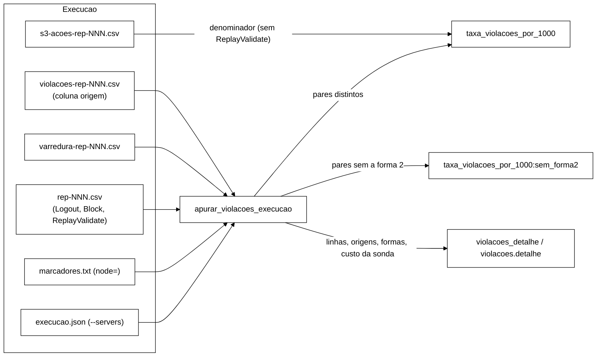

# Relatório do W-5c: V com a sonda de *replay* e a varredura no `comparar_bracos.py` (2026-11-06)

Branch `feature/w5c-v-com-sonda` (worktree `wt-w5c`), a partir de `daa18a2` (`feature/controlador-integracao`, com o
W-10 e o P-48). Sem *push* e sem integração. Só Python: a VM estava medindo, então nada de Maven nem Podman, e os
injetores, o h4 e o *runner* do *rebaseline* não foram tocados.

## 1. O que foi pedido

Ajustar a análise dos braços ao método de observação do rascunho do pré-registro do benchmark refeito
(`docs/pre-registro-benchmark-refeito-2026-11-06.md`, branch `docs/pre-registro-benchmark-refeito`, `a5ddac9`,
seção 2):

- V = I1 + I4 + I2 `REAL` por mil ações S3, nas fases `durante` + `recuperacao`, com três origens: o auditor online, a
  sonda de *replay* do W-10 (`origem = sonda`) e a varredura final (`REAL`);
- um par distinto (chave, invariante) por execução, somando as origens; o total de linhas só como descritivo;
- a forma 2 de I1 conta em V, com o subtipo registrado e uma sensibilidade sem ela;
- o *replay* tardio e a varredura atribuídos às fases pelo instante do *logout* confirmado, contando mesmo quando ele
  não é achado no CSV;
- `ReplayValidate` fora de latência, vazão útil, taxa de erro e do denominador de V.

## 2. O que foi feito

1. **Leitura das três origens.** `ler_violacoes` lê o CSV do auditor por nome de coluna; a coluna `origem` vazia é o
   auditor online, `sonda` é a sonda, outro valor é recusado (exit 2). `ler_varredura` lê o
   `varredura-rep-NNN.csv` e fica com os achados `REAL`: I1 e I4 pela sid, I2 administrativo pela sid (a identidade
   sai do detalhe) e I2-PERDIDO pela identidade, os dois na classe `I2_REAL`. Os outros achados são contados como
   "fora de V".
2. **Pares distintos.** `apurar_violacoes_execucao` junta as detecções por (chave, classe). Um par entra no
   numerador quando ao menos uma das suas detecções cai nas fases pedidas. O desfecho `taxa_violacoes_por_1000`
   passa a ter `contagem` = pares e `linhas` = linhas contadas; o `info["violacoes"]` (somas por invariante na célula)
   passa a ser de pares. O `contar_violacoes` também conta pares distintos.
3. **Fases.** Online e *replay* imediato pelo instante da detecção. A detecção da sonda depois do fim observado da
   carga (a maior `end_ns` das ações S3 e dos eventos da carga, sem `ReplayValidate`) é do *replay* tardio. O tardio
   e a varredura vão pelo `end_ns` da invalidação confirmada: o `Logout` com `return_code = NONE` mais antigo da sid
   (I1 e I4 com motivo `LOGOUT`) ou o último `Block` `NONE` da identidade (I2 e I2-PERDIDO). Sem esse evento no
   `rep-NNN.csv`, a detecção conta sem filtro de fase e entra na descritiva `sem_invalidacao_localizada`.
4. **Formas de I1.** O nó da falha é o `node=` do marcador `start`; a réplica dele vem do `--servers` do
   `execucao.json` (ordem `isn1`, `isn2`, `isn3`, conferida pelo orquestrador). Forma 1 quando o `Logout` da sid foi
   confirmado pela réplica do nó da falha. Forma 2 quando o `Logout` foi confirmado por outra réplica e a leitura que
   revelou a I1 (o `Validate`/`Logout` online ou o `ReplayValidate` imediato, casado ao instante da violação) foi
   servida pela réplica do nó da falha entre o `start` e o `end`. Outra no resto; indeterminada quando há `start` mas
   não há a réplica do nó. Cada par e cada detecção levam o subtipo.
5. **Sensibilidade.** `taxa_violacoes_por_1000:sem_forma2`, família sensibilidade, escala diferença, sem Holm,
   presente quando a execução tem a sonda ou a varredura.
6. **Descritivas.** Por execução (`violacoes_detalhe`) e por braço na célula (`violacoes.detalhe.totais`): linhas,
   linhas e pares por origem, pares vistos por mais de uma origem, atribuição (detecção, invalidação, sem
   invalidação localizada), formas, pares sem a forma 2, achados da varredura fora de V, custo da sonda (eventos
   `ReplayValidate`, imediatos, tardios, sids no tardio) e o teto do tardio (`sonda_tardia_max` do `s3-resumo`). A
   lista dos pares, com cada detecção, fica em `por_execucao`. A tabela Markdown ganha duas linhas por célula.
7. **Guardas.** `varredura-rep-NNN.erro.txt` deixa V e a sensibilidade ausentes na execução, com motivo. Na célula de
   teste, um bloco com instrumentos diferentes entre A e B dá exit 2.

**`ReplayValidate`.** O `comparar_bracos.py` já herdava a exclusão do W-10: os eventos vêm de
`energia_proxy.ler_eventos_inicio`, que descarta o `ReplayValidate` (fora do `evento_p99:*`, da `taxa_erro`, do Δ_rec e
das fronteiras `t0`/`t1`), e a latência da ação S3, a vazão útil, as falhas percebidas e o denominador de V vêm do
`s3-acoes-rep-NNN.csv`, que nunca teve a sonda. Não foi preciso exclusão própria. O leitor novo
(`ler_eventos_por_chave`) lê os `ReplayValidate` de propósito, só para casar a leitura da forma 2 e para o custo da
sonda; ele não alimenta nenhum desfecho de desempenho. O teste `ReplayValidateFora` prende isso.

Detalhes de desenho em `docs/implementacao.md` (TD-017) e no `analysis/README.md`.

## 3. Commits

Em `feature/w5c-v-com-sonda`, sobre `daa18a2`, sem *push*:

| Commit | O quê |
|---|---|
| `9093e6f` | `test:` golden do `comparar_bracos` sem sonda e sem varredura, gerado na base antes de qualquer mudança (não regressão) |
| `eb35290` | `test:` os 20 testes da regra nova e a fixture de formato real do *smoke* do W-10 (vermelhos) |
| `2ce2cc8` | `feat:` a regra de V, as formas, a sensibilidade, as descritivas e as guardas; corrige a conta de um teste vermelho |
| (último) | `docs:` TD-017, testes, contrato CSV (seção 7), `analysis/README.md` e este relatório |

## 4. Testes

TDD. O golden foi gerado com o `comparar_bracos.py` da base e commitado antes do código. Os testes da regra nova
foram commitados vermelhos: 12 erros (faltavam `violacoes_detalhe` e `DESFECHO_V_SEM_F2`) e 8 falhas de asserção (a
contagem por linha em vez de par, a atribuição do tardio, `contar_violacoes`, a varredura com erro, a guarda,
a origem desconhecida e a tabela). Um desses vermelhos tinha uma conta
errada minha: o cenário de sobreposição tem 2 achados da varredura fora de V, não 3. A asserção foi corrigida no
commit do código.

| Suíte | Resultado |
|---|---|
| `python -E -P -m unittest discover -s analysis` | **396 OK, 1 *skip*** (374 da base + 22) |
| `test_comparar_bracos.py` e `test_desfechos_coprincipais.py` | sem nenhuma edição, todos passam |

Cobertura pedida:

| Pedido | Teste |
|---|---|
| contagem por par distinto com sobreposição sonda + varredura + online | `ParesDistintos.test_sobreposicao_das_tres_origens` (5 pares em 19 linhas; a contagem antiga daria 19), `test_mesma_chave_invariantes_diferentes_contam_separado`, `test_varredura_so_real_conta`, `test_contar_violacoes_por_par_distinto` |
| forma 2 de I1 e a sensibilidade | `FormasDeI1` (4 testes) e `ComparacaoComSonda.test_sensibilidade_na_celula_de_teste` |
| `ReplayValidate` fora de tudo | `ReplayValidateFora.test_fora_de_latencia_vazao_erro_e_denominador` |
| fases do tardio | `FasesDoTardio` (4 testes) |
| não regressão sem sonda e sem varredura | `NaoRegressaoGolden` (golden da base `daa18a2`) e as suítes existentes sem edição |
| formato real | `SmokeW10` (recorte do *smoke* F2 do W-10) |

Conferência da CLI no *smoke* inteiro do W-10 (fora da suíte, no *scratchpad*): 258 `ReplayValidate`, sendo 139
imediatos na janela e 119 tardios (os números do relatório do W-10, seção 5); 4 pares de I1 em 8 linhas (6 da sonda, 2
da varredura); forma 1 nas duas sids do M1 e forma 2 nas duas com *logout* no `isn2` relidas `VALID` pelo `isn3`, como
o relatório do W-10 descreve; 2 240 ações S3 nas fases.

## 5. Ambiguidades da regra e escolhas feitas

Cada item diz o que foi implementado e o que muda se o Gestor decidir diferente.

1. **"Sem sonda e sem varredura, os resultados atuais não mudam."** A regra de pares vale para toda execução, também
   sem os instrumentos (é a razão 1 da 2.3: 11 linhas de I2 `REAL` na mesma sessão). Com chaves distintas por linha,
   que é o caso do golden e de todas as fixtures existentes, nada muda; numa execução antiga com linhas repetidas do
   mesmo par, V cai para o número de pares. Se o Gestor quiser contar linhas quando não houver instrumento, é preciso
   um ramo novo, e a mesma célula poderia misturar as duas regras.
2. **Sensibilidade só com instrumentos.** O desfecho `:sem_forma2` só aparece quando a execução tem a sonda (coluna
   `origem`) ou a varredura. Se ele existisse sempre, entraria na lista ordenada dos desfechos e mudaria o índice de
   semente do `vazao_util` (e do bootstrap das contagens), o que alteraria os IC das execuções antigas. No benchmark
   refeito todas as execuções têm os dois instrumentos, então ele sempre aparece.
3. **Imediata ou tardia.** A detecção da sonda depois da última `end_ns` da carga é tardia. O instante da violação vem
   de `Instant.now()` e os eventos, do `EpochClock`; no *smoke* a diferença foi de até 7,4 ms. Um *replay* imediato
   ainda em voo no fim da carga poderia ser lido como tardio. Ali a fase pelos dois instantes é a mesma
   (`recuperacao`) e a leitura já passou do `end`, então nem a contagem nem a forma mudam.
4. **Instante da invalidação.** Usei o `end_ns` do `Logout` ou do `Block`, o instante em que o cliente recebeu a
   confirmação, que é o mesmo critério do corte de candidatas do *replay* tardio (W-10). A regra de fase dos eventos
   anômalos (P-2 da V-W5) usa o início da operação; a diferença é a duração de uma escrita confirmada.
5. **Cascata.** Uma I1 ou I4 com motivo confirmado `ADMIN_BLOCK` não tem evento com a chave da sid no `rep-NNN.csv`
   (a cascata é o `Block`, com a chave da identidade), então conta sem filtro de fase. Daria para achar a identidade
   da sid pelo `s3-acoes` (o ator que agiu na sid), mas a 2.4 fala em "CSV de eventos pela chave".
6. **Qual `Block`.** Para I2 e I2-PERDIDO, o último `Block` `NONE` da identidade. A varredura define o I2-PERDIDO pelo
   último evento confirmado ser um `Block`, e o I2 final é do período de bloqueio corrente.
7. **Janela da forma 2.** A 2.5 diz "entre o marcador `start` e a detecção", e o instante da detecção da falha pelo
   *cluster* não está nos CSV. Usei `start` a `end`. Com `DENY_READ_WRITES`, o nó isolado recusa leitura depois da
   detecção, então uma leitura `VALID` servida por ele nesse intervalo é, na prática, anterior à detecção. Na pausa
   (zumbi), as leituras velhas vêm depois do `end` e ficam como "outra", portanto continuam na sensibilidade.
8. **Forma do par.** Um par é forma 2 só se todas as suas detecções contadas forem forma 2. Um par com a leitura
   cruzada (forma 2) e também um I1 `REAL` da varredura (o estado final ficou errado) é "outra" e continua na
   sensibilidade. Forma 1 e forma 2 não se misturam num par, porque dependem do mesmo `Logout`.
9. **Réplica do nó da falha.** Vem do `--servers` do `execucao.json`. No orquestrador ele existe e a ordem é
   conferida. O piloto usou um *wrapper* de `JAVA`; se as execuções dele não tiverem `execucao.json` com
   `--servers`, as formas ficam indeterminadas e a sensibilidade fica ausente com motivo. O item da seção 8 do
   pré-registro (orquestrador passando `--sweep` e as opções da sonda pela própria campanha) resolve isso para a
   recalibração e a avaliação.
10. **Varredura com erro.** Deixei V ausente na execução, porque a contagem pré-registrada exige as três origens, e o
    bloco sai do teste de V com o motivo visível em `blocos_excluidos`. Há um risco: se a varredura falhar mais no
    braço B (o AC-5 parou um nó e o religamento falhou), os blocos excluídos seriam justamente os em que o
    controlador agiu. A alternativa, contar sem a varredura, subestima V no braço afetado. **Precisa de decisão do
    Gestor.**
11. **Tolerância de casamento de 1 s.** É uma tolerância de alinhamento de relógio, não um limiar estatístico. Ela fica
    duas ordens acima do desvio observado no *smoke* (7,4 ms) e casa o evento mais próximo da mesma sid. Sem leitura
    casada, a detecção não é forma 2.
12. **Guarda de instrumentos.** É uma recusa nova (exit 2) na célula de teste, seguindo a 2.1 ("iguais em todas as
    execuções ... e dos dois braços"). Nas células descritiva e de referência os blocos só ficam listados.
13. **Teto do tardio.** Marcado quando as sids distintas lidas no tardio são pelo menos `sonda_tardia_max`. Com
    candidatas exatamente iguais ao teto, a marca aparece sem ter havido corte; o `stdout` (`tardias_candidatas`) é a
    fonte exata.
14. **Mesma perda vista como duas invariantes.** Um `Block` perdido pode aparecer como I2-PERDIDO (chave = identidade)
    e como I1 `ADMIN_BLOCK` das sessões que a cascata não invalidou de vez (chave = sid). São pares diferentes pela
    definição da 2.3 (chave, invariante). Registro para a leitura dos resultados.

## 6. Fora do escopo e próximos passos

- A seção 8 do pré-registro também pede conferir o `calibracao_s3.py` (W-9): `ReplayValidate` fora do λ₅, da
  excedência e da referência de p99. Esse módulo não está na base `daa18a2`; o `referencia_p99.py` já o descarta.
- Integração: a branch toca só `analysis/` e `docs/`. O conflito provável é no `docs/testes.md` (seção nova no fim) e
  no número do TD (o W-9 também quer o TD-017).
- Os itens 5.1, 5.7, 5.9 e 5.10 dependem do Gestor (P-5 do pré-registro: a regra de contagem e a forma 2 em V).
