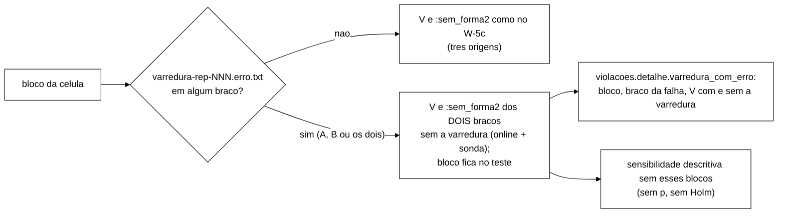

# Relatório do W-5d: varredura com erro pelo tratamento simétrico (2026-11-06)

> Nota da integração (06/11, merge do W-5c e do W-5d em `feature/controlador-integracao`): o TD-017 deste relatório
> é o TD-019 da integração, porque o W-9 (TD-017) e a carga S3 parametrizada (TD-018) entraram antes.

Branch `feature/w5c-v-com-sonda` (worktree `wt-w5c`), sobre a V-W5c (`aec81b0`, aprovado com ressalvas). Só Python,
sem *push* e sem integração. Regra aprovada pelo coordenador na seção 5 da `docs/validacao-w5c-2026-11-06.md`.

## O que mudou

1. `apurar_violacoes_execucao` devolve também os totais sem as detecções da varredura: `pares_sem_varredura`,
   `total_pares_sem_varredura`, `total_linhas_sem_varredura` e `total_pares_sem_forma2_sem_varredura`. A forma do par
   é recalculada só com as detecções que não são da varredura (função `_forma_do_par`, extraída).
2. `comparar`, em toda célula (teste, descritiva e referência): no bloco em que algum braço tem `varredura = erro`,
   `_aplicar_varredura_simetrica` troca V e `:sem_forma2` dos dois braços por esses totais, antes dos desfechos. O
   bloco fica no teste. O `co_principal_v` e as contagens por invariante (`violacoes.I1` etc.) usam as contagens
   trocadas.
3. `violacoes.detalhe.varredura_com_erro`: número de blocos (só A, só B, nos dois), a lista com o braço da falha e os
   dois V de cada braço (com a varredura, `None` no braço em que ela falhou; sem ela) e a sensibilidade sem esses
   blocos (`_sensibilidade_sem_blocos_varredura_erro`: estimativa, IC t e IC bootstrap de blocos na escala
   diferença; sem p e sem Holm; índice de semente `len(nomes) + 4`, que nenhum outro cálculo usa). Uma linha na
   tabela Markdown e `parametros.varredura_com_erro`.
4. Sem mudança: a guarda de instrumentos (`erro` continua contando como varredura pedida) e a execução isolada
   (`desfechos_execucao` com erro continua com V ausente, porque sozinha a contagem está incompleta).

## Commits

| Commit | O quê |
|---|---|
| `3e50735` | `test:` 11 testes (10 vermelhos; a guarda já passava) |
| `bc9cfdd` | `feat:` totais sem a varredura, troca simétrica, detalhe, sensibilidade e linha da tabela |
| (último) | `docs:` TD-019 (decisão 7; TD-017 na branch), `testes.md`, `analysis/README.md`, nota no relatório do W-5c e este relatório |

## Testes

`python -E -P -m unittest discover -s analysis`: **407 OK, 1 *skip*** (396 + 11). O golden da base continua igual (a
troca só age com `varredura = erro`). Casos: erro só em A, só em B e nos dois, numa célula de teste e numa descritiva;
`d_b` de cada bloco, `co_principal_v` e contagens por invariante trocados; bloco sem falha intacto (a célula só com
os blocos sem erro dá os mesmos `d_b` e contagens); detalhe, sensibilidade e linha da tabela; guarda de instrumentos.

## Pontos para o Gestor

- O texto do pré-registro (2.3/2.4) ainda precisa da regra simétrica, da declaração de que ela subestima V nos dois
  braços dos blocos afetados e do número de blocos por célula e por braço da falha (V-W5c, seção 5). O código já
  grava esses números.
