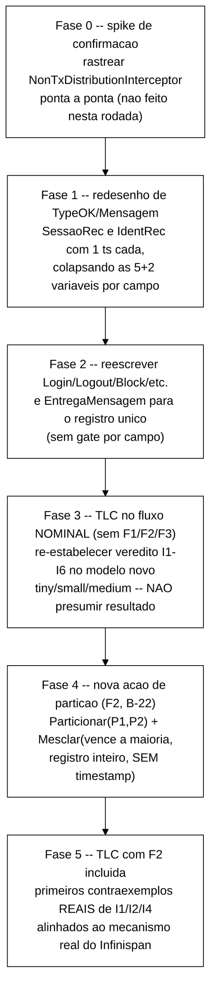

# Achado E — dimensionamento da revisão do mecanismo de resolução de conflito (TLA+ vs. Infinispan real)

> Adendo a `docs/plano-consolidacao-b21-b23-b24-2026-10-02.md`, elaborado pelo Senior em
> 2026-10-02 em resposta à decisão do Gestor de **pausar e revisar o modelo agora**,
> antes de B-23/B-24, em vez de só registrar o Achado E como limitação textual. **Ainda
> só planejamento** — nenhum arquivo de `spec/*.tla` foi alterado. Toda afirmação sobre
> o comportamento real do Infinispan abaixo é rastreada a **código-fonte oficial** (
> `infinispan-core-15.0.21.Final-sources.jar`, baixado do Maven Central nesta sessão,
> mesma versão do servidor pinada em `cluster/podman-compose.yml`) e à **documentação
> oficial** (`infinispan.org/docs/stable/.../configuring.html`, seção 8, baixada nesta
> sessão) — não de suposição. Onde a confiança é mais baixa (porque o rastreamento não
> foi linha-a-linha), isso é dito explicitamente.

---

## (a) O que `merge-policy=PREFERRED_NON_NULL` + `DIST_SYNC owners=2` realmente fazem

### A.1 `PREFERRED_NON_NULL` não é nenhuma forma de LWW — é regra posicional, sem noção de tempo

Código-fonte real (`org.infinispan.conflict.MergePolicy`, 15.0.21.Final):

```java
PREFERRED_NON_NULL((preferredEntry, otherEntries) -> {
         if (preferredEntry != null || otherEntries.isEmpty()) return preferredEntry;
         return (CacheEntry) otherEntries.get(0);
      }),
```

E o javadoc de `EntryMergePolicy.merge(...)` (mesma versão) é explícito sobre o que é
`preferredEntry`:

> "During a partition merge, we define the preferred partition as the partition whom's
> coordinator is coordinating the current merge. [...] the preferredEntry is the primary
> replica of a CacheEntry stored in the partition that contains **the most nodes** or,
> if partitions are equal, **the one with the largest topologyId**."

A documentação oficial (Tabela 10, "Infinispan merge policies") confirma e generaliza:

| Merge policy | Descrição oficial | Consideração oficial |
|---|---|---|
| `PREFERRED_ALWAYS` | "Infinispan finds the value that exists **on the majority of nodes**... and uses it to resolve conflicts." | "Infinispan **could use stale values**... Even if an entry is available [on] the majority of nodes, **the last update could happen on the minority partition**." |
| `PREFERRED_NON_NULL` (configuração deste projeto) | "Infinispan uses the **first non-null value that it finds**... to resolve conflicts." | "Infinispan could **restore deleted entries**." |

**Conclusão factual, não suposição:** a regra é "a partição com mais nós vence; se
houver empate, a de maior `topologyId` vence" — **majoritária/posicional**, sem
comparar timestamp/versão/ordem causal de nenhum tipo. A própria documentação alerta que
isso pode **usar um valor obsoleto** mesmo que a atualização mais recente tenha ocorrido
do outro lado. Isso é estruturalmente diferente de LWW (que, por definição, escolhe pelo
timestamp mais alto, não pela partição mais numerosa).

### A.2 Para este protocolo especificamente, `PREFERRED_NON_NULL` degenera em `PREFERRED_ALWAYS`

`SessionOps.java` (lido em `ddf9dfc`) **nunca chama `remove()`** — toda operação (O1,
O3-O7) usa `sessions.put(...)`/`identities.put(...)`. Uma sessão "deslogada" não é
removida da *cache*, é sobrescrita por um `SessionState` com `estado=INVALID` (ainda
**não-nulo**). Como o ramo `preferredEntry == null` de `PREFERRED_NON_NULL` depende de a
entrada da partição preferida estar **ausente** (não de estar logicamente invalidada), e
este protocolo nunca produz ausência, **na prática `PREFERRED_NON_NULL` sempre devolve
`preferredEntry`** — ou seja, comporta-se de forma indistinguível de `PREFERRED_ALWAYS`
para este workload: **o valor (inteiro, o `SessionState`/`IdentityState` completo) da
partição majoritária vence sempre, mesmo que seja o lado com a escrita mais antiga.**

### A.3 Quando isso é sequer invocado — a configuração do projeto (`DENY_READ_WRITES`) restringe bastante o caso comum

`org.infinispan.partitionhandling.PartitionHandling` (javadoc real):
`DENY_READ_WRITES` = "If the partition does not have all owners for a given segment,
both reads and writes are denied for all keys in that segment." A documentação oficial
acrescenta a condição de ativação do modo DEGRADED (que é quando o *merge-policy*
realmente importa): isso só ocorre quando **pelo menos um segmento perdeu todos os
*owners*** e **não há maioria de nós na partição**. E o efeito, por design: "**DEGRADED
mode guarantees consistency by ensuring that write operations do not take place for the
same key in different partitions.**"

Com 3 réplicas e `owners=2`: uma falha de **1 nó** (F1) deixa **2 de 3** nós — ainda
maioria — então DEGRADED mode **não ativa**, e `merge-policy` **não é invocado**. Isso é
um evento de membership normal (view change + *rebalance*/`state-transfer`, já habilitado
em `cluster/infinispan-cluster.xml` com `timeout="60000"`), não um evento de partição.
**F2 (quando existir) é o único cenário em que esse mecanismo realmente entra em jogo
neste cluster de 3 nós.** F3 (jitter) só entraria nesse caminho se o atraso excedesse o
*timeout* do detector de falha (`FD_ALL3`) a ponto de o GMS suspeitar erroneamente um nó
vivo — risco lateral já implícito no Achado C (F3 real acima do alvo), não investigado
a fundo nesta rodada.

### A.4 Em operação normal (sem partição), o cluster não resolve "conflitos" — serializa por trava no *owner* primário (confiança alta, não rastreado linha a linha)

`org.infinispan.interceptors.locking.NonTransactionalLockingInterceptor` e
`org.infinispan.interceptors.distribution.NonTxDistributionInterceptor` (ambos
confirmados existentes no código-fonte real, 15.0.21.Final) implementam o caminho de
escrita de uma *cache* não-transacional como este projeto (nenhum `<transaction>` em
`cluster/infinispan-cluster.xml`): a escrita de uma chave adquire uma trava no *owner*
primário daquela chave, propaga sincronamente aos *backup owners*, aguarda confirmação,
e só então libera a trava e retorna ao cliente. **Isso serializa escritas concorrentes
na mesma chave por ordem de aquisição da trava — não há, em operação normal, nenhum
"valor que chega depois e precisa ser comparado por timestamp com o que já está lá".**
Esta conclusão é de confiança alta (os dois interceptors existem exatamente como
esperado), mas **não foi rastreada o caminho completo de código linha a linha** nesta
sessão (orçamento de tempo) — recomendo isso como o primeiro passo técnico se a Fase 1
da revisão (§C) for aprovada, antes de tocar `spec/SessionStore.tla`.

**Consequência combinada de A.1-A.4:** o `canal`/`EntregaMensagem` de
`spec/SessionStore.tla` modela um canal assíncrono **sempre disponível para disparar**,
de forma não-determinística, em paralelo a qualquer ação local (`Next` oferece
`EntregaMensagem(r)` como alternativa em todo passo, `spec/SessionStore.tla` linha 517)
— ou seja, modela reordenação **persistente, em qualquer momento**, não um fenômeno
*gatilhado por falha*. O LWW por relógio de Lamport existe para resolver justamente essa
reordenação sempre-presente. Mas, pelo que A.4 estabelece, essa reordenação **não
corresponde a nada que acontece de fato em operação normal** no cluster real — e, pelo
que A.1-A.3 estabelecem, mesmo quando um conflito real ocorre (sob F2), ele não é
resolvido por timestamp, é resolvido por "partição maior vence, valor inteiro, sem
comparação de tempo". **As duas pontas do Achado E apontam na mesma direção: o
`canal`+LWW-por-Lamport não corresponde a nenhum mecanismo real deste cluster, nem no
caso nominal nem no caso de falha.**

### A.5 Um segundo *mismatch*, mais estrutural — granularidade do registro

`spec/SessionStore.tla` (lido em `ddf9dfc`) declara **5 variáveis de estado
independentes por réplica**, cada uma com seu **próprio relógio LWW**: `sessoes`,
`motivos`, `sessaoDe` (+ `sessoesTS`, `motivosTS`, `sessaoDeTS`) para sessão, e
`contador`, `status` (+ `contadorTS`, `statusTS`) para identidade. Mas
`SessionState.java`/`IdentityState.java` (lidos em `ddf9dfc`) armazenam **um único
objeto imutável por chave**, com **um único campo `versao`**, sempre lido e escrito como
uma unidade atômica (`sessions.put(sid, atual)`, nunca um `put` parcial de um campo).
`EntryMergePolicy.merge(...)` do Infinispan real opera sobre `CacheEntry` **inteiro**
— nunca combina "este campo de A com aquele campo de B". Logo, o modelo decompôs em 5
variáveis independentes (com gates independentes) algo que no sistema real é **uma
única unidade atômica de replicação**. Isso explica, de forma estrutural, por que 4 das
6 correções da Cadeia 1 (ver §B) foram necessárias: elas corrigem *bugs* que só existem
**porque** o modelo decompôs um registro atômico em campos com relógios
independentes — não porque o protocolo real tenha esse problema.

---

## (b) Impacto nas 6 correções da Cadeia 1 — o que é ortogonal, o que precisa ser refeito

| # | Correção (commit) | Depende da premissa LWW-por-timestamp? | Avaliação |
|---|---|---|---|
| 1 | *Broadcast* real por-réplica (`canal: [REPLICAS -> Seq(Mensagem)]`, `7ce78ca`/`cc18d51`) | **Não, é ortogonal** | O *bug* original (entrega a 1 réplica só) é um *bug* de entrega, independente de qual regra resolve conflito. **Preservar o princípio** — mesmo que a forma do *payload* mude (registro completo em vez de campo único) se a Opção 2 (§C) for adotada. |
| 2 | LWW via relógio de Lamport por campo (`aefe391`) | **Sim, é o núcleo da premissa** | A comparação por *timestamp* é exatamente o que A.1-A.4 mostram não corresponder a nada real. **Substituir** — nominal: sem conflito a resolver (A.4); sob F2: majoritário-vence-por-registro-inteiro (A.1-A.2), não por *timestamp*. |
| 3 | Gate por campo independente (`sessaoDe`/`motivos`, `a5622f2`; escrita local gateada, `f8e9e02`/`8acd772`) | **Sim — é artefato direto da decomposição por campo (A.5)** | Sob a Opção 2 (registro único por chave), este problema **deixa de existir por construção** — não há "dois campos com gates dessincronizados" se há um único registro com um único relógio. **Obsoleta sob Opção 2.** |
| 4 | Cascata de invalidação via `sessoesAfetadas` em `ID_BLOQUEIA` (`b9c46e2`) | **Parcialmente — a regra de negócio é ortogonal, a forma de aplicação não** | Block invalidar todas as sessões ativas da identidade é uma regra do protocolo (Cap. 3), não do mecanismo de conflito. **Preservar a regra**; simplificar a aplicação na chegada (um `put` de registro inteiro por sessão afetada, não um gate campo-a-campo) sob a Opção 2. |
| 5 | Gate de `status` desacoplado do gate de `contador` em `CONTADOR_INC` (`3743efc`/`e846282`) | **Sim — artefato direto de A.5** | `IdentityState.java` tem `contadorFalhas`+`status` num único objeto com um único `versao`. Sob a Opção 2 (`IdentRecord` único), este *bug* **deixa de ser possível por construção**. **Obsoleta sob Opção 2.** |
| 6 | *Broadcast* condicional de `CONTADOR_INC` (corrige mensagem fantasma P-15, `b6e0ec4`) | **Sim — existe porque o gate de origem podia rejeitar o que a mensagem já anunciava** | Mesma causa-raiz de #5. Sob a Opção 2, o *broadcast* só ocorre quando a escrita local realmente mudou o registro (checagem natural de "o `put` mudou o valor", não um gate por campo). **A forma atual fica obsoleta; o princípio geral ("não anunciar o que não foi de fato aplicado") deve ser preservado na forma nova.** |

**Resumo:** das 6 correções, **1 é puramente ortogonal (preservar), 1 é parcialmente
ortogonal (preservar a regra, simplificar a mecânica), e 4 são artefatos diretos da
premissa sob revisão** (obsoletas ou precisam ser refeitas sob a forma nova). Isso é uma
fração substancial — mais da metade do trabalho de 2026-09-16 — mas **não é trabalho
perdido**: o processo de depuração que levou a essas 6 correções foi o que **revelou**
o Achado E (sem ele, a divergência de granularidade de A.5 não teria aparecido). Os
relatórios (`docs/relatorio-tlc-2026-09-16-mudanca3/4.md`,
`docs/plano-fix-broadcast-lww-2026-09-16.md`) continuam válidos como **registro do
processo** (relevante para a narrativa metodológica do TCC), mesmo que o desenho final
mude.

---

## (c) Plano de revisão de `spec/SessionStore.tla`/`spec/MCSession.tla`

### C.1 Duas opções de desenho — recomendação e trade-off (decisão do Gestor)

| | Opção 1 — mínima | Opção 2 — recomendada pelo Senior |
|---|---|---|
| O quê | Manter as 5 variáveis por campo; troque só a REGRA de resolução (de "maior *timestamp*" para "partição com mais réplicas no momento do *merge*, valor inteiro do campo") | Colapsar `sessoes`+`motivos`+`sessaoDe` num único `SessaoRec` (registro com 1 `ts`); colapsar `contador`+`status` num único `IdentRec` (registro com 1 `ts`) — espelha `SessionState.java`/`IdentityState.java` exatamente |
| Esforço | Menor *diff* imediato | Maior *diff* (redesenho de `TypeOK`, `Mensagem`, as 6 ações locais, `EntregaMensagem`) |
| Fidelidade ao sistema real | Parcial — ainda decompõe por campo, mecanismo real opera sobre registro inteiro | Alta — granularidade de replicação do modelo passa a bater com a do sistema real (A.5) |
| Correções da Cadeia 1 que permanecem necessárias (na forma atual) | #3, #5, #6 continuam necessárias (decomposição por campo preservada) | #3, #5, #6 tornam-se obsoletas por construção (§b) |
| Risco | Corrige o Achado E só parcialmente — a granularidade errada (A.5) permanece | Risco de regressão maior (redesenho maior), mas resolve as duas pontas do Achado E de uma vez |

**Recomendação do Senior: Opção 2.** Não é só "mais fiel" — **elimina por construção**
uma classe inteira de *bugs* que a Cadeia 1 precisou descobrir e corrigir um por um
(#3, #5, #6), simplificando o modelo em vez de complicá-lo. Mas é uma decisão de
arquitetura e **precisa aprovação explícita do Gestor** antes do Worker tocar o arquivo
(política do projeto).

### C.2 Fases da revisão (assumindo Opção 2 aprovada)



- **Fase 0 (spike):** confirmar, lendo o caminho completo
  `NonTxDistributionInterceptor` → `NonTransactionalLockingInterceptor` → RPC síncrono,
  que não há de fato nenhuma janela de reordenação visível para escritas na mesma chave
  em operação normal. Baixo custo (já se tem o `.jar` de fontes baixado nesta sessão).
- **Fase 1-2 (redesenho):** como em §C.1. Afeta `TypeOK`, `Mensagem` (payload passa a
  carregar o registro inteiro, não um valor de campo único), as 6 ações locais
  (`Login`, `Logout`, `Block`, `Unblock`, `IncrementFailure`, `ResetFailures`) e
  `EntregaMensagem`. **Isto por si só já atende ao pedido do Gestor de "revisar o
  modelo agora"** — não depende de já ter F2 implementada.
- **Fase 3 (reverificação do nominal, sem F1/F2/F3):** critério de sucesso — I1-I6
  continuam valendo em `tiny`/`small`/`medium` (idealmente de forma mais direta/exaustiva,
  já que removendo o canal assíncrono "sempre disponível" reduz o espaço de estados).
  **Não presumir o resultado** — se algo violar, é um achado real sobre o redesenho, a
  reportar antes de prosseguir.
- **Fase 4 (nova ação de F2, já prevista como B-22):** uma ação `Particionar(P1, P2)`
  (`P1 \cup P2 = REPLICAS`, disjuntos, não-vazios) que marca o cluster em modo
  degradado; enquanto particionado, escritas só se aplicam dentro do sub-conjunto que
  ainda tem a maioria (ou ambos, se se quiser modelar `ALLOW_READ_WRITES` para
  comparação — mas a configuração real do projeto é `DENY_READ_WRITES`, então o modelo
  deveria refletir isso: só a maioria aceita escrita). Uma ação `Mesclar` resolve, por
  chave cujo registro divergiu, pegando o registro da partição com mais réplicas
  (desempate fixo, análogo a "maior `topologyId`") — **nunca** por comparação de
  `ts`.
- **Fase 5 (reverificação com F2):** aqui, sim, é esperado que I1/I2/I4 produzam os
  primeiros contraexemplos reais do catálogo (§3.2 do plano de 24/09) — e, pela primeira
  vez, contraexemplos que usam o **mecanismo real** (maioria vence, registro inteiro),
  não um substituto (LWW por campo) que a própria investigação desta rodada mostrou não
  corresponder a nada real.

### C.3 O que isso implica para F1 e F3 (não é escopo de redesenho, é observação)

Pela A.3: F1 (1 nó cai, 2 de 3 sobrevivem) **nunca ativa** modo degradado nem
*merge-policy* neste cluster de 3 réplicas — é só *rebalance*/`state-transfer`.
**Hipótese a confirmar, não decidida aqui:** talvez F1 não precise de nenhuma ação
dedicada de "*crash*" no TLA+ — bastaria modelar que uma réplica fica temporariamente
sem receber `EntregaMensagem` (atraso, não ausência de dados) até o `state-transfer`
reconverction. Isso é **mais simples** do que o B-22 original presumia, mas também é uma
leitura nova que o Gestor precisa validar antes de entrar no desenho de B-22 de fato.
F3 (jitter) continua coberto pela abstração existente do canal assíncrono (reordenação
sempre possível), mas só enquanto não disparar suspeita falsa de falha via `FD_ALL3` —
risco lateral já ligado ao Achado C, fora do escopo de decidir aqui.

---

## (d) Sequenciamento atualizado em relação a B-21/B-23/B-24

**Achado de dependência de arquivo (verificado, não suposto):** a revisão de
`spec/SessionStore.tla`/`spec/MCSession.tla` toca **exclusivamente** arquivos em
`spec/` (mais, possivelmente, `docs/plano-fix-*.md`/`docs/relatorio-tlc-*.md` como
registro). **Nenhum desses arquivos é tocado pela Cadeia 2** (confirmado em
`docs/plano-consolidacao-b21-b23-b24-2026-10-02.md` §1.2 — a interseção de arquivos
tocados pelas duas cadeias é só `cluster/*` + `docs/registro-de-problemas.md`). Logo:
**a revisão do modelo e o merge da B-21 não competem por nenhum arquivo — podem correr
em qualquer ordem, ou em paralelo, sem risco de conflito de merge.**

**Mas a ordem ainda importa por um motivo prático (não de conflito de merge):** se a
B-21 for executada primeiro (merge de `origin/feature/f3-baseline` em
`fix/broadcast-fantasma-contador-inc`) e a revisão do modelo vier depois, a validação de
TLC da B-21 (item 3 do plano de consolidação, §2.4) estaria validando um modelo que será
**imediatamente revisado/descartado em parte** — uma passada de validação jogada fora.

**Recomendação do Senior (ajuste à sugestão do Gestor, a confirmar):** fazer a revisão
do modelo **primeiro**, como uma nova branch `fix/revisao-mecanismo-conflito-real`
**a partir de `fix/broadcast-fantasma-contador-inc` (`ddf9dfc`)** — ou seja, antes do
merge da B-21, não depois. Assim, a branch de integração `feature/b21-consolidacao-base`
(§2.1 do plano de consolidação) passa a ser criada a partir da ponta **já revisada**
(`fix/revisao-mecanismo-conflito-real`, não `ddf9dfc` diretamente), e a validação de TLC
pós-merge (B-21) já valida o modelo definitivo, uma vez só. Isso não contradiz a
intenção do Gestor ("revisar antes de B-23/B-24") — só esclarece que também pode (e deve)
vir antes do merge da B-21, já que não há conflito de arquivo em jogo. **B-23/B-24
permanecem depois de tudo isso, como o Gestor decidiu** — e aqui cabe uma observação de
apoio a essa escolha: embora B-23/B-24 (Java, `workload/src/`) não dependam
tecnicamente do conteúdo de `spec/*.tla` para serem implementados (I1/I4/I5/I6 são
definições de invariante que não mudam s e revisão troca o MECANISMO de replicação
modelado, não a DEFINIÇÃO dos invariantes), rodar a auditoria real **antes** de entender
que F1 não ativa o mecanismo de partição (§C.3) arriscaria interpretar mal um resultado
"zero violações sob F1" como "o sistema está correto", quando a leitura certa seria "F1
não exercita o mecanismo de risco identificado — o teste relevante é sob F2, ainda não
implementado". Entender isso primeiro evita essa armadilha de interpretação.

**Sequência final recomendada:**
1. `fix/revisao-mecanismo-conflito-real` (a partir de `ddf9dfc`) — Fases 1-3 de §C.2 no
   mínimo (redesenho + reverificação nominal); Fases 4-5 (F2) podem ficar como o próprio
   B-22 já programado, não precisam necessariamente estar concluídas antes da B-21.
2. B-21 — merge de `origin/feature/f3-baseline` na ponta já revisada, não em `ddf9dfc`
   diretamente.
3. B-23/B-24, como já planejado em `docs/plano-consolidacao-b21-b23-b24-2026-10-02.md` §3
   (desenho inalterado por esta revisão — I1/I4/I5/I6 continuam as mesmas definições de
   invariante a instrumentar em Java).

---

## (e) Implicação para o cronograma de TCC-II

`ApPlanoTCC2.tex`, Etapas 3-4, já prevê "introduzir falhas explícitas no TLA+" — isso
**cobre** a Fase 4-5 de §C.2 (a ação de partição F2 e sua reverificação). **Não cobre**,
pelo menos não explicitamente no texto lido, a Fase 1-3 (corrigir a granularidade/
mecanismo do modelo **nominal**, sem nenhuma falha envolvida) — isso é uma correção de
fidelidade de um modelo que já existia desde o TCC-I, não a introdução de um cenário
novo. **Avaliação do Senior:** é trabalho adicional não literalmente orçado no
cronograma como redigido, mas que se torna **pré-requisito de qualidade** para que as
Etapas 3-4 (já previstas) produzam contraexemplos que a Etapa 7 (alinhamento
formal-experimental) consiga de fato relacionar ao *baseline* real — sem essa correção,
qualquer contraexemplo de F2 obtido sobre o mecanismo antigo (LWW por campo) estaria
"alinhando" o *baseline* a um mecanismo que esta própria investigação mostrou não
existir no sistema real, esvaziando o propósito da Etapa 7. **Não é possível, neste
papel, estimar quantas semanas isso consome** — isso é uma decisão de cronograma do
Gestor, não do Senior — mas o tamanho do *diff* esperado (Opção 2: redesenho de
`TypeOK`, `Mensagem`, 6 ações locais, `EntregaMensagem`, mais a nova ação de partição da
Fase 4) é comparável, em escopo, ao conjunto das 6 correções da Cadeia 1 já feitas em
2026-09-16 — não um ajuste pontual.

---

## Pontos que precisam de validação do Gestor

1. **Opção 1 vs. Opção 2 (§C.1)** — o Senior recomenda a Opção 2 (registro único por
   chave, elimina 3 das 6 correções da Cadeia 1 por construção), mas é decisão de
   arquitetura do Gestor.
2. **Sequenciamento ajustado (§D)** — revisão do modelo **antes** do merge da B-21 (não
   depois, como uma leitura literal da mensagem do Gestor sugeriria), já que não há
   conflito de arquivo entre as duas. B-23/B-24 permanecem depois de tudo, como
   decidido.
3. **Escopo mínimo da "pausa"** — confirmar se "revisar o modelo agora" significa só
   Fases 1-3 de §C.2 (corrigir o mecanismo nominal, sem F2 ainda) ou já inclui Fases 4-5
   (F2 completa, que é B-22/Etapas 3-4). O Senior recomenda tratar Fases 1-3 como o
   mínimo desta pausa, e Fases 4-5 como B-22 já programado — mas o Gestor pode preferir
   fazer tudo de uma vez.
4. **Hipótese sobre F1 (§C.3)** — talvez F1 não precise de ação dedicada no TLA+ (só
   atraso/reconvergência via `state-transfer`, já que nunca ativa modo degradado neste
   cluster de 3 réplicas). Levantado, não decidido.
5. **Implicação de cronograma (§E)** — reconhecer que Fases 1-3 são trabalho adicional
   não literalmente previsto no texto de `ApPlanoTCC2.tex`, mesmo sendo pré-requisito de
   qualidade para as Etapas 3-4/7 já previstas.
6. Como sempre: nada vai a `origin/*` sem aprovação explícita — este documento e seu
   commit local não presumem aprovação alguma.

---

## Próxima tarefa sugerida para o Worker

**Não antes da validação do Gestor sobre os pontos 1-3 acima.** Se aprovado (Opção 2,
sequenciamento revisão-antes-do-merge):
1. Fase 0 (spike) — confirmar o caminho `NonTxDistributionInterceptor` → locking → RPC
   síncrono por leitura direta do `.jar` de fontes já baixado nesta sessão
   (`infinispan-core-15.0.21.Final-sources.jar`, Maven Central).
2. Abrir `fix/revisao-mecanismo-conflito-real` a partir de `fix/broadcast-fantasma-contador-inc`
   (`ddf9dfc`); implementar Fases 1-2 (§C.2).
3. Rodar TLC (Fase 3) em `tiny`/`small`/`medium`; reportar o veredito real de I1-I6 antes
   de prosseguir — sem presumir que vai bater com o modelo anterior.
4. Só então seguir para a B-21 (merge de `origin/feature/f3-baseline` nesta ponta já
   revisada) e, depois, B-23/B-24, conforme já detalhado em
   `docs/plano-consolidacao-b21-b23-b24-2026-10-02.md`.
5. Fases 4-5 (F2/B-22) ficam para quando o Gestor confirmar o ponto 3 acima.
