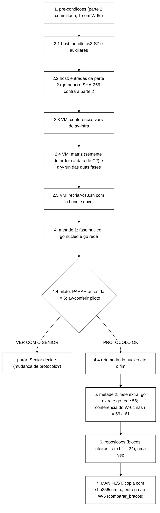

# Roteiro de VM da avaliação do controlador (B-40, braços A e B) (Senior, 2026-11-06)

> Para o coordenador, que roda a avaliação sob a autorização do Gestor. Mesmo estilo do
> `docs/roteiro-x17-calibracao-2026-11-05.md` (X-17/X-18), que continua valendo onde este não diz nada diferente.
> Os blocos marcados **VM** vão pela função `vm` (seção 0). Os marcados **host** rodam no Git Bash, e os
> **PowerShell** no PowerShell sem elevação.
>
> Base: **B-40 parte 1** (`wt-b40`, `docs/b40-pre-registro-avaliacao`, ponta `bae665d`, DT-021, com os complementos 1
> e 3 da calibração); **B-40 parte 2** ainda em produção. Nenhum valor calibrado aparece aqui: cada valor da parte 2
> entra por um **ponto de inserção** marcado `PARTE2_…` (seção 3), e os passos que dependem dele recusam enquanto ele
> não estiver preenchido. Orquestrador com o **W-6c** (merge `494ccce` em `feature/controlador-integracao`; a tag
> `int/2026-11-06-w6c` ainda não existia quando escrevi): F3 na matriz, `--swap-limite-kb`, `--exigir-trilha-completa`,
> N1, R4 e a parada de memória com exit 11 (P-59).
>
> Conferido no *host*, sem VM: com a árvore de `494ccce`, a matriz da avaliação gerada pelo `campanha_s3_matriz.py`
> (96 linhas: 56 no núcleo, 40 nas extras; SHA da seção 2.4 para a semente de ordem 20261106) e o `--dry-run` das fases
> `nucleo` e `extra` com `--swap-limite-kb 1048576 --exigir-trilha-completa` (exit 0, `24 numeros, todos com origem`,
> F3 com `inject-jitter.sh --node isn2 … --duration 251`). As entradas usadas nesse ensaio vieram do gerador da seção 11
> com uma derivação **sintética** (os valores provisórios da calibração), só para testar o encanamento. O gerador recusou
> regravar a saída e aceitou as referências pelo SHA. Os quatro auxiliares passaram em `bash -n` ou `py_compile`. O
> conferidor deu "PROTOCOLO OK" no X-17 real e "VER COM O SENIOR" no trecho do X-18 com o h4a (i = 1). O supervisor,
> numa simulação com `tmux` falso, deu os GO, criou o `PARAR` do piloto depois do veredito da i = 4, gravou
> `PILOTO-nucleo-PARADO` no fim e respondeu `go rede 58` (F3) na fase `extra`.

## Siglas

| Sigla | Significado |
|---|---|
| T, S7 | SHA completo e 7 primeiros caracteres da ponta integrada com o W-6c (tag `int/2026-11-06-w6c`) |
| C2 | commit da parte 2 do B-40 |
| metade 1, metade 2 | fase `nucleo` (56 execuções) e fase `extra` (40), cada uma com o seu GO e retomável |
| piloto | os 3 primeiros blocos da fase `nucleo`, lidos só no protocolo (B-40 §2) |
| B1, N1, R4, O1 | regras do braço B com AC-5 no nó da falha, fim nominal, linhas exigidas no F4, AC-5 precoce (B-40 §9) |
| B-7 | trilha sem `fim` ou com `linhas_perdidas` > 0 vira DESCARTADA-INFRA (`--exigir-trilha-completa`) |

## 0. Visão geral



**Como rodar os blocos** (igual ao roteiro do X-17/X-18):

```bash
# host, uma vez por sessao do Git Bash
VMIP=172.27.114.62     # se mudar: Get-NetNeighbor -LinkLayerAddress 00-15-5D-03-AC-00
SSHO=(-o BatchMode=yes -o ConnectTimeout=10 -o HostKeyAlias=172.18.251.140 -i "$HOME/.ssh/id_ed25519_tccf3")
vm() { sed 's/\r$//' | ssh "${SSHO[@]}" "server1@$VMIP" 'bash -s'; }
# uso: vm <<'FIMVM'  ...bloco VM inteiro...  FIMVM   (os blocos usam EOF e EOF2 nos heredocs de dentro)
```

**Regras de todos os passos:**

- *Lock* `/var/lock/tcc-vm.lock`: o orquestrador o pega sozinho; a recriação manual roda sob `flock -n`.
- *Dead-man* dos injetores: o orquestrador arma `tcc-heal-cs-<i>` antes de F2, F3 e F4 (janela + 90 s; 341 s no F3).
  Antes de cada invocação, `systemctl list-timers --all --no-legend 'tcc-heal*'` vazio.
- Logs voláteis em `/run/tccdiag/coord-av/`; o que precisa ficar vai para `~/av-infra/` (disco). Nada em `/dev/shm`.
- CR: bundle por `git archive` com `core.autocrlf=false`, auxiliares e entradas tirados do Git ou gerados sem CR;
  `grep -rlI $'\r'` no 2.3; havendo CR num arquivo vindo do Windows, `sed -i 's/\r$//'` e anotar.
- Nunca `pkill -f`; parar algo é `kill <PID>` depois de `pgrep -af`, ou `tmux send-keys … C-c` na janela dele.
- `tmux`: sessão nova `av`, criada ao lado de `cs3` e `rebaseline`, que ficam como estão. Nenhuma sessão é morta.
- Vigia de progresso: o supervisor grava uma linha por minuto em `/run/tccdiag/coord-av/progresso-<fase>-*.log` e um
  `ALERTA-PROGRESSO` se o `orquestrador.log` parar mais que `exec_teto_s` + 90 s.
- *Swap* (C-10, complemento 2 da calibração, DT-023): com W-6c, quem age é o orquestrador (`--swap-limite-kb
  1048576`): recria o *cluster* uma vez no portão e roda a execução com o mesmo i e a mesma semente; se o *swap*
  continuar ≥ 1 GiB, **para a fase com exit 11** (P-59) sem rodar a execução. O supervisor fica no modo `registrar`.
  Nunca `swapoff`/`swapon`.
- Perfil do *host*: **H0** do 4.1 ao `parar` do amostrador no 7.1. O perfil máximo é o mesmo da calibração (plano
  contínuo §2.2; G-1 de 05/11), sem `mvn`, testes, TLC, Podman local, cópias grandes, `scp` nem `git` no *host*.

## 1. Pré-condições (faltando uma, não começar)

| # | Item | Bloqueia |
|---|---|---|
| P-1 | Nenhuma fase em curso na VM (`pgrep -af 'run-campanha-s3|run-rebaseline'` vazio; *lock* livre; 0 *timers*; 0 *units* `tcc-amostrador-*`). A ordem com o *rebaseline* é do coordenador; a avaliação recria o *cluster* S3 pelo bundle novo e não toca em `~/rb/rb-20805b0` | tudo |
| P-2 | T = ponta da tag `int/2026-11-06-w6c` (merge do W-6c), com as suítes do integrador registradas | tudo |
| P-3 | **B-40 parte 2 commitada** (C2), com: a derivação usada (caminho e SHA-256), o diretório das referências gravadas pelo `calibracao_s3.py --referencias-dir`, os SHA-256 do controlador, do `campanha-s3/2`, das duas referências, da matriz e do jar (B-40 §11), e a viabilidade do AC-5 = viável (se inviável, o B-40 é revisto antes da avaliação) | 2.2 em diante |
| P-4 | W-5 (`comparar-bracos/2`) integrado (B-40 §13 item 3) | só a análise do 7.4, não a VM |
| P-5 | *Host* em H0 há ≥ 5 min antes do GO, aplicativos do usuário fechados, `WSearch` parado (G-4 da noite 1) | GO da metade 1 |
| P-6 | Disco da VM: livre ≥ 1,5 × 120 × `volume_exec_mb` da parte 2, em MiB (96 execuções + até 24 reposições h4; regra 1,5 × do plano de 04/11 §9) | 2.5 |

## 2. Bundle, entradas e *cluster*

### 2.1 Host: bundle da ponta com o W-6c e auxiliares (H2; ~10 min)

```bash
# host. Trocar SHA_DA_PONTA pelo SHA completo da tag int/2026-11-06-w6c.
T=SHA_DA_PONTA
[[ "$T" =~ ^[0-9a-f]{40}$ ]] || echo "T invalido: trocar SHA_DA_PONTA"
TCC=/c/Users/Francesco/Development/tcc
git -C $TCC/wt-ctrl-integ merge-base --is-ancestor 494ccce "$T" && echo "T contem o merge do W-6c (494ccce)"
S7=$(git -C $TCC/wt-ctrl-integ rev-parse --short=7 "$T"); echo "S7=$S7"
git -C $TCC/wt-ctrl-integ worktree add --detach "$TCC/wt-cs3-$S7" "$T"
cd "$TCC/wt-cs3-$S7"
git status --short | wc -l                                          # 0
grep -c -- '--swap-limite-kb)' scripts/run-campanha-s3.sh           # >= 1 (W-6c)
grep -c 'finalizar 11' scripts/run-campanha-s3.sh                    # >= 1 (P-59)
H=$TCC/dados-vm/cs3-2026-11; D=$H/bundle-av-$S7; mkdir -p "$D/aux"
git -c core.autocrlf=false archive --format=tar --prefix="cs3-$S7/" "$T" -o "$D/cs3-$S7.tar"
(cd workload && mvn -o -q -T1 -DskipTests package)                  # faltando plugin offline: o mesmo sem -o
cp workload/target/session-workload-0.1.0-SNAPSHOT.jar "$D/"
(cd "$D" && sha256sum cs3-$S7.tar session-workload-0.1.0-SNAPSHOT.jar | sed 's/ \*/  /' > bundle-$S7.sha256 && cat bundle-$S7.sha256)
R="docs/plano-implementacao-controlador:docs/roteiro-avaliacao-b40-2026-11-06.md"
extrair() { git -C $TCC/wt-plano-ctrl show "$R" | awk -v m="<!-- arquivo: $1 -->" '$0 == m {f = 1; next} f == 1 && /^```/ {f = 2; next} f == 2 && /^```$/ {exit} f == 2 {print}'; }
for f in recriar-cs3.sh supervisor-cs3.sh av-conferir.py gerar-entradas-avaliacao.py; do extrair "$f" > "$D/aux/$f"; done
(cd "$D/aux" && sha256sum * | sed 's/ \*/  /' > ../aux-$S7.sha256 && cat ../aux-$S7.sha256)   # igual a tabela da secao 11
```

O jar entra na parte 2 (B-40 §11). Se a parte 2 já registrou o SHA do jar, o `bundle-<S7>.sha256` tem de dar o mesmo.

### 2.2 Host: entradas da parte 2 (H2; ~5 min)

O gerador (seção 11.4) monta os arquivos de entrada a partir da derivação conferida pela parte 2, sem escolher valor
nenhum: o controlador é o da calibração com os 15 valores de `valores_b40_parte2`; o `campanha-s3/2` é o arquivo final
da calibração (B-9 do B-40) com `convergencia_teto_s` (7.10), `convergencia_periodo_s` (= W), `exec_teto_s` e
`volume_exec_mb` (7.17) da derivação, mais os cinco números do F3 (B-40 §4.3); as referências são copiadas byte a
byte. Ele recusa com AC-5 inviável, com valor faltando, se o controlador não carregaria os valores ou se o SHA de uma
referência não bater com a derivação. Se a parte 2 já trouxer os quatro arquivos prontos, eles valem, e o gerador
serve só de conferência (os SHA têm de ser iguais).

```bash
# host. Preencher os PARTE2_* com o que a parte 2 (C2) registrou; nada aqui tem valor padrao.
DERIV=PARTE2_CAMINHO_DA_DERIVACAO          # ex.: $H/derivacao-<UTC>/calibracao-s3-derivacao.json
DERIV_SHA=PARTE2_SHA256_DA_DERIVACAO
REFS=PARTE2_DIR_DAS_REFERENCIAS            # onde o calibracao_s3.py --referencias-dir gravou as duas
PCTL_SHA=PARTE2_SHA256_DO_CONTROLADOR
PAV_SHA=PARTE2_SHA256_DO_CAMPANHA_S3_2
RAV_A_SHA=PARTE2_SHA256_DA_REFERENCIA_ASYNC
RAV_S_SHA=PARTE2_SHA256_DA_REFERENCIA_SYNC
for v in DERIV_SHA PCTL_SHA PAV_SHA RAV_A_SHA RAV_S_SHA; do [[ "${!v}" =~ ^[0-9a-f]{64}$ ]] || echo "PREENCHER $v (parte 2)"; done
[ "$(sha256sum "$DERIV" | cut -c1-64)" = "$DERIV_SHA" ] && echo "derivacao confere com a parte 2"
PBASE=$H/x18-20261106T050100Z/entrada/campanha-s3-calibracao.json   # arquivo final da calibracao (cfd5fa6a...)
sha256sum "$PBASE" | cut -c1-64                                      # cfd5fa6a0d5de696d52dac1ae1646b1ae87eb9303dc7533cedba8a5e24af9a98
python -I "$D/aux/gerar-entradas-avaliacao.py" --derivacao "$DERIV" --referencias-dir "$REFS" \
  --controlador-base "$TCC/wt-cs3-$S7/cluster/controlador/controlador-calibracao-s3.json" \
  --parametros-base "$PBASE" --saida-dir "$D/entradas"; echo "gerador rc=$?"
cat "$D/entradas/SHA256SUMS"
printf '%s  %s\n' "$PCTL_SHA" controlador-avaliacao-s3.json "$PAV_SHA" campanha-s3-avaliacao.json \
  "$RAV_A_SHA" referencia-S3-async.json "$RAV_S_SHA" referencia-S3-sync.json > "$D/entradas-parte2.sha256"
(cd "$D/entradas" && sha256sum -c ../entradas-parte2.sha256)        # 4 OK: as entradas sao as da parte 2
python -I "$TCC/wt-cs3-$S7/scripts/campanha_s3_conferir.py" parametros --arquivo "$D/entradas/campanha-s3-avaliacao.json" --t-enc-pior-s 21 | tail -9
python -I "$TCC/wt-cs3-$S7/scripts/campanha_s3_conferir.py" controlador --arquivo "$D/entradas/controlador-avaliacao-s3.json" \
  --hotrod-timeout-ms 2000 --exigir-politica --exigir-p2-desabilitada
for p in async sync; do python -I "$TCC/wt-cs3-$S7/scripts/campanha_s3_conferir.py" referencia --arquivo "$D/entradas/referencia-S3-$p.json" --perfil $p; done
```

`gerador rc=3` (recusa) ou um FAILED no `sha256sum -c`: parar; a parte 2 e as entradas discordam, e a decisão é do
Senior. O controlador base é o da calibração (`c4e05c3c…`, o mesmo de `17f2bd4`), lido da *worktree*; o JSON não
depende do fim de linha.

### 2.3 Transferência e conferência (H2; ~5 min)

```bash
# host
scp "${SSHO[@]}" "$D/cs3-$S7.tar" "$D/session-workload-0.1.0-SNAPSHOT.jar" "$D/bundle-$S7.sha256" "$D/aux-$S7.sha256" "server1@$VMIP:"
scp -r "${SSHO[@]}" "$D/aux" "server1@$VMIP:av-aux-$S7"
scp -r "${SSHO[@]}" "$D/entradas" "server1@$VMIP:av-entradas-$S7"
```

```bash
# VM. Trocar XXXXXXX pelo S7 do 2.1 e PARTE2_AAAAMMDD pela data do commit C2 (git log -1 --format=%cd --date=format:%Y%m%d C2).
S7=XXXXXXX
ORDEM=PARTE2_AAAAMMDD
[[ "$ORDEM" =~ ^20[0-9]{6}$ ]] || { echo "PREENCHER ORDEM (data de C2)"; exit 1; }
cd ~ && sha256sum -c bundle-$S7.sha256                              # 2 OK
(cd ~/av-aux-$S7 && sha256sum -c ../aux-$S7.sha256)                 # 4 OK
(cd ~/av-entradas-$S7 && sha256sum -c SHA256SUMS)                   # 4 OK
if [ -e ~/cs3/cs3-$S7 ]; then echo "cs3-$S7 ja existe: usar como esta, sem extrair por cima"; else mkdir -p ~/cs3 && tar -xf ~/cs3-$S7.tar -C ~/cs3; fi
CS3=~/cs3/cs3-$S7; mkdir -p $CS3/workload/target $CS3/runs/entrada-av ~/av-infra
[ -f $CS3/workload/target/session-workload-0.1.0-SNAPSHOT.jar ] || cp ~/session-workload-0.1.0-SNAPSHOT.jar $CS3/workload/target/
cp ~/av-aux-$S7/*.sh ~/av-aux-$S7/*.py ~/av-infra/
cp ~/av-entradas-$S7/*.json $CS3/runs/entrada-av/
grep -rlI $'\r' $CS3/scripts $CS3/cluster $CS3/runs/entrada-av ~/av-infra || echo "sem CR"
cp ~/cs3-infra/congelados.sha256 ~/av-infra/congelados.sha256 2>/dev/null
(cd $CS3 && sha256sum -c ~/av-infra/congelados.sha256)              # 18 OK (os do roteiro do X-17/X-18, 2.2)
grep -q -- '--swap-limite-kb)' $CS3/scripts/run-campanha-s3.sh && echo "W6C=sim" || { echo "SEM W-6c: PARAR"; exit 1; }
cat > ~/av-infra/vars.sh <<EOF2
# avaliacao B-40 (roteiro-avaliacao-b40-2026-11-06.md). Todo bloco da VM comeca com: source ~/av-infra/vars.sh
S7=$S7
CS3=$HOME/cs3/cs3-$S7
E=$HOME/cs3/cs3-$S7/runs/entrada-av
SAV=$HOME/cs3/cs3-$S7/runs/campanha-s3-avaliacao
ORDEM=$ORDEM
JAR=$HOME/cs3/cs3-$S7/workload/target/session-workload-0.1.0-SNAPSHOT.jar
JAR_SHA=$(sha256sum $CS3/workload/target/session-workload-0.1.0-SNAPSHOT.jar | cut -c1-64)
CTRL=$HOME/cs3/cs3-$S7/runs/entrada-av/controlador-avaliacao-s3.json
CTRL_SHA=$(sha256sum $CS3/runs/entrada-av/controlador-avaliacao-s3.json | cut -c1-64)
PAV=$HOME/cs3/cs3-$S7/runs/entrada-av/campanha-s3-avaliacao.json
PAV_SHA=$(sha256sum $CS3/runs/entrada-av/campanha-s3-avaliacao.json | cut -c1-64)
REF_A=$HOME/cs3/cs3-$S7/runs/entrada-av/referencia-S3-async.json
REF_A_SHA=$(sha256sum $CS3/runs/entrada-av/referencia-S3-async.json | cut -c1-64)
REF_S=$HOME/cs3/cs3-$S7/runs/entrada-av/referencia-S3-sync.json
REF_S_SHA=$(sha256sum $CS3/runs/entrada-av/referencia-S3-sync.json | cut -c1-64)
MAV=$HOME/cs3/cs3-$S7/runs/entrada-av/matriz-avaliacao.tsv
OAV="--swap-limite-kb 1048576 --exigir-trilha-completa"
EOF2
cat >> ~/av-infra/vars.sh <<'EOF2'
lancar_av() {  # lancar_av <fase> <tsv da fila> <cmd> <janela do supervisor> [<parar antes de i>]
  if pgrep -f 'run-campanha-s3[.]sh' > /dev/null; then echo "orquestrador ainda rodando: nao lancar"; return 1; fi
  if pgrep -f '^bash /home/[^ ]+/av-infra/supervisor-cs3[.]sh' > /dev/null; then echo "supervisor anterior ainda rodando: esperar SUP_FIM"; return 1; fi
  local lim; lim=$(( $(python3 -I -c 'import json,sys; print(json.load(open(sys.argv[1]))["parametros"]["exec_teto_s"]["valor"])' "$PAV") + 90 ))
  tmux has-session -t av 2>/dev/null || tmux new-session -d -s av -n orq -x 220 -y 50
  tmux send-keys -t av:orq clear Enter; sleep 1; tmux clear-history -t av:orq
  tmux new-window -d -t av -n "$4" "SUP_JANELA=av:orq SUP_INFRA=$HOME/av-infra SUP_VOLATIL=/run/tccdiag/coord-av bash $HOME/av-infra/supervisor-cs3.sh $SAV $1 $2 $3 $lim registrar $CS3 $5; echo SUP_FIM; sleep 86400"
  sleep 2; tmux send-keys -t av:orq "bash $3" Enter
}
EOF2
cat ~/av-infra/vars.sh; bash -n ~/av-infra/vars.sh && echo "vars ok"
```

### 2.4 Matriz e `--dry-run` (H2; ~5 min)

B-40 §8: `--ordem-seed` = data do commit da parte 2 (AAAAMMDD), `--s0 400000`, passo 100, `--i0 0`, `--b0 1`
(semente 400 000 + 100·bloco, blocos 1 a 48).

```bash
# VM
source ~/av-infra/vars.sh; cd $CS3
python3 -I scripts/campanha_s3_matriz.py gerar --modo avaliacao \
  --nucleo "ASYNC-F2:teste:12,ASYNC-F1:descritiva:4,ASYNC-none:descritiva:8,SYNC-F2:referencia:4" \
  --extras "ASYNC-F4:teste:12,SYNC-F4:referencia:4,ASYNC-F3:descritiva:4" \
  --ordem-seed $ORDEM --s0 400000 --passo-semente 100 --i0 0 --b0 1 --saida $MAV
echo "MAV_SHA=$(sha256sum $MAV | cut -c1-64)" >> ~/av-infra/vars.sh; source ~/av-infra/vars.sh; echo "$MAV_SHA"
#   com ORDEM=20261106: 813159a102e8a73a500e2be13da9a993d0a91d8a5c83785b3b2e5568db3706ab (gerada no host com 494ccce)
#   se a parte 2 registrou o SHA da matriz, tem de ser igual
awk -F'\t' 'NR>1{c[$2" "$5]++} END{for(k in c) print k, c[k]}' $MAV | sort
#   extra ASYNC-F3 8; extra ASYNC-F4 24; extra SYNC-F4 8; nucleo ASYNC-F1 8; nucleo ASYNC-F2 24; nucleo ASYNC-none 16; nucleo SYNC-F2 8
for F in nucleo extra; do
  bash scripts/run-campanha-s3.sh --dry-run --matriz $MAV --matriz-sha256 $MAV_SHA --fase $F \
    --parametros $PAV --parametros-sha256 $PAV_SHA --controlador $CTRL --controlador-sha256 $CTRL_SHA \
    --referencia-async $REF_A --referencia-async-sha256 $REF_A_SHA --referencia-sync $REF_S --referencia-sync-sha256 $REF_S_SHA \
    --jar $JAR --jar-sha256 $JAR_SHA --saida $SAV $OAV 2>&1 | grep -vE '^      timeout' | tee ~/av-infra/dry-run-$F.txt | grep -E '^(DRY-RUN|PLANO execucoes|Erro)'
done
ls -d $SAV 2>/dev/null || echo "saida ainda nao existe (certo)"
```

Esperado: `DRY-RUN fase=nucleo … (SHA-256 confere) … (24 numeros, todos com origem)`; controlador conferido com
`politica=sim p2_habilitada=false defasagem=sim`; `perfis da fase: async sync`; `DRY-RUN opcoes:
swap_limite_kb=1048576 exigir_trilha_completa=sim`; `PLANO execucoes=56` no núcleo e `PLANO execucoes=40` nas extras;
`DRY-RUN: nada executado`. Na fase extra, as linhas F3 dizem `inject-jitter.sh --node isn2 --iface eth0 --delay 20ms
--jitter 13ms --distribution normal --duration 251`.

### 2.5 Recriação com o bundle novo (H2; ~5 min)

```bash
# VM
source ~/av-infra/vars.sh
TS=$(date -u +%Y%m%dT%H%M%SZ); A=~/av-infra/cluster-antes-$TS; mkdir -p $A
for n in isn1 isn2 isn3; do sudo podman inspect $n > $A/inspect-$n.json 2>&1; sudo podman logs $n > $A/logs-$n.txt 2>&1; done
sha256sum $A/* > $A.sha256
flock -n /var/lock/tcc-vm.lock bash ~/av-infra/recriar-cs3.sh $CS3 ~/av-infra/recriacao-$TS > /dev/null 2>&1; echo "recriar rc=$?"
grep -vE 'AVAILABLE$|rebalancing_enabled true|ISPN000094' ~/av-infra/recriacao-$TS/conferencia.txt
free -m | tail -2; df -Pm $CS3/runs | tail -1
```

Esperado: `RECRIAR-CS3 OK` (com as três linhas `antes do cria-caches: nenhum dos seis`), *swap* perto de 40 MB, livre
pela P-6.

## 3. Parte 2: pontos de inserção

| Ponto | Onde entra | De onde vem |
|---|---|---|
| `PARTE2_CAMINHO_DA_DERIVACAO`, `PARTE2_SHA256_DA_DERIVACAO` | 2.2 | a derivação que a parte 2 cita (saída do `analysis/calibracao_s3.py` validado pela V-W9) |
| `PARTE2_DIR_DAS_REFERENCIAS` | 2.2 | o diretório do `calibracao_s3.py --referencias-dir` (referências de p99 da regra 7.1) |
| `PARTE2_SHA256_DO_CONTROLADOR`, `…_DO_CAMPANHA_S3_2`, `…_DA_REFERENCIA_ASYNC`, `…_DA_REFERENCIA_SYNC` | 2.2 | B-40 §11 (SHA-256 registrados na parte 2) |
| `PARTE2_AAAAMMDD` | 2.3 (`ORDEM`) | data do commit C2 (B-40 §8) |
| W (`wNs`) | controlador; `convergencia_periodo_s`; análise (`--w-analise-s`) | parte 2, regra 7.3 (com a reserva do complemento 1) |
| θ, k, m, `n_err`, `T_cooldown`, `T_estavel`, `T_hold_viol`, `kLag`, `lag_in`, `lag_out` | controlador | parte 2, regras 7.6 a 7.15 |
| `convergencia_teto_s`, `exec_teto_s`, `volume_exec_mb` | `campanha-s3/2`; limiar do supervisor (`exec_teto_s` + 90 s); P-6 | parte 2, regras 7.10 e 7.17 |
| cobertura da latência (R-2, DT-024) | só o relatório | parte 2 |

Tudo o mais é fixo pela parte 1 e não muda: células e blocos (B-40 §3 e §7), semente (§8), números das falhas
(`campanha-s3/1` da calibração mais o F3 do §4.3), `w_recovery_s` = 191 s e `encerramento_folga_s` = 2 s (B-9).

## 4. Metade 1: fase `nucleo` (56 execuções, 28 blocos)

### 4.1 PowerShell: H0 e covariáveis

O bloco do 4.1 do roteiro do X-17/X-18, trocando `X-17` por `avaliacao` e `host-proc-io-x17.csv` por
`host-proc-io-av.csv`. Esperar 5 min em H0 antes do 4.3.

### 4.2 VM: amostrador h4, bloco de abertura e comandos

```bash
# VM
source ~/av-infra/vars.sh; cd $CS3
flock -n /var/lock/tcc-vm.lock true && echo "lock livre" || echo "LOCK OCUPADO: parar"
pgrep -af 'run-rebaseline|run-campanha-s3|supervisor-|session-workload|inject-' || echo "nenhum processo residual"
systemctl list-timers --all --no-legend 'tcc-heal*' | grep -c .       # 0
systemctl list-units --all --no-legend 'tcc-amostrador-*' | grep -c . # 0
H4AV=diag-$(date -u +%Y%m%dT%H%M%SZ)
printf 'H4AV=%s\nBOOTAV=%s\n' "$H4AV" "$(cat /proc/sys/kernel/random/boot_id)" >> ~/av-infra/vars.sh
bash scripts/amostrador-infra.sh iniciar --id $H4AV --espelho-dir ~/av-infra/$H4AV
bash scripts/amostrador-infra.sh estado --id $H4AV
sudo install -d -m 0755 -o "$(id -un)" -g "$(id -gn)" /run/tccdiag/coord-av
date -Is > ~/av-infra/abertura-iso.txt
source ~/rebaseline-infra/bloco.sh; bloco ~/av-infra/inicio-$(date -u +%Y%m%dT%H%M%SZ).txt > /dev/null
source ~/av-infra/vars.sh
for F in nucleo extra reposicoes; do
cat > ~/av-infra/cmd-av-$F.sh <<EOF
#!/bin/bash
# avaliacao B-40, fase $F (roteiro-avaliacao-b40-2026-11-06.md, 4.2); gerado em $(date -u +%FT%TZ)
cd $CS3 || { echo "ORQ_RC=2 cd falhou"; exit 2; }
export CS_PASSWORD="\$(sed -n 's/^ *- PASS=//p' cluster/podman-compose-sem-caches.yml | head -1)"
bash scripts/run-campanha-s3.sh --matriz $MAV --matriz-sha256 $MAV_SHA --fase $F \\
  --parametros $PAV --parametros-sha256 $PAV_SHA --controlador $CTRL --controlador-sha256 $CTRL_SHA \\
  --referencia-async $REF_A --referencia-async-sha256 $REF_A_SHA --referencia-sync $REF_S --referencia-sync-sha256 $REF_S_SHA \\
  --jar $JAR --jar-sha256 $JAR_SHA --boot-esperado $BOOTAV --h4-id $H4AV --saida $SAV $OAV
echo "ORQ_RC=\$? \$(date -u +%FT%TZ)"
EOF
bash -n ~/av-infra/cmd-av-$F.sh || echo "ERRO em cmd-av-$F.sh"
done
cat ~/av-infra/cmd-av-nucleo.sh
```

### 4.3 VM: lançamento com o piloto embutido; o GO

```bash
# VM
source ~/av-infra/vars.sh
test ! -e $SAV && echo "saida da avaliacao nova"
lancar_av nucleo $MAV ~/av-infra/cmd-av-nucleo.sh supn1 6
sleep 30; cat ~/av-infra/supervisor-nucleo-*.log
```

O supervisor (janela `av:supn1`) dá o GO sob a autorização do Gestor: `go nucleo <AAAA-MM-DD>` e `go rede <i>` antes
da primeira F2 (na ordem de 20261106, a i = 0). Com o quinto argumento (6), ele cria `$SAV/PARAR` assim que sai o
veredito da i = 4. A i = 5 roda, e o orquestrador para antes da i = 6 com `FIM exit=0 motivo=parada pedida pelo
arquivo PARAR`. O supervisor grava `~/av-infra/PILOTO-nucleo-PARADO`. Se a fase cair antes do fim do piloto (qualquer
falha da seção 9 com retomada), o relançamento usa de novo o quinto argumento 6; depois do piloto, nunca.

### 4.4 Piloto embutido (B-40 §2): leitura só do protocolo e retomada

```bash
# VM
source ~/av-infra/vars.sh
ls ~/av-infra/ | grep -E '^(ALERTA|FIM|PILOTO)-'                    # PILOTO-nucleo-PARADO
python3 -I ~/av-infra/av-conferir.py piloto $SAV --ate-i 5 | tee ~/av-infra/piloto-nucleo.txt
```

O checklist só olha protocolo (veredito, carga, âncora, camada 3, trilhas com `fim` e `linhas_perdidas` 0, h4,
MANIFEST, disparo da falha, *dead-man*, resto de rede, marcadores, AC-5 só no nó da falha com religamento) e nunca V,
L, vazão ou convergência.

- **`PILOTO: PROTOCOLO OK`**: os 3 blocos contam, e a fase segue sem mudança de protocolo. O coordenador manda o
  `piloto-nucleo.txt` ao Senior e retoma já (seção 10, G-1):

  ```bash
  # VM
  source ~/av-infra/vars.sh
  rm -f $SAV/PARAR
  lancar_av nucleo $MAV ~/av-infra/cmd-av-nucleo.sh supn2
  sleep 30; tail -n 4 $(ls -t ~/av-infra/supervisor-nucleo-*.log | head -1)
  ```

  Na retomada o orquestrador pula as i = 0 a 5 (já checadas), pede `go nucleo <data>` e o `go rede` da primeira
  F2/F3/F4 que falta, e o supervisor responde.
- **`PILOTO: VER COM O SENIOR`**: não retomar. O Senior lê o protocolo e decide. Sem mudança de protocolo, retoma como
  acima. Com mudança, ela é registrada antes da retomada, os 3 blocos ficam como piloto (fora da análise) e são refeitos
  com os próximos blocos livres (B-40 §2).

### 4.5 Acompanhamento (só leitura, a cada 30 a 60 min)

```bash
# VM
source ~/av-infra/vars.sh
tail -n 3 $SAV/nucleo/orquestrador.log
tail -n 1 $(ls -t /run/tccdiag/coord-av/progresso-nucleo-*.log | head -1)
ls ~/av-infra/ | grep -E '^(ALERTA|FIM|PILOTO)-' || echo "sem alerta nem fim"
tmux list-windows -t av
```

Duração: 56 × ~394 s (média do X-18) ≈ 6,1 h, mais o intervalo do piloto.

## 5. Metade 2: fase `extra` (40 execuções, 20 blocos)

### 5.1 Lançamento (depois de `FIM-nucleo-OK`)

```bash
# VM
source ~/av-infra/vars.sh
ls ~/av-infra/ | grep -E '^(ALERTA|FIM)-'                           # FIM-nucleo-OK
lancar_av extra $MAV ~/av-infra/cmd-av-extra.sh supx1
sleep 30; cat ~/av-infra/supervisor-extra-*.log
```

GO pelo supervisor: `go extra <data>` e `go rede 56` (a primeira linha das extras é sempre a i = 56, F4, F3 ou SYNC F4,
que pedem GO de rede). O GO da metade 2 é dado mesmo que a metade 1 tenha terminado há horas; o *host* continua em H0.

### 5.2 Conferência do W-6c nos 3 primeiros blocos das extras (sem parar)

A rodada 13 tem um bloco de cada célula das extras (ASYNC F4, SYNC F4, ASYNC F3), e é a primeira vez que o F3 e as
linhas do R4 rodam na VM. Depois do veredito da i = 61:

```bash
# VM
source ~/av-infra/vars.sh
python3 -I ~/av-infra/av-conferir.py piloto $SAV --desde-i 56 --ate-i 61 | tee ~/av-infra/extra-w6c.txt
```

Com `PROTOCOLO OK`, nada a fazer. Com `VER COM O SENIOR` por item de F3 ou F4 (disparo, *dead-man*, resto de rede,
marcadores, AC-5 fora do nó), `touch $SAV/PARAR` para a fase parar antes da execução seguinte e chamar o Senior. Perdas
comuns (h4, recusa) não pedem parada: entram nas reposições.

Duração: 40 × ~394 s ≈ 4,4 h.

## 6. Reposições (depois de `FIM-extra-OK`; uma vez)

B-40 §9: bloco perdido é refeito inteiro, com o próximo bloco livre e semente nova; o braço que sobrou vira PULADA;
teto de reposições h4 = 24; uma segunda perda do mesmo bloco reposto pede decisão do Gestor.

```bash
# VM
source ~/av-infra/vars.sh; cd $CS3
python3 -I ~/av-infra/av-conferir.py execucoes $SAV --tsv ~/av-infra/execucoes-antes-reposicoes.tsv | grep '^BLOCOS'
python3 -I scripts/campanha_s3_matriz.py repor --matriz $MAV --saida $SAV --ordem-seed $ORDEM --s0 400000 \
  --passo-semente 100 --teto-h4 24 --dry-run
# se listar reposicoes (senao, ir ao 7):
python3 -I scripts/campanha_s3_matriz.py repor --matriz $MAV --saida $SAV --ordem-seed $ORDEM --s0 400000 \
  --passo-semente 100 --teto-h4 24 | tee ~/av-infra/repor.txt
cat $SAV/reposicoes/reposicoes.tsv
lancar_av reposicoes $SAV/reposicoes/reposicoes.tsv ~/av-infra/cmd-av-reposicoes.sh supr1
```

GO pelo supervisor: `go reposicoes <data>` e `go rede <i>` da primeira F2/F3/F4 das reposições. Os blocos repostos
começam no bloco 49 (semente 404 900), i = 96 em diante. O `repor` sai com 3 se o teto h4 estourar: não repor e chamar o
Gestor. Depois de `FIM-reposicoes-OK`, rodar o `execucoes` de novo; **bloco reposto perdido de novo não é reposto outra
vez** (Gestor).

## 7. Fim

### 7.1 VM: conferência e fim do H0

```bash
# VM
source ~/av-infra/vars.sh; cd $SAV
ls ~/av-infra/ | grep -E '^(ALERTA|FIM|PILOTO)-'
for F in nucleo extra reposicoes; do
  [ -f $F/MANIFEST.sha256 ] || continue
  echo "$F: linhas .tmp = $(grep -c " $F/MANIFEST.sha256.tmp\$" $F/MANIFEST.sha256)"
  grep -v " $F/MANIFEST.sha256.tmp\$" $F/MANIFEST.sha256 | sha256sum -c --quiet; echo "$F manifest rc=$?"
done
for d in exec-*/; do
  case $d in *.abortada-*) echo "abortada (DT-014): $d"; continue ;; esac
  if [ -f $d/MANIFEST.sha256 ]; then (cd $d && sha256sum -c --quiet MANIFEST.sha256) || echo "DIVERGE $d"; else echo "sem MANIFEST: $d"; fi
done
python3 -I ~/av-infra/av-conferir.py execucoes $SAV --tsv ~/av-infra/execucoes-final.tsv | grep -E '^BLOCOS'
wc -l < $SAV/manifesto-bracos.tsv                                    # 1 + 2 x blocos completos
systemctl list-timers --all --no-legend 'tcc-heal*' | grep -c .       # 0
bash $CS3/scripts/amostrador-infra.sh parar --id $H4AV --espelho-dir ~/av-infra/$H4AV
source ~/rebaseline-infra/bloco.sh
bloco ~/av-infra/fim-$(date -u +%Y%m%dT%H%M%SZ).txt "$(cat ~/av-infra/abertura-iso.txt)" > /dev/null
cp -p /run/tccdiag/coord-av/progresso-*.log ~/av-infra/ 2>/dev/null
```

Aqui termina o H0 (`HOST-PERFIL.txt` a H2; covariáveis de fim do *host*). No `reposicoes`, o MANIFEST tem 2 linhas
`.tmp` (a pasta entra duas vezes na lista do orquestrador), o que o filtro já trata.

### 7.2 Cópia ao *host* com `sha256sum -c` dos dois lados

```bash
# VM
source ~/av-infra/vars.sh; TS=$(date -u +%Y%m%dT%H%M%SZ); echo "TS=$TS"
tar -C $CS3/runs -cf ~/av-infra/av-brutos-$TS.tar campanha-s3-avaliacao entrada-av
tar -C ~ -cf ~/av-infra/av-infra-$TS.tar --exclude='*.tar' av-infra
cd ~/av-infra && sha256sum av-brutos-$TS.tar av-infra-$TS.tar | tee av-$TS.sha256 && sha256sum -c av-$TS.sha256
```

```bash
# host. Trocar TS_DA_VM pelo TS impresso na VM.
TS=TS_DA_VM; mkdir -p "$H/av-$TS" && cd "$H/av-$TS"
scp "${SSHO[@]}" "server1@$VMIP:av-infra/av-brutos-$TS.tar" "server1@$VMIP:av-infra/av-infra-$TS.tar" "server1@$VMIP:av-infra/av-$TS.sha256" .
sha256sum -c av-$TS.sha256                                           # 2 OK
tar -xf av-brutos-$TS.tar && tar -xf av-infra-$TS.tar
cd campanha-s3-avaliacao
for F in nucleo extra reposicoes; do [ -f $F/MANIFEST.sha256 ] && { grep -v " $F/MANIFEST.sha256.tmp\$" $F/MANIFEST.sha256 | sha256sum -c --quiet && echo "$F OK no host"; }; done
n=0; for d in exec-*/; do [ -f "$d/MANIFEST.sha256" ] && { (cd "$d" && sha256sum -c --quiet MANIFEST.sha256) && n=$((n+1)) || echo "DIVERGE $d"; }; done; echo "MANIFEST por execucao OK: $n"
```

### 7.3 Entrega ao W-5 (`comparar_bracos.py`)

Gravar `"$H/av-$TS/ENTREGA-W5.txt"` com:

1. o diretório `dados-vm/cs3-2026-11/av-<TS>/campanha-s3-avaliacao/` e o `manifesto-bracos.tsv` dele (só blocos com
   os dois braços ACEITA, de todas as fases), com os SHA-256 de `av-<TS>.sha256`;
2. T, S7, o bundle (`nucleo/bundle.sha256`), `JAR_SHA`, `CTRL_SHA`, `PAV_SHA`, `REF_A_SHA`, `REF_S_SHA`, `MAV_SHA`, a
   semente de ordem e o C2 (todos no `av-infra/vars.sh` copiado);
3. o `av-infra/execucoes-final.tsv` (protocolo por execução, com N1: `fim_nominal_s` e `injetor_saida_s`) e as linhas
   `BLOCOS` (completos, perdidos e incompletos por célula);
4. as listas de células do B-40 §3: teste `ASYNC-F2,ASYNC-F4`; descritivas `ASYNC-none,ASYNC-F1,ASYNC-F3`; referência
   `SYNC-F2,SYNC-F4`;
5. os parâmetros da análise do B-40 §6 que este roteiro conhece: `--delta-latencia 0.10`, `--delta 0.10`,
   `--w-recovery-s 191`, `--p-max-w 181`, `--razao-ocioso-central 0.3` (0,5 de sensibilidade), `--w-analise-s` = W da
   parte 2, fases `durante` + `recuperacao` e a célula sem falha com `--fases antes` em chamada própria; a semente do
   *bootstrap* e o resto da linha de comando ficam com a análise (W-5), fora deste roteiro;
6. a regra N1 (B-40 §9): nas execuções com o aviso do B1, o fim da falha é o maior entre o `end` e o fim nominal;
7. a frase "o `comparar_bracos.py` roda com `python -E -P` (G2 de 28/10)".

## 8. Tempo estimado

| Passo | Tempo | Base |
|---|---|---|
| 2.1 a 2.5 | 30-40 min | X-17/X-18 |
| 4.1 a 4.3 | 15 min (5 min de H0 antes do GO) | |
| metade 1 até o piloto (6 execuções) | ~40 min | 6 × 394 s |
| leitura do piloto e retomada | 5-15 min | |
| resto da metade 1 (50 execuções) | ~5,5 h | 50 × 394 s (média do X-18) |
| metade 2 (40 execuções) | ~4,4 h | 40 × 394 s |
| reposições | ~13 min por bloco (2 execuções) | com a fração h4 do X-18 (1 em 27), ~2 blocos esperados |
| 7.1 a 7.3 | 30-40 min | |
| **Total** | **~11,5 a 12,5 h** | o pior caso por execução é 180 + 60 + `exec_teto_s` + 240 s (recriação de *swap*) |

## 9. Falhas prováveis

O que não está aqui segue a seção 8 do roteiro do X-17/X-18, trocando `cs3` por `av`, `~/cs3-infra` por `~/av-infra`
e `lancar_fase` por `lancar_av`.

| Sintoma | O que fazer |
|---|---|
| 2.2: `gerador rc=3` ou `sha256sum -c` das entradas com FAILED | parar: parte 2 e derivação discordam; Senior |
| 2.3: `SEM W-6c` | parar: T sem o merge do W-6c (P-2) |
| 2.4: SHA da matriz diferente do da parte 2 | conferir `ORDEM` (data de C2); se estiver certa, parar e chamar o Senior |
| exit 11 (`parada swap: … depois da recriacao`, P-59) | não retomar; diagnóstico de memória (`free -m`, `swapon --show`, 15 maiores `VmSwap`) em `~/av-infra/memoria-exit11-<UTC>.txt`; chamar o Senior (DT-023) |
| exit 6 com "guarda de netns" antes da falha (AC-5 precoce, O1) | não retomar: é um achado (AC-5 antes do disparo); copiar os brutos e chamar o Senior |
| execução DESCARTADA-INFRA por `trilha de decisoes incompleta` (B-7) | nada na hora: o bloco entra nas reposições |
| RECUSADA por injetor F2/F4 com 1 ou 6 sem o B1 completo (falta a linha OK, `degradacao aplicada` ou o `start`) | nada na hora: reposição. Duas seguidas na mesma célula: chamar o Senior |
| F3 RECUSADA por `sem netem … a +2 s` | idem; se repetir nos 3 primeiros blocos das extras, o 5.2 já pede o Senior |
| `PILOTO-nucleo-PARADO` sem o `PARAR` ter sido criado pelo supervisor (alguém criou o arquivo) | conferir quem; retomar com `lancar_av` sem o quinto argumento |
| `ALERTA-PROGRESSO-*`, `ALERTA-FIM-*`, `ALERTA-GO-*` | como no roteiro do X-17/X-18 (seção 8) |
| VM ou *host* caíram (`boot_id` novo) | não retomar sem o Senior: o amostrador é outro e o h4 das execuções anteriores precisaria de dois arquivos |

## 10. Pontos para o coordenador e o Gestor

| # | Ponto | O que o roteiro faz |
|---|---|---|
| G-1 | Piloto embutido (B-40 §2: "o Senior lê só o protocolo") | o checklist do `av-conferir.py piloto` é a leitura de protocolo escrita antes dos dados; com `PROTOCOLO OK` o coordenador retoma sem esperar o Senior e manda o resultado a ele; com `VER COM O SENIOR`, espera. Confirmar |
| G-2 | O1 depois do X-17 (B-40 §9: "o Senior reavalia") | mantido como está: AC-5 antes do disparo para a fase com 6. O X-17 não teve AC-5 precoce, e o código do W-6c não mudou o O1 |
| G-3 | P-48 (topologia do `rcm` principal) continua ABERTO | a avaliação mede Δ_conv (secundário); o smoke do P-48 pode rodar antes da avaliação, fora do H0. Sem ele, o Δ_conv da avaliação vai com a mesma ressalva da regra 7.10 da calibração |
| G-4 | Duas metades | as fases `nucleo` e `extra` do orquestrador, cada uma com o seu GO e retomável pelo `progresso.json`; as reposições, uma fase só no fim |

## 11. Arquivos auxiliares

Extraídos no 2.1 do *blob* deste roteiro. SHA-256 esperados:

| Arquivo | SHA-256 | Vai para | Diferença em relação ao roteiro do X-17/X-18 |
|---|---|---|---|
| `recriar-cs3.sh` | `e8b96d6180b5d34f8abea9f3c084d5a662e9b353790abaaa2c21d3c9a900b03d` | `~/av-infra/` | nenhuma (versão de `c74ec22`, com a conferência pela lista) |
| `supervisor-cs3.sh` | `f606b9e2e9d2a39d6171a77d1365a19947663fa47587fbd558a2a82cbe5f720f` | `~/av-infra/` | janela e pastas por variável de ambiente; GO de rede também para F3; piloto embutido (8º argumento) |
| `av-conferir.py` | `030fbf48953802b6c8083d3ec0e66151d54d7ba1b57d3b5d2c8a0e2e094e5e1a` | `~/av-infra/` | novo: protocolo por execução, blocos por célula e checklist do piloto |
| `gerar-entradas-avaliacao.py` | `8286c4eb630b049b0980c5c6be2240817e637400e34ea0025e537ab054324443` | *host* (2.2) | novo: entradas da parte 2 a partir da derivação |

### 11.1 `recriar-cs3.sh`

<!-- arquivo: recriar-cs3.sh -->
```bash
#!/bin/bash
# recriar-cs3.sh <bundle> <dir-saida>: recria o cluster com o XML SEM caches do bundle S3 (W-6, TD-015) e confere o
# desenho: ESTAVEL (3 nos HEALTHY com 3 membros por 20 s seguidos, ate 180 s; criterio do recriar-rb-20805b0.sh),
# nenhum dos seis caches antes do cria-caches.sh (lista GET /rest/v2/caches de cada no so com os internos ___*; o
# ?action=config de cache inexistente da HTTP 500 no 15.0.21, nao 404), os seis criados pela REST com leitura de volta
# byte a byte nos 3 nos, e a camada 3 (rebalancing_enabled true e os seis AVAILABLE nos 3 nos). Sem netem/timer.
# Roteiro X-17/X-18 (roteiro-x17-calibracao-2026-11-05.md), passo 2.2. Rodar sob flock /var/lock/tcc-vm.lock.
# Ultima linha: "RECRIAR-CS3 OK" ou "RECRIAR-CS3 FALHA (<n>)". Exit 0 ou 1.
set -u
B=$1; D=$2; mkdir -p "$D"; cd "$B" || exit 1
C=cluster/podman-compose-sem-caches.yml
S=$(sed -n 's/^ *- PASS=//p' "$C" | head -1)
CACHES="sessions counters sessions-async counters-async canario canario-async"
PORTAS="11222 11223 11224"
nf=0
ok() { echo "OK    $*" | tee -a "$D/conferencia.txt"; }
falha() { echo "FALHA $*" | tee -a "$D/conferencia.txt"; nf=$((nf + 1)); }
cod() { printf 'user = "admin:%s"\n' "$S" | curl -s -o "$3" -w '%{http_code}' -m 5 --digest -K - "http://127.0.0.1:$1$2"; }
hs() { for p in $PORTAS; do rm -f "$D/h.json"; cod "$p" /rest/v2/cache-managers/default/health "$D/h.json" > /dev/null
         tr -d ' \n' < "$D/h.json" 2>/dev/null | grep -o '"health_status":"[A-Z_]*","number_of_nodes":[0-9]*' || echo "$p:ERR"
       done | paste -sd' '; }
echo "inicio $(date -u +%FT%TZ) bundle=$B xml=$(sha256sum cluster/infinispan-sem-caches.xml | cut -c1-64)" > "$D/conferencia.txt"
sudo podman-compose -f "$C" down > "$D/down.log" 2>&1; r=$?; [ $r = 0 ] && ok "down rc=0" || falha "down rc=$r"
sudo podman-compose -f "$C" up -d > "$D/up.log" 2>&1; r=$?; [ $r = 0 ] && ok "up rc=0" || falha "up rc=$r"
T0=$(date +%s); OKS=; EST=
while [ $(( $(date +%s) - T0 )) -lt 180 ]; do
  r=$(hs); echo "$(date +%s.%N) $r" >> "$D/validacao.txt"
  if [ "$(echo "$r" | grep -o '"health_status":"HEALTHY","number_of_nodes":3' | wc -l)" = 3 ]; then
    [ -z "$OKS" ] && OKS=$(date +%s)
    [ $(( $(date +%s) - OKS )) -ge 20 ] && { EST=$(date +%s); break; }
  else OKS=; fi
  sleep 2
done
[ -n "$EST" ] && ok "ESTAVEL size=3 HEALTHY: primeira leitura boa +$((OKS - T0))s, total $((EST - T0))s" \
              || falha "ESTAVEL: nao fechou em 180 s"
for p in $PORTAS; do
  h=$(cod "$p" /rest/v2/caches "$D/lista-antes-$p.json")
  r=$(python3 -I -c 'import json,sys; l=json.load(open(sys.argv[1])); n=[x if isinstance(x, str) else x.get("name") for x in l]; u=sorted(set(sys.argv[2].split()) & set(n)); print(" ".join(u) if u else "nenhum")' \
      "$D/lista-antes-$p.json" "$CACHES" 2>/dev/null) || r="ilegivel"
  [ "$h" = 200 ] && [ "$r" = nenhum ] && ok "antes do cria-caches: nenhum dos seis em :$p ($(tr -d '\r\n' < "$D/lista-antes-$p.json"))" \
    || falha "antes do cria-caches: :$p HTTP $h, presentes: $r (o XML devia vir sem caches)"
done
CRIA_CACHES_SENHA="$S" bash scripts/cria-caches.sh --url http://127.0.0.1:11222 \
  --conferir http://127.0.0.1:11222,http://127.0.0.1:11223,http://127.0.0.1:11224 --usuario admin \
  --dir cluster/caches $CACHES > "$D/caches.tsv" 2> "$D/caches.err"; r=$?
[ $r = 0 ] && ok "cria-caches rc=0 ($(grep -c $'\tPOST\t' "$D/caches.tsv") POST, $(grep -c $'\tGET\t' "$D/caches.tsv") GET)" \
           || falha "cria-caches rc=$r: $(head -c 300 "$D/caches.err")"
for p in $PORTAS; do
  cod "$p" /rest/v2/caches "$D/lista-depois-$p.json" > /dev/null
  cod "$p" /rest/v2/container "$D/container-$p.json" > /dev/null
  grep -q '"rebalancing_enabled":true' "$D/container-$p.json" && ok ":$p rebalancing_enabled true" \
                                                               || falha ":$p rebalancing_enabled diferente de true"
  for c in $CACHES; do
    cod "$p" "/rest/v2/caches/$c?action=get-availability" "$D/x.txt" > /dev/null
    a=$(tr -d '\r\n' < "$D/x.txt"); [ "$a" = AVAILABLE ] && ok ":$p $c AVAILABLE" || falha ":$p $c disponibilidade '$a'"
  done
done
t=$(systemctl list-timers --all --no-legend 'tcc-heal*' | grep -c .)
[ "$t" = 0 ] && ok "nenhum timer tcc-heal*" || falha "timers tcc-heal* ativos: $t"
for n in isn1 isn2 isn3; do
  pid=$(sudo podman inspect -f '{{.State.Pid}}' "$n"); q=$(sudo nsenter -t "$pid" -n tc qdisc show dev eth0 | tr '\n' ';')
  echo "$n StartedAt=$(sudo podman inspect -f '{{.State.StartedAt}}' "$n") qdisc=$q" >> "$D/conferencia.txt"
  case "$q" in *netem*|*clsact*|*"prio 1:"*) falha "$n com regra de rede: $q" ;; *) ok "$n sem regra de rede" ;; esac
done
for n in isn1 isn2 isn3; do sudo podman logs "$n" 2>&1 | grep -E "ISPN000094" | tail -1 | cut -c1-200 >> "$D/conferencia.txt"; done
[ "$nf" = 0 ] && { echo "RECRIAR-CS3 OK" | tee -a "$D/conferencia.txt"; exit 0; }
echo "RECRIAR-CS3 FALHA ($nf)" | tee -a "$D/conferencia.txt"; exit 1
```

### 11.2 `supervisor-cs3.sh`

<!-- arquivo: supervisor-cs3.sh -->
```bash
#!/bin/bash
# supervisor-cs3.sh <SAIDA> <FASE> <TSV da fila> <arquivo de comando> <limiar de progresso, s> <registrar|recriar> <bundle>
#                   [<parar antes de i>]
# Supervisor do coordenador para UMA invocacao de fase do run-campanha-s3.sh (X-17 e X-18), na janela tmux cs3:sup,
# sob a autorizacao do Gestor de 05/11 (rodar o X-17 e a calibracao sem novo aval). Roteiro
# docs/roteiro-x17-calibracao-2026-11-05.md, secao 5.4. Modelo: supervisor-n1s2b.sh e goloop-gen.sh da noite 1.
#  1. GO: copia para cs3:orq so "go <FASE> AAAA-MM-DD" e "go rede <i>" com i de F2/F4 da fila, uma vez por texto e
#     por invocacao; outro pedido grava ALERTA-GO e fica sem resposta (o orquestrador sai com 5 em 1 h).
#  2. Swap (C-10 aprovada, nota de fechamento do DT-020, 2c8b7b8; decisao do coordenador de 05/11): com >= 1 GiB no
#     portao K1, o cluster e recriado antes da execucao, que roda com o mesmo i e a mesma semente, sem contar como
#     recusa. Le /proc/meminfo enquanto a ultima linha do log e o "portao K1" de uma execucao. Modo "registrar" (W-6c na
#     ponta, --swap-limite-kb 1048576): quem recria e o orquestrador; aqui so se registra a leitura. Modo "recriar"
#     (sem W-6c): Ctrl-C no K1 (DT-014 item 1: sem stdout.log, mesmo i e mesma semente), diagnostico, recriar-cs3.sh
#     sob o lock e relancamento, quantas vezes for preciso, sempre registrando; a terceira seguida na mesma execucao
#     grava ALERTA-SWAP-REPETIDO, so informativo. Nunca swapoff/swapon (risco de OOM: ~6,4 GB nas tres JVMs em 8 GB).
#  3. Progresso: orquestrador.log parado por mais de <limiar> s grava ALERTA-PROGRESSO (sem acao automatica).
#  4. Fim (ORQ_RC= no painel): "FIM exit=0 motivo=fase <FASE> concluida" grava FIM-<FASE>-OK; outro fim, ALERTA-FIM.
#  5. Piloto embutido (B-40 secao 2; avaliacao): com o 8o argumento N, cria <SAIDA>/PARAR assim que o veredito da
#     i = N-2 aparece no log; o orquestrador para antes da i = N (exit 0, motivo "parada pedida pelo arquivo PARAR"), e
#     o supervisor grava PILOTO-<FASE>-PARADO em vez de ALERTA-FIM.
# Janela, pasta de eventos e pasta volatil: SUP_JANELA, SUP_INFRA e SUP_VOLATIL (padrao cs3:orq, ~/cs3-infra e
# /run/tccdiag/coord-cs3, os do X-17/X-18). O pedido de rede vale para F2, F3 e F4 (W-6c: GO de rede antes da 1a F3).
# Nunca usa pkill; nao mata sessao tmux; progresso na pasta volatil (tmpfs); eventos na pasta de eventos (disco).
set -u
SAIDA=$1; FASE=$2; TSV=$3; CMD=$4; LIMIAR=$5; MODO=$6; BUNDLE=$7; PARAR_ANTES=${8:-}
case "$MODO" in registrar|recriar) ;; *) echo "uso: modo do swap deve ser registrar ou recriar" >&2; exit 2 ;; esac
J=${SUP_JANELA:-cs3:orq}; I=${SUP_INFRA:-$HOME/cs3-infra}; V=${SUP_VOLATIL:-/run/tccdiag/coord-cs3}; LIM=1048576
case "$PARAR_ANTES" in ''|[1-9]|[1-9][0-9]*) ;; *) echo "uso: <parar antes de i> deve ser inteiro >= 2" >&2; exit 2 ;; esac
L=$SAIDA/$FASE/orquestrador.log
TS=$(date -u +%Y%m%dT%H%M%SZ); EV=$I/supervisor-$FASE-$TS.log; PR=$V/progresso-$FASE-$TS.log
mkdir -p "$I" "$V" 2>/dev/null || true
ev() { echo "$(date -u +%FT%TZ) $*" | tee -a "$EV"; }
swap_kb() { awk '/^SwapTotal:/{t=$2} /^SwapFree:/{f=$2} END{print t-f}' /proc/meminfo; }
mem_kb() { awk '/^MemAvailable:/{print $2}' /proc/meminfo; }
REDE="|$(awk -F'\t' -v f="$FASE" 'NR>1 && ($7=="F2"||$7=="F3"||$7=="F4") && (f=="reposicoes"||$2==f) {printf "%s|", $1}' "$TSV")"
ev "inicio saida=$SAIDA fase=$FASE tsv=$TSV cmd=$CMD limiar=${LIMIAR}s swap_lim_kB=$LIM modo_swap=$MODO bundle=$BUNDLE janela=$J parar_antes=${PARAR_ANTES:--} rede=$REDE"
parar_feito=0
feito="|"; k1="|"; swap_i=""; ult_swap_i=""; seguidas=0; t0=$(date +%s); ult=0; alertado=0

relancar() {
  tmux send-keys -t "$J" clear Enter; sleep 1; tmux clear-history -t "$J"
  tmux send-keys -t "$J" "bash $CMD" Enter
  feito="|"; k1="|"; swap_i=""; t0=$(date +%s); alertado=0
  ev "orquestrador relancado: bash $CMD"
}

tratar_swap() {  # orquestrador ja saiu com 130 pelo Ctrl-C do swap: diagnostico, recriacao (C-10), relancamento
  local f d p q
  f=$I/memoria-swap-$FASE-i$swap_i-$(date -u +%Y%m%dT%H%M%SZ).txt
  { date -Is; free -m; swapon --show; cat /proc/pressure/memory
    for p in /proc/[0-9]*; do
      q=$(awk '/^VmSwap:/{print $2}' "$p/status" 2>/dev/null)
      [ -n "$q" ] && [ "$q" -gt 0 ] && echo "$q kB pid=${p#/proc/} $(tr '\0' ' ' < "$p/cmdline" 2>/dev/null | cut -c1-150)"
    done | sort -rn | head -15
  } > "$f" 2>&1
  if [ "$swap_i" = "$ult_swap_i" ]; then seguidas=$((seguidas + 1)); else seguidas=1; ult_swap_i=$swap_i; fi
  if [ "$seguidas" -ge 3 ]; then
    ev "parada por swap numero $seguidas seguida na i=$swap_i (informativo; o supervisor segue)"; touch "$I/ALERTA-SWAP-REPETIDO-$FASE-i$swap_i"
  fi
  d=$I/recriacao-swap-$FASE-i$swap_i-$(date -u +%Y%m%dT%H%M%SZ)
  flock -n /var/lock/tcc-vm.lock bash "$I/recriar-cs3.sh" "$BUNDLE" "$d" > /dev/null 2>&1
  if ! tail -n 1 "$d/conferencia.txt" 2>/dev/null | grep -q '^RECRIAR-CS3 OK$'; then
    ev "recriacao depois do swap da i=$swap_i falhou ($d): supervisor para"; touch "$I/ALERTA-RECRIACAO-$FASE"; return 1
  fi
  ev "cluster recriado depois do swap da i=$swap_i (C-10): swap agora $(swap_kb) kB; recriacao em $d; diagnostico em $f"
  relancar
  return 0
}

for t in $(seq 1 200000); do
  p=$(tmux capture-pane -p -S -40 -t "$J" 2>/dev/null) || { ev "janela $J sumiu: supervisor para"; touch "$I/ALERTA-SUPERVISOR-$FASE"; break; }
  # 1) GO
  g=$(printf '%s\n' "$p" | grep -oE '^Digite exatamente: go [a-z]+ [0-9-]+$' | tail -1 | sed 's/^Digite exatamente: //')
  if [ -n "$g" ] && ! printf '%s' "$feito" | grep -qF "|$g|"; then
    feito="$feito$g|"
    if printf '%s' "$g" | grep -qE "^go $FASE [0-9]{4}-[0-9]{2}-[0-9]{2}\$" \
       || { printf '%s' "$g" | grep -qE '^go rede [0-9]+$' && printf '%s' "$REDE" | grep -qF "|${g#go rede }|"; }; then
      tmux send-keys -t "$J" "$g" Enter; ev "GO enviado: $g"
    else
      ev "GO NAO previsto, nao enviado: $g"; touch "$I/ALERTA-GO-$FASE"
    fi
  fi
  linha=$(tail -n 1 "$L" 2>/dev/null)
  # 2) swap no portao K1
  k=$(printf '%s' "$linha" | sed -n 's/.*run-campanha-s3\.sh: exec i=\([0-9]*\): portao K1$/\1/p')
  if [ -n "$k" ] && [ -z "$swap_i" ]; then
    s=$(swap_kb)
    printf '%s' "$k1" | grep -qF "|$k|" || { k1="$k1$k|"; ev "K1 i=$k swap_usado_kB=$s"; }
    if [ "$s" -ge "$LIM" ] && [ "$MODO" = recriar ]; then
      tmux send-keys -t "$J" C-c; swap_i=$k
      ev "SWAP $s kB >= $LIM kB no K1 da i=$k: Ctrl-C para recriar o cluster (C-10; DT-014 item 1)"; touch "$I/SWAP-$FASE-i$k-$(date -u +%H%M%S)"
    elif [ "$s" -ge "$LIM" ] && ! printf '%s' "$k1" | grep -qF "|$k:alto|"; then
      k1="$k1$k:alto|"; ev "SWAP $s kB >= $LIM kB no K1 da i=$k: o orquestrador (W-6c, --swap-limite-kb) recria o cluster"
    fi
  fi
  # 2b) piloto embutido: PARAR quando o veredito da i = PARAR_ANTES-2 aparecer (a i seguinte roda; a fase para antes)
  if [ -n "$PARAR_ANTES" ] && [ "$parar_feito" = 0 ] && [ -f "$L" ] \
     && grep -qE "run-campanha-s3\.sh: exec i=$((PARAR_ANTES - 2)): (ACEITA|RECUSADA|DESCARTADA-INFRA|PULADA)" "$L"; then
    touch "$SAIDA/PARAR"; parar_feito=1
    ev "PARAR criado (piloto embutido, B-40 secao 2): a fase para antes da i=$PARAR_ANTES"
  fi
  # 3) fim do orquestrador
  if printf '%s\n' "$p" | grep -q '^ORQ_RC='; then
    rc=$(printf '%s\n' "$p" | grep '^ORQ_RC=' | tail -1)
    if [ -f "$L" ] && [ "$(stat -c %Y "$L")" -ge "$t0" ]; then fim=$(tail -n 1 "$L"); else fim="(sem linha FIM nova: pre-voo; ver o painel)"; fi
    ev "fim do orquestrador: $rc | $fim"
    if printf '%s' "$fim" | grep -qE "FIM exit=0 motivo=fase $FASE concluida\$"; then touch "$I/FIM-$FASE-OK"; break; fi
    if [ "$parar_feito" = 1 ] && printf '%s' "$fim" | grep -q 'FIM exit=0 motivo=parada pedida pelo arquivo PARAR'; then
      touch "$I/PILOTO-$FASE-PARADO"; ev "piloto embutido: fase parada pelo PARAR, como previsto"; break
    fi
    if [ -n "$swap_i" ] && printf '%s' "$fim" | grep -q 'FIM exit=130 '; then tratar_swap && continue; break; fi
    printf '%s\n%s\n' "$rc" "$fim" > "$I/ALERTA-FIM-$FASE"; break
  fi
  # 4) progresso, a cada 60 s
  agora=$(date +%s)
  if [ $((agora - ult)) -ge 60 ]; then
    ult=$agora
    # idade desde a ultima linha do log ou desde o (re)lancamento, o que for mais recente (retomada com log antigo)
    m=$t0; if [ -f "$L" ] && [ "$(stat -c %Y "$L")" -gt "$t0" ]; then m=$(stat -c %Y "$L"); fi; idade=$((agora - m))
    cont=$(cat "$SAIDA"/exec-*/checagem.json 2>/dev/null | grep -o '"veredito": "[A-Z-]*"' | sort | uniq -c | tr -s ' ' | tr '\n' ';')
    passo=$(grep -o '"passo": "[^"]*"' "$SAIDA/$FASE/progresso.json" 2>/dev/null)
    echo "$(date -u +%FT%TZ) idade_log=${idade}s ${passo} swap_kB=$(swap_kb) memdisp_kB=$(mem_kb) livre_MiB=$(df -Pm "$SAIDA" | awk 'NR==2{print $4}') timers=$(systemctl list-timers --all --no-legend 'tcc-heal*' | grep -c .) vereditos=[${cont}] ultima=$(printf '%s' "$linha" | cut -c1-160)" >> "$PR"
    if [ "$idade" -gt "$LIMIAR" ] && [ "$alertado" = 0 ]; then ev "PROGRESSO parado ha ${idade}s (> ${LIMIAR}s): $linha"; touch "$I/ALERTA-PROGRESSO-$FASE"; alertado=1; fi
    [ "$idade" -le "$LIMIAR" ] && alertado=0
  fi
  sleep 3
done
cp -p "$PR" "$I/" 2>/dev/null
ev "supervisor sai"
```

### 11.3 `av-conferir.py`

<!-- arquivo: av-conferir.py -->
```python
#!/usr/bin/env python3
"""Conferencias do coordenador na avaliacao (B-40), roteiro docs/roteiro-avaliacao-b40-2026-11-06.md. So biblioteca
padrao; roda com python3 -I. Nunca le V, L, vazao nem convergencia (o piloto embutido do B-40 secao 2 so olha o
protocolo); so leitura dos brutos, grava so o --tsv.

  execucoes <SAIDA> --tsv <arq>
      Uma linha por execucao terminada: i, bloco, celula, braco, veredito, motivos, avisos, tempos (t_pre, duracao,
      volume), swap no K1 e recriacao (C-10), injetor (exit, alvo parado, fim nominal e saida: N1), AC-5 da linha de
      fim e religamento, trilhas (fim, linhas_perdidas, trilha_incompleta: B-7), marcadores, h4 e MANIFEST. No fim, por
      celula, os blocos completos (A e B ACEITA), perdidos (algum braco nao ACEITA) e incompletos (falta braco).
  piloto <SAIDA> --ate-i N [--desde-i M]
      Checklist de protocolo das execucoes i = M..N (padrao M = 0; o piloto embutido sao os 3 primeiros blocos da
      fase nucleo: M = 0, N = 5; a conferencia do W-6c na fase extra: M = 56, N = 61). Uma linha OK/FALHA por item e
      "PILOTO: PROTOCOLO OK" ou "PILOTO: VER COM O SENIOR (<n> itens)". Exit 0 ou 1.
"""
import argparse
import json
import math
import os
import re
import subprocess
import sys
from datetime import datetime
from pathlib import Path

LOG_RE = re.compile(r"^\[(\S+)\] run-campanha-s3\.sh: (.*)$")
FALHA_NO = {"F1": "isn2", "F2": "isn3", "F3": "isn2", "F4": "isn3"}
ALVO_NO = {"127.0.0.1:11222": "isn1", "127.0.0.1:11223": "isn2", "127.0.0.1:11224": "isn3"}


def ler(p):
    return json.loads(Path(p).read_text(encoding="utf-8"))


def jsonl(p):
    p = Path(p)
    if not p.is_file():
        return []
    out = []
    for l in p.read_text(encoding="utf-8", errors="replace").splitlines():
        try:
            out.append(json.loads(l))
        except ValueError:
            out.append({"tipo": "ILEGIVEL"})
    return out


def fim_trilha(linhas):
    if not linhas or linhas[-1].get("tipo") != "fim":
        return "nao", "-"
    return "sim", str(linhas[-1].get("linhas_perdidas", "-"))


def iso_ms(s):
    return int(round((datetime.strptime(s, "%Y-%m-%dT%H:%M:%S.%fZ") - datetime(1970, 1, 1)).total_seconds() * 1000))


def tempos_log(saida):
    ini, fim = {}, {}
    for f in sorted(Path(saida).glob("*/orquestrador.log")):
        for l in f.read_text(encoding="utf-8", errors="replace").splitlines():
            m = LOG_RE.match(l)
            if not m:
                continue
            t, txt = iso_ms(m.group(1)), m.group(2)
            a = re.match(r"exec i=(\d+) \S+ braco=\S+ .*recriando o cluster", txt)
            if a:
                ini.setdefault(int(a.group(1)), t)
            b = re.match(r"exec i=(\d+): (ACEITA|RECUSADA|DESCARTADA-INFRA|PULADA)", txt)
            if b:
                fim[int(b.group(1))] = t
    return ini, fim


def volume_mib(d):
    tot = 0
    for raiz, _d, arqs in os.walk(d):
        for a in arqs:
            st = os.lstat(os.path.join(raiz, a))
            tot += max(st.st_size, getattr(st, "st_blocks", 0) * 512)
    return math.ceil(tot / 1048576)


def manifest_ok(d):
    if not (d / "MANIFEST.sha256").is_file():
        return "sem"
    r = subprocess.run(["sha256sum", "-c", "--quiet", "MANIFEST.sha256"], cwd=str(d), capture_output=True, text=True)
    return "ok" if r.returncode == 0 else "DIVERGE"


def uma(d, ini, fim):
    """Dados de protocolo de uma execucao terminada (sem V, L, vazao nem convergencia)."""
    ch = ler(d / "checagem.json")
    ex = ler(d / "execucao.json") if (d / "execucao.json").is_file() else {}
    f1, l1 = fim_trilha(jsonl(d / "decisoes-rep-001.jsonl"))
    f2, l2 = fim_trilha(jsonl(d / "observaveis-rep-001.jsonl"))
    mk = (d / "marcadores.txt").read_text(encoding="utf-8").splitlines() if (d / "marcadores.txt").is_file() else []
    h4 = ""
    if (d / "h4.txt").is_file():
        m = re.search(r"^VEREDITO \d+ (\S+)$", (d / "h4.txt").read_text(encoding="utf-8", errors="replace"), re.M)
        h4 = m.group(1) if m else "?"
    i = ch["i"]
    t_pre = None
    if ex.get("ancora_ms") and ex.get("lancamento_ms"):
        t_pre = (ex["ancora_ms"] - ex["lancamento_ms"]) / 1000.0
    dur = (fim[i] - ini[i]) / 1000.0 if i in ini and i in fim else None
    sp = ex.get("swap_portao") or {}
    rel = ex.get("religamento") or {}
    return {"i": i, "dir": d.name, "bloco": ch.get("bloco"), "celula": ch.get("celula"), "braco": ch.get("braco"),
            "veredito": ch["veredito"], "motivos": ch["motivos"], "avisos": ch["avisos"],
            "falha": ex.get("falha"), "t_pre_s": t_pre, "duracao_s": dur, "volume_mib": volume_mib(d),
            "swap_kb_k1": ex.get("swap_usado_kb_k1"), "swap_recriado": sp.get("recriado"),
            "inj_offset_s": ex.get("inj_inicio_offset_s"), "injetor_exit": ex.get("injetor_exit"),
            "injetor_alvo_parado": ex.get("injetor_alvo_parado"),
            "fim_nominal_s": ex.get("fim_nominal_desde_ancora_s"),
            "injetor_saida_s": ex.get("injetor_saida_desde_ancora_s"),
            "deadman_armado": (ex.get("deadman") or {}).get("armado"),
            "residuo": (ex.get("rede_pos") or {}).get("residuo"),
            "camada3_ok": (ex.get("camada3_pre") or {}).get("divergencias", 1) is None
            and (ex.get("camada3_pos") or {}).get("divergencias", 1) is None,
            "ac5_alvo": (ex.get("sinal_fim_carga") or {}).get("ac5_alvo"),
            "religamento_rc": rel.get("podman_start_rc"), "religamento_no": rel.get("no"),
            "trilha_incompleta": ex.get("trilha_incompleta"), "decisoes": (f1, l1), "observaveis": (f2, l2),
            "marc_start": sum(1 for l in mk if "event=start" in l), "marc_end": sum(1 for l in mk if "event=end" in l),
            "h4": h4, "manifest": manifest_ok(d), "workload_exit": ex.get("workload_exit"),
            "teto": ex.get("teto_estourado")}


def execucoes(saida):
    ini, fim = tempos_log(saida)
    out = []
    for d in sorted(Path(saida).glob("exec-*")):
        if ".abortada-" in d.name or not (d / "checagem.json").is_file():
            continue
        out.append(uma(d, ini, fim))
    return sorted(out, key=lambda x: x["i"])


def cmd_execucoes(a):
    xs = execucoes(a.saida)
    cols = ["i", "bloco", "celula", "braco", "veredito", "n_motivos", "n_avisos", "t_pre_s", "duracao_s", "volume_mib",
            "swap_kb_k1", "swap_recriado", "injetor_exit", "injetor_alvo_parado", "fim_nominal_s", "injetor_saida_s",
            "ac5_alvo", "religamento_rc", "trilha_incompleta", "decisoes", "observaveis", "marcadores", "h4",
            "manifest", "motivos_e_avisos"]
    linhas = ["\t".join(cols)]
    for x in xs:
        v = [x["i"], x["bloco"], x["celula"], x["braco"], x["veredito"], len(x["motivos"]), len(x["avisos"]),
             x["t_pre_s"], x["duracao_s"], x["volume_mib"], x["swap_kb_k1"], x["swap_recriado"], x["injetor_exit"],
             x["injetor_alvo_parado"], x["fim_nominal_s"], x["injetor_saida_s"], x["ac5_alvo"], x["religamento_rc"],
             x["trilha_incompleta"], "/".join(x["decisoes"]), "/".join(x["observaveis"]),
             "%d/%d" % (x["marc_start"], x["marc_end"]), x["h4"], x["manifest"],
             " | ".join(x["motivos"] + ["aviso: " + y for y in x["avisos"]]).replace("\t", " ")]
        linhas.append("\t".join("-" if y is None else str(y) for y in v))
    Path(a.tsv).write_text("\n".join(linhas) + "\n", encoding="utf-8")
    for l in linhas:
        print(l[:220])
    blocos = {}
    for x in xs:
        if x["bloco"] in (None, "-"):
            continue
        blocos.setdefault(x["celula"], {}).setdefault(str(x["bloco"]), {})[x["braco"]] = x["veredito"]
    for cel in sorted(blocos):
        comp = sorted(int(b) for b, br in blocos[cel].items() if br.get("A") == "ACEITA" and br.get("B") == "ACEITA")
        perd = sorted(int(b) for b, br in blocos[cel].items()
                      if any(v not in ("ACEITA",) for v in br.values()) and set(br) >= {"A", "B"})
        inc = sorted(int(b) for b, br in blocos[cel].items() if set(br) != {"A", "B"})
        print("BLOCOS %s completos=%d perdidos=%s incompletos=%s" % (cel, len(comp), perd or "-", inc or "-"))
    return 0


def cmd_piloto(a):
    xs = [x for x in execucoes(a.saida) if a.desde_i <= x["i"] <= a.ate_i]
    falhas = []

    def c(nome, ok, det=None):
        print("%s %s%s" % ("OK   " if ok else "FALHA", nome, "" if det is None else ": %s" % (det,)))
        if not ok:
            falhas.append(nome)

    c("execucoes terminadas de i = %d a %d" % (a.desde_i, a.ate_i),
      [x["i"] for x in xs] == list(range(a.desde_i, a.ate_i + 1)), [x["i"] for x in xs])
    for x in xs:
        p = "i=%d %s %s bloco %s: " % (x["i"], x["celula"], x["braco"], x["bloco"])
        c(p + "veredito ACEITA", x["veredito"] == "ACEITA", "%s %s" % (x["veredito"], "; ".join(x["motivos"])))
        if x["veredito"] == "PULADA":
            continue
        c(p + "carga com exit 0, sem teto, ancora ate 120 s", x["workload_exit"] == 0 and x["teto"] is False
          and x["t_pre_s"] is not None and x["t_pre_s"] <= 120, (x["workload_exit"], x["teto"], x["t_pre_s"]))
        c(p + "camada 3 sem divergencia", x["camada3_ok"])
        c(p + "trilhas de decisoes e observaveis com fim e linhas_perdidas 0 (B-7)",
          x["decisoes"] == ("sim", "0") and x["observaveis"] == ("sim", "0"), (x["decisoes"], x["observaveis"]))
        c(p + "h4 ok", x["h4"] == "ok", x["h4"])
        c(p + "MANIFEST da execucao confere", x["manifest"] == "ok", x["manifest"])
        if x["falha"] in ("F2", "F3", "F4"):
            c(p + "falha disparada em [49, 51) s, dead-man armado, sem resto de rede",
              x["inj_offset_s"] is not None and 49 <= float(x["inj_offset_s"]) < 51 and x["deadman_armado"] is True
              and x["residuo"] is False, (x["inj_offset_s"], x["deadman_armado"], x["residuo"]))
        if x["falha"] in ("F1", "F2", "F3", "F4"):
            c(p + "marcadores: um start e um end", (x["marc_start"], x["marc_end"]) == (1, 1),
              (x["marc_start"], x["marc_end"]))
        if x["ac5_alvo"] not in (None, "-"):
            no = ALVO_NO.get(x["ac5_alvo"])
            c(p + "AC-5 so no no da falha, com religamento rc 0", x["braco"] == "B" and no == FALHA_NO.get(x["falha"])
              and x["religamento_rc"] == 0, (x["ac5_alvo"], x["falha"], x["religamento_rc"]))
    if falhas:
        print("PILOTO: VER COM O SENIOR (%d itens)" % len(falhas))
        return 1
    print("PILOTO: PROTOCOLO OK (os 3 blocos contam; a fase segue)")
    return 0


def main(argv):
    ap = argparse.ArgumentParser(prog="av-conferir.py")
    sub = ap.add_subparsers(dest="cmd")
    e = sub.add_parser("execucoes")
    e.add_argument("saida")
    e.add_argument("--tsv", required=True)
    p = sub.add_parser("piloto")
    p.add_argument("saida")
    p.add_argument("--ate-i", type=int, required=True)
    p.add_argument("--desde-i", type=int, default=0)
    try:
        a = ap.parse_args(argv)
    except SystemExit as x:
        return 2 if x.code else 0
    if a.cmd == "execucoes":
        return cmd_execucoes(a)
    if a.cmd == "piloto":
        return cmd_piloto(a)
    ap.print_usage(sys.stderr)
    return 2


if __name__ == "__main__":
    sys.exit(main(sys.argv[1:]))
```

### 11.4 `gerar-entradas-avaliacao.py`

<!-- arquivo: gerar-entradas-avaliacao.py -->
```python
#!/usr/bin/env python3
"""Arquivos de entrada da avaliacao (B-40) a partir da derivacao da calibracao (W-9, chave valores_b40_parte2).

Roteiro docs/roteiro-avaliacao-b40-2026-11-06.md, secao 2.3. So biblioteca padrao; roda com python3 -I.

Uso:
  python3 -I gerar-entradas-avaliacao.py --derivacao <calibracao-s3-derivacao.json> --referencias-dir <dir>
      --controlador-base <controlador-calibracao-s3.json> --parametros-base <campanha-s3-calibracao.json>
      --saida-dir <dir que ainda nao existe>

Grava em --saida-dir: controlador-avaliacao-s3.json, campanha-s3-avaliacao.json (esquema campanha-s3/2),
referencia-S3-async.json e referencia-S3-sync.json (copias byte a byte das que o calibracao_s3.py gravou com
--referencias-dir, conferidas pelo SHA-256 da derivacao) e SHA256SUMS. Nenhum valor e escolhido aqui:
  - controlador: o arquivo da calibracao com wNs, nLat, nErr, thetaLatIn/Out, thetaErrIn/Out, k, m, cooldownNs,
    estavelNs, holdViolNs, politica.kLag, defasagem.lagInMs e defasagem.lagOutMs trocados pelos de
    valores_b40_parte2 (B-40 secao 11); os outros campos (tetoLagMs, tRebNs, cotaAc5, p2Habilitada, passoLeituraMs)
    ficam como na calibracao;
  - campanha-s3/2: os 19 numeros do arquivo da calibracao (B-9 do B-40), com convergencia_teto_s (7.10),
    convergencia_periodo_s (= W, fechamento do DT-020), exec_teto_s e volume_exec_mb (7.17) trocados pelos da
    derivacao, mais os cinco do F3 (B-40 secao 4.3).
Recusa (exit 3) se a derivacao disser AC-5 inviavel, se o controlador nao carregaria os valores, se faltar valor ou se
o SHA-256 de uma referencia nao bater. Exit 0 ok, 2 uso, 3 recusa. Nunca sobrescreve.
"""
import argparse
import hashlib
import json
import sys
from pathlib import Path

TOPO = ("wNs", "nLat", "nErr", "thetaLatIn", "thetaLatOut", "thetaErrIn", "thetaErrOut", "k", "m", "cooldownNs",
        "estavelNs", "holdViolNs")
ANINHADOS = (("politica", "kLag", "politica.kLag", "B-40 parte 2, regra 7.13 da calibracao"),
             ("defasagem", "lagInMs", "defasagem.lagInMs", "B-40 parte 2, regra 7.11 da calibracao"),
             ("defasagem", "lagOutMs", "defasagem.lagOutMs", "B-40 parte 2, regra 7.12 da calibracao (complemento 1)"))
CAMPANHA = (("convergencia_teto_s", "convergencia_teto_s", "B-40 parte 2, regra 7.10 da calibracao"),
            ("convergencia_periodo_s", "convergencia_periodo_s", "= W da parte 2 do B-40 (fechamento do DT-020)"),
            ("exec_teto_s", "exec_teto_s", "B-40 parte 2, regra 7.17 da calibracao (nunca abaixo de 1010 s)"),
            ("volume_exec_mb", "volume_exec_mb", "B-40 parte 2, regra 7.17 da calibracao"))
F3 = (("f3_no", "isn2", "B-40 secao 4.3; PR do rebaseline secao 2"),
      ("f3_delay_ms", 20, "B-40 secao 4.3; PR do rebaseline secao 2 (20 ms)"),
      ("f3_jitter_ms", 13, "B-40 secao 4.3; PR do rebaseline secao 2 (13 ms)"),
      ("f3_distribuicao", "normal", "B-40 secao 4.3; PR do rebaseline secao 2"),
      ("f3_dur_s", 251, "B-40 secao 4.3; DT-011 (+49 s ate o fim da carga, 300 - 49)"))


class Recusa(Exception):
    pass


def sha(b):
    return hashlib.sha256(b).hexdigest()


def gravar(p, obj):
    dados = (json.dumps(obj, indent=1, ensure_ascii=True) + "\n").encode("ascii")
    p.write_bytes(dados)
    return sha(dados)


def gerar(a):
    der_b = Path(a.derivacao).read_bytes()
    der = json.loads(der_b.decode("utf-8"))
    v = der.get("valores_b40_parte2")
    if not isinstance(v, dict):
        raise Recusa("derivacao sem valores_b40_parte2")
    if v.get("ac5_viavel") is not True:
        raise Recusa("AC-5 inviavel na derivacao (7.4): o B-40 e revisto antes da avaliacao")
    carga = v.get("carga") or {}
    if carga.get("carrega_no_controlador") is not True:
        raise Recusa("o controlador nao carregaria os valores: %s" % carga.get("problemas"))
    precisos = list(TOPO) + [x[2] for x in ANINHADOS] + [x[1] for x in CAMPANHA] + ["referencia_async_sha256",
                                                                                    "referencia_sync_sha256"]
    faltam = [k for k in precisos if v.get(k) is None]
    if faltam:
        raise Recusa("valores ausentes na derivacao: %s" % ", ".join(faltam))
    rotulo = sha(der_b)[:16]
    saida = Path(a.saida_dir)
    if saida.exists():
        raise Recusa("--saida-dir ja existe (nunca sobrescreve): %s" % saida)
    refs = {}
    for perf in ("async", "sync"):
        f = Path(a.referencias_dir) / ("referencia-S3-%s.json" % perf)
        b = f.read_bytes()
        if sha(b) != v["referencia_%s_sha256" % perf]:
            raise Recusa("SHA-256 de %s (%s) difere da derivacao (%s)" % (f, sha(b), v["referencia_%s_sha256" % perf]))
        refs[perf] = b
    ctl = json.loads(Path(a.controlador_base).read_text(encoding="utf-8"))
    for k in TOPO:
        if k not in ctl:
            raise Recusa("controlador base sem o campo %s" % k)
        ctl[k] = v[k]
    for bloco, campo, chave, origem in ANINHADOS:
        if not isinstance(ctl.get(bloco), dict) or campo not in ctl[bloco]:
            raise Recusa("controlador base sem %s.%s" % (bloco, campo))
        ctl[bloco][campo] = v[chave]
        if isinstance(ctl[bloco].get("origem"), dict):
            ctl[bloco]["origem"][campo] = "%s (derivacao %s)" % (origem, rotulo)
    ctl["versao"] = "avaliacao-s3 (B-40 parte 2; derivacao %s)" % rotulo
    par = json.loads(Path(a.parametros_base).read_text(encoding="utf-8"))
    if par.get("esquema") != "campanha-s3/1" or not isinstance(par.get("parametros"), dict):
        raise Recusa("parametros base nao sao campanha-s3/1")
    ps = par["parametros"]
    for nome, chave, origem in CAMPANHA:
        if nome not in ps:
            raise Recusa("parametros base sem %s" % nome)
        ps[nome] = {"valor": v[chave], "origem": "%s (derivacao %s)" % (origem, rotulo)}
    for nome, valor, origem in F3:
        ps[nome] = {"valor": valor, "origem": origem}
    nova = {"esquema": "campanha-s3/2", "versao": "avaliacao-s3 (B-40; campanha-s3/2; derivacao %s)" % rotulo,
            "parametros": ps}
    saida.mkdir(parents=True)
    linhas = ["%s  %s" % (gravar(saida / "controlador-avaliacao-s3.json", ctl), "controlador-avaliacao-s3.json"),
              "%s  %s" % (gravar(saida / "campanha-s3-avaliacao.json", nova), "campanha-s3-avaliacao.json")]
    for perf in ("async", "sync"):
        nome = "referencia-S3-%s.json" % perf
        (saida / nome).write_bytes(refs[perf])
        linhas.append("%s  %s" % (sha(refs[perf]), nome))
    (saida / "SHA256SUMS").write_bytes(("\n".join(linhas) + "\n").encode("ascii"))
    print("derivacao %s (sha256 %s)" % (a.derivacao, sha(der_b)))
    for l in linhas:
        print(l)
    return 0


def main(argv):
    ap = argparse.ArgumentParser(prog="gerar-entradas-avaliacao.py")
    for o in ("--derivacao", "--referencias-dir", "--controlador-base", "--parametros-base", "--saida-dir"):
        ap.add_argument(o, required=True)
    try:
        a = ap.parse_args(argv)
    except SystemExit as e:
        return 2 if e.code else 0
    try:
        return gerar(a)
    except Recusa as e:
        print("Recusa: %s" % e, file=sys.stderr)
        return 3
    except (OSError, ValueError) as e:
        print("Erro: %s" % e, file=sys.stderr)
        return 2


if __name__ == "__main__":
    sys.exit(main(sys.argv[1:]))
```

---

## Análise do Senior (formato da frente prática)

### Contexto identificado no TCC
A avaliação A/B do B-40 é o experimento do objetivo específico (5): o braço B (controlador atuando) contra o braço A
(só observa), com os limiares derivados da calibração.

### Requisitos práticos identificados
Bundle novo com o W-6c; entradas da parte 2 sem valor inventado; duas metades retomáveis com GO próprio; piloto
embutido; regras B1, N1, R4, O1 e B-7 no orquestrador; reposições por bloco com teto h4 de 24.

### Planejamento proposto
Seções 2 a 7, com os tempos da 8 e as falhas da 9.

### Branches sugeridas
Nenhuma de código. Este roteiro está em `docs/plano-implementacao-controlador`.

### Critérios de aceite
Piloto e conferência do W-6c (4.4 e 5.2); MANIFEST e cópia (7.1 e 7.2); `manifesto-bracos.tsv` entregue (7.3).

### Pontos que precisam de validação do gestor
Seção 10 e a parte 2 (seção 3).

### Próxima tarefa sugerida para o Worker
Nenhuma neste roteiro. O smoke do P-48 (G-3), se o coordenador quiser antes da avaliação.
