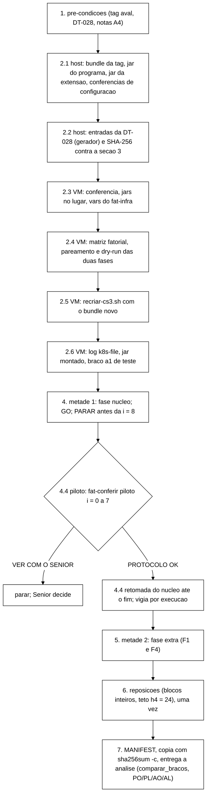

# Roteiro de VM da avaliação fatorial (DT-027, valores da DT-028) (Senior, 2026-11-06)

> Para o coordenador, que roda a avaliação sob a autorização do Gestor. **Só executar depois do aviso dele**, com a tag
> `int/2026-11-06-aval` fechada. Substitui, para o *benchmark* refeito, o `docs/roteiro-avaliacao-b40-2026-11-06.md`
> (desenho A × B do B-40), que continua valendo onde este não diz nada diferente. O roteiro do X-17/X-18 e o anexo da
> recalibração (`docs/roteiro-recalibracao-2026-11-06.md`) valem para a forma dos blocos, a função `vm`, o *lock*, o
> *dead-man*, o CR, o `tmux`, o perfil H0 e as cópias com `sha256sum -c`.
>
> **Base.** Desenho: complemento 1 do pré-registro do *benchmark* refeito, **DT-027** (`wt-bench`,
> `docs/pre-registro-benchmark-refeito`, documento `4fa4546`, DT `f6965ae`, nota da seção 7 em `3a1db1d` e `c11162f`).
> Valores: B-40 parte 2 revisada, **DT-028** (documento `8eadca7`, DT `9ee94a6`), sobre a derivação da recalibração
> `b183527a…`. Orquestrador fatorial: `docs/relatorio-orquestrador-fatorial-2026-11-06.md` da integração (TD-023,
> P-65).
>
> **Conferido no *host*, sem VM.** A tag ainda não existe. As duas linhas que ela junta foram conferidas cada uma na
> sua ponta: `9cf777a` (ponta de `feature/controlador-integracao`: orquestrador fatorial, A1, P1-IC com o AC-7, W-5e e
> W-5f) e `e672051` (ponta de `feature/p1ic-conferidor-analise`: P-63, AC-7 no conferidor e no orquestrador, e P-64).
> Um `git merge-tree` das duas dá conflito no `run-campanha-s3.sh`, no `campanha_s3_conferir.py` e nos testes, então o
> ensaio conjunto só existe com a tag (2.4).
>
> - Matriz fatorial: igual em duas gerações (`406a845c…` com a semente de ordem 20261106), e o `pareamento` dá 80
>   linhas, 12 blocos fatoriais, 16 de dois braços, variantes `pnn,a1`.
> - Entradas: o gerador da seção 11.4, sobre a derivação `b183527a…`, deu o controlador `163b88b0…`, o `campanha-s3/2`
>   `5959a349…` e as referências `dec07fb7…` e `32bb1c60…` (as da DT-028). Recusou regravar, recusou SHA de derivação
>   errado e recusou base sem a carga L+.
> - Em `9cf777a`: `parametros --sonda-replay` com 31 números (`exec_teto_s` 1019, `s3_replay_late_max` 306,
>   `fusao_teto_s` 72, os cinco do F3); o `--dry-run` das fases `nucleo` (64) e `extra` (16) saiu com exit 0, com a
>   linha do programa terminando em `--s3-replay-late-max 306 --s3-replay-probe --sweep --sweep-merge-timeout-sec 72`,
>   `DRY-RUN fusao: pnn=… a1=… PoliticaFusaoSessoes` e o JAR da extensão "montado nos 3 nos (SHA-256 confere)".
> - Em `e672051`: `controlador --exigir-politica --exigir-p2-desabilitada --exigir-acao-p1 AC-7` aceitou o
>   controlador gerado (`acao_p1 AC-7`); `ajusta-log.sh --validar` aceitou o `loggers-avaliacao.tsv` (duas categorias
>   em FATAL).
> - O JAR da extensão compilou no *host* (`mvn -o`), mas **o SHA-256 muda a cada build** (duas compilações seguidas
>   deram `a5e6f9c2…` e `d03306c4…`; o *jar* do programa também não é reprodutível). Por isso o SHA dos dois *jars* é
>   o do arquivo construído no 2.1, que vai à VM e ao `--extensao-sha256`.
> - O `fat-conferir.py` (11.3) leu a saída do caso S36 do orquestrador em `9cf777a` (um bloco fatorial com dublês):
>   bloco completo com PO, AO, AL e PL; fusão e controlador de cada braço, `fusao_config.ok`, `t_fusao_ns`, AC-5 e AC-7
>   lidos certo. As FALHA que ele deu lá são do ensaio, não do conferidor: a trilha de observáveis do dublê não tem
>   `fim`, o disparo do dublê sai fora de [49, 51) s (tempo comprimido) e `9cf777a` ainda não grava o `loggers.tsv`
>   do P-64.
> - Os quatro auxiliares passaram em `bash -n` ou `py_compile`; os blocos *bash* deste roteiro passaram em `bash -n`.

## Siglas

| Sigla | Significado |
|---|---|
| T, S7 | SHA completo e 7 primeiros caracteres da tag `int/2026-11-06-aval` |
| PO, PL, AO, AL | braços do bloco fatorial na ASYNC F2: P = `PREFERRED_NON_NULL` (`fusao=pnn`), A = A1 (`fusao=a1`); O = `shadow`, L = `active` com o AC-7 |
| A, B | braços das células descritivas (sem falha, F3, F1, F4): `shadow` × `active`, ambos `pnn` |
| metade 1, metade 2 | fase `nucleo` (64 execuções, 20 blocos) e fase `extra` (16 execuções, 8 blocos) |
| piloto | os 3 primeiros blocos da fase `nucleo` (i = 0 a 7 na matriz de 20261106), lidos só no protocolo |
| EXT | o `tcc-extensao-servidor.jar` (política de fusão da A1), montado em `server/lib` nos três nós em todos os braços |

## 0. Visão geral



**Regras de todos os passos** (as do roteiro do B-40, seção 0, com estes nomes): sessão `tmux` nova **`fat`** (as
sessões `cs3`, `rc` e `rebaseline` ficam como estão; nenhuma é morta), pasta de eventos `~/fat-infra`, voláteis em
`/run/tccdiag/coord-fat`, saída `$CS3/runs/campanha-s3-fatorial`. Nunca `pkill -f`; nunca `swapoff`/`swapon`; CR
removido de tudo que vier do Windows; H0 do 4.1 ao `parar` do amostrador no 7.1 (sem `mvn`, testes, TLC, Podman local,
cópias grandes, `scp` nem `git` no *host*).

```bash
# host, uma vez por sessao do Git Bash
VMIP=172.27.114.62     # se mudar: Get-NetNeighbor -LinkLayerAddress 00-15-5D-03-AC-00
SSHO=(-o BatchMode=yes -o ConnectTimeout=10 -o HostKeyAlias=172.18.251.140 -i "$HOME/.ssh/id_ed25519_tccf3")
vm() { sed 's/\r$//' | ssh "${SSHO[@]}" "server1@$VMIP" 'bash -s'; }
# uso: vm <<'FIMVM'  ...bloco VM inteiro...  FIMVM   (os blocos usam EOF e EOF2 nos heredocs de dentro)
```

## 1. Pré-condições (faltando uma, não começar)

| # | Item | Bloqueia |
|---|---|---|
| P-1 | Nenhuma fase em curso na VM (`pgrep -af 'run-campanha-s3|run-rebaseline'` vazio; *lock* livre; 0 *timers* `tcc-heal*`; 0 *units* `tcc-amostrador-*`) | tudo |
| P-2 | T = tag `int/2026-11-06-aval`, com as suítes do integrador registradas e as funções conferidas no 2.1: matriz fatorial e `--extensao-sha256` (orquestrador fatorial), `sessions-async-a1.json` e `extensao-servidor/` (A1), `--exigir-acao-p1` (P-63/AC-7), `ajusta-log.sh` e `loggers-avaliacao.tsv` (P-64), `--sweep-merge-timeout-sec` no programa | tudo |
| P-3 | DT-028 registrada (`8eadca7`, `9ee94a6`): feito | 2.2 |
| P-4 | Notas [A4] da DT-027 (seção 6: A4-1 a A4-4) fechadas antes dos dados | GO |
| P-5 | *Host* em H0 há ≥ 5 min antes do GO, `WSearch` parado | GO da metade 1 |
| P-6 | Disco da VM: livre ≥ 1,5 × (80 + 4 × 24) × 14 MiB ≈ 3,7 GiB para as execuções e reposições, mais 1,5 GiB para o log `k8s-file` dos três nós (teto de 512 MB cada) ≈ **5,2 GiB** | 2.5 |

## 2. Bundle, entradas e *cluster*

### 2.1 Host: bundle da tag, os dois *jars*, auxiliares e conferências de configuração (H2; ~15 min)

```bash
# host. Trocar SHA_DA_TAG pelo SHA completo da tag int/2026-11-06-aval.
T=SHA_DA_TAG
TCC=/c/Users/Francesco/Development/tcc
[ "$(git -C $TCC/wt-ctrl-integ rev-parse 'int/2026-11-06-aval^{commit}')" = "$T" ] && echo "T e a tag" || echo "T NAO e a tag: parar"
for c in 9cf777a 7051409 f957d19 ce41a25 cc2b71c; do git -C $TCC/wt-ctrl-integ merge-base --is-ancestor $c "$T" && echo "T contem $c" || echo "T sem $c (ver se o integrador refez o commit)"; done
S7=$(git -C $TCC/wt-ctrl-integ rev-parse --short=7 "$T"); echo "S7=$S7"
git -C $TCC/wt-ctrl-integ worktree add --detach "$TCC/wt-cs3-$S7" "$T"
cd "$TCC/wt-cs3-$S7" && git status --short | wc -l                   # 0
grep -c -- '--extensao-sha256)' scripts/run-campanha-s3.sh            # >= 1 (orquestrador fatorial)
grep -c -- 'fatorial' scripts/campanha_s3_matriz.py                   # >= 1
grep -c -- '--exigir-acao-p1' scripts/campanha_s3_conferir.py         # >= 1 (P-63, AC-7)
grep -c -- 'conferir_loggers' scripts/run-campanha-s3.sh              # >= 1 (P-64)
grep -c -- 'sweep-merge-timeout-sec' workload/src/main/java/br/unipampa/tcc/session/Cli.java    # >= 1
H=$TCC/dados-vm/cs3-2026-11; D=$H/bundle-fat-$S7; mkdir -p "$D/aux"
git -c core.autocrlf=false archive --format=tar --prefix="cs3-$S7/" "$T" -o "$D/cs3-$S7.tar"
(cd workload && mvn -o -q -T1 -DskipTests package)                   # faltando plugin offline: o mesmo sem -o
(cd extensao-servidor && mvn -o -q -T1 -DskipTests package)          # idem
cp workload/target/session-workload-0.1.0-SNAPSHOT.jar extensao-servidor/target/tcc-extensao-servidor.jar "$D/"
(cd "$D" && sha256sum cs3-$S7.tar session-workload-0.1.0-SNAPSHOT.jar tcc-extensao-servidor.jar | sed 's/ \*/  /' > bundle-$S7.sha256 && cat bundle-$S7.sha256)
#   os dois jars nao sao reprodutiveis (timestamps): o SHA que vale e o deste arquivo, do 2.3 ate a entrega
```

Conferências de configuração na *worktree* da tag (só leitura):

```bash
# host
cd "$TCC/wt-cs3-$S7"
sha256sum cluster/caches/sessions-async.json cluster/caches/sessions-async-a1.json cluster/caches/counters-async.json | cut -c1-64
#   b68c3ca52433a1eec38f8aab9d7e5ff3ef14945a640e79468bc6da197af6154c  (pnn, o mesmo da recalibracao)
#   df3c290dfe424ab8ea4d3f3677c868b7a24078c9611e0ee3040ebc14db7f9a7a  (a1, igual em 9cf777a e e672051)
#   b68c3ca52433a1eec38f8aab9d7e5ff3ef14945a640e79468bc6da197af6154c  (counters-async pnn nos quatro bracos)
grep -oE '"merge-policy":"[^"]+"' cluster/caches/sessions-async.json cluster/caches/sessions-async-a1.json cluster/caches/counters-async.json
#   PREFERRED_NON_NULL; br.unipampa.tcc.servidor.PoliticaFusaoSessoes; PREFERRED_NON_NULL
bash scripts/ajusta-log.sh --validar; echo "validar rc=$?"
#   org.infinispan.server.hotrod.BaseRequestProcessor FATAL; org.infinispan.interceptors.impl.InvocationContextInterceptor FATAL; rc=0
sha256sum cluster/log/loggers-avaliacao.tsv scripts/ajusta-log.sh | cut -c1-64
#   em e672051: 31e9885464df3ec7... e 955339c793a57075...; diferente na tag: registrar no ENTREGA e seguir se o --validar der 0
grep -c 'tcc-extensao-servidor.jar:/opt/infinispan/server/lib/tcc-extensao-servidor.jar:ro' cluster/podman-compose-sem-caches.yml   # 3
grep -c 'driver: k8s-file' cluster/podman-compose-sem-caches.yml      # 3
grep -c 'max-size: "512mb"' cluster/podman-compose-sem-caches.yml     # 3
cat > "$D/congelados-fat.sha256" <<'EOF2'
4ebdd8a34a7d5c1e6981138272a4f0b90a67c44dd8626e9521884e185297abb1  scripts/inject-netdegrade.sh
59dd2beee5b003d85f96cae71866227d7bca1c87a9ceeab034180ce4254d94e1  scripts/inject-partition.sh
531a98a1a613647d28288f590e26a55f1240a42e362c223363fe6c40eb93985c  scripts/inject-crash.sh
7e68962b1b7f508ee84ca7561a20c0bba36c43ea4597d7390e7c8091cd24e529  scripts/inject-jitter.sh
e4cc5c794312afbfa7e4743ca556f37033924c51b0246f8f211718a6ee0a8780  scripts/amostrador-infra.sh
53d7e7cb831856a58dc9df1a717df559437857aae5b57d159d42bbd84feb8b30  analysis/h4.py
53de0b390473dc0b57903af8c68e439087eb864deddc755330c6e61c14b6864b  scripts/cria-caches.sh
d1d3581b7fe0ce12e4e33358698da287f3ac87e4d223689b91248d7fee9327c3  scripts/collect-resources.sh
a7b18f2dac46095e468c43ae97c4cc51e411cbb54875606e898a20b6a7227c85  cluster/infinispan-sem-caches.xml
dd79343070cf9107571de238851d1117255ebdb1c7887075e23d76638d7bcf14  cluster/jgroups-tcp.xml
c4e05c3cc40c1900378de7f709ac3f99fea896a1ba2d1f0addd9d78a53a574ff  cluster/controlador/controlador-calibracao-s3.json
3c7826b5e85c07d4b5b265206a8b2d36a16675e1273d22e2ff0905b54fc3899c  cluster/caches/sessions.json
3c7826b5e85c07d4b5b265206a8b2d36a16675e1273d22e2ff0905b54fc3899c  cluster/caches/counters.json
b68c3ca52433a1eec38f8aab9d7e5ff3ef14945a640e79468bc6da197af6154c  cluster/caches/sessions-async.json
b68c3ca52433a1eec38f8aab9d7e5ff3ef14945a640e79468bc6da197af6154c  cluster/caches/counters-async.json
3c7826b5e85c07d4b5b265206a8b2d36a16675e1273d22e2ff0905b54fc3899c  cluster/caches/canario.json
b68c3ca52433a1eec38f8aab9d7e5ff3ef14945a640e79468bc6da197af6154c  cluster/caches/canario-async.json
df3c290dfe424ab8ea4d3f3677c868b7a24078c9611e0ee3040ebc14db7f9a7a  cluster/caches/sessions-async-a1.json
EOF2
sha256sum cluster/podman-compose-sem-caches.yml cluster/log/loggers-avaliacao.tsv scripts/ajusta-log.sh | sed 's/ \*/  /' >> "$D/congelados-fat.sha256"
sha256sum -c "$D/congelados-fat.sha256"                              # 21 OK
R="docs/plano-implementacao-controlador:docs/roteiro-avaliacao-fatorial-2026-11-06.md"
extrair() { git -C $TCC/wt-plano-ctrl show "$R" | awk -v m="<!-- arquivo: $1 -->" '$0 == m {f = 1; next} f == 1 && /^```/ {f = 2; next} f == 2 && /^```$/ {exit} f == 2 {print}'; }
for f in recriar-cs3.sh supervisor-cs3.sh fat-conferir.py gerar-entradas-fatorial.py; do extrair "$f" > "$D/aux/$f"; done
(cd "$D/aux" && sha256sum * | sed 's/ \*/  /' > ../aux-$S7.sha256 && cat ../aux-$S7.sha256)    # igual a tabela da secao 11
```

As 18 primeiras linhas do `congelados-fat.sha256` são as 17 do X-17/X-18 sem o *compose* (que passou a montar o EXT
e a gravar o log em `k8s-file`), mais o JSON da A1. As 18 conferem nas árvores de `9cf777a` e de `e672051`. As três
últimas (o *compose*, o arquivo de *loggers* e o `ajusta-log.sh`) entram com o SHA da tag. Um `FAILED` nas 18
primeiras: parar e chamar o Senior.

### 2.2 Host: entradas da DT-028 (H2; ~5 min)

O gerador (seção 11.4) monta as quatro entradas a partir da derivação `b183527a…`, sem escolher valor: o controlador é
o da calibração (`c4e05c3c…`, da *worktree* da tag) com os valores da DT-028 §1 e `politica.acaoP1 = "AC-7"` com a
origem (DT-028 §3); o `campanha-s3/2` é o arquivo da recalibração (`1ca5877f…`: os 19 números, a carga L+ e o
`s3_replay_late_max`) com `convergencia_teto_s` 600, `convergencia_periodo_s` 4 e `exec_teto_s` 1019 da derivação,
`volume_exec_mb` 14 (DT-028 §2; a derivação dá 3), `s3_replay_late_max` 306 e `fusao_teto_s` 72 (DT-028 §3) e os cinco
números do F3 (B-40 §4.3). As referências são as da derivação, copiadas byte a byte.

```bash
# host
DR=$H/derivacao-recal-20261106T145106Z
PB=$H/bundle-rc-cc2b71c/entrada/campanha-s3-recalibracao.json
sha256sum "$PB" | cut -c1-64                                         # 1ca5877f3b2ea01982477fd45e52befb9a794a71d5bf7d39f025560942d7222b
python -I "$D/aux/gerar-entradas-fatorial.py" --derivacao "$DR/calibracao-s3-derivacao.json" \
  --derivacao-sha256 b183527a4c88476a1feda51bfd6e7fedb832949344d04ad59c80606b25126121 --referencias-dir "$DR/referencias" \
  --controlador-base "$TCC/wt-cs3-$S7/cluster/controlador/controlador-calibracao-s3.json" \
  --parametros-base "$PB" --saida-dir "$D/entradas"; echo "gerador rc=$?"
cat > "$D/entradas-dt028.sha256" <<'EOF2'
163b88b01a6d049eab86cdebe4357e2ea17f738166f1710f9ce561f3c52ff032  controlador-avaliacao-s3.json
5959a3495ca8398667135f60d968f992c382354c7ce4b79829d720ee078c1e8d  campanha-s3-avaliacao.json
dec07fb76352e85ea014def9f8c52f5b0b416663ddda4f3c60f4676c660fd396  referencia-S3-async.json
32bb1c60d13611eed70b4ffae3a276e0e318dbee9f3d2393a3545a653e6ad741  referencia-S3-sync.json
EOF2
(cd "$D/entradas" && sha256sum -c ../entradas-dt028.sha256)         # 4 OK: as entradas registradas na secao 3
C=$TCC/wt-cs3-$S7/scripts/campanha_s3_conferir.py
python -I $C parametros --arquivo "$D/entradas/campanha-s3-avaliacao.json" --t-enc-pior-s 21 --sonda-replay | tail -9
#   ... exec_teto_s 1019 ... volume_exec_mb 14 ... s3_replay_late_max 306, fusao_teto_s 72
python -I $C controlador --arquivo "$D/entradas/controlador-avaliacao-s3.json" --hotrod-timeout-ms 2000 \
  --exigir-politica --exigir-p2-desabilitada --exigir-acao-p1 AC-7
#   politica sim, p2_habilitada false, acao_p1 AC-7
for p in async sync; do python -I $C referencia --arquivo "$D/entradas/referencia-S3-$p.json" --perfil $p | tail -1; done
```

`gerador rc=3` ou um `FAILED` no `sha256sum -c`: parar. A causa provável é a tag ter mudado o controlador base (o
`congelados-fat.sha256` já teria acusado) ou o esquema; a decisão é do Senior.

### 2.3 Transferência e conferência (H2; ~5 min)

```bash
# host
scp "${SSHO[@]}" "$D/cs3-$S7.tar" "$D/session-workload-0.1.0-SNAPSHOT.jar" "$D/tcc-extensao-servidor.jar" \
  "$D/bundle-$S7.sha256" "$D/aux-$S7.sha256" "$D/congelados-fat.sha256" "server1@$VMIP:"
scp -r "${SSHO[@]}" "$D/aux" "server1@$VMIP:fat-aux-$S7"
scp -r "${SSHO[@]}" "$D/entradas" "server1@$VMIP:fat-entradas-$S7"
```

```bash
# VM. Trocar XXXXXXX pelo S7 do 2.1.
S7=XXXXXXX
ORDEM=20261106    # secao 3: data do commit do registro (DT-028, 9ee94a6)
cd ~ && sha256sum -c bundle-$S7.sha256                               # 3 OK
(cd ~/fat-aux-$S7 && sha256sum -c ../aux-$S7.sha256)                 # 4 OK
(cd ~/fat-entradas-$S7 && sha256sum -c SHA256SUMS)                   # 4 OK
if [ -e ~/cs3/cs3-$S7 ]; then echo "cs3-$S7 ja existe: usar como esta"; else mkdir -p ~/cs3 && tar -xf ~/cs3-$S7.tar -C ~/cs3; fi
CS3=~/cs3/cs3-$S7; mkdir -p $CS3/workload/target $CS3/extensao-servidor/target $CS3/runs/entrada-fat ~/fat-infra
[ -f $CS3/workload/target/session-workload-0.1.0-SNAPSHOT.jar ] || cp ~/session-workload-0.1.0-SNAPSHOT.jar $CS3/workload/target/
[ -f $CS3/extensao-servidor/target/tcc-extensao-servidor.jar ] || cp ~/tcc-extensao-servidor.jar $CS3/extensao-servidor/target/
cp ~/fat-aux-$S7/*.sh ~/fat-aux-$S7/*.py ~/fat-infra/
cp ~/fat-entradas-$S7/*.json $CS3/runs/entrada-fat/
cp ~/congelados-fat.sha256 ~/fat-infra/
grep -rlI $'\r' $CS3/scripts $CS3/cluster $CS3/runs/entrada-fat ~/fat-infra || echo "sem CR"
(cd $CS3 && sha256sum -c ~/fat-infra/congelados-fat.sha256)          # 21 OK
cat > ~/fat-infra/vars.sh <<EOF2
# avaliacao fatorial (roteiro-avaliacao-fatorial-2026-11-06.md). Todo bloco da VM comeca com: source ~/fat-infra/vars.sh
S7=$S7
CS3=$HOME/cs3/cs3-$S7
E=$HOME/cs3/cs3-$S7/runs/entrada-fat
SFAT=$HOME/cs3/cs3-$S7/runs/campanha-s3-fatorial
ORDEM=$ORDEM
JAR=$HOME/cs3/cs3-$S7/workload/target/session-workload-0.1.0-SNAPSHOT.jar
JAR_SHA=$(sha256sum $CS3/workload/target/session-workload-0.1.0-SNAPSHOT.jar | cut -c1-64)
EXT_SHA=$(sha256sum $CS3/extensao-servidor/target/tcc-extensao-servidor.jar | cut -c1-64)
CTRL=$HOME/cs3/cs3-$S7/runs/entrada-fat/controlador-avaliacao-s3.json
CTRL_SHA=163b88b01a6d049eab86cdebe4357e2ea17f738166f1710f9ce561f3c52ff032
PFAT=$HOME/cs3/cs3-$S7/runs/entrada-fat/campanha-s3-avaliacao.json
PFAT_SHA=5959a3495ca8398667135f60d968f992c382354c7ce4b79829d720ee078c1e8d
REF_A=$HOME/cs3/cs3-$S7/runs/entrada-fat/referencia-S3-async.json
REF_A_SHA=dec07fb76352e85ea014def9f8c52f5b0b416663ddda4f3c60f4676c660fd396
REF_S=$HOME/cs3/cs3-$S7/runs/entrada-fat/referencia-S3-sync.json
REF_S_SHA=32bb1c60d13611eed70b4ffae3a276e0e318dbee9f3d2393a3545a653e6ad741
MFAT=$HOME/cs3/cs3-$S7/runs/entrada-fat/matriz-fatorial.tsv
EOF2
cat >> ~/fat-infra/vars.sh <<'EOF2'
OFAT="--swap-limite-kb 1048576 --exigir-trilha-completa --sonda-replay --extensao-sha256 $EXT_SHA"
lancar_fat() {  # lancar_fat <fase> <tsv da fila> <cmd> <janela do supervisor> [<parar antes de i>]
  if pgrep -f 'run-campanha-s3[.]sh' > /dev/null; then echo "orquestrador ainda rodando: nao lancar"; return 1; fi
  if pgrep -f '^bash /home/[^ ]+/fat-infra/supervisor-cs3[.]sh' > /dev/null; then echo "supervisor anterior ainda rodando: esperar SUP_FIM"; return 1; fi
  local lim; lim=$(( $(python3 -I -c 'import json,sys; print(json.load(open(sys.argv[1]))["parametros"]["exec_teto_s"]["valor"])' "$PFAT") + 90 ))
  tmux has-session -t fat 2>/dev/null || tmux new-session -d -s fat -n orq -x 220 -y 50
  tmux send-keys -t fat:orq clear Enter; sleep 1; tmux clear-history -t fat:orq
  tmux new-window -d -t fat -n "$4" "SUP_JANELA=fat:orq SUP_INFRA=$HOME/fat-infra SUP_VOLATIL=/run/tccdiag/coord-fat bash $HOME/fat-infra/supervisor-cs3.sh $SFAT $1 $2 $3 $lim registrar $CS3 $5; echo SUP_FIM; sleep 86400"
  sleep 2; tmux send-keys -t fat:orq "bash $3" Enter
}
EOF2
cat ~/fat-infra/vars.sh; bash -n ~/fat-infra/vars.sh && echo "vars ok"
```

O `JAR_SHA` e o `EXT_SHA` impressos têm de ser iguais às linhas 2 e 3 do `bundle-<S7>.sha256` do *host*.

### 2.4 Matriz fatorial, pareamento e `--dry-run` (H2; ~5 min)

DT-027 §3 e DT-026 §5: `--s0 800000`, passo 100, semente = 800 000 + 100·bloco (`--b0 0`, blocos 0 a 27, sementes
800 000 a 802 700), núcleo antes das extras.

```bash
# VM
source ~/fat-infra/vars.sh; cd $CS3
python3 -I scripts/campanha_s3_matriz.py gerar --modo fatorial \
  --nucleo "ASYNC-F2:teste:12,ASYNC-none:descritiva:4,ASYNC-F3:descritiva:4" \
  --extras "ASYNC-F1:descritiva:4,ASYNC-F4:descritiva:4" \
  --ordem-seed $ORDEM --s0 800000 --passo-semente 100 --i0 0 --b0 0 --saida $MFAT
echo "MFAT_SHA=$(sha256sum $MFAT | cut -c1-64)" >> ~/fat-infra/vars.sh; source ~/fat-infra/vars.sh; echo "$MFAT_SHA"
#   com ORDEM=20261106: 406a845cd785cb291a097afd7d3341d3116517d42e0e4af368cf76c789b5d726 (registrada na secao 3)
python3 -I scripts/campanha_s3_conferir.py pareamento --matriz $MFAT
#   formato fatorial (14 colunas); linhas 80; blocos_ab 16; blocos_fatorial 12; sem_bloco 0; fusao pnn,a1
awk -F'\t' 'NR>1{c[$2" "$5" "$10]++} END{for(k in c) print k, c[k]}' $MFAT | sort | tr '\n' ';'; echo
#   extra ASYNC-F1 A 4; B 4; extra ASYNC-F4 A 4; B 4; nucleo ASYNC-F2 AL 12; AO 12; PL 12; PO 12;
#   nucleo ASYNC-F3 A 4; B 4; nucleo ASYNC-none A 4; B 4
for F in nucleo extra; do
  bash scripts/run-campanha-s3.sh --dry-run --matriz $MFAT --matriz-sha256 $MFAT_SHA --fase $F \
    --parametros $PFAT --parametros-sha256 $PFAT_SHA --controlador $CTRL --controlador-sha256 $CTRL_SHA \
    --referencia-async $REF_A --referencia-async-sha256 $REF_A_SHA --referencia-sync $REF_S --referencia-sync-sha256 $REF_S_SHA \
    --jar $JAR --jar-sha256 $JAR_SHA --saida $SFAT $OFAT 2>&1 | tee ~/fat-infra/dry-run-$F.txt | grep -E '^(DRY-RUN|PLANO execucoes|Erro)'
done
grep -m1 '^      timeout' ~/fat-infra/dry-run-nucleo.txt | grep -oE '\-\-s3-[a-z-]+ [0-9.]+|--s3-replay-probe|--sweep[a-z-]*( [0-9]+)?' | tr '\n' ' '; echo
grep -E '^PLANO i=(0|1|2|3) ' ~/fat-infra/dry-run-nucleo.txt | cut -c1-120
ls -d $SFAT 2>/dev/null || echo "saida ainda nao existe (certo)"
```

Esperado nas duas fases (as linhas medidas em `9cf777a`, mais as do P-64 e do AC-7, que só a tag junta):

- `DRY-RUN fase=… (SHA-256 confere) … (31 numeros, todos com origem)`;
- controlador conferido com `politica=sim p2_habilitada=false` e `acao_p1=AC-7` (ou o texto equivalente da tag);
- `DRY-RUN opcoes: swap_limite_kb=1048576 exigir_trilha_completa=sim sonda_replay=sim`;
- `DRY-RUN carga S3: --s3-users 40 … --s3-admin-mean-sec 5 --s3-replay-late-max 306`;
- `DRY-RUN fusao: pnn=sessions-async.json PREFERRED_NON_NULL b68c3ca52433 a1=sessions-async-a1.json
  br.unipampa.tcc.servidor.PoliticaFusaoSessoes df3c290dfe42` (na fase `extra`, só `pnn`);
- `DRY-RUN fusao antes da varredura: fusao_teto_s=72 s contados do end`;
- `DRY-RUN extensao: … montado nos 3 nos (SHA-256 confere)`;
- `DRY-RUN loggers: org.infinispan.server.hotrod.BaseRequestProcessor=FATAL org.infinispan.interceptors.impl.InvocationContextInterceptor=FATAL`;
- `PLANO execucoes=64` no núcleo e `16` nas extras; SIGTERM no teto de 1019 s;
- linha do programa terminando em `--s3-replay-late-max 306 --s3-replay-probe --sweep --sweep-merge-timeout-sec 72`;
- `PLANO i=0 … bloco=0 braco=PO controller=shadow fusao=pnn seed=800000`, `i=1 … AO … a1`, `i=2 … PL … pnn`, `i=3 … AL
  … a1`.

Faltando a linha do P-64 ou o `acao_p1=AC-7`: parar (P-2).

### 2.5 Recriação com o bundle novo (H2; ~5 min)

O *compose* monta o EXT nos três nós, então o *jar* tem de estar em `$CS3/extensao-servidor/target/` antes (2.3).

```bash
# VM
source ~/fat-infra/vars.sh
TS=$(date -u +%Y%m%dT%H%M%SZ); A=~/fat-infra/cluster-antes-$TS; mkdir -p $A
for n in isn1 isn2 isn3; do sudo podman inspect $n > $A/inspect-$n.json 2>&1; sudo podman logs $n > $A/logs-$n.txt 2>&1; done
sha256sum $A/* > $A.sha256
flock -n /var/lock/tcc-vm.lock bash ~/fat-infra/recriar-cs3.sh $CS3 ~/fat-infra/recriacao-$TS > /dev/null 2>&1; echo "recriar rc=$?"
grep -vE 'AVAILABLE$|rebalancing_enabled true|ISPN000094' ~/fat-infra/recriacao-$TS/conferencia.txt
free -m | tail -2; df -Pm $CS3/runs | tail -1                       # livre >= 5,2 GiB (P-6)
```

Esperado: `RECRIAR-CS3 OK` e *swap* perto de 40 MB. O `recriar-cs3.sh` cria os seis *caches* pela regra atual
(`pnn`), o que basta para o portão; o orquestrador troca o `sessions-async` pelo do braço em cada execução.

### 2.6 Conferências do ambiente antes do GO (H2; ~10 min)

Só leitura, salvo o braço `a1` de teste (c), que troca o `sessions-async` do *cluster* recém-criado. A i = 0 recria o
*cluster* de qualquer modo.

```bash
# VM
source ~/fat-infra/vars.sh; cd $CS3
PASS="$(sed -n 's/^ *- PASS=//p' cluster/podman-compose-sem-caches.yml | head -1)"
# (a) log dos conteineres em k8s-file com teto (P-64, DT-028 secao 5); podman-compose 1.0.6 na VM, nao testado
podman-compose --version 2>&1 | tail -1
(cd cluster && sudo podman-compose --dry-run -f podman-compose-sem-caches.yml up -d) > ~/fat-infra/compose-dry-run.txt 2>&1; echo "compose dry-run rc=$?"
grep -oE -- '--log-driver=[^ ]+|--log-opt=[^ ]+' ~/fat-infra/compose-dry-run.txt | sort | uniq -c
#   esperado: 3 --log-driver=k8s-file e 3 --log-opt=max-size=512mb
for n in isn1 isn2 isn3; do echo "$n $(sudo podman inspect $n --format '{{.HostConfig.LogConfig.Type}} {{.HostConfig.LogConfig.Size}}')"; done
#   esperado: k8s-file e o teto de 512 MB nos tres (o cluster do 2.5, criado pelo mesmo compose)
# (b) JAR da extensao montado nos tres nos
for n in isn1 isn2 isn3; do
  src=$(sudo podman inspect $n --format '{{range .Mounts}}{{if eq .Destination "/opt/infinispan/server/lib/tcc-extensao-servidor.jar"}}{{.Source}}{{end}}{{end}}')
  echo "$n fonte=$src sha=$([ -n "$src" ] && sha256sum "$src" | cut -c1-64) no_conteiner=$(sudo podman exec $n sha256sum /opt/infinispan/server/lib/tcc-extensao-servidor.jar 2>/dev/null | cut -c1-64)"
done
echo "EXT_SHA=$EXT_SHA"                                              # os tres iguais a ele
# (c) braco a1 de teste: sessions-async recriado com o JSON da A1 e a politica lida de volta nos tres nos
T1=$(mktemp -d); cp cluster/caches/sessions-async-a1.json $T1/sessions-async.json
printf 'user = "admin:%s"\n' "$PASS" | curl -sS --digest -K - -o /dev/null -w 'DELETE sessions-async %{http_code}\n' -X DELETE http://127.0.0.1:11222/rest/v2/caches/sessions-async
CRIA_CACHES_SENHA="$PASS" bash scripts/cria-caches.sh --url http://127.0.0.1:11222 \
  --conferir http://127.0.0.1:11222,http://127.0.0.1:11223,http://127.0.0.1:11224 --dir $T1 sessions-async \
  > ~/fat-infra/teste-a1-caches.tsv 2> ~/fat-infra/teste-a1-caches.err; echo "cria-caches a1 rc=$?"   # 0: leitura de volta igual nos 3
for p in 11222 11223 11224; do echo "$p $(printf 'user = "admin:%s"\n' "$PASS" | curl -sS --digest -K - "http://127.0.0.1:$p/rest/v2/caches/sessions-async?action=config" | grep -oE '"merge-policy":"[^"]+"')"; done
#   esperado: "merge-policy":"br.unipampa.tcc.servidor.PoliticaFusaoSessoes" nos tres
for n in isn1 isn2 isn3; do echo "$n A1-POLITICA carregada: $(sudo podman logs $n 2>&1 | grep -c 'A1-POLITICA carregada')"; done   # >= 1 em cada
rm -rf $T1
```

Se (a) não mostrar `--log-driver=k8s-file` e `--log-opt=max-size=512mb`, o `podman-compose` 1.0.6 não traduz o bloco
`logging`. A prova é o `podman inspect` da segunda parte de (a): se ele disser `k8s-file`, vale. Se não disser:

1. **Alternativa 1 (sem mudar a VM):** passar o *driver* pela linha do `podman run` do próprio `podman-compose`, com
   `PODMAN_COMPOSE="sudo podman-compose --podman-run-args=--log-driver=k8s-file --podman-run-args=--log-opt=max-size=512mb"`
   (o orquestrador lê essa variável; padrão `sudo podman-compose`), conferida antes pelo mesmo `--dry-run` com essas
   opções. O `recriar-cs3.sh` chama `sudo podman-compose` direto, mas o portão de cada execução é do orquestrador.
2. **Alternativa 2 (muda a VM):** `log_driver = "k8s-file"` e `log_size_max = 536870912` na seção `[containers]` do
   `/etc/containers/containers.conf` do *root*. Vale para todo contêiner *rootful*; precisa do aval do coordenador.

Sem `k8s-file` confirmado, não dar o GO: a DT-028 §5 declara o log em `k8s-file` como condição do ambiente.

## 3. Valores e SHA-256 registrados (DT-028 §6)

| Item | Valor ou SHA-256 | Origem |
|---|---|---|
| derivação | `b183527a4c88476a1feda51bfd6e7fedb832949344d04ad59c80606b25126121` | DT-028, cabeçalho |
| `controlador-avaliacao-s3.json` | `163b88b01a6d049eab86cdebe4357e2ea17f738166f1710f9ce561f3c52ff032` | gerador 11.4 sobre a derivação e o controlador `c4e05c3c…` |
| `campanha-s3-avaliacao.json` (`campanha-s3/2`, 31 números) | `5959a3495ca8398667135f60d968f992c382354c7ce4b79829d720ee078c1e8d` | gerador 11.4 sobre a derivação e a recalibração `1ca5877f…` |
| `referencia-S3-async.json`, `referencia-S3-sync.json` | `dec07fb76352e85ea014def9f8c52f5b0b416663ddda4f3c60f4676c660fd396`, `32bb1c60d13611eed70b4ffae3a276e0e318dbee9f3d2393a3545a653e6ad741` | DT-028, cabeçalho |
| matriz fatorial (`--ordem-seed 20261106`) | `406a845cd785cb291a097afd7d3341d3116517d42e0e4af368cf76c789b5d726` | 2.4; reproduzida duas vezes no *host* com `9cf777a` |
| `--ordem-seed` | **20261106** | data do commit do registro (DT-028, `9ee94a6`), pela instrução do coordenador. A DT-027 §3 diz "a data do commit que fechar as notas [A4]"; se essa nota sair em outra data, o coordenador decide antes do GO qual vale, e a matriz muda |
| W, `kLag`, θ, `lag_in`, `lag_out`, m, `T_cooldown`, `T_estavel`, `T_hold_viol`, k, `n_lat`, `n_err` | 4 s, 1, os da DT-028 §1, 35, 140 s, 2 s, 69,500485632 s, 2, 100, 100 | DT-028 §1 (no controlador) |
| `convergencia_teto_s`, `convergencia_periodo_s`, `exec_teto_s` | 600 s, 4 s, 1019 s | DT-028 §1 |
| `volume_exec_mb` | 14 | DT-028 §2 |
| `s3_*` (L+), `s3_replay_late_max`, `fusao_teto_s` | 40, 500, 10, 0,9, 5; 306; 72 s | DT-026 P-1; DT-028 §3 |
| `acaoP1` | `"AC-7"`, com a origem | DT-028 §3 |
| *jars* do programa e da extensão, T | do 2.1 (`bundle-<S7>.sha256`) | não reprodutíveis entre *builds*; registrados na entrega |

## 4. Metade 1: fase `nucleo` (64 execuções, 20 blocos)

### 4.1 PowerShell: H0 e covariáveis

O bloco do 4.1 do roteiro do X-17/X-18, trocando `X-17` por `fatorial` e `host-proc-io-x17.csv` por
`host-proc-io-fat.csv`. Esperar 5 min em H0 antes do 4.3.

### 4.2 VM: amostrador h4, bloco de abertura e comandos

```bash
# VM
source ~/fat-infra/vars.sh; cd $CS3
test -n "$MFAT_SHA" || { echo "falta o 2.4: PARAR"; exit 1; }
flock -n /var/lock/tcc-vm.lock true && echo "lock livre" || echo "LOCK OCUPADO: parar"
pgrep -af 'run-rebaseline|run-campanha-s3|supervisor-|session-workload|inject-' || echo "nenhum processo residual"
systemctl list-timers --all --no-legend 'tcc-heal*' | grep -c .       # 0
systemctl list-units --all --no-legend 'tcc-amostrador-*' | grep -c . # 0
H4FAT=diag-$(date -u +%Y%m%dT%H%M%SZ)
printf 'H4FAT=%s\nBOOTFAT=%s\n' "$H4FAT" "$(cat /proc/sys/kernel/random/boot_id)" >> ~/fat-infra/vars.sh
bash scripts/amostrador-infra.sh iniciar --id $H4FAT --espelho-dir ~/fat-infra/$H4FAT
bash scripts/amostrador-infra.sh estado --id $H4FAT
sudo install -d -m 0755 -o "$(id -un)" -g "$(id -gn)" /run/tccdiag/coord-fat
date -Is > ~/fat-infra/abertura-iso.txt
source ~/rebaseline-infra/bloco.sh; bloco ~/fat-infra/inicio-$(date -u +%Y%m%dT%H%M%SZ).txt > /dev/null
source ~/fat-infra/vars.sh
for F in nucleo extra reposicoes; do
cat > ~/fat-infra/cmd-fat-$F.sh <<EOF
#!/bin/bash
# avaliacao fatorial, fase $F (roteiro-avaliacao-fatorial-2026-11-06.md, 4.2); gerado em $(date -u +%FT%TZ)
cd $CS3 || { echo "ORQ_RC=2 cd falhou"; exit 2; }
export CS_PASSWORD="\$(sed -n 's/^ *- PASS=//p' cluster/podman-compose-sem-caches.yml | head -1)"
bash scripts/run-campanha-s3.sh --matriz $MFAT --matriz-sha256 $MFAT_SHA --fase $F \\
  --parametros $PFAT --parametros-sha256 $PFAT_SHA --controlador $CTRL --controlador-sha256 $CTRL_SHA \\
  --referencia-async $REF_A --referencia-async-sha256 $REF_A_SHA --referencia-sync $REF_S --referencia-sync-sha256 $REF_S_SHA \\
  --jar $JAR --jar-sha256 $JAR_SHA --boot-esperado $BOOTFAT --h4-id $H4FAT --saida $SFAT $OFAT
echo "ORQ_RC=\$? \$(date -u +%FT%TZ)"
EOF
bash -n ~/fat-infra/cmd-fat-$F.sh || echo "ERRO em cmd-fat-$F.sh"
done
cat ~/fat-infra/cmd-fat-nucleo.sh
```

### 4.3 VM: lançamento com o piloto embutido; o GO

```bash
# VM
source ~/fat-infra/vars.sh
test ! -e $SFAT && echo "saida da avaliacao nova"
lancar_fat nucleo $MFAT ~/fat-infra/cmd-fat-nucleo.sh supn1 8
sleep 30; cat ~/fat-infra/supervisor-nucleo-*.log
```

O supervisor (janela `fat:supn1`, modo `registrar`) dá o GO sob a autorização do Gestor: `go nucleo <AAAA-MM-DD>` e
`go rede 0` (na ordem de 20261106 a i = 0 é F2). Com o quinto argumento (8), ele cria `$SFAT/PARAR` assim que sai o
veredito da i = 6; a i = 7 roda, e o orquestrador para antes da i = 8 com `FIM exit=0 motivo=parada pedida pelo arquivo
PARAR`. O supervisor grava `~/fat-infra/PILOTO-nucleo-PARADO`. Os três primeiros blocos são o 0 (F2: PO, AO, PL, AL),
o 1 (sem falha: A, B) e o 2 (F3: A, B).

Logo depois do lançamento da i = 0, a linha da carga tem de trazer a carga, a sonda, a varredura e o teto da fusão:

```bash
# VM
source ~/fat-infra/vars.sh
grep -m1 'exec i=0: lancando a carga' $SFAT/nucleo/orquestrador.log | grep -oE '\-\-s3-[a-z-]+ [0-9.]+|--s3-replay-probe|--sweep[a-z-]*( [0-9]+)?' | tr '\n' ' '; echo
#   esperado: as cinco da L+, --s3-replay-late-max 306, --s3-replay-probe, --sweep e --sweep-merge-timeout-sec 72
grep -E 'exec i=[01]: (fusao=|loggers)' $SFAT/nucleo/orquestrador.log | cut -c1-200
```

Faltando qualquer uma: `touch $SFAT/PARAR` e chamar o Senior.

### 4.4 Piloto embutido: leitura só do protocolo e retomada

```bash
# VM
source ~/fat-infra/vars.sh
ls ~/fat-infra/ | grep -E '^(ALERTA|FIM|PILOTO)-'                   # PILOTO-nucleo-PARADO
python3 -I ~/fat-infra/fat-conferir.py piloto $SFAT --ate-i 7 --extensao-sha256 $EXT_SHA | tee ~/fat-infra/piloto-nucleo.txt
```

O checklist só olha protocolo e nunca V, L, vazão ou convergência. Por execução: veredito ACEITA; carga com exit 0,
sem teto, âncora até 120 s; camada 3 sem divergência (inclui os *loggers* do P-64); trilhas com `fim` e
`linhas_perdidas` 0 (B-7); h4; MANIFEST; fusão e controlador do braço; política de fusão conferida nos três nós
(`fusao_config.ok`); `loggers.tsv` gravado; nenhum AC-5; EXT igual ao do bundle; nas F2, `t_fusao_ns` presente e falha
disparada em [49, 51) s com *dead-man* e sem resto de rede; nos braços ativos, AC-7 que não ficou ativo no fim;
marcadores com um `start` e um `end` nas falhas.

- **`PILOTO: PROTOCOLO OK`**: os 3 blocos contam. O coordenador manda o `piloto-nucleo.txt` ao Senior e retoma já:

  ```bash
  # VM
  source ~/fat-infra/vars.sh
  rm -f $SFAT/PARAR
  lancar_fat nucleo $MFAT ~/fat-infra/cmd-fat-nucleo.sh supn2
  sleep 30; tail -n 4 $(ls -t ~/fat-infra/supervisor-nucleo-*.log | head -1)
  ```

- **`PILOTO: VER COM O SENIOR`** por item de protocolo (não por h4 ou recusa comum): não retomar. Sem mudança de
  protocolo, retoma como acima; com mudança, ela é registrada antes, e os 3 blocos ficam como piloto, fora da análise.

### 4.5 Vigia por execução (só leitura)

Depois de cada veredito, o checklist da execução que terminou. O vigia guarda só o último i conferido:

```bash
# VM, vigia
source ~/fat-infra/vars.sh
ULT=$(cat ~/fat-infra/vigia-ultimo-i 2>/dev/null || echo -1)
for i in $(cat $SFAT/*/orquestrador.log | grep -oE 'exec i=[0-9]+: (ACEITA|RECUSADA|DESCARTADA-INFRA|PULADA)' | grep -oE '[0-9]+' | sort -n | awk -v u="$ULT" '$1 > u'); do
  python3 -I ~/fat-infra/fat-conferir.py piloto $SFAT --desde-i $i --ate-i $i --extensao-sha256 $EXT_SHA > ~/fat-infra/vigia-i$i.txt
  echo "i=$i $(grep -c '^FALHA' ~/fat-infra/vigia-i$i.txt) falha(s): $(grep '^FALHA' ~/fat-infra/vigia-i$i.txt | cut -c1-150 | tr '\n' ';')"
  echo "$i" > ~/fat-infra/vigia-ultimo-i
done
tail -n 3 $SFAT/nucleo/orquestrador.log
tail -n 1 $(ls -t /run/tccdiag/coord-fat/progresso-*.log | head -1)
ls ~/fat-infra/ | grep -E '^(ALERTA|FIM|PILOTO)-' || echo "sem alerta nem fim"
```

FALHA só de veredito e h4 numa DESCARTADA-INFRA por h4: nada a fazer (reposição). FALHA de outro item: `touch
$SFAT/PARAR` (a fase para antes da próxima execução) e chamar o Senior. Caminhos: `$SFAT/<fase>/orquestrador.log`,
`$SFAT/exec-NNNN-<celula>-<braco>/` (`stdout.log`, `execucao.json`, `checagem.json`, `loggers.tsv`, MANIFEST),
`~/fat-infra/supervisor-<fase>-*.log`, `/run/tccdiag/coord-fat/progresso-<fase>-*.log`, `~/fat-infra/vigia-i<i>.txt`.

Duração: 64 × ~395 s (medida da recalibração) ≈ 7,0 h, mais o intervalo do piloto.

## 5. Metade 2: fase `extra` (16 execuções, 8 blocos)

```bash
# VM
source ~/fat-infra/vars.sh
ls ~/fat-infra/ | grep -E '^(ALERTA|FIM)-'                          # FIM-nucleo-OK
lancar_fat extra $MFAT ~/fat-infra/cmd-fat-extra.sh supx1
sleep 30; cat ~/fat-infra/supervisor-extra-*.log
```

GO pelo supervisor: `go extra <data>` e `go rede 66` (na ordem de 20261106 a primeira F4 é a i = 66; F1 não pede GO de
rede). O vigia do 4.5 continua. Duração: 16 × ~395 s ≈ 1,8 h.

## 6. Reposições (depois de `FIM-extra-OK`; uma vez)

Bloco perdido é refeito inteiro (os quatro braços no fatorial, os dois nas descritivas), com o próximo bloco livre e
semente nova; teto de reposições h4 = 24; uma segunda perda do mesmo bloco reposto pede decisão do Gestor.

```bash
# VM
source ~/fat-infra/vars.sh; cd $CS3
python3 -I ~/fat-infra/fat-conferir.py execucoes $SFAT --tsv ~/fat-infra/execucoes-antes-reposicoes.tsv | grep '^BLOCOS'
python3 -I scripts/campanha_s3_matriz.py repor --matriz $MFAT --saida $SFAT --ordem-seed $ORDEM --s0 800000 \
  --passo-semente 100 --teto-h4 24 --dry-run
# se listar reposicoes (senao, ir ao 7):
python3 -I scripts/campanha_s3_matriz.py repor --matriz $MFAT --saida $SFAT --ordem-seed $ORDEM --s0 800000 \
  --passo-semente 100 --teto-h4 24 | tee ~/fat-infra/repor.txt
python3 -I scripts/campanha_s3_conferir.py pareamento --matriz $SFAT/reposicoes/reposicoes.tsv
lancar_fat reposicoes $SFAT/reposicoes/reposicoes.tsv ~/fat-infra/cmd-fat-reposicoes.sh supr1
```

GO: `go reposicoes <data>` e `go rede <i>` da primeira F2/F3/F4 das reposições. Os blocos repostos começam no bloco 28
(semente 802 800), i = 80 em diante. O `repor` sai com 3 se o teto h4 estourar: não repor e chamar o Gestor. Depois de
`FIM-reposicoes-OK`, rodar o `execucoes` de novo; **bloco reposto perdido de novo não é reposto outra vez**.

## 7. Fim

### 7.1 VM: conferência e fim do H0

```bash
# VM
source ~/fat-infra/vars.sh; cd $SFAT
ls ~/fat-infra/ | grep -E '^(ALERTA|FIM|PILOTO)-'
for F in nucleo extra reposicoes; do
  [ -f $F/MANIFEST.sha256 ] || continue
  echo "$F: linhas .tmp = $(grep -c " $F/MANIFEST.sha256.tmp\$" $F/MANIFEST.sha256)"
  grep -v " $F/MANIFEST.sha256.tmp\$" $F/MANIFEST.sha256 | sha256sum -c --quiet; echo "$F manifest rc=$?"
done
for d in exec-*/; do
  case $d in *.abortada-*) echo "abortada (DT-014): $d"; continue ;; esac
  if [ -f $d/MANIFEST.sha256 ]; then (cd $d && sha256sum -c --quiet MANIFEST.sha256) || echo "DIVERGE $d"; else echo "sem MANIFEST: $d"; fi
done
python3 -I ~/fat-infra/fat-conferir.py execucoes $SFAT --tsv ~/fat-infra/execucoes-final.tsv | grep -E '^BLOCOS'
awk -F'\t' 'NR>1{print $2, $3}' $SFAT/manifesto-bracos.tsv | sort | uniq -c   # bloco, celula, braco, execucao: so blocos completos
systemctl list-timers --all --no-legend 'tcc-heal*' | grep -c .       # 0
bash $CS3/scripts/amostrador-infra.sh parar --id $H4FAT --espelho-dir ~/fat-infra/$H4FAT
source ~/rebaseline-infra/bloco.sh
bloco ~/fat-infra/fim-$(date -u +%Y%m%dT%H%M%SZ).txt "$(cat ~/fat-infra/abertura-iso.txt)" > /dev/null
cp -p /run/tccdiag/coord-fat/progresso-*.log ~/fat-infra/ 2>/dev/null
```

Aqui termina o H0 (`HOST-PERFIL.txt` a H2; covariáveis de fim do *host*, como no X-19).

### 7.2 Cópia ao *host* com `sha256sum -c` dos dois lados

```bash
# VM
source ~/fat-infra/vars.sh; TS=$(date -u +%Y%m%dT%H%M%SZ); echo "TS=$TS"
tar -C $CS3/runs -cf ~/fat-infra/fat-brutos-$TS.tar campanha-s3-fatorial entrada-fat
tar -C ~ -cf ~/fat-infra/fat-infra-$TS.tar --exclude='*.tar' fat-infra
cd ~/fat-infra && sha256sum fat-brutos-$TS.tar fat-infra-$TS.tar | tee fat-$TS.sha256 && sha256sum -c fat-$TS.sha256
```

```bash
# host. Trocar TS_DA_VM pelo TS impresso na VM.
TS=TS_DA_VM; mkdir -p "$H/fat-$TS" && cd "$H/fat-$TS"
scp "${SSHO[@]}" "server1@$VMIP:fat-infra/fat-brutos-$TS.tar" "server1@$VMIP:fat-infra/fat-infra-$TS.tar" "server1@$VMIP:fat-infra/fat-$TS.sha256" .
sha256sum -c fat-$TS.sha256                                          # 2 OK
tar -xf fat-brutos-$TS.tar && tar -xf fat-infra-$TS.tar
cd campanha-s3-fatorial
for F in nucleo extra reposicoes; do [ -f $F/MANIFEST.sha256 ] && { grep -v " $F/MANIFEST.sha256.tmp\$" $F/MANIFEST.sha256 | sha256sum -c --quiet && echo "$F OK no host"; }; done
n=0; for d in exec-*/; do [ -f "$d/MANIFEST.sha256" ] && { (cd "$d" && sha256sum -c --quiet MANIFEST.sha256) && n=$((n+1)) || echo "DIVERGE $d"; }; done; echo "MANIFEST por execucao OK: $n"
```

### 7.3 Entrega à análise (`comparar_bracos.py` do W-5e)

Gravar `"$H/fat-$TS/ENTREGA-ANALISE.txt"` com:

1. o diretório `dados-vm/cs3-2026-11/fat-<TS>/campanha-s3-fatorial/` e o `manifesto-bracos.tsv` dele (braços **PO,
   PL, AO e AL** nos blocos fatoriais, A e B nos de dois; só blocos completos, de todas as fases), com os SHA-256 de
   `fat-<TS>.sha256`;
2. T, S7, o `bundle-<S7>.sha256` (tar, *jar* do programa, EXT), os SHA da seção 3, a semente de ordem e os commits da
   DT-027 e da DT-028;
3. o `fat-infra/execucoes-final.tsv` (protocolo por execução, com `fusao`, `fusao_ok`, `t_fusao`, `ac7_ativo_fim` e
   `loggers`) e as linhas `BLOCOS`;
4. as listas de células: teste `ASYNC-F2` (fatorial); descritivas `ASYNC-none,ASYNC-F3,ASYNC-F1,ASYNC-F4`; sem
   referência (DT-027 §3: as SYNC saem);
5. os parâmetros da análise que este roteiro conhece: `--delta-latencia 0.10`, `--delta 0.10`, `--w-analise-s 4` (W da
   DT-028), `--w-recovery-s 191`, as escolhas da nota da DT-027 §7 (perda permanente e exposição com `t_fusao_ns`;
   H_V por efeito; sem IC hierárquico do p99) e Holm m = 2 sobre os efeitos da A1 e da A4; a semente do *bootstrap* e o
   resto da linha de comando ficam com a análise;
6. as execuções com `t_fusao_ns` ausente (fusão não registrada até o teto: varredura com erro, tratamento simétrico
   nos quatro braços do bloco), as com AC-7 ativo no fim e as com `tardias_candidatas` ≥ 306;
7. a frase "o `comparar_bracos.py` roda com `python -E -P` (G2 de 28/10)".

## 8. Tempo estimado

| Passo | Tempo | Base |
|---|---|---|
| 2.1 a 2.6 | 45-60 min | X-19, mais o EXT e as conferências do 2.6 |
| 4.1 a 4.3 | 15 min (5 min de H0 antes do GO) | |
| piloto (8 execuções) | ~53 min | 8 × 395 s |
| leitura do piloto e retomada | 5-15 min | |
| resto da metade 1 (56 execuções) | ~6,1 h | 56 × 395 s |
| metade 2 (16 execuções) | ~1,8 h | |
| reposições | ~26 min por bloco fatorial, ~13 min por bloco de dois | ver o risco abaixo |
| 7.1 a 7.3 | 30-40 min | |
| **Total sem reposições** | **~10 h** | a DT-027 §3 orça 11,0 h com a margem de 1,25 |

**Risco de h4, registrado antes dos dados.** Na recalibração (carga L+), 4 de 29 execuções foram DESCARTADA-INFRA por
h4a (13,8 %), contra 1 em 27 no X-18. Com essa taxa por execução, um bloco fatorial perde pelo menos um braço com
probabilidade 1 − 0,862⁴ ≈ 45 %, e um de dois braços, ≈ 26 %. Isso daria ~5 blocos F2 e ~4 descritivos repostos (~30
execuções, ~3,3 h a mais) e, pela regra de repor uma vez, cerca de 2 blocos F2 perdidos de vez. A margem de 1,25 da
DT-027 não cobre esse cenário. Nenhuma regra muda aqui; o ponto vai ao coordenador (seção 10).

## 9. Falhas prováveis

O que não está aqui segue a seção 9 do roteiro do B-40, trocando `av` por `fat`.

| Sintoma | O que fazer |
|---|---|
| 2.1: `T sem <commit>` | o integrador pode ter refeito o commit; valem as conferências por `grep` do 2.1. Faltando uma: parar (P-2) |
| 2.1: `congelados-fat.sha256` com FAILED nos 18 primeiros | parar: a tag mudou um arquivo congelado; Senior |
| 2.2: `gerador rc=3` ou `entradas-dt028.sha256` com FAILED | parar; Senior |
| 2.4: SHA da matriz diferente de `406a845c…` | conferir `ORDEM`; se for outra data (seção 3), registrar o SHA novo antes do GO |
| 2.6 (a): sem `k8s-file` | alternativas do 2.6; sem confirmação, não dar o GO |
| 2.6 (c): `cria-caches a1 rc` ≠ 0, política lida diferente ou sem `A1-POLITICA carregada` | parar: o EXT não carregou a classe; Senior |
| `exec i=…: fusao=a1: a politica do braco nao ficou` | a execução vira DESCARTADA-INFRA sem carga e a fase segue; a terceira seguida da mesma variante para a fase com exit 6 (TD-023): não retomar; Senior |
| exit 6 com `infra: ajusta-log.sh saiu com …` | não retomar; copiar `loggers.err` da pasta da execução; Senior |
| `t_fusao_ns` ausente numa F2 | nada na hora (varredura com erro; tratamento simétrico do bloco na análise); se for o piloto, o checklist pede o Senior |
| aviso `AC-7 ativo no fim` | nada na hora (V-4: aviso, não descarte); o vigia anota; duas seguidas: chamar o Senior |
| exit 11 (`parada swap … depois da recriacao`) | não retomar; diagnóstico de memória em `~/fat-infra/memoria-exit11-<UTC>.txt`; Senior |
| `ALERTA-PROGRESSO-*`, `ALERTA-FIM-*`, `ALERTA-GO-*` | como no roteiro do X-17/X-18 (seção 8) |

## 10. Pontos para o coordenador e o Gestor

| # | Ponto | O que o roteiro faz |
|---|---|---|
| G-1 | `--ordem-seed`: a DT-027 §3 manda a data do commit que fechar as notas [A4]; a instrução do coordenador é a data do registro (DT-028, 20261106) | usa 20261106 e registra a matriz `406a845c…`; se as notas [A4] saírem com outra data, o coordenador escolhe antes do GO |
| G-2 | Notas [A4] (A4-1 a A4-4) | P-4: precisam estar fechadas antes do GO |
| G-3 | Taxa de h4a com L+ (13,8 % na recalibração) contra blocos de quatro braços | registrado na seção 8, sem mudar regra; decidir antes do GO se o orçamento e o teto h4 de 24 bastam |
| G-4 | `podman-compose` 1.0.6 e o bloco `logging` | 2.6 (a) confere pelo `--dry-run` e pelo `podman inspect`; alternativas sem e com mudança da VM |
| G-5 | Braço `a1` de teste no 2.6 (c) | troca o `sessions-async` do *cluster* recém-criado antes do GO; a i = 0 recria o *cluster* |
| G-6 | *Jars* não reprodutíveis | o SHA é o do arquivo do 2.1, levado à VM e à entrega |

## 11. Arquivos auxiliares

Extraídos no 2.1 do *blob* deste roteiro. SHA-256 esperados:

| Arquivo | SHA-256 | Vai para | Diferença |
|---|---|---|---|
| `recriar-cs3.sh` | `e8b96d6180b5d34f8abea9f3c084d5a662e9b353790abaaa2c21d3c9a900b03d` | `~/fat-infra/` | nenhuma (a do X-19) |
| `supervisor-cs3.sh` | `f606b9e2e9d2a39d6171a77d1365a19947663fa47587fbd558a2a82cbe5f720f` | `~/fat-infra/` | nenhuma (a do roteiro do B-40 e do X-19; lê a coluna 7 da fila, que é a falha também na matriz de 14 colunas) |
| `fat-conferir.py` | `28f99667df54600ec505290eeedad310ec234b86730775060c8fd81c7ad54866` | `~/fat-infra/` | novo, derivado do `av-conferir.py` (`030fbf48`): blocos de quatro braços e os itens da A1, da fusão, do AC-7 e do P-64 |
| `gerar-entradas-fatorial.py` | `b8b962c6c5e6d0b20ceaf7a4b5db0bae483a7208ba073861d65471c0fa4fc6ce` | *host* (2.2) | novo, derivado do `gerar-entradas-avaliacao.py` (`8286c4eb`): base da recalibração com a L+, `volume_exec_mb` 14, `s3_replay_late_max` 306, `fusao_teto_s` 72 e `acaoP1` AC-7 |

### 11.1 `recriar-cs3.sh`

<!-- arquivo: recriar-cs3.sh -->
```bash
#!/bin/bash
# recriar-cs3.sh <bundle> <dir-saida>: recria o cluster com o XML SEM caches do bundle S3 (W-6, TD-015) e confere o
# desenho: ESTAVEL (3 nos HEALTHY com 3 membros por 20 s seguidos, ate 180 s; criterio do recriar-rb-20805b0.sh),
# nenhum dos seis caches antes do cria-caches.sh (lista GET /rest/v2/caches de cada no so com os internos ___*; o
# ?action=config de cache inexistente da HTTP 500 no 15.0.21, nao 404), os seis criados pela REST com leitura de volta
# byte a byte nos 3 nos, e a camada 3 (rebalancing_enabled true e os seis AVAILABLE nos 3 nos). Sem netem/timer.
# Roteiro X-17/X-18 (roteiro-x17-calibracao-2026-11-05.md), passo 2.2. Rodar sob flock /var/lock/tcc-vm.lock.
# Ultima linha: "RECRIAR-CS3 OK" ou "RECRIAR-CS3 FALHA (<n>)". Exit 0 ou 1.
set -u
B=$1; D=$2; mkdir -p "$D"; cd "$B" || exit 1
C=cluster/podman-compose-sem-caches.yml
S=$(sed -n 's/^ *- PASS=//p' "$C" | head -1)
CACHES="sessions counters sessions-async counters-async canario canario-async"
PORTAS="11222 11223 11224"
nf=0
ok() { echo "OK    $*" | tee -a "$D/conferencia.txt"; }
falha() { echo "FALHA $*" | tee -a "$D/conferencia.txt"; nf=$((nf + 1)); }
cod() { printf 'user = "admin:%s"\n' "$S" | curl -s -o "$3" -w '%{http_code}' -m 5 --digest -K - "http://127.0.0.1:$1$2"; }
hs() { for p in $PORTAS; do rm -f "$D/h.json"; cod "$p" /rest/v2/cache-managers/default/health "$D/h.json" > /dev/null
         tr -d ' \n' < "$D/h.json" 2>/dev/null | grep -o '"health_status":"[A-Z_]*","number_of_nodes":[0-9]*' || echo "$p:ERR"
       done | paste -sd' '; }
echo "inicio $(date -u +%FT%TZ) bundle=$B xml=$(sha256sum cluster/infinispan-sem-caches.xml | cut -c1-64)" > "$D/conferencia.txt"
sudo podman-compose -f "$C" down > "$D/down.log" 2>&1; r=$?; [ $r = 0 ] && ok "down rc=0" || falha "down rc=$r"
sudo podman-compose -f "$C" up -d > "$D/up.log" 2>&1; r=$?; [ $r = 0 ] && ok "up rc=0" || falha "up rc=$r"
T0=$(date +%s); OKS=; EST=
while [ $(( $(date +%s) - T0 )) -lt 180 ]; do
  r=$(hs); echo "$(date +%s.%N) $r" >> "$D/validacao.txt"
  if [ "$(echo "$r" | grep -o '"health_status":"HEALTHY","number_of_nodes":3' | wc -l)" = 3 ]; then
    [ -z "$OKS" ] && OKS=$(date +%s)
    [ $(( $(date +%s) - OKS )) -ge 20 ] && { EST=$(date +%s); break; }
  else OKS=; fi
  sleep 2
done
[ -n "$EST" ] && ok "ESTAVEL size=3 HEALTHY: primeira leitura boa +$((OKS - T0))s, total $((EST - T0))s" \
              || falha "ESTAVEL: nao fechou em 180 s"
for p in $PORTAS; do
  h=$(cod "$p" /rest/v2/caches "$D/lista-antes-$p.json")
  r=$(python3 -I -c 'import json,sys; l=json.load(open(sys.argv[1])); n=[x if isinstance(x, str) else x.get("name") for x in l]; u=sorted(set(sys.argv[2].split()) & set(n)); print(" ".join(u) if u else "nenhum")' \
      "$D/lista-antes-$p.json" "$CACHES" 2>/dev/null) || r="ilegivel"
  [ "$h" = 200 ] && [ "$r" = nenhum ] && ok "antes do cria-caches: nenhum dos seis em :$p ($(tr -d '\r\n' < "$D/lista-antes-$p.json"))" \
    || falha "antes do cria-caches: :$p HTTP $h, presentes: $r (o XML devia vir sem caches)"
done
CRIA_CACHES_SENHA="$S" bash scripts/cria-caches.sh --url http://127.0.0.1:11222 \
  --conferir http://127.0.0.1:11222,http://127.0.0.1:11223,http://127.0.0.1:11224 --usuario admin \
  --dir cluster/caches $CACHES > "$D/caches.tsv" 2> "$D/caches.err"; r=$?
[ $r = 0 ] && ok "cria-caches rc=0 ($(grep -c $'\tPOST\t' "$D/caches.tsv") POST, $(grep -c $'\tGET\t' "$D/caches.tsv") GET)" \
           || falha "cria-caches rc=$r: $(head -c 300 "$D/caches.err")"
for p in $PORTAS; do
  cod "$p" /rest/v2/caches "$D/lista-depois-$p.json" > /dev/null
  cod "$p" /rest/v2/container "$D/container-$p.json" > /dev/null
  grep -q '"rebalancing_enabled":true' "$D/container-$p.json" && ok ":$p rebalancing_enabled true" \
                                                               || falha ":$p rebalancing_enabled diferente de true"
  for c in $CACHES; do
    cod "$p" "/rest/v2/caches/$c?action=get-availability" "$D/x.txt" > /dev/null
    a=$(tr -d '\r\n' < "$D/x.txt"); [ "$a" = AVAILABLE ] && ok ":$p $c AVAILABLE" || falha ":$p $c disponibilidade '$a'"
  done
done
t=$(systemctl list-timers --all --no-legend 'tcc-heal*' | grep -c .)
[ "$t" = 0 ] && ok "nenhum timer tcc-heal*" || falha "timers tcc-heal* ativos: $t"
for n in isn1 isn2 isn3; do
  pid=$(sudo podman inspect -f '{{.State.Pid}}' "$n"); q=$(sudo nsenter -t "$pid" -n tc qdisc show dev eth0 | tr '\n' ';')
  echo "$n StartedAt=$(sudo podman inspect -f '{{.State.StartedAt}}' "$n") qdisc=$q" >> "$D/conferencia.txt"
  case "$q" in *netem*|*clsact*|*"prio 1:"*) falha "$n com regra de rede: $q" ;; *) ok "$n sem regra de rede" ;; esac
done
for n in isn1 isn2 isn3; do sudo podman logs "$n" 2>&1 | grep -E "ISPN000094" | tail -1 | cut -c1-200 >> "$D/conferencia.txt"; done
[ "$nf" = 0 ] && { echo "RECRIAR-CS3 OK" | tee -a "$D/conferencia.txt"; exit 0; }
echo "RECRIAR-CS3 FALHA ($nf)" | tee -a "$D/conferencia.txt"; exit 1
```

### 11.2 `supervisor-cs3.sh`

<!-- arquivo: supervisor-cs3.sh -->
```bash
#!/bin/bash
# supervisor-cs3.sh <SAIDA> <FASE> <TSV da fila> <arquivo de comando> <limiar de progresso, s> <registrar|recriar> <bundle>
#                   [<parar antes de i>]
# Supervisor do coordenador para UMA invocacao de fase do run-campanha-s3.sh (X-17 e X-18), na janela tmux cs3:sup,
# sob a autorizacao do Gestor de 05/11 (rodar o X-17 e a calibracao sem novo aval). Roteiro
# docs/roteiro-x17-calibracao-2026-11-05.md, secao 5.4. Modelo: supervisor-n1s2b.sh e goloop-gen.sh da noite 1.
#  1. GO: copia para cs3:orq so "go <FASE> AAAA-MM-DD" e "go rede <i>" com i de F2/F4 da fila, uma vez por texto e
#     por invocacao; outro pedido grava ALERTA-GO e fica sem resposta (o orquestrador sai com 5 em 1 h).
#  2. Swap (C-10 aprovada, nota de fechamento do DT-020, 2c8b7b8; decisao do coordenador de 05/11): com >= 1 GiB no
#     portao K1, o cluster e recriado antes da execucao, que roda com o mesmo i e a mesma semente, sem contar como
#     recusa. Le /proc/meminfo enquanto a ultima linha do log e o "portao K1" de uma execucao. Modo "registrar" (W-6c na
#     ponta, --swap-limite-kb 1048576): quem recria e o orquestrador; aqui so se registra a leitura. Modo "recriar"
#     (sem W-6c): Ctrl-C no K1 (DT-014 item 1: sem stdout.log, mesmo i e mesma semente), diagnostico, recriar-cs3.sh
#     sob o lock e relancamento, quantas vezes for preciso, sempre registrando; a terceira seguida na mesma execucao
#     grava ALERTA-SWAP-REPETIDO, so informativo. Nunca swapoff/swapon (risco de OOM: ~6,4 GB nas tres JVMs em 8 GB).
#  3. Progresso: orquestrador.log parado por mais de <limiar> s grava ALERTA-PROGRESSO (sem acao automatica).
#  4. Fim (ORQ_RC= no painel): "FIM exit=0 motivo=fase <FASE> concluida" grava FIM-<FASE>-OK; outro fim, ALERTA-FIM.
#  5. Piloto embutido (B-40 secao 2; avaliacao): com o 8o argumento N, cria <SAIDA>/PARAR assim que o veredito da
#     i = N-2 aparece no log; o orquestrador para antes da i = N (exit 0, motivo "parada pedida pelo arquivo PARAR"), e
#     o supervisor grava PILOTO-<FASE>-PARADO em vez de ALERTA-FIM.
# Janela, pasta de eventos e pasta volatil: SUP_JANELA, SUP_INFRA e SUP_VOLATIL (padrao cs3:orq, ~/cs3-infra e
# /run/tccdiag/coord-cs3, os do X-17/X-18). O pedido de rede vale para F2, F3 e F4 (W-6c: GO de rede antes da 1a F3).
# Nunca usa pkill; nao mata sessao tmux; progresso na pasta volatil (tmpfs); eventos na pasta de eventos (disco).
set -u
SAIDA=$1; FASE=$2; TSV=$3; CMD=$4; LIMIAR=$5; MODO=$6; BUNDLE=$7; PARAR_ANTES=${8:-}
case "$MODO" in registrar|recriar) ;; *) echo "uso: modo do swap deve ser registrar ou recriar" >&2; exit 2 ;; esac
J=${SUP_JANELA:-cs3:orq}; I=${SUP_INFRA:-$HOME/cs3-infra}; V=${SUP_VOLATIL:-/run/tccdiag/coord-cs3}; LIM=1048576
case "$PARAR_ANTES" in ''|[1-9]|[1-9][0-9]*) ;; *) echo "uso: <parar antes de i> deve ser inteiro >= 2" >&2; exit 2 ;; esac
L=$SAIDA/$FASE/orquestrador.log
TS=$(date -u +%Y%m%dT%H%M%SZ); EV=$I/supervisor-$FASE-$TS.log; PR=$V/progresso-$FASE-$TS.log
mkdir -p "$I" "$V" 2>/dev/null || true
ev() { echo "$(date -u +%FT%TZ) $*" | tee -a "$EV"; }
swap_kb() { awk '/^SwapTotal:/{t=$2} /^SwapFree:/{f=$2} END{print t-f}' /proc/meminfo; }
mem_kb() { awk '/^MemAvailable:/{print $2}' /proc/meminfo; }
REDE="|$(awk -F'\t' -v f="$FASE" 'NR>1 && ($7=="F2"||$7=="F3"||$7=="F4") && (f=="reposicoes"||$2==f) {printf "%s|", $1}' "$TSV")"
ev "inicio saida=$SAIDA fase=$FASE tsv=$TSV cmd=$CMD limiar=${LIMIAR}s swap_lim_kB=$LIM modo_swap=$MODO bundle=$BUNDLE janela=$J parar_antes=${PARAR_ANTES:--} rede=$REDE"
parar_feito=0
feito="|"; k1="|"; swap_i=""; ult_swap_i=""; seguidas=0; t0=$(date +%s); ult=0; alertado=0

relancar() {
  tmux send-keys -t "$J" clear Enter; sleep 1; tmux clear-history -t "$J"
  tmux send-keys -t "$J" "bash $CMD" Enter
  feito="|"; k1="|"; swap_i=""; t0=$(date +%s); alertado=0
  ev "orquestrador relancado: bash $CMD"
}

tratar_swap() {  # orquestrador ja saiu com 130 pelo Ctrl-C do swap: diagnostico, recriacao (C-10), relancamento
  local f d p q
  f=$I/memoria-swap-$FASE-i$swap_i-$(date -u +%Y%m%dT%H%M%SZ).txt
  { date -Is; free -m; swapon --show; cat /proc/pressure/memory
    for p in /proc/[0-9]*; do
      q=$(awk '/^VmSwap:/{print $2}' "$p/status" 2>/dev/null)
      [ -n "$q" ] && [ "$q" -gt 0 ] && echo "$q kB pid=${p#/proc/} $(tr '\0' ' ' < "$p/cmdline" 2>/dev/null | cut -c1-150)"
    done | sort -rn | head -15
  } > "$f" 2>&1
  if [ "$swap_i" = "$ult_swap_i" ]; then seguidas=$((seguidas + 1)); else seguidas=1; ult_swap_i=$swap_i; fi
  if [ "$seguidas" -ge 3 ]; then
    ev "parada por swap numero $seguidas seguida na i=$swap_i (informativo; o supervisor segue)"; touch "$I/ALERTA-SWAP-REPETIDO-$FASE-i$swap_i"
  fi
  d=$I/recriacao-swap-$FASE-i$swap_i-$(date -u +%Y%m%dT%H%M%SZ)
  flock -n /var/lock/tcc-vm.lock bash "$I/recriar-cs3.sh" "$BUNDLE" "$d" > /dev/null 2>&1
  if ! tail -n 1 "$d/conferencia.txt" 2>/dev/null | grep -q '^RECRIAR-CS3 OK$'; then
    ev "recriacao depois do swap da i=$swap_i falhou ($d): supervisor para"; touch "$I/ALERTA-RECRIACAO-$FASE"; return 1
  fi
  ev "cluster recriado depois do swap da i=$swap_i (C-10): swap agora $(swap_kb) kB; recriacao em $d; diagnostico em $f"
  relancar
  return 0
}

for t in $(seq 1 200000); do
  p=$(tmux capture-pane -p -S -40 -t "$J" 2>/dev/null) || { ev "janela $J sumiu: supervisor para"; touch "$I/ALERTA-SUPERVISOR-$FASE"; break; }
  # 1) GO
  g=$(printf '%s\n' "$p" | grep -oE '^Digite exatamente: go [a-z]+ [0-9-]+$' | tail -1 | sed 's/^Digite exatamente: //')
  if [ -n "$g" ] && ! printf '%s' "$feito" | grep -qF "|$g|"; then
    feito="$feito$g|"
    if printf '%s' "$g" | grep -qE "^go $FASE [0-9]{4}-[0-9]{2}-[0-9]{2}\$" \
       || { printf '%s' "$g" | grep -qE '^go rede [0-9]+$' && printf '%s' "$REDE" | grep -qF "|${g#go rede }|"; }; then
      tmux send-keys -t "$J" "$g" Enter; ev "GO enviado: $g"
    else
      ev "GO NAO previsto, nao enviado: $g"; touch "$I/ALERTA-GO-$FASE"
    fi
  fi
  linha=$(tail -n 1 "$L" 2>/dev/null)
  # 2) swap no portao K1
  k=$(printf '%s' "$linha" | sed -n 's/.*run-campanha-s3\.sh: exec i=\([0-9]*\): portao K1$/\1/p')
  if [ -n "$k" ] && [ -z "$swap_i" ]; then
    s=$(swap_kb)
    printf '%s' "$k1" | grep -qF "|$k|" || { k1="$k1$k|"; ev "K1 i=$k swap_usado_kB=$s"; }
    if [ "$s" -ge "$LIM" ] && [ "$MODO" = recriar ]; then
      tmux send-keys -t "$J" C-c; swap_i=$k
      ev "SWAP $s kB >= $LIM kB no K1 da i=$k: Ctrl-C para recriar o cluster (C-10; DT-014 item 1)"; touch "$I/SWAP-$FASE-i$k-$(date -u +%H%M%S)"
    elif [ "$s" -ge "$LIM" ] && ! printf '%s' "$k1" | grep -qF "|$k:alto|"; then
      k1="$k1$k:alto|"; ev "SWAP $s kB >= $LIM kB no K1 da i=$k: o orquestrador (W-6c, --swap-limite-kb) recria o cluster"
    fi
  fi
  # 2b) piloto embutido: PARAR quando o veredito da i = PARAR_ANTES-2 aparecer (a i seguinte roda; a fase para antes)
  if [ -n "$PARAR_ANTES" ] && [ "$parar_feito" = 0 ] && [ -f "$L" ] \
     && grep -qE "run-campanha-s3\.sh: exec i=$((PARAR_ANTES - 2)): (ACEITA|RECUSADA|DESCARTADA-INFRA|PULADA)" "$L"; then
    touch "$SAIDA/PARAR"; parar_feito=1
    ev "PARAR criado (piloto embutido, B-40 secao 2): a fase para antes da i=$PARAR_ANTES"
  fi
  # 3) fim do orquestrador
  if printf '%s\n' "$p" | grep -q '^ORQ_RC='; then
    rc=$(printf '%s\n' "$p" | grep '^ORQ_RC=' | tail -1)
    if [ -f "$L" ] && [ "$(stat -c %Y "$L")" -ge "$t0" ]; then fim=$(tail -n 1 "$L"); else fim="(sem linha FIM nova: pre-voo; ver o painel)"; fi
    ev "fim do orquestrador: $rc | $fim"
    if printf '%s' "$fim" | grep -qE "FIM exit=0 motivo=fase $FASE concluida\$"; then touch "$I/FIM-$FASE-OK"; break; fi
    if [ "$parar_feito" = 1 ] && printf '%s' "$fim" | grep -q 'FIM exit=0 motivo=parada pedida pelo arquivo PARAR'; then
      touch "$I/PILOTO-$FASE-PARADO"; ev "piloto embutido: fase parada pelo PARAR, como previsto"; break
    fi
    if [ -n "$swap_i" ] && printf '%s' "$fim" | grep -q 'FIM exit=130 '; then tratar_swap && continue; break; fi
    printf '%s\n%s\n' "$rc" "$fim" > "$I/ALERTA-FIM-$FASE"; break
  fi
  # 4) progresso, a cada 60 s
  agora=$(date +%s)
  if [ $((agora - ult)) -ge 60 ]; then
    ult=$agora
    # idade desde a ultima linha do log ou desde o (re)lancamento, o que for mais recente (retomada com log antigo)
    m=$t0; if [ -f "$L" ] && [ "$(stat -c %Y "$L")" -gt "$t0" ]; then m=$(stat -c %Y "$L"); fi; idade=$((agora - m))
    cont=$(cat "$SAIDA"/exec-*/checagem.json 2>/dev/null | grep -o '"veredito": "[A-Z-]*"' | sort | uniq -c | tr -s ' ' | tr '\n' ';')
    passo=$(grep -o '"passo": "[^"]*"' "$SAIDA/$FASE/progresso.json" 2>/dev/null)
    echo "$(date -u +%FT%TZ) idade_log=${idade}s ${passo} swap_kB=$(swap_kb) memdisp_kB=$(mem_kb) livre_MiB=$(df -Pm "$SAIDA" | awk 'NR==2{print $4}') timers=$(systemctl list-timers --all --no-legend 'tcc-heal*' | grep -c .) vereditos=[${cont}] ultima=$(printf '%s' "$linha" | cut -c1-160)" >> "$PR"
    if [ "$idade" -gt "$LIMIAR" ] && [ "$alertado" = 0 ]; then ev "PROGRESSO parado ha ${idade}s (> ${LIMIAR}s): $linha"; touch "$I/ALERTA-PROGRESSO-$FASE"; alertado=1; fi
    [ "$idade" -le "$LIMIAR" ] && alertado=0
  fi
  sleep 3
done
cp -p "$PR" "$I/" 2>/dev/null
ev "supervisor sai"
```

### 11.3 `fat-conferir.py`

<!-- arquivo: fat-conferir.py -->
```python
#!/usr/bin/env python3
"""Conferencias do coordenador na avaliacao fatorial (DT-027), roteiro docs/roteiro-avaliacao-fatorial-2026-11-06.md.
Derivado do av-conferir.py do roteiro do B-40 (030fbf48), com os blocos de quatro bracos (PO, PL, AO, AL) e os itens
da A1 (fusao do braco conferida no cluster), da checagem de fusao (t_fusao_ns), do AC-7 e do P-64. So biblioteca
padrao; roda com python3 -I. Nunca le V, L, vazao nem convergencia (o piloto embutido so olha o protocolo); so leitura
dos brutos, grava so o --tsv.

  execucoes <SAIDA> --tsv <arq>
      Uma linha por execucao terminada: i, bloco, celula, braco, fusao, veredito, motivos, avisos, tempos (t_pre,
      duracao, volume), swap no K1 e recriacao (C-10), injetor (exit, alvo parado, fim nominal e saida: N1), AC-5 da
      linha de fim, politica de fusao conferida (fusao_config.ok), t_fusao_ns (presente ou nao), AC-7 ativo no fim,
      loggers do P-64, trilhas (fim, linhas_perdidas: B-7), marcadores, h4 e MANIFEST. No fim, por celula, os blocos
      completos (todos os bracos do bloco ACEITA: PO, PL, AO e AL no fatorial; A e B nos de dois), perdidos (algum
      braco nao ACEITA) e incompletos (falta braco).
  piloto <SAIDA> --ate-i N [--desde-i M] [--extensao-sha256 HEX]
      Checklist de protocolo das execucoes i = M..N (o piloto embutido sao os 3 primeiros blocos da fase nucleo, i = 0
      a 7 na matriz de 20261106). Uma linha OK/FALHA por item e "PILOTO: PROTOCOLO OK" ou "PILOTO: VER COM O SENIOR
      (<n> itens)". Exit 0 ou 1.
"""
import argparse
import json
import math
import os
import re
import subprocess
import sys
from datetime import datetime
from pathlib import Path

LOG_RE = re.compile(r"^\[(\S+)\] run-campanha-s3\.sh: (.*)$")
FALHA_NO = {"F1": "isn2", "F2": "isn3", "F3": "isn2", "F4": "isn3"}
# braco -> (fusao, controlador) esperados (DT-027 secoes 1 e 3; P = pnn, A = a1; O = shadow, L = active)
BRACO = {"PO": ("pnn", "shadow"), "PL": ("pnn", "active"), "AO": ("a1", "shadow"), "AL": ("a1", "active"),
         "A": ("pnn", "shadow"), "B": ("pnn", "active")}
FATORIAL = ("PO", "PL", "AO", "AL")
ALVO_NO = {"127.0.0.1:11222": "isn1", "127.0.0.1:11223": "isn2", "127.0.0.1:11224": "isn3"}


def ler(p):
    return json.loads(Path(p).read_text(encoding="utf-8"))


def jsonl(p):
    p = Path(p)
    if not p.is_file():
        return []
    out = []
    for l in p.read_text(encoding="utf-8", errors="replace").splitlines():
        try:
            out.append(json.loads(l))
        except ValueError:
            out.append({"tipo": "ILEGIVEL"})
    return out


def fim_trilha(linhas):
    if not linhas or linhas[-1].get("tipo") != "fim":
        return "nao", "-"
    return "sim", str(linhas[-1].get("linhas_perdidas", "-"))


def iso_ms(s):
    return int(round((datetime.strptime(s, "%Y-%m-%dT%H:%M:%S.%fZ") - datetime(1970, 1, 1)).total_seconds() * 1000))


def tempos_log(saida):
    ini, fim = {}, {}
    for f in sorted(Path(saida).glob("*/orquestrador.log")):
        for l in f.read_text(encoding="utf-8", errors="replace").splitlines():
            m = LOG_RE.match(l)
            if not m:
                continue
            t, txt = iso_ms(m.group(1)), m.group(2)
            a = re.match(r"exec i=(\d+) \S+ braco=\S+ .*recriando o cluster", txt)
            if a:
                ini.setdefault(int(a.group(1)), t)
            b = re.match(r"exec i=(\d+): (ACEITA|RECUSADA|DESCARTADA-INFRA|PULADA)", txt)
            if b:
                fim[int(b.group(1))] = t
    return ini, fim


def volume_mib(d):
    tot = 0
    for raiz, _d, arqs in os.walk(d):
        for a in arqs:
            st = os.lstat(os.path.join(raiz, a))
            tot += max(st.st_size, getattr(st, "st_blocks", 0) * 512)
    return math.ceil(tot / 1048576)


def manifest_ok(d):
    if not (d / "MANIFEST.sha256").is_file():
        return "sem"
    r = subprocess.run(["sha256sum", "-c", "--quiet", "MANIFEST.sha256"], cwd=str(d), capture_output=True, text=True)
    return "ok" if r.returncode == 0 else "DIVERGE"


def uma(d, ini, fim):
    """Dados de protocolo de uma execucao terminada (sem V, L, vazao nem convergencia)."""
    ch = ler(d / "checagem.json")
    ex = ler(d / "execucao.json") if (d / "execucao.json").is_file() else {}
    f1, l1 = fim_trilha(jsonl(d / "decisoes-rep-001.jsonl"))
    f2, l2 = fim_trilha(jsonl(d / "observaveis-rep-001.jsonl"))
    mk = (d / "marcadores.txt").read_text(encoding="utf-8").splitlines() if (d / "marcadores.txt").is_file() else []
    h4 = ""
    if (d / "h4.txt").is_file():
        m = re.search(r"^VEREDITO \d+ (\S+)$", (d / "h4.txt").read_text(encoding="utf-8", errors="replace"), re.M)
        h4 = m.group(1) if m else "?"
    i = ch["i"]
    t_pre = None
    if ex.get("ancora_ms") and ex.get("lancamento_ms"):
        t_pre = (ex["ancora_ms"] - ex["lancamento_ms"]) / 1000.0
    dur = (fim[i] - ini[i]) / 1000.0 if i in ini and i in fim else None
    sp = ex.get("swap_portao") or {}
    rel = ex.get("religamento") or {}
    fc = ex.get("fusao_config")
    lg = d / "loggers.tsv"
    return {"i": i, "dir": d.name, "bloco": ch.get("bloco"), "celula": ch.get("celula"), "braco": ch.get("braco"),
            "fusao": ex.get("fusao"), "controller": ex.get("controller"),
            "fusao_ok": fc.get("ok") if isinstance(fc, dict) else None,
            "t_fusao": "sim" if isinstance(ex.get("t_fusao_ns"), int) else "nao",
            "extensao_sha256": ex.get("extensao_sha256"),
            "ac7_ativo_fim": any("AC-7 ativo no fim" in y for y in ch["avisos"]),
            "loggers": "sim" if lg.is_file() and lg.stat().st_size > 0 else "nao",
            "veredito": ch["veredito"], "motivos": ch["motivos"], "avisos": ch["avisos"],
            "falha": ex.get("falha"), "t_pre_s": t_pre, "duracao_s": dur, "volume_mib": volume_mib(d),
            "swap_kb_k1": ex.get("swap_usado_kb_k1"), "swap_recriado": sp.get("recriado"),
            "inj_offset_s": ex.get("inj_inicio_offset_s"), "injetor_exit": ex.get("injetor_exit"),
            "injetor_alvo_parado": ex.get("injetor_alvo_parado"),
            "fim_nominal_s": ex.get("fim_nominal_desde_ancora_s"),
            "injetor_saida_s": ex.get("injetor_saida_desde_ancora_s"),
            "deadman_armado": (ex.get("deadman") or {}).get("armado"),
            "residuo": (ex.get("rede_pos") or {}).get("residuo"),
            "camada3_ok": (ex.get("camada3_pre") or {}).get("divergencias", 1) is None
            and (ex.get("camada3_pos") or {}).get("divergencias", 1) is None,
            "ac5_alvo": (ex.get("sinal_fim_carga") or {}).get("ac5_alvo"),
            "religamento_rc": rel.get("podman_start_rc"), "religamento_no": rel.get("no"),
            "trilha_incompleta": ex.get("trilha_incompleta"), "decisoes": (f1, l1), "observaveis": (f2, l2),
            "marc_start": sum(1 for l in mk if "event=start" in l), "marc_end": sum(1 for l in mk if "event=end" in l),
            "h4": h4, "manifest": manifest_ok(d), "workload_exit": ex.get("workload_exit"),
            "teto": ex.get("teto_estourado")}


def execucoes(saida):
    ini, fim = tempos_log(saida)
    out = []
    for d in sorted(Path(saida).glob("exec-*")):
        if ".abortada-" in d.name or not (d / "checagem.json").is_file():
            continue
        out.append(uma(d, ini, fim))
    return sorted(out, key=lambda x: x["i"])


def cmd_execucoes(a):
    xs = execucoes(a.saida)
    cols = ["i", "bloco", "celula", "braco", "fusao", "veredito", "n_motivos", "n_avisos", "t_pre_s", "duracao_s",
            "volume_mib", "swap_kb_k1", "swap_recriado", "injetor_exit", "injetor_alvo_parado", "fim_nominal_s",
            "injetor_saida_s", "ac5_alvo", "fusao_ok", "t_fusao", "ac7_ativo_fim", "loggers", "trilha_incompleta",
            "decisoes", "observaveis", "marcadores", "h4", "manifest", "motivos_e_avisos"]
    linhas = ["\t".join(cols)]
    for x in xs:
        v = [x["i"], x["bloco"], x["celula"], x["braco"], x["fusao"], x["veredito"], len(x["motivos"]),
             len(x["avisos"]), x["t_pre_s"], x["duracao_s"], x["volume_mib"], x["swap_kb_k1"], x["swap_recriado"],
             x["injetor_exit"], x["injetor_alvo_parado"], x["fim_nominal_s"], x["injetor_saida_s"], x["ac5_alvo"],
             x["fusao_ok"], x["t_fusao"], x["ac7_ativo_fim"], x["loggers"],
             x["trilha_incompleta"], "/".join(x["decisoes"]), "/".join(x["observaveis"]),
             "%d/%d" % (x["marc_start"], x["marc_end"]), x["h4"], x["manifest"],
             " | ".join(x["motivos"] + ["aviso: " + y for y in x["avisos"]]).replace("\t", " ")]
        linhas.append("\t".join("-" if y is None else str(y) for y in v))
    Path(a.tsv).write_text("\n".join(linhas) + "\n", encoding="utf-8")
    for l in linhas:
        print(l[:220])
    blocos = {}
    for x in xs:
        if x["bloco"] in (None, "-"):
            continue
        blocos.setdefault(x["celula"], {}).setdefault(str(x["bloco"]), {})[x["braco"]] = x["veredito"]
    for cel in sorted(blocos):
        def esperados(br):
            return set(FATORIAL) if set(br) & set(FATORIAL) else {"A", "B"}
        comp = sorted(int(b) for b, br in blocos[cel].items()
                      if set(br) == esperados(br) and all(v == "ACEITA" for v in br.values()))
        perd = sorted(int(b) for b, br in blocos[cel].items()
                      if any(v != "ACEITA" for v in br.values()) and set(br) >= esperados(br))
        inc = sorted(int(b) for b, br in blocos[cel].items() if set(br) != esperados(br))
        print("BLOCOS %s completos=%d perdidos=%s incompletos=%s" % (cel, len(comp), perd or "-", inc or "-"))
    return 0


def cmd_piloto(a):
    xs = [x for x in execucoes(a.saida) if a.desde_i <= x["i"] <= a.ate_i]
    falhas = []

    def c(nome, ok, det=None):
        print("%s %s%s" % ("OK   " if ok else "FALHA", nome, "" if det is None else ": %s" % (det,)))
        if not ok:
            falhas.append(nome)

    c("execucoes terminadas de i = %d a %d" % (a.desde_i, a.ate_i),
      [x["i"] for x in xs] == list(range(a.desde_i, a.ate_i + 1)), [x["i"] for x in xs])
    for x in xs:
        p = "i=%d %s %s bloco %s: " % (x["i"], x["celula"], x["braco"], x["bloco"])
        c(p + "veredito ACEITA", x["veredito"] == "ACEITA", "%s %s" % (x["veredito"], "; ".join(x["motivos"])))
        if x["veredito"] == "PULADA":
            continue
        c(p + "carga com exit 0, sem teto, ancora ate 120 s", x["workload_exit"] == 0 and x["teto"] is False
          and x["t_pre_s"] is not None and x["t_pre_s"] <= 120, (x["workload_exit"], x["teto"], x["t_pre_s"]))
        c(p + "camada 3 sem divergencia", x["camada3_ok"])
        c(p + "trilhas de decisoes e observaveis com fim e linhas_perdidas 0 (B-7)",
          x["decisoes"] == ("sim", "0") and x["observaveis"] == ("sim", "0"), (x["decisoes"], x["observaveis"]))
        c(p + "h4 ok", x["h4"] == "ok", x["h4"])
        c(p + "MANIFEST da execucao confere", x["manifest"] == "ok", x["manifest"])
        if x["falha"] in ("F2", "F3", "F4"):
            c(p + "falha disparada em [49, 51) s, dead-man armado, sem resto de rede",
              x["inj_offset_s"] is not None and 49 <= float(x["inj_offset_s"]) < 51 and x["deadman_armado"] is True
              and x["residuo"] is False, (x["inj_offset_s"], x["deadman_armado"], x["residuo"]))
        if x["falha"] in ("F1", "F2", "F3", "F4"):
            c(p + "marcadores: um start e um end", (x["marc_start"], x["marc_end"]) == (1, 1),
              (x["marc_start"], x["marc_end"]))
        esp = BRACO.get(x["braco"])
        c(p + "fusao e controlador do braco", esp is not None and (x["fusao"], x["controller"]) == esp,
          (x["fusao"], x["controller"], esp))
        c(p + "politica de fusao conferida nos tres nos (fusao_config.ok)", x["fusao_ok"] is True, x["fusao_ok"])
        c(p + "niveis de log do P-64 postos (loggers.tsv)", x["loggers"] == "sim", x["loggers"])
        c(p + "sem AC-5 (a acao do P1 e o AC-7)", x["ac5_alvo"] in (None, "-"), x["ac5_alvo"])
        if a.extensao_sha256:
            c(p + "JAR da extensao = o do bundle", x["extensao_sha256"] == a.extensao_sha256, x["extensao_sha256"])
        if x["falha"] == "F2":
            c(p + "instante da fusao registrado (t_fusao_ns)", x["t_fusao"] == "sim", x["t_fusao"])
        if esp is not None and esp[1] == "active":
            c(p + "AC-7 nao ficou ativo no fim", x["ac7_ativo_fim"] is False, x["ac7_ativo_fim"])
    if falhas:
        print("PILOTO: VER COM O SENIOR (%d itens)" % len(falhas))
        return 1
    print("PILOTO: PROTOCOLO OK (os 3 blocos contam; a fase segue)")
    return 0


def main(argv):
    ap = argparse.ArgumentParser(prog="fat-conferir.py")
    sub = ap.add_subparsers(dest="cmd")
    e = sub.add_parser("execucoes")
    e.add_argument("saida")
    e.add_argument("--tsv", required=True)
    p = sub.add_parser("piloto")
    p.add_argument("saida")
    p.add_argument("--ate-i", type=int, required=True)
    p.add_argument("--desde-i", type=int, default=0)
    p.add_argument("--extensao-sha256")
    try:
        a = ap.parse_args(argv)
    except SystemExit as x:
        return 2 if x.code else 0
    if a.cmd == "execucoes":
        return cmd_execucoes(a)
    if a.cmd == "piloto":
        return cmd_piloto(a)
    ap.print_usage(sys.stderr)
    return 2


if __name__ == "__main__":
    sys.exit(main(sys.argv[1:]))
```

### 11.4 `gerar-entradas-fatorial.py`

<!-- arquivo: gerar-entradas-fatorial.py -->
```python
#!/usr/bin/env python3
"""Arquivos de entrada da avaliacao fatorial (DT-027) a partir da derivacao da recalibracao e da B-40 parte 2 revisada
(DT-028).

Roteiro docs/roteiro-avaliacao-fatorial-2026-11-06.md, secao 2.2. So biblioteca padrao; roda com python3 -I.

Uso:
  python3 -I gerar-entradas-fatorial.py --derivacao <calibracao-s3-derivacao.json> --derivacao-sha256 <hex>
      --referencias-dir <dir> --controlador-base <controlador-calibracao-s3.json>
      --parametros-base <campanha-s3-recalibracao.json> --saida-dir <dir que ainda nao existe>

Grava em --saida-dir: controlador-avaliacao-s3.json, campanha-s3-avaliacao.json (esquema campanha-s3/2),
referencia-S3-async.json e referencia-S3-sync.json (copias byte a byte das que o calibracao_s3.py gravou com
--referencias-dir, conferidas pelo SHA-256 da derivacao) e SHA256SUMS. Nenhum valor e escolhido aqui:
  - controlador: o da calibracao com wNs, nLat, nErr, thetaLatIn/Out, thetaErrIn/Out, k, m, cooldownNs, estavelNs,
    holdViolNs, politica.kLag, defasagem.lagInMs e defasagem.lagOutMs de valores_b40_parte2 (DT-028 secao 1), e
    politica.acaoP1 = "AC-7" com a origem (DT-028 secao 3; o orquestrador recusa o braco ativo sem ele); os outros
    campos (tetoLagMs, tRebNs, cotaAc5, p2Habilitada = false, passoLeituraMs) ficam como na calibracao;
  - campanha-s3/2: o arquivo da recalibracao (os 19 numeros da X-18, os cinco s3_* da carga L+ e o
    s3_replay_late_max), com convergencia_teto_s (7.10), convergencia_periodo_s (= W) e exec_teto_s (7.17) da
    derivacao; volume_exec_mb = 14 (guarda de disco, DT-028 secao 2; a derivacao da 3); s3_replay_late_max = 306 e
    fusao_teto_s = 72 (DT-028 secao 3); mais os cinco do F3 (B-40 secao 4.3).
Recusa (exit 3) se o SHA-256 da derivacao nao bater, se a derivacao disser acao do P1 inviavel, se o controlador nao
carregaria os valores, se faltar valor, se a base nao tiver a carga L+ da DT-026 ou se o SHA-256 de uma referencia nao
bater. Exit 0 ok, 2 uso, 3 recusa. Nunca sobrescreve.
"""
import argparse
import hashlib
import json
import sys
from pathlib import Path

TOPO = ("wNs", "nLat", "nErr", "thetaLatIn", "thetaLatOut", "thetaErrIn", "thetaErrOut", "k", "m", "cooldownNs",
        "estavelNs", "holdViolNs")
ANINHADOS = (("politica", "kLag", "politica.kLag", "DT-028 secao 1, regra 7.13 da calibracao"),
             ("defasagem", "lagInMs", "defasagem.lagInMs", "DT-028 secao 1, regra 7.11 da calibracao"),
             ("defasagem", "lagOutMs", "defasagem.lagOutMs", "DT-028 secao 1, regra 7.12 da calibracao (complemento 1)"))
CAMPANHA = (("convergencia_teto_s", "convergencia_teto_s", "DT-028 secao 1, regra 7.10 da calibracao"),
            ("convergencia_periodo_s", "convergencia_periodo_s", "= W da DT-028 (fechamento do DT-020)"),
            ("exec_teto_s", "exec_teto_s", "DT-028 secao 1, regra 7.17 da calibracao (nunca abaixo de 1010 s)"))
VOLUME_MB = 14
VOLUME_ORIGEM = ("DT-028 secao 2: guarda de disco, o maior volume medido no projeto (I-3b, braco B, 13,6 MB); a 7.17 "
                 "deu %s MiB na derivacao %s")
DT028 = (("s3_replay_late_max", 306, "DT-028 secao 3: regra da DT-026 secao 2.1 (acima do maior numero de candidatas "
                                     "ao replay tardio por execucao), o maior na recalibracao foi 305 "
                                     "(exec-0023-ASYNC-F4-A)"),
         ("fusao_teto_s", 72, "DT-028 secao 3: 48 s (maior tempo de fusao depois do end da F2 na VM, 47,8 s, em 18 F2 "
                              "do X-18 e do X-19, pela sonda de topologia) x 1,5 (folga do exec_teto_s); "
                              "49 + 90 + 72 = 211 <= 300"))
ACAO_P1 = "AC-7"
ACAO_P1_ORIGEM = ("DT-028 secao 3: decisao G-1 do coordenador sobre a A4 (ignored-caches/sessions-async no lugar da "
                  "parada) e V-3 (explicito no arquivo da avaliacao)")
F3 = (("f3_no", "isn2", "B-40 secao 4.3; PR do rebaseline secao 2"),
      ("f3_delay_ms", 20, "B-40 secao 4.3; PR do rebaseline secao 2 (20 ms)"),
      ("f3_jitter_ms", 13, "B-40 secao 4.3; PR do rebaseline secao 2 (13 ms)"),
      ("f3_distribuicao", "normal", "B-40 secao 4.3; PR do rebaseline secao 2"),
      ("f3_dur_s", 251, "B-40 secao 4.3; DT-011 (+49 s ate o fim da carga, 300 - 49)"))
CARGA_L = {"s3_users": 40, "s3_think_ms": 500, "s3_session_median_sec": 10, "s3_logout_prob": 0.9,
           "s3_admin_mean_sec": 5}


class Recusa(Exception):
    pass


def sha(b):
    return hashlib.sha256(b).hexdigest()


def gravar(p, obj):
    dados = (json.dumps(obj, indent=1, ensure_ascii=True) + "\n").encode("ascii")
    p.write_bytes(dados)
    return sha(dados)


def gerar(a):
    der_b = Path(a.derivacao).read_bytes()
    if sha(der_b) != a.derivacao_sha256:
        raise Recusa("SHA-256 da derivacao (%s) difere do registrado (%s)" % (sha(der_b), a.derivacao_sha256))
    der = json.loads(der_b.decode("utf-8"))
    v = der.get("valores_b40_parte2")
    if not isinstance(v, dict):
        raise Recusa("derivacao sem valores_b40_parte2")
    if v.get("ac5_viavel") is not True:
        raise Recusa("acao do P1 inviavel na derivacao (7.4)")
    carga = v.get("carga") or {}
    if carga.get("carrega_no_controlador") is not True:
        raise Recusa("o controlador nao carregaria os valores: %s" % carga.get("problemas"))
    precisos = list(TOPO) + [x[2] for x in ANINHADOS] + [x[1] for x in CAMPANHA] + [
        "volume_exec_mb", "referencia_async_sha256", "referencia_sync_sha256"]
    faltam = [k for k in precisos if v.get(k) is None]
    if faltam:
        raise Recusa("valores ausentes na derivacao: %s" % ", ".join(faltam))
    if v["volume_exec_mb"] > VOLUME_MB:
        raise Recusa("a derivacao da volume_exec_mb %s > %d: a guarda da DT-028 nao cobre" % (v["volume_exec_mb"],
                                                                                            VOLUME_MB))
    rotulo = sha(der_b)[:16]
    saida = Path(a.saida_dir)
    if saida.exists():
        raise Recusa("--saida-dir ja existe (nunca sobrescreve): %s" % saida)
    refs = {}
    for perf in ("async", "sync"):
        f = Path(a.referencias_dir) / ("referencia-S3-%s.json" % perf)
        b = f.read_bytes()
        if sha(b) != v["referencia_%s_sha256" % perf]:
            raise Recusa("SHA-256 de %s (%s) difere da derivacao (%s)" % (f, sha(b), v["referencia_%s_sha256" % perf]))
        refs[perf] = b
    ctl = json.loads(Path(a.controlador_base).read_text(encoding="utf-8"))
    for k in TOPO:
        if k not in ctl:
            raise Recusa("controlador base sem o campo %s" % k)
        ctl[k] = v[k]
    for bloco, campo, chave, origem in ANINHADOS:
        if not isinstance(ctl.get(bloco), dict) or campo not in ctl[bloco]:
            raise Recusa("controlador base sem %s.%s" % (bloco, campo))
        ctl[bloco][campo] = v[chave]
        if isinstance(ctl[bloco].get("origem"), dict):
            ctl[bloco]["origem"][campo] = "%s (derivacao %s)" % (origem, rotulo)
    pol = ctl["politica"]
    if pol.get("p2Habilitada") is not False or not isinstance(pol.get("origem"), dict):
        raise Recusa("controlador base sem politica.p2Habilitada = false ou sem politica.origem")
    nova_pol = {}
    for k, x in pol.items():
        if k == "origem":
            nova_pol["acaoP1"] = ACAO_P1
        if k != "acaoP1":
            nova_pol[k] = x
    nova_pol["origem"]["acaoP1"] = ACAO_P1_ORIGEM
    ctl["politica"] = nova_pol
    ctl["versao"] = "avaliacao-fatorial-s3 (DT-027, DT-028; derivacao %s)" % rotulo
    par = json.loads(Path(a.parametros_base).read_text(encoding="utf-8"))
    if par.get("esquema") != "campanha-s3/1" or not isinstance(par.get("parametros"), dict):
        raise Recusa("parametros base nao sao campanha-s3/1")
    ps = par["parametros"]
    for nome, val in CARGA_L.items():
        if (ps.get(nome) or {}).get("valor") != val:
            raise Recusa("parametros base sem a carga L+ da DT-026 (%s = %s, esperado %s)"
                         % (nome, (ps.get(nome) or {}).get("valor"), val))
    for nome, chave, origem in CAMPANHA:
        if nome not in ps:
            raise Recusa("parametros base sem %s" % nome)
        ps[nome] = {"valor": v[chave], "origem": "%s (derivacao %s)" % (origem, rotulo)}
    if "volume_exec_mb" not in ps:
        raise Recusa("parametros base sem volume_exec_mb")
    ps["volume_exec_mb"] = {"valor": VOLUME_MB, "origem": VOLUME_ORIGEM % (v["volume_exec_mb"], rotulo)}
    for nome, valor, origem in DT028 + F3:
        ps[nome] = {"valor": valor, "origem": origem}
    nova = {"esquema": "campanha-s3/2",
            "versao": "avaliacao-fatorial-s3 (DT-027, DT-028; campanha-s3/2; derivacao %s)" % rotulo,
            "parametros": ps}
    saida.mkdir(parents=True)
    linhas = ["%s  %s" % (gravar(saida / "controlador-avaliacao-s3.json", ctl), "controlador-avaliacao-s3.json"),
              "%s  %s" % (gravar(saida / "campanha-s3-avaliacao.json", nova), "campanha-s3-avaliacao.json")]
    for perf in ("async", "sync"):
        nome = "referencia-S3-%s.json" % perf
        (saida / nome).write_bytes(refs[perf])
        linhas.append("%s  %s" % (sha(refs[perf]), nome))
    (saida / "SHA256SUMS").write_bytes(("\n".join(linhas) + "\n").encode("ascii"))
    print("derivacao %s (sha256 %s)" % (a.derivacao, sha(der_b)))
    for l in linhas:
        print(l)
    return 0


def main(argv):
    ap = argparse.ArgumentParser(prog="gerar-entradas-fatorial.py")
    for o in ("--derivacao", "--derivacao-sha256", "--referencias-dir", "--controlador-base", "--parametros-base",
              "--saida-dir"):
        ap.add_argument(o, required=True)
    try:
        a = ap.parse_args(argv)
    except SystemExit as e:
        return 2 if e.code else 0
    try:
        return gerar(a)
    except Recusa as e:
        print("Recusa: %s" % e, file=sys.stderr)
        return 3
    except (OSError, ValueError, KeyError) as e:
        print("Erro: %s" % e, file=sys.stderr)
        return 2


if __name__ == "__main__":
    sys.exit(main(sys.argv[1:]))
```

---

## Análise do Senior (formato da frente prática)

### Contexto identificado no TCC
Avaliação fatorial 2×2 (regra de fusão A1 × controlador com o AC-7) na ASYNC F2 com a carga L+, mais as descritivas
de falso alarme, com os valores recalibrados da DT-028.

### Requisitos práticos identificados
Bundle da tag com o EXT; entradas da DT-028 com SHA registrado; matriz fatorial pareada; log `k8s-file`; política
`a1` conferida no *cluster*; duas metades com piloto e vigia; reposições de blocos inteiros; entrega ao W-5e.

### Planejamento proposto
Seções 2 a 7.

### Branches sugeridas
Nenhuma de código. Roteiro em `docs/plano-implementacao-controlador`.

### Critérios de aceite
2.4 (dry-run com as linhas esperadas), 2.6 (três conferências), 4.4 (piloto), 7.1 e 7.2 (MANIFEST nos dois lados).

### Pontos que precisam de validação do gestor
G-1 a G-6 (seção 10), em especial G-1 (data da semente de ordem) e G-3 (h4 com blocos de quatro braços).

### Próxima tarefa sugerida para o Worker
Integrador: fechar a tag `int/2026-11-06-aval` com as duas linhas (`9cf777a` e `e672051`) e registrar o `--dry-run`
fatorial com as linhas do P-64 e do AC-7 juntas.
