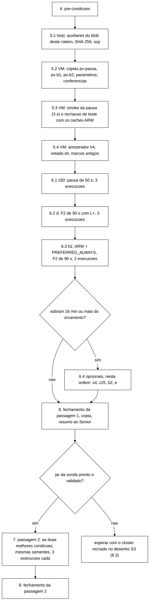

# Roteiro de VM do piloto exploratório de geração de violações de invariante de sessão (Senior, 2026-11-06)

> Para o coordenador. O objetivo é um só: achar um ponto de operação em que o sistema **sem** controlador viola I1, I4
> ou I2 classificada REAL com frequência útil. O controlador fica em `shadow` em todas as execuções, e nenhum efeito
> dele é medido nem olhado. O ponto escolhido vira depois pré-registro de recalibração e avaliação, e o piloto é
> relatado como etapa de seleção (seção 11). São duas passagens: a 1ª com o *jar* atual (`b6cf9227…`, o da
> calibração), para rodar já; a 2ª com o *jar* da sonda de *replay* (Worker, previsão de 1,5 a 2 h), repetindo as duas
> melhores condições da 1ª.
>
> Fontes lidas: diagnóstico da calibração (`scratchpad/diag-v/relatorio.md`, outro Senior, 06/11); brutos do X-18
> (`dados-vm/cs3-2026-11/x18-20261106T050100Z/`); orquestrador `scripts/run-campanha-s3.sh` e `campanha_s3_conferir.py`
> na ponta `1f65a02` (a do *bundle* já extraído na VM, `~/cs3/cs3-1f65a02`); `inject-partition.sh`,
> `inject-netdegrade.sh` e `cria-caches.sh`; `Cli.java`, `S3Parametros.java`, `WorkloadMain.java` e
> `VarreduraFinal.java` do *jar*; roteiro X-17/X-18 (`roteiro-x17-calibracao-2026-11-05.md`, com `recriar-cs3.sh` e
> `supervisor-cs3.sh`); teste de pausa do `wt-w2a` (`runs/b44-2/integracao/I2-pausa-async-*`).
>
> Conferido no *host*, sem VM: `--dry-run` do orquestrador (exit 0) com a matriz e os parâmetros da condição c50 e a
> referência inerte ASYNC, pela própria função `prepara_cond` do `piloto-vars.sh`; `--dry-run` do programa (Java 17,
> *jar* `b6cf9227…`) com `--sweep` e as cinco opções da carga L+ (exit 0, "configuracao OK"); `bash -n` dos três
> *scripts* e execução dos dois Python; os quatro arquivos de parâmetros passam no `campanha_s3_conferir.py
> parametros`; os quatro JSON de *cache* variantes são JSON válido com o `partition-handling` esperado; o
> `inject-pausa.sh` contra um `podman` falso (pausa e volta; sinal no meio, com `unpause` pelo *trap* e marcador
> `end`; `--heal`; nó inválido, exit 2; nó parado, exit 4); o `java-piloto.sh` contra um `java` falso (opções no fim
> só com `-jar`, `-version` sem mudança, linha de log sem a senha); o `piloto-resumo.py` sobre os brutos do X-18 (0 V
> em 27) e sobre a pausa r2 do `wt-w2a` (11 I2 REAL em 1 chave; 4 I5 fora de V). Os SHA-256 das seções 5 e 9 foram
> calculados aqui. **Não conferido sem VM:** `podman pause` no Podman *rootful* da VM (5.3 faz o *smoke*) e a leitura
> de volta byte a byte dos *caches* ARW pelo servidor 15.0.21 (5.3 faz a recriação de teste e tem o contorno).

## Siglas

| Sigla | Significado |
|---|---|
| V | desfecho da DT-002: I1 + I4 + I2 classificada REAL, contadas no `violacoes-rep-001.csv` (auditor *online*) |
| V-varr | achados REAL do `--sweep` (`varredura-rep-001.csv`): I1, I4, I2 e I2-PERDIDO. Se entram em V é decisão do Gestor (G-1) |
| zumbi | nó que volta de uma pausa com a vista antiga de 3 membros, sem DEGRADED, e serve leitura e escrita até a fusão (diagnóstico, seção 6) |
| L+ | carga com mais escritas: `--s3-users 40 --s3-think-ms 500 --s3-session-median-sec 10 --s3-logout-prob 0.9 --s3-admin-mean-sec 5` |
| ARW | `when-split="ALLOW_READ_WRITES"` |
| pv-* | cópias do *bundle* `cs3-1f65a02` em `~/piloto/`, cada uma com uma única diferença (5.2) |
| orçamento | 1h30 de VM contadas do primeiro GO da passagem 1 |

## 0. Visão geral



**Como rodar os blocos.** Como no roteiro X-17/X-18: blocos **host** no Git Bash; blocos **VM** inteiros pela
entrada padrão com a função `vm` (`sed 's/\r$//' | ssh ... 'bash -s'`), sem CR e sem o texto na linha de comando de
nenhum processo da VM. Todo bloco VM do piloto começa com `source ~/cs3-infra/vars.sh; source ~/piloto/piloto-vars.sh`.
Nunca `pkill -f`; para parar, `tmux send-keys -t cs3:orq C-c` ou `kill <PID>` do processo certo.

## 1. O que o diagnóstico muda no desenho

O diagnóstico de 06/11 achou dois mecanismos, e eles explicam o zero da calibração:

1. **M1 latente na F2.** Na janela não detectada (42 a 46 s), o `isn3` isolado confirma escrita quando é o dono
   primário da chave. A réplica assíncrona para o backup da maioria se perde, e a fusão com `PREFERRED_NON_NULL` fica
   com o valor da maioria. Foram 3 logouts assim nas 5 ASYNC-F2 (~0,6 por execução). **Ninguém leu essas sessões
   depois**: o "voltar" revalida por 10 s e sempre no mesmo nó, e o `--sweep` não estava ligado em nenhuma execução.
2. **Zumbi na pausa.** O `isn3` congelado acima do FD_ALL3 volta com a vista antiga e serve por ~40 s até a fusão. Uma
   sessão criada só do lado do zumbi sobrevive à fusão como VALID enquanto a identidade fica BLOCKED pela maioria. O
   próprio usuário continua usando a sessão, e isso deu 11 I2 REAL (1 chave) na r2 do `wt-w2a`.

Na F4 não houve vista nova nem fusão, e o M1 não ocorre ali.

### 1.1 Como o `--sweep` classifica um logout perdido

Lido em `VarreduraFinal.varrer`, chamada por `WorkloadMain.executarVarredura` depois da convergência, só com
`--sweep`. A varredura lê **todas** as chaves dos dois *caches* do perfil pelo cliente *topology-aware* e confronta
cada sid com invalidação confirmada pelo cliente (o mapa `invalidacoesConfirmadasSnapshot`, que no S3 junta o Logout e
a cascata de todos os atores; `executarS3` devolve esse fornecedor):

| Estado lido no fim | Achado | Arquivo |
|---|---|---|
| sid ausente (`null`) | nenhum: a sid é pulada | |
| VALID | **I1, REAL** ("invalidacao confirmada (LOGOUT) e a sessao esta VALID") | `varredura-rep-001.csv` |
| INVALID com motivo diferente do confirmado | **I4, REAL** | idem |
| sessão VALID de identidade BLOCKED | I2 com a classe do bloqueio (REAL se administrativo) | idem |
| último evento confirmado da identidade é Block e ela está OPEN ou ausente | I2-PERDIDO, REAL (INCERTA se houve Unblock com erro depois) | idem |

**Logout perdido é I1 REAL da varredura, não I5.** I5 e I6 são outra coisa: divergência entre réplicas achada pelo
laço de convergência (`violacoes-rep-001.csv`, fase `pos-convergencia`), que o resumo mostra fora de V. Se a leitura
global falhar (*cache* DEGRADED), a varredura não roda e grava `varredura-rep-001.erro.txt`, nunca resultado parcial.
Ela mede perda **latente**, o estado final errado, e não exposição ao cliente; por isso o resumo separa V de V-varr.

### 1.2 Como o piloto liga o `--sweep` e a carga L+ sem mexer no orquestrador

O orquestrador monta a linha do programa com `"${JAVA_CMD[@]}" -jar <jar> ...` e lê `JAVA` do ambiente
(`read -r -a JAVA_CMD <<< "${JAVA}"`, linha 117). Com `JAVA=~/piloto/java-piloto.sh`, o *wrapper* (9.2) põe as opções
de `PILOTO_EXTRA` no fim da linha. O picocli aceita opções em qualquer ordem, e nenhuma delas é passada pelo
orquestrador, então não há opção repetida. O pré-voo da fase roda o `--dry-run` do programa por perfil pelo mesmo
`JAVA` (`calibracao/dry-run-shadow-async.txt`), o que valida as opções na VM antes da primeira carga. Os `varredura-*.csv` saem no `.scratch`, e o orquestrador já move tudo
dele para a pasta da execução (linha 1393). O `execucao.json` registra o caminho do *wrapper* no comando; as opções
extras ficam no `cmd-<cond>.sh` e no `runs/<cond>-java.log`.

## 2. Condições

### 2.1 Todas as candidatas

| Cond. | O que é | Código novo no *jar*? | Como entra sem mudar o orquestrador | Chance de V | Custo extra |
|---|---|---|---|---|---|
| **c50** (C) | `podman pause` do `isn3` por 50 s, acima do FD_ALL3 (~41 s): o zumbi | não | cópia `pv-pausa` com o `inject-pausa.sh` (9.1) no lugar do `inject-partition.sh`, mesma interface: o orquestrador dispara na célula F2 a +49 s da âncora, arma o *dead-man* (`--heal` = `unpause`, em 50 + 90 s) e grava os marcadores | alta: mecanismo observado (I2 REAL na r2) | o injetor, já testado |
| **c25** (C) | pausa de 25 s, abaixo do FD_ALL3 | não | idem, `f2_dur_s = 25` | baixa: sem vista nova não há fusão nem zumbi; serve de controle negativo | nenhum |
| **d** (D) | F2 atual (DENY, 90 s) com L+ | não | `JAVA` = *wrapper* com L+ | média: ~4 vezes mais logouts confirmados pelo `isn3` na janela (13 usuários presos a ele em vez de 6, cada um com o dobro de páginas e sessões mais curtas), lidos pelo `--sweep` como I1 REAL | nenhum |
| **b1** (B) | ARW + `PREFERRED_ALWAYS` nos *caches* `-async`, F2 de 90 s | não (só o JSON criado pela REST) | cópia `pv-b1` com os dois JSON trocados; o orquestrador recria os *caches* dela antes de cada execução | alta: o `isn3` fica ~96 s sozinho servindo leitura e escrita (da detecção à fusão); Block confirmado na maioria e sessão VALID lida no `isn3` dão I2; os logouts do `isn3` se perdem na fusão (I1 no `--sweep`) | recriação de teste (5.3); risco da leitura de volta byte a byte |
| **b2** (B) | ARW + `REMOVE_ALL`, F2 de 90 s | não | cópia `pv-b2` | média: a fusão apaga as chaves em conflito (sessão ausente é pulada pela varredura), mas apagar um BLOCKED dá I2-PERDIDO | idem |
| **cd** | c50 com L+ | não | `pv-pausa` + *wrapper* com L+ | alta: 3 vezes mais Blocks e o dobro de usuários no `isn3` durante os ~40 s de zumbi | nenhum |
| **e** (E) | F4 com 99,9 % de perda só na saída do `isn3` (`f4_severidade = N5`, `f4_direcao = out`) | não | só o arquivo de parâmetros (o `inject-netdegrade.sh` faz `--direction out|in` e N5 = 99,9 %) | baixa: o JGroups usa TCP, e os ACK do `isn3` vão pelo sentido cortado, então a perda de um sentido trava os dois fluxos e vira uma partição quase simétrica, mais lenta (raciocínio, não medido); o `inject-partition.sh` não tem modo assimétrico | nenhum |
| **(A)** | sonda de *replay*: `Validate` da sid antiga por outro servidor de aplicação 1 a 3 s depois do logout, e de novo depois da fusão (cenário de NIST/OWASP) | **sim** | — | alta como instrumento: o *replay* cruzado dentro da janela já lê o backup VALID da maioria | em implementação pelo Worker (1,5 a 2 h); entra na passagem 2 (seção 7) |

`NONE` como *merge-policy* fica fora: sem resolução de conflito, as réplicas continuam divergentes depois da fusão, a
convergência não fecha (censura em toda execução) e a varredura lê o valor do dono que responder.

### 2.2 O que cada *merge-policy* faz (Infinispan 15)

Descrição segundo o guia de configuração do Infinispan 15 (*Configuring Infinispan caches*, seção de *partition
handling*, já citado na monografia como `infinispan_configuring_15`, seção 7) e a leitura do código registrada em
`configuracao-infinispan.md` e no `registro-de-problemas.md`. **Sem acesso à web nesta sessão: o
Bibliotecário confere o texto e a seção exata antes de qualquer uso na monografia.**

| Política | Na fusão, para cada chave em conflito |
|---|---|
| `PREFERRED_NON_NULL` (atual) | vale o valor da partição preferida (na prática, a maior, aqui a maioria); se ele for nulo, o primeiro não nulo das outras |
| `PREFERRED_ALWAYS` | vale sempre o valor da partição preferida, mesmo nulo: as escritas do lado menor se perdem, e as chaves criadas só nele somem |
| `REMOVE_ALL` | a chave é removida de todos os nós |
| `NONE` | não há resolução: cada dono fica com o seu valor (o guia dá `NONE` como padrão da *merge-policy* e `ALLOW_READ_WRITES` como padrão do `when-split`; a conferir pelo Bibliotecário) |

Com `ALLOW_READ_WRITES`, as duas partições seguem disponíveis e independentes depois da detecção. O código do 15.0.21
(registro de problemas, achado da leitura de `PartitionHandlingConfiguration`) resolve conflito na fusão sempre que a
*merge-policy* não é `NONE`, independentemente do `when-split`.

### 2.3 Matriz do piloto

Todas as execuções: ASYNC, braço A, controlador `shadow`, 300 s, `isn3` como alvo, injeção a +49 s da âncora,
`--sweep`, convergência censurada em 240 s (`exec_teto_s` = 660). Sementes novas por condição (610 000 + 100·i a
670 000 + 100·i), para não repetir as da calibração.

| Ordem | Cond. | *Bundle* | Parâmetros | Célula | Execuções | Sementes | Opções extras | Matriz (SHA-256) |
|---|---|---|---|---|---|---|---|---|
| 1 | c50 | `pv-pausa` | `piloto-c50.json` | ASYNC-F2 (= pausa) | 3 | 610000, 610100, 610200 | `--sweep` | `c1870853…` |
| 2 | d | `$CS3` | `piloto-f2.json` | ASYNC-F2 | 3 | 620000.. | `--sweep` + L+ | `5b1a63ad…` |
| 3 | b1 | `pv-b1` | `piloto-f2.json` | ASYNC-F2 | 2 | 630000.. | `--sweep` | `753c7b98…` |
| 4 (opc.) | cd | `pv-pausa` | `piloto-c50.json` | ASYNC-F2 (= pausa) | 2 | 640000.. | `--sweep` + L+ | `5abf9ccf…` |
| 5 (opc.) | c25 | `pv-pausa` | `piloto-c25.json` | ASYNC-F2 (= pausa) | 2 | 650000.. | `--sweep` | `2cdc7d8b…` |
| 6 (opc.) | b2 | `pv-b2` | `piloto-f2.json` | ASYNC-F2 | 2 | 660000.. | `--sweep` | `afd9fb31…` |
| 7 (opc.) | e | `$CS3` | `piloto-e.json` | ASYNC-F4 | 2 | 670000.. | `--sweep` | `23a91d30…` |

A ordem segue a do coordenador (C, D, B; E só se sobrar tempo). Entre as opcionais, cd vem primeiro porque combina os
dois mecanismos de maior chance; c25 é o controle negativo da pausa; e fica por último pela razão da 2.1.

## 3. Por que estes números

| Número | Valor | Origem |
|---|---|---|
| pausa longa | 50 s | acima de FD_ALL3 40 s + VERIFY_SUSPECT2 1 s + instalação da vista (janela medida de 42 a 46 s na calibração); 52 s no teste do `wt-w2a` |
| pausa curta | 25 s | abaixo da detecção, com folga de ~15 s |
| F2 | 90 s | a da calibração (`f2_dur_s`) |
| `convergencia_teto_s` | 240 s | censura para caber no orçamento; todas as aceitas do X-18 convergiram, mas a pausa deixou divergência persistente (I5) no `wt-w2a`, e com 600 s cada execução assim custaria ~16 min |
| `exec_teto_s` | 660 s | ≥ 300 + 21 + 60 + 240 + 5 = 626 (regra do `campanha_s3_conferir.py`) |
| L+ `--s3-users 40` | 40 | o usuário `s3-u-NNN` fica preso ao nó NNN mod 3: 13 no `isn3` em vez de 6 |
| L+ `--s3-think-ms 500` | 500 ms | o dobro de páginas por usuário (padrão 1000) |
| L+ `--s3-session-median-sec 10` | 10 s | o dobro de sessões, e de logouts, por unidade de tempo (padrão 20) |
| L+ `--s3-logout-prob 0.9` | 0,9 | +29 % de logouts por sessão (padrão 0,7) |
| L+ `--s3-admin-mean-sec 5` | 5 s | 3 vezes mais Blocks administrativos (padrão 15), que alimentam o I2 do zumbi e do ARW |
| execuções por condição | 2 a 3 | pedido do coordenador; 3 nas de maior chance |

Tempo: ~6 min 40 s por execução no X-18 (recriação ~20 s, K1 ~60 s, carga 300 s, fim ~20 s). Com a convergência
censurada, o pior caso fica em ~11 min. Passagem 1 principal: 8 execuções, ~55 a 60 min, mais ~10 min de preparo e
~3 min por lançamento: **~75 a 80 min**. Cada opcional custa ~15 a 16 min.

## 4. Pré-condições

| # | Item | Como conferir |
|---|---|---|
| P-1 | Autorização do Gestor para o piloto (pedido de 06/11), com GO pelo supervisor | o coordenador registra no diário |
| P-2 | Nenhuma fase do S3 ou do *rebaseline* em curso; lock livre; 0 *timers* `tcc-heal*`; 0 *units* `tcc-amostrador-*` | bloco 5.2 |
| P-3 | Brutos do X-18 já no *host* e conferidos (entregues ao W-9 em 06/11) | `ENTREGA-W9.txt` |
| P-4 | Perfil do *host* H0 durante as execuções (como no X-18) e H2 só no 5.1 e no 8.2 | `HOST-PERFIL.txt` |
| P-5 | Disco: livre ≥ 1,5 × 25 execuções × 14 MiB ≈ 525 MiB na VM | `df -Pm` no 5.2 |

## 5. Preparo

### 5.1 Host: auxiliares (H2; ~3 min)

```bash
# host, Git Bash
TCC=/c/Users/Francesco/Development/tcc
VMIP=${VMIP:?defina VMIP com o IP atual da VM (Get-NetNeighbor, plano continuo 3.2)}
SSHO=(-o BatchMode=yes -o HostKeyAlias=172.18.251.140 -i "$HOME/.ssh/id_ed25519_tccf3")
vm() { sed 's/\r$//' | ssh "${SSHO[@]}" "server1@$VMIP" 'bash -s'; }
R="docs/plano-implementacao-controlador:docs/roteiro-piloto-violacoes-2026-11-06.md"
D=$TCC/dados-vm/piloto-2026-11-06/aux; mkdir -p "$D"
extrair() { git -C $TCC/wt-plano-ctrl show "$R" | awk -v m="<!-- arquivo: $1 -->" '$0 == m {f = 1; next} f == 1 && /^```/ {f = 2; next} f == 2 && /^```$/ {exit} f == 2 {print}'; }
for f in inject-pausa.sh java-piloto.sh piloto-resumo.py piloto-param.py piloto-vars.sh; do extrair "$f" > "$D/$f"; done
(cd "$D" && sha256sum * | sed 's/ \*/  /' > ../aux.sha256 && cat ../aux.sha256)   # igual a tabela da secao 9
scp "${SSHO[@]}" -r "$D" "server1@$VMIP:piloto-aux"
scp "${SSHO[@]}" "$D/../aux.sha256" "server1@$VMIP:piloto-aux.sha256"
```

### 5.2 VM: cópias do *bundle*, parâmetros e conferências (~5 min)

```bash
# VM
source ~/cs3-infra/vars.sh
flock -n /var/lock/tcc-vm.lock true && echo "lock livre" || echo "LOCK OCUPADO: parar"
pgrep -af 'run-rebaseline|run-campanha-s3|supervisor-|session-workload|inject-' || echo "nenhum processo residual"
systemctl list-timers --all --no-legend 'tcc-heal*' | grep -c .        # 0
systemctl list-units --all --no-legend 'tcc-amostrador-*' | grep -c .  # 0
(cd ~/piloto-aux && sha256sum -c ../piloto-aux.sha256)                 # 5 OK
test ! -e ~/piloto || { echo "~/piloto ja existe: PARAR (nao sobrescrever)"; exit 1; }
mkdir -p ~/piloto/entrada ~/piloto/runs ~/piloto/tmp
cp ~/piloto-aux/* ~/piloto/; chmod +x ~/piloto/*.sh
grep -lI $'\r' ~/piloto/*.sh ~/piloto/*.py || echo "sem CR"
# tres copias do bundle, sem runs nem target (o jar e os arquivos de entrada sao os de $CS3, por caminho absoluto)
for v in pausa b1 b2; do
  tar -C ~/cs3 --exclude="cs3-$S7/runs" --exclude="cs3-$S7/workload/target" -cf - "cs3-$S7" | tar -C ~/piloto/tmp -xf -
  mv ~/piloto/tmp/cs3-$S7 ~/piloto/pv-$v
done
rmdir ~/piloto/tmp
cp ~/piloto/inject-pausa.sh ~/piloto/pv-pausa/scripts/inject-partition.sh
for c in sessions-async counters-async; do
  sed -i 's/"when-split":"DENY_READ_WRITES","merge-policy":"PREFERRED_NON_NULL"/"when-split":"ALLOW_READ_WRITES","merge-policy":"PREFERRED_ALWAYS"/' ~/piloto/pv-b1/cluster/caches/$c.json
  sed -i 's/"when-split":"DENY_READ_WRITES","merge-policy":"PREFERRED_NON_NULL"/"when-split":"ALLOW_READ_WRITES","merge-policy":"REMOVE_ALL"/' ~/piloto/pv-b2/cluster/caches/$c.json
done
(cd ~/piloto && sha256sum pv-b1/cluster/caches/*-async.json pv-b2/cluster/caches/*-async.json)   # tabela 9.6
diff -rq $CS3/scripts ~/piloto/pv-pausa/scripts    # so inject-partition.sh
diff -rq $CS3/cluster ~/piloto/pv-b1/cluster        # so sessions-async.json e counters-async.json
diff -rq $CS3/cluster ~/piloto/pv-b2/cluster        # idem
diff -rq $CS3/scripts ~/piloto/pv-b1/scripts && echo "pv-b1 scripts iguais"
# parametros (base: o da calibracao, PCAL = cfd5fa6a...)
cd ~/piloto/entrada
python3 -I ~/piloto/piloto-param.py $PCAL piloto-c50.json "piloto-violacoes 06/11: pausa de 50 s (c50, cd)" f2_dur_s=50 convergencia_teto_s=240 exec_teto_s=660
python3 -I ~/piloto/piloto-param.py $PCAL piloto-c25.json "piloto-violacoes 06/11: pausa de 25 s (c25)" f2_dur_s=25 convergencia_teto_s=240 exec_teto_s=660
python3 -I ~/piloto/piloto-param.py $PCAL piloto-f2.json "piloto-violacoes 06/11: F2 de 90 s (d, b1, b2)" convergencia_teto_s=240 exec_teto_s=660
python3 -I ~/piloto/piloto-param.py $PCAL piloto-e.json "piloto-violacoes 06/11: F4 N5 de saida (e)" f4_severidade=N5 convergencia_teto_s=240 exec_teto_s=660
for f in piloto-c50.json piloto-c25.json piloto-f2.json piloto-e.json; do
  python3 -I $CS3/scripts/campanha_s3_conferir.py parametros --arquivo $f --t-enc-pior-s 21 > /dev/null && sha256sum $f
done                                                                    # 4 linhas, iguais a tabela 9.6
df -Pm ~/piloto | tail -1                                               # livre >= 525 MiB
```

### 5.3 VM: *smoke* da pausa e recriação de teste com os *caches* ARW (~4 min)

O *cluster* que está de pé é o da última recriação do X-18; o orquestrador recria antes de cada execução, então os
dois testes abaixo não deixam efeito.

```bash
# VM
source ~/cs3-infra/vars.sh; source ~/piloto/piloto-vars.sh
TS=$(date -u +%Y%m%dT%H%M%SZ)
flock -n /var/lock/tcc-vm.lock env PODMAN="sudo podman" bash ~/piloto/inject-pausa.sh --minority isn3 --duration 3 --marker ~/piloto/smoke-pausa-$TS.txt; echo "pausa rc=$?"
cat ~/piloto/smoke-pausa-$TS.txt; sudo podman inspect -f '{{.Name}} {{.State.Status}}' isn1 isn2 isn3
flock -n /var/lock/tcc-vm.lock bash ~/cs3-infra/recriar-cs3.sh ~/piloto/pv-b1 ~/piloto/recriacao-b1-$TS; echo "recriar b1 rc=$?"
grep -E 'cria-caches|FALHA|RECRIAR' ~/piloto/recriacao-b1-$TS/conferencia.txt
```

Esperado: `pausa rc=0`, as linhas "OK: isn3 pausado por 3 s" e "OK: isn3 de volta (running)", o arquivo com o
comentário `# pausa` e os marcadores `start` e `end`, os três nós `running`; `recriar b1 rc=0` com
`cria-caches rc=0 (6 POST, 18 GET)` e `RECRIAR-CS3 OK`.

**Se a pausa falhar** (`pause rc` diferente de 0, ou estado diferente de `paused`): sem c50, cd e c25; seguir com d e
b1 e avisar o Senior. Conferir `sudo podman unpause isn3` se o nó ficou `paused`.

**Se a recriação do b1 falhar só na leitura de volta** (`cria-caches rc=4`, com o diff no `caches.err`): o servidor
devolveu o JSON numa forma diferente da do arquivo. Gravar a forma do servidor e recriar de novo:

```bash
# VM, so neste caso
source ~/cs3-infra/vars.sh; TS=$(date -u +%Y%m%dT%H%M%SZ)
P=$(sed -n 's/^ *- PASS=//p' ~/piloto/pv-b1/cluster/podman-compose-sem-caches.yml | head -1)
for c in sessions-async counters-async; do
  printf 'user = "admin:%s"\n' "$P" | curl -s -m 5 --digest -K - "http://127.0.0.1:11222/rest/v2/caches/$c?action=config" > ~/piloto/srv-b1-$c.json
  cat ~/piloto/srv-b1-$c.json; echo
done
# so seguir se o merge-policy lido for PREFERRED_ALWAYS (o when-split pode faltar se o servidor omitir o padrao)
for c in sessions-async counters-async; do
  cp -p ~/piloto/pv-b1/cluster/caches/$c.json ~/piloto/pv-b1-$c.json.orig
  { sed -e "s/^{\"$c\"://" -e 's/}$//' ~/piloto/srv-b1-$c.json; echo; } > ~/piloto/pv-b1/cluster/caches/$c.json
done
flock -n /var/lock/tcc-vm.lock bash ~/cs3-infra/recriar-cs3.sh ~/piloto/pv-b1 ~/piloto/recriacao-b1b-$TS; echo "recriar b1 rc=$?"
```

Com a segunda falha, b1 e b2 saem do piloto (registrar no diário) e o Senior olha o `caches.err`. Para b2 vale o
mesmo contorno, com `REMOVE_ALL`, antes da execução dela.

### 5.4 VM: amostrador h4, estado e marcos antigos (~2 min)

```bash
# VM
source ~/cs3-infra/vars.sh; cd $CS3
H4P=diag-$(date -u +%Y%m%dT%H%M%SZ)
printf 'H4P=%s\nBOOTP=%s\n' "$H4P" "$(cat /proc/sys/kernel/random/boot_id)" > ~/piloto/estado.sh
bash scripts/amostrador-infra.sh iniciar --id $H4P --espelho-dir ~/piloto/$H4P
bash scripts/amostrador-infra.sh estado --id $H4P
sudo install -d -m 0755 -o "$(id -un)" -g "$(id -gn)" /run/tccdiag/coord-cs3
# os marcos FIM-* do X-18 saem do caminho do supervisor (ja estao no host, ENTREGA-W9)
mkdir -p ~/cs3-infra/marcos-x18 && mv ~/cs3-infra/FIM-*-OK ~/cs3-infra/marcos-x18/ 2>/dev/null; ls ~/cs3-infra | grep -E '^(FIM|ALERTA)-' || echo "sem marcos"
date -Is > ~/piloto/abertura-iso.txt
source ~/rebaseline-infra/bloco.sh; bloco ~/piloto/inicio-$(date -u +%Y%m%dT%H%M%SZ).txt > /dev/null
```

## 6. Passagem 1

### 6.0 Ciclo de cada condição

Cada condição é uma invocação do orquestrador, fase `calibracao` (só braço A, `shadow`), com a sua saída em
`~/piloto/runs/<cond>`. O supervisor do X-18 (`~/cs3-infra/supervisor-cs3.sh`) dá os dois GO (`go calibracao
<data>` e `go rede 0`), recria o *cluster* da cópia certa se o *swap* passar de 1 GiB no K1 e grava o marco de fim.

```bash
# VM: preparar e lancar (trocar c50 pela condicao da vez)
source ~/cs3-infra/vars.sh; source ~/piloto/piloto-vars.sh
prepara_cond c50          # imprime bundle, parametros, matriz e extras; DRY-RUN ... e PLANO execucoes=3
lancar_piloto c50
sleep 30; cat ~/cs3-infra/supervisor-calibracao-*.log | tail -n 4
```

Esperado no `prepara_cond`: a linha `cond=...` com os SHA-256 da tabela 2.3 e da 9.6, `DRY-RUN fase=calibracao
... (SHA-256 confere)`, `DRY-RUN perfis da fase: async` e `PLANO execucoes=<n>`; nenhuma linha `Erro`. No
supervisor: `GO enviado: go calibracao <data>` e, ~1 min 30 s depois, `GO enviado: go rede 0`.

```bash
# VM: acompanhamento (so leitura, a cada 5 a 10 min)
source ~/cs3-infra/vars.sh; source ~/piloto/piloto-vars.sh
estado_cond c50
```

No meio de uma pausa, `estado_cond` mostra o `isn3` como `paused` e um *timer* `tcc-heal-cs-<i>`; fora dela, os três
`running` e 0 *timers*. Na F2 do d e do b1, o *timer* aparece durante os 90 s.

```bash
# VM: fechar a condicao, depois do "FIM exit=0 motivo=fase calibracao concluida" (ou de um ALERTA-FIM)
source ~/cs3-infra/vars.sh; source ~/piloto/piloto-vars.sh
fecha_cond c50            # move o marco, confere os MANIFEST e imprime o resumo da condicao (9.3)
```

Depois de cada condição, anotar no `~/piloto/diario.txt` (o `lancar_piloto` e o `fecha_cond` já gravam as horas) o
tempo gasto do orçamento e a linha agregada do resumo.

### 6.1 a 6.3 Condições principais

Em sequência, com o ciclo da 6.0: **c50**, depois **d**, depois **b1**. Nenhuma depende do resultado da anterior.

Particularidades:

- **c50**: o `injetor.log` de cada execução tem as linhas do `inject-pausa.sh`; o `marcadores.txt` tem a linha
  `# pausa ...` antes do `start`. O orquestrador chama a célula de F2 (diretórios `exec-000i-ASYNC-F2-A`): nesta
  saída, F2 quer dizer pausa. O *dead-man* dá `unpause` em 140 s se o injetor morrer.
- **d**: `runs/d-java.log` tem uma linha por chamada do programa (a do `--dry-run` da fase e uma por execução) com
  `extra=--sweep --s3-users 40 ...`.
- **b1**: antes do lançamento, `prepara_cond b1` imprime o *bundle* `pv-b1`; o `caches.tsv` de cada execução mostra
  os seis POST, e a leitura de volta passa só se os JSON da cópia baterem com o servidor (5.3).

### 6.4 Opcionais

Só se o orçamento deixar 16 min ou mais **depois** do fechamento da anterior, nesta ordem: **cd**, **c25**, **b2**
(antes dela, se o b1 precisou do contorno da 5.3, aplicar o mesmo ao `pv-b2`), **e**. Passou do orçamento, ir ao 8.

### 6.5 Leitura e escolha do ponto de operação

O resumo (9.3) dá, por execução, V e as chaves distintas por classe (I1, I4, I2 REAL), V-varr por classe e o que fica
fora de V (I2_CASCATA_*, I2 de outra classe, I5, I6); por condição, V por execução e execuções com V ≥ 1.

Regra de escolha, para a passagem 2 e para a proposta ao Gestor:

1. **Útil** = V ≥ 1 em pelo menos 2 execuções da condição, com ao menos 2 chaves distintas no total (11 linhas na
   mesma sessão, como na r2 do `wt-w2a`, contam como uma ocorrência).
2. Entre as úteis, a de mais execuções com V ≥ 1; empate, a de mais chaves distintas por execução; empate, a que menos
   muda o sistema (pausa e carga antes de trocar a configuração do *cluster*, ou seja, c50, d, cd antes de b1, b2).
3. Sem nenhuma útil por V, a mesma ordem com V + V-varr, marcada como "só latente" (depende da G-1).
4. As duas primeiras pela regra vão para a passagem 2.

## 7. Passagem 2 (*jar* com a sonda de *replay*)

### 7.1 Pré-condições e *jar*

- *Jar* da sonda (W-10, `wt-w10`, ponta `7c94cfb`; coordenador, 06/11):
  `wt-w10/workload/target/session-workload-0.1.0-SNAPSHOT.jar`, SHA-256
  `19f30b45fdac51ba03c91c4527d76c33e06b0bf9db06d010e78229102446b39f`. Opção: `--s3-replay-probe` (padrões
  `--s3-replay-min-sec 1 --s3-replay-max-sec 3 --s3-replay-late-max 200`): *replay* imediato pelo nó k+1 de 1 a 3 s
  depois de cada logout e *replay* tardio no fim da carga. As violações que ela revela saem com `origem=sonda` (coluna
  nova do `violacoes-rep-001.csv`), e o resumo (9.3) conta essas à parte, como V-sonda, com as chaves distintas.
- O *jar* entra pelo `--jar` do orquestrador (`JAR2`), conferido pelo SHA-256; o `java-piloto.sh` só acrescenta as
  opções. O pré-voo da fase roda o `--dry-run` do programa com elas.

```bash
# host (H2)
TCC=/c/Users/Francesco/Development/tcc; J=$TCC/wt-w10/workload/target/session-workload-0.1.0-SNAPSHOT.jar
sha256sum "$J" | cut -c1-64      # 19f30b45fdac51ba03c91c4527d76c33e06b0bf9db06d010e78229102446b39f
ssh "${SSHO[@]}" "server1@$VMIP" 'mkdir -p ~/piloto/jar-w10'
scp "${SSHO[@]}" "$J" "server1@$VMIP:piloto/jar-w10/"
```

```bash
# VM
cd ~/piloto/jar-w10 && echo "19f30b45fdac51ba03c91c4527d76c33e06b0bf9db06d010e78229102446b39f  session-workload-0.1.0-SNAPSHOT.jar" | sha256sum -c
printf 'JAR2=%s\nJAR2_SHA=%s\nSONDA="%s"\n' "$HOME/piloto/jar-w10/session-workload-0.1.0-SNAPSHOT.jar" \
  19f30b45fdac51ba03c91c4527d76c33e06b0bf9db06d010e78229102446b39f "--s3-replay-probe" >> ~/piloto/estado.sh
cat ~/piloto/estado.sh
```

O resumo da 9.3 foi revisto no mesmo dia para a coluna `origem` (V-sonda); a versão nova substitui a anterior em
`~/piloto/piloto-resumo.py` antes da passagem 2 (o SHA-256 da tabela 9 é o da versão nova). O teste manual do
coordenador (F2 com `--sweep`, semente 310200, `dados-vm/piloto-violacoes-2026-11-06/manual/f2-sweep-2/`) entra no
relatório como evidência ("manual-f2"), fora da contagem do piloto.

### 7.2 Execuções

As duas condições escolhidas na 6.5, cada uma como `p2-<cond>`: o mesmo *bundle*, os mesmos parâmetros e as **mesmas
sementes** da passagem 1, o *jar* novo e as opções da passagem 1 mais `SONDA`. Três execuções por condição (`P2N`, padrão 3, também
para as opcionais, que na passagem 1 têm 2). Mesmo ciclo da 6.0:

```bash
# VM (exemplo com c50)
source ~/cs3-infra/vars.sh; source ~/piloto/piloto-vars.sh
prepara_cond p2-c50; lancar_piloto p2-c50
# ... estado_cond p2-c50 ... fecha_cond p2-c50
```

As sementes iguais não reproduzem o instante das operações (a carga tem tempos reais e a fusão não é determinística);
elas só mantêm a mesma sequência de escolhas da carga. A comparação entre as passagens é descritiva, não pareada.

## 8. Fechamento

### 8.1 VM: resumo geral, amostrador e cópia (~5 min)

```bash
# VM
source ~/cs3-infra/vars.sh; source ~/piloto/piloto-vars.sh
pgrep -af 'run-campanha-s3' || echo "orquestrador parado"
systemctl list-timers --all --no-legend 'tcc-heal*' | grep -c .        # 0
sudo podman inspect -f '{{.Name}} {{.State.Status}}' isn1 isn2 isn3    # tres running (nenhum paused)
python3 -I ~/piloto/piloto-resumo.py $(ls -d $PR/*/ | grep -v -- '-marcos/') | tee ~/piloto/resumo-geral.tsv
bash $CS3/scripts/amostrador-infra.sh parar --id $H4P --espelho-dir ~/piloto/$H4P
source ~/rebaseline-infra/bloco.sh; bloco ~/piloto/fim-$(date -u +%Y%m%dT%H%M%SZ).txt "$(cat ~/piloto/abertura-iso.txt)" > /dev/null
cp -p /run/tccdiag/coord-cs3/progresso-*.log ~/piloto/ 2>/dev/null
find ~/cs3-infra -maxdepth 1 -name 'supervisor-calibracao-*.log' -newer ~/piloto/abertura-iso.txt -exec cp -p {} ~/piloto/ \;
TS=$(date -u +%Y%m%dT%H%M%SZ)
(cd ~ && tar -cf ~/piloto-$TS.tar --exclude='piloto/pv-*' --exclude='piloto/session-workload-sonda.jar' piloto)
(cd ~ && sha256sum piloto-$TS.tar > piloto-$TS.sha256 && cat piloto-$TS.sha256); echo "TS=$TS"
```

### 8.2 Host: cópia com conferência (H2)

```bash
# host. Trocar TS_DA_VM pelo TS impresso na VM.
TS=TS_DA_VM; H=$TCC/dados-vm/piloto-2026-11-06
scp "${SSHO[@]}" "server1@$VMIP:piloto-$TS.tar" "server1@$VMIP:piloto-$TS.sha256" "$H/"
(cd "$H" && sha256sum -c piloto-$TS.sha256) && mkdir -p "$H/p-$TS" && tar -C "$H/p-$TS" -xf "$H/piloto-$TS.tar"
cat "$H/p-$TS/piloto/resumo-geral.tsv"
```

O resumo geral, o diário e os resumos por condição vão ao Senior, que escreve a proposta de ponto de operação para o
Gestor (seção 11). O piloto **não** entra em nenhuma análise de efeito do controlador.

### 8.3 Deixar o *cluster* no desenho S3

Depois da última condição (e antes de qualquer fase do S3 ou do *rebaseline*), recriar com o *bundle* do S3, que tem
`DENY_READ_WRITES` + `PREFERRED_NON_NULL`:

```bash
# VM
source ~/cs3-infra/vars.sh
flock -n /var/lock/tcc-vm.lock bash ~/cs3-infra/recriar-cs3.sh $CS3 ~/piloto/recriacao-final-$(date -u +%Y%m%dT%H%M%SZ); echo "recriar rc=$?"
```

## 9. Arquivos auxiliares

Extraídos do *blob* deste roteiro pelo 5.1. SHA-256 esperados (LF, sem CR):

| Arquivo | SHA-256 |
|---|---|
| `inject-pausa.sh` | `9ebef670255f138fa27efb2256ee6cad262a70e695a14ac4d66ab8c462ad1e21` |
| `java-piloto.sh` | `15f737abc862c7ccc1fa9ae7655410e16c6e265ee520df89923ff3b8dae53831` |
| `piloto-resumo.py` | `4e60b2b3700c6f88f2135af31818fe9e6e842a9194611276d39efe2b2ee13c3b` |
| `piloto-param.py` | `16fe668f56aa2e57de2d4aa732f027218e2ed4e26f8b6030faee79bec1535a4e` |
| `piloto-vars.sh` | `e7cd3671464f334c04c225471293bc08bab062d8ba635a91a4972163e163fb4e` |

### 9.1 `inject-pausa.sh`

<!-- arquivo: inject-pausa.sh -->
```bash
#!/usr/bin/env bash
# inject-pausa.sh: injetor de PAUSA do piloto de violacoes (roteiro-piloto-violacoes-2026-11-06.md, secao 9.1).
# Tem a interface do inject-partition.sh para entrar no lugar dele numa COPIA do bundle
# (~/piloto/pv-pausa/scripts/inject-partition.sh); o bundle do S3 ($CS3) nao muda. O orquestrador chama:
#   inject-partition.sh --minority <no> --duration <s> --marker <arq>   (injecao, celula F2 da copia)
#   inject-partition.sh --heal --minority <no>                          (dead-man do systemd-run, em <s> + 90 s)
# Injecao: comentario e marcador start, "podman pause <no>", confere State.Status = paused, espera <s>,
# "podman unpause <no>", confere running, marcador end. Trap em EXIT, INT, TERM e HUP: unpause se o no ficou
# pausado e marcador end se faltou. --heal: unpause de cada no pausado. Marcadores no formato B-29
# ("fault=F2 node=<no> event=start|end t_epoch_ns=<n>"); a linha "# pausa ..." e ignorada pelo programa.
# Exit: 0 ok; 1 unpause falhou (o dead-man tenta de novo); 2 uso; 3 dependencia ausente;
#       4 no ausente ou fora de running; 6 a pausa nao se efetivou (estado diferente de paused).
set -uo pipefail
PODMAN="${PODMAN:-podman}"
read -r -a PM <<< "${PODMAN}"
MINORITY=""; DUR=""; MARKER=""; HEAL=0; DRY=0
while [[ $# -gt 0 ]]; do
    case "$1" in
        --minority) MINORITY="${2:-}"; shift 2 ;;
        --duration) DUR="${2:-}"; shift 2 ;;
        --marker) MARKER="${2:-}"; shift 2 ;;
        --heal) HEAL=1; shift ;;
        --dry-run) DRY=1; shift ;;
        --nodes|--iface) shift 2 ;;   # aceitos e ignorados (interface do inject-partition.sh)
        -h|--help) sed -n '2,13p' "$0"; exit 2 ;;
        *) echo "Erro: opcao desconhecida: $1" >&2; exit 2 ;;
    esac
done
log() { echo "[$(date -u +%FT%T.%3NZ)] inject-pausa: $*"; }
estado() { "${PM[@]}" inspect -f '{{.State.Status}}' "$1" 2>/dev/null || echo ausente; }
if [[ -n "${MINORITY}" && ! "${MINORITY}" =~ ^isn[123]$ ]]; then
    echo "Erro: --minority deve ser um unico no isn1, isn2 ou isn3: '${MINORITY}'" >&2; exit 2
fi
command -v "${PM[0]}" > /dev/null 2>&1 || { echo "Erro: '${PM[0]}' ausente" >&2; exit 3; }

if [[ "${HEAL}" -eq 1 ]]; then
    rc=0
    for n in ${MINORITY:-isn1 isn2 isn3}; do
        s="$(estado "${n}")"
        if [[ "${s}" == paused ]]; then
            if [[ "${DRY}" -eq 1 ]]; then log "dry-run: unpause ${n}"; continue; fi
            if "${PM[@]}" unpause "${n}" > /dev/null; then log "heal: ${n} unpause ($(estado "${n}"))"
            else log "heal: unpause de ${n} falhou"; rc=1; fi
        else
            log "heal: ${n} em '${s}', nada a fazer"
        fi
    done
    exit "${rc}"
fi

[[ -n "${MINORITY}" ]] || { echo "Erro: falta --minority" >&2; exit 2; }
[[ "${DUR}" =~ ^[1-9][0-9]*$ ]] || { echo "Erro: --duration deve ser inteiro > 0: '${DUR}'" >&2; exit 2; }
if [[ "${DRY}" -eq 1 ]]; then
    log "dry-run: pause ${MINORITY}; espera ${DUR} s; unpause ${MINORITY}; marcador ${MARKER:-nenhum}"; exit 0
fi
s="$(estado "${MINORITY}")"
[[ "${s}" == running ]] || { log "no ${MINORITY} em '${s}' (esperado running)"; exit 4; }

PAUSADO=0; INICIO=0; FIM=0
marca() {
    [[ -z "${MARKER}" ]] && return 0
    echo "fault=F2 node=${MINORITY} event=$1 t_epoch_ns=$(date +%s%N)" >> "${MARKER}" 2>/dev/null || true
}
limpar() {
    if [[ "${PAUSADO}" -eq 1 && "$(estado "${MINORITY}")" == paused ]]; then
        if "${PM[@]}" unpause "${MINORITY}" > /dev/null; then log "trap: ${MINORITY} unpause"
        else log "trap: unpause de ${MINORITY} falhou (o dead-man tenta de novo)"; fi
    fi
    if [[ "${INICIO}" -eq 1 && "${FIM}" -eq 0 ]]; then marca end; FIM=1; fi
}
trap limpar EXIT
trap 'log "sinal recebido"; exit 130' INT TERM HUP

[[ -z "${MARKER}" ]] || echo "# pausa (inject-pausa.sh, piloto 2026-11-06): F2 desta copia = podman pause de ${MINORITY} por ${DUR} s" >> "${MARKER}"
marca start; INICIO=1
if ! "${PM[@]}" pause "${MINORITY}" > /dev/null; then log "podman pause ${MINORITY} falhou"; exit 6; fi
PAUSADO=1
s="$(estado "${MINORITY}")"
[[ "${s}" == paused ]] || { log "estado de ${MINORITY} depois do pause: '${s}' (esperado paused)"; exit 6; }
log "OK: ${MINORITY} pausado por ${DUR} s"
sleep "${DUR}" &
wait $!
if ! "${PM[@]}" unpause "${MINORITY}" > /dev/null; then log "podman unpause ${MINORITY} falhou"; exit 1; fi
PAUSADO=0
s="$(estado "${MINORITY}")"
marca end; FIM=1
[[ "${s}" == running ]] || { log "estado de ${MINORITY} depois do unpause: '${s}' (esperado running)"; exit 1; }
log "OK: ${MINORITY} de volta (running) depois de ${DUR} s"
exit 0
```

### 9.2 `java-piloto.sh`

<!-- arquivo: java-piloto.sh -->
```bash
#!/bin/bash
# java-piloto.sh: acrescenta as opcoes do piloto (PILOTO_EXTRA) a linha do programa de carga montada pelo
# run-campanha-s3.sh, sem mudar o orquestrador (roteiro-piloto-violacoes-2026-11-06.md, secao 9.2). O orquestrador
# roda "${JAVA_CMD[@]}" -jar <jar> ...; com JAVA=<este arquivo>, as opcoes vao no fim da linha (o picocli aceita
# opcoes em qualquer ordem; nenhuma delas e passada pelo orquestrador, entao nao ha opcao repetida). Outras chamadas
# (java -version) passam sem mudanca. Cada chamada com -jar grava uma linha em PILOTO_LOG (sem a senha).
if [ "${1:-}" = "-jar" ] && [ -n "${PILOTO_EXTRA:-}" ]; then
    read -r -a extra <<< "${PILOTO_EXTRA}"
    if [ -n "${PILOTO_LOG:-}" ]; then
        seed=""; prev=""; dry=nao
        for a in "$@"; do [ "$prev" = "--seed" ] && seed="$a"; [ "$a" = "--dry-run" ] && dry=sim; prev="$a"; done
        echo "$(date -u +%FT%TZ) pid=$$ seed=${seed:-?} dry_run=${dry} extra=${PILOTO_EXTRA}" >> "${PILOTO_LOG}"
    fi
    exec java "$@" "${extra[@]}"
fi
exec java "$@"
```

### 9.3 `piloto-resumo.py`

<!-- arquivo: piloto-resumo.py -->
```python
#!/usr/bin/env python3
"""piloto-resumo.py <saida> [<saida> ...]: violacoes por execucao e por classe no piloto de 06/11
(roteiro-piloto-violacoes-2026-11-06.md, secao 9.3). Uma linha TSV por execucao e um agregado por saida.
<saida> e uma pasta com exec-*/ (saida do orquestrador) ou a pasta de uma execucao so (com violacoes-rep-001.csv).

V online (DT-002): I1 e I4 de violacoes-rep-001.csv (qualquer classificacao) + I2 com classificacao REAL, sem origem.
V sonda (W-10, coluna origem = sonda): as mesmas classes reveladas pela sonda de replay, contadas a parte.
V varredura (--sweep, VarreduraFinal): achados REAL de varredura-rep-001.csv por invariante (I1, I4, I2,
I2-PERDIDO); contados a parte como V-latente (decisao G-1 do coordenador, 06/11). Fora de V, so contexto:
I2_CASCATA_INCOMPLETA, I2_JANELA_CASCATA, I2 de outra classe, I5 e I6. 'chaves' = chaves distintas."""
import csv, glob, json, os, sys
from collections import Counter

def ler_csv(p):
    if not os.path.isfile(p):
        return None
    with open(p, newline="", encoding="utf-8") as f:
        return list(csv.DictReader(f))

def ehv(r):
    inv, cl = r.get("invariante", ""), r.get("classificacao", "")
    return inv in ("I1", "I4") or (inv == "I2" and cl == "REAL")

def uma(d):
    on = ler_csv(os.path.join(d, "violacoes-rep-001.csv")) or []
    v_on, ch_on, v_so, ch_so, fora = Counter(), set(), Counter(), set(), Counter()
    for r in on:
        inv, cl, org = r.get("invariante", ""), r.get("classificacao", ""), r.get("origem", "")
        if ehv(r) and org == "sonda":
            v_so[inv] += 1; ch_so.add(r.get("chave", ""))
        elif ehv(r):
            v_on[inv] += 1; ch_on.add(r.get("chave", ""))
        else:
            fora[inv + (":" + cl if cl else "") + (":" + org if org else "")] += 1
    va = ler_csv(os.path.join(d, "varredura-rep-001.csv"))
    if va is None:
        st = "ERRO" if os.path.isfile(os.path.join(d, "varredura-rep-001.erro.txt")) else "AUSENTE"
        va = []
    else:
        st = "ok"
    v_va, ch_va, outros = Counter(), set(), Counter()
    for r in va:
        if r.get("classificacao") == "REAL":
            v_va[r["invariante"]] += 1; ch_va.add(r.get("chave", ""))
        else:
            outros[r.get("invariante", "") + ":" + r.get("classificacao", "")] += 1
    ver = conv = "?"
    try:
        ver = json.load(open(os.path.join(d, "checagem.json")))["veredito"]
    except Exception:
        pass
    try:
        conv = json.load(open(os.path.join(d, "convergencia-resumo-rep-001.json")))["convergencia_estado"]
    except Exception:
        pass
    return dict(exec=os.path.basename(d.rstrip("/")), veredito=ver, convergencia=conv,
                v_online=sum(v_on.values()), chaves_online=len(ch_on), classes_online=dict(v_on),
                v_sonda=sum(v_so.values()), chaves_sonda=len(ch_so), classes_sonda=dict(v_so),
                varredura=st, v_varredura=sum(v_va.values()), chaves_varredura=len(ch_va),
                classes_varredura=dict(v_va), varredura_outros=dict(outros), fora_de_v=dict(fora))

def fmt(c):
    return ",".join("%s=%d" % kv for kv in sorted(c.items())) or "-"

def main(saidas):
    cab = ["saida", "exec", "veredito", "convergencia", "V_online", "chaves", "classes_online", "V_sonda",
           "chaves_sonda", "classes_sonda", "varredura", "V_varredura", "chaves_varr", "classes_varredura",
           "varredura_outros", "fora_de_V"]
    print("\t".join(cab))
    agreg = []
    for s in saidas:
        nome = os.path.basename(s.rstrip("/"))
        if os.path.isfile(os.path.join(s, "violacoes-rep-001.csv")):
            ds = [s]
        else:
            ds = sorted(x for x in glob.glob(os.path.join(s, "exec-*")) if os.path.isdir(x) and ".abortada" not in x)
        tot = dict(n=0, on=0, so=0, va=0, run_on=0, run_so=0, run_va=0, run_qq=0, k_on=0, k_so=0, k_va=0,
                   c_on=Counter(), c_so=Counter(), c_va=Counter())
        for d in ds:
            if not os.path.isfile(os.path.join(d, "violacoes-rep-001.csv")):
                print("\t".join([nome, os.path.basename(d), "SEM-CSV"] + ["-"] * 13)); continue
            r = uma(d)
            print("\t".join(str(x) for x in [nome, r["exec"], r["veredito"], r["convergencia"],
                  r["v_online"], r["chaves_online"], fmt(r["classes_online"]), r["v_sonda"], r["chaves_sonda"],
                  fmt(r["classes_sonda"]), r["varredura"], r["v_varredura"], r["chaves_varredura"],
                  fmt(r["classes_varredura"]), fmt(r["varredura_outros"]), fmt(r["fora_de_v"])]))
            tot["n"] += 1; tot["on"] += r["v_online"]; tot["so"] += r["v_sonda"]; tot["va"] += r["v_varredura"]
            tot["k_on"] += r["chaves_online"]; tot["k_so"] += r["chaves_sonda"]; tot["k_va"] += r["chaves_varredura"]
            tot["run_on"] += r["v_online"] > 0; tot["run_so"] += r["v_sonda"] > 0; tot["run_va"] += r["v_varredura"] > 0
            tot["run_qq"] += (r["v_online"] + r["v_sonda"] + r["v_varredura"]) > 0
            tot["c_on"].update(r["classes_online"]); tot["c_so"].update(r["classes_sonda"])
            tot["c_va"].update(r["classes_varredura"])
        agreg.append((nome, tot))
    print()
    print("saida\texecucoes\tV_online/exec\tchaves_online\texecs_V_online\tV_sonda/exec\tchaves_sonda\texecs_V_sonda"
          "\tV_varr/exec\tchaves_varr\texecs_V_varr\texecs_algum\tclasses_online\tclasses_sonda\tclasses_varredura")
    for nome, t in agreg:
        n = max(t["n"], 1)
        print("%s\t%d\t%.2f\t%d\t%d/%d\t%.2f\t%d\t%d/%d\t%.2f\t%d\t%d/%d\t%d/%d\t%s\t%s\t%s" % (
              nome, t["n"], t["on"] / n, t["k_on"], t["run_on"], t["n"], t["so"] / n, t["k_so"], t["run_so"], t["n"],
              t["va"] / n, t["k_va"], t["run_va"], t["n"], t["run_qq"], t["n"], fmt(t["c_on"]), fmt(t["c_so"]),
              fmt(t["c_va"])))

if __name__ == "__main__":
    if len(sys.argv) < 2:
        sys.exit(__doc__)
    main(sys.argv[1:])
```

### 9.4 `piloto-param.py`

<!-- arquivo: piloto-param.py -->
```python
#!/usr/bin/env python3
"""piloto-param.py <base.json> <saida.json> <versao> <chave=valor> [...]: deriva um arquivo de parametros
campanha-s3/1 do piloto (roteiro-piloto-violacoes-2026-11-06.md, secao 9.4) a partir do da calibracao S3, trocando
so os valores dados; cada valor trocado ganha a origem "piloto 06/11: <motivo da secao 3>". Inteiros ficam inteiros."""
import json, sys

ORIGEM = {
    "f2_dur_s": "piloto 06/11 (secao 3): duracao da pausa ou da particao da condicao",
    "convergencia_teto_s": "piloto 06/11 (secao 3): censura em 240 s para caber em 1h30 de VM; nao e parametro de avaliacao",
    "exec_teto_s": "piloto 06/11 (secao 3): 300 + 21 + 60 + 240 + 5 = 626, com folga",
    "f4_severidade": "piloto 06/11 (secao 3, E): N5 = 99,9 % de perda num so sentido (particao assimetrica)",
    "f4_direcao": "piloto 06/11 (secao 3, E): sentido da perda",
}
if len(sys.argv) < 5:
    sys.exit(__doc__)
base, saida, versao = sys.argv[1:4]
obj = json.load(open(base, encoding="utf-8"))
obj["versao"] = versao
for kv in sys.argv[4:]:
    k, v = kv.split("=", 1)
    if k not in obj["parametros"]:
        sys.exit("parametro desconhecido: " + k)
    antigo = obj["parametros"][k]["valor"]
    obj["parametros"][k] = {"valor": int(v) if isinstance(antigo, int) else v, "origem": ORIGEM.get(k, "piloto 06/11")}
with open(saida, "w", encoding="utf-8", newline="\n") as f:
    json.dump(obj, f, indent=1, ensure_ascii=False)
    f.write("\n")
```

### 9.5 `piloto-vars.sh`

<!-- arquivo: piloto-vars.sh -->
```bash
# piloto-vars.sh: variaveis e funcoes do piloto de violacoes (roteiro-piloto-violacoes-2026-11-06.md, secao 9.5).
# Todo bloco VM do piloto comeca com: source ~/cs3-infra/vars.sh; source ~/piloto/piloto-vars.sh
# Condicao -> bundle (PB), parametros (PP), matriz "celula modo falha semente0 n" (PM) e opcoes extras (PX).
# Passagem 2: "p2-<cond>" usa o bundle, os parametros e as sementes de <cond>, o jar novo (JAR2), PX + SONDA e
# P2N execucoes (padrao 3).
PI=$HOME/piloto; PE=$PI/entrada; PR=$PI/runs; PJAVA=$PI/java-piloto.sh
LIMP=750   # exec_teto_s do piloto (660) + 90: limiar de progresso do supervisor
[ -f "$PI/estado.sh" ] && source "$PI/estado.sh"   # H4P, BOOTP, JAR2, JAR2_SHA, SONDA (gravados no 5.4 e no 7.1)
LMAIS="--s3-users 40 --s3-think-ms 500 --s3-session-median-sec 10 --s3-logout-prob 0.9 --s3-admin-mean-sec 5"
declare -A PB=([c50]=$PI/pv-pausa [d]=$CS3 [b1]=$PI/pv-b1 [cd]=$PI/pv-pausa [c25]=$PI/pv-pausa [b2]=$PI/pv-b2 [e]=$CS3)
declare -A PP=([c50]=piloto-c50.json [d]=piloto-f2.json [b1]=piloto-f2.json [cd]=piloto-c50.json [c25]=piloto-c25.json
               [b2]=piloto-f2.json [e]=piloto-e.json)
declare -A PM=([c50]="ASYNC-F2 async F2 610000 3" [d]="ASYNC-F2 async F2 620000 3" [b1]="ASYNC-F2 async F2 630000 2"
               [cd]="ASYNC-F2 async F2 640000 2" [c25]="ASYNC-F2 async F2 650000 2" [b2]="ASYNC-F2 async F2 660000 2"
               [e]="ASYNC-F4 async F4 670000 2")
declare -A PX=([c50]="--sweep" [d]="--sweep $LMAIS" [b1]="--sweep" [cd]="--sweep $LMAIS" [c25]="--sweep" [b2]="--sweep"
               [e]="--sweep")

base_de() { echo "${1#p2-}"; }
conferir_cond() {
  local b; b=$(base_de "$1")
  [ -n "${PB[$b]:-}" ] || { echo "condicao desconhecida: $1"; return 1; }
  if [ "$1" != "$b" ]; then
    [ -n "${JAR2:-}" ] && [ -n "${JAR2_SHA:-}" ] || { echo "passagem 2 sem JAR2/JAR2_SHA (7.1)"; return 1; }
  fi
  [ -n "${H4P:-}" ] && [ -n "${BOOTP:-}" ] || { echo "falta H4P/BOOTP (5.4)"; return 1; }
}
gera_matriz() {  # gera_matriz <arq> <celula> <modo> <falha> <semente0> <n>
  printf 'i\tfase\trodada\tposicao\tcelula\tmodo\tfalha\tpapel\tbloco\tbraco\tcontrolador\tseed\trepoe\n' > "$1"
  local i
  for ((i = 0; i < $6; i++)); do
    printf '%d\tcalibracao\t1\t%d.0\t%s\t%s\t%s\tcalibracao\t-\tA\tshadow\t%d\t-\n' "$i" "$i" "$2" "$3" "$4" $(( $5 + 100 * i )) >> "$1"
  done
}
prepara_cond() {  # prepara_cond <cond>: matriz, comando e --dry-run do orquestrador (com o --dry-run do programa)
  conferir_cond "$1" || return 1
  local c=$1 b; b=$(base_de "$1")
  local bun=${PB[$b]} par=$PE/${PP[$b]} m=$PE/matriz-$c.tsv jar=$JAR js=$JAR_SHA x=${PX[$b]}
  local -a mspec; read -r -a mspec <<< "${PM[$b]}"
  if [ "$c" != "$b" ]; then jar=$JAR2; js=$JAR2_SHA; x="$x ${SONDA:-}"; mspec[4]=${P2N:-3}; fi
  test ! -e "$PR/$c" || { echo "$PR/$c ja existe: nao sobrescrever (DT-014: retomar com o mesmo comando)"; return 1; }
  gera_matriz "$m" "${mspec[@]}"
  local ms ps; ms=$(sha256sum "$m" | cut -c1-64); ps=$(sha256sum "$par" | cut -c1-64)
  cat > "$PI/cmd-$c.sh" <<EOF2
#!/bin/bash
# piloto de violacoes, condicao $c (roteiro-piloto-violacoes-2026-11-06.md, 6); gerado em $(date -u +%FT%TZ)
cd $bun || { echo "ORQ_RC=2 cd falhou"; exit 2; }
export CS_PASSWORD="\$(sed -n 's/^ *- PASS=//p' cluster/podman-compose-sem-caches.yml | head -1)"
export JAVA=$PJAVA PILOTO_EXTRA="$x" PILOTO_LOG=$PR/$c-java.log
bash scripts/run-campanha-s3.sh --matriz $m --matriz-sha256 $ms --fase calibracao \\
  --parametros $par --parametros-sha256 $ps --controlador $CTRL --controlador-sha256 $CTRL_SHA \\
  --referencia-async $REF_A --referencia-async-sha256 $REF_A_SHA \\
  --jar $jar --jar-sha256 $js --boot-esperado $BOOTP --h4-id $H4P --saida $PR/$c \$1
echo "ORQ_RC=\$? \$(date -u +%FT%TZ)"
EOF2
  bash -n "$PI/cmd-$c.sh" || return 1
  echo "cond=$c bundle=$bun parametros=${PP[$b]} ($ps) matriz=$ms jar=${js:0:12} extra=[$x]"
  bash "$PI/cmd-$c.sh" --dry-run 2>&1 | grep -E '^(DRY-RUN|PLANO execucoes|Erro)'
}
lancar_piloto() {  # lancar_piloto <cond>: orquestrador na janela cs3:orq e supervisor (GO e swap) em cs3:p-<cond>
  conferir_cond "$1" || return 1
  local c=$1 b; b=$(base_de "$1")
  test -f "$PI/cmd-$c.sh" || { echo "rode antes: prepara_cond $c"; return 1; }
  if pgrep -f 'run-campanha-s3[.]sh' > /dev/null; then echo "orquestrador ainda rodando: nao lancar"; return 1; fi
  if pgrep -f '^bash /home/[^ ]+/cs3-infra/supervisor-cs3[.]sh' > /dev/null; then echo "supervisor anterior ainda rodando"; return 1; fi
  [ ! -e ~/cs3-infra/FIM-calibracao-OK ] && [ ! -e ~/cs3-infra/ALERTA-FIM-calibracao ] || { echo "marco FIM/ALERTA antigo em ~/cs3-infra: fecha_cond antes"; return 1; }
  [ "$(systemctl list-timers --all --no-legend 'tcc-heal*' | grep -c .)" = 0 ] || { echo "timer tcc-heal* ativo: PARAR"; return 1; }
  tmux has-session -t cs3 2>/dev/null || tmux new-session -d -s cs3 -n orq -x 220 -y 50
  tmux send-keys -t cs3:orq clear Enter; sleep 1; tmux clear-history -t cs3:orq
  tmux new-window -d -t cs3 -n "p-$c" "bash $HOME/cs3-infra/supervisor-cs3.sh $PR/$c calibracao $PE/matriz-$c.tsv $PI/cmd-$c.sh $LIMP recriar ${PB[$b]}; echo SUP_FIM; sleep 86400"
  sleep 2; tmux send-keys -t cs3:orq "bash $PI/cmd-$c.sh" Enter
  echo "$(date -u +%FT%TZ) lancada $c" | tee -a "$PI/diario.txt"
}
estado_cond() {  # estado_cond <cond>: so leitura
  local c=$1
  tail -n 3 "$PR/$c/calibracao/orquestrador.log" 2>/dev/null
  ls ~/cs3-infra/ | grep -E '^(ALERTA|FIM)-' ; tmux capture-pane -p -t cs3:orq | grep -v '^$' | tail -n 2
  systemctl list-timers --all --no-legend 'tcc-heal*' | grep -c . | sed 's/^/timers tcc-heal: /'
  sudo podman inspect -f '{{.Name}} {{.State.Status}}' isn1 isn2 isn3 | paste -sd' '
}
fecha_cond() {  # fecha_cond <cond>: depois do FIM (ou ALERTA): marcos para a saida, MANIFEST e resumo da condicao
  local c=$1 d
  pgrep -f 'run-campanha-s3[.]sh' > /dev/null && { echo "orquestrador ainda rodando"; return 1; }
  mkdir -p "$PR/$c-marcos"; mv ~/cs3-infra/FIM-calibracao-OK ~/cs3-infra/ALERTA-FIM-calibracao "$PR/$c-marcos/" 2>/dev/null
  ls "$PR/$c-marcos/"; tail -n 1 "$PR/$c/calibracao/orquestrador.log"
  for d in "$PR/$c"/exec-*/; do
    case $d in *.abortada-*) echo "abortada (DT-014): $d"; continue ;; esac
    if [ -f "$d/MANIFEST.sha256" ]; then (cd "$d" && sha256sum -c --quiet MANIFEST.sha256) || echo "DIVERGE $d"
    else echo "sem MANIFEST: $d"; fi
  done
  python3 -I "$PI/piloto-resumo.py" "$PR/$c" | tee "$PR/$c-resumo.tsv"
  echo "$(date -u +%FT%TZ) fechada $c" >> "$PI/diario.txt"
}
```

### 9.6 SHA-256 dos arquivos gerados na VM

| Arquivo | SHA-256 |
|---|---|
| `entrada/piloto-c50.json` | `0d9e83e465190e6c682b7713f0657a1aafe5c351f48b52c8724a069ea70f6873` |
| `entrada/piloto-c25.json` | `0adc6f40b37c0c10b33dbce9d44747f3ed98746d1f1f6dbf62a15450c71d8103` |
| `entrada/piloto-f2.json` | `6a03143148cab77b3e44caa827a3f9d764413ec950f00de48f9eef64c3be1f80` |
| `entrada/piloto-e.json` | `2c59640a2c6884f4dc35cbd2107e469a114aa869ae3f90449d4219bd79a2a608` |
| `pv-b1/cluster/caches/sessions-async.json` = `counters-async.json` | `f424634e5e6f5a055a60b5943ea47aafbcc92da887b1cba5d8bdfba15b0833d6` |
| `pv-b2/cluster/caches/sessions-async.json` = `counters-async.json` | `b5e1fcc58b54377e50fef9d5f26ef17ff4cef4e61eedea3fd011d2b132305e9a` |
| `entrada/matriz-c50.tsv` (e `matriz-p2-c50.tsv`) | `c18708533de461a812ed9eee34fd10341d0c274365beb0bc75284e400c7d6287` |
| `entrada/matriz-d.tsv` | `5b1a63adcd84ce88c0a848dc46c2d9951e1710223b7f97432611ee719542263d` |
| `entrada/matriz-b1.tsv` | `753c7b98590be7ef7cac151722e4530c5fb251400fd24778952b4cbba2c3d4e3` |
| `entrada/matriz-cd.tsv` | `5abf9ccf60438aa601eaf76f43538aae5aef8da4d3cad94bb973fe748da5a679` |
| `entrada/matriz-c25.tsv` | `2cdc7d8bf183df9dd8e5532077d0dcf9c0ac46d1268d9d1dd26866f2fd3cb561` |
| `entrada/matriz-b2.tsv` | `afd9fb3171ecf6f4417563781f06a0354ea4b61b537db0db37b5034c3dc61f9a` |
| `entrada/matriz-e.tsv` | `23a91d30d398a3e1444b1d886bf9bd55738f6f2d365110db9f1edc7f79cdedfe` |

Os parâmetros saem do `$PCAL` da VM (`cfd5fa6a…`, idêntico ao v1 do roteiro X-17); os JSON de *cache*, do `sed` sobre
os do *bundle* `cs3-1f65a02` (`b68c3ca5…`).

## 10. Falhas prováveis e o que fazer

| Sintoma | Causa provável | O que fazer |
|---|---|---|
| `prepara_cond`: `... ja existe` | condição já lançada | não sobrescrever; retomar com `lancar_piloto` (o orquestrador retoma pela DT-014) ou passar à próxima |
| `prepara_cond`: `Erro: ... parametros` | arquivo de parâmetros diferente do da 9.6 | refazer o passo de parâmetros da 5.2 |
| pré-voo recusa o programa (`--dry-run` com erro de opção) | opção do L+ ou da sonda não aceita pelo *jar* | conferir `PILOTO_EXTRA` no `cmd-<cond>.sh`; na passagem 2, o texto da `SONDA` |
| `isn3` `paused` depois do fim da janela | injetor morto antes do `unpause` | o *dead-man* dá `unpause` em `f2_dur_s` + 90 s; se não der, `sudo podman unpause isn3` e anotar |
| execução DESCARTADA-INFRA por h4 | atraso do *host* (H0 quebrado) | no piloto, a execução conta para V do mesmo jeito (exploratório), com a marca no resumo; não repor |
| injetor sai com 6 na c50 | o `podman pause` não pegou | ver `injetor.log`; se repetir, sem pausa (5.3) |
| `varredura-rep-001.erro.txt` | *cache* DEGRADED no fim (convergência censurada) | o resumo mostra `ERRO`; V do auditor *online* continua válido |
| convergência `censurada` em toda execução da pausa ou do ARW | divergência persistente (I5) | esperado como possibilidade; ~11 min por execução: refazer a conta do orçamento antes das opcionais |
| `ALERTA-FIM-calibracao` | fim da fase com exit diferente de 0 | `fecha_cond` mesmo assim; ler a última linha do `orquestrador.log` e chamar o Senior se for parada por K1 ou por *cluster* que não volta |
| *swap* ≥ 1 GiB no K1 | memória | o supervisor recria a cópia certa (é o 7º argumento dele) e relança, como no X-18 |

## 11. Como o piloto entra no texto e o que depende do Gestor

O piloto é uma etapa de seleção do ponto de operação, relatada como tal: condições testadas, números de execuções,
V e V-varr por condição, e a regra da 6.5. Nenhum resultado dele entra na avaliação do controlador, e as execuções do
piloto não são reaproveitadas na recalibração (sementes e saídas próprias). O ponto escolhido vira um pré-registro
novo (recalibração e avaliação) antes de qualquer execução que conte.

| # | Decisão do Gestor | Recomendação do Senior |
|---|---|---|
| G-1 | Os achados REAL do `--sweep` entram em V? | Contar à parte, como V-latente, e não somar a V: a varredura mede estado final errado, não exposição; a sonda de *replay* é que mede a exposição |
| G-2 | Se a condição escolhida for b1 ou b2, a troca de `DENY_READ_WRITES` por `ALLOW_READ_WRITES` contraria a decisão registrada em `configuracao-infinispan.md` ("não oferecer *flag* para simular `ALLOW_READ_WRITES`, fora de escopo") e muda o que o Cap. 3 e o Cap. 4 descrevem | Só adotar b1 ou b2 se nenhuma das condições sem mudança de configuração (c50, cd, d) for útil |
| G-3 | Se a condição escolhida for pausa (c50 ou cd), a pausa entra no modelo de falhas como uma falha nova (nó congelado que volta com vista antiga), distinta de F1 e F2, e pede texto e, se houver tempo, um traço no TLA+ | Descrever como variante de F1 (processo que para sem morrer) e registrar a diferença |
| G-4 | Se a condição escolhida usar L+, a carga do S3 muda e a referência de p99 tem de ser refeita | Aceitável: a recalibração já refaz as referências |
| G-5 | A sonda de *replay* (A) como instrumentação permanente da carga S3 | Sim, como já pedido ao Worker; ela é o leitor que faltava ao M1 |
