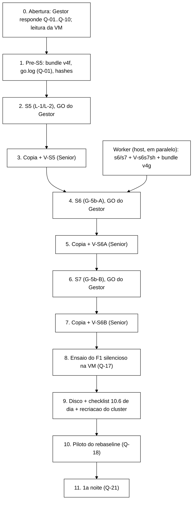

# Roteiro único da VM, 2026-11-04

> Preparado pelo Senior na madrugada de 04/11 (por volta de 05:00 UTC), com o Gestor dormindo. Nada foi executado na VM
> para escrever este roteiro; o estado da VM abaixo é o que o coordenador leu às ~04:40 UTC, só lendo. Nenhum push.
> As perguntas ao Gestor estão na seção 9, numeradas Q-01..Q-21, cada uma com a recomendação do Senior. As que bloqueiam
> o passo seguinte estão marcadas **[bloqueia]**.

## 1. Estado de partida (04/11 ~04:40 UTC)

| Item | Valor |
|---|---|
| VM | IP `172.23.214.235` (MAC `00-15-5D-03-AC-00`); `ssh -o HostKeyAlias=172.18.251.140 -i ~/.ssh/id_ed25519_tccf3 server1@172.23.214.235` |
| `boot_id` | `5d7119b8-3b50-435d-bd0d-cbdb6bd410df`, o mesmo do S4 (o `s5.sh` tem esse valor fixo no código) |
| Cluster | isn1..3 `healthy` (rootful, `sudo podman`); vista de 3 membros desde o `MergeView` do S4 (28/10 07:14:34) |
| Rede e locks | sem `tc`/`iptables` residual nos 3 netns; `/var/lock/tcc-vm.lock` e `/tmp/inject-partition-isn3.lock` livres; nenhum injetor rodando |
| P-6 da V-S1 | aplicada: `apt-mark hold` do kernel 6.8.0-147, `unattended-upgrades` desligado |
| Disco `/` da VM | 3,3 GB livres de 19 GB (81 %) |
| Disco `C:` do host | **15 GB livres de 476 GB (97 %)**; o VHDX da VM é dinâmico de 40 GB (`C:\Hyper-V\tcc-f3`, hoje ~16,8 GiB) |
| Código na VM | ponta `1266c12` (S4). O *bundle* `tcc/gate-v4f.bundle` (`1266c12..9c18ec8`, sha256 `d761ca7c…4750`) ainda não foi levado |
| Já conferido pelo coordenador em 28/10 (R-4 da V-s5sh) | `curl` da VM imprime `time_connect` contra o banner SSH (0,000089); `fail2ban` não instalado |

## 2. Ordem do dia

Regras que valem o dia todo: um bloco por vez, com parada e validação do Senior sobre os **brutos** antes do seguinte
(§5.1); GO só do Gestor, presente, digitado no prompt do próprio script; nada de TLC, `mvn test` ou suíte pesada no host
durante uma janela de injeção e nos 5 min antes e depois (§1.7 das decisões de 16/10), o que inclui os testes do Worker;
toda escrita na VM fora dos scripts aprovados (por exemplo o `git checkout` da Q-01) só com autorização do Gestor, e com o
comando e a saída nos brutos.

## 3. Passos, com tempo estimado

| # | Passo | Quem | Tempo | Depende de |
|---|---|---|---|---|
| 0 | Abertura: o Gestor lê este roteiro e responde Q-01..Q-10; coordenador confere IP (`Get-NetNeighbor`), `boot_id`, cluster, locks e `git status --porcelain --untracked-files=no` na VM (só leitura) | Gestor + coordenador | 30 a 45 min | nada |
| 1 | Pré-S5: levar o v4f (Q-02), `git bundle verify`, `fetch`, `checkout 9c18ec8`; resolver o `go.log` (Q-01); `sha256sum runs/vm-s5-2026-10-28/s5.sh` = `8bce87a5…0da08` | coordenador | 15 min | Q-01, Q-02 |
| 2 | S5 conforme `runs/vm-s5-2026-10-28/ROTEIRO-S5.md`; o prompt do GO aparece em ~3,5 min; GO em até 15 min do prompt (R-5) | Gestor presente | ~11 min + espera do GO | Q-03..Q-10 |
| 3 | Cópia dos brutos para o host com `sha256sum -c`; V-S5 pelo Senior (leitura humana de P-1, P-2, R-7) | coordenador + Senior | 5 + 30 a 45 min | S5 |
| 3a | Em paralelo com a V-S5: levar o v4g à VM (`fetch` + `checkout`, não toca no cluster), se a V-s6s7sh já tiver saído | coordenador | 10 min | V-s6s7sh, Q-02 |
| 4 | S6 conforme `runs/vm-s6-2026-11-04/ROTEIRO-S6.md` (a ser entregue pelo Worker), `--bloco-anterior` = o `vm-<UTC>/` do S5 | Gestor presente | ~13 min + GO (seção 5) | V-S5 aprovada, Q-11..Q-16 |
| 5 | Cópia + V-S6A | coordenador + Senior | 5 + 30 a 45 min | S6 |
| 6 | S7 conforme `ROTEIRO-S7.md`, `--bloco-anterior` = o `vm-<UTC>/` do S6 | Gestor presente | ~14 min + GO (seção 5) | V-S6A aprovada |
| 7 | Cópia + V-S6B | coordenador + Senior | 5 + 30 a 45 min | S7 |
| 8 | Ensaio do F1 silencioso (§4.2 do `prompt-f1-kill-2026-10-27.md`): 2 F1 sem carga e 2 com carga (S1 sync e S1 async, 300 s), no cluster atual, **antes** da recriação | Gestor presente no GO | 1,5 a 2 h + leitura do Senior ~45 min | V-S6B, Q-17 |
| 9 | Disco (seção 7 e Q-19/Q-20); itens "de dia" da checklist 10.6 (`wt-ctrl-integ/docs/relatorio-rebaseline-runner-2026-10-23.md`); *bundle* do *rebaseline* (`git archive 20805b0` + jar congelado `5eced136…`, lista `003814e9…`); anotar o instante UTC e recriar o cluster; pré-voo sem injeção | coordenador + Gestor | 45 min a 1 h | ensaio lido, Q-19 |
| 10 | Piloto: rodada 0, 12 execuções (i = 1000..1011), GO `go piloto <data>`, Gestor acompanha a primeira F3 (i = 1005, ~35 min depois do GO) | Gestor no início | ~1,5 h | Q-18 |
| 11 | Validação do piloto pelo Senior (K1..K10, n por operação, tempos, **tamanho real por execução**) e liberação pelo Gestor; depois, noite 1 (rodadas 1..5) | Senior, Gestor | 1 a 2 h + 6,5 a 8 h | Q-19, Q-21 |

Somas: do passo 0 ao 7, **3 h 15 min a 4 h 30 min**. Com o ensaio e o preparo do piloto, mais 2 h 30 min a 3 h 45 min.
O piloto e a sua validação, mais 2 h 30 min a 3 h 30 min. Começando às 09:00 (BRT), a noite 1 só poderia começar entre
~17:30 e ~21:00, e isso sem nenhuma repetição de bloco. Por isso a recomendação da Q-18 e da Q-21.

## 4. O que já se sabe que vai dar problema no S5

1. **`runs/gate-b29/go.log` modificado na VM (provável, a conferir).** O `exigir_go` do `g1.sh` acrescentou a linha do GO
   da REP=4 em `runs/gate-b29/go.log`, que é **versionado** (5 linhas no git; a cópia do S4,
   `runs/vm-s4-2026-10-28/vm-20261028T070600Z/go.log`, tem 6, sha256 `3de1fa71…20d8`). O passo 0 do `s5.sh` exige "0 arquivos
   versionados modificados" e vai abortar com rc 1, sem tocar em nada. Não é risco para a VM, mas gasta o GO. Ver Q-01.
2. **`boot_id` fixo no `s5.sh`.** Vale enquanto a VM não reiniciar. Se reiniciar antes do S5 (queda de energia), o `s5.sh`
   aborta no passo 0 e precisa de correção (hash novo, nova revisão) ou da decisão de recriar o cluster. O `s6.sh`/`s7.sh`
   não têm esse problema (Q-11).
3. **Bundle.** O `ROTEIRO-S5.md` diz que o `s5.sh` chega à VM "só pelo bundle, depois da aprovação" (Q-02).

## 5. S6 e S7: o que o Gestor precisa saber antes de cada GO

Detalhe completo no prompt do Worker (`docs/prompt-worker-s6-s7-g5b-2026-11-04.md`) e, quando entregues, nos
`ROTEIRO-S6.md`/`ROTEIRO-S7.md`.

- **S6 (G-5b-A).** O `g5b.sh A` arma o dead-man para 120 + 90 = 210 s (com `AccuracySec=1s`), corta isn3 por até 120 s,
  espera o split aparecer nos logs, mata o injetor com `kill -KILL` em +70 s, confere que o corte continua por 15 s e faz
  a cura manual (`--heal`). Depois espera `MergeView` de 3 e `HEALTHY` x3 e só então desarma. O Gestor não precisa fazer
  nada além do GO. Duração: pré-condições e portão pré ~3 min até o prompt; depois do GO, ~2,5 a 4,5 min de bloco e ~6 min
  de portão pós.
- **S7 (G-5b-B).** Mesma injeção e mesmo KILL, mas **ninguém cura**: o dead-man (prazo 145 s) é o único agente. isn3 fica
  cortado até ~145 s depois de armar. **Não** usar o `--heal` manual: isso invalida o bloco (§5.7). Se o dead-man não
  disparar até 185 s, o próprio `g5b.sh` falha e o trap dele cura. Duração: ~3 min até o prompt; depois do GO, ~3,5 a
  5 min de bloco e ~6 min de portão pós.
- Nos dois, o GO tem de vir em até 15 min depois do prompt (o coletor desiste depois disso), e o `--bloco-anterior` é o
  diretório `vm-<UTC>/` do bloco anterior; o `--boot-esperado` é o `boot_id fim` que está nesse diretório.
- O que o S6 e o S7 **não** provam (§5.8): queda da própria VM, perda da sessão `tmux`, precisão do timer de produção (a de
  produção tem `AccuracySec` de 1 min; o S7 prova o corpo do dead-man de produção com o timer de 1 s).

## 6. Pré-requisitos das noites (complemento 1 do pré-registro, §5, e checklist 10.6)

Antes do piloto, todos conferidos e registrados: alimentação do host conferida pelo Gestor; suspensão e hibernação
desligadas; Windows Update pausado; `Get-VM tcc-f3 | Select AutomaticStopAction,AutomaticStartAction` em PowerShell
**elevado**, com `AutomaticStopAction=ShutDown` (até onde o Senior sabe, esta leitura ainda não foi feita); kernel segurado e
`unattended-upgrades` desligado (feito); host em silêncio a noite toda; e o disco (seção 7).

## 7. Disco: conta da campanha de *rebaseline*

### 7.1 De onde vêm os números

Por execução, o que pesa é o CSV de eventos (`rep-001.csv`); o resto (`stdout.log`, JSONs, `violacoes-*.csv`, logs do
injetor) fica abaixo de 1 MB. O CSV só guarda a janela de medição, que no *rebaseline* vai de +44 a +300 s, ou seja,
**256 s**. A taxa de gravação (bytes de CSV por segundo de janela) foi medida em três fontes:

| Fonte | Configuração | Medido | Taxa |
|---|---|---|---|
| `tcc/dados-vm/baseline-2026-06-23/` (VM) | S1/S2, 8 *threads*, 90 s, janela de 66 s, mistura antiga (quase tudo `BLOCKED`, operações rápidas) | S1-none 151,3 MB/exec; S2-none 230,2 MB/exec; F1 = 0,879 × none; F3 = 0,027 a 0,040 × none | 2,29 (S1) e 3,49 (S2) MB/s; **metade para 4 *threads***: 1,15 e 1,74 MB/s |
| `wt-ctrl-integ/runs/integ-passo6-smoke/` (host) | v3, 4 *threads*, 60 s, janela de 47 s; Q1 = S1 SYNC, Q2 = S2 ASYNC | 40,2 MB (413 394 eventos) e 36,8 MB (400 719 eventos), ~92 a 97 B/evento | 0,854 e 0,783 MB/s |
| `wt-b27/runs/b27-smoke/Q2/` (host) | v3, 4 *threads*, S1 SYNC, 90 s, janela de 76 s | 29,3 MB (300 401 eventos) | 0,386 MB/s |

Nenhuma fonte é a VM com a mistura v3 e 4 *threads*; o piloto é a primeira medida desse caso. Por isso a conta sai em três
cenários. Para o F1 uso o fator medido em junho (0,88). Para o F3 (20 ± 13 ms em isn2 de +49 a +300 s): 5 s de taxa normal
mais 251 s a 3,5 % da taxa, o meio da faixa medida em junho.

### 7.2 Estimativa

| Cenário (taxa média S1/S2) | none | F1 | F3 | Rodada (12 exec) | Piloto | Noite (5 rodadas) | 10 rodadas | Total (piloto + 10 + ≤ 6 reposições) |
|---|---|---|---|---|---|---|---|---|
| baixo (0,386 MB/s) | 99 MB | 87 MB | 5 MB | 0,76 GB | 0,76 GB | 3,8 GB | 7,6 GB | 8,8 GB |
| **central (0,819 MB/s)** | **210 MB** | **184 MB** | **11 MB** | **1,62 GB** | **1,62 GB** | **8,1 GB** | **16,2 GB** | **18,6 GB** |
| alto (1,445 MB/s) | 370 MB | 326 MB | 20 MB | 2,86 GB | 2,86 GB | 14,3 GB | 28,6 GB | 32,9 GB |

Compressão, medida no host sobre os mesmos CSVs: `gzip -1` deixa 20,9 % a 23,9 % do tamanho (`gzip -6`, 20,0 %; `zstd -3`,
21,6 %), a ~180 MB/s no host. Com 24 %, a noite central cai para ~1,95 GB e o total para ~4,5 GB; no cenário alto, 3,4 GB
por noite e 7,9 GB no total.

### 7.3 Os 3,3 GB bastam?

- **Piloto:** sim no cenário central (sobra ~1,7 GB) e no baixo; no alto sobra ~0,4 GB, pouco demais (o `journald` com o
  driver de log dos contêineres e o próprio `/` também crescem). Bastam com folga se antes se liberar espaço (O-1 abaixo).
- **Noite de campanha (5 rodadas):** **não**, em nenhum cenário: 3,8 a 14,3 GB.
- **Campanha inteira:** não, nem comprimida no cenário alto (7,9 GB).
- **Host:** o `C:` tem só 15 GB livres e o VHDX é dinâmico. O que a VM escreve em blocos nunca usados aumenta o arquivo
  do VHDX no host. Uma noite central (8,1 GB) deixaria o host com ~7 GB; uma noite alta (14,3 GB) o encheria, e com o disco
  do host cheio o Hyper-V pausa a VM no meio da noite. Copiar os brutos sem compressão para o host também não cabe (a
  campanha central dá 18,6 GB).

### 7.4 Opções (decisão do Gestor, Q-19 e Q-20)

| # | Opção | Ganho | Custo e risco |
|---|---|---|---|
| O-1 | Na VM, apagar os CSVs de junho (`~/tcc-desenvolvimento/runs/`, ~2,1 GB) **depois** de reconferir o sha256 da cópia do host (`tcc/dados-vm/baseline-2026-06-23/sha256-vm.txt`); `journalctl --vacuum-size` e `podman image prune` só se a leitura mostrar volume | ~2,1 GB ou mais, já para o piloto | escrita na VM; os dados de junho passam a existir só no host (com sha256) |
| O-2 | Compressão por execução dentro do *runner* (`gzip -1` do CSV depois do verificador e antes do K1 da execução seguinte; a análise lê `.gz`) | ~4×; a noite central cabe em ~2 GB | muda `run-rebaseline.sh` e `analysis/rebaseline.py`, que estão congelados no pré-registro (DT nova, revalidação, *hashes* novos); CPU da VM entre execuções (estimo poucos segundos por execução, fora da janela de medição) |
| O-3 | Compressão e cópia para o host **de dia**, entre as noites (`gzip -1` na VM, `scp`, `sha256sum -c` do CSV original e do `.gz`, só então apagar na VM) | libera a VM para a noite seguinte; cópia comprimida cabe no host (~2 a 3,4 GB por noite) | não resolve a noite em si: o volume de uma noite ainda precisa caber sem compressão |
| O-4 | Aumentar o LV da VM. O VHDX tem 40 GB e o `/` tem 19 GB, o que sugere ~19 GB livres no VG (padrão do instalador do Ubuntu); conferir com `sudo vgs`. `lvextend -r` com o `/` montado | até ~19 GB na VM, sem desligar | escrita na VM (LVM/ext4 online); **limitado pelo host**: cada GB a mais que a VM usar pode virar GB a mais de VHDX no `C:` |
| O-5 | Liberar espaço no `C:` do host (por exemplo a ISO do Ubuntu, 3,4 GB em `C:\Hyper-V\iso`, *bundles* e *zips* antigos em `tcc/`) | margem para o VHDX crescer e para as cópias | decisão do Gestor sobre arquivos dele |
| O-6 | Noites menores (por exemplo 2 ou 3 rodadas por noite em vez de 5) | volume por noite cai para 40 a 60 % | mais noites; muda só a partição em noites, não a ordem nem as sementes (as rodadas já são blocos completos), mas o PR §8 fixa duas noites, então é DT nova antes da noite 1 |

**Recomendação do Senior.** Para hoje: O-1 (e O-5, pelo menos a ISO) antes do piloto, o que deixa ~5,4 GB livres na VM e
cobre o piloto até no cenário alto. Ler, só leitura, `df -h /`, `sudo vgs`, `sudo lvs`, `lsblk`,
`journalctl --disk-usage`, `du -sh ~/tcc-desenvolvimento/runs ~/tcc-gate`, `sudo podman system df`. O piloto mede o tamanho
real por célula, e é com ele que se decide a noite 1: se 5 rodadas medidas couberem em até 60 % do livre na VM **e** do
livre no host, manter o PR; senão, O-4 (só se O-5 der ao host folga maior que a extensão) mais O-3, e, se ainda não couber,
O-6. A O-2 é a mais eficaz, mas é a única que mexe no que foi congelado e validado; eu só a recomendaria se o piloto der o
cenário alto. Em qualquer caso, conferir `df -h /` no bloco de abertura de cada noite, com a regra de não dar o GO se o
livre for menor que 1,5 × o volume estimado da noite.

## 8. Itens para o Worker e para o Senior, de manhã

- Worker (já despachável): `s6.sh`/`s7.sh` + testes + roteiros + *bundle* v4g, pelo prompt
  `docs/prompt-worker-s6-s7-g5b-2026-11-04.md`. Os testes dele rodam no host; não durante as janelas do S5/S6/S7 ±5 min.
- Senior: V-s6s7sh (revisão independente, como a V-s5sh) antes do S6; V-S5, V-S6A e V-S6B sobre os brutos.
- Se a Q-17 for "sim hoje": prompt do Worker para o *script* do ensaio do F1 na VM (não existe ainda), com a mesma
  invocação do *runner* e semente fora da faixa da matriz.

## 9. Perguntas ao Gestor

| # | Pergunta | Recomendação do Senior |
|---|---|---|
| **Q-01** [bloqueia o S5] | A VM deve ter `runs/gate-b29/go.log` modificado desde o S4, e o passo 0 do `s5.sh` aborta com isso. Autoriza, depois de confirmar por leitura (`git status --porcelain --untracked-files=no` mostra só ` M runs/gate-b29/go.log` e `sha256sum` dá `3de1fa71…20d8`, igual à cópia do S4 já no host), restaurar o arquivo com `git checkout -- runs/gate-b29/go.log` antes do S5, gravando comando e saída nos brutos? A alternativa é o Worker corrigir o `s5.sh` com a regra do prefixo (seção 3 do prompt), o que muda o hash e pede nova revisão (~1 h). | **Restaurar.** A linha está preservada na cópia do S4 com sha256 conferido (35/35). O `s5.sh` aprovado fica intacto |
| **Q-02** | Autoriza levar à VM o *bundle* v4f agora (para o S5) e o v4g depois da V-s6s7sh (para o S6/S7), cada um conferido por sha256? E, no passo 9, o *bundle* do *rebaseline* (`git archive 20805b0` + jar)? Nenhum deles é push para o GitHub | **Sim aos três**, um de cada vez, com o hash no roteiro do bloco |
| **Q-03** | P-1 da V-s5sh: Hot Rod com critério automático só pela conexão TCP a 11224; latência de put/get para leitura humana | **Aceitar** |
| **Q-04** | P-2 da V-s5sh: regra "mediana durante ≤ p95 da base + 1 ms", sem mudar o código | **Aceitar**; o critério de cauda fica para os próximos invólucros |
| **Q-05** | P-3 da V-s5sh: perdas calculadas do percentual do `L1.log`, supondo 300 transmitidos | **Aceitar** |
| **Q-06** | P-4 da V-s5sh: ssh medido só do lado da VM (~100 linhas de banner inválido no `auth.log`). O `fail2ban` já foi conferido como não instalado | **Aceitar**; anotar se sentir atraso no terminal durante a janela |
| **Q-07** | P-5 da V-s5sh: manter o nome `vm-s5-2026-10-28` | **Manter** |
| **Q-08** | P-6 da V-s5sh: `-text` para `runs/gate-b29/` | **Sim, depois do S7**, num `chore:` separado (antes disso mudaria a ponta dos *bundles* já revisados) |
| **Q-09** | R-9 da V-s5sh: a sonda Hot Rod roda durante a janela do L-1 (cluster um pouco menos "ocioso" que o §5.6) | **Aceitar**, registrado na V-S5 como diferença declarada |
| **Q-10** | GO do S5, com o senhor presente do GO ao fim da janela (e até a cura, se o injetor falhar) e digitado em até 15 min depois do prompt | é decisão sua; o Senior não concede GO |
| **Q-11** | S6/S7 sem `boot_id` no código: `--boot-esperado` obrigatório, conferido contra o `boot_id fim` do bloco anterior e contra o atual; qualquer diferença aborta ("reboot entre blocos: parar e chamar o Senior") | **Aprovar** |
| **Q-12** | S6/S7 aceitam como única modificação versionada o `runs/gate-b29/go.log` com linhas `go ` acrescentadas ao fim (o `exigir_go` de cada bloco acrescenta uma) | **Aprovar**; sem isso o S7 abortaria por causa do GO do S6 |
| **Q-13** | Critérios derivados, que operacionalizam o §5.7 sem estar escritos nele: D-1 detector de cura manual pelo journal do `sudo` (no S6, controle positivo: tem de ver o `--heal` manual; no S7, 0 vindos da sessão); D-2 série de `tc qdisc show` de isn3 a cada 2 s, coerente com o corte e a cura; D-3 timer com `AccuracyUSec=1s` e o prazo certo; D-4 IDs e `StartedAt` dos contêineres iguais aos do bloco anterior; D-5 depois de uma falha do `g5b.sh`, o invólucro espera o dead-man e registra a cura (R-6 da V-s5sh) | **Aprovar os cinco**. O D-1 é a única forma objetiva que encontrei de provar "nenhum comando de cura nos consoles" (o `history` só é gravado quando o shell sai) |
| **Q-14** | `ISPN000524`/`ISPN100014`/`ISPN000638` (timeouts de resolução de conflito) nos logs do G-5b: invalidam o bloco ou são resultado? O §5.7 manda o Senior verificar a ausência, mas não diz | **Resultado, com leitura humana.** O G-5b testa o mecanismo de cura, não o tempo de fusão; um timeout de conflito é dado do sistema e vai para o relatório |
| **Q-15** | No S6, se a fusão demorar e o dead-man (210 s) disparar depois do `--heal` manual, antes do desarme: o bloco vale? | **Vale, como resultado**, desde que o registro mostre o `clsact` ausente logo depois do `--heal` manual, antes do disparo. O disparo cai sobre um nó já limpo e o `--heal` é idempotente |
| **Q-16** | GO do S6 e do S7, com o senhor presente. No S7, aceita não curar à mão antes de 185 s, deixando que o próprio `g5b.sh` cure se o dead-man não disparar? | GO é seu. **Sim** ao segundo ponto: a cura manual só se o `g5b.sh` travar, e aí o bloco fica como falha do dead-man |
| **Q-17** | Ensaio do F1 na VM (aprovado em 28/10, Q4): o *script* ainda não existe. Preparar hoje (prompt do Senior de manhã, Worker escreve e testa, ~2 a 3 h com validação) e rodar depois da V-S6B; ou adiar e deixar o piloto fazer o papel dele (risco: uma parada (e) no piloto custa o piloto inteiro) | **Preparar hoje e rodar hoje ou amanhã de manhã**, antes da recriação do cluster |
| **Q-18** | Piloto de dia ou de noite? O pré-registro aprovado (R10 e §8) diz "piloto numa noite (noite 0), validado de dia", e a checklist 10.6 segue isso. Rodar de dia hoje é desvio do pré-registro (pede nota em `decisoes-tecnicas.md` antes do piloto e host em silêncio por ~1,5 h); os dados do piloto nunca entram em resultado, então o risco é só de condição diferente da noite | **Piloto hoje à noite, como noite 0**, com o ensaio do F1 de dia. Ganha-se tempo para o disco e para a validação; a noite 1 fica para 05/11 e a noite 2 para 06/11 |
| **Q-19** [bloqueia a noite 1] | Disco da VM: qual combinação das opções O-1..O-6 (seção 7.4)? | **O-1 hoje**, antes do piloto; noite 1 decidida com o tamanho medido no piloto: O-4 + O-3 e, se preciso, O-6; O-2 só se o piloto der o cenário alto |
| **Q-20** [bloqueia a noite 1] | Disco do host: o `C:` está com 97 % (15 GB livres) e o VHDX da VM é dinâmico. Libera espaço (ao menos a ISO de 3,4 GB) e aceita a regra "não extender o LV da VM além do que o host tiver livre menos 20 %"? | **Sim aos dois**, antes do piloto |
| **Q-21** | Noite 1 hoje (04/11)? Só seria possível com o piloto de dia (Q-18), o ensaio feito, o piloto validado e o disco resolvido até ~21:00 | **Não**; noite 1 em 05/11, com o piloto de hoje à noite validado de manhã |
