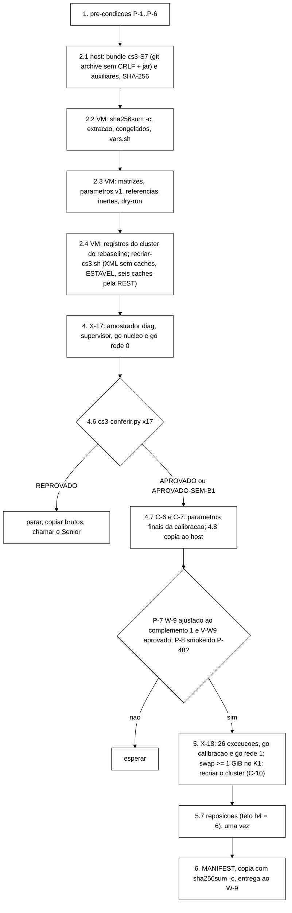

# Roteiro de VM do X-17 (validação do orquestrador) e do X-18 (calibração S3) (Senior, 2026-11-05)

> Para o coordenador, que roda tudo sem novo aval do Gestor (autorização de 05/11 para o X-17 e a calibração). Este
> roteiro não tem decisão em aberto para quem o executa. Cada passo diz o que rodar, o que esperar e o que fazer se
> sair diferente. O que ainda depende do Gestor está na seção 9 e não bloqueia nenhum passo, salvo onde a pré-condição
> diz.
>
> Fontes lidas nesta versão: pré-registro da calibração **aprovado, DT-020, versão `2c8b7b8`** (`wt-prc-s3`, com o
> fechamento de C-10, `convergencia_teto_s` e `convergencia_periodo_s`); orquestrador do W-6/W-6b (`wt-w6`, `081e1c4`) e
> a integração `49baddc` (merge do W-6 sobre o W-2b); W-6c em curso (`wt-w6c`, `f4bcf1f` mais a árvore de trabalho, com
> `--swap-limite-kb`, `--exigir-trilha-completa`, N1, R4 e R7); V-W6 e V-W6b; B-40 parte 1 (`wt-b40`, `2c06890`);
> plano de execução contínua §2, §3.1 e §3.2; plano de execução de 04/11 §5.1; roteiro e leitura da noite 1 e os
> *scripts* do supervisor da noite 1 (`dados-vm/rebaseline-2026-11/noite1-completa-20261105/rebaseline-infra/`).
>
> Conferido no *host*, sem VM nem *cluster*: o `--dry-run` do orquestrador (W-6 `081e1c4` e W-6c) com as duas matrizes,
> o arquivo de parâmetros e as duas referências deste roteiro passa (exit 0), e as matrizes geradas aqui têm os SHA-256
> da seção 2.3. Os três *scripts* auxiliares da seção 10 passaram em `bash -n` e `py_compile`; o conferidor do X-17
> deu o veredito certo em quatro casos sintéticos (B1, sem AC-5, negativo e bloco PULADA); o supervisor, numa
> simulação com `tmux` falso, deu os dois GO, recusou um `go rede` fora da fila, no modo `recriar` mandou o `Ctrl-C`
> no K1, recriou o *cluster* e relançou três vezes seguidas (com o alerta informativo na terceira), no modo
> `registrar` só registrou a leitura, e reconheceu o fim normal.
>
> **Revisão de 05/11 (decisões do coordenador sob a autorização do Gestor, seção 9):** G-1, G-4, G-5 e G-6
> aceitos; G-2 com o W-9 existente (`wt-w9`, `feature/w9-calibracao-s3`, ponta `4bcca11` ou posterior) a ajustar ao
> complemento 1 (DT-022, `744e6e8`) e com a V-W9 antes do X-18; G-3 pela **C-10 aprovada** (nota de fechamento do
> DT-020, `2c8b7b8`): com *swap* ≥ 1 GiB no portão, o *cluster* é recriado antes da execução, que roda com o mesmo i
> e a mesma semente, sem contar como recusa, e **nunca** `swapoff`/`swapon` (risco de OOM com ~6,4 GB nas três JVMs
> numa VM de 8 GB). A §5 do pré-registro, que ainda diz "para a fase", vai ser alinhada à C-10 pelo outro Senior.

## Siglas

| Sigla | Significado |
|---|---|
| T, S7 | SHA completo e os 7 primeiros caracteres da ponta integrada de `feature/controlador-integracao` que o coordenador dá |
| X-17 | validação curta do orquestrador: 1 bloco ASYNC F2 (`isn3`, 90 s), braço A (`shadow`) e braço B (`active`) |
| X-18 | calibração S3, só braço A, 26 execuções (DT-020) |
| B1 | caminho do orquestrador para F2/F4 em que o AC-5 do braço B para o nó da falha (V-W6 §5.1, V-W6b §3) |
| H0 | *host* em silêncio: sem `mvn`, testes, TLC, Podman local, cópias grandes, `scp` ou `git` (plano contínuo §2.1 e §3.0) |
| DT-014 | regra da execução interrompida: sem `stdout.log`, volta com o mesmo i e a mesma semente; com ele, RECUSADA |

## 0. Visão geral



**Como rodar os blocos.** Os blocos marcados **host** rodam no Git Bash do coordenador, os marcados **PowerShell** no
PowerShell sem elevação. Todo bloco marcado **VM** vai inteiro pela entrada padrão, já sem CR:

```bash
# host, uma vez por sessao do Git Bash
VMIP=172.27.114.62     # se a VM mudar de IP: Get-NetNeighbor -LinkLayerAddress 00-15-5D-03-AC-00 (plano continuo 3.2)
SSHO=(-o BatchMode=yes -o HostKeyAlias=172.18.251.140 -i "$HOME/.ssh/id_ed25519_tccf3")
vm() { sed 's/\r$//' | ssh "${SSHO[@]}" "server1@$VMIP" 'bash -s'; }
# uso: vm <<'FIMVM'
#      ...bloco VM inteiro...
#      FIMVM
# (FIMVM e o terminador de fora; os blocos usam EOF e EOF2 nos heredocs de dentro)
```

Assim o texto do bloco nunca aparece na linha de comando de um processo da VM (o processo remoto é só `bash -s`), e o
CR de um arquivo editado no Windows não chega lá. Mesmo assim, nunca use `pkill -f`: para parar algo, `pgrep -af`
para ver e `kill <PID>` do processo certo, ou `tmux send-keys ... C-c` na janela dele. Variáveis não sobrevivem entre
blocos: a partir do 2.2 todo bloco VM começa com `source ~/cs3-infra/vars.sh`.

**Regras que valem em todos os passos** (lições da noite 1 de 05/11):

- *Lock*: o orquestrador pega `/var/lock/tcc-vm.lock` sozinho (`flock -n`, exit 4 se ocupado). Tudo que mexe no
  *cluster* fora dele (recriação manual) roda sob `flock -n /var/lock/tcc-vm.lock`. `swapoff`/`swapon` não se usa.
- *Dead-man* dos injetores: o orquestrador arma `tcc-heal-cs-<i>` (`systemd-run`, janela + 90 s) antes de cada F2/F4.
  Antes de cada invocação, `systemctl list-timers --all --no-legend 'tcc-heal*'` tem de estar vazio; durante a F2/F4
  aparece um; depois, nenhum.
- Logs voláteis em `/run/tccdiag/coord-cs3/` (tmpfs, sobrevive ao fim da sessão; o `/dev/shm` é apagado). O que precisa
  ficar vai para `~/cs3-infra/` (disco).
- CR: o *bundle* sai do `git archive` com `core.autocrlf=false` e os auxiliares saem do *blob* do Git, então nada tem
  CR. O 2.2 confere com `grep -rlI $'\r'`. Se aparecer, `sed -i 's/\r$//'` no arquivo e anotar.
- `tmux`: a sessão `cs3` é criada ao lado de qualquer outra (`rebaseline` fica como está). Nenhum passo mata sessão;
  janelas antigas do supervisor ficam dormindo e podem ser fechadas com `tmux kill-window -t cs3:<nome>`, nunca a `orq`.
- Vigia de progresso, não só de fim: o supervisor (seção 10) grava uma linha de progresso por minuto e um ALERTA se o
  `orquestrador.log` parar mais que `exec_teto_s` + 90 s.
- Swap: C-10 aprovada (nota de fechamento do DT-020, `2c8b7b8`). Com ≥ 1 GiB no portão K1, o *cluster* é recriado
  antes da execução, que roda com o mesmo i e a mesma semente, sem contar como recusa (5.5). Com W-6c, quem recria é o
  orquestrador (`--swap-limite-kb 1048576`); sem ele, o supervisor (Ctrl-C no K1, `recriar-cs3.sh`, relançamento).

## 1. Pré-condições (conferir antes do 2.1; faltando uma, não começar)

| # | Item | Como conferir | Bloqueia |
|---|---|---|---|
| P-1 | Nenhuma fase do *rebaseline* em curso. A fase que estiver aberta foi encerrada pelo roteiro dela (linha FIM, bloco de fim, `amostrador-infra.sh parar`, `h4.py fase`, brutos no *host*). O X-17 derruba o *cluster* do *rebaseline*, que depois é recriado pelo `recriar-rb-20805b0.sh` (G-3a) antes da próxima fase dele | `pgrep -af run-rebaseline` vazio; `systemctl list-units --all --no-legend 'tcc-amostrador-*'` vazio | tudo |
| P-2 | T é a ponta integrada de `feature/controlador-integracao` com W-2b, W-6/W-6b e o I-1 (pré-registro §9 item 1), com o Surefire e as suítes da integração registrados pelo integrador. Sem o I-1, um disco lento na leitura da `meta` para a fase com 6 (V-W6 §5.2). O W-6c é opcional (2.1 detecta; 5.3) | o coordenador dá T e o registro das suítes | tudo |
| P-3 | *Host* em H2 no 2.1 (o `mvn package` não roda em H0) | `HOST-PERFIL.txt` | 2.1 |
| P-4 | Perfil do *host* no X-17 e no X-18: **H0**. Nenhuma DT registra o M-0 aprovado, e o pré-registro §2 diz "H1 se o M-0 aprovar, senão H0". `HOST-PERFIL.txt` em H0 há ≥ 5 min antes do GO, aplicativos do usuário fechados, `wsl --shutdown` e `WSearch` parado pelo Gestor como na G-4 da noite 1 | `HOST-PERFIL.txt`; covariáveis do 4.1 | GO do X-17 e do X-18 |
| P-5 | VM: *lock* livre, nenhum processo residual, 0 *timers* `tcc-heal*`, 0 *units* `tcc-amostrador-*`, imagem `quay.io/infinispan/server:15.0.21.Final` presente | bloco do 4.2 | 2.4 |
| P-6 | Disco: VM com livre ≥ 1,5 × 34 execuções × 14 MiB = 714 MiB além do *bundle* (regra 1,5 × do plano de 04/11 §9, W-6 item 4; 34 = 2 do X-17 + 26 + até 6 reposições); depois do X-17 a conta usa o volume medido (4.7). *Host*: regra do AVHDX do plano contínuo §2.5 | `df -Pm` (2.2) | 2.4 |
| P-7 | Só para o X-18: W-9 (`analysis/calibracao_s3.py`, `wt-w9`, branch `feature/w9-calibracao-s3`, a partir de `4bcca11`) **ajustado ao complemento 1 (DT-022, `744e6e8`) e com a V-W9 aprovada**, com o SHA do commit validado registrado. O pré-registro §7 e §9 item 4 exigem as regras em código **antes** do X-18 | parecer da V-W9 | GO do X-18 |
| P-8 | Só para o X-18: *smoke* local do P-48 (topologia do `rcm` principal) feito e, se a topologia estiver velha, a mitigação na ponta T (pré-registro §9 item 5) | relatório do *smoke* | GO do X-18 |
| P-9 | Só para o X-18: X-17 com veredito APROVADO ou APROVADO-SEM-B1 (4.6), no **mesmo** *bundle*. Trocar de ponta depois do X-17 obriga a repetir o X-17 | `~/cs3-infra/conferencia-x17.txt` | GO do X-18 |

## 2. *Bundle* e *cluster*

### 2.1 Host: *bundle* da ponta integrada e auxiliares (H2; ~10-15 min)

```bash
# host, Git Bash. Trocar SHA_DA_PONTA pelo SHA completo (40 hex) que o coordenador da.
T=SHA_DA_PONTA
[[ "$T" =~ ^[0-9a-f]{40}$ ]] || echo "T invalido: trocar SHA_DA_PONTA"
TCC=/c/Users/Francesco/Development/tcc
git -C $TCC/wt-ctrl-integ merge-base --is-ancestor "$T" feature/controlador-integracao && echo "T esta na branch de integracao"
S7=$(git -C $TCC/wt-ctrl-integ rev-parse --short=7 "$T"); echo "S7=$S7"
git -C $TCC/wt-ctrl-integ worktree add --detach "$TCC/wt-cs3-$S7" "$T"
cd "$TCC/wt-cs3-$S7"
git status --short | wc -l                                          # 0
test -f scripts/run-campanha-s3.sh && test -f cluster/infinispan-sem-caches.xml && echo "W-6 na ponta"
grep -c -- '--swap-limite-kb)' scripts/run-campanha-s3.sh           # >= 1 (2 no W-6c atual) = W-6c na ponta; 0 = sem W-6c (5.3)
H=$TCC/dados-vm/cs3-2026-11; D=$H/bundle-$S7; mkdir -p "$D/aux"
git -c core.autocrlf=false archive --format=tar --prefix="cs3-$S7/" "$T" -o "$D/cs3-$S7.tar"
(cd workload && mvn -o -q -T1 -DskipTests package)                  # faltando plugin no modo offline: o mesmo sem -o
cp workload/target/session-workload-0.1.0-SNAPSHOT.jar "$D/"
(cd "$D" && sha256sum cs3-$S7.tar session-workload-0.1.0-SNAPSHOT.jar | sed 's/ \*/  /' > bundle-$S7.sha256 && cat bundle-$S7.sha256)
# auxiliares (secao 10), tirados do blob do Git deste roteiro, sem CR
R="docs/plano-implementacao-controlador:docs/roteiro-x17-calibracao-2026-11-05.md"
extrair() { git -C $TCC/wt-plano-ctrl show "$R" | awk -v m="<!-- arquivo: $1 -->" '$0 == m {f = 1; next} f == 1 && /^```/ {f = 2; next} f == 2 && /^```$/ {exit} f == 2 {print}'; }
for f in recriar-cs3.sh supervisor-cs3.sh cs3-conferir.py campanha-s3-calibracao-v1.json referencia-S3-async-inerte.json referencia-S3-sync-inerte.json; do
  extrair "$f" > "$D/aux/$f"
done
(cd "$D/aux" && sha256sum * | sed 's/ \*/  /' > ../aux-$S7.sha256 && cat ../aux-$S7.sha256)   # igual a tabela da secao 10
```

Por que `core.autocrlf=false`: com o padrão do Git for Windows (`true`), o `git archive` deste *host* põe CRLF nos
`*.json` e `*.md`, que não estão no `.gitattributes` (conferido: `controlador-calibracao-s3.json` sai com `\r\n` e
SHA-256 `0ff8714b…`, o arquivo LF é `c4e05c3c…`). Os `*.sh`, `*.py`, `*.xml`, `*.yml` e `*.tsv` já são `eol=lf`.

O *jar* é o do `package` na *worktree* `wt-cs3-<S7>`, que fica até o fim do X-18 (não apagar: é a referência do que
rodou).

### 2.2 Transferência e conferência (H2; ~5-10 min)

```bash
# host
scp "${SSHO[@]}" "$D/cs3-$S7.tar" "$D/session-workload-0.1.0-SNAPSHOT.jar" "$D/bundle-$S7.sha256" "$D/aux-$S7.sha256" "server1@$VMIP:"
scp -r "${SSHO[@]}" "$D/aux" "server1@$VMIP:cs3-aux-$S7"
```

```bash
# VM (vm <<'FIMVM' ... FIMVM). Trocar XXXXXXX pelo S7 do 2.1.
S7=XXXXXXX
cd ~ && sha256sum -c bundle-$S7.sha256                              # 2 OK
(cd ~/cs3-aux-$S7 && sha256sum -c ../aux-$S7.sha256)                # 6 OK
test ! -e ~/cs3/cs3-$S7 || { echo "cs3-$S7 ja existe: PARAR (nao extrair por cima)"; exit 1; }
mkdir -p ~/cs3 ~/cs3-infra && tar -xf ~/cs3-$S7.tar -C ~/cs3
CS3=~/cs3/cs3-$S7
mkdir -p $CS3/workload/target $CS3/runs/entrada
cp ~/session-workload-0.1.0-SNAPSHOT.jar $CS3/workload/target/
cp ~/cs3-aux-$S7/recriar-cs3.sh ~/cs3-aux-$S7/supervisor-cs3.sh ~/cs3-aux-$S7/cs3-conferir.py ~/cs3-infra/
cp ~/cs3-aux-$S7/*.json $CS3/runs/entrada/
grep -rlI $'\r' $CS3/scripts $CS3/cluster $CS3/analysis $CS3/runs/entrada ~/cs3-infra || echo "sem CR"
cat > ~/cs3-infra/congelados.sha256 <<'EOF2'
4ebdd8a34a7d5c1e6981138272a4f0b90a67c44dd8626e9521884e185297abb1  scripts/inject-netdegrade.sh
59dd2beee5b003d85f96cae71866227d7bca1c87a9ceeab034180ce4254d94e1  scripts/inject-partition.sh
531a98a1a613647d28288f590e26a55f1240a42e362c223363fe6c40eb93985c  scripts/inject-crash.sh
7e68962b1b7f508ee84ca7561a20c0bba36c43ea4597d7390e7c8091cd24e529  scripts/inject-jitter.sh
e4cc5c794312afbfa7e4743ca556f37033924c51b0246f8f211718a6ee0a8780  scripts/amostrador-infra.sh
53d7e7cb831856a58dc9df1a717df559437857aae5b57d159d42bbd84feb8b30  analysis/h4.py
53de0b390473dc0b57903af8c68e439087eb864deddc755330c6e61c14b6864b  scripts/cria-caches.sh
d1d3581b7fe0ce12e4e33358698da287f3ac87e4d223689b91248d7fee9327c3  scripts/collect-resources.sh
a7b18f2dac46095e468c43ae97c4cc51e411cbb54875606e898a20b6a7227c85  cluster/infinispan-sem-caches.xml
35ae88a00d2c25d9cc6274389617b94007ccc3e2a1a8fd4bcaf735c7d339d700  cluster/podman-compose-sem-caches.yml
dd79343070cf9107571de238851d1117255ebdb1c7887075e23d76638d7bcf14  cluster/jgroups-tcp.xml
c4e05c3cc40c1900378de7f709ac3f99fea896a1ba2d1f0addd9d78a53a574ff  cluster/controlador/controlador-calibracao-s3.json
3c7826b5e85c07d4b5b265206a8b2d36a16675e1273d22e2ff0905b54fc3899c  cluster/caches/sessions.json
3c7826b5e85c07d4b5b265206a8b2d36a16675e1273d22e2ff0905b54fc3899c  cluster/caches/counters.json
b68c3ca52433a1eec38f8aab9d7e5ff3ef14945a640e79468bc6da197af6154c  cluster/caches/sessions-async.json
b68c3ca52433a1eec38f8aab9d7e5ff3ef14945a640e79468bc6da197af6154c  cluster/caches/counters-async.json
3c7826b5e85c07d4b5b265206a8b2d36a16675e1273d22e2ff0905b54fc3899c  cluster/caches/canario.json
b68c3ca52433a1eec38f8aab9d7e5ff3ef14945a640e79468bc6da197af6154c  cluster/caches/canario-async.json
EOF2
(cd $CS3 && sha256sum -c ~/cs3-infra/congelados.sha256)             # 18 OK
python3 --version; java -version 2>&1 | head -1
sudo podman images --format '{{.Repository}}:{{.Tag}}' | grep -c 'infinispan/server:15.0.21.Final'   # 1
df -Pm $CS3/runs | tail -1                                          # livre >= 714 MiB (P-6)
if grep -q -- '--swap-limite-kb)' $CS3/scripts/run-campanha-s3.sh; then W=sim; else W=nao; fi
cat > ~/cs3-infra/vars.sh <<EOF2
# X-17/X-18 (roteiro-x17-calibracao-2026-11-05.md). Todo bloco da VM comeca com: source ~/cs3-infra/vars.sh
S7=$S7
CS3=$HOME/cs3/cs3-$S7
E=$HOME/cs3/cs3-$S7/runs/entrada
X17=$HOME/cs3/cs3-$S7/runs/x17-validacao
SC=$HOME/cs3/cs3-$S7/runs/campanha-s3-calibracao
JAR=$HOME/cs3/cs3-$S7/workload/target/session-workload-0.1.0-SNAPSHOT.jar
JAR_SHA=$(sha256sum $CS3/workload/target/session-workload-0.1.0-SNAPSHOT.jar | cut -c1-64)
CTRL=$HOME/cs3/cs3-$S7/cluster/controlador/controlador-calibracao-s3.json
CTRL_SHA=c4e05c3cc40c1900378de7f709ac3f99fea896a1ba2d1f0addd9d78a53a574ff
REF_A=$HOME/cs3/cs3-$S7/runs/entrada/referencia-S3-async-inerte.json
REF_A_SHA=05342de490d817208d4c26625a4718f4969f4d02244b4b24758bdc73a2016d15
REF_S=$HOME/cs3/cs3-$S7/runs/entrada/referencia-S3-sync-inerte.json
REF_S_SHA=30dee87fb79cb69dbf3f9a61caa6a2a9354f20a8d10f2370af5f9925a532212f
PV1=$HOME/cs3/cs3-$S7/runs/entrada/campanha-s3-calibracao-v1.json
PV1_SHA=cfd5fa6a0d5de696d52dac1ae1646b1ae87eb9303dc7533cedba8a5e24af9a98
MX17=$HOME/cs3/cs3-$S7/runs/entrada/matriz-x17.tsv
MX17_SHA=027db4e13c0a60a6d84ec65b43c9ed605c69a4902a5cb3e3912cfb18e1a8581f
MCAL=$HOME/cs3/cs3-$S7/runs/entrada/matriz-calibracao.tsv
MCAL_SHA=7e5b2609ca328395a51fed6e9027d5dc41fef567094036e8ab511120ee471f67
W6C=$W
EOF2
if [ "$W" = sim ]; then
  printf '%s\n' 'O17="--swap-limite-kb 1048576 --exigir-trilha-completa"' 'O18="--swap-limite-kb 1048576"' >> ~/cs3-infra/vars.sh
else
  printf '%s\n' 'O17=""' 'O18=""' >> ~/cs3-infra/vars.sh
fi
cat >> ~/cs3-infra/vars.sh <<'EOF2'
lancar_fase() {  # lancar_fase <saida> <fase> <tsv da fila> <cmd> <limiar s> <janela do supervisor>
  if pgrep -f 'run-campanha-s3[.]sh' > /dev/null; then echo "orquestrador ainda rodando: nao lancar"; return 1; fi
  # so o processo do supervisor (argv "bash /home/.../supervisor-cs3.sh"), nao o "bash -c ...; sleep 86400" da janela
  if pgrep -f '^bash /home/[^ ]+/cs3-infra/supervisor-cs3[.]sh' > /dev/null; then echo "supervisor anterior ainda rodando: esperar SUP_FIM"; return 1; fi
  tmux has-session -t cs3 2>/dev/null || tmux new-session -d -s cs3 -n orq -x 220 -y 50
  tmux send-keys -t cs3:orq clear Enter; sleep 1; tmux clear-history -t cs3:orq
  local m=recriar; [ "$W6C" = sim ] && m=registrar   # swap (C-10): o W-6c recria; sem ele, o supervisor
  tmux new-window -d -t cs3 -n "$6" "bash $HOME/cs3-infra/supervisor-cs3.sh $1 $2 $3 $4 $5 $m $CS3; echo SUP_FIM; sleep 86400"
  sleep 2; tmux send-keys -t cs3:orq "bash $4" Enter
}
EOF2
cat ~/cs3-infra/vars.sh; bash -n ~/cs3-infra/vars.sh && echo "vars.sh ok"
```

O `JAR_SHA` impresso tem de ser igual à segunda linha do `bundle-<S7>.sha256` do *host*. Os 18 arquivos de
`congelados.sha256` são os da ponta `49baddc` e não mudam no W-6c (relatório do W-6c §4). Injetores, h4 e amostrador
são congelados. O controlador tem de ser o de `17f2bd4` (pré-registro §4.2), e os XML, o *compose* e os JSON de
*cache* são os da avaliação. Um `FAILED` em qualquer um: parar e chamar o Senior.

### 2.3 Entradas e `--dry-run` (H2; ~5-10 min)

```bash
# VM
source ~/cs3-infra/vars.sh; cd $CS3
python3 -I scripts/campanha_s3_matriz.py gerar --modo avaliacao --nucleo "ASYNC-F2:teste:1" --ordem-seed 20261105 \
  --s0 290000 --passo-semente 100 --i0 0 --b0 0 --saida $MX17
python3 -I scripts/campanha_s3_matriz.py gerar --modo calibracao \
  --celulas "ASYNC-none:calibracao:5,ASYNC-F1:calibracao:5,ASYNC-F2:calibracao:5,SYNC-F2:calibracao:3,SYNC-none:calibracao:3,ASYNC-F4:calibracao:5" \
  --ordem-seed 20261105 --s0 300000 --passo-semente 100 --i0 0 --saida $MCAL
printf '%s  %s\n' $MX17_SHA $MX17 $MCAL_SHA $MCAL | sha256sum -c   # 2 OK
for p in async sync; do python3 -I scripts/campanha_s3_conferir.py referencia --arquivo $E/referencia-S3-$p-inerte.json --perfil $p; done
python3 -I scripts/campanha_s3_conferir.py parametros --arquivo $PV1 --t-enc-pior-s 21 | grep -E '^(exec_teto_s|volume_exec_mb|convergencia)'
bash scripts/run-campanha-s3.sh --dry-run --matriz $MX17 --matriz-sha256 $MX17_SHA --fase nucleo \
  --parametros $PV1 --parametros-sha256 $PV1_SHA --controlador $CTRL --controlador-sha256 $CTRL_SHA \
  --referencia-async $REF_A --referencia-async-sha256 $REF_A_SHA --jar $JAR --jar-sha256 $JAR_SHA \
  --saida $X17 $O17 2>&1 | grep -vE '^      timeout' | tee ~/cs3-infra/x17-dry-run.txt
bash scripts/run-campanha-s3.sh --dry-run --matriz $MCAL --matriz-sha256 $MCAL_SHA --fase calibracao \
  --parametros $PV1 --parametros-sha256 $PV1_SHA --controlador $CTRL --controlador-sha256 $CTRL_SHA \
  --referencia-async $REF_A --referencia-async-sha256 $REF_A_SHA --referencia-sync $REF_S --referencia-sync-sha256 $REF_S_SHA \
  --jar $JAR --jar-sha256 $JAR_SHA --saida $SC $O18 2>&1 | grep -vE '^      timeout' | tee ~/cs3-infra/x18-dry-run-v1.txt
ls -d $X17 $SC 2>/dev/null || echo "saidas ainda nao existem (certo)"
```

Esperado (é o que o `--dry-run` deu no *host*):

- referências: `sha256 05342de4…`, `cenario S3`, `perfil async`; `sha256 30dee87f…`, `perfil sync`;
- parâmetros: `exec_teto_s 1010`, `volume_exec_mb 14`, `convergencia_teto_s 600`, `convergencia_periodo_s 5`;
- X-17: `DRY-RUN fase=nucleo … (SHA-256 confere) … (19 numeros, todos com origem)`; `controlador conferido:
  sha256=c4e05c3c… politica=sim p2_habilitada=false defasagem=sim`; `perfis da fase: async`; com W-6c, `DRY-RUN
  opcoes: swap_limite_kb=1048576 exigir_trilha_completa=sim`; `PLANO i=0 … braco=A controller=shadow seed=290000 … F2:
  inject-partition.sh --minority isn3 --duration 90 … dead-man 180 s`; `PLANO i=1 … braco=B controller=active
  seed=290000`; `PLANO execucoes=2 encerramento: SIGTERM no teto (1010 s) e SIGKILL 23 s depois`; `DRY-RUN: nada
  executado`;
- calibração: `perfis da fase: async sync`; 26 linhas `PLANO`, de `i=0 celula=ASYNC-F1 … seed=300000` a `i=25
  celula=ASYNC-F1 … seed=302500`, na ordem da tabela do 5.2; com W-6c, `swap_limite_kb=1048576
  exigir_trilha_completa=nao`.

Exit 2 ou 4 no `--dry-run`: a mensagem diz qual arquivo ou SHA. Corrigir a **entrada** (nunca um *script* do *bundle*)
e repetir.

**Sementes e ordem do X-17.** O X-17 não é dado de nenhuma análise, mas a semente vem de uma faixa livre e fixa:
290 000 (bloco 0), abaixo da calibração (300 000 + 100·i) e da avaliação (400 000 + 100·bloco), acima do ensaio do F1
(250 000 a 250 300) e do piloto (até 151 100). `--ordem-seed 20261105` segue a regra do pré-registro (data em
AAAAMMDD) e dá A primeiro (i = 0) e B depois (i = 1). As células da calibração vão em `--celulas` na ordem da tabela
do pré-registro §3 ("as células acima"), que é o que fixa a ordem sorteada.

### 2.4 Registros do *cluster* do *rebaseline* e recriação com o XML sem *caches* (H2; ~5-10 min)

O desenho do W-6 (TD-015): o *cluster* sobe com `cluster/infinispan-sem-caches.xml`, que não declara *cache* nenhum,
e os seis (`sessions`, `counters`, `sessions-async`, `counters-async`, `canario`, `canario-async`) vêm pela REST, do
`scripts/cria-caches.sh` com os JSON de `cluster/caches/`, com leitura de volta byte a byte nos três nós. Os `canario*`
do W-4 **não estão em XML nenhum**: são dois desses seis JSON. O orquestrador repete essa recriação antes de **cada**
execução. A recriação manual abaixo só confere o desenho na VM antes de gastar um GO, e derruba o *cluster* do
*rebaseline* (o `down` apaga os *logs* dos contêineres, por isso eles são salvos antes).

```bash
# VM
source ~/cs3-infra/vars.sh
TS=$(date -u +%Y%m%dT%H%M%SZ); RA=~/cs3-infra/rebaseline-antes-$TS; mkdir -p $RA
for n in isn1 isn2 isn3; do sudo podman inspect $n > $RA/inspect-$n.json 2>&1; sudo podman logs $n > $RA/logs-$n.txt 2>&1; done
sudo podman events --since "$(date -u -d '-24 hours' +%FT%TZ)" --until "$(date -u +%FT%TZ)" \
  --filter event=died --filter event=start --format json > $RA/eventos-24h.json 2>&1
free -m > $RA/free-antes.txt; sha256sum $RA/* > $RA.sha256; cat $RA/free-antes.txt
printf 'Cluster do rebaseline derrubado pelo X-17 (S3) em %s, bundle %s, XML sem caches. Antes de qualquer fase do rebaseline: recriar com ~/rebaseline-infra/recriar-rb-20805b0.sh e cluster_criado_apos novo (G-3a). Registros em %s\n' \
  "$TS" "$CS3" "$RA" > ~/rebaseline-infra/AVISO-CLUSTER-S3-$TS.txt
flock -n /var/lock/tcc-vm.lock bash ~/cs3-infra/recriar-cs3.sh $CS3 ~/cs3-infra/recriacao-$TS; echo "recriar rc=$?"
free -m | tee -a ~/cs3-infra/recriacao-$TS/conferencia.txt
```

Esperado: `recriar rc=0` e a última linha `RECRIAR-CS3 OK`, depois de `down rc=0`, `up rc=0`, `ESTAVEL size=3 HEALTHY`,
três linhas `antes do cria-caches: nenhum dos seis em :<porta> (["___protobuf_metadata","___script_cache"])`
(a lista `GET /rest/v2/caches` de cada nó só com os *caches* internos; no 15.0.21, `?action=config` de *cache*
inexistente responde HTTP 500, não 404, e por isso a conferência usa a lista), `cria-caches rc=0 (6 POST, 18 GET)`, três
`rebalancing_enabled true`, 18 `AVAILABLE`, `nenhum timer tcc-heal*` e três `sem regra de rede`. O *swap* do `free -m`
cai para perto de zero (na noite 1, ~50 MB depois de cada recriação). Qualquer `FALHA`: seção 8.

## 3. Referência de p99 por perfil antes da calibração

**De onde vem.** Ainda não existe referência medida no S3. O programa exige uma por perfil e recusa a de outro perfil
(`LigacaoControlador.java:204`), e o orquestrador exige a de cada modo de replicação presente na fila (B2 do W-6b). O
pré-registro resolve na 4.2 e na 7.1: **até o fim da calibração, as duas referências são inertes** (p99 = 10 s em todas
as operações). A referência de verdade sai da **regra 7.1**, aplicada pelo W-9 depois do X-18:
`analysis/referencia_p99.py --cenario S3 --perfil async|sync --n-min 1000` sobre os CSV das execuções sem falha do
perfil (ASYNC × 5, SYNC × 3). Ela vai para o B-40 parte 2 e é passada na avaliação pelas mesmas opções
`--referencia-async`/`--referencia-sync`.

| Uso | Arquivo | SHA-256 | Origem |
|---|---|---|---|
| X-17 (`--referencia-async`) e X-18 (`--referencia-async`) | `runs/entrada/referencia-S3-async-inerte.json` | `05342de4…6d15` | os mesmos bytes de `wt-w4/runs/i3b/config/referencia-S3-async.json`, o arquivo que o pré-registro 4.2 nomeia |
| X-18 (`--referencia-sync`) | `runs/entrada/referencia-S3-sync-inerte.json` | `30dee87f…212f` | o mesmo com `"perfil":"sync"` (pré-registro 4.2); bytes iguais ao *blob* de `runs/b44-2/integracao/referencia-S3-sync.json` em `17f2bd4` |

O X-17 só tem ASYNC, então passa só `--referencia-async`.

**Por que a referência inerte não contamina as derivações.**

1. No braço A o controlador nunca chama a API (`shadow`). A referência não muda nada no *cluster* nem na carga. Só
   muda o sinal de latência gravado nas linhas `decisao`, que fica sempre abaixo do limiar.
2. As regras da seção 7 do pré-registro usam os **sinais brutos** (CSV de eventos, `observaveis-rep-001.jsonl`,
   topologia, defasagem) e nunca as decisões gravadas (4.2). A 7.5 recalcula a excedência por janela do CSV com a
   referência derivada da 7.1.
3. A 7.1 lê os CSV das execuções sem falha, não o arquivo inerte.
4. Cada `execucao.json` grava o `referencia_sha256` usado. O conferidor do X-17 e o W-9 confirmam que é o inerte.

No braço B do X-17, com a referência inerte, o P1 (AC-5) depende só da assinatura de S_lag e da topologia, como no
I-3b `ativo-religar`, que usou o mesmo arquivo. O X-17 não alimenta regra nenhuma além de C-6 e C-7 (tempos e volume,
4.7).

## 4. X-17: 1 F2 `shadow` + 1 F2 `active` (`isn3`, 90 s)

### 4.1 PowerShell: perfil do *host* e covariáveis (~5 min)

```powershell
"H0 ate o fim do X-17 (inicio $((Get-Date).ToUniversalTime().ToString('HH:mm'))Z)" | Set-Content C:\Users\Francesco\Development\tcc\HOST-PERFIL.txt
Add-Content C:\Users\Francesco\Development\tcc\HOST-PERFIL.log "$((Get-Date).ToUniversalTime().ToString('o')) H0 (X-17)"
$D = "$env:LOCALAPPDATA\Temp\claude\98c9abffb040f610\0786b06c-748d-4829-8e8b-152396a994ac\scratchpad\diag-io"
Get-Process typeperf -ErrorAction SilentlyContinue | Stop-Process
Start-Process typeperf -WindowStyle Hidden -ArgumentList @('-cf', "$D\contadores-proc.txt", '-si', '2', '-f', 'CSV', '-y', '-o', "$D\host-proc-io-x17.csv")
New-Item -ItemType Directory -Force C:\Users\Francesco\Development\tcc\dados-vm\cs3-2026-11 | Out-Null
$H = "C:\Users\Francesco\Development\tcc\dados-vm\cs3-2026-11\x17-host-inicio-$((Get-Date).ToUniversalTime().ToString('yyyyMMddTHHmmssZ')).txt"
& {
  Get-Date -Format o
  Get-PSDrive C | Select-Object Used,Free | Format-List
  Get-Process typeperf | Select-Object Id,StartTime | Format-List
  Get-Service WSearch | Select-Object Status,StartType | Format-List
  'aplicativos (esperado vazio):'
  Get-Process -Name VALORANT*,RiotClient*,Discord*,steam*,Spotify*,msedge* -ErrorAction SilentlyContinue | Select-Object Name,Id,StartTime
  Get-Process | Sort-Object CPU -Descending | Select-Object -First 15 Name,Id,CPU | Format-Table -AutoSize
} *>&1 | Tee-Object -FilePath $H
```

Esperar 5 min em H0 antes do GO (o supervisor dá o GO assim que o orquestrador pede, então o 4.3 só é lançado depois
desses 5 min).

### 4.2 VM: estado, amostrador h4, bloco de abertura e comando (~10 min)

```bash
# VM
source ~/cs3-infra/vars.sh; cd $CS3
flock -n /var/lock/tcc-vm.lock true && echo "lock livre" || echo "LOCK OCUPADO: parar"
pgrep -af 'run-rebaseline|run-campanha-s3|ensaio-f1|goloop|supervisor-|vigia-h4|swapguard|session-workload|inject-' || echo "nenhum processo residual"
systemctl list-timers --all --no-legend 'tcc-heal*' | grep -c .       # 0
systemctl list-units --all --no-legend 'tcc-amostrador-*' | grep -c . # 0
df -Pm $CS3/runs | tail -1; df -h /run; free -m
H4X17=diag-$(date -u +%Y%m%dT%H%M%SZ)
printf 'H4X17=%s\nBOOT17=%s\n' "$H4X17" "$(cat /proc/sys/kernel/random/boot_id)" >> ~/cs3-infra/vars.sh
bash scripts/amostrador-infra.sh iniciar --id $H4X17 --espelho-dir ~/cs3-infra/$H4X17
#   esperado exit 0, as duas units, /run/tccdiag/<ID>/amostras.txt, o espelho e "primeira amostra: ..."
bash scripts/amostrador-infra.sh estado --id $H4X17
sudo install -d -m 0755 -o "$(id -un)" -g "$(id -gn)" /run/tccdiag/coord-cs3
date -Is > ~/cs3-infra/abertura-x17-iso.txt
source ~/rebaseline-infra/bloco.sh; bloco ~/cs3-infra/x17-inicio-$(date -u +%Y%m%dT%H%M%SZ).txt > /dev/null
source ~/cs3-infra/vars.sh
cat > ~/cs3-infra/cmd-x17.sh <<EOF
#!/bin/bash
# X-17 (roteiro-x17-calibracao-2026-11-05.md, 4.2); gerado em $(date -u +%FT%TZ)
cd $CS3 || { echo "ORQ_RC=2 cd falhou"; exit 2; }
export CS_PASSWORD="\$(sed -n 's/^ *- PASS=//p' cluster/podman-compose-sem-caches.yml | head -1)"
bash scripts/run-campanha-s3.sh --matriz $MX17 --matriz-sha256 $MX17_SHA --fase nucleo \\
  --parametros $PV1 --parametros-sha256 $PV1_SHA --controlador $CTRL --controlador-sha256 $CTRL_SHA \\
  --referencia-async $REF_A --referencia-async-sha256 $REF_A_SHA \\
  --jar $JAR --jar-sha256 $JAR_SHA --boot-esperado $BOOT17 --h4-id $H4X17 --saida $X17 $O17
echo "ORQ_RC=\$? \$(date -u +%FT%TZ)"
EOF
bash -n ~/cs3-infra/cmd-x17.sh && cat ~/cs3-infra/cmd-x17.sh
```

A senha vai por `CS_PASSWORD`, lida do *compose* (a credencial de laboratório que já está no repositório), e não
aparece na linha de comando nem no histórico. **Não** usar `--password`.

No bloco de abertura, conferir: `boot_id` igual ao `BOOT17`; os três contêineres `running` com o `StartedAt` da
recriação do 2.4; nenhuma *unit* `tcc-amostrador-*` além da do `H4X17`.

### 4.3 VM: supervisor e orquestrador; o GO (~2 min até o GO)

```bash
# VM
source ~/cs3-infra/vars.sh
LIM17=$(( $(python3 -I -c 'import json,sys; print(json.load(open(sys.argv[1]))["parametros"]["exec_teto_s"]["valor"])' $PV1) + 90 ))
echo "LIM17=$LIM17"                                                   # 1100
test ! -e $X17 && echo "saida do X-17 nova"
lancar_fase $X17 nucleo $MX17 ~/cs3-infra/cmd-x17.sh $LIM17 sup17
sleep 25; tmux capture-pane -p -t cs3:orq | tail -n 6; cat ~/cs3-infra/supervisor-nucleo-*.log
```

**Como o GO é dado.** O orquestrador imprime no `tmux` `Digite exatamente: go nucleo AAAA-MM-DD` (a data UTC da VM no
instante do pedido) e, antes da primeira F2, `Digite exatamente: go rede 0`. O supervisor (janela `cs3:sup17`)
copia o texto exato para a janela `cs3:orq`, uma vez por texto, **sob a autorização do Gestor de 05/11** para o X-17 e
a calibração, e grava `GO enviado: …` no log de eventos. O orquestrador registra o texto digitado e a hora em
`nucleo/gates.json`. O supervisor só responde a `go nucleo <data>` e `go rede <i>` com i de F2/F4 da fila. Qualquer
outro pedido vira `ALERTA-GO-nucleo` e fica sem resposta (o orquestrador sai com 5 depois de 1 h, sem efeito).

Esperado logo depois: no log de eventos, `GO enviado: go nucleo <data>` e `GO enviado: go rede 0`; no painel, o plano e
`exec i=0 ASYNC-F2 braco=A bloco=0 seed=290000: recriando o cluster`.

### 4.4 Durante o X-17 (só leitura, a cada 5 a 10 min)

```bash
# VM
source ~/cs3-infra/vars.sh
tail -n 4 $X17/nucleo/orquestrador.log
tail -n 1 /run/tccdiag/coord-cs3/progresso-nucleo-*.log
ls ~/cs3-infra/ | grep -E '^(ALERTA|FIM)-' || echo "sem alerta nem fim"
# so entre +49 s e ~+140 s da ancora de cada execucao:
systemctl list-timers --all --no-legend 'tcc-heal-cs-*'              # um timer tcc-heal-cs-<i> (dead-man da F2)
sudo nsenter -t $(sudo podman inspect -f '{{.State.Pid}}' isn3) -n tc qdisc show dev eth0   # clsact durante a F2
```

Sequência esperada no `orquestrador.log`, por execução: `recriando o cluster`; `portao K1`; com W-6c, `swap usado no
portao: <n> kB (limite 1048576 kB)`; `lancando a carga (…)`; `ancora a +<~2> s do lancamento (medicao +44..+300 s)`;
`F2 disparada a +49.<…> s da ancora`; `injetor saiu com 0` (A) ou, no B com AC-5, `injetor F2 saiu com 1 com isn3
parado; pendente ate a pos-checagem (AC-5?)`; `linha de fim da carga (ac5_alvo=-)` ou `(ac5_alvo=127.0.0.1:11224);
podman start isn3`; `carga saiu com 0`; `ACEITA`. No B com AC-5, o `nsenter` falha depois da parada de `isn3` (PID 0).
Isso é esperado.

Duração esperada: ~8 min por execução (pré-registro §8), ~17 a 20 min para as duas; pior caso do plano, 2 × 1250 s
(W-6) ou 2 × 1490 s (W-6c com `--swap-limite-kb`).

### 4.5 Fim do X-17 (VM; ~10 min)

```bash
# VM
source ~/cs3-infra/vars.sh
ls ~/cs3-infra/ | grep -E '^(ALERTA|FIM)-'                           # FIM-nucleo-OK
tail -n 1 $X17/nucleo/orquestrador.log; cat $X17/nucleo/resumo.md
cd $X17 && grep -c ' nucleo/MANIFEST.sha256.tmp$' nucleo/MANIFEST.sha256   # 0 ou 1 (o .tmp entra no find; defeito do rebaseline)
grep -v ' nucleo/MANIFEST.sha256.tmp$' nucleo/MANIFEST.sha256 | sha256sum -c --quiet; echo "manifest rc=$?"   # 0
systemctl list-timers --all --no-legend 'tcc-heal*' | grep -c .       # 0
python3 -I ~/cs3-infra/cs3-conferir.py x17 $X17 --jar-sha256 $JAR_SHA --parametros-sha256 $PV1_SHA \
  --controlador-sha256 $CTRL_SHA --referencia-sha256 $REF_A_SHA --medidas $E/medidas-x17.json | tee ~/cs3-infra/conferencia-x17.txt
bash $CS3/scripts/amostrador-infra.sh parar --id $H4X17 --espelho-dir ~/cs3-infra/$H4X17
#   esperado exit 0 e "copia final: .../amostras-final.txt sha256=<hex>"
source ~/rebaseline-infra/bloco.sh
bloco ~/cs3-infra/x17-fim-$(date -u +%Y%m%dT%H%M%SZ).txt "$(cat ~/cs3-infra/abertura-x17-iso.txt)" > /dev/null
tmux kill-window -t cs3:sup17
```

Aqui termina o H0 do X-17 (`HOST-PERFIL.txt` de volta a H2; `typeperf` continua).

### 4.6 Critérios de aceite do X-17

O `cs3-conferir.py x17` imprime uma linha `OK` ou `FALHA` por critério e termina com `VEREDITO X-17: APROVADO`,
`APROVADO-SEM-B1` ou `REPROVADO`. **Qualquer `FALHA` reprova.** Os critérios, com a origem:

| Onde | O que | Aprova | Origem |
|---|---|---|---|
| `nucleo/orquestrador.log`, `resumo.json`, `gates.json` | fim da fase | última linha `FIM exit=0 motivo=fase nucleo concluida`; contagem `{"ACEITA": 2}`; GO de fase e `go rede <primeiro i>` aceitos | contrato do orquestrador |
| `matriz.tsv`, `manifesto-bracos.tsv` | o bloco | um A e um B, mesma semente; o bloco nos dois braços | plano 5.2; `conferir_pareamento` |
| `checagem.json` | veredito | `ACEITA` nas duas | V-W6 §7 item 6 |
| `execucao.json` | identidade | `controller` shadow (A) e active (B), `modo` async, `falha` F2, `seed` da matriz; `jar_sha256`, `parametros_sha256`, `controlador_sha256`, `referencia_sha256` iguais aos do `vars.sh` | B2; regra do *bundle* |
| `execucao.json` | carga | `workload_exit` 0, `teto_estourado` false, âncora ≤ 120 s depois do lançamento | K6 do *rebaseline*; `ANCORA_TIMEOUT_S` |
| `execucao.json` | falha | `inj_inicio_offset_s` em [49, 51) s (C5 do *rebaseline*: +49 mais 2 s); `deadman.armado` true com `on_active_s` 180; `rede_pos.residuo` false | DT-011; V-S6A |
| `execucao.json`, `portao.json`, `caches.tsv` | *cluster* | `camada3_pre` e `camada3_pos` sem divergência; K1 `ok`; 6 POST 200 e 18 GET 200 | TD-015; camada 3 |
| `marcadores.txt`, `injetor.log` | F2 | um `start` e um `end` de `fault=F2 node=isn3`, o `end` depois; `OK: isn3 nao conecta a nenhum par` | B-25.1; B1 |
| `decisoes-rep-001.jsonl` | trilha | 1ª linha `meta` com o `modo` do braço, `param_sha256` = `CTRL_SHA`, `p2_habilitada` false; última linha `fim` com `linhas_perdidas` 0 | contrato JSONL 1.2; D-B; B-7 do B-40 |
| `observaveis-rep-001.jsonl` | sinais | última linha `fim` com `linhas_perdidas` 0 | é a entrada das regras 7.x |
| `convergencia-resumo-rep-001.json` | convergência | `convergencia_estado` presente (`convergiu`, `divergente` ou `sem_rodada_valida`) | W-6, coordenador 05/11 |
| `h4.txt`, `MANIFEST.sha256`, `trilha-ac5.txt` | integridade | `VEREDITO <i> ok`; `sha256sum -c` da execução; `trilha_completa sim`, `ac5_falhou_executada 0` | C3; W-6 |
| braço A | sem ação | `ac5_alvo` `-`, nenhum outro nó parado, `religamento` nulo, nenhuma `acao` executada, `StartedAt` igual antes e depois nos três, `injetor_exit` 0 | `shadow` |
| braço B, com AC-5 | B1 e religamento | `ac5_alvo` `127.0.0.1:11224`; `religamento.no` isn3 com `podman_start_rc` 0; uma `acao` AC-5 executada e `APLICADA` em isn3, **depois** do `start` da F2; `trilha_ac5` igual; `t_religamento_ns` presente, `religamento_esgotado` false e a primeira rodada da convergência depois dele; só `isn3` reiniciado; com `injetor_exit` 1 ou 6, `injetor_alvo_parado` isn3 e o aviso `falha efetiva ate a parada do no pelo AC-5` | V-W6 §5.1, V-W6b §3.2; W-6 ponto 4 |
| braço B, sem AC-5 | sem ação | como o braço A | — |

**Vereditos.**

- `APROVADO`: tudo OK e o B passou pelo B1. Segue para o 4.7.
- `APROVADO-SEM-B1`: tudo OK, e o AC-5 não agiu no B (ou agiu depois da janela, com o injetor saindo com 0). O
  orquestrador está validado para a calibração, que não tem braço B. O B1 fica sem teste na VM e vira o primeiro ponto
  do primeiro bloco F2 da avaliação. Segue para o 4.7.
- `REPROVADO`: qualquer `FALHA`, inclusive a fase sair com exit ≠ 0. Também reprova, como achado do controlador, um
  AC-5 em `isn1`/`isn2` ou antes do `start` da F2 (O1 da V-W6b: um AC-5 precoce no nó da falha para a fase com 6). Não
  recriar o *cluster*, fazer o 4.8 (cópia) e chamar o Senior.

Informativo, sem critério (só com W-6c): `swap_usado_kb_k1`, `trilha_incompleta` false, `fim_nominal_desde_ancora_s`
≈ 139 e `injetor_saida_desde_ancora_s` perto dele nas F2.

### 4.7 C-6 e C-7: parâmetros finais da calibração (VM; ~5 min)

O pré-registro manda recalcular `exec_teto_s` com o maior `t_pre` e o maior `t_pos` do X-17, se forem maiores que os do
I-3b (2,4 s e 13,5 s), nunca abaixo de 1010 s (C-6, 4.1), e trocar `volume_exec_mb` pelo maior volume do X-17, se for
maior que 14 (C-7). O `cs3-conferir.py` mede `t_pre` = âncora − lançamento, `t_pos` = `fim_utc` −
`t_convergencia_abs_ns` (só nas execuções que convergiram; o `fim_utc` vem um pouco depois do fim do processo, o que
deixa a medida conservadora) e o volume em MiB (`du` do diretório da execução, arredondado para cima).

```bash
# VM
source ~/cs3-infra/vars.sh; cd $CS3
python3 -I ~/cs3-infra/cs3-conferir.py parametros --v1 $PV1 --medidas $E/medidas-x17.json --saida $E/campanha-s3-calibracao.json
printf 'PCAL=%s\nPCAL_SHA=%s\n' "$E/campanha-s3-calibracao.json" "$(sha256sum $E/campanha-s3-calibracao.json | cut -c1-64)" >> ~/cs3-infra/vars.sh
source ~/cs3-infra/vars.sh; echo "PCAL_SHA=$PCAL_SHA"     # = PV1_SHA se nada mudou
python3 -I scripts/campanha_s3_conferir.py parametros --arquivo $PCAL --t-enc-pior-s 21 | grep -E '^(exec_teto_s|volume_exec_mb)'
bash scripts/run-campanha-s3.sh --dry-run --matriz $MCAL --matriz-sha256 $MCAL_SHA --fase calibracao \
  --parametros $PCAL --parametros-sha256 $PCAL_SHA --controlador $CTRL --controlador-sha256 $CTRL_SHA \
  --referencia-async $REF_A --referencia-async-sha256 $REF_A_SHA --referencia-sync $REF_S --referencia-sync-sha256 $REF_S_SHA \
  --jar $JAR --jar-sha256 $JAR_SHA --saida $SC $O18 2>&1 | grep -E '^(DRY-RUN|PLANO execucoes)' | tee ~/cs3-infra/x18-dry-run.txt
python3 -I -c 'import json,sys; m=[x["duracao_s"] for x in json.load(open(sys.argv[1]))["execucoes"] if x["duracao_s"]]; print("maior duracao no X-17: %.0f s; 26 execucoes: %.1f h" % (max(m), 26*max(m)/3600))' $E/medidas-x17.json
df -Pm $CS3/runs | tail -1     # livre >= 1,5 x 32 x volume_exec_mb (MiB)
```

Sem mudança, o arquivo final é cópia byte a byte do v1 (`PCAL_SHA` = `cfd5fa6a…`). Com mudança, a `versao` passa a
`calibracao-s3 v2 (v1 com C-6 e C-7 depois do X-17)` e as duas origens citam o X-17. Os dois valores entram no
relatório do X-17 e no B-40 parte 2.

### 4.8 Cópia do X-17 para o *host* (H2; ~5-10 min)

```bash
# VM
source ~/cs3-infra/vars.sh; TS=$(date -u +%Y%m%dT%H%M%SZ); echo "TS=$TS"
cp -p /run/tccdiag/coord-cs3/progresso-nucleo-*.log ~/cs3-infra/ 2>/dev/null
tar -C $CS3/runs -cf ~/cs3-infra/x17-brutos-$TS.tar x17-validacao entrada
tar -C ~ -cf ~/cs3-infra/x17-infra-$TS.tar --exclude='*.tar' cs3-infra
cd ~/cs3-infra && sha256sum x17-brutos-$TS.tar x17-infra-$TS.tar | tee x17-$TS.sha256
```

```bash
# host. Trocar TS_DA_VM pelo TS impresso na VM.
TS=TS_DA_VM; mkdir -p "$H/x17-$TS" && cd "$H/x17-$TS"
scp "${SSHO[@]}" "server1@$VMIP:cs3-infra/x17-brutos-$TS.tar" "server1@$VMIP:cs3-infra/x17-infra-$TS.tar" "server1@$VMIP:cs3-infra/x17-$TS.sha256" .
sha256sum -c x17-$TS.sha256                                           # 2 OK
tar -xf x17-brutos-$TS.tar && tar -xf x17-infra-$TS.tar
(cd x17-validacao && grep -v ' nucleo/MANIFEST.sha256.tmp$' nucleo/MANIFEST.sha256 | sha256sum -c --quiet && echo "manifest no host OK")
```

O Senior lê o X-17 a partir dessa cópia, em paralelo com o X-18. O X-18 não espera essa leitura: o critério é o do 4.6.

## 5. X-18: calibração (braço A, 26 execuções)

### 5.1 Pré-voo

P-7, P-8 e P-9 da seção 1 conferidos. Depois, o 4.1 de novo, trocando `X-17` por `X-18` e `host-proc-io-x17.csv` por
`host-proc-io-x18.csv` (o `typeperf` é reiniciado com saída nova, para enumerar os processos de agora), e o bloco de
estado do início do 4.2 (*lock*, processos, *timers*, *units*, `df`, `free`).

### 5.2 Matriz (pré-registro §3; semente = 300 000 + 100·i)

`--ordem-seed 20261105 --s0 300000 --passo-semente 100 --i0 0`, gerada e conferida no 2.3 (`7e5b2609…1f67`).

| i | Rodada | Célula | Semente | i | Rodada | Célula | Semente |
|---|---|---|---|---|---|---|---|
| 0 | 1 | ASYNC-F1 | 300 000 | 13 | 3 | SYNC-F2 | 301 300 |
| 1 | 1 | SYNC-F2 | 300 100 | 14 | 3 | SYNC-none | 301 400 |
| 2 | 1 | SYNC-none | 300 200 | 15 | 3 | ASYNC-F2 | 301 500 |
| 3 | 1 | ASYNC-none | 300 300 | 16 | 3 | ASYNC-F4 | 301 600 |
| 4 | 1 | ASYNC-F4 | 300 400 | 17 | 3 | ASYNC-F1 | 301 700 |
| 5 | 1 | ASYNC-F2 | 300 500 | 18 | 4 | ASYNC-F1 | 301 800 |
| 6 | 2 | ASYNC-F4 | 300 600 | 19 | 4 | ASYNC-none | 301 900 |
| 7 | 2 | SYNC-none | 300 700 | 20 | 4 | ASYNC-F4 | 302 000 |
| 8 | 2 | ASYNC-F1 | 300 800 | 21 | 4 | ASYNC-F2 | 302 100 |
| 9 | 2 | SYNC-F2 | 300 900 | 22 | 5 | ASYNC-F2 | 302 200 |
| 10 | 2 | ASYNC-none | 301 000 | 23 | 5 | ASYNC-F4 | 302 300 |
| 11 | 2 | ASYNC-F2 | 301 100 | 24 | 5 | ASYNC-none | 302 400 |
| 12 | 3 | ASYNC-none | 301 200 | 25 | 5 | ASYNC-F1 | 302 500 |

Contagem: ASYNC-none 5, ASYNC-F1 5, ASYNC-F2 5, ASYNC-F4 5, SYNC-F2 3, SYNC-none 3. F2/F4 (pedem `go rede`): i = 1,
4, 5, 6, 9, 11, 13, 15, 16, 20, 21, 22 e 23. O primeiro pedido é `go rede 1`, depois da i = 0.

### 5.3 O que depende do W-6c

| Opção | Com W-6c (`W6C=sim`) | Sem W-6c (alternativa) |
|---|---|---|
| `--swap-limite-kb 1048576` (**depende do W-6c**) | passada no X-17 e no X-18. O orquestrador lê o *swap* depois do K1, grava `swap_usado_kb_k1` e `swap_portao` no `execucao.json` e, com ≥ 1 GiB, recria o *cluster* (mesmo i, mesma semente, sem recusa), uma vez por portão; se continuar ≥ 1 GiB, a execução roda com o aviso (P-56). O supervisor roda no modo `registrar`: só grava a leitura de cada K1 | não passada. O supervisor roda no modo `recriar`: lê `/proc/meminfo` durante o K1 de cada execução e, com ≥ 1 GiB, dá Ctrl-C, recria o *cluster* pelo `recriar-cs3.sh` e relança (5.5). O registro por execução fica no log de eventos do supervisor (`K1 i=<i> swap_usado_kB=<n>`), copiado com os brutos |
| `--exigir-trilha-completa` (**depende do W-6c**) | só no X-17, para exercitar a regra B-7 da avaliação. **Não** na calibração: a DT-020 §5 não lista esse critério, e incluí-lo seria critério novo depois do pré-registro. O `execucao.json` da calibração marca `trilha_incompleta` como aviso, e o resumo do 6.1 dá `fim` e `linhas_perdidas` das duas trilhas para o W-9 | não passada. O `cs3-conferir.py` confere a trilha no X-17 de qualquer jeito |
| N1 e R4 | campos informativos no X-17 (4.6) | sem efeito no X-17 (F2) e na calibração (sem braço B) |

O pré-requisito 3 do pré-registro §9 (leitura do *swap* no K1 de cada execução, gravada, com a ação da C-10) fica
atendido pelo supervisor quando o W-6c não está na ponta: leitura no K1, registro e recriação. A diferença é só onde
o número fica gravado.

As opções entram no *bundle* da fase (linha `opcoes:` do `bundle.sha256` no W-6c). Uma fase retomada com outras opções
é recusada. Por isso o `O18` é fixado no `vars.sh` e vale para toda a calibração e as reposições.

### 5.4 Abertura, comando, supervisor e GO (~10 min até o GO)

```bash
# VM
source ~/cs3-infra/vars.sh; cd $CS3
test -n "$PCAL_SHA" || { echo "falta o 4.7: PARAR"; exit 1; }
H4X18=diag-$(date -u +%Y%m%dT%H%M%SZ)
printf 'H4X18=%s\nBOOT18=%s\n' "$H4X18" "$(cat /proc/sys/kernel/random/boot_id)" >> ~/cs3-infra/vars.sh
bash scripts/amostrador-infra.sh iniciar --id $H4X18 --espelho-dir ~/cs3-infra/$H4X18
bash scripts/amostrador-infra.sh estado --id $H4X18
date -Is > ~/cs3-infra/abertura-x18-iso.txt
source ~/rebaseline-infra/bloco.sh; bloco ~/cs3-infra/x18-inicio-$(date -u +%Y%m%dT%H%M%SZ).txt > /dev/null
source ~/cs3-infra/vars.sh
for F in calibracao reposicoes; do
cat > ~/cs3-infra/cmd-x18-$F.sh <<EOF
#!/bin/bash
# X-18, fase $F (roteiro-x17-calibracao-2026-11-05.md, 5.4); gerado em $(date -u +%FT%TZ)
cd $CS3 || { echo "ORQ_RC=2 cd falhou"; exit 2; }
export CS_PASSWORD="\$(sed -n 's/^ *- PASS=//p' cluster/podman-compose-sem-caches.yml | head -1)"
bash scripts/run-campanha-s3.sh --matriz $MCAL --matriz-sha256 $MCAL_SHA --fase $F \\
  --parametros $PCAL --parametros-sha256 $PCAL_SHA --controlador $CTRL --controlador-sha256 $CTRL_SHA \\
  --referencia-async $REF_A --referencia-async-sha256 $REF_A_SHA --referencia-sync $REF_S --referencia-sync-sha256 $REF_S_SHA \\
  --jar $JAR --jar-sha256 $JAR_SHA --boot-esperado $BOOT18 --h4-id $H4X18 --saida $SC $O18
echo "ORQ_RC=\$? \$(date -u +%FT%TZ)"
EOF
bash -n ~/cs3-infra/cmd-x18-$F.sh || echo "ERRO em cmd-x18-$F.sh"
done
cat ~/cs3-infra/cmd-x18-calibracao.sh
LIM18=$(( $(python3 -I -c 'import json,sys; print(json.load(open(sys.argv[1]))["parametros"]["exec_teto_s"]["valor"])' $PCAL) + 90 ))
echo "LIM18=$LIM18" >> ~/cs3-infra/vars.sh; echo "LIM18=$LIM18"
test ! -e $SC && echo "saida da calibracao nova"
lancar_fase $SC calibracao $MCAL ~/cs3-infra/cmd-x18-calibracao.sh $LIM18 sup18
sleep 30; cat ~/cs3-infra/supervisor-calibracao-*.log
```

O GO é dado como no 4.3, pelo supervisor da janela `cs3:sup18`, sob a mesma autorização: `go calibracao AAAA-MM-DD`
no início e `go rede 1` depois da i = 0 (~8 min). Numa retomada, o orquestrador pede de novo o GO de fase (com a data
UTC do momento) e o `go rede` da primeira F2/F4 que falta. O supervisor aceita qualquer i de F2/F4 da fila.

### 5.5 Regra do *swap* no portão K1 (C-10)

**C-10 aprovada** (nota de fechamento do DT-020, `2c8b7b8`; decisão do coordenador de 05/11 sob a autorização do
Gestor): com *swap* usado (`SwapTotal − SwapFree`) ≥ 1 048 576 kB no portão K1, o *cluster* é recriado antes da
execução, que roda com o mesmo i e a mesma semente, sem contar como recusa. O limiar é o `LIM_swap_kB` do supervisor da
noite 1. **Nunca** `swapoff`/`swapon`: com ~6,4 GB nas três JVMs numa VM de 8 GB, o risco de OOM é real. A §5 do
pré-registro ("para a fase") vai ser alinhada à C-10 pelo outro Senior.

O supervisor lê o *swap* a cada 3 s enquanto a última linha do log é `exec i=<i>: portao K1` (o K1 dura ≥ 60 s, então
há ~20 leituras antes da carga) e grava a primeira de cada K1 (`K1 i=<i> swap_usado_kB=<n>`). O que acontece com ≥ 1 GiB
depende do W-6c:

- **Com W-6c (`W6C=sim`, supervisor no modo `registrar`).** Quem recria é o orquestrador: depois do K1, com
  `--swap-limite-kb 1048576`, ele guarda os brutos da primeira recriação em `antes-recriacao-swap/`, recria pelo mesmo
  caminho (`down`/`up`, seis *caches*, camada 3, K1) e lança a execução com o mesmo i e a mesma semente. É uma
  recriação por portão; se o *swap* continuar ≥ 1 GiB, a execução roda com o aviso (`swap continua …`, P-56). O
  supervisor só registra.
- **Sem W-6c (`W6C=nao`, modo `recriar`).** O supervisor faz o que o supervisor da noite 1 fazia, quantas vezes for
  preciso, sempre registrando:
  1. `Ctrl-C` na janela `cs3:orq` e um arquivo `~/cs3-infra/SWAP-<fase>-i<i>-<hhmmss>`. O orquestrador sai com 130 pelo
     *trap*. A execução não tem `stdout.log`, então na retomada vira `exec-<i>-….abortada-<UTC>` e roda de novo com o
     mesmo i e a mesma semente (DT-014 item 1), sem contar como recusa;
  2. diagnóstico em `~/cs3-infra/memoria-swap-<fase>-i<i>-<UTC>.txt` (`free -m`, `swapon --show`, PSI de memória e os
     15 processos com mais `VmSwap`), só leitura;
  3. `flock -n /var/lock/tcc-vm.lock bash ~/cs3-infra/recriar-cs3.sh <bundle> ~/cs3-infra/recriacao-swap-<fase>-i<i>-<UTC>`;
     sem `RECRIAR-CS3 OK`, o supervisor para com `ALERTA-RECRIACAO-<fase>`;
  4. relança o orquestrador com o mesmo comando (o orquestrador recria de novo antes da execução, como sempre);
  5. na terceira parada seguida na mesma execução, grava `ALERTA-SWAP-REPETIDO-<fase>-i<i>`, só informativo: o
     supervisor continua, e o coordenador avisa o Senior com os arquivos de diagnóstico, porque a recriação não está
     liberando a memória (o *swap* é de outro processo, P-56).

O risco que sobra no modo `recriar` é o `Ctrl-C` cair nos milissegundos entre o fim do K1 e o lançamento. Aí a
execução vira RECUSADA na retomada (DT-014 item 2) e entra nas reposições. A chance é de ~0,1 % por K1 com *swap*
alto. Com o *cluster* recriado antes de toda execução, o esperado é *swap* perto de 50 MB em todo K1 (noite 1, i = 50 a
59, depois de cada recriação).

### 5.6 Acompanhamento (só leitura, a cada 30 a 60 min; H0, sem `scp` nem cópia)

```bash
# VM
source ~/cs3-infra/vars.sh
tail -n 3 $SC/calibracao/orquestrador.log
tail -n 1 /run/tccdiag/coord-cs3/progresso-calibracao-*.log           # idade_log < LIM18, vereditos, swap, livre
ls ~/cs3-infra/ | grep -E '^(ALERTA|FIM)-' || echo "sem alerta nem fim"
tmux list-windows -t cs3                                               # orq e sup18 vivas
grep -cE 'exec i=[0-9]+: (ACEITA|RECUSADA|DESCARTADA-INFRA)' $SC/calibracao/orquestrador.log   # execucoes feitas
```

Uma linha de progresso com mais de 2 min de idade quer dizer supervisor parado. Nesse caso, olhar a janela `sup18`
(`tmux capture-pane -p -t cs3:sup18 | tail`). Ele pode ter saído por um ALERTA, que diz o motivo.

Duração esperada: 26 × a maior duração medida no X-17 (4.7), ~3,5 h pela estimativa de ~8 min por execução
(pré-registro §8). Pior caso: 26 × 1250 s = 9,0 h (W-6) ou 26 × 1490 s = 10,8 h (W-6c com `--swap-limite-kb`).

### 5.7 Reposições (depois de `FIM-calibracao-OK`; ~8 min cada)

Pré-registro §5: cada execução perdida (RECUSADA ou DESCARTADA-INFRA, inclusive h4 e DT-014 depois do lançamento) é
reposta **uma vez**, com o próximo i livre e semente nova; teto de reposições h4 = 6.

```bash
# VM
source ~/cs3-infra/vars.sh; cd $CS3
python3 -I ~/cs3-infra/cs3-conferir.py resumo $SC --tsv ~/cs3-infra/resumo-calibracao.tsv | tail -n 8
python3 -I scripts/campanha_s3_matriz.py repor --matriz $MCAL --saida $SC --ordem-seed 20261105 --s0 300000 \
  --passo-semente 100 --teto-h4 6 --fase calibracao --dry-run
# se listar reposicoes (senao, ir ao 6):
python3 -I scripts/campanha_s3_matriz.py repor --matriz $MCAL --saida $SC --ordem-seed 20261105 --s0 300000 \
  --passo-semente 100 --teto-h4 6 --fase calibracao | tee ~/cs3-infra/repor.txt
cat $SC/reposicoes/reposicoes.tsv
lancar_fase $SC reposicoes $SC/reposicoes/reposicoes.tsv ~/cs3-infra/cmd-x18-reposicoes.sh $LIM18 sup18r
```

GO pelo supervisor da janela `cs3:sup18r`: `go reposicoes <data>` e, se houver F2/F4, `go rede <i>`. As reposições
começam em i = 26 (semente 302 600). O `repor` sai com 3 se o teto h4 estourar ("Recusa: teto de reposicoes h4"):
não repor e chamar o Gestor.

Depois de `FIM-reposicoes-OK`, rodar de novo o `resumo`. **Se alguma linha de reposição não for ACEITA, não rodar o
`repor` outra vez**: a segunda perda da mesma reposição pede decisão do Gestor (pré-registro §5). Uma célula que fechar
com menos execuções entra nas regras com o que tem.

## 6. Fim: MANIFEST, cópia ao *host* e entrega ao W-9

### 6.1 VM: conferência e fechamento do H0 (~10 min)

```bash
# VM
source ~/cs3-infra/vars.sh; cd $SC
ls ~/cs3-infra/ | grep -E '^(ALERTA|FIM)-'
for F in calibracao reposicoes; do
  [ -f $F/MANIFEST.sha256 ] || continue
  echo "$F: linhas .tmp = $(grep -c " $F/MANIFEST.sha256.tmp\$" $F/MANIFEST.sha256)"
  grep -v " $F/MANIFEST.sha256.tmp\$" $F/MANIFEST.sha256 | sha256sum -c --quiet; echo "$F manifest rc=$?"   # 0
done
for d in exec-*/; do
  case $d in *.abortada-*) echo "abortada (DT-014): $d"; continue ;; esac
  if [ -f $d/MANIFEST.sha256 ]; then (cd $d && sha256sum -c --quiet MANIFEST.sha256) || echo "DIVERGE $d"; else echo "sem MANIFEST (interrompida, RECUSADA): $d"; fi
done
python3 -I ~/cs3-infra/cs3-conferir.py resumo $SC --tsv ~/cs3-infra/resumo-x18.tsv | tail -n 8
systemctl list-timers --all --no-legend 'tcc-heal*' | grep -c .       # 0
bash $CS3/scripts/amostrador-infra.sh parar --id $H4X18 --espelho-dir ~/cs3-infra/$H4X18
source ~/rebaseline-infra/bloco.sh
bloco ~/cs3-infra/x18-fim-$(date -u +%Y%m%dT%H%M%SZ).txt "$(cat ~/cs3-infra/abertura-x18-iso.txt)" > /dev/null
cp -p /run/tccdiag/coord-cs3/progresso-*.log ~/cs3-infra/ 2>/dev/null
```

Aqui termina o H0 do X-18 (`HOST-PERFIL.txt` a H2; covariáveis de fim do *host* como no 4.1, num arquivo
`x18-host-fim-<UTC>.txt`).

### 6.2 Cópia ao *host* com `sha256sum -c` (H2; ~10-15 min)

```bash
# VM
source ~/cs3-infra/vars.sh; TS=$(date -u +%Y%m%dT%H%M%SZ); echo "TS=$TS"
tar -C $CS3/runs -cf ~/cs3-infra/x18-brutos-$TS.tar campanha-s3-calibracao entrada
tar -C ~ -cf ~/cs3-infra/x18-infra-$TS.tar --exclude='*.tar' cs3-infra
cd ~/cs3-infra && sha256sum x18-brutos-$TS.tar x18-infra-$TS.tar | tee x18-$TS.sha256; du -sh x18-*-$TS.tar
```

```bash
# host. Trocar TS_DA_VM pelo TS impresso na VM.
TS=TS_DA_VM; mkdir -p "$H/x18-$TS" && cd "$H/x18-$TS"
scp "${SSHO[@]}" "server1@$VMIP:cs3-infra/x18-brutos-$TS.tar" "server1@$VMIP:cs3-infra/x18-infra-$TS.tar" "server1@$VMIP:cs3-infra/x18-$TS.sha256" .
sha256sum -c x18-$TS.sha256                                           # 2 OK
tar -xf x18-brutos-$TS.tar && tar -xf x18-infra-$TS.tar
cd campanha-s3-calibracao
for F in calibracao reposicoes; do [ -f $F/MANIFEST.sha256 ] && { grep -v " $F/MANIFEST.sha256.tmp\$" $F/MANIFEST.sha256 | sha256sum -c --quiet && echo "$F OK no host"; }; done
for d in exec-*/; do [ -f "$d/MANIFEST.sha256" ] && { (cd "$d" && sha256sum -c --quiet MANIFEST.sha256) || echo "DIVERGE $d"; }; done
```

Os brutos ficam também na VM (o volume é pequeno). Nada é apagado.

### 6.3 Entrega ao W-9

Gravar `"$H/x18-$TS/ENTREGA-W9.txt"` no *host* com:

1. o diretório `dados-vm/cs3-2026-11/x18-<TS>/campanha-s3-calibracao/` e os SHA-256 de `x18-<TS>.sha256`;
2. a versão do pré-registro (DT-020, `2c8b7b8`), o complemento 1 (DT-022, `744e6e8`) e as regras que o W-9 aplica
   (7.1 a 7.18, nas leituras do complemento 1);
3. T, S7, `JAR_SHA`, `PCAL_SHA`, `CTRL_SHA`, `REF_A_SHA`, `REF_S_SHA`, `MCAL_SHA` e o `bundle_sha256` de
   `calibracao/bundle.sha256` (todos no `cs3-infra/vars.sh` copiado);
4. o `cs3-infra/resumo-x18.tsv` (veredito, motivos, avisos, medidas, *swap* no K1, `fim` e `linhas_perdidas` de
   `decisoes` e `observaveis` por execução) e a contagem por célula;
5. as leituras de *swap* no K1 (`cs3-infra/supervisor-calibracao-*.log`, linhas `K1 i=`) e qualquer
   `ALERTA-*`/`memoria-swap-*`;
6. a frase: "dados da calibração não entram na avaliação (D-12); as referências usadas são inertes (seção 3 do
   roteiro), e a 7.1 deriva as de verdade".

O W-9 roda o `analysis/calibracao_s3.py` validado pela V-W9 (P-7), com a linha de comando do relatório dele, sobre essa cópia do
*host*. A saída (JSON com valor, regra e dados de cada parâmetro) vai ao Senior, que a confere contra os brutos e a leva
ao B-40 parte 2, antes da N4.

## 7. Tempo estimado

| Passo | Tempo | Base |
|---|---|---|
| 2.1 *bundle* no *host* | 10-15 min | `git archive` de ~15 MB; `mvn package` |
| 2.2 transferência e conferência | 5-10 min | |
| 2.3 entradas e `--dry-run` | 5-10 min | |
| 2.4 registros e recriação | 5-10 min | ESTAVEL em ~1-2 min nas recriações da noite 1; criação de *cache* ≤ 8 s (ações §6.4) |
| 4.1-4.3 abertura do X-17 e espera de 5 min em H0 | 15 min | |
| X-17, 2 execuções | 17-20 min (pior caso 42-50 min) | ~8 min por execução (pré-registro §8); `--dry-run` |
| 4.5-4.8 conferência, parâmetros, cópia | 20-25 min | |
| 5.1-5.4 abertura do X-18 | 15 min | |
| X-18, 26 execuções | ~3,5 h (pior caso 9,0 h ou 10,8 h) | 26 × ~8 min; recalcular com o X-17 (4.7) |
| 5.7 reposições | ~8 min cada (esperado 0 a 3) | |
| 6.1-6.3 fim, cópia, entrega | 25-35 min | |
| **Total** | **~5,5 a 6,5 h**; pior caso ~13 h | do 2.1 à entrega, sem esperar o W-9 |

## 8. Falhas prováveis e o que fazer

Regra geral: nunca editar *script* do *bundle* nem apagar brutos; "relançar" é `lancar_fase` com o mesmo comando e uma
janela de supervisor com nome novo (`sup17b`, `sup18b`, …), só depois que a janela do supervisor anterior mostrar
`SUP_FIM` (`tmux capture-pane -p -t cs3:<janela> | grep -c SUP_FIM`), para não haver dois supervisores respondendo GO;
uma segunda falha igual na mesma fase para e chama o Senior.

| Onde | Sintoma | O que fazer |
|---|---|---|
| 2.1 | `mvn -o` sem plugin | o mesmo `mvn` sem `-o` (H2) |
| 2.1 | `extrair` dá SHA diferente da tabela da seção 10 | o roteiro mudou depois deste commit: extrair de `git show <commit deste roteiro>:docs/roteiro-x17-calibracao-2026-11-05.md`; se ainda divergir, chamar o Senior |
| 2.2 | `sha256sum -c` do *bundle* ou dos auxiliares falha na VM | `scp` de novo; se repetir, apagar só a cópia da VM (`~/cs3-<S7>.tar`, `~/cs3-aux-<S7>`) e repetir o 2.2 |
| 2.2 | `congelados.sha256` com FAILED | parar: T mudou arquivo congelado ou de configuração; chamar o Senior |
| 2.3 | SHA da matriz diferente | parar; registrar `python3 --version` e o SHA de `scripts/campanha_s3_matriz.py`; chamar o Senior |
| 2.3 | `--dry-run` com exit 2 ou 4 | ler a mensagem; corrigir a entrada (arquivo, SHA ou opção); nunca o *script* |
| 2.4 | `up` falha com nome em uso | `sudo podman rm -f isn1 isn2 isn3` e repetir o `recriar-cs3.sh` (sob *lock*) |
| 2.4 | ESTAVEL não fecha em 180 s | repetir uma vez; se repetir, guardar `sudo podman logs` dos três e chamar o Senior |
| 2.4 | `antes do cria-caches: … presentes: <cache>` | o XML em uso não é o sem *caches*: parar e chamar o Senior |
| 2.4 | `cria-caches rc=3` | repetir uma vez depois de 30 s; se repetir, chamar o Senior com `caches.err` |
| 2.4 | `cria-caches rc=4` ou camada 3 divergente | parar (JSON e servidor discordam): chamar o Senior |
| 4.2/5.4 | `amostrador-infra.sh iniciar` com exit 3 | `amostrador-infra.sh estado`; se for uma *unit* `diag-*` de tentativa anterior, `parar --id` dela e repetir |
| orquestrador | exit 4 no pré-voo (sem linha FIM; o supervisor grava `ALERTA-FIM`) | o painel diz o motivo: *lock* ocupado (`pgrep -af run-campanha-s3`), *timer* `tcc-heal-cs-*` sobrando (ver a última linha), resto de rede, *unit* h4 inativa, `boot_id` diferente, *bundle* mudado numa retomada. Corrigir a causa e relançar |
| orquestrador | exit 5 (GO não dado) | `ALERTA-GO-*` ou supervisor parado: relançar (o supervisor primeiro, já no `lancar_fase`) |
| orquestrador | exit 6 (infra: `meta` recusada, *cache* não criado, camada 3, *dead-man* que não armou, injetor com exit determinístico, resto de rede, AC-5 precoce pelo O1) | ler a última linha e o `checagem.json` da execução; conferir `tc qdisc` nos três *netns* e os *timers*; no X-17, REPROVADO; no X-18, relançar uma vez |
| orquestrador | exit 10 por h4 (`parada h4`, C3 §4.3) | **não** retomar; copiar e chamar o Senior |
| orquestrador | exit 10 por K1 em 600 s, nó do F1 sem volta em 180 s ou *cluster* sem 3 HEALTHY | `recriar-cs3.sh` à mão (2.4) para diagnóstico; se `RECRIAR-CS3 OK`, relançar uma vez |
| orquestrador | exit 10 por disco ou `boot_id` mudado | parar e chamar o Senior. Com `boot_id` novo (queda da VM ou do *host*, como em 28/10), o amostrador é outro, e o h4 das execuções anteriores precisaria de dois arquivos; não retomar sem o Senior |
| supervisor | `ALERTA-PROGRESSO-*` | `pgrep -af 'run-campanha-s3|session-workload|inject-'`; se o Java passou de `exec_teto_s` + 23 s (`ps -o etimes= -p <PID>`), o `timeout` falhou: `tmux send-keys -t cs3:orq C-c`, esperar `ORQ_RC=` e relançar uma vez (DT-014) |
| supervisor | `SWAP-<fase>-i<i>-*` (modo `recriar`) | nada: recriação e relançamento são automáticos (5.5); conferir no log `abortada` e o mesmo i |
| supervisor | `ALERTA-SWAP-REPETIDO-<fase>-i<i>` | o supervisor segue; avisar o Senior com `memoria-swap-*` (a recriação não libera a memória) |
| supervisor | `ALERTA-RECRIACAO-<fase>` | a recriação depois do *swap* falhou: ver `recriacao-swap-*/conferencia.txt`, seguir as linhas do 2.4 desta tabela e relançar com `lancar_fase` |
| supervisor | `ALERTA-FIM-*` com `parada pedida pelo arquivo PARAR` | só se alguém criou o `PARAR`: apagar o arquivo e relançar |
| fase | execução RECUSADA ou DESCARTADA-INFRA, fase segue | nada na hora; entra nas reposições (5.7) |
| rede | *timer* `tcc-heal-cs-<i>` sobrando depois de um orquestrador morto | esperar o disparo (≤ 180 s do início da falha) e conferir `tc qdisc`; se ainda houver regra, `bash scripts/inject-partition.sh --heal --minority isn3` (F2) ou `bash scripts/inject-netdegrade.sh --heal` (F4), e só então `sudo systemctl stop tcc-heal-cs-<i>.timer` |
| acesso | `ssh` caiu | reconectar: o `tmux` segue; nada se perde |
| acesso | IP da VM mudou | `Get-NetNeighbor -LinkLayerAddress 00-15-5D-03-AC-00` e trocar `VMIP` |
| X-17 | REPROVADO | não recriar o *cluster*; 4.8 (cópia); chamar o Senior. Repetir o X-17 depois da correção com `--b0 1` (semente 290 100, B primeiro), matriz `86bc5cd1…46bc8`, `--saida runs/x17-validacao-r2` e `cmd-x17` novo |

## 9. Decisões do coordenador (05/11, sob a autorização do Gestor e a regra permanente)

| # | Ponto | Decisão | Onde entra |
|---|---|---|---|
| G-1 | Perfil do *host* no X-17 e no X-18 | **H0** nos dois. A integração e o W-6c terminam os testes pesados antes do X-17 | P-4; 4.1; 5.1 |
| G-2 | W-9 antes do X-18 | o W-9 existe (`wt-w9`, `feature/w9-calibracao-s3`, a partir de `4bcca11`, 55 testes OK) e está sendo ajustado ao complemento 1 (DT-022, `744e6e8`); uma validação independente (V-W9) roda antes do X-18 | P-7; 6.3 |
| G-3 | *Swap* no portão | vale a **C-10 aprovada** (nota de fechamento do DT-020, `2c8b7b8`): recriar o *cluster* antes da execução, mesmo i, mesma semente, sem recusa; coincide com o W-6c (`--swap-limite-kb`, P-56). **Sem `swapoff`/`swapon`.** Com W-6c integrado, `--swap-limite-kb 1048576`; sem ele, o supervisor dá Ctrl-C no K1, recria pelo `recriar-cs3.sh` e relança, quantas vezes for preciso, registrando. A §5 do pré-registro será alinhada à C-10 pelo outro Senior | 5.3; 5.5; supervisor (10.2) |
| G-4 | `--exigir-trilha-completa` | só no X-17 | 5.3 |
| G-5 | `APROVADO-SEM-B1` libera o X-18 | sim: o X-18 é só braço A, sem AC-5 | 4.6 |
| G-6 | O1 (AC-5 precoce para a fase com 6) | fica como está até o X-17 | 4.6 |

A integração está em `49baddc` (W-2b mais W-6). O W-6c entra por cima quando terminar, e o coordenador passa o SHA
final (T) para o 2.1.

## 10. Arquivos auxiliares

Extraídos no 2.1 do *blob* deste roteiro. A extração tem de dar exatamente estes SHA-256:

| Arquivo | SHA-256 | Vai para |
|---|---|---|
| `recriar-cs3.sh` | `e8b96d6180b5d34f8abea9f3c084d5a662e9b353790abaaa2c21d3c9a900b03d` | `~/cs3-infra/` |
| `supervisor-cs3.sh` | `438044421b1ce7da19e9c3e707305b78d7e986268e27c94a2311607445ac1714` | `~/cs3-infra/` |
| `cs3-conferir.py` | `3d11fed75de618e6bc47139fb3ac2578ac742fe22292b41b7a63a9b34e88e5b6` | `~/cs3-infra/` |
| `campanha-s3-calibracao-v1.json` | `cfd5fa6a0d5de696d52dac1ae1646b1ae87eb9303dc7533cedba8a5e24af9a98` | `runs/entrada/` |
| `referencia-S3-async-inerte.json` | `05342de490d817208d4c26625a4718f4969f4d02244b4b24758bdc73a2016d15` | `runs/entrada/` |
| `referencia-S3-sync-inerte.json` | `30dee87fb79cb69dbf3f9a61caa6a2a9354f20a8d10f2370af5f9925a532212f` | `runs/entrada/` |

O arquivo de parâmetros tem os 19 números do pré-registro §4.1, cada um com a origem (DT-020, versão `2c8b7b8`,
inclusive o fechamento de 05/11 de `convergencia_teto_s` e `convergencia_periodo_s`). O `campanha_s3_conferir.py
parametros` da ponta `081e1c4` o aceita, com mínimo de 986 s para o teto.

### 10.1 `recriar-cs3.sh`

<!-- arquivo: recriar-cs3.sh -->
```bash
#!/bin/bash
# recriar-cs3.sh <bundle> <dir-saida>: recria o cluster com o XML SEM caches do bundle S3 (W-6, TD-015) e confere o
# desenho: ESTAVEL (3 nos HEALTHY com 3 membros por 20 s seguidos, ate 180 s; criterio do recriar-rb-20805b0.sh),
# nenhum dos seis caches antes do cria-caches.sh (lista GET /rest/v2/caches de cada no so com os internos ___*; o
# ?action=config de cache inexistente da HTTP 500 no 15.0.21, nao 404), os seis criados pela REST com leitura de volta
# byte a byte nos 3 nos, e a camada 3 (rebalancing_enabled true e os seis AVAILABLE nos 3 nos). Sem netem/timer.
# Roteiro X-17/X-18 (roteiro-x17-calibracao-2026-11-05.md), passo 2.2. Rodar sob flock /var/lock/tcc-vm.lock.
# Ultima linha: "RECRIAR-CS3 OK" ou "RECRIAR-CS3 FALHA (<n>)". Exit 0 ou 1.
set -u
B=$1; D=$2; mkdir -p "$D"; cd "$B" || exit 1
C=cluster/podman-compose-sem-caches.yml
S=$(sed -n 's/^ *- PASS=//p' "$C" | head -1)
CACHES="sessions counters sessions-async counters-async canario canario-async"
PORTAS="11222 11223 11224"
nf=0
ok() { echo "OK    $*" | tee -a "$D/conferencia.txt"; }
falha() { echo "FALHA $*" | tee -a "$D/conferencia.txt"; nf=$((nf + 1)); }
cod() { printf 'user = "admin:%s"\n' "$S" | curl -s -o "$3" -w '%{http_code}' -m 5 --digest -K - "http://127.0.0.1:$1$2"; }
hs() { for p in $PORTAS; do rm -f "$D/h.json"; cod "$p" /rest/v2/cache-managers/default/health "$D/h.json" > /dev/null
         tr -d ' \n' < "$D/h.json" 2>/dev/null | grep -o '"health_status":"[A-Z_]*","number_of_nodes":[0-9]*' || echo "$p:ERR"
       done | paste -sd' '; }
echo "inicio $(date -u +%FT%TZ) bundle=$B xml=$(sha256sum cluster/infinispan-sem-caches.xml | cut -c1-64)" > "$D/conferencia.txt"
sudo podman-compose -f "$C" down > "$D/down.log" 2>&1; r=$?; [ $r = 0 ] && ok "down rc=0" || falha "down rc=$r"
sudo podman-compose -f "$C" up -d > "$D/up.log" 2>&1; r=$?; [ $r = 0 ] && ok "up rc=0" || falha "up rc=$r"
T0=$(date +%s); OKS=; EST=
while [ $(( $(date +%s) - T0 )) -lt 180 ]; do
  r=$(hs); echo "$(date +%s.%N) $r" >> "$D/validacao.txt"
  if [ "$(echo "$r" | grep -o '"health_status":"HEALTHY","number_of_nodes":3' | wc -l)" = 3 ]; then
    [ -z "$OKS" ] && OKS=$(date +%s)
    [ $(( $(date +%s) - OKS )) -ge 20 ] && { EST=$(date +%s); break; }
  else OKS=; fi
  sleep 2
done
[ -n "$EST" ] && ok "ESTAVEL size=3 HEALTHY: primeira leitura boa +$((OKS - T0))s, total $((EST - T0))s" \
              || falha "ESTAVEL: nao fechou em 180 s"
for p in $PORTAS; do
  h=$(cod "$p" /rest/v2/caches "$D/lista-antes-$p.json")
  r=$(python3 -I -c 'import json,sys; l=json.load(open(sys.argv[1])); n=[x if isinstance(x, str) else x.get("name") for x in l]; u=sorted(set(sys.argv[2].split()) & set(n)); print(" ".join(u) if u else "nenhum")' \
      "$D/lista-antes-$p.json" "$CACHES" 2>/dev/null) || r="ilegivel"
  [ "$h" = 200 ] && [ "$r" = nenhum ] && ok "antes do cria-caches: nenhum dos seis em :$p ($(tr -d '\r\n' < "$D/lista-antes-$p.json"))" \
    || falha "antes do cria-caches: :$p HTTP $h, presentes: $r (o XML devia vir sem caches)"
done
CRIA_CACHES_SENHA="$S" bash scripts/cria-caches.sh --url http://127.0.0.1:11222 \
  --conferir http://127.0.0.1:11222,http://127.0.0.1:11223,http://127.0.0.1:11224 --usuario admin \
  --dir cluster/caches $CACHES > "$D/caches.tsv" 2> "$D/caches.err"; r=$?
[ $r = 0 ] && ok "cria-caches rc=0 ($(grep -c $'\tPOST\t' "$D/caches.tsv") POST, $(grep -c $'\tGET\t' "$D/caches.tsv") GET)" \
           || falha "cria-caches rc=$r: $(head -c 300 "$D/caches.err")"
for p in $PORTAS; do
  cod "$p" /rest/v2/caches "$D/lista-depois-$p.json" > /dev/null
  cod "$p" /rest/v2/container "$D/container-$p.json" > /dev/null
  grep -q '"rebalancing_enabled":true' "$D/container-$p.json" && ok ":$p rebalancing_enabled true" \
                                                               || falha ":$p rebalancing_enabled diferente de true"
  for c in $CACHES; do
    cod "$p" "/rest/v2/caches/$c?action=get-availability" "$D/x.txt" > /dev/null
    a=$(tr -d '\r\n' < "$D/x.txt"); [ "$a" = AVAILABLE ] && ok ":$p $c AVAILABLE" || falha ":$p $c disponibilidade '$a'"
  done
done
t=$(systemctl list-timers --all --no-legend 'tcc-heal*' | grep -c .)
[ "$t" = 0 ] && ok "nenhum timer tcc-heal*" || falha "timers tcc-heal* ativos: $t"
for n in isn1 isn2 isn3; do
  pid=$(sudo podman inspect -f '{{.State.Pid}}' "$n"); q=$(sudo nsenter -t "$pid" -n tc qdisc show dev eth0 | tr '\n' ';')
  echo "$n StartedAt=$(sudo podman inspect -f '{{.State.StartedAt}}' "$n") qdisc=$q" >> "$D/conferencia.txt"
  case "$q" in *netem*|*clsact*|*"prio 1:"*) falha "$n com regra de rede: $q" ;; *) ok "$n sem regra de rede" ;; esac
done
for n in isn1 isn2 isn3; do sudo podman logs "$n" 2>&1 | grep -E "ISPN000094" | tail -1 | cut -c1-200 >> "$D/conferencia.txt"; done
[ "$nf" = 0 ] && { echo "RECRIAR-CS3 OK" | tee -a "$D/conferencia.txt"; exit 0; }
echo "RECRIAR-CS3 FALHA ($nf)" | tee -a "$D/conferencia.txt"; exit 1
```

### 10.2 `supervisor-cs3.sh`

<!-- arquivo: supervisor-cs3.sh -->
```bash
#!/bin/bash
# supervisor-cs3.sh <SAIDA> <FASE> <TSV da fila> <arquivo de comando> <limiar de progresso, s> <registrar|recriar> <bundle>
# Supervisor do coordenador para UMA invocacao de fase do run-campanha-s3.sh (X-17 e X-18), na janela tmux cs3:sup,
# sob a autorizacao do Gestor de 05/11 (rodar o X-17 e a calibracao sem novo aval). Roteiro
# docs/roteiro-x17-calibracao-2026-11-05.md, secao 5.4. Modelo: supervisor-n1s2b.sh e goloop-gen.sh da noite 1.
#  1. GO: copia para cs3:orq so "go <FASE> AAAA-MM-DD" e "go rede <i>" com i de F2/F4 da fila, uma vez por texto e
#     por invocacao; outro pedido grava ALERTA-GO e fica sem resposta (o orquestrador sai com 5 em 1 h).
#  2. Swap (C-10 aprovada, nota de fechamento do DT-020, 2c8b7b8; decisao do coordenador de 05/11): com >= 1 GiB no
#     portao K1, o cluster e recriado antes da execucao, que roda com o mesmo i e a mesma semente, sem contar como
#     recusa. Le /proc/meminfo enquanto a ultima linha do log e o "portao K1" de uma execucao. Modo "registrar" (W-6c na
#     ponta, --swap-limite-kb 1048576): quem recria e o orquestrador; aqui so se registra a leitura. Modo "recriar"
#     (sem W-6c): Ctrl-C no K1 (DT-014 item 1: sem stdout.log, mesmo i e mesma semente), diagnostico, recriar-cs3.sh
#     sob o lock e relancamento, quantas vezes for preciso, sempre registrando; a terceira seguida na mesma execucao
#     grava ALERTA-SWAP-REPETIDO, so informativo. Nunca swapoff/swapon (risco de OOM: ~6,4 GB nas tres JVMs em 8 GB).
#  3. Progresso: orquestrador.log parado por mais de <limiar> s grava ALERTA-PROGRESSO (sem acao automatica).
#  4. Fim (ORQ_RC= no painel): "FIM exit=0 motivo=fase <FASE> concluida" grava FIM-<FASE>-OK; outro fim, ALERTA-FIM.
# Nunca usa pkill; nao mata sessao tmux; progresso em /run/tccdiag/coord-cs3 (tmpfs); eventos em ~/cs3-infra.
set -u
SAIDA=$1; FASE=$2; TSV=$3; CMD=$4; LIMIAR=$5; MODO=$6; BUNDLE=$7
case "$MODO" in registrar|recriar) ;; *) echo "uso: modo do swap deve ser registrar ou recriar" >&2; exit 2 ;; esac
J=cs3:orq; I=$HOME/cs3-infra; V=/run/tccdiag/coord-cs3; LIM=1048576
L=$SAIDA/$FASE/orquestrador.log
TS=$(date -u +%Y%m%dT%H%M%SZ); EV=$I/supervisor-$FASE-$TS.log; PR=$V/progresso-$FASE-$TS.log
mkdir -p "$I" "$V" 2>/dev/null || true
ev() { echo "$(date -u +%FT%TZ) $*" | tee -a "$EV"; }
swap_kb() { awk '/^SwapTotal:/{t=$2} /^SwapFree:/{f=$2} END{print t-f}' /proc/meminfo; }
mem_kb() { awk '/^MemAvailable:/{print $2}' /proc/meminfo; }
REDE="|$(awk -F'\t' -v f="$FASE" 'NR>1 && ($7=="F2"||$7=="F4") && (f=="reposicoes"||$2==f) {printf "%s|", $1}' "$TSV")"
ev "inicio saida=$SAIDA fase=$FASE tsv=$TSV cmd=$CMD limiar=${LIMIAR}s swap_lim_kB=$LIM modo_swap=$MODO bundle=$BUNDLE rede=$REDE"
feito="|"; k1="|"; swap_i=""; ult_swap_i=""; seguidas=0; t0=$(date +%s); ult=0; alertado=0

relancar() {
  tmux send-keys -t "$J" clear Enter; sleep 1; tmux clear-history -t "$J"
  tmux send-keys -t "$J" "bash $CMD" Enter
  feito="|"; k1="|"; swap_i=""; t0=$(date +%s); alertado=0
  ev "orquestrador relancado: bash $CMD"
}

tratar_swap() {  # orquestrador ja saiu com 130 pelo Ctrl-C do swap: diagnostico, recriacao (C-10), relancamento
  local f d p q
  f=$I/memoria-swap-$FASE-i$swap_i-$(date -u +%Y%m%dT%H%M%SZ).txt
  { date -Is; free -m; swapon --show; cat /proc/pressure/memory
    for p in /proc/[0-9]*; do
      q=$(awk '/^VmSwap:/{print $2}' "$p/status" 2>/dev/null)
      [ -n "$q" ] && [ "$q" -gt 0 ] && echo "$q kB pid=${p#/proc/} $(tr '\0' ' ' < "$p/cmdline" 2>/dev/null | cut -c1-150)"
    done | sort -rn | head -15
  } > "$f" 2>&1
  if [ "$swap_i" = "$ult_swap_i" ]; then seguidas=$((seguidas + 1)); else seguidas=1; ult_swap_i=$swap_i; fi
  if [ "$seguidas" -ge 3 ]; then
    ev "parada por swap numero $seguidas seguida na i=$swap_i (informativo; o supervisor segue)"; touch "$I/ALERTA-SWAP-REPETIDO-$FASE-i$swap_i"
  fi
  d=$I/recriacao-swap-$FASE-i$swap_i-$(date -u +%Y%m%dT%H%M%SZ)
  flock -n /var/lock/tcc-vm.lock bash "$I/recriar-cs3.sh" "$BUNDLE" "$d" > /dev/null 2>&1
  if ! tail -n 1 "$d/conferencia.txt" 2>/dev/null | grep -q '^RECRIAR-CS3 OK$'; then
    ev "recriacao depois do swap da i=$swap_i falhou ($d): supervisor para"; touch "$I/ALERTA-RECRIACAO-$FASE"; return 1
  fi
  ev "cluster recriado depois do swap da i=$swap_i (C-10): swap agora $(swap_kb) kB; recriacao em $d; diagnostico em $f"
  relancar
  return 0
}

for t in $(seq 1 200000); do
  p=$(tmux capture-pane -p -S -40 -t "$J" 2>/dev/null) || { ev "janela $J sumiu: supervisor para"; touch "$I/ALERTA-SUPERVISOR-$FASE"; break; }
  # 1) GO
  g=$(printf '%s\n' "$p" | grep -oE '^Digite exatamente: go [a-z]+ [0-9-]+$' | tail -1 | sed 's/^Digite exatamente: //')
  if [ -n "$g" ] && ! printf '%s' "$feito" | grep -qF "|$g|"; then
    feito="$feito$g|"
    if printf '%s' "$g" | grep -qE "^go $FASE [0-9]{4}-[0-9]{2}-[0-9]{2}\$" \
       || { printf '%s' "$g" | grep -qE '^go rede [0-9]+$' && printf '%s' "$REDE" | grep -qF "|${g#go rede }|"; }; then
      tmux send-keys -t "$J" "$g" Enter; ev "GO enviado: $g"
    else
      ev "GO NAO previsto, nao enviado: $g"; touch "$I/ALERTA-GO-$FASE"
    fi
  fi
  linha=$(tail -n 1 "$L" 2>/dev/null)
  # 2) swap no portao K1
  k=$(printf '%s' "$linha" | sed -n 's/.*run-campanha-s3\.sh: exec i=\([0-9]*\): portao K1$/\1/p')
  if [ -n "$k" ] && [ -z "$swap_i" ]; then
    s=$(swap_kb)
    printf '%s' "$k1" | grep -qF "|$k|" || { k1="$k1$k|"; ev "K1 i=$k swap_usado_kB=$s"; }
    if [ "$s" -ge "$LIM" ] && [ "$MODO" = recriar ]; then
      tmux send-keys -t "$J" C-c; swap_i=$k
      ev "SWAP $s kB >= $LIM kB no K1 da i=$k: Ctrl-C para recriar o cluster (C-10; DT-014 item 1)"; touch "$I/SWAP-$FASE-i$k-$(date -u +%H%M%S)"
    elif [ "$s" -ge "$LIM" ] && ! printf '%s' "$k1" | grep -qF "|$k:alto|"; then
      k1="$k1$k:alto|"; ev "SWAP $s kB >= $LIM kB no K1 da i=$k: o orquestrador (W-6c, --swap-limite-kb) recria o cluster"
    fi
  fi
  # 3) fim do orquestrador
  if printf '%s\n' "$p" | grep -q '^ORQ_RC='; then
    rc=$(printf '%s\n' "$p" | grep '^ORQ_RC=' | tail -1)
    if [ -f "$L" ] && [ "$(stat -c %Y "$L")" -ge "$t0" ]; then fim=$(tail -n 1 "$L"); else fim="(sem linha FIM nova: pre-voo; ver o painel)"; fi
    ev "fim do orquestrador: $rc | $fim"
    if printf '%s' "$fim" | grep -qE "FIM exit=0 motivo=fase $FASE concluida\$"; then touch "$I/FIM-$FASE-OK"; break; fi
    if [ -n "$swap_i" ] && printf '%s' "$fim" | grep -q 'FIM exit=130 '; then tratar_swap && continue; break; fi
    printf '%s\n%s\n' "$rc" "$fim" > "$I/ALERTA-FIM-$FASE"; break
  fi
  # 4) progresso, a cada 60 s
  agora=$(date +%s)
  if [ $((agora - ult)) -ge 60 ]; then
    ult=$agora
    # idade desde a ultima linha do log ou desde o (re)lancamento, o que for mais recente (retomada com log antigo)
    m=$t0; if [ -f "$L" ] && [ "$(stat -c %Y "$L")" -gt "$t0" ]; then m=$(stat -c %Y "$L"); fi; idade=$((agora - m))
    cont=$(cat "$SAIDA"/exec-*/checagem.json 2>/dev/null | grep -o '"veredito": "[A-Z-]*"' | sort | uniq -c | tr -s ' ' | tr '\n' ';')
    passo=$(grep -o '"passo": "[^"]*"' "$SAIDA/$FASE/progresso.json" 2>/dev/null)
    echo "$(date -u +%FT%TZ) idade_log=${idade}s ${passo} swap_kB=$(swap_kb) memdisp_kB=$(mem_kb) livre_MiB=$(df -Pm "$SAIDA" | awk 'NR==2{print $4}') timers=$(systemctl list-timers --all --no-legend 'tcc-heal*' | grep -c .) vereditos=[${cont}] ultima=$(printf '%s' "$linha" | cut -c1-160)" >> "$PR"
    if [ "$idade" -gt "$LIMIAR" ] && [ "$alertado" = 0 ]; then ev "PROGRESSO parado ha ${idade}s (> ${LIMIAR}s): $linha"; touch "$I/ALERTA-PROGRESSO-$FASE"; alertado=1; fi
    [ "$idade" -le "$LIMIAR" ] && alertado=0
  fi
  sleep 3
done
cp -p "$PR" "$I/" 2>/dev/null
ev "supervisor sai"
```

### 10.3 `cs3-conferir.py`

<!-- arquivo: cs3-conferir.py -->
```python
#!/usr/bin/env python3
"""Conferencias do coordenador no X-17 e no X-18 (roteiro-x17-calibracao-2026-11-05.md). So biblioteca padrao.

  x17 <SAIDA> --jar-sha256 H --parametros-sha256 H --controlador-sha256 H --referencia-sha256 H --medidas <json>
      Criterios de aceite do X-17 (secao 4.6 do roteiro): uma linha OK/FALHA por criterio, as medidas (t_pre, t_pos,
      volume e duracao de cada execucao, gravadas em --medidas) e o veredito: APROVADO, APROVADO-SEM-B1 ou REPROVADO.
      Exit 0 (aprovado, com ou sem B1), 1 (reprovado), 2 (uso).
  parametros --v1 <campanha-s3.json> --medidas <json> --saida <json>
      C-6 e C-7 do pre-registro da calibracao: exec_teto_s = max(1010, teto(986 + 1,5 x (max(2,4, t_pre) +
      max(13,5, t_pos)))) e volume_exec_mb = max(14, maior volume do X-17). Sem mudanca, copia o v1 byte a byte.
  resumo <SAIDA> --tsv <arq>
      Uma linha por execucao (veredito, medidas, swap no K1, fim e linhas_perdidas das duas trilhas) e a contagem
      por celula. So leitura dos brutos; grava so o --tsv.
"""
import argparse
import json
import math
import os
import re
import subprocess
import sys
from datetime import datetime
from pathlib import Path

LOG_RE = re.compile(r"^\[(\S+)\] run-campanha-s3\.sh: (.*)$")
ALVO_ISN3 = "127.0.0.1:11224"
TETO_FIXO_S = 300 + 21 + 60 + 600 + 5  # duracao + T_enc + religamento + teto da convergencia + periodo (4.1)


def ler(p):
    return json.loads(Path(p).read_text(encoding="utf-8"))


def jsonl(p):
    p = Path(p)
    if not p.is_file():
        return []
    out = []
    for l in p.read_text(encoding="utf-8", errors="replace").splitlines():
        try:
            out.append(json.loads(l))
        except ValueError:
            out.append({"tipo": "ILEGIVEL"})
    return out


def iso_ms(s):
    """'2026-11-06T01:02:03.456Z' (UTC, formato do orquestrador) -> ms desde a epoca."""
    return int(round((datetime.strptime(s, "%Y-%m-%dT%H:%M:%S.%fZ") - datetime(1970, 1, 1)).total_seconds() * 1000))


def tempos_log(saida):
    """{i: (inicio_ms, fim_ms)}: primeira linha 'recriando o cluster' e linha do veredito de cada i."""
    ini, fim = {}, {}
    for f in sorted(Path(saida).glob("*/orquestrador.log")):
        for l in f.read_text(encoding="utf-8", errors="replace").splitlines():
            m = LOG_RE.match(l)
            if not m:
                continue
            t, txt = iso_ms(m.group(1)), m.group(2)
            a = re.match(r"exec i=(\d+) \S+ braco=\S+ .*recriando o cluster", txt)
            if a and int(a.group(1)) not in ini:
                ini[int(a.group(1))] = t
            b = re.match(r"exec i=(\d+): (ACEITA|RECUSADA|DESCARTADA-INFRA|PULADA)", txt)
            if b:
                fim[int(b.group(1))] = t
    return {i: (ini[i], fim.get(i)) for i in ini}


def volume_mib(d):
    tot = 0
    for raiz, _dirs, arqs in os.walk(d):
        for a in arqs:
            st = os.lstat(os.path.join(raiz, a))
            tot += max(st.st_size, getattr(st, "st_blocks", 0) * 512)
    return math.ceil(tot / 1048576)


def fim_trilha(linhas):
    if not linhas or linhas[-1].get("tipo") != "fim":
        return "nao", "-"
    return "sim", str(linhas[-1].get("linhas_perdidas", "-"))


def medidas(d, tl):
    ex = ler(d / "execucao.json")
    t_pre = None
    if ex.get("ancora_ms") and ex.get("lancamento_ms"):
        t_pre = (ex["ancora_ms"] - ex["lancamento_ms"]) / 1000.0
    t_pos, conv = None, {}
    cp = d / "convergencia-resumo-rep-001.json"
    if cp.is_file():
        conv = ler(cp)
        if conv.get("convergiu") is True and conv.get("t_convergencia_abs_ns") and ex.get("fim_utc"):
            t_pos = (iso_ms(ex["fim_utc"]) - conv["t_convergencia_abs_ns"] / 1e6) / 1000.0
    i = ex["i"]
    dur = None
    if i in tl and tl[i][1]:
        dur = (tl[i][1] - tl[i][0]) / 1000.0
    return {"i": i, "dir": d.name, "t_pre_s": t_pre, "t_pos_s": t_pos, "volume_mib": volume_mib(d),
            "duracao_s": dur, "convergencia_estado": conv.get("convergencia_estado")}


def cmd_x17(a):
    saida = Path(a.saida)
    falhas = []

    def c(nome, ok, det=None):
        print("%s %s%s" % ("OK   " if ok else "FALHA", nome, "" if det is None else ": %s" % (det,)))
        if not ok:
            falhas.append(nome)

    log = (saida / "nucleo" / "orquestrador.log").read_text(encoding="utf-8", errors="replace").splitlines()
    ult = log[-1] if log else ""
    c("fase: ultima linha 'FIM exit=0 motivo=fase nucleo concluida'",
      re.search(r"run-campanha-s3\.sh: FIM exit=0 motivo=fase nucleo concluida$", ult) is not None, ult[-90:])
    res = ler(saida / "nucleo" / "resumo.json") if (saida / "nucleo" / "resumo.json").is_file() else {}
    c("fase: resumo com 2 ACEITA e nada mais", res.get("contagem") == {"ACEITA": 2}, res.get("contagem"))
    fila = []  # (braco, i, semente) das linhas da matriz copiada pelo orquestrador
    for l in (saida / "matriz.tsv").read_text(encoding="ascii").splitlines()[1:]:
        x = l.split("\t")
        if len(x) >= 12:
            fila.append((x[9], int(x[0]), int(x[11])))
    fila.sort()
    c("fase: matriz com um bloco ASYNC-F2 (A e B, mesma semente)", [f[0] for f in fila] == ["A", "B"]
      and len({f[2] for f in fila}) == 1, fila)
    rede = "go rede %d" % min(f[1] for f in fila) if fila else "go rede ?"
    gates = ler(saida / "nucleo" / "gates.json")["execucoes_do_orquestrador"][-1]["gates"]
    tipos = {(g["tipo"], g["esperado"]) for g in gates if g.get("aceito") is True}
    c("fase: GO de fase e '%s' aceitos" % rede, any(t == "fase" for t, _e in tipos) and ("rede", rede) in tipos,
      sorted(tipos))
    mb = saida / "manifesto-bracos.tsv"
    c("fase: manifesto-bracos.tsv com o bloco (A e B)", mb.is_file() and
      len([l for l in mb.read_text(encoding="utf-8").splitlines()[1:] if "\tASYNC-F2\t" in l]) == 2)

    tl = tempos_log(saida)
    meds, resultado_b = [], None
    for braco, i, semente in fila:
        try:
            d = saida / ("exec-%04d-ASYNC-F2-%s" % (i, braco))
            p = "%s(i=%d): " % (braco, i)
            if not d.is_dir():
                c(p + "diretorio da execucao", False, d)
                continue
            ch = ler(d / "checagem.json")
            if not (d / "execucao.json").is_file():
                c(p + "execucao.json presente", False, "veredito %s %s" % (ch["veredito"], "; ".join(ch["motivos"])))
                continue
            ex = ler(d / "execucao.json")
            c(p + "veredito ACEITA", ch["veredito"] == "ACEITA", "%s %s" % (ch["veredito"], "; ".join(ch["motivos"])))
            print("      avisos: %s" % ("; ".join(ch["avisos"]) or "-"))
            modo = "shadow" if braco == "A" else "active"
            c(p + "controller, modo, falha e semente", (ex["controller"], ex["modo"], ex["falha"], ex["seed"])
              == (modo, "async", "F2", semente), (ex["controller"], ex["modo"], ex["falha"], ex["seed"]))
            c(p + "SHA-256 de jar, parametros, controlador e referencia", (ex["jar_sha256"], ex["parametros_sha256"],
              ex["controlador_sha256"], ex["referencia_sha256"]) == (a.jar_sha256, a.parametros_sha256,
              a.controlador_sha256, a.referencia_sha256))
            c(p + "carga com exit 0 e sem teto", ex["workload_exit"] == 0 and ex["teto_estourado"] is False,
              (ex["workload_exit"], ex["teto_estourado"]))
            anc = ex.get("ancora_ms") and ex.get("lancamento_ms") and (ex["ancora_ms"] - ex["lancamento_ms"]) / 1000.0
            c(p + "ancora ate 120 s do lancamento", bool(anc) and anc <= 120, anc)
            off = ex.get("inj_inicio_offset_s")
            c(p + "F2 disparada em [49, 51) s da ancora", off is not None and 49 <= float(off) < 51, off)
            dm = ex.get("deadman") or {}
            c(p + "dead-man armado (on_active 180 s)", dm.get("armado") is True and dm.get("on_active_s") == 180, dm)
            rp = ex.get("rede_pos") or {}
            c(p + "sem resto de rede depois do injetor", rp.get("residuo") is False, rp)
            c(p + "camada 3 antes e depois sem divergencia", (ex["camada3_pre"] or {}).get("divergencias", 1) is None
              and (ex["camada3_pos"] or {}).get("divergencias", 1) is None)
            c(p + "portao K1 ok", ler(d / "portao.json").get("ok") is True)
            cs = [l.split("\t") for l in (d / "caches.tsv").read_text(encoding="utf-8").splitlines() if l.strip()]
            post = {x[1] for x in cs if len(x) >= 5 and x[2] == "POST" and x[4] == "200"}
            get = [x for x in cs if len(x) >= 5 and x[2] == "GET" and x[4] == "200"]
            c(p + "seis caches criados (POST 200) e lidos de volta nos 3 nos (18 GET 200)", post == {
                "sessions", "counters", "sessions-async", "counters-async", "canario", "canario-async"} and len(get) == 18,
              (sorted(post), len(get)))
            mk = [l for l in (d / "marcadores.txt").read_text(encoding="utf-8").splitlines() if "fault=F2 node=isn3" in l]
            st = [int(re.search(r"t_epoch_ns=(\d+)", l).group(1)) for l in mk if "event=start" in l]
            en = [int(re.search(r"t_epoch_ns=(\d+)", l).group(1)) for l in mk if "event=end" in l]
            c(p + "marcadores F2 isn3: um start e um end depois dele", len(st) == 1 and len(en) == 1 and en[0] > st[0],
              (len(st), len(en)))
            inj = (d / "injetor.log").read_text(encoding="utf-8", errors="replace")
            c(p + "injetor.log com 'OK: isn3 nao conecta a nenhum par'", "OK: isn3 nao conecta a nenhum par" in inj)
            dec = jsonl(d / "decisoes-rep-001.jsonl")
            meta = dec[0] if dec else {}
            pp = meta.get("parametros_politica") or {}
            c(p + "meta da trilha (modo, param_sha256, p2_habilitada false)", meta.get("tipo") == "meta" and
              meta.get("modo") == modo and meta.get("param_sha256") == a.controlador_sha256 and
              pp.get("p2_habilitada") is False, (meta.get("modo"), pp.get("p2_habilitada")))
            f, lp = fim_trilha(dec)
            c(p + "trilha de decisoes com fim e linhas_perdidas 0", (f, lp) == ("sim", "0"), (f, lp))
            f2, lp2 = fim_trilha(jsonl(d / "observaveis-rep-001.jsonl"))
            c(p + "observaveis com fim e linhas_perdidas 0", (f2, lp2) == ("sim", "0"), (f2, lp2))
            conv = ler(d / "convergencia-resumo-rep-001.json")
            c(p + "convergencia_estado presente", conv.get("convergencia_estado") in (
                "convergiu", "divergente", "sem_rodada_valida"), conv.get("convergencia_estado"))
            h4 = (d / "h4.txt").read_text(encoding="utf-8", errors="replace")
            c(p + "h4 'VEREDITO %d ok'" % i, re.search(r"^VEREDITO %d ok$" % i, h4, re.M) is not None, h4.strip()[-60:])
            r = subprocess.run(["sha256sum", "-c", "--quiet", "MANIFEST.sha256"], cwd=str(d), capture_output=True,
                               text=True)
            c(p + "MANIFEST.sha256 da execucao confere", r.returncode == 0, (r.stdout + r.stderr).strip()[-120:] or None)
            ta = dict(l.split("\t", 1) for l in (d / "trilha-ac5.txt").read_text(encoding="utf-8").splitlines()
                      if "\t" in l)
            c(p + "trilha-ac5: trilha_completa sim, ac5_falhou_executada 0", ta.get("trilha_completa") == "sim" and
              ta.get("ac5_falhou_executada") == "0", ta)
            sp = dict(x.split("=") for x in (ex.get("started_at_pre") or "").split())
            sq = dict(x.split("=") for x in (ex.get("started_at_pos") or "").split())
            sinal = ex.get("sinal_fim_carga") or {}
            alvo = sinal.get("ac5_alvo")
            acoes = [x for x in dec if x.get("tipo") == "acao" and x.get("executada") is True]
            if braco == "A" or alvo == "-":
                c(p + "linha de fim com ac5_alvo '-' e nenhum outro no parado", alvo == "-" and
                  sinal.get("outros_parados") is None, sinal)
                c(p + "sem religamento e sem acao executada na trilha", ex.get("religamento") is None and not acoes,
                  len(acoes))
                c(p + "nenhum no reiniciado (StartedAt igual antes e depois)", sp == sq and len(sp) == 3)
                c(p + "injetor saiu com 0, sem alvo parado", ex.get("injetor_exit") == 0 and
                  ex.get("injetor_alvo_parado") is None, (ex.get("injetor_exit"), ex.get("injetor_alvo_parado")))
                if braco == "B":
                    resultado_b = "SEM-AC5"
            elif alvo == ALVO_ISN3:
                rel = ex.get("religamento") or {}
                c(p + "religamento de isn3 com podman start rc 0", rel.get("no") == "isn3" and
                  rel.get("podman_start_rc") == 0, rel)
                c(p + "uma acao AC-5 executada e APLICADA em isn3 (127.0.0.1:11224)", len(acoes) == 1 and
                  acoes[0].get("acao", {}).get("tipo") == "AC-5" and acoes[0].get("acao", {}).get("alvo") == ALVO_ISN3
                  and acoes[0].get("resultado") == "APLICADA", [(x.get("acao", {}).get("alvo"), x.get("resultado"))
                                                                for x in acoes])
                t_ac5 = acoes[0].get("t_inicio_ns") if acoes else None
                c(p + "AC-5 depois do start da F2 (nao precoce, O1)", bool(t_ac5) and len(st) == 1 and t_ac5 > st[0],
                  None if not (t_ac5 and st) else "%.1f s depois do start" % ((t_ac5 - st[0]) / 1e9))
                c(p + "trilha-ac5 com o mesmo alvo", ta.get("trilha_ac5") == ALVO_ISN3, ta.get("trilha_ac5"))
                rows = [l.split(",") for l in (d / "convergencia-rep-001.csv").read_text(encoding="utf-8").splitlines()[1:]
                        if l.strip()]
                tr = conv.get("t_religamento_ns")
                c(p + "religamento antes do laco de convergencia", tr is not None and conv.get("religamento_esgotado")
                  is False and bool(rows) and int(rows[0][0]) >= tr, (tr, rows[0][0] if rows else None))
                c(p + "so isn3 reiniciado", len(sp) == 3 and sp.get("isn1") == sq.get("isn1") and
                  sp.get("isn2") == sq.get("isn2") and sp.get("isn3") != sq.get("isn3"))
                if ex.get("injetor_exit") in (1, 6):
                    c(p + "B1: isn3 parado na saida do injetor e aviso do B1", ex.get("injetor_alvo_parado") == "isn3"
                      and any("falha efetiva ate a parada do no pelo AC-5" in x for x in ch["avisos"]),
                      ex.get("injetor_alvo_parado"))
                    resultado_b = "B1"
                else:
                    c(p + "AC-5 depois da janela: injetor saiu com 0", ex.get("injetor_exit") == 0, ex.get("injetor_exit"))
                    resultado_b = "AC5-DEPOIS-DA-JANELA"
            else:
                c(p + "AC-5 so pode ser em isn3 (achado do controlador: falso positivo em outro no)", False, alvo)
            meds.append(medidas(d, tl))
        except (OSError, ValueError, KeyError, TypeError, AttributeError, IndexError) as e:
            c("%s(i=%d): leitura dos brutos" % (braco, i), False, repr(e)[:160])

    for m in meds:
        print("MEDIDA i=%d %s t_pre_s=%s t_pos_s=%s volume_mib=%s duracao_s=%s convergencia=%s" % (
            m["i"], m["dir"], m["t_pre_s"], m["t_pos_s"], m["volume_mib"], m["duracao_s"], m["convergencia_estado"]))
    Path(a.medidas).write_text(json.dumps({"execucoes": meds, "resultado_b": resultado_b}, indent=1) + "\n",
                               encoding="utf-8")
    if falhas:
        print("VEREDITO X-17: REPROVADO (%d falha(s))" % len(falhas))
        return 1
    print("VEREDITO X-17: %s (braco B: %s)" % ("APROVADO" if resultado_b == "B1" else "APROVADO-SEM-B1", resultado_b))
    return 0


def cmd_parametros(a):
    v1_bytes = Path(a.v1).read_bytes()
    v1 = json.loads(v1_bytes.decode("utf-8"))
    md = ler(a.medidas)["execucoes"]
    tpre = max([2.4] + [m["t_pre_s"] for m in md if m["t_pre_s"] is not None])
    tpos = max([13.5] + [m["t_pos_s"] for m in md if m["t_pos_s"] is not None])
    vol = max([14] + [m["volume_mib"] for m in md])
    teto = max(1010, math.ceil(TETO_FIXO_S + 1.5 * (tpre + tpos)))
    ps = v1["parametros"]
    print("t_pre*=%.3f t_pos*=%.3f -> exec_teto_s=%d (v1 %d); volume_exec_mb=%d (v1 %d)" % (
        tpre, tpos, teto, ps["exec_teto_s"]["valor"], vol, ps["volume_exec_mb"]["valor"]))
    if teto == ps["exec_teto_s"]["valor"] and vol == ps["volume_exec_mb"]["valor"]:
        Path(a.saida).write_bytes(v1_bytes)
        print("sem mudanca: %s = copia do v1" % a.saida)
        return 0
    ps["exec_teto_s"] = {"valor": teto, "origem": "C-6 recalculado depois do X-17: 986 + 1,5 x (%.1f + %.1f), maior "
                         "t_pre e t_pos entre o X-17 e o I-3b; nunca abaixo de 1010 (pre-registro 4.1 e 7.17)"
                         % (tpre, tpos)}
    ps["volume_exec_mb"] = {"valor": vol, "origem": "C-7: maior volume por execucao entre o X-17 e o I-3b (14 MB), "
                            "em MiB (pre-registro 4.1)"}
    v1["versao"] = "calibracao-s3 v2 (v1 com C-6 e C-7 depois do X-17)"
    Path(a.saida).write_bytes((json.dumps(v1, indent=1, ensure_ascii=True) + "\n").encode("ascii"))
    print("gravado: %s" % a.saida)
    return 0


def cmd_resumo(a):
    saida = Path(a.saida)
    tl = tempos_log(saida)
    cols = ["i", "dir", "celula", "veredito", "n_motivos", "avisos", "t_pre_s", "t_pos_s", "volume_mib", "duracao_s",
            "convergencia_estado", "swap_usado_kb_k1", "injetor_exit", "ac5_alvo", "decisoes_fim", "decisoes_lp",
            "observaveis_fim", "observaveis_lp", "motivos"]
    linhas, cont = ["\t".join(cols)], {}
    for d in sorted(saida.glob("exec-*")):
        if ".abortada-" in d.name or not (d / "checagem.json").is_file():
            print("sem checagem ou abortada: %s" % d.name)
            continue
        ch = ler(d / "checagem.json")
        ex = ler(d / "execucao.json") if (d / "execucao.json").is_file() else {}
        m = medidas(d, tl) if ex else {}
        f1, l1 = fim_trilha(jsonl(d / "decisoes-rep-001.jsonl"))
        f2, l2 = fim_trilha(jsonl(d / "observaveis-rep-001.jsonl"))
        cont.setdefault(ch.get("celula"), {}).setdefault(ch["veredito"], 0)
        cont[ch.get("celula")][ch["veredito"]] += 1
        v = [ch["i"], d.name, ch.get("celula"), ch["veredito"], len(ch["motivos"]), len(ch["avisos"]),
             m.get("t_pre_s"), m.get("t_pos_s"), m.get("volume_mib"), m.get("duracao_s"), m.get("convergencia_estado"),
             ex.get("swap_usado_kb_k1"), ex.get("injetor_exit"), (ex.get("sinal_fim_carga") or {}).get("ac5_alvo"),
             f1, l1, f2, l2, " | ".join(ch["motivos"] + ["aviso: " + x for x in ch["avisos"]]).replace("\t", " ")]
        linhas.append("\t".join("-" if x is None else str(x) for x in v))
    Path(a.tsv).write_text("\n".join(linhas) + "\n", encoding="utf-8")
    for l in linhas:
        print(l[:200])
    for cel in sorted(cont, key=str):
        print("CELULA %s %s" % (cel, " ".join("%s=%d" % kv for kv in sorted(cont[cel].items()))))
    return 0


def main(argv):
    ap = argparse.ArgumentParser(prog="cs3-conferir.py")
    sub = ap.add_subparsers(dest="cmd")
    x = sub.add_parser("x17")
    x.add_argument("saida")
    for o in ("--jar-sha256", "--parametros-sha256", "--controlador-sha256", "--referencia-sha256", "--medidas"):
        x.add_argument(o, required=True)
    p = sub.add_parser("parametros")
    for o in ("--v1", "--medidas", "--saida"):
        p.add_argument(o, required=True)
    r = sub.add_parser("resumo")
    r.add_argument("saida")
    r.add_argument("--tsv", required=True)
    try:
        a = ap.parse_args(argv)
    except SystemExit as e:
        return 2 if e.code else 0
    if a.cmd == "x17":
        return cmd_x17(a)
    if a.cmd == "parametros":
        return cmd_parametros(a)
    if a.cmd == "resumo":
        return cmd_resumo(a)
    ap.print_usage(sys.stderr)
    return 2


if __name__ == "__main__":
    sys.exit(main(sys.argv[1:]))
```

### 10.4 `campanha-s3-calibracao-v1.json`

<!-- arquivo: campanha-s3-calibracao-v1.json -->
```json
{
 "esquema": "campanha-s3/1",
 "versao": "calibracao-s3 v1 (DT-020; pre-registro 2c8b7b8, secao 4.1)",
 "parametros": {
  "duracao_s": {"valor": 300, "origem": "PR do rebaseline secao 2 (run-rebaseline.sh:48); pre-registro da calibracao 4.1"},
  "warmup_min_s": {"valor": 30, "origem": "PR do rebaseline secao 2; pre-registro da calibracao 4.1"},
  "inj_offset_s": {"valor": 49, "origem": "DT-011 (+49 s da ancora); pre-registro da calibracao 4.1"},
  "f1_no": {"valor": "isn2", "origem": "PR do rebaseline secao 2 (T17); pre-registro da calibracao 4.1"},
  "f1_dur_s": {"valor": 60, "origem": "PR do rebaseline secao 2 (T17); pre-registro da calibracao 4.1"},
  "f2_no": {"valor": "isn3", "origem": "plano de execucao 04/11 secao 5.2; pre-registro da calibracao 4.1"},
  "f2_dur_s": {"valor": 90, "origem": "plano 5.2; padrao do inject-partition.sh (B-29); pre-registro da calibracao 4.1"},
  "f4_no": {"valor": "isn3", "origem": "alvo do S5 validado (wt-gate-v4/runs/gate-netdegrade/l1.sh:7); C-3 da DT-020"},
  "f4_severidade": {"valor": "N3", "origem": "plano 5.2; S5 com --loss 20 (inject-netdegrade.sh:291); pre-registro da calibracao 4.1"},
  "f4_direcao": {"valor": "out", "origem": "direcao do S5 validado (04-l1.log); C-3 da DT-020"},
  "f4_dur_s": {"valor": 90, "origem": "igual a f2_dur_s (plano 5.2); C-3 da DT-020"},
  "hotrod_timeout_ms": {"valor": 2000, "origem": "S3Parametros.java:117; igual a tetoLagMs (R7 da V-W2a); pre-registro da calibracao 4.1"},
  "convergencia_teto_s": {"valor": 600, "origem": "limite de censura, >= 6 x a fusao do MERGE3 de ~96 s (opcoes-arquitetura 9.5; B-44.3); fechamento de 05/11 da DT-020"},
  "convergencia_periodo_s": {"valor": 5, "origem": "derivacao: igual a W (wNs de controlador-calibracao-s3.json, 5 s); fechamento de 05/11 da DT-020"},
  "w_recovery_s": {"valor": 191, "origem": "300 - 49 - 60, acima da janela de fusao de ~96 s (opcoes-arquitetura 9.5); C-4 da DT-020"},
  "religamento_prazo_s": {"valor": 60, "origem": "T_reb (acoes-controlador-cluster 5.1); pre-registro da calibracao 4.1"},
  "exec_teto_s": {"valor": 1010, "origem": "300 + 21 + 60 + 600 + 5 + 1,5 x (2,4 + 13,5) = 1009,85 (R2 da V-W6b); C-6 da DT-020"},
  "encerramento_folga_s": {"valor": 2, "origem": "T_cham = 2 s (B-26.2; acoes-controlador-cluster 5.1); C-5 da DT-020"},
  "volume_exec_mb": {"valor": 14, "origem": "maior volume por execucao no I-3b (13,6 MB, wt-w4/runs/i3b/ativo-religar); C-7 da DT-020"}
 }
}
```

### 10.5 Referências inertes

<!-- arquivo: referencia-S3-async-inerte.json -->
```json
{"esquema":"referencia-p99/1","cenario":"S3","perfil":"async","p99_ns":{"Login":10000000000,"Validate":10000000000,"Logout":10000000000,"IncrementFailure":10000000000,"ResetFailures":10000000000,"Block":10000000000,"Unblock":10000000000}}
```

<!-- arquivo: referencia-S3-sync-inerte.json -->
```json
{"esquema":"referencia-p99/1","cenario":"S3","perfil":"sync","p99_ns":{"Login":10000000000,"Validate":10000000000,"Logout":10000000000,"IncrementFailure":10000000000,"ResetFailures":10000000000,"Block":10000000000,"Unblock":10000000000}}
```

---

## Análise do Senior (formato da frente prática)

### Contexto identificado no TCC
A calibração S3 (DT-020) é a única fonte dos limiares do controlador que a avaliação A/B (B-40) usa, e o X-17 é o
primeiro teste do orquestrador com injetores reais na VM.

### Requisitos práticos identificados
*Bundle* novo e separado do `rb-20805b0` congelado; *cluster* sem *caches* no XML; referência inerte por perfil; regra
do *swap* no K1; GO dado pelo coordenador sob a autorização do Gestor; brutos conferidos por SHA-256 do começo ao fim.

### Planejamento proposto
Seções 2 a 6, com os tempos da 7 e as falhas da 8.

### Branches sugeridas
Nenhuma de código. Este roteiro está em `docs/plano-implementacao-controlador`.

### Critérios de aceite
4.6 (X-17) e as conferências de 6.1 e 6.2 (X-18).

### Pontos que precisam de validação do gestor
Nenhum em aberto: G-1 a G-6 decididos pelo coordenador em 05/11 (seção 9).

### Próxima tarefa sugerida para o Worker
Nenhuma neste roteiro. O W-9 ajustado ao complemento 1, com a V-W9 aprovada, continua como pré-condição do X-18 (P-7).
