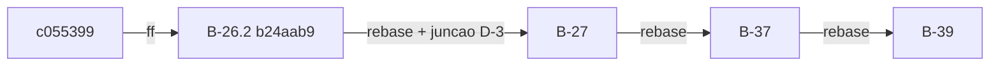

# Validação do B-26.2 (sonda de topologia) e do B-27 (portão de emissão) (2026-10-27)

> Senior, 2026-10-27. Prompts: `docs/prompt-b26-2-sonda-topologia-2026-10-27.md` e
> `docs/prompt-b27-portao-emissao-2026-10-27.md` (`afa33c8`); decisões D1..D4 do Gestor em
> `docs/decisoes-tecnicas.md` (`e70b1cf`). Entregas validadas:
>
> - B-26.2: worktree `wt-b26-2`, branch `feature/b26-2-sonda-topologia`, ponta `b24aab9` (7 commits sobre
>   `c055399`), relatório `docs/relatorio-b26-2-2026-10-27.md`.
> - B-27: worktree `wt-b27`, branch `feature/b27-portao-emissao`, ponta `503d6af` (9 commits sobre
>   `c055399`), relatório `docs/relatorio-b27-2026-10-27.md`, contrato `docs/contrato-s3-acoes-v2.md`.
>
> Sem VM, sem `tc`/`netem`, sem push, sem integração. Nenhum arquivo dos worktrees dos Workers foi
> editado. Suítes, vermelhos, mutantes, *rebase* simulado e integração simulada rodaram em cópias
> `git archive` e em clones descartáveis no *scratchpad* do Senior. JDK 22.0.2, Maven offline.

## 1. Veredito

| Bloco | Veredito | Integra? |
|---|---|---|
| B-26.2 | **Aprovado com ressalvas** | Sim, depois de um commit `test:` que versiona os brutos do *smoke* byte a byte (R26-1, seção 2.5) |
| B-27 | **Aprovado com ressalvas** | Sim, com o *rebase* local que junta `72613cf` + `ce64576` (recomendado, o Gestor decide; seção 3.5) |

Os dois blocos fazem o que os prompts pedem, os números dos relatórios batem com os que medi, os
vermelhos e os mutantes reaplicados morrem nos testes declarados, nenhum teste existente foi editado e
nenhum arquivo proibido foi tocado. Os dois não conflitam entre si nem com o B-37 e o B-39: a
integração simulada dos quatro, em cadeia linear, não teve conflito e ficou verde (seção 4).

## 2. B-26.2: sonda de topologia

### 2.1 Números medidos por mim

| Verificação | Resultado |
|---|---|
| Surefire na ponta `b24aab9` (cópia `git archive`, `clean test`) | **112 arquivos, 819 testes, 0 falhas, 0 erros, 1 ignorado** (761 + 58) |
| `test-compile` por commit (7 commits, cópia `workload` + `cluster` de cada SHA) | **7/7 com código 0** |
| Vermelhos do commit `test:` `735020e` | 112 / 819 / **47 falhas / 6 erros** / 1; todos nas 5 classes novas (Agenda 6, Classificação 15, Rodada 15, CLI 6, adaptador 11); os 761 existentes verdes. Bate com a seção 4 do relatório |
| Commit `feat:` intermediário `03a06c8` | 112 / 819 / 13 / 4 / 1, só em `ConsultaSaudeRestTest` (11) e `ConsultaSaudeRestCliTest` (6). Bate |
| `git diff --name-status c055399 b24aab9` | 45 entradas, **todas `A`**; nenhum arquivo existente modificado (logo, nenhum proibido tocado e nenhum teste existente editado) |
| Linearidade | 7 commits, sem *merge*, `c055399` ancestral |
| Mutante **M4** (`startsWith("HEALTHY")`), reaplicado | morto: 4 vermelhos (`realRebalanceando`, `primeiroCacheDaLista`, `asyncRebalanceando`, `soHealthyExato`), iguais aos do relatório |
| Mutante **M14** (`-u usuario:senha` no comando), reaplicado | morto: 1 vermelho (`comandoSemSenha`, "senha no argumento: admin:s3cr3t\"x"), igual ao relatório |
| *Smoke*: `python test_analise.py` e `python analise.py` na cópia limpa | 12 OK; exit 0 (P1, P2, P3b passam; P3a falha só em `volta_observada`; `podman_estado_igual: true`) |
| `MANIFEST.sha256` do *smoke* | confere no worktree do Worker (Windows, CRLF); **numa checkout com LF (Linux) os 4 `amostras.jsonl` falham** (R26-1) |
| Estabilidade | as 6 classes novas de B-26.2 e as 10 de B-27, 5 repetições seguidas na árvore integrada: 5/5 verdes |

### 2.2 Diff contra o prompt

- Divisão `controle/` (pura) e `session/` (adaptador e CLI) como pedida. `controle/` sem import de
  `session` nem `org.infinispan` (`ArquiteturaControleTest` e `ArquiteturaSondaTest` verdes).
- Nomes públicos fixos conferem: `LeituraSaude`, `FonteDeSaude`, `ResultadoNo` (motivos `ok`, `timeout`,
  `falha:<Excecao>`, `nos:<n><<e>`, `cache-ausente:<c>`, `cache:<c>=<s>`, na ordem pedida),
  `AmostraTopologia` (`tNs` no fim da rodada, `nosMinimo` 0 sem resposta), `SondaTopologia` (construtor
  com as rejeições pedidas, `classificar` pura, `rodada`, `iniciar`, `resumirAte`, `close`, contadores),
  `ConsultaSaudeRest.urlsDe`, `SondaTopologiaCli` sem *default* de perfil (`porRotulo(variável)`).
- Contrato V-B28.1 preservado: falha de consulta vira amostra anômala; `resumirAte` sempre devolve
  `disponivel = true` (M1 e M2 mortos pelo relatório; li o código e confirmo).
- Credenciais: só por stdin com `HealthRest.configCurl`; nenhum argumento contém a senha (M14 reaplicado).
- Agenda: no máximo `nos()` consultas em voo (*pool* fixo) e pulo contado quando a rodada anterior não
  terminou; o contador `emVoo` com "reivindicação" evita vazamento quando a consulta é cancelada antes de
  começar. Li a lógica e não achei caminho em que o contador fique negativo ou preso.

### 2.3 Desvios declarados pelo Worker e minha recomendação

| Desvio | Recomendação |
|---|---|
| Construtor público `(urls, usuario, senha)` extra e `lancamentos()` | **Aceitar.** Não muda contrato, não expõe o `LancadorCurl` e serve ao B-28.2 e ao custo do *smoke* |
| Linha de cabeçalho e linha de custo em stderr da CLI | **Aceitar.** O stdout segue o esquema exato; a CLI é só de *smoke*; o teste `saidaJsonl` confere que a senha não aparece em stdout nem stderr |
| Teste do M16 escrito de antemão, testes além de T1..T16 | **Aceitar** |
| 7 commits em vez de 6 (brutos `.txt`/`.log` consolidados em JSON por causa da D-005) | **Aceitar.** Melhor que forçar `git add` de arquivo ignorado; os 25 arquivos do MANIFEST estão todos no git |
| P3 em duas execuções (P3a 120 s sem volta; P3b 180 s) | **Aceitar P3b como a evidência do critério 7**, com P3a mantido nos brutos. O `podman start` local de 27,5 s é do ambiente, não da sonda |
| `.jsonl` com CRLF e MANIFEST calculado sobre a cópia de trabalho | **Corrigir antes de integrar** (R26-1) |

### 2.4 Pontos levantados pelo Worker

1. **Grafia `timeout` x `falha:TimeoutException`.** As duas são o mesmo fato (nenhuma resposta no
   prazo); a diferença é só qual relógio venceu primeiro, o da rodada ou o do adaptador, ambos de 1,5 s.
   O núcleo só vê a contagem, então nada muda na decisão de `S_top`. **Recomendação:** normalizar no
   B-28.2, dentro de `SondaTopologia.executarRodada`: `ExecutionException` cuja causa é
   `TimeoutException` vira `timeout`, com um teste novo. Prefiro isso à folga no prazo do adaptador,
   porque a folga depende do escalonamento e não fecha o caso por construção. Não reabrir o B-26.2.
2. **Protocolo do P3 a 180 s.** **Recomendação:** sim, para qualquer repetição local do P3 (B-28.2 ou
   integração): observar 180 s ou até a saúde do nó voltar a HEALTHY com 3 nós e mais 30 s, o que vier
   depois.
3. **`nosEsperados` no B-28.2.** **Recomendação:** mesma regra da CLI (número de itens de `--servers`),
   sem opção nova, com o valor gravado na linha de metadados do JSONL. A campanha usa sempre os três nós
   listados; um parâmetro próprio só se justifica se isso mudar.
4. HEALTHY_REBALANCING não visto no *smoke* (caches vazios rebalanceiam em milissegundos): coberto por
   T2/T3 com capturas reais e sintéticas; conferir no primeiro piloto do controlador na VM.
5. `rodada()` interrompida lança `IllegalStateException` sem entregar amostra: aceitar; o B-28.2 usa
   `iniciar()`.
6. CPU dos `curl` não medido no Windows: medir na VM no B-28.2 (`pidstat` ou `/usr/bin/time`).

### 2.5 Ressalvas

- **R26-1 (antes de integrar).** Os 4 `runs/b26-2-smoke/*/amostras.jsonl` estão no índice com LF (o
  `core.autocrlf=true` normalizou) e o MANIFEST tem o hash dos bytes CRLF da cópia de trabalho. Numa
  checkout com LF, `sha256sum -c` falha nesses 4. Os *smokes* anteriores resolveram isso com
  `runs/<smoke>/.gitattributes` contendo `* -text` (`b43-2`, `b43-6`, `integ-passo6`, e o próprio B-27).
  Correção: um commit `test:` do Worker no `wt-b26-2` com `runs/b26-2-smoke/.gitattributes` (`* -text`) e
  `git add --renormalize runs/b26-2-smoke`. Simulei num clone com os bytes CRLF reconstruídos: o commit
  toca só o `.gitattributes` e os 4 `.jsonl`, o MANIFEST não muda e passa a conferir numa checkout com
  LF. Tem de ser feito no worktree do Worker, onde estão os bytes originais.
- **R26-2 (B-28.2).** Normalização do motivo de prazo (ponto 1 acima).
- **R26-3 (B-28.2, menor).** `ConsultaSaudeRest` não lê nem fecha o stderr do `curl` e não fecha o
  stdout explicitamente. Com `-s` o stderr fica vazio e no Linux o JDK fecha os *pipes* quando o
  processo termina, então o risco é baixo; ainda assim, a 3 processos a cada 2 s, vale
  `redirectError(ProcessBuilder.Redirect.DISCARD)` e `try-with-resources` no stdout quando o B-28.2
  tocar o adaptador.

## 3. B-27: portão de emissão e *knobs* K1..K4

### 3.1 Números medidos por mim

| Verificação | Resultado |
|---|---|
| Surefire na ponta `503d6af` (cópia `git archive`, `clean test`) | **116 arquivos, 805 testes, 0 falhas, 0 erros, 1 ignorado** (761 + 44) |
| Python na ponta (`python -m unittest discover -s analysis -p "test_*.py"`) | **Ran 82 tests, OK (skipped=1)** (78 da base + 4) |
| `test-compile` por commit (9 commits) | **7/9.** `72613cf` e `7ad2fb8` falham: `PortaoS1S2Test.java:[124,25] cannot find symbol` (o parâmetro `AtomicInteger chamadas` sombreado pelo campo `List chamadas` de `OpsGravadas`). Reproduzido. `ce64576` corrige |
| Vermelhos do commit `test:` `591261c` | 116 / 805 / **37 falhas / 1 erro** / 1, todos nas 10 classes novas; os 761 existentes verdes. Bate com a seção 3 do relatório |
| Commit `feat:` intermediário `7cef2af` | 116 / 805 / 14 / 0 / 1, só nas 4 classes de `session/`. Bate |
| `git diff --name-status c055399 503d6af` | `A` em tudo, salvo `M` em `AcaoS3`, `AplicacaoS3`, `ContextoS3`, `S3Registro`, `UsuarioVirtual`, `WorkloadMain`: exatamente os permitidos. `-- workload/src/test` só com `A` (10 arquivos). Nenhum proibido tocado |
| `WorkloadMain.java` | 4 *hunks*: 2 *imports* (`PortaoDeEmissao`, `LockSupport`) e a região de `rodarCliente` (a de 11 parâmetros no lugar da antiga, a de 10 logo depois, com uma linha que delega com `livre()`). `executarRepeticao`, `executarS3` e `Cli` intactos |
| `S3Registro` / `UsuarioVirtual` | só `escreverCsv` / só `pensarNs`, como pedido |
| Mutante **N2** (`signal()` em `aoMudarPerfil`), reaplicado | morto: 1 vermelho (`PortaoDeEmissaoK1Test.acordaTodos`, "faltaram 5 threads depois da volta a NORMAL") |
| Mutante **N15** (`esperaPortaoNs` sem o K3), reaplicado | morto: 3 vermelhos (`escopoNaAplicacao`, `fimComK3EBackoff`, `simulacaoConservador`) |
| `MANIFEST.sha256` do *smoke* | os 21 arquivos versionados conferem numa checkout com LF (há `runs/b27-smoke/.gitattributes` com `* -text`); os outros 21 (CSV, `.log`, `.txt`) estão fora do git pela D-005 e só existem no `wt-b27` |
| Compatibilidade com o B-39 | `energia_proxy.ler_acoes_s3` (B-39) lê a *fixture* do B-27 sem erro: 199 ações, `t_fim_ns >= t_ns` em todas, soma de `espera_portao_ns` = 0. `AcaoS3.HEADER` é idêntico a `CABECALHO_S3_V2` do B-39 |

### 3.2 Diff contra o prompt e D1

- D1 cumprida: sobrecarga de 11 parâmetros antes da de 10, a de 10 em uma linha com `livre()`,
  `ParametrosKnobs` em JSON próprio, nenhum teste existente editado. `Random r = randomDaMistura(seed);`
  uma vez no corpo da de 11.
- `PortaoDeEmissao`: K1 com `ReentrantLock`/`Condition`, `signalAll` na troca de perfil e no
  `encerrar()`, `signal` no `sair()` (suficiente, porque cada saída libera uma vaga e todos os que
  esperam têm o mesmo predicado); limite relido a cada checagem; redução não expulsa quem já entrou.
  K3 por nome de operação (as quatro adiáveis coincidem com `SessionOps.OP_*`), sondagem pelo `Dormidor`
  com passo `min(sondagem, restante)`, `EventoK3` sempre emitido, nunca descarta. K4 pela fórmula do
  prompt, sem mudar o número de tentativas. `livre()` *singleton* sem alocação.
- `AplicacaoS3`: K3 antes da primeira tentativa, cada tentativa entre `entrar()`/`sair()` em `finally`,
  K4 sobre a base que continua dobrando, `tFimNs` depois da última tentativa, `esperaPortaoNs` = K1 + K3.
  Interrompida na espera do portão, a operação segue sem a permissão do K1 (documentado; coerente com
  "nunca descarta").
- `AcaoS3` com as duas colunas no fim e validação no construtor canônico; `HEADER` novo; as 8 primeiras
  colunas inalteradas. Nenhum consumidor existente do CSV S3 em `analysis/` ou `scripts/` na base
  (busquei), então a mudança de cabeçalho não quebra nada; só a documentação (`docs/relatorio-b33`,
  `analysis/README.md`) descreve o cabeçalho de 8 colunas e deve ser atualizada na integração de docs.

### 3.3 Desvios declarados pelo Worker e minha recomendação

| Desvio | Recomendação |
|---|---|
| D-1, cópia de `mix64` em `controle/` | **Aceitar.** Importar `session` é proibido e `MisturaV3.mix64` é *package-private*; o teste `formulaMix64` (2 000 casos contra `MisturaV3.mix64`) amarra a equivalência. Mover para um pacote utilitário comum não compensa agora |
| D-2, K1d com `RuntimeException` engolida e `AssertionError` que escapa | **Aceitar.** É a leitura certa: `executarOperacao` engole `Exception`, e só o caminho que escapa mata N4 |
| D-3, dois commits sem `test-compile` | ver 3.5 |
| D-4, P3 em duas partes | **Aceitar.** "Mesmo instante lógico de fim" não existe na simulação completa, porque K2 e K3 mudam o tempo e as decisões dos atores dependem do tempo. A parte (a) prova a igualdade do multiconjunto num roteiro determinístico; a parte (b) prova conservação (cada administrativa com exatamente um `EventoK3`, nenhum evento sem ação) na simulação completa. Registrar no B-28.2 que a restrição §4 sob controlador real se confere de novo pelo JSONL de `EventoK3` |
| D-5, validação de `AcaoS3` no commit 4 | **Aceitar** |
| D-6, teste Python da *fixture* com `skipUnless` até o commit 6 | **Aceitar** |
| N6 não morto por P1, N11 não morto por P3, N14 não morto pelo Python | **Aceitar as explicações.** N6 é equivalente só no domínio da simulação (`x < 2^53`) e morre por K2b; N11 morre por K4a e K3c; N14 morre por F1. Todos os 16 morrem por algum teste |

### 3.4 Pontos levantados pelo Worker

1. **`i1_concorrentes=49` no Q2.** O critério do prompt ("I1 = I4 = 0") se referia a violações, e deu
   zero (`Violacoes detectadas: 0`, `violacoes-rep-001.csv` só com cabeçalho, `VerificadorSanidade`
   OK). Desde o B-43.6, `i1_concorrentes` conta leituras VALID concorrentes com a primeira invalidação,
   linearizáveis, e fica fora das violações. **Recomendação:** aceitar a leitura do Worker. Nos próximos
   prompts escrevo "violações I1 = I4 = 0 (o contador `i1_concorrentes` não entra)".
2. **Leitura de P3 em duas partes.** Aceitar (D-4 acima).
3. **Cópia do `mix64`.** Aceitar (D-1 acima).
4. **Relógios no B-28.2** (`FonteDeTempo` no portão, `RelogioS3` na ação): os dois são monotônicos e,
   nos testes, o mesmo relógio falso. Sem objeção; o B-28.2 deve criar o portão com a mesma
   `FonteDeTempo` do laço de controle.

### 3.5 D-3: aceitar ou *rebase* local

Fatos medidos:

- `72613cf` e `7ad2fb8` não compilam os testes. A mensagem de `7ad2fb8` afirma "Surefire 805/0/0/1",
  o que é falso naquele SHA.
- Nada foi publicado.
- Para manter o histórico linear, o B-27 **terá de ser rebaseado de qualquer forma** na integração,
  porque tem a mesma base (`c055399`) que o B-26.2 (e que o B-37 e o B-39). Todos os SHAs do B-27 mudam
  no *rebase*, com ou sem a junção. O argumento de preservar os SHAs citados no relatório e no
  `jars.json` não se sustenta.
- Simulei a junção num clone descartável: `7cef2af` → (`72613cf` + `ce64576` num commit só, com a
  mensagem de `72613cf`) → `7ad2fb8` → `f6eb886` → `49e085a` → `503d6af`. Sem conflito; a **árvore
  final é idêntica** à de `503d6af` (mesmo *tree* `6d82863`); **todos os commits compilam**; o commit
  `test:` juntado fica com 805 / 14 / 0 / 1 (vermelhos só nas classes novas, como em `7cef2af`) e o
  `feat:` seguinte com **805 / 0 / 0 / 1**, de modo que a mensagem de `7ad2fb8` passa a ser verdadeira.
  Depois disso o *rebase* sobre o B-26.2 também não teve conflito.

**Recomendação:** autorizar o *rebase* local, feito pelo coordenador ou pelo Worker na mesma operação
que rebaseia o B-27 sobre a ponta do B-26.2. A sequência sem `-i` é a da simulação: *cherry-pick*
`-n` de `72613cf` e de `ce64576`, `commit -C 72613cf`, depois *cherry-pick* de `7ad2fb8`, `f6eb886`,
`49e085a` e `503d6af`. Em seguida vem um commit `docs:` que acrescenta ao relatório um mapa
SHA antigo → novo, cita o `f6eb886` do `jars.json` (a árvore de `workload/` é a mesma, então o jar é o
mesmo) e diz que D-3 foi resolvido por *rebase* autorizado. Manter uma *ref* local
`backup/b27-portao-emissao-503d6af` até a integração fechar. Sem *force-push*, porque nada está no `origin`.

Alternativa: aceitar os dois SHAs como estão, com D-3 registrado. Funciona, mas deixa dois commits que
não compilam no histórico de `feature/controlador-integracao` (atrapalha `git bisect`) e uma mensagem
de commit falsa, sem economizar nada, já que o *rebase* acontece de qualquer jeito.

### 3.6 Ressalvas

- **R27-1.** D-3 (seção 3.5).
- **R27-2.** Os brutos não versionados do *smoke* (CSV de ações completo, `rep-001.csv`, logs dos
  servidores; 21 dos 42 itens do MANIFEST) só existem no `wt-b27`. Não remover o worktree antes de
  arquivar esses arquivos junto com os dados (o mesmo vale para os *smokes* anteriores).
- **R27-3 (docs da integração).** Atualizar `analysis/README.md`, `docs/implementacao.md` e
  `docs/testes.md` para o CSV S3 v2 e apontar para `docs/contrato-s3-acoes-v2.md`.
- **R27-4 (B-28.2).** Os itens da seção 5 do prompt continuam valendo; acrescentar que a troca da chamada
  em `executarRepeticao` precisa manter `seedThread, opsAlvoPorThread, totalOps, parar, cli.mix, misturaV3`
  contíguo (argumento novo depois de `misturaV3`), senão `TokenAntigoFonteTest` fica vermelho.

## 4. Conflitos e ordem de integração

Arquivos tocados (`c055399..ponta`): B-26.2, 45 `A`; B-27, 40 `A` + 6 `M` em `session/`; B-37,
`scripts/collect-resources*.sh`, `docs/contrato-recursos-v1.md`, relatório e `runs/b37-smoke/**`; B-39,
`analysis/{fases,referencia_p99,energia_proxy,comparar_bracos}.py`, os testes, `analysis/fixtures/b39/`
e o relatório. **As quatro interseções duas a duas são vazias.** As guardas que varrem diretórios
(`ArquiteturaControleTest`, `NomesDeCacheSoNoResolvedorTest`, `PerfilFixoForaDoResolvedorTest`) foram
rodadas com os arquivos novos dos dois blocos juntos.

Integração simulada num clone descartável, em cadeia linear:

| Medida na ponta integrada (37 commits sobre `c055399`) | Resultado |
|---|---|
| Conflitos | nenhum, em nenhum passo |
| Surefire | **122 arquivos, 863 testes (761 + 58 + 44), 0 falhas, 0 erros, 1 ignorado** |
| Python (`analysis/`) | **Ran 181 tests, OK (skipped=1)** (os 177 da V-B37/B39 + 4 do B-27) |
| Compatibilidade B-27 → B-39 | leitor S3 v2 do B-39 aceita a *fixture* do B-27 (seção 3.1) |

Como os conjuntos de arquivos são disjuntos, a árvore final é a mesma em qualquer ordem. A ordem só
decide quais branches mantêm os SHAs (a primeira, por *fast-forward*) e quais precisam de mapa de SHAs
no relatório. Duas ordens servem:

- **(a) B-26.2 → B-27 → B-37 → B-39** (a que medi). O B-26.2 entra por *fast-forward* e mantém os SHAs
  citados no relatório e no `jars.json` (`7d154f3`); o B-27 é rebaseado de qualquer jeito, e a junção
  de D-3 vai junto. O B-39 entra depois do B-27, cujo contrato S3 v2 ele consome.
- **(b) B-37 → B-39 → B-26.2 → B-27**, a da `docs/validacao-b37-b39-2026-10-27.md`, seção 7. Também sem
  conflito; nesse caso o B-26.2 também é rebaseado e precisa do mapa de SHAs.

**Recomendação:** (a), pelo motivo acima. Se o Gestor já aprovou (b) na G1 da V-B37/B39, ela serve
igualmente. Em qualquer caso o coordenador mede de novo o Surefire (863/0/0/1), o Python (181 OK) e a
suíte do coletor depois do último passo.

## 5. Perguntas ao Gestor

- **H1 (B-27, D-3).** Autorizar o *rebase* local que junta `72613cf` + `ce64576` antes de `7ad2fb8`, na
  mesma operação que rebaseia o B-27 para a integração, com um commit `docs:` de mapa de SHAs e uma *ref*
  de *backup*? **Recomendação: sim** (seção 3.5).
- **H2 (B-26.2, R26-1).** Pedir ao Worker o commit `test:` com `runs/b26-2-smoke/.gitattributes`
  (`* -text`) e `git add --renormalize` antes de integrar? **Recomendação: sim**, é o padrão dos
  *smokes* anteriores e mantém o MANIFEST verificável no Linux.
- **H3 (ordem).** Integrar na ordem (a) B-26.2 → B-27 → B-37 → B-39? **Recomendação: sim**; (b) também
  serve, se já aprovada.
- **H4 (B-26.2, ponto 4).** Normalizar `falha:TimeoutException` para `timeout` no B-28.2, dentro da
  sonda, com teste? **Recomendação: sim**, sem reabrir o B-26.2.
- **H5 (B-26.2, ponto 1).** Fixar o protocolo local do P3 em 180 s (ou HEALTHY com 3 nós + 30 s)?
  **Recomendação: sim.**
- **H6 (B-26.2, ponto 6).** `nosEsperados` = número de itens de `--servers` no B-28.2, sem opção nova,
  gravado na linha de metadados do JSONL? **Recomendação: sim.**
- **H7 (B-27, Q2).** Aceitar "I1 = I4 = 0" como zero violações, com `i1_concorrentes` fora do critério?
  **Recomendação: sim.**
- **H8 (B-27, D-4 e D-1).** Aceitar a leitura de P3 em duas partes e a cópia do `mix64` amarrada por
  `formulaMix64`? **Recomendação: sim.**

## 6. Decisões do Gestor (2026-10-28)

H1..H8 aprovadas, todas pela recomendação. H1..H3 em execução por um Worker. H4..H8 são requisitos
dos prompts do B-28.2 e da leitura do P3; texto em `docs/decisoes-tecnicas.md`, "Decisões do Gestor
de 2026-10-28", e nota na tabela do B-28.2 em `docs/plano-implementacao-controlador-2026-10-22.md`.
