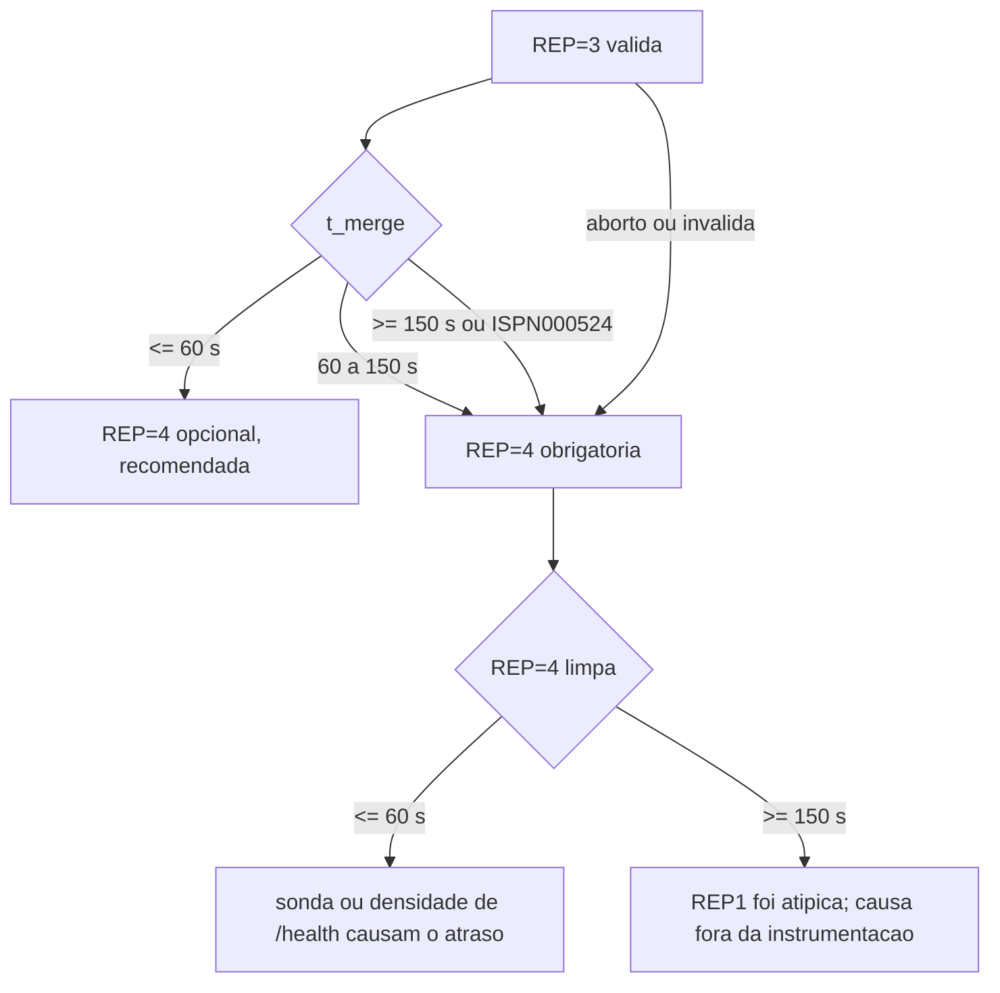

# Validacao V-B3: pacote revisado do gate (test/b29-gate-vm-v3) antes da VM - 2026-10-16

Senior. Entrega do Worker-2: branch `test/b29-gate-vm-v3` (HEAD `507c21ee6812d4ea69788277907b92b56ff13311`), bundle `gate-v3.bundle`, relatorio `docs/relatorio-gate-v3-2026-10-16.md`. Nada foi executado na VM, nenhum script foi alterado. Trabalho em clone proprio do bundle (`_vb3/c`), mutantes em copias (`_vb3/m_*`).

## Veredito: APROVADA COM RESSALVAS

As 6 correcoes de V-B2 (4.2.1 a 4.2.6) estao no codigo e cada uma e detectada por teste. Todas as suites passam. As ressalvas (secao 7) sao condicoes de execucao e de procedimento; nenhuma exige alterar os scripts nem refazer o bundle. Com as ressalvas R1 a R7 atendidas pelo Worker e a ciencia do Gestor (secao 8), o Worker pode executar a sequencia.

## 1. Integridade do bundle (conferido)

| Item | Resultado |
|---|---|
| sha256 do arquivo | `c44bb8377822bfd38e0799f0d1ebca136c6386ecd7c1ef6e80e2c0fb645a5175`, igual ao `.sha256` |
| HEAD do clone | `507c21ee6812d4ea69788277907b92b56ff13311` (confere) |
| CR em arquivos de texto | 0 (`grep -rlI $'\r'` no clone inteiro) |
| Modos | 19 arquivos `100755`: g0, g0b, g1, g1b, g5, g6 e os 4 `*.test.sh` de gate, `inject-*.sh` (+ testes), `run-baseline.sh`, `run-tlc.sh`; bibliotecas `g-lib.sh`, `g56-lib.sh`, `gate-test-lib.sh` em `100644` (so `source`) |
| 8 hashes da secao 5 do relatorio | os 8 conferem com o clone (g1, g1b, g5, g6, g56-lib, g-lib, inject-partition, inject-jitter) |
| jar | `3594c690...7bee` confere com `wt-gate-v3/workload/target/` (nao esta no bundle; vai por scp) |
| Commits | 14 em `e6e5985..HEAD` (9 na linha principal + 5 trazidos pela fusao de `tmp/vm-bundle-2`); o relatorio fala em 9 |

## 2. Suites em checkout limpo do bundle

| Suite | Git Bash | WSL (flock real) | Esperado |
|---|---|---|---|
| partition | 125/0/2 | 127/0/1 | 125/0/2; 127/0/1 |
| netdegrade | 298/0/1 (2 execucoes isoladas) | 306/0/0 | 298/0/1; 306/0/0 |
| jitter | 35/0 | 35/0 | 35/0 |
| g1.test.sh | 48/0 (3 execucoes isoladas) | 48/0 | 48 |
| g1b.test.sh | 25 ok, falhas=0 | idem | 25 |
| g5.test.sh | 50/0 | 50/0 | 50 |
| g6.test.sh | 70/0 | 70/0 | 70 |
| mvn test | 205 testes, 0 falhas, 0 erros, 3 skipped | | 205/0/3 |
| analysis (unittest discover) | 9 OK | | 9 |

Observacao de robustez (ressalva R6): na primeira passada do Git Bash, rodada **em paralelo** com a do WSL, `T-nd-13b` (SIGHUP) e `T-g1-3` (linhas de saude apos o end) falharam uma vez cada; isoladas, 3/3 (g1) e 2/2 (netdegrade) passaram. Sao testes com janelas curtas: sob carga, a temporizacao estoura. Na VM as suites devem rodar uma de cada vez e sem outra carga.

## 3. Os seis defeitos de V-B2 estao corrigidos de fato

Reproducao do defeito no `g6.sh` antigo (hash `b17fe7a5...`, o de `wt-tb`, commit `8394843`) com a bateria nova: **T-g6-5 reproduz o falso FAIL** (5 FAIL: rc 1, FAIL indevido, sem PULADA, sem PASS da janela, abort acionado). O total do g6.sh antigo contra a bateria nova foi **16 FAIL, nao 12** como diz o relatorio (54 PASS / 16 FAIL); a diferenca nao afeta a conclusao (o antigo falha mais, nao menos). Tambem reproduzidos: 8 ocorrencias de `qd|grep` (4.2.2), T-g6-6 sem "nada armado" (4.2.3), `t_f2_fim_s` e "desde o fim da F2" ausentes (4.2.6).

Mutantes (cada um em copia do clone, apenas a mutacao indicada; "detecta" = ao menos um FAIL):

| Defeito | Mutacao | Resultado |
|---|---|---|
| 4.2.1 | remover o salto de amostra tardia | detecta: T-g6-5 (5 FAIL) |
| 4.2.1 | ler o estado depois das sondas lentas (remover a leitura antecipada) | detecta: 13 FAIL |
| 4.2.1 | padrao `10 45 70` voltar a `10 45 80` | NAO detecta, e equivalente: com o salto, +80 s so e amostrada se decorrido < 85 s e o estado e lido primeiro |
| 4.2.3 | remover o teste de "nada armado" (`INJETOU`) | detecta: T-g6-2/2b/6/6b (5 FAIL) |
| 4.2.3 | remover `PID2=` da inicializacao | NAO detecta (equivalente, ver abaixo) |
| 4.2.3 | remover `[ -z "$PID2" ] \|\|` do abort | NAO detecta (equivalente, ver abaixo) |
| 4.2.4 | remover a guarda de netns do host em `inject-partition.sh` | detecta: T-par-18b/c/e (7 FAIL) |
| 4.2.5 | dead-man sem `b != a` | detecta: T-g6-7b (4 FAIL) |
| 4.2.5 | dead-man so com `b != a` (sem pid vazio, netns ilegivel) | detecta: T-g6-7c/7d (3 FAIL) |
| 4.2.6 | `espera_saudavel` sem a base `T_F2FIM` | detecta: 1 FAIL ("desde o fim da F2") |
| ordem G-6 | remover/atrasar o dead-man do netem | detecta: T-g6-1 (10 FAIL) |
| G-5 | armar depois do injetor | detecta: T-g5-6 |
| G-5 | abort que desarma o dead-man | detecta: T-g5-4/5/6 |
| G-5 | sem `exigir_go`; sem `--heal` no KILL | detecta: 8 FAIL cada |
| G-5 | aceitar rc de TERM qualquer; aceitar clsact sumido no KILL | NAO detecta (lacuna de teste menor, codigo correto por leitura) |
| g1 | sem `trap` do log de saude; log ignorando `G1_LOG_SAUDE_S=0`; log iniciado depois; sem `exigir_go`; colunas trocadas no CSV | detecta todos (3, 2, 9, 5, 8 FAIL) |
| g1b | `COLETA=minima` coletando tudo | detecta: 3 falhas |
| g6 | sem `exigir_go` | NAO detecta: **nao ha teste de "sem GO" para o g6.sh** (g5 e g1 tem). Codigo correto por leitura (linha 30, mesma funcao testada em g5/g1) |

**Mutante do abort sem o teste de PID2: aceitavel.** `INJETOU=1` so e atribuido na linha 61, depois de `PID2=$(pid_de isn2)` (linha 49, que sai com `exit 1` se o pid for invalido). Logo, "abort com INJETOU=1 e PID2 vazio" e inalcancavel; a guarda e defesa em profundidade e o mutante e equivalente. O que importa (nao tocar em nada antes de armar) e protegido por `INJETOU` e esta coberto (mutante 4.2.3 acima detectado). O mesmo vale para `PID2=` na inicializacao.

Dead-man do netem e `systemd-run` real: o teste executa o corpo como foi passado ao shim, nao o `systemd-run`. Por leitura, o corpo (um unico argumento de `bash -c`) so tem `$(...)`, `$p`, `$a`, `$b`, `$1` embutidos em palavra maior, sem `${`, sem `$$`, sem `%`: o systemd so expande `$VAR` quando e palavra isolada e `${VAR}` em qualquer posicao, e especificadores `%x`; nada disso ocorre, entao o corpo chega intacto. Tentei provar com `systemd-run --user` no WSL, mas nao ha barramento de usuario; fica como verificacao na VM (R3).

## 4. Leitura linha a linha

- `g-lib.sh`: `guarda`/`pid_de` recusam pid vazio/0, netns ilegivel e igual ao do PID 1; `sem_clsact` sem pipe; `armar` usa `systemd-run` com `--heal` (hoje com A2). Log de saude: uma amostra por porta em paralelo, `curl -m 2`, `http=000` e campos vazios se o no nao responde, `HEALTHY_REBALANCING` preservado; lacos terminados por `trap EXIT` no g1. Sem defeito.
- `g56-lib.sh`: `exigir_go` exige terminal (ou `G_TESTE=1`, so teste) e grava o `go.log`; `espera_saudavel` conta tempo **e limite** desde a base; corpo do dead-man com guarda completa; `preflight` verifica size=3 x3, sem clsact/netem nos 3 nos, 0 timers. Sem defeito.
- `g1.sh`: go -> `trap` do log -> `pid_de` (guarda) -> saude-antes (aborta fora de size=3) -> `sem_clsact` -> **log de saude antes da injecao** -> `armar` (dead-man 90+90 s) -> injecao -> amostras -> `desarmar` so apos rc 0 e sem clsact. `extrair_logs` apos a fusao e nos aborts. Dois detalhes: (a) o limite de 600 s (`G1_MERGE_LIM`) conta a partir de `t0` (inicio da injecao), ou seja, ~500 s apos o end; (b) `REP` ausente cai em `REP=1` e escreveria em `g1-rep1/` (R7). O preflight do g1 nao checa `sem_netem` nem timers (a lista manual de 6.3 cobre).
- `g1b.sh` (`COLETA=minima`): so `/health` das 3 portas + as 2 sondas; sem `/caches`, `?action=stats`, `?action=get-availability`; valor invalido aborta; `resumo.txt` registra `coleta=`. Corre sem `flock` no terminal B, certo.
- `g5.sh`: go, preflight, `armar` **dentro de `fase`**, antes do injetor, nas duas fases (cobre o KILL); sinal tolerante a injetor ja terminado; `--heal` no KILL; `desarmar` so apos a verificacao; abort deixa o dead-man armado e aciona `--heal`; espera o filho orfao (<=60 s); preflight final.
- `g6.sh`: guarda de netns em isn1/isn2/isn3 e isn2 != isn3; F3 (jitter em isn2) antes da F2; os dois dead-men antes de injetar; estado lido primeiro, amostras `10 45 70` com salto a menos de 5 s do fim da F2 e minimo de 2 validas; limpeza da F2 so toca isn3 (clsact) e a do jitter so isn2 (root); abort so limpa se algo foi armado. Dois pontos: (a) o dead-man da F2 dispara em +180 s e o fim do F3 fica em ~+135 s, entao ambos sao desarmados antes de disparar; (b) o `espera_saudavel` de 150 s desde o fim da F2 **aborta** o script se a fusao demorar mais, e o abort pula a extracao de logs e o preflight final (R2).
- `inject-partition.sh` do bundle: A2 (guarda de netns no alvo, nos pares e no `--heal`, exit 4), A1 (contadores por sentido, offset 12/16) e A3 (timestamp por linha de log). Comportamento de injecao, marcadores e exit codes 0/137/143 iguais ao da REP=2. A contagem do injetor passa a diferir (ingress != egress), irrelevante para o t_merge.

## 5. Sequencia e procedimento de recriar o cluster

Sequencia confirmada: **cluster novo -> REP=3 minima -> G-5 -> G-6 -> (cluster novo -> REP=4 com `G1_LOG_SAUDE_S=0`, sem g1b)**. Decisao do Senior sobre o ponto aberto do relatorio (6.7): **REP=4 com `G1_LOG_SAUDE_S=0`**, para ficar identica a REP1 (sem sonda, sem log, sem coleta); `t_merge.txt` do g1.sh e a medida (resolucao pior que a do log; usar tambem os instantes do `MergeView` e do `Finished rebalance` nos logs de container, que sao exatos).

Recriar (`sudo podman-compose -f cluster/podman-compose.yml down` e `up -d`):

- **E destrutivo, mas so para o cluster de teste.** `down` remove os 3 containers e a rede `infinispan-net` do projeto; **a imagem permanece** (`down` sem `--rmi`; confirmar antes com `sudo podman images | grep infinispan/server` e a tag 15.0.21.Final, para o `up` nao depender de rede). Nao toca no host (iptables/NIC da VM), no SSH nem em `runs/`. Os `volumes:` do compose sao so os dois XML de configuracao, somente leitura; nao ha volume nomeado nem persistencia nos caches.
- **O que se perde**: todo o conteudo em memoria (sessions, counters e seus valores), ids de topologia e historico de vistas (esse e o objetivo: remover H3), e os **logs dos containers** (`podman logs` some com o container). Os logs de REP1/REP2 ja foram extraidos para arquivo; qualquer execucao anterior sem extracao (G-0, ensaios) e perdida.
- **Seguro?** Sim, com cuidado: containers tem nome fixo, entao se o `down` nao achar o projeto (outro diretorio/nome de projeto) o `up` falha por conflito de nome sem destruir nada. Deve ser feito com o mesmo `-f` e o mesmo diretorio do `up` original; conferir antes `sudo podman ps -a`.
- **Validacao**: o relatorio usa `sleep 60` e uma leitura. Insuficiente: exigir `/health` HEALTHY com `number_of_nodes=3` nas 3 portas em **leituras consecutivas por >= 20 s** (laco com limite de 180 s), vista de 3 membros nos logs, 0 timers `tcc-heal`, netns limpos (so `noqueue`), e registrar a **idade do cluster** no inicio da REP (para a comparabilidade).

## 6. Criterios objetivos

**Classificacao da REP=3** (t_merge = maximo, entre as 3 portas, do tempo do `event=end` ao primeiro `HEALTHY` com `size=3` no `saude-log.csv`; conferir com `t_merge.txt`; REP valida se injetor rc=0, sem abort, janela real 96 +/- 1 s):

| Faixa | t_merge | Leitura |
|---|---|---|
| ~48 s (como REP1) | <= 60 s | sonda minima e `/health` a 2 s inocentes; REP2 foi H2 (coleta completa) ou H3 (historico); REP=4 opcional (recomendo faze-la: e a unica via de 3 janelas comparaveis REP1/REP3/REP4) |
| ~188 s (como REP2) | >= 150 s, ou `ISPN100014`/`ISPN000524` (timeout de 60 s na resolucao de conflitos) nos logs | H1 (sonda) **ou** densidade de `/health` na REP=3 (nao separaveis); REP=4 obrigatoria |
| intermediaria | 60 a 150 s | ambigua; REP=4 obrigatoria |

**G-5 PASS** (`runs/gate-b29/g5/resultado.txt`, todos): TERM rc=143; sem clsact apos o trap; marcadores start e end uma vez cada; size=3 HEALTHY <= 150 s; KILL rc=137; clsact **fica**; sem `end`; `--heal` rc=0; sem clsact apos o heal; size=3 HEALTHY <= 150 s; preflight final limpo (0 timers); linha "G-5 concluido"; **nenhuma** linha `FAIL` ou `ABORTADO`, e `abort-heal.log` ausente. **FAIL**: qualquer um falhar ou aparecer `FAIL`/`ABORTADO`/timer residual.

**G-6 PASS** (`g6/resultado.txt`): "PASS durante a janela ... (N amostras validas)" com N >= 2 (linhas `PULADA` aceitaveis, no maximo 1); F2 rc=0; isn3 sem clsact apos a F2; a limpeza da F2 **nao** removeu o netem de isn2; F3 rc=0; isn2 sem netem; isn3 limpo; "size=3 HEALTHY apos N s desde o fim da F2" dentro do limite; preflight final limpo; "G-6 concluido"; nenhuma linha `FAIL`/`ABORTADO`. O tempo desde o fim da F2 e **dado**, nao deve ser agregado ao G-4. **FAIL**: qualquer linha `FAIL`/`ABORTADO` ou residuo.

## 7. Ressalvas (o Worker deve atender; nenhuma altera script)

- **R1 (backup antes do checkout).** O relatorio diz que `g1-rep1/` e `g1-rep2/` sao untracked na VM e "nao sao sobrescritos". Isso so vale se estiverem untracked: se a VM os tiver **commitados** no branch atual, `git checkout -B ... FETCH_HEAD` os **remove da arvore** (o novo branch nao os tem). Antes: `git status`, `git branch`, e `cp -a runs/gate-b29 ~/backup-gate-b29-pre-v3`. Alternativa mais segura: clonar o bundle em diretorio novo e usar `TCC_DIR`.
- **R2 (G-6).** Executar com `G6_LIMITE_S=300` (variavel existente): se a fusao pos-F2 repetir os ~188 s da REP2, o limite padrao de 150 s abortaria o script e perderia logs e preflight final, e o "FAIL" seria de convergencia, nao de coexistencia. Em qualquer abort, o Worker extrai `podman logs --since` dos 3 nos manualmente antes de recriar o cluster.
- **R3 (dead-man do netem, verificacao na VM, nao invasiva).** Antes do G-6: `sudo systemd-run --unit=tcc-dmtest --on-active=5s bash -c "$DEADMAN_NETEM_CORPO" _ nao-existe` e conferir no `journalctl -u tcc-dmtest` a mensagem "NAO tocado" (prova que as aspas e o `$` sobrevivem ao systemd sem tocar em nenhum no). Exige ciencia do Gestor por ser acao nova na VM (inerte).
- **R4 (recriar o cluster).** Seguir a secao 5: `podman ps -a`, imagem presente, dump de `podman logs` e `podman inspect` antes do `down`, validacao em leituras consecutivas, idade do cluster registrada. Parar se `up` nao fechar size=3 HEALTHY em 180 s.
- **R5 (`inject-partition.sh` difere da REP=2).** Registrar na ordem de execucao e no relatorio da VM (secao 8). Sem efeito sobre t_merge.
- **R6 (suites na VM).** Uma por vez, sem carga paralela; relatar falhas intermitentes como tal, sem repetir ate passar sem registrar.
- **R7 (REP sempre explicito).** `REP=3` e `REP=4` em toda linha de comando; `g1.sh` sem `REP` escreve em `g1-rep1/`. Conferir o rotulo no prompt do GO.
- Pontos menores, sem acao: `/health` em paralelo (g1b minimo + log a 2 s + `health()` do g1.sh) aumenta a carga REST de isn3 em relacao a REP1; por isso a faixa "188 s" nao prova H1 e a REP=4 e a contraprova. `g6.sh` pula amostras tardias e exige 2 validas: aceito (pior caso: a amostra +70 s comeca por volta de +72 s, antes do corte de +85 s). Formato novo do `go.log` (`go G-1 (REP=N, janela de 90 s em isn3) <data> vm=<ip> sha=<sha>`): aceito, nada o le. Lacunas de teste (sem teste de "sem GO" no g6; TERM com rc diferente de 143 e KILL sem clsact nao tem caso negativo): codigo correto por leitura, registradas.

## 8. Go do Gestor: o que ja existe e o que falta

Registrado no `go.log` da VM (REP=1 em 2026-10-16T05:11, sha `4978e1c`; REP=2 em T06:48, sha `5448791`). Conforme informado no pedido e em V-B2 (secao 5):

| Acao | Situacao |
|---|---|
| REP=1, REP=2 | go dado e executado |
| REP=3 (g1.sh + g1b minimo) | go dado; o pacote revisado e subconjunto da coleta autorizada, **nao exige novo go**, mas o log de saude a 2 s e carga nova: informar |
| G-5, G-6 | go dado "desde que o bundle seja o revisado": e o caso (hashes novos conferidos); **nao exige novo go**, exige a ciencia do item abaixo |
| Recriar o cluster | "sim" do Gestor; **confirmar se cobre as duas recriacoes** (antes da REP=3 e antes da REP=4) |
| REP=4 limpa | "sim" condicional (regra da secao 6) |
| L-0 / L-1 | **NAO** autorizados; fora desta sequencia |

Nao ha go novo obrigatorio. Pedir ao Gestor **ciencia explicita** de: (1) `inject-partition.sh` com guarda A2 diferente do da REP=2; (2) R3 (teste inerte de `systemd-run`); (3) as duas recriacoes; (4) `G6_LIMITE_S=300` e `G1_LOG_SAUDE_S=0` na REP=4. Alem disso, o proprio `exigir_go` e interativo: **o Gestor deve digitar GO** em cada uma das 4 execucoes (REP=3, G-5, G-6, REP=4); o Worker nao pode prosseguir sem ele no terminal.

Nada vai para `origin/*` sem aprovacao explicita.
