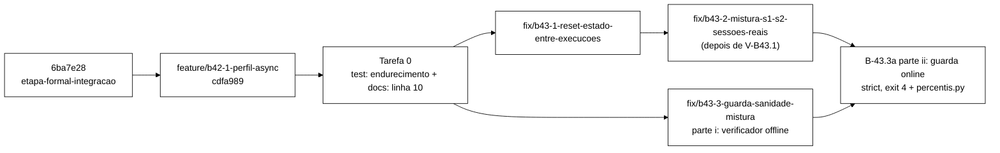

# Validação V-B42.1: perfil ASYNC selecionável (2026-10-22)

> Senior, 2026-10-22. Validação independente da entrega do Worker na branch
> `feature/b42-1-perfil-async` (worktree `wt-b42-1`), commits `69352c1..cdfa989` sobre `6ba7e28`,
> relatório `docs/relatorio-b42-1-2026-10-22.md`. Nada foi alterado em `wt-b42-1`. Os testes por commit e
> as mutações rodaram numa worktree destacada temporária no *scratchpad*, removida no fim. Nenhum
> *cluster* subiu e a VM não foi usada. Commit local nesta branch (`docs/plano-implementacao-controlador`),
> sem push.

## 1. Veredito

**APROVADA COM RESSALVAS.** O código entregue está correto: a leitura dos diffs, o Surefire medido
commit a commit e os brutos do *smoke* conferem com o relatório. As ressalvas são três:

1. **Lacuna de teste (R1).** De 9 mutantes meus, 5 sobrevivem. Os testes pegam um *literal*
   reintroduzido e uma divergência entre irmãos no XML. Não pegam um **perfil fixo**
   (`PerfilReplicacao.SYNC` no lugar de `cli.replicacao`), que faria uma execução `--replication async`
   gravar nos *caches* SYNC sem nenhum aviso. Também não pegam **papéis trocados**
   (sessões ↔ contadores) nem uma **deriva simultânea** do SYNC e do irmão ASYNC (por exemplo, o
   `acquire-timeout` dos dois). Só o *smoke* (tamanhos por *cache*) separaria o primeiro caso. Para a
   comparação SYNC × ASYNC esse é o modo de falha mais caro. Recomendo um commit `test:` de
   endurecimento antes da integração (seção 5, Tarefa 0 do prompt).
2. **Doc desatualizada (D8).** A linha 10 de `docs/configuracao-infinispan.md` agora está errada.
   Deve ser corrigida, num commit `docs:` de uma linha.
3. **Números do *smoke* S1 sem valor de evidência.** O *smoke* S1 sync/async tem o mesmo defeito C1/C2
   do diagnóstico aprovado (seção 4). "0 violações" é vácuo. O *smoke* vale **só** como prova de que a
   seleção de *caches* funciona de ponta a ponta.

## 2. Alterações no relatório depois de `cdfa989` (aviso do *harness*)

Não houve alteração. `git status` em `wt-b42-1` está limpo e `git diff cdfa989 -- docs/relatorio-b42-1-2026-10-22.md`
sai vazio. O `git hash-object` do arquivo no disco (`161afe0…`) é igual ao *blob* em `cdfa989`. O `mtime`
(02:57:57.136) é o próprio instante do commit (02:57:57 -0300). O reflog não tem nenhuma operação depois
do commit, e o `atime` de 03:00:49 corresponde só a uma leitura. O aviso foi espúrio, provavelmente
disparado pela escrita imediatamente anterior ao commit. Nem o Worker nem outro agente editaram o
arquivo, e não havia nada a reverter.

## 3. Medido × alegado

| # | Alegação do relatório | Medido pelo Senior | Confere? |
|---|---|---|---|
| 1 | Surefire 275/0/0 antes (`6ba7e28`), 33 arquivos | `mvn clean test` em `6ba7e28`: exit 0, 275/0/0/0, 33 arquivos | sim |
| 2 | 296/0/0 depois, 36 arquivos | `mvn -f workload/pom.xml clean test` em `wt-b42-1` (HEAD `cdfa989`): exit 0, 296/0/0/0, 36 arquivos | sim |
| 3 | Cada commit intermediário verde (280, 284, 290, 296) | `69352c1` 280/0/0, `4147c40` 284/0/0, `771744f` 290/0/0, `83f0bbd` 296/0/0, todos com exit 0. `a6fa048`, `09f2434` e `cdfa989` não tocam `workload/` nem `cluster/` (`git diff --stat 83f0bbd cdfa989 -- workload cluster` vazio) | sim |
| 4 | `GoldenS1S2Test` e recursos byte a byte iguais | `git diff --quiet 6ba7e28 HEAD -- …/GoldenS1S2Test.java workload/src/test/resources` sai com 0 | sim |
| 5 | Nenhum teste existente alterado | `--name-status`: só `M CliTest`, `M SondaHotrodTest` e três `A`. `--numstat` dá 70/0 e 24/0, sem nenhuma linha removida | sim |
| 6 | M1 (`getCache("sessions")`) morta | Não reexecutei M1 (fiz a minha N3, que é diferente). Pela leitura de `NomesDeCacheSoNoResolvedorTest` (regex `GETCACHE_LITERAL` e `LITERAL`), M1 é pega pelas duas asserções citadas | sim, por leitura |
| 7 | M2 (`owners` divergente) e M3 (`merge-policy`) mortas | Não reexecutei. A asserção correspondente existe em `irmaosTemOwnersSegmentsEPartitionHandlingIguais` e `irmaosSoDiferemNoModo`. Matei uma variante (N9, `striping` só no irmão) | sim, por leitura e N9 |
| 8 | Caches SYNC (XML l.22-32) inalterados | `diff` das linhas 22-32 entre `6ba7e28` e HEAD: idênticas. Só mudaram o comentário de cabeçalho (l.2-9) e os blocos novos (l.34-45) | sim |
| 9 | Smoke: os 4 caches HEALTHY nos 3 nós, antes e depois | 6 JSON de *health*: todos `HEALTHY`, `number_of_nodes=3`, e `sessions`, `counters`, `sessions-async` e `counters-async` `HEALTHY` em cada um | sim |
| 10 | `MANIFEST.sha256` confere | `sha256sum -c`: 43/43 `OK` | sim |
| 11 | "42 arquivos mais `MANIFEST.sha256`" | O manifesto e o disco têm **43** arquivos (fora o manifesto) | **não** (erro de contagem, irrelevante) |
| 12 | Config efetiva: SYNC e ASYNC com os mesmos owners/segments/partition | Os `config-*.json` conferem. O servidor acrescenta `remote-timeout=17500` só aos SYNC, que é o *default* do servidor e não se aplica a ASYNC | sim (nota) |
| 13 | 0 `ERROR` nos logs dos servidores | `grep -c ERROR isn{1,2,3}.log` = 0/0/0 | sim |
| 14 | Carga `async` só povoa os `-async` | `tamanhos-apos-S1-sync`: 185/4/0/0. `tamanhos-apos-S1-async`: 185/4/101/4 | sim |
| 15 | S1 sync/async: "0 violações" | Confere com o *stdout*, mas é **vácuo** (seção 4) | número sim, valor não |
| 16 | Temp `podman-compose.b421-smoke.yml` apagado (D1) | `cluster/` tem só os três arquivos versionados | sim |
| 17 | Nenhum consumidor do *stdout* afetado (D4) | Nenhum *parser* de linhas do *stdout* em `scripts/` ou `analysis/` | sim |
| 18 | Literais só em `PerfilReplicacao` | `grep '"sessions\|"counters' workload/src/main` fora do resolvedor: vazio. Fora do Java, só o XML e capturas JSON de teste | sim |

## 4. O *smoke* S1 sync/async também tem C1/C2. Os números não servem como evidência

Contagem `operation × return_code` em `runs/b42-1-smoke/S1-{sync,async}/rep-001.csv`:

| Célula | Login | Login `OK` | Validate `VALID` | Validate `NONE` | Logout `NONE` | IncrementFailure | ResetFailures |
|---|---|---|---|---|---|---|---|
| S1-sync | 109 687 `BLOCKED` | **0** | **0** | 217 008 | 43 318 | 43 801 `COUNTED` | 21 584 `NONE` |
| S1-async | 116 232 `BLOCKED` | **0** | **0** | 231 684 | 46 311 | 46 545 `COUNTED` | 23 295 `NONE` |

Identidade aritmética do diagnóstico (§2.2), aplicada ao *stdout*:

- S1-sync: registrados + descartados = 435 398 + 136 331 = 571 729, contra 571 359 operações.
  A diferença de 370 dá **185 logins OK, todos no *warm-up***. É exatamente o `sessions=185` medido.
- S1-async: 464 067 + 188 548 = 652 615, contra 652 413 operações. A diferença de 202 dá **101 logins
  OK no *warm-up***, e `sessions-async=101`.

Os *caches* começaram vazios (`tamanhos-antes.txt`: tudo 0). Por isso C3 **não** atua no S1 deste
*smoke*. Mesmo assim as quatro identidades bloquearam ainda no *warm-up* e a janela de medição ficou
sem nenhuma sessão. Essa é a confirmação empírica do §2.3 do diagnóstico: C1 sozinho basta, e só o
*reset* não resolve. C2 também está presente (`Validate`/`Logout` isolados em `sid-*`, 100 % `NONE`).

Consequências, que registro aqui sem editar o relatório:

- Não servem como evidência de consistência nem de desempenho: "571 359 / 652 413 operações",
  "0 violações", "convergência em 3 rodadas", "varredura com 185/101 sessões e 0 achados" e as latências.
  São caminhos de recusa e de chave ausente.
- O S3 async (`s3-resumo`: 22 `OK_LOGIN`, 379 `VALID`) **não** é vácuo, porque C1/C2 não se aplicam ao S3.
  Mesmo assim sofre C3: rodou no mesmo *cluster*, logo depois do S1 async, sem limpeza, e a varredura
  leu chaves alheias. É uma única execução de 30 s. Também não é evidência.
- O único fato que o *smoke* comprova é o de B-42.1: `--replication` escolhe o par de *caches*, os quatro
  *caches* existem com o `mode` certo no servidor, e cada perfil escreve só no seu par.

## 5. Mutantes do Senior

Nove mutantes, cada um com `mvn clean test` completo. Nenhum coincide com M1, M2 ou M3.

| ID | Mutação | Resultado | Teste que mata |
|---|---|---|---|
| N1 | `SessionOps.java:98`: sessões abre `perfil.cacheContadores()` (papéis trocados) | **sobrevive** (296/0/0) | nenhum |
| N2 | `WorkloadMain.java:129`: `new SessionOps(rcm, PerfilReplicacao.SYNC, …)` (perfil fixo) | **sobrevive** | nenhum |
| N3 | `WorkloadMain.java:285`: `healthy(cacheSessoes())` duas vezes, sem contadores | **sobrevive** | nenhum |
| N4 | `PerfilReplicacao`: `ASYNC("")` (perfis colapsam) | morta: 8 falhas e 1 erro | `PerfilReplicacaoTest`, `CliTest`, `ClusterXmlIrmaosTest`, `SondaHotrodTest` |
| N5 | `SondaHotrod.java:103`: padrão fixo `SYNC.cacheSessoes()` | morta | `SondaHotrodTest.semCachesOPadraoSegueOPerfil` |
| N6 | `Cli.java:219`: `defaultValue = "async"` | morta | `CliTest.replicacaoPadraoSync`, `dryRunMostraPerfil` |
| N7 | `S3Clientes.java:115`: admin com `PerfilReplicacao.SYNC` | **sobrevive** | nenhum |
| N8 | XML: `acquire-timeout` 15000 → 5000 em `sessions` **e** `sessions-async` | **sobrevive** | nenhum (`syncInalterado` só fixa owners/segments/partition) |
| N9 | XML: `striping="true"` só em `sessions-async` | morta | `ClusterXmlIrmaosTest.irmaosSoDiferemNoModo` |

Leitura: a guarda de B-42.1 verifica **de onde vem o nome** (o perfil, não um *literal*), mas não
verifica **qual perfil** nem **qual papel**. N2 e N7 são os casos graves: uma bateria "ASYNC" que mede
SYNC, ou um S3 com o admin num par e os servidores de aplicação no outro. N8 mostra que o *baseline*
SYNC não está totalmente fixado. Endurecimento recomendado (Tarefa 0 do prompt, na própria branch de
B-42.1):

- (a) em `workload/src/main`, nenhuma referência a `PerfilReplicacao.SYNC`/`.ASYNC` fora de
  `PerfilReplicacao.java`, a não ser os dois *defaults* declarados (`Cli.replicacao` e
  `SondaHotrod.Args.parse`), numa *allow-list* por arquivo e conteúdo da linha. Mata N2, N7 e
  (por N5) a regressão da sonda;
- (b) papel: `getCache(...)` atribuído a `RemoteCache<String, SessionState>` ou com tipo
  `<String, SessionState>` tem de usar `cacheSessoes()`, e `IdentityState` tem de usar
  `cacheContadores()`. A chamada `healthy(...)` aparece em par, sessões primeiro. Mata N1 e N3;
- (c) `ClusterXmlIrmaosTest.syncInalterado` compara **todos** os atributos e filhos de `sessions` e
  `counters` com um instantâneo do *baseline* (`6ba7e28`), sem usar só owners/segments/partition. Mata N8.

## 6. Desvios

| Desvio | Avaliação | Recomendação |
|---|---|---|
| **D1**, containers `b421-isnN` no *smoke* | Correto e bem documentado. O que importa para a validade foi preservado: imagem, comando, *hostnames*/aliases que o TCPPING usa, montes e *healthcheck*. Evitou recriar os `isn1..3` de outra worktree. O arquivo temporário não foi versionado e já não existe | **Aceitar.** Para os próximos *smokes* locais, registrar no relatório o `podman ps -a` antes e depois, como prova de que os `isn1..3` antigos não foram tocados |
| **D2**, máquina Podman iniciada e parada | Correto (estado restaurado) | Aceitar |
| **D3**, perfil obrigatório nos construtores de `SessionOps`, sem padrão implícito | É a escolha certa: um *default* SYNC silencioso seria exatamente a falha N2 sem nem precisar de mutação. Só há dois chamadores. A parametrização de `valorDeTeste` também está correta | **Aceitar.** O complemento é a guarda (a) da seção 5, porque exigir o parâmetro não impede passar uma constante. Opcional: `Objects.requireNonNull(perfil)` para falhar com mensagem clara |
| **D4**, linha `Replicacao: …` nova no *stdout* | Aditiva. `Cli.toString()` não mudou, e nenhum *script* nem `analysis/` faz *parse* do *stdout* por linha | **Aceitar.** É uma informação útil para auditoria de baterias |
| **D5**, `java` 8 no PATH, *smoke* com `$JAVA_HOME` | Correto | Aceitar. Registrar o mesmo em todo *smoke* |
| **D6**, horário | Sem impacto | Aceitar |
| **D7**, `ClusterXmlIrmaosTest` exige exatamente 4 caches | Intencional e útil, porque funciona como alarme contra *cache* novo não previsto. B-43 não cria *caches* (o *reset* limpa os existentes) | **Aceitar.** Se um item futuro criar *cache*, ele mesmo atualiza o teste, num commit `test:` explícito |
| **D8**, linha 10 de `docs/configuracao-infinispan.md` | Agora é **falsa**: diz que o descritor define só `sessions`/`counters`, em modo síncrono | **Atualizar.** Um commit `docs:` de uma linha na branch de B-42.1 (Tarefa 0), por exemplo: "Define os *caches* `sessions`/`counters` (DIST_SYNC, controle) e os irmãos `sessions-async`/`counters-async` (DIST_ASYNC, alvo), com partição tratada por `DENY_READ_WRITES`; o *workload* escolhe o par por `--replication`." |

## 7. Base de B-43.1 e B-43.2

**Concordo com a recomendação: devem partir de `feature/b42-1-perfil-async`**, depois da Tarefa 0.

- O *reset* de B-43.1 tem de limpar **os caches do perfil** em uso. Sem `PerfilReplicacao`, teria de
  repetir os *literais*, e a guarda de B-42.1 ficaria vermelha na integração.
- B-43.2 reescreve `WorkloadMain.rodarCliente` e o ponto em que `SessionOps` é criado, que B-42.1
  alterou (`WorkloadMain.java:129`). Partir de `6ba7e28` garante conflito.
- O B-43.3a offline (verificador) toca só arquivos novos e pode partir do mesmo ponto, em paralelo
  com B-43.1.



O ligamento *online* da guarda (`--sanity strict` no `WorkloadMain`, saída 4) **não** entra agora.
Com a mistura atual, *strict* abortaria toda execução S1/S2, inclusive o *smoke* de B-43.1. Entra
depois de B-43.2 (parte ii), junto com a recusa em `percentis.py`.

## 8. Pontos para o Gestor

1. Aprovar a **Tarefa 0** (endurecimento dos testes e linha 10 da doc) como dois commits extras em
   `feature/b42-1-perfil-async`, antes de criar as branches de B-43.
2. Aprovar a **divisão de B-43.3a** em parte i (verificador offline, agora) e parte ii (guarda *online*
   e `percentis.py`, depois de B-43.2).
3. Os **limiares** 0,95 / `VALID > 0` / 0,05 / 2 p.p. **não** constam como aprovados. O prompt os trata
   como valores provisórios, parametrizados e gravados no JSON. Confirmar ou ajustar.
4. A **fase "fora da janela"** com marcadores é provisória: conta `antes` e `pos-convergencia`;
   `durante*` e `recuperacao` ficam "dentro".
5. O critério 5 de B-43.1 no diagnóstico ("primeiro `Login` da 2ª execução é OK no CSV") **não é
   verificável**: o CSV só tem a janela de medição, e com a mistura atual o bloqueio volta ainda no
   *warm-up*. No prompt, ele foi trocado pela identidade "eventos − operações = 2 × logins OK", com
   A/B de *reset* ligado e desligado.
6. O código de saída **5** para o *reset* e o **4** para a sanidade seguem o diagnóstico. Hoje estão em
   uso 2 (parâmetro) e 3 (falha de execução).

## Apêndice A. Prompt para o Worker: Tarefa 0, B-43.1 e B-43.3a (parte i)

> Só começa depois que o Gestor aprovar os pontos 1 e 2 da seção 8. Os pontos 3 e 4 entram como
> provisórios.

````md
Você é o WORKER. Três entregas, nesta ordem, cada uma em sua branch e worktree, com commits só
locais. **Não faça push.** Não use a VM. Não edite `tcc-escrita/`, `scripts/run-baseline.sh`,
`analysis/percentis.py`, `spec/` nem o *golden* `workload/src/test/resources/golden-8e2e815/`.
Nenhum teste já existente pode ser editado ou removido: só acréscimos, em arquivos de teste novos.
TDD: cada par teste+implementação vai num commit que compila e deixa o Surefire verde. Registre o
vermelho antes do verde. Mensagens de commit `feat:|fix:|test:|docs:|refactor:`. Diagramas em Mermaid.

Contexto obrigatório (ler antes de codar):
- `wt-plano-ctrl/docs/diagnostico-login-blocked-2026-10-22.md` (C1..C4, seção 4: B-43). Decisões do
  Gestor: B-43 aprovado; mistura v2 = desenho (a), pools disjuntos + carga de sids VALID (fica para
  B-43.2, NÃO é desta tarefa); guarda de sanidade **strict, que aborta**.
- `wt-plano-ctrl/docs/validacao-b42-1-2026-10-22.md` (seções 5 e 6: mutantes sobreviventes e desvios).

Comando de teste: `mvn -f workload/pom.xml clean test`. Some os `TEST-*.xml` (tests/failures/errors/
skipped/arquivos) antes e depois de **cada** commit e coloque tudo numa tabela no relatório.

=== TAREFA 0: endurecimento de B-42.1 (branch `feature/b42-1-perfil-async`, worktree `wt-b42-1`) ===
Base: `cdfa989`. Dois commits.

0.1 `test: guarda de perfil fixo, papel do cache e baseline SYNC completo (B-42.1)`.
Crie testes NOVOS. `NomesDeCacheSoNoResolvedorTest` e `ClusterXmlIrmaosTest` ficam sem edição.
  (a) `PerfilFixoForaDoResolvedorTest`: varre `workload/src/main/**/*.java` e falha se aparecer
      `PerfilReplicacao.SYNC` ou `PerfilReplicacao.ASYNC` fora de `PerfilReplicacao.java`. A exceção
      são os dois *defaults* declarados, numa allow-list por (arquivo, trecho exato da linha):
      `Cli.java` (`public PerfilReplicacao replicacao = PerfilReplicacao.SYNC;`) e `SondaHotrod.java`
      (`PerfilReplicacao perfil = PerfilReplicacao.SYNC;`). Inclua um teste de não-vacuidade e um
      autoteste do detector com formas conhecidas.
  (b) `PapelDoCacheTest`: em `workload/src/main`, toda chamada `getCache(...)` cujo tipo seja
      `SessionState` (pelo argumento de tipo explícito `<String, SessionState>` ou pela declaração
      `RemoteCache<String, SessionState> x =` na mesma linha) usa `cacheSessoes()`, e toda chamada com
      `IdentityState` usa `cacheContadores()`. Em `HealthRest.Estado`, as chamadas `healthy(...)`
      aparecem em par, sessões antes de contadores. Inclua um autoteste do detector.
  (c) `ClusterXmlBaselineSyncTest`: para `sessions` e `counters`, compara TODOS os atributos do
      `distributed-cache` (exceto `name`) e TODOS os filhos com os seus atributos com o instantâneo de
      `6ba7e28`, escrito literalmente no teste: `mode=SYNC owners=2 segments=64 statistics=true`;
      `locking{concurrency-level=1000, acquire-timeout=15000, striping=false}`;
      `state-transfer{enabled=true, timeout=60000}`;
      `partition-handling{when-split=DENY_READ_WRITES, merge-policy=PREFERRED_NON_NULL}`.
  Prova de eficácia: aplique na árvore de trabalho, rode o Surefire completo e reverta com
  `git checkout --`, sem commitar, os mutantes N1, N2, N3, N7 e N8 da seção 5 da validação.
  Os cinco precisam MORRER. Registre no relatório o exit e as asserções que falharam em cada um.
0.2 `docs: configuracao-infinispan linha 10 descreve os quatro caches (B-42.1)`. Troque a linha 10 de
  `docs/configuracao-infinispan.md` por: "Define os *caches* `sessions`/`counters` (DIST_SYNC,
  controle) e os irmãos `sessions-async`/`counters-async` (DIST_ASYNC, alvo), com partição tratada
  por `DENY_READ_WRITES`; o *workload* escolhe o par por `--replication sync|async`."
Aceite: Surefire 296 + k / 0 / 0 / 0; *golden* idêntico a `6ba7e28`; N1, N2, N3, N7 e N8 mortos.
Registre a Tarefa 0 num arquivo NOVO `docs/relatorio-b42-1-adendo-<data>.md`. O relatório de
`cdfa989` não é editado.

=== B-43.1: reset de estado entre execuções, com código de saída próprio ===
Branch `fix/b43-1-reset-estado-entre-execucoes` a partir da ponta da Tarefa 0. Worktree `wt-b43-1`.

Objetivo: antes do warm-up de CADA repetição (S1, S2 e S3), esvaziar os dois caches DO PERFIL em uso
(`cli.replicacao`) e provar que estão vazios. Se não esvaziarem, abortar com código de saída 5, sem
gravar `rep-NNN.csv`. A tarefa NÃO corrige a mistura (C1/C2 continuam até B-43.2).

Desenho exigido:
1. `Cli`: opção `--reset-state on|off`, padrão `on`, com conversor que rejeita outro valor
   (`ParameterException`, saída 2). Campo `public boolean resetEstado = true`. `Cli.toString()` NÃO
   muda (mesmo critério do D4 de B-42.1). `textoDryRun()` ganha a linha
   `dry-run, reset_state=on|off`.
2. Interface de produção NOVA `CacheLimpavel` { `String nome()`; `void clear()`; `int size()` }, com o
   adaptador estático `de(RemoteCache<?, ?>)`. NÃO altere `Armazem`.
3. Classe NOVA `ResetEstado`:
   `static Resultado executar(List<CacheLimpavel> caches, Duration prazo, Duration intervalo,
   LongSupplier relogioNs, Sono sono)`. Lê `size()` de cada cache (tamanhos_antes), chama `clear()` em
   cada um e depois consulta `size()` até TODOS darem 0 ou o prazo vencer. Isso é necessário porque em
   ASYNC o `clear` chega aos donos de forma assíncrona. Padrão: prazo 10 s, intervalo 100 ms. `Sono`
   é uma costura de teste: nenhum teste dorme de verdade. `Resultado` é um record com caches,
   tamanhos_antes, tamanhos_depois e duracao_ms. Falha (prazo vencido, ou exceção em `clear`/`size`,
   como `AvailabilityException` em partição degradada) lança `EstadoNaoLimpoException`, que carrega o
   `Resultado` parcial e o motivo.
4. `WorkloadMain.executarRepeticao`: o reset roda DEPOIS de abrir o `rcm` e ANTES de
   `inicioMs`/`WarmupPolicy.padrao(...)`, para não consumir warm-up. Os caches vêm de
   `rcm.getCache(cli.replicacao.cacheSessoes())` e `rcm.getCache(cli.replicacao.cacheContadores())`,
   nesta forma literal, para que a guarda de B-42.1 e a da Tarefa 0 continuem verdes sem edição.
   Extraia `static ResetEstado.Resultado prepararEstado(Cli, List<CacheLimpavel>, int rep)`
   (package-private), que:
   - com `on`: executa o reset, imprime
     `Reset: reset_state=on caches=<a>,<b> antes=<x>,<y> depois=0,0 ms=<n>` e, se `--csv-dir`,
     grava `estado-rep-NNN.json` (`reset_state`, `replicacao`, `caches`, `tamanhos_antes`,
     `tamanhos_depois`, `duracao_ms`, `veredito` OK|FALHA, `motivo`). Na falha, grava o JSON com
     `FALHA` e relança;
   - com `off`: NÃO faz nenhuma operação nos caches (nem `size`), imprime `Reset: reset_state=off` e
     grava o JSON com `reset_state=off` e o resto nulo.
5. `main`: capture `EstadoNaoLimpoException` antes do `catch (Exception)` genérico, imprima o motivo
   em stderr e use `System.exit(5)`. Extraia `static int codigoDeSaida(Throwable)` (5 para
   `EstadoNaoLimpoException`, inclusive como causa; 3 para o resto) e use-o nos dois caminhos.
   As repetições seguintes à que abortou não rodam. Documente os códigos 2, 3 e 5 (e reserve o 4
   para B-43.3a) no Javadoc de `main` e no relatório.

Testes (arquivos novos; a ordem é a do TDD):
 T1 `ResetEstadoTest.limpaEDesbloqueia`: fakes de sessões e contadores pré-populados (10 sessões,
    `user-0` com `IdentityState` BLOCKED). Use um helper de teste novo `FakeLimpavel`, que embrulha
    `FakeCaches.Cache.dados` e implementa `CacheLimpavel`, sem editar `FakeCaches`. Depois de
    `executar`, os dois ficam com tamanho 0, e um `SessionOps` montado sobre os MESMOS fakes devolve
    `OK_LOGIN` para `login("user-0", ...)`.
 T2 cache que ignora `clear` ⇒ `EstadoNaoLimpoException` com o relógio falso avançando até o prazo.
    A mensagem cita o nome do cache e o tamanho restante.
 T3 cache "ASYNC" que só chega a 0 na k-ésima consulta (k > 1) ⇒ OK, com `tamanhos_depois` = 0.
 T4 `clear()` lança `RuntimeException` ⇒ `EstadoNaoLimpoException` com a causa preservada.
 T5 `codigoDeSaida`: 5 para `EstadoNaoLimpoException` direta e embrulhada; 3 para outra exceção.
 T6 `prepararEstado` com `--csv-dir` temporário e cache que não esvazia ⇒ lança; existe
    `estado-rep-001.json` com `"veredito":"FALHA"`; NÃO existe `rep-001.csv`.
 T7 `prepararEstado` com `off` ⇒ zero chamadas a `clear`/`size` (fake contador). É o teste de
    regressão do fluxo atual.
 T8 `CliResetEstadoTest`: padrão `on`; `off`; inválidos (`ligado`, vazio, `true`) ⇒
    `ParameterException`; `textoDryRun` com a linha nova; `WorkloadMain.main --dry-run
    --reset-state off` imprime sem conectar.
 T9 Guardas de B-42.1 e da Tarefa 0 verdes SEM edição; `GoldenS1S2Test` verde sem tocar nos recursos.

Mutações (aplicar, rodar o Surefire completo, reverter; nenhuma commitada; todas precisam morrer):
 B1 só `clear()`, sem esperar `size()==0` (mata T3/T2); B2 limpa só o cache de sessões (mata T1);
 B3 `codigoDeSaida` devolve 3 para tudo (mata T5); B4 `off` chama `size()` (mata T7).

Smoke local (cluster Podman, 3 nós, SEM VM): containers com nome próprio `b431-isnN`, como no D1 de
B-42.1, e `podman ps -a` antes e depois no relatório. Use `$JAVA_HOME/bin/java`. Sequência no MESMO
cluster, S1, 30 s, `--threads 4`, `--csv-dir` separado por execução:
 R1 `--replication sync --reset-state on`; R2 `sync --reset-state off`; R3 `sync --reset-state on`;
 R4 `--replication async --reset-state on`.
Critério (substitui o critério 5 do diagnóstico, que o CSV não permite verificar): pela identidade
`registrados + descartados_warmup − Total de operacoes = 2 × logins OK`, tirada do stdout,
 - R2 dá **0** (as identidades de R1 continuam BLOCKED: o estado residual C3 fica demonstrado);
 - R1, R3 e R4 dão **> 0**;
 - o `estado-rep-001.json` de R3 tem `tamanhos_antes` > 0 e `tamanhos_depois` = 0,0;
 - todos terminam com exit 0.
Ponha os brutos em `runs/b43-1-smoke/`, com `MANIFEST.sha256`. Escreva no relatório, com destaque:
"com a mistura atual (C1/C2), os números de operações, latências e violações destas execuções NÃO
servem como evidência; o smoke prova apenas o reset".

Relatório: `docs/relatorio-b43-1-<data>.md` (resultado, Surefire por commit, arquivo:linha antes e
depois, testes, mutações, smoke, desvios, pontos para o Gestor).

=== B-43.3a, PARTE i: verificador OFFLINE de sanidade da mistura (strict, aborta) ===
Branch `fix/b43-3-guarda-sanidade-mistura` a partir da ponta da Tarefa 0 (em paralelo com B-43.1).
Worktree `wt-b43-3`. Escopo: SÓ arquivos novos, mais um acréscimo de leitura em `Scenario`. NÃO ligue
nada no `WorkloadMain` nem em `percentis.py`; isso fica para a parte ii, depois de B-43.2.

1. `Scenario`: acrescente só o acessor público `int peso(Op op)`, sem mudar pesos nem o sorteio. O
   `GoldenS1S2Test` continua verde sem edição.
2. Classe NOVA `Sanidade` (lógica pura, sem I/O):
   - `registrar(String operation, String returnCode, String fase)` acumula `operation × return_code`
     por região. Região "fora" = sem coluna `phase`, ou `phase` ∈ {`antes`, `pos-convergencia`}.
     Região "dentro" = `durante`, `durante-pre-split`, `durante-pos-split` e `recuperacao`.
   - `Limiares`: um record com os valores PROVISÓRIOS do diagnóstico, `loginOkMin=0.95`,
     `validNotFoundMax=0.05`, `misturaToleranciaPp=2.0`, mais a regra `Validate VALID > 0`.
   - `avaliar(Scenario, Limiares)` devolve `Veredito` (`OK` | `FALHA`), uma lista de motivos com
     código estável e texto, as contagens e as métricas. Regras, calculadas na região "fora":
       JANELA_VAZIA         nenhum evento fora;
       LOGIN_AUSENTE        Login = 0;
       LOGIN_OK_BAIXO       OK/(OK+BLOCKED) < loginOkMin   (texto: "Login OK = 0,0 %");
       VALIDATE_VALID_ZERO  contagem(Validate, VALID) = 0  (texto: "Validate VALID = 0");
       VALIDATE_AUSENTE_ALTO (Validate NONE + Validate NOT_FOUND)/Validate > validNotFoundMax
                            (aceitar `NONE` e `NOT_FOUND`, para valer antes e depois de B-43.4);
       MISTURA_DESVIO       com ops = eventos − 2·loginOk, frações por operação
                            Validate=(V − loginOk)/ops, Logout=(L − loginOk)/ops, Login=Login/ops,
                            IncrementFailure/ops e ResetFailures/ops, comparadas a `peso/100`;
                            |desvio| > tolerância em p.p. ⇒ um motivo por operação.
     Na região "dentro", se houver: DENTRO_SEM_VALID quando Validate VALID = 0 e nem todos os
     eventos de lá são `ERROR_*`.
3. Classe NOVA `VerificadorSanidade` (CLI offline): `--csv <arquivo> --scenario S1|S2 [--saida <json>]`.
   Leitura em streaming (o CSV real tem 57 MB). Colunas por NOME do cabeçalho, com `phase` opcional.
   Cabeçalho sem `operation`/`return_code` ⇒ saída 2. `S3` ⇒ saída 2 com "S3: guarda propria na
   parte ii". Escreve um JSON com `arquivo`, `sha256` do CSV, `cenario`, `limiares`, `contagens`,
   `metricas`, `veredito`, `motivos` e `versao`. Códigos: **0 = OK, 4 = FALHA, 2 = uso/arquivo
   inválido**. Não existe modo leniente: a decisão do Gestor é "strict aborta". Exponha
   `static int executar(String[] args, PrintStream out)` para teste e deixe `main` chamar
   `System.exit(executar(...))`.

Testes. O PRIMEIRO teste a escrever, e o primeiro vermelho registrado, é a regressão de junho:
 S1 `SanidadeRegressaoJunhoTest.s1F1Rep001DaFalha`: recurso NOVO
    `workload/src/test/resources/sanidade/S1-F1-rep-001-head.csv` = cabeçalho + as primeiras 5 000
    linhas de dados de `tcc-desenvolvimento/runs/S1-F1/rep-001.csv`. Ao lado, um `LEIAME.md` com a
    origem, o SHA-256 do arquivo completo
    (`5ea464aeb2b0ffad738f63fb5cb30e79a0f447a9195825828659eea0023aa198`) e o do recorte.
    `executar(--csv <recurso> --scenario S1)` ⇒ **4**, veredito `FALHA`, motivos CONTÊM
    `LOGIN_OK_BAIXO` e `VALIDATE_VALID_ZERO` (use `contains`, não igualdade, porque no recorte o
    MISTURA_DESVIO pode aparecer por ruído amostral).
 S2 o mesmo sobre o arquivo COMPLETO, ativado por `-Dsanidade.csvJunho=<caminho>`
    (`@EnabledIfSystemProperty`). Além de 4 e dos dois motivos, as contagens EXATAS:
    Login BLOCKED 161 064; Validate NONE 320 336; Logout NONE 64 922; IncrementFailure COUNTED 63 905;
    ResetFailures NONE 32 402; total 642 629; Login OK 0; Validate VALID 0. Rode uma vez e cole a
    saída no relatório.
 S3 fixture sã SINTÉTICA gerada no teste: `Scenario.S1` com `new Random(42)`, 20 000 operações, todo
    Login `OK` seguido de Validate `VALID` e Logout `NONE`, Validate isolado `VALID`, contadores
    `COUNTED`/`NONE` ⇒ **0**, `OK`, sem motivos. O mesmo com `Scenario.S2`.
 S4 um caso por regra, partindo da fixture sã: 90 % de Login OK ⇒ LOGIN_OK_BAIXO; nenhum VALID ⇒
    VALIDATE_VALID_ZERO; 6 % de Validate NOT_FOUND ⇒ VALIDATE_AUSENTE_ALTO (testar as grafias `NONE` e
    `NOT_FOUND`); Validate deslocado 3 p.p. ⇒ MISTURA_DESVIO; CSV só com cabeçalho ⇒ JANELA_VAZIA.
 S5 coluna `phase`: falha só em `durante` não derruba "fora"; "dentro" sem VALID e com eventos não-ERROR
    ⇒ DENTRO_SEM_VALID; "dentro" 100 % `ERROR_*` ⇒ sem esse motivo.
 S6 cabeçalho sem `return_code` ⇒ 2; `--scenario S3` ⇒ 2.
Mutações (todas precisam morrer): V1 `<` vira `<=` em LOGIN_OK_BAIXO, com a fixture na fronteira
exata; V2 sem o `− 2·loginOk` em `ops` (a fixture sã passa a dar MISTURA_DESVIO); V3 sem aceitar
`NOT_FOUND`; V4 FALHA devolve 0.
Execução documental: rode o verificador sobre `tcc-desenvolvimento/runs/S1-F1/rep-001.csv` completo e
sobre `wt-b42-1/runs/b42-1-smoke/S1-sync/rep-001.csv`. Os dois têm de sair com 4. Versione os JSON em
`runs/b43-3a-verificador/`, com `MANIFEST.sha256`.
Relatório: `docs/relatorio-b43-3a-i-<data>.md`.

Ao terminar as três entregas: liste os SHAs, as worktrees e o estado `git status` de cada uma, e pare.
Não integre nem faça push. O Senior valida (V-B43.1 e V-B43.3a-i) antes de B-43.2.
````
