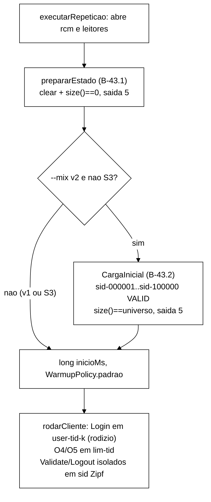

# Validação V-B43.1: reset de estado entre execuções (2026-10-22)

> Senior, 2026-10-22. Validação independente da entrega do Worker na branch
> `fix/b43-1-reset-estado-entre-execucoes` (worktree `wt-b43-1`), commits `f854c80..65d237b` sobre
> `8296270`, relatório `docs/relatorio-b43-1-2026-10-22.md`. Especificação: Apêndice A de
> `validacao-b42-1-2026-10-22.md` (bloco B-43.1), com os ajustes da seção 5 de
> `validacao-b42-1-tarefa0-2026-10-22.md`. Contexto: `diagnostico-login-blocked-2026-10-22.md`.
> Surefire e mutantes rodaram em cópias `git archive` de cada commit, num subdiretório próprio do
> *scratchpad* (removido no fim). Nada foi alterado em `wt-b43-1`. Nenhum *cluster* subiu e a VM não
> foi usada. O *smoke* foi conferido só nos brutos. Commit local nesta branch, sem push.

## 1. Veredito

**APROVADA COM RESSALVAS.** Todas as alegações medidas conferem: o Surefire de cada commit, os
mutantes X1, X5, B1..B4 e B2w, a ausência de edição em testes existentes, o *golden*, a identidade
aritmética de R1..R4 refeita a partir dos stdout e dos CSV, e o `MANIFEST.sha256` (45/45). O
comportamento está correto. As ressalvas são de cobertura de teste:

1. **R1. A posição do reset em `executarRepeticao` só é travada por texto, e o texto aceita código
   morto.** `resetAntesDoWarmup` procura as *strings* no fonte e verifica a ordem. Não verifica se a
   chamada executa. Sobrevivem: a chamada em comentário (B2w na forma "linha comentada"), um
   `if (false)` antes dela (M6), a exceção engolida por `try/catch` local (M7, o que anula a saída 5
   e grava `rep-NNN.csv` sobre estado sujo) e o reset pulado em S3 (M8, o que reabre os três caminhos
   de C3 no S3, §3.3 do diagnóstico). Em `65d237b` o código está certo, e o *smoke* prova que o reset
   executa em S1. Falta impedir a regressão.
2. **R2. Os padrões de produção (10 s e 100 ms) não são testados.** Todos os testes usam a sobrecarga
   de 7 argumentos com valores explícitos. Trocar os dois padrões de lugar na sobrecarga de 3
   argumentos (M2c: prazo de 100 ms e intervalo de 10 s) deixa a suíte verde. Na VM em ASYNC, esse
   mutante viraria aborto espúrio com saída 5.
3. **R3 (observação, sem defeito).** O *smoke* não exercitou o caminho de espera ASYNC com dados: R4
   tinha `antes=0,0`. Nenhum ponto do *smoke* exercitou de ponta a ponta a saída 5. O caminho de
   espera é coberto por T2/T3 com relógio falso. A prova real com dados entra no *smoke* de B-43.2,
   em que cada repetição começa com pelo menos 10⁵ sessões carregadas (seção 7).

R1 e R2 cabem num único commit `test:`, com arquivo de teste novo e sem código de produção. Proponho
que seja o **primeiro commit de B-43.2**, como foi feito com o T0-D5 em B-43.1. Assim a branch de
B-43.1 não é reaberta e o SHA de partida não muda.

**SHA de partida para B-43.2: `65d237b`.**

## 2. Medido × alegado

| Alegação do Worker | Medido pelo Senior | Confere? |
|---|---|---|
| Base `8296270`: 305/0/0/0, 39 arquivos | `git archive 8296270`, `mvn -o -f workload/pom.xml clean test`: exit 0, 305/0/0/0, 39 | sim |
| `f854c80`: 309/0/0/0, 40 | exit 0, 309/0/0/0, 40 | sim |
| `890caf8`: 315/0/0/0, 41 | exit 0, 315/0/0/0, 41 | sim |
| `3c8cc76`: 321/0/0/0, 42 | exit 0, 321/0/0/0, 42 | sim |
| `5f0350c`: 327/0/0/0, 43 | exit 0, 327/0/0/0, 43 | sim |
| `93a609f` e `65d237b`: 327/0/0/0, 43 | exit 0, 327/0/0/0, 43 nos dois | sim |
| Nenhum teste existente editado | `git diff --name-status 8296270 65d237b -- workload/src/test`: só `A` (5 arquivos novos) | sim |
| *Golden* idêntico | `git diff --quiet 8296270 65d237b -- GoldenS1S2Test.java workload/src/test/resources` sai com 0; árvore `workload/src/test/resources` = `693ca28` nos dois | sim |
| Nada em `scripts/`, `analysis/`, `spec/`, `cluster/` | `git diff --stat` vazio nesses caminhos | sim |
| X1 morto | 327/1/0/0, `PapelDoCacheComplementarTest.papelCasaComOTipoNaDeclaracao` | sim |
| X5 morto | 327/1/0/0, `PapelDoCacheComplementarTest.semPerfilPorPosicao` | sim |
| B1 morto (327/3/0/0) | 327/3/0/0: T2, T3, T6 | sim |
| B2 morto (327/2/2/0) | 327/2/2/0: T1, T2, T3, `onGravaJsonOk` | sim |
| B3 morto (327/2/0/0) | 327/2/0/0: T5, T6 | sim |
| B4 morto (327/1/0/0) | 327/1/0/0: T7 | sim |
| B2w morto (linha do cache de contadores **removida**) | 327/1/0/0, `resetAntesDoWarmup` | sim. Mas a mesma mutação com a linha **comentada** sobrevive (R1) |
| Arquivo:linha (`main :59`, `codigoDeSaida :95`, `prepararEstado :114/:121`, chamada `:213-215`, `inicioMs :216`, antes `:114`, varredura `:422-423`, antes `:320-321`) | conferidos com `grep -n` em `65d237b` e `8296270` | sim |
| R1..R4 com exit 0 | `exits.txt`: os quatro com `exit=0` | sim |
| Identidade R1 = 362 | 327 072 + 142 777 − 469 487 = **362**, ou seja, 181 logins OK = `sessions=181` no REST depois | sim |
| Identidade R2 = 0 | 320 097 + 172 635 − 492 732 = **0**; REST 181/4 → 181/4 | sim |
| Identidade R3 = 434 | 184 533 + 115 312 − 299 411 = **434**, ou seja, 217 = `sessions=217` | sim |
| Identidade R4 = 178 | 375 644 + 98 793 − 474 259 = **178**, ou seja, 89 = `sessions-async=89`; os SYNC continuam 217/4 | sim |
| `R3/estado-rep-001.json`: antes `[181,4]`, depois `[0,0]`, OK | lido no bruto | sim |
| `registrados` = linhas do CSV | contei as linhas de `R1..R4/rep-001.csv`: 327 072, 320 097, 184 533, 375 644, iguais ao stdout | sim |
| CSV com Login OK = 0 e Validate VALID = 0 na janela | contagem `operation × return_code` refeita: só `Login BLOCKED`, `Validate NONE`, `Logout NONE`, `IncrementFailure COUNTED` e `ResetFailures NONE` nas quatro | sim |
| `MANIFEST.sha256` 45/45 | `sha256sum -c`: 45 OK, 0 falhas; 45 arquivos no diretório além do manifesto | sim |
| `podman ps -a` antes = depois | `diff` vazio | sim |
| Logs dos servidores sem ` ERROR ` | 0/0/0 em `isn1..3.log` | sim |
| *Health* HEALTHY, 3 nós, 4 *caches* | `health-depois-11223.json` conferido | sim |
| `--dry-run` padrão/off/inválido | `reset_state=on` e `reset_state=off` com exit 0; `ligado` com exit 2 e a mensagem do conversor | sim |

## 3. Mutantes do Senior

Aplicados por um *script* que exige exatamente uma ocorrência do trecho original (o defeito que o
Worker relatou no próprio *script* não se repete aqui), sobre cópias de `65d237b`, com o Surefire
completo e `-Dsurefire.timeout=180`.

| ID | Mutação | Resultado | Teste que mata |
|---|---|---|---|
| M1 | `inicioMs` capturado **antes** do reset (reset consome o *warm-up*) | morta | `resetAntesDoWarmup` |
| M1b | reset movido para depois de `WarmupPolicy.padrao(...)` | morta | `resetAntesDoWarmup` |
| M2a | prazo ignorado no laço (`decorrido >= 2 * prazoNs`) | morta (laço infinito: `OutOfMemoryError` no *fork*, 245 testes) | T2 |
| M2b | `executar` usa `PRAZO_PADRAO` e ignora o parâmetro | **sobrevive** | equivalente nos testes (todos passam 10 s); sem efeito em produção |
| M2c | sobrecarga de 3 argumentos com `INTERVALO_PADRAO, PRAZO_PADRAO` trocados | **sobrevive** | nenhum (R2) |
| M3 | exceção de `size()` não convertida (`catch` estreitado) | morta | `sizeQueLancaPreservaCausa` |
| M4 | JSON com `"OK"` na falha | morta | T6 |
| M4b | JSON com `"FALHA"` no sucesso | morta | `onGravaJsonOk` |
| M5 | `off` grava `replicacao` no JSON | morta | T7 |
| M6 | `if (false) prepararEstado(...)` | **sobrevive** | nenhum (R1) |
| M7 | `try { prepararEstado(...) } catch (EstadoNaoLimpoException ignorada) { }` | **sobrevive** | nenhum (R1) |
| M8 | `if (!cli.scenarioS3) prepararEstado(...)` | **sobrevive** | nenhum (R1) |
| B2w-c | linha do cache de contadores **comentada** em vez de removida | **sobrevive** | nenhum (R1) |
| M9 | `codigoDeSaida` só olha a exceção direta | morta | T5 |
| M10 | `off` ignorado (reset sempre executa) | morta | T7 |
| M11 | `defaultValue = "off"` | morta, 4 falhas e 1 erro | `padraoOn`, `textoDryRun`, `semCsvDir`, T6, `onGravaJsonOk` |
| M12 | *setter* sem efeito | morta, 4 falhas | `onEOff`, `textoDryRun`, `workloadMainDryRun`, T7 |
| M13 | `motivo` nulo na falha | morta | T6 |
| M14 | falha sem gravar o JSON | morta | T6 |
| M15 | `catch (EstadoNaoLimpoException)` em `main` com `System.exit(3)` literal | **sobrevive** | nenhum. `System.exit` não é testável sem reestruturar `main`; risco baixo, porque `codigoDeSaida` é testado |
| M16 | a verificação aceita o 2º cache não vazio | morta | T2, T6 |

Saldo: 14 de 21 morrem. Dos 7 sobreviventes, M2b é equivalente, M15 é residual e aceito, e M2c, M6,
M7, M8 e B2w-c são R1/R2.

## 4. Desvios D1..D8

| Desvio | Avaliação |
|---|---|
| **D1**, `@Option` num *setter* com o *record* `LigaDesliga` | **Aceito.** Reproduzi a alternativa numa cópia (`@Option` direto no `boolean resetEstado`, com um conversor `on/off` para `Boolean`): 5 testes de `CliInstrumentacaoTest` caem com `valor invalido 'true' para --reset-state`, como o Worker relatou. **O padrão `on` vale de fato com a opção omitida:** M11 (`defaultValue="off"`) derruba `padraoOn`, o que prova que o Picocli chama o *setter* com o padrão no `parseArgs` e que o valor não vem só do inicializador. **O campo continua a fonte da verdade:** `prepararEstado`, `gravarEstado`, `rotuloResetEstado` e `textoDryRun` leem só `cli.resetEstado`. O *setter* só escreve no campo, e M12 (*setter* sem efeito) morre. O `--help` mostra `Padrao on` |
| **D2**, sobrecarga de `prepararEstado` com prazo, relógio e sono | **Aceito.** Sem ela, T6 dormiria 10 s. Deixa R2 aberta: a sobrecarga de produção não é testada |
| **D3**, `off` devolve `null` e grava `replicacao` nulo | **Aceito.** É a leitura literal de "o resto nulo", e M5 mostra que está travado por teste. A rastreabilidade do perfil com `off` já vem da linha `Replicacao:` do stdout e, em B-43.3b, do `meta.json` |
| **D4**, testes além da lista | **Aceito e desejável.** `resetAntesDoWarmup` é o único que mata M1/M1b/B2w. T4b mata M3 |
| **D5**, guarda X5 também pega `getEnumConstants()` | **Aceito.** É a mesma evasão |
| **D6**, *smoke* sem `--convergence`/`--sweep` | **Aceito.** Fora do pedido. A varredura com estado limpo fica coberta pela posição do reset (R1, quando fechada) |
| **D7**, máquina Podman iniciada e parada | **Aceito.** Estado restaurado, `podman ps -a` idêntico |
| **D8**, *scratchpad* compartilhado | **Aceito.** Sem efeito nas medições: o "antes" foi refeito numa cópia limpa, e eu reproduzi 305/0/0/0. Recomendação de processo: cada agente usa um subdiretório próprio desde o início |

## 5. Prazo de 10 s e intervalo de 100 ms fixos, sem opção na CLI

**Aceitável, com uma condição.**

- O desenho falha de forma segura: se o prazo vencer, a repetição aborta com saída 5 e não grava
  dados. Um prazo curto demais custa uma nova execução, nunca um número sujo.
- O prazo é contado desde o primeiro `size()`. O `clear()` SYNC bloqueia até terminar, então só o
  ASYNC depende da espera. O `ClearCommand` é um único *broadcast*, e a defasagem esperada fica na
  ordem de milissegundos (R4 levou 6 ms com os *caches* vazios). Com 100 ms de intervalo há no máximo
  cerca de 100 consultas `size()`, o que é barato.
- Partição ou nó ausente (`AvailabilityException`) não espera o prazo: vira saída 5 já na primeira
  exceção (T4/T4b).
- **Condição:** a evidência com dados ainda não existe (R3). A partir de B-43.2, cada repetição começa
  com pelo menos 10⁵ sessões. O *smoke* de B-43.2 deve registrar o `ms=` do reset em SYNC e em ASYNC
  com `antes` ≥ 10⁵. Se algum passar de 2 s (20 % do prazo) no *host*, ou depois na VM, abre-se um
  item para expor a opção (por exemplo `--reset-timeout`). Até lá, fixo.
- O teste de R2 trava os dois padrões, para que uma troca acidental não leve à VM um prazo de 100 ms.

## 6. Observação fora do escopo (pré-existente)

`WorkloadMain.rodarCliente:579` sorteia a operação com `ThreadLocalRandom.current()`. A semente
`seedThread` só alimenta o `KeyGenerator`. A sequência de operações em produção, portanto, **não** é
reproduzível por `--seed`. O `GoldenS1S2Test` trava a sequência de `Scenario.proximaOperacao(new
Random(42))`, que a produção não usa. Isso não afeta B-43.1 e não deve entrar em B-43.2 (o *diff*
precisa continuar separável). Registro para decisão do Gestor, porque o texto da Metodologia pode
afirmar reprodutibilidade por semente.

## 7. Prompt para o Worker: B-43.2 (mistura S1/S2 v2)

> Só despacha depois que o Gestor aprovar os pontos P-a..P-e da seção 8.

````md
Você é o WORKER. Uma entrega, B-43.2, com commits só locais. **Não faça push.** Não use a VM.
Branch `fix/b43-2-mistura-s1-s2-sessoes-reais`, a partir de `65d237b` (ponta de B-43.1). Worktree
nova `wt-b43-2`. Use um subdiretório PRÓPRIO do scratchpad (`b432/`) desde o primeiro comando.

Não edite: `tcc-escrita/`, `scripts/run-baseline.sh`, `analysis/percentis.py`, `spec/`, o golden
`workload/src/test/resources/golden-8e2e815/`, `OpResult` (o mascaramento C4 fica para B-43.4) nem a
branch `fix/b43-3-guarda-sanidade-mistura`. Nenhum teste existente pode ser editado ou removido: só
acréscimos, em arquivos de teste novos. TDD: cada par teste+implementação vai num commit que compila e
deixa o Surefire verde. Registre o vermelho antes do verde. Mensagens `feat:|fix:|test:|docs:|refactor:`.
Diagramas em Mermaid.

Contexto obrigatório: `wt-plano-ctrl/docs/diagnostico-login-blocked-2026-10-22.md` (C1, C2, §4.2
linha B-43.2 e §4.3 critérios B-43.2) e `wt-plano-ctrl/docs/validacao-b43-1-2026-10-22.md` (R1, R2,
seção 5). Decisão do Gestor: desenho (a), pools disjuntos + carga inicial de sids VALID, golden intacto.

Comando: `mvn -f workload/pom.xml clean test`. Some os `TEST-*.xml` (tests/failures/errors/skipped/
arquivos) antes e depois de CADA commit. Referência "antes": **327/0/0/0, 43 arquivos**.

=== Commit 1: `test: guarda de execucao do reset e padroes de prazo (V-B43.1 R1, R2)` ===
Arquivo NOVO `ResetEstadoPosicaoTest` (`resetAntesDoWarmup` não é editado):
 (a) Lê `WorkloadMain.java` e REMOVE os comentários (`//...` até o fim da linha e `/* ... */`) antes
     de procurar. No corpo de `executarRepeticao`, a chamada tem de aparecer como statement no início
     da linha (regex `^\s*prepararEstado\(cli, List\.of\(`, multiline), com a linha anterior não vazia
     terminando em `{` ou `;`, e não pode estar dentro de `try` nem de `if`. Os dois
     `CacheLimpavel.de(rcm.getCache(cli.replicacao.cacheSessoes()))` e `...cacheContadores()))` têm
     de estar no código sem comentários. A chamada vem antes de `long inicioMs`, de
     `WarmupPolicy.padrao(` e de `if (cli.scenarioS3)`. `catch (EstadoNaoLimpoException` só pode
     aparecer dentro de `main`. Inclua um autoteste do detector com as formas: chamada comentada,
     `if (false)`, `try/catch` local e `if (!cli.scenarioS3)`, todas detectadas.
 (b) `ResetEstado.PRAZO_PADRAO == Duration.ofSeconds(10)` e `INTERVALO_PADRAO == Duration.ofMillis(100)`.
     No fonte sem comentários, a sobrecarga de 3 argumentos de `prepararEstado` passa
     `ResetEstado.PRAZO_PADRAO, ResetEstado.INTERVALO_PADRAO` nessa ordem.
 Prova: reaplique M6, M7, M8, B2w-c e M2c da V-B43.1 (seção 3). Os cinco têm de MORRER.

=== B-43.2 ===
Objetivo: em S1/S2, o Login usa identidades que nunca recebem O4/O5 (nunca bloqueiam), O4/O5 vão para
uma identidade própria por thread, e os `sid-NNNNNN` do gerador Zipf existem como sessões VALID antes
do warm-up. A sequência de operações e de chaves por semente NÃO muda.

Desenho exigido:
1. `Cli`: `--mix v1|v2`, padrão `v2`, conversor estrito (outro valor ⇒ `ParameterException`, saída 2),
   no padrão já usado em `Cli.Escolha`/`LigaDesliga` (se o Picocli reaplicar o padrão de forma
   incompatível, registre como desvio). `Cli.toString()` NÃO muda. `textoDryRun()` ganha a 4ª linha
   `dry-run, mix=v1|v2`. `executar` imprime `Mistura: mix=<v>` logo após a linha `Replicacao:`.
   `Cli.validar()` rejeita `--mix v2` com `--reset-state off` (saída 2), porque a carga exige o
   estado vazio. `v1` é o comportamento atual, byte a byte nas identidades.
2. Classe NOVA `IdentidadesMistura` (pura, sem I/O e sem Random), uma instância por thread:
   - v2: `login()` devolve `user-<tid>-<k>` em rodízio, k = 0..`POOL_LOGIN_POR_THREAD`−1 com
     `POOL_LOGIN_POR_THREAD = 8`; `limite()` devolve `lim-<tid>`;
   - v1: `login()` = `limite()` = `user-<tid>`;
   - `static String identidadeDaCarga(int i, int threads)` = `user-<(i−1) mod threads>-<((i−1) / threads)
     mod POOL_LOGIN_POR_THREAD>`, para i ≥ 1.
   O rodízio NÃO pode consumir o `Random` nem o `KeyGenerator`.
3. `WorkloadMain.rodarCliente`: troque só as identidades (Login usa `ids.login()`; IncrementFailure e
   ResetFailures usam `ids.limite()`). Extraia o corpo do laço para um método package-private, por
   exemplo `static void executarOperacoes(SessionOps ops, Scenario cenario, Random r, KeyGenerator
   chaves, IdentidadesMistura ids, long n)`, que os testes chamam com `new Random(42)` e fakes. A
   produção continua com `ThreadLocalRandom` (a reprodutibilidade por semente é item à parte e NÃO é
   desta tarefa). S3 não muda.
4. Interface NOVA `CacheCarregavel extends CacheLimpavel` com `void putAll(Map<String, SessionState>)`
   e adaptador `de(RemoteCache<String, SessionState>)`. `CacheLimpavel` e `Armazem` não mudam.
5. Classe NOVA `CargaInicial`:
   `static Resultado carregar(CacheCarregavel sessoes, int universo, int threads, Instant agora,
   int lote, Duration prazo, Duration intervalo, LongSupplier relogioNs, ResetEstado.Sono sono)`.
   Grava `sid-000001..sid-<universo>` como `SessionState.criar(sid, identidadeDaCarga(i, threads), agora)`
   (VALID), em `putAll` de `lote` = 1000. A chave usa `KeyGenerator.PREFIXO_SID` e o mesmo formato
   `%s%06d` de `nextSessionKey`. Depois consulta `size()` até dar exatamente `universo` (ASYNC) ou o
   prazo vencer (padrões 10 s / 100 ms, os mesmos de `ResetEstado`). `universo` vem de
   `KeyGenerator.TAMANHO_PADRAO_UNIVERSO`, sem literal. Falha (prazo, tamanho diferente, exceção em
   `putAll`/`size`) ⇒ `CargaInicialException extends EstadoNaoLimpoException` (saída 5 pelo
   `codigoDeSaida` existente, sem editá-lo), com o resultado parcial e o motivo. `Resultado`: universo,
   lotes, tamanho_final, duracao_ms.
6. `WorkloadMain.executarRepeticao`: com `cli.mix == v2` e não S3, a carga roda DEPOIS de
   `prepararEstado(...)` e ANTES de `long inicioMs` (fora do warm-up e fora do CSV), sobre
   `rcm.getCache(cli.replicacao.cacheSessoes())`, nesta forma literal. Imprime
   `Carga: mix=v2 cache=<nome> sids=<n> lotes=<l> ms=<t>` e, com `--csv-dir`, grava
   `carga-rep-NNN.json` (`mix`, `replicacao`, `cache`, `universo`, `tamanho_final`, `lotes`,
   `duracao_ms`, `veredito` OK|FALHA, `motivo`). O `estado-rep-NNN.json` de B-43.1 NÃO muda. Com v1, nada
   de carga e nada de JSON de carga.
7. [Depende de P-d] Contador de desfechos de Validate, só em memória: `SessionOps` conta, **na janela
   de medição** (mesma `WarmupPolicy` do `LatencyRegistry`/CSV), Validate por `OK_VALIDATE` com
   estado VALID, `OK_VALIDATE` com estado INVALID, `NOT_FOUND` e `ERROR_*`. No fim da repetição,
   imprime `Desfechos Validate: valid=<a> invalid=<b> not_found=<c> erro=<d>`. NÃO muda o CSV nem
   `OpResult`. Motivo: o C4 grava `VALID` para sessão INVALID, e o Logout isolado sobre sids Zipf
   invalida em segundos as chaves mais quentes. Sem esse contador, "Validate VALID" no CSV não
   distingue sessão válida de chave existente.

Testes (arquivos novos, na ordem do TDD):
 T1 `IdentidadesMisturaTest`: rodízio v2 de 8 por thread; `lim-<tid>`; disjunção (para tid < 64,
    nenhuma identidade de login é de limite, nem igual a `user-<tid>`); v1 = `user-<tid>` nos dois;
    `identidadeDaCarga` cobre exatamente as 8 × threads identidades de login.
 T2 (critério 2 do diagnóstico) `MisturaV2Test`: fakes `FakeCaches`, carga sobre o fake, `new Random(42)`,
    `KeyGenerator(42)`, 10⁴ operações em S1 e em S2, 4 threads simuladas: nenhuma identidade de login
    fica BLOCKED; `Login OK / Login = 1,0`; Validate NOT_FOUND = 0; em S1, `lim-<tid>` chega a BLOCKED
    (O4 continua exercitado); a razão eventos/operações > 1.
 T3 (critério 3): depois da carga, `validate("sid-000001")` ⇒ `OK_VALIDATE` com estado VALID, e
    `size == KeyGenerator.TAMANHO_PADRAO_UNIVERSO`. As 10⁴ primeiras chaves de `KeyGenerator(42)`
    estão todas no conjunto carregado (pega carga começando em 0 ou terminando em universo−1).
 T4 sequência intacta: no laço v2 com `new Random(42)`, as 2000 primeiras operações executadas e as 500
    primeiras chaves são as de `golden-8e2e815/sequencia-s1-s2-seed42.txt`, lido como recurso e sem
    editá-lo. Isso prova que o rodízio não consome o `Random`.
 T5 carga ASYNC: um fake que só chega a `universo` na k-ésima consulta ⇒ OK; um fake que nunca chega
    ⇒ `CargaInicialException` no prazo do relógio falso, `codigoDeSaida == 5`, `carga-rep-001.json`
    com FALHA, sem `rep-001.csv`; `putAll` que lança ⇒ causa preservada.
 T6 regressão v1: com v1, Login/IncrementFailure/ResetFailures usam `user-<tid>`, e em S1 com 10⁴
    operações a identidade chega a BLOCKED (C1 reproduzido de propósito); nenhuma carga.
 T7 `CliMisturaTest`: padrão v2; v1; inválidos (`V2`, `2`, vazio, sem valor) ⇒ `ParameterException`;
    `toString()` igual; 4ª linha do dry-run; `v2` + `--reset-state off` ⇒ `validar()` falha; `main
    --dry-run --mix v1` sem conectar.
 T8 posição (texto sem comentários, mesmo detector do commit 1): a carga vem depois de
    `prepararEstado(` e antes de `long inicioMs`; usa `rcm.getCache(cli.replicacao.cacheSessoes())`.
 T9 [se P-d] o contador separa VALID, INVALID e NOT_FOUND num fake em que um Logout isolado invalida
    um sid carregado antes do Validate.
 T10 guardas de B-42.1, da Tarefa 0 e de B-43.1, e o `GoldenS1S2Test`, verdes SEM edição.

Mutações (aplicar com script que exige 1 ocorrência, rodar o Surefire completo, reverter; nenhuma
commitada; todas precisam morrer):
 G1 v2 com Login em `ids.limite()` (mata T2); G2 carga de `sid-000000` a `universo−1` (mata T3);
 G3 carga sem verificar `size()` (mata T5); G4 carga depois de `long inicioMs` (mata T8);
 G5 rodízio por `r.nextInt(8)` (mata T4); G6 v1 com identidades v2 (mata T6);
 G7 `--mix` com padrão v1 (mata T7); G8 carga também em S3 ou em v1 (mata T6/T8).

Smoke local (Podman, 3 nós, SEM VM): containers `b432-isnN`, `podman ps -a` antes e depois, máquina
Podman devolvida ao estado em que estava. `$JAVA_HOME/bin/java`. No MESMO cluster, `--threads 4`,
`--duration 60`, `--reset-state on`, `--csv-dir` separado por execução:
 Q1 S1 sync v2; Q2 S2 sync v2; Q3 S1 async v2; Q4 S2 async v2; Q5 S1 sync v1 (30 s, contraste).
Critérios (diagnóstico §4.3, B-43.2, item 4, calculados no CSV da janela de medição):
 - Q1..Q4: `Validate VALID > 0`; `Login OK / Login ≥ 0,99`; `Validate NONE / Validate ≤ 0,01` (antes de
   B-43.4, `NONE` em Validate é `NOT_FOUND`); `(registrados + descartados) / Total de operacoes > 1`;
   identidade `registrados + descartados − operações = 2 × logins OK` > 0;
 - Q5: Login OK = 0 na janela (C1 reproduzido com v1);
 - reset: Q2 e Q4 com `antes` ≥ 10⁵ em sessões e `depois=0,0`. Q4 é a primeira prova do reset ASYNC
   com dados. Registre o `ms=` de todos;
 - carga (critério 5): `ms=` de Q1..Q4 registrado, `tamanho_final = 100000`, e nenhum evento de carga
   no CSV (as operações do CSV são só as cinco da mistura);
 - [se P-d] a linha `Desfechos Validate` de Q1..Q4 no relatório, com a fração INVALID;
 - todos com exit 0, exceto o que for de propósito.
Execução documental (não é critério de aceite): se a V-B43.3a-i estiver aprovada, rode o
`VerificadorSanidade` da branch `fix/b43-3-guarda-sanidade-mistura` (`6ce301a`) sobre os CSV de
Q1..Q4 (cenário certo) e de Q5, e registre veredito, motivos e métricas. Isso serve à calibração do
limiar `loginOkMin` (V-B43.3a-i, seção 5, item 2). NÃO ajuste limiares.
Brutos em `runs/b43-2-smoke/` com `MANIFEST.sha256`. Escreva com destaque: "smoke local, 60 s, 4
threads: as latências NÃO são evidência; o smoke prova a mistura v2, a carga e o reset com dados".

Relatório: `docs/relatorio-b43-2-<data>.md` (resultado, Surefire por commit, arquivo:linha antes e
depois, testes, mutações, smoke, custo da carga, desvios, pontos para o Gestor). Ao terminar, liste os
SHAs, a worktree e o `git status`, e pare. Não integre nem faça push.
````



## 8. Pontos para o Gestor

1. **Aprovar V-B43.1 com ressalvas.** R1 e R2 fecham no commit 1 de B-43.2, só com teste novo.
2. **D1..D8 aceitos**, com D1 verificado empiricamente (seção 4).
3. **Prazo/intervalo fixos (seção 5) aceitos**, com a condição de medir o reset com ≥ 10⁵ entradas em
   SYNC e ASYNC no *smoke* de B-43.2. Se passar de 2 s, abre-se um item de opção na CLI.
4. Decisões para o prompt de B-43.2:
   - **P-a.** `--mix v1|v2`, padrão v2, com v1 preservado para regressão e contraste. Recomendo sim:
     é o mesmo padrão do `--reset-state off`.
   - **P-b.** `v2` exige `--reset-state on` (saída 2 em `validar()`). Recomendo sim: a carga verifica
     `size()==universo`, que só faz sentido sobre estado vazio.
   - **P-c.** Falha da carga com saída **5** (subclasse de `EstadoNaoLimpoException`, "estado inicial
     não preparado"), sem código novo. Recomendo sim.
   - **P-d.** Contador de desfechos de Validate só no stdout. Recomendo sim. Com o C4 ainda ativo, o
     Logout isolado invalida as chaves Zipf quentes e o CSV continua gravando `VALID`. Sem o contador,
     o critério "Validate VALID > 0" é satisfeito por chave existente, não por sessão válida. Esse
     ponto também pesa a favor de aprovar B-43.4.
   - **P-e.** `POOL_LOGIN_POR_THREAD = 8`. É um valor de engenharia: espalha as leituras de identidade
     sem efeito no bloqueio, porque o pool de login nunca recebe O4/O5.
5. **Observação da seção 6** (operação sorteada por `ThreadLocalRandom`, sem semente): decidir se vira
   item próprio (B-43.5) e se o texto da Metodologia precisa de ajuste. Fora de B-43.2.
6. Integração e push continuam pendentes de aprovação explícita. Nada foi publicado.
