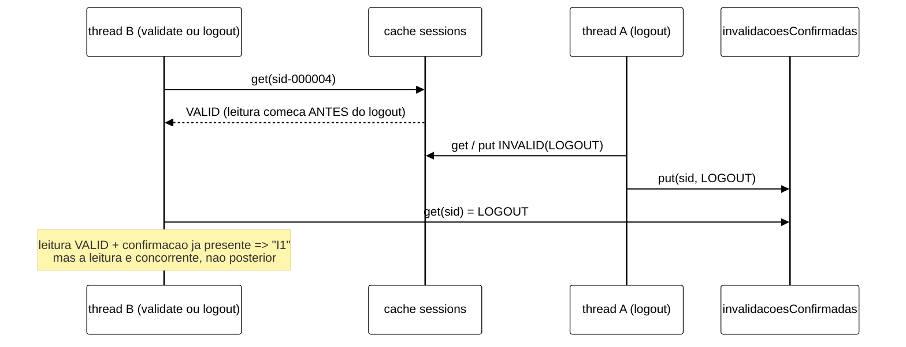
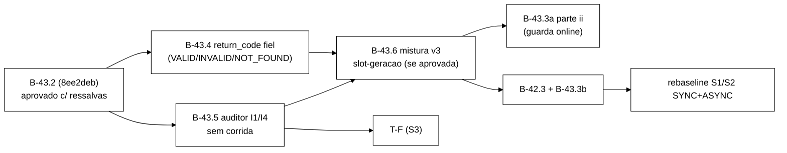

# Validação V-B43.2: mistura S1/S2 v2 (2026-10-22)

> Senior, 2026-10-22. Validação independente da entrega do Worker na branch
> `fix/b43-2-mistura-s1-s2-sessoes-reais` (worktree `wt-b43-2`), commits `c742c77..8ee2deb` sobre
> `65d237b`, relatório `docs/relatorio-b43-2-2026-10-22.md`, brutos `runs/b43-2-smoke/`.
> Especificação: seção 7 de `validacao-b43-1-2026-10-22.md` (`503278d`), com P-a..P-e aprovados.
> Surefire, mutantes e uma reprodução determinística da corrida do auditor (A1) rodaram em cópias
> `git archive` no *scratchpad*, removidas no fim. Nada foi alterado em `wt-b43-2`. Nenhum *cluster*
> subiu e a VM não foi usada. Commit local nesta branch, sem push.

## 1. Veredito

**APROVADA COM RESSALVAS, e com dois achados que bloqueiam o *rebaseline*, não a integração.**

A entrega faz o que o prompt pediu, e todas as alegações medidas conferem: o Surefire de cada commit,
a ausência de edição em testes, o *golden*, R1/R2 e G1..G8 mortos, a identidade aritmética e o
contador de desfechos refeitos a partir dos stdout e CSV, o manifesto (66/66) e os vereditos do
verificador. A ressalva de cobertura é pequena (seção 3).

Os dois achados do Worker se confirmam, e os dois são mais graves do que o relatório diz:

- **A1 (seção 5): as 2 violações I1 de Q1 são falso positivo do auditor.** Reproduzi a corrida de
  forma determinística, sem *cluster*. Ela afeta toda leitura concorrente com uma invalidação, em
  S1/S2 v2 e no S3. O gatilho R1 do controlador e a hipótese H-A0 consomem exatamente essas
  violações. **Corrigir antes do *rebaseline*, da T-F e da calibração do controlador.**
- **A2 (seção 6): a fração de Validate sobre sessão INVALID é maior do que a relatada e não é
  estacionária.** Entre os Validate **isolados** (sem os da tríade, que são sempre VALID), ela é de
  **69 %** em S1 e **54 %** em S2 já em 60 s. Um modelo que reproduz os brutos com erro abaixo de 1 %
  projeta cerca de 86 % (S1) e 73 % (S2) numa execução de 600 s. Ao mesmo tempo, o Logout isolado
  deixa de escrever: em S1, a fração dele que é escrita cai de 53 % para 9 % ao longo de 600 s. A
  mistura muda durante a própria medição, depende da duração e do ritmo do *host*, e por isso VM e
  *host* não seriam comparáveis. **Só documentar não basta.** Recomendo a mistura v3 (seção 6.4).

**SHA de partida para os próximos blocos: `8ee2deb`.**

## 2. Medido × alegado

| Alegação do Worker | Medido pelo Senior | Confere? |
|---|---|---|
| Base `65d237b`: 327/0/0/0, 43 | cópia `git archive` (`workload` + `cluster`), `mvn -o clean test`: exit 0, 327/0/0/0, 43 | sim |
| `c742c77` 334/44 · `cc0497e` 340/45 · `a3be995` 349/46 · `177ad87` 360/47 · `da9d2fb` 364/50 · `8e47bda` 370/51 · `6137cf8` 373/52 | idênticos, todos com exit 0 e 0/0/0 | sim |
| `b10bfa6` e `8ee2deb`: 373/0/0/0, 52 | idênticos | sim |
| Nenhum teste existente editado | `git diff --name-status 65d237b 8ee2deb -- workload/src/test`: só `A` | sim |
| *Golden* intacto | `git diff --quiet` sobre `GoldenS1S2Test.java` e `workload/src/test/resources` sai com 0 | sim |
| Nada em `scripts/`, `analysis/`, `spec/`, `cluster/`, `OpResult.java` | `git diff --stat` vazio | sim |
| R1/R2: M6, M7, M8, B2w-c e M2c mortos | reaplicados na ponta: 373/2, 373/2, 373/2, 373/3 e 373/2/1. Matam `resetExecutaAntesDoWarmup`, `posicaoDaCarga`, `detectorPegaCodigoMorto` e os 3 de `sobrecargaDeProducao*` | sim |
| G1..G8 mortos | amostra reaplicada: G1 373/2 (`MisturaV2Test` S1 e S2) e G4 373/2 (`posicaoDaCarga`, `detectorDaCarga`) | sim (amostra) |
| Q1..Q5 com exit 0 | `exits.txt` | sim |
| Linhas do CSV = `registrados` | contei as linhas: 411 355, 512 519, 394 523, 538 460 e 342 052, iguais ao stdout | sim |
| Identidade Q1 = 165 962 = 2 × 82 981 | 411 355 + 86 988 − 332 381 = **165 962**; `login_ok` n + descartados = 68 443 + 14 538 = **82 981** | sim |
| Identidade Q2 = 36 794 = 2 × 18 397 | 512 519 + 128 618 − 604 343 = **36 794**; 14 689 + 3 708 = **18 397** | sim |
| Identidade Q3 = 161 282 = 2 × 80 641 | 394 523 + 90 149 − 323 390 = **161 282**; 65 723 + 14 918 = **80 641** | sim |
| Identidade Q4 = 38 470 = 2 × 19 235 | 538 460 + 141 356 − 641 346 = **38 470**; 15 269 + 3 966 = **19 235** | sim |
| Q5: 226 = 2 × 113 | 342 052 + 174 862 − 516 688 = **226** | sim |
| Q1..Q4: Login OK/Login = 1,0 | CSV: 68 443/68 443, 14 689/14 689, 65 723/65 723 e 15 269/15 269 | sim |
| Q1..Q4: Validate ausente = 0 | `Validate NONE` = 0 nos quatro CSV | sim |
| Q1..Q4: eventos/ops > 1 | 1,4993, 1,0609, 1,4987 e 1,0600 | sim |
| Q5 reproduz C1 | CSV: `Login BLOCKED` 85 319, Login OK 0, `Validate NONE` 171 310/171 310 | sim |
| Soma dos desfechos = Validate do CSV | Q1 205 979 · Q2 473 576 · Q3 196 948 · Q4 497 840 · Q5 171 310: iguais nos cinco | sim |
| INVALID: 46,0 %, 52,4 %, 45,8 %, 53,6 % | iguais **sobre todos os Validate**. Sobre os Validate **isolados** dá **68,9 %, 54,1 %, 68,7 % e 55,3 %** (seção 6.1) | sim, mas a métrica relevante é a outra |
| Reset com cerca de 1,8×10⁵ entradas: 33 ms SYNC, 13 ms ASYNC | stdout: Q2 `antes=182981,36 … ms=33`; Q4 `antes=180641,36 … ms=13`; Q5 `antes=118397,36 … ms=13` | sim |
| Carga de 10⁵ em 0,7 a 1,1 s | `Carga:` 1 110, 1 012, 834 e 702 ms | sim |
| Verificador `a8f5549`: OK em Q1..Q4, FALHA em Q5 | `verificador-a8f5549/exits.txt` com 0,0,0,0,4; JSON com `OK` ×4 e `FALHA` com `LOGIN_OK_BAIXO`, `VALIDATE_VALID_ZERO` e `VALIDATE_AUSENTE_ALTO`, versão `b43-3a-i/1` | sim |
| `MANIFEST.sha256` 66/66 | `sha256sum -c`: 66 OK, 0 falhas | sim |
| 2 violações I1 em Q1 | `Q1/violacoes-rep-001.csv`: `sid-000004` às 16:45:37,518Z e `sid-000188` às 16:45:39,906Z; Q2..Q5 com 0 | sim |

Observação menor: o histograma `validate` do stdout diverge do CSV em Q2 (473 574 contra 473 576) e
em Q3 (196 947 contra 196 948). É o efeito de fronteira já documentado (o `LatencyRegistry` e o CSV
consultam o relógio em momentos diferentes). Isso já existia antes de B-43.2. O contador novo segue o
CSV.

## 3. Mutantes do Senior

Mesmo método da V-B43.1: um *script* que exige exatamente 1 ocorrência do trecho, sobre cópias de
`8ee2deb`, com o Surefire completo e `-Dsurefire.timeout=240`.

| ID | Mutação | Resultado | Teste que mata |
|---|---|---|---|
| N1 | `executar`: `try { executarRepeticao(cli, rep); } catch (Exception ignorada) { }` (engole a saída 5 e qualquer falha) | **sobrevive** | nenhum. O detector só olha `catch (EstadoNaoLimpoException` (D3) |
| N2 | o mesmo com `catch (EstadoNaoLimpoException ignorada)` | morta, 373/2 | `resetExecutaAntesDoWarmup`, `posicaoDaCarga` |
| N3 | `DesfechosValidate` ignora a janela | morta, 373/1 | `DesfechosValidateTest.soNaJanela` |
| N4 | VALID e INVALID trocados no contador | morta, 373/1 | `separaDesfechos` |
| N5 | rodízio fixo em k = 0 | morta, 373/6 | `IdentidadesMisturaTest` (4), `MisturaV2Test` (S1, S2) |
| N6 | carga com `threads = 1` em vez de `cli.threads` | morta, 373/1 | `WorkloadMainCargaTest.v2GravaJsonOk` |
| N7 | sem a falha imediata para `size() > universo` (espera o prazo) | morta, 373/1 | `CargaInicialTest.tamanhoMaior` |
| N8 | P-b removida de `validar()` | morta, 373/1 | `CliMisturaTest.v2ExigeReset` |
| N9 | `ERROR_UNAVAILABLE` não contado como `erro` no contador | **sobrevive** | nenhum. O T9 só exercita `ERROR_TRANSPORT`. Baixa gravidade (só stdout), mas é justamente o desfecho de F3/partição |
| N10 | identidade da carga em `lim-<tid>` | morta, 373/3 | `cargaPadrao`, `identidadeDaCarga`, `v2GravaJsonOk` |
| N11 | o último lote parcial não é gravado | morta (erro, 373/0/1) | `CargaInicialTest.loteParcial` |

Saldo dos 11 próprios: 9 morrem e 2 sobrevivem (N1, N9). Os dois sobreviventes têm correção barata (seção 8).

## 4. Desvios D1..D14

| Desvio | Avaliação |
|---|---|
| **D1**, a 4ª linha vem de `textoDryRunComMistura()`, e `textoDryRun()` fica com 3 | **Aceito.** É obrigatório: `CliResetEstadoTest.textoDryRun` exige 3 linhas e não pode ser editado. O `main --dry-run` imprime as 4 |
| **D2**, P-b dispensada no `--dry-run` e em S3 | **Aceito, com uma condição para B-43.3b.** No *dry-run* a dispensa é forçada pelo teste existente `workloadMainDryRun` (`main --dry-run --reset-state off`, que de outro modo derrubaria o *fork* com `System.exit(2)`), e a 4ª linha avisa que a execução real sai com 2. Consequência: o `--dry-run` **não** serve de *pre-flight* para essa combinação, porque sai com 0 e a execução real sai com 2. B-43.3b não pode usar o exit do *dry-run* como validação. Como o *runner* sempre passa `--reset-state on`, o risco é baixo. Em S3 a dispensa é correta: a mistura não tem efeito ali, e `S3 --reset-state off` já era aceito em B-43.1. A exigência de reset antes da T-F continua valendo pelo diagnóstico (§6, item 6), não por esta regra |
| **D3**, `catch (EstadoNaoLimpoException …)` fora de `main` aceito se relançar | **Aceito.** O padrão grava-JSON-e-relança já existia em `prepararEstado` (B-43.1), e `prepararCarga` segue o mesmo. O detector exige `throw <mesma variável>;` como último statement do bloco, e o M7 (bloco vazio) e o N2 (captura no laço de repetições) morrem. **Limite:** o detector só olha `catch (EstadoNaoLimpoException`. Um `catch (Exception …)` que engole tudo no laço de repetições sobrevive (N1, seção 3). É improvável e fácil de fechar (seção 8) |
| **D4**, "linha anterior não vazia" lida como última linha não vazia | **Aceito.** É a leitura correta depois de remover os comentários |
| **D5**, `executarOperacao` (uma) além de `executarOperacoes` (n) | **Aceito.** Preserva a checagem de prazo e de `--stop-at-fault-end` a cada operação |
| **D6**, o prazo da carga conta do fim dos `putAll` | **Aceito.** O prazo cobre a replicação, não o tempo de escrita. O `ms=` relatado cobre tudo |
| **D7**, tamanho maior que o universo falha na hora | **Aceito.** Esperar não corrige estado sujo |
| **D8**, T2 com semente `42 + tid` | **Aceito.** T4 usa exatamente `Random(42)`/`KeyGenerator(42)` |
| **D9**, forma de G2, G5 e G8 | **Aceito.** As formas exercitam o efeito que cada teste precisa pegar |
| **D10**, mensagem de saída 5 distingue carga e reset | **Aceito.** Só muda o texto. `codigoDeSaida` não mudou |
| **D11**, linhas `Mistura`/`Desfechos` em S3 | **Aceito** |
| **D12**, `problemasDaCarga` acrescentado ao `DetectorFonte` no commit 6 | **Aceito.** É arquivo deste bloco, não teste pré-existente |
| **D13**, máquina Podman iniciada e parada | **Aceito.** `podman ps -a` idêntico |
| **D14**, só o relatório foi escrito | **Aceito por ora.** `docs/implementacao.md`, `docs/testes.md` e o `configuracao-infinispan.md` entram no commit `docs:` de integração do bloco B-43, depois de A1/A2 decididos, para não documentar duas vezes uma mistura que ainda vai mudar |

## 5. A1: as violações I1 de Q1 são falso positivo do auditor

### 5.1 Mecanismo

Em S1/S2 há um único `SessionOps` por repetição, compartilhado pelas *threads*
(`WorkloadMain.java:297`). O mapa `invalidacoesConfirmadas` também é compartilhado. No S3 ele é
compartilhado de propósito entre os servidores de aplicação e o *admin* (`S3Clientes.java:40`). A
checagem de I1 (`SessionOps.verificarI1I4`, `:226-243`) compara o resultado de uma leitura com o
estado **atual** do mapa, consultado **depois** que a leitura terminou:



Uma I1 real exige que uma leitura **iniciada depois** de a invalidação ter sido confirmada devolva
VALID. Aqui a leitura começou antes. Pela linearizabilidade por chave, as duas ordens são legítimas.

### 5.2 Evidência

1. **Reprodução determinística sem *cluster*.** Escrevi um teste numa cópia de `8ee2deb` (não
   versionado), com um `Armazem` que pausa a *thread* B logo depois do `get` e um `CountDownLatch`.
   B lê VALID, A faz `logout` (lê, grava INVALID e confirma), e B retoma. Resultado: **1 violação I1**
   (`invalidacao confirmada (LOGOUT) revertida para VALID`), tanto com B em `validate` quanto com B
   em `logout` (dois `logout` concorrentes). A mensagem é idêntica à de Q1.
2. **Não existe escritor de VALID para `sid-*` na medição.** Só a carga (antes de `inicioMs`) grava
   `sid-*`. O `Login` grava UUID, e o `Logout` só grava INVALID. Uma "ressurreição" real exigiria
   uma escrita VALID ou uma leitura velha de réplica. Com Hot Rod roteando ao dono primário, SYNC e
   topologia estável (*health* HEALTHY antes e depois, 0 ` ERROR `), a leitura velha não tem
   mecanismo plausível.
3. **Assinatura temporal.** Uma chave só pode produzir essa corrida na **primeira** invalidação: depois
   dela toda leitura é INVALID para sempre. As chaves quentes são invalidadas nos primeiros segundos.
   As duas violações estão a cerca de 1 s e 3 s do início da repetição (stdout: reset e carga às
   13:45:35 locais mais 1,1 s; violações às 16:45:37,5Z e 16:45:39,9Z), ainda no *warm-up*, em
   `sid-000004` (posto 4 do Zipf) e `sid-000188`. É o perfil esperado da corrida. Os eventos desses
   instantes foram descartados do CSV pelo *warm-up*, então a prova direta é o item 1, não o CSV.
4. **Por que só agora.** Antes de B-43.2 as chaves `sid-*` nunca existiam, e a tríade usa um UUID novo
   numa sequência da mesma *thread*, sem concorrência na chave. Nenhum número publicado ou escrito é
   afetado: v1 tinha 0 sessões em `sid-*`, e o S3 ainda não rodou.

### 5.3 Por que é crítico

- **Controlador:** `S_viol = Δ(I1 + I4 + I2_REAL)`, e a regra R1 leva ao CONSERVADOR **imediatamente,
  ignorando o *cooldown*** (`plano-implementacao-controlador-2026-10-22.md:265,287,300`). Cada falso
  positivo é uma troca espúria para SYNC e contamina a avaliação do controlador.
- **Hipóteses:** H-A0 ("zero violações sem falha em ASYNC", `:148`) seria refutada por um artefato do
  observador, e H-A1 compara contagens ASYNC × SYNC que incluem ruído de corrida proporcional à
  concorrência em chaves quentes.
- **S3:** o mapa é compartilhado entre servidores e *admin*. Validate de uma página × Logout de outra
  e Validate × cascata de `block` têm a mesma corrida (I1). No `block`, a checagem por entrada da
  varredura tem uma janela ainda maior.

### 5.4 Correção (B-43.5)

**Princípio:** uma leitura só pode ser acusada contra confirmações que já existiam **antes de ela
começar**. A implementação mínima não precisa de relógio nem de mudar o tipo do mapa compartilhado (o
`MundoS3` de teste, que não pode ser editado, passa `ConcurrentHashMap<String, Motivo>`):

- Antes do `sessions.get(sid)` de `validate` e de `logout`, tira-se um instantâneo
  `confirmadoAntes = invalidacoesConfirmadas.get(sid)`.
- I1 só quando `confirmadoAntes != null` e a leitura deu VALID. I4 só quando `confirmadoAntes != null`
  e o motivo lido difere de `confirmadoAntes`.
- Se `confirmadoAntes == null` mas o mapa tem uma confirmação depois da leitura (a corrida), não é
  violação: conta-se em `i1_concorrentes` / `i4_concorrentes`, impressos no stdout.
- A primeira observação de INVALID continua registrando com `putIfAbsent`.
- No `block`, tira-se uma cópia do mapa **antes** de iniciar `sessions.entrySet()`, e cada entrada é
  checada contra essa cópia.

A ordem `sessions.put` e depois `invalidacoesConfirmadas.put` garante que uma confirmação visível no
mapa implica uma escrita já reconhecida pelo *cluster*. O `ConcurrentHashMap` dá a relação
*happens-before*. Assim, uma leitura velha **real** (iniciada depois da confirmação), que é o fenômeno
de H-A0 e H-A1 em ASYNC e sob falha, continua sendo acusada.

**Bloco:** **B-43.5** "auditor I1/I4 sem corrida", no bloco B-43 (higiene e sanidade da medição).
Branch `fix/b43-5-auditor-i1-concorrencia` a partir de `8ee2deb`. É pré-requisito do *rebaseline*,
da T-F, de B-28.x/B-26.x (calibração do controlador) e de B-41. Não depende de A2.

**Critérios de aceite:** os do prompt da seção 9.1. Em resumo: a reprodução determinística vira teste
e passa a dar 0 violações e `i1_concorrentes = 1`; um controle positivo (leitura velha iniciada depois
da confirmação) continua dando I1; os testes existentes de I1/I4/S3/varredura ficam verdes sem edição;
os mutantes morrem; o *smoke* de 3 × S1 SYNC v2 de 60 s dá I1 = 0.

**Observação para o S3 (só diagnóstico em B-43.5):** I4 com motivos diferentes vindos de duas
invalidações concorrentes (`logout` × `block`) não é corrida do observador. É uma atualização perdida
da **aplicação**: `logout` e `block` fazem `get` + `put` sem condição, e quem escreve por último
vence. Pode ser um efeito real a medir ou um defeito do *workload*. Decisão do Gestor, depois do
diagnóstico. I2 (`valida sob bloqueio`, `SessionOps.java:295-298`) lê sessão e identidade em dois
`get` não atômicos e tem uma janela análoga. B-43.5 deve medir e relatar o que acontece no
`MundoS3`, sem mudar o comportamento de I2.

## 6. A2: fração INVALID e realismo da mistura v2

### 6.1 Medida correta

A tríade (Login → Validate → Logout) valida a sessão que acabou de criar e é sempre VALID. A
métrica que descreve o Validate **isolado** desconta esses casos:

| Exec. | Validate (CSV) | da tríade (= Login OK) | isolados | INVALID | INVALID / isolados | *sids* invalidados (`logout_ok` total − logins OK) |
|---|---|---|---|---|---|---|
| Q1 S1 SYNC | 205 979 | 68 443 | 137 536 | 94 821 | **68,9 %** | 94 488 − 82 981 = 11 507 |
| Q2 S2 SYNC | 473 576 | 14 689 | 458 887 | 248 321 | **54,1 %** | 21 313 − 18 397 = 2 916 |
| Q3 S1 ASYNC | 196 948 | 65 723 | 131 225 | 90 160 | **68,7 %** | 91 818 − 80 641 = 11 177 |
| Q4 S2 ASYNC | 497 840 | 15 269 | 482 571 | 266 946 | **55,3 %** | 22 309 − 19 235 = 3 074 |

### 6.2 Modelo e projeção

Simulei a mistura (pesos de `Scenario`, Zipf ρ = 0,99 sobre 10⁵, o mesmo número de operações de Q1 e
Q2, janela a partir de 13/60). O modelo reproduz os brutos:

| | Medido | Modelo |
|---|---|---|
| Q1: INVALID / isolados | 68,9 % | 69,3 % |
| Q1: *sids* invalidados | 11 507 | 11 537 |
| Q2: INVALID / isolados | 54,1 % | 55,1 % |
| Q2: *sids* invalidados | 2 916 | 2 977 |

Projeção para 600 s no mesmo ritmo do *host*, com *warm-up* de 60 s (padrões da CLI):

| Cenário | INVALID / isolados na janela | no último décimo | Logout isolado que escreve (1º → último décimo) |
|---|---|---|---|
| S1 60 s (Q1) | 69 % | 74 % | 53 % → 27 % |
| S1 600 s | **86 %** | **92 %** | 34 % → **9 %** |
| S2 600 s | **73 %** | 79 % | 50 % → 22 % |

### 6.3 Diagnóstico

1. **Não estacionária.** A composição efetiva da carga muda durante a janela de medição: as leituras
   passam a ser de sessão invalidada, e o Logout isolado passa de escrita a leitura (no-op). A
   proporção de escritas de S1, que é a variável de T7 (50/50), cai alguns pontos percentuais ao
   longo da execução.
2. **Depende da duração e do ritmo.** Execuções de 60 s, de 600 s, do *host* e da VM (outro ritmo)
   medem misturas diferentes com o mesmo rótulo. A comparação SYNC × ASYNC entre células continua
   pareada (mesmo ritmo aproximado), mas a comparação com qualquer outra referência fica frágil.
3. **Controlador.** As janelas deslizantes de B-26 veriam uma deriva lenta de mistura que se confunde
   com mudança de carga.
4. **Realismo.** Num serviço real, o Validate é a checagem de *token* em cada requisição autenticada.
   A popularidade (Zipf) é dos **usuários**, e o usuário ativo usa a sessão corrente, que é válida.
   Requisição com *token* revogado (aba antiga depois do *logout*, *replay*) é a exceção. Não temos na
   bibliografia do TCC um número medido para essa fração. "Poucos por cento" é premissa de engenharia
   e deve ser escrita como tal. Mesmo sem o número, uma mistura em que 70 % a 90 % das validações
   são de sessões já encerradas não representa o caso dominante do objeto de estudo.
5. **O C4 esconde tudo isso no CSV:** todas viram `VALID`. B-43.4 resolve a observação, não a
   mistura.

### 6.4 Opções e recomendação

| Opção | Estacionária? | Validate VALID | Leituras pós-invalidação (poder de I1 em S1/S2) | Custo | Avaliação |
|---|---|---|---|---|---|
| (a) Só documentar | **não** | 70 % → 90 % INVALID | muitas, mas de chaves invalidadas há muito tempo (sem informação) | nenhum | **não recomendada** |
| (b) Logout isolado sobre um *pool* disjunto e sequencial de sids carregados, nunca validados | sim | 100 % VALID | **nenhuma**: I1 fica vácua em S1/S2, e só o S3 testa invalidação | baixo | aceitável se o Gestor quiser S1/S2 só como *baseline* de latência |
| (c) **Mistura v3, "*slot*-geração"**: o Zipf escolhe o **usuário** (*slot* k), que tem uma sessão corrente `sid(k, g)`. Validate isolado lê a geração corrente. Logout isolado invalida a geração corrente e faz a reposição (`put` VALID de `sid(k, g+1)`, o novo login do mesmo usuário). Uma fração fixa e determinística q de Validate isolados (proposta: 1 a cada 20, q = 5 %, por contador, sem consumir o `Random`) lê a geração **anterior** (*token* antigo) | **sim** | ≈ 95 % | **controladas e estacionárias** (q), concentradas em *slots* quentes recém-invalidados, que é onde a leitura velha ASYNC aparece | médio | **recomendada** |

Por que (c): mantém o Zipf e o *golden* (o `KeyGenerator` continua sorteando o *slot*). Torna a
mistura estacionária e independente da duração. Deixa o Logout isolado sempre como escrita. Dá ao
auditor (já corrigido por B-43.5) leituras pós-invalidação em fração conhecida, que é o que H-A0/H-A1
precisam para ter poder em S1/S2.

Pontos de desenho para o Gestor fixar, antes do prompt:

- **(c1) versão:** `--mix v3`, com v2 mantida para regressão. O `SequenciaMisturaV2Test` (que agora
  não pode ser editado) fixa as chaves de v2, e as chaves de geração ≥ 1 mudam de formato
  (`sid-NNNNNN` na geração 0, `sid-NNNNNN~g` depois).
- **(c2) reposição:** um `put` adicional dentro da operação Logout. A latência registrada cobre só a
  invalidação, e as reposições aparecem no stdout (`Reposicao: n`), fora do CSV, para não alterar as
  frações que o verificador confere. É escrita a mais no *cluster* (S1 +10 % das operações, S2 +1 %),
  e precisa ser declarada na Metodologia.
- **(c3) q = 5 %**, como premissa declarada.
- **(c4) mapa *slot* → geração** compartilhado entre *threads* (`AtomicIntegerArray` de 10⁵). Uma
  corrida Validate × Logout no mesmo *slot* produz uma leitura INVALID legítima, contada nos
  desfechos.

O desenho (c) depende de B-43.5 (o auditor precisa estar correto antes de se dar a ele leituras
pós-invalidação) e se beneficia de B-43.4 (o CSV passa a mostrar `INVALID`).

## 7. Ordem recomendada



1. **B-43.5 primeiro.** Pequeno, crítico e independente de A2. Afeta S1/S2/S3 e o controlador.
2. **B-43.4 em paralelo.** Toca `OpResult` e `percentis.py`, sem conflito de arquivo com B-43.5
   (`SessionOps`). Tem de entrar antes da mistura v3, para que o *smoke* de v3 mostre `INVALID` no
   próprio CSV.
3. **B-43.6 (mistura v3)** depois dos dois, se aprovada. O prompt sai depois que o Gestor fixar
   c1..c4.

## 8. Recomendações sobre a entrega

- **N1 (catch genérico no laço de repetições):** acrescentar ao detector, num commit `test:` de B-43.5
  ou de B-43.6, a regra "o corpo do `for` de `executar` contém `executarRepeticao(cli, rep);` como
  statement fora de `try`". Custa pouco e fecha a evasão encontrada.
- **N9 (`ERROR_UNAVAILABLE`):** um caso a mais no teste do contador (B-43.4 já mexe nos desfechos e
  pode levar o caso, em arquivo de teste novo).
- **Relatório de B-43.2:** a fração INVALID tem de ser lida sobre os Validate **isolados** (seção 6.1).
  O relatório não precisa ser editado, porque esta validação registra a correção.
- **Integração** de B-43.1 + B-43.2 + B-43.3a-i numa branch de integração pode acontecer antes de
  A1/A2 (o código está correto para o que promete). O *rebaseline* não pode.

## 9. Prompts

### 9.1 Prompt para o Worker: B-43.5 (auditor I1/I4 sem corrida)

````md
Você é o WORKER. Uma entrega, B-43.5, com commits só locais. **Não faça push.** Não use a VM.
Branch `fix/b43-5-auditor-i1-concorrencia` a partir de `8ee2deb` (ponta de B-43.2). Worktree nova
`wt-b43-5`. Use um subdiretório PRÓPRIO do scratchpad (`b435/`) desde o primeiro comando.

Não edite: `tcc-escrita/`, `scripts/`, `analysis/`, `spec/`, o golden `golden-8e2e815/`, `OpResult`
(é de B-43.4, em paralelo), `WorkloadMain.rodarCliente`/`executarOperacao` nem a mistura. Nenhum
teste existente pode ser editado ou removido: só acréscimos, em arquivos novos. TDD com o vermelho
registrado antes do verde. Mensagens `feat:|fix:|test:|docs:`. Diagramas em Mermaid.

Contexto obrigatório: `wt-plano-ctrl/docs/validacao-b43-2-2026-10-22.md`, seção 5 (A1), e o
`plano-implementacao-controlador-2026-10-22.md` (`S_viol`, R1, H-A0/H-A1).
Comando: `mvn -f workload/pom.xml clean test`, somando os `TEST-*.xml` antes e depois de CADA commit.
Referência "antes": **373/0/0/0, 52 arquivos**.

Regra a implementar (`SessionOps`): uma leitura só pode ser acusada de I1/I4 contra uma confirmação de
invalidação que já existia ANTES de a leitura começar.
1. `validate` e `logout`: antes do `sessions.get(sid)`, tire `confirmadoAntes =
   invalidacoesConfirmadas.get(sid)`. `verificarI1I4` passa a receber `confirmadoAntes`:
   - I1 se `confirmadoAntes != null` e a leitura deu VALID;
   - I4 se `confirmadoAntes != null`, a leitura deu INVALID e o motivo difere de `confirmadoAntes`;
   - se `confirmadoAntes == null` e, depois da leitura, o mapa já tem uma confirmação incompatível
     (VALID lido, ou motivo diferente), NÃO é violação: incremente `i1Concorrentes`/`i4Concorrentes`
     (`LongAdder`, acessores package-private);
   - a primeira observação de INVALID continua com `putIfAbsent`.
2. `block`: copie o mapa (`new HashMap<>(invalidacoesConfirmadas)`) ANTES de iniciar
   `sessions.entrySet()` e cheque cada entrada contra a cópia, com a mesma regra.
3. A ordem `sessions.put(...)` e depois `invalidacoesConfirmadas.put(...)` em `logout`/`block` fica
   como está, e um comentário explica por que ela importa (confirmação visível ⇒ escrita reconhecida).
4. O tipo do mapa compartilhado (`ConcurrentHashMap<String, SessionState.Motivo>`), os construtores e
   `invalidacoesConfirmadasSnapshot()` NÃO mudam (`MundoS3`, `S3Clientes`, `VarreduraFinal`).
5. Stdout no fim da repetição (S1/S2 e S3): `Auditor: i1_concorrentes=<n> i4_concorrentes=<m>`. No
   S3 é a soma das instâncias que compartilham o mapa.

Testes (arquivos novos):
 A1 `AuditorCorridaTest.validateConcorrenteComLogoutNaoEViolacao`: um `Armazem` que pausa a thread "B"
    logo depois do `get` (`CountDownLatch`): B lê VALID; A faz `logout`; B retoma ⇒ 0 violações e
    `i1Concorrentes == 1`. (Em `8ee2deb` este mesmo roteiro dá 1 I1. Registre esse vermelho.)
 A2 o mesmo com B em `logout` (dois logouts concorrentes) ⇒ 0 violações.
 A3 CONTROLE POSITIVO: um `Armazem` "velho" que, depois de a confirmação existir, devolve a versão
    VALID antiga para uma leitura INICIADA depois da confirmação ⇒ 1 I1. O mesmo para I4 com motivo
    diferente.
 A4 `block` com uma leitura concorrente na varredura ⇒ sem I1 espúria; com a confirmação anterior à
    varredura e a entrada VALID ⇒ I1.
 A5 sequencial (o caso de B-23): logout, depois validate que lê VALID por um fake velho ⇒ I1.
 A6 os testes existentes de I1/I4/I2, `MundoS3`, `VarreduraFinal`, `SessionOpsRastroTest`,
    `SessionOpsBlockTest` e o golden, verdes SEM edição.
 A7 diagnóstico (sem mudar comportamento): no `MundoS3`, `logout` × `block` concorrentes na mesma
    sessão produzem I4 por atualização perdida da aplicação? Relate o que acontece, com um teste que
    documente o comportamento atual. O mesmo para I2 (sessão lida antes de um `block`, identidade
    lida depois). NÃO corrija I2 nem a atualização perdida: são decisões do Gestor.

Mutações (todas precisam morrer): U1 instantâneo tirado DEPOIS do `get` (comportamento antigo);
U2 a regra aplicada a I1 mas não a I4; U3 `block` usando o mapa vivo em vez da cópia; U4
`i1Concorrentes` não incrementado; U5 `confirmadoAntes` ignorado (sempre null), o que mata o controle
positivo A3.

Smoke local (Podman, containers `b435-isnN`, `podman ps -a` antes e depois, máquina Podman devolvida
ao estado inicial, SEM VM, `$JAVA_HOME/bin/java`): no mesmo cluster, S1 sync v2 60 s × 3 e S1 async
v2 60 s × 1, `--threads 4 --reset-state on`. Critérios: I1 = I4 = 0 nas quatro; a linha `Auditor:`
presente, com os valores registrados (espera-se `i1_concorrentes` ≥ 0, concentrado nos primeiros
segundos); todos com exit 0. Brutos em `runs/b43-5-smoke/` com `MANIFEST.sha256`. Destaque: "o smoke
não prova ausência de I1 real; prova que a corrida do observador não gera mais violações".

Relatório `docs/relatorio-b43-5-<data>.md` (resultado, Surefire por commit, arquivo:linha antes e
depois, testes, mutações, smoke, o diagnóstico A7, desvios, pontos para o Gestor). Ao terminar,
liste os SHAs, a worktree e o `git status`, e pare. Não integre nem faça push.
````

### 9.2 Prompt para o Worker: B-43.4 (`return_code` fiel), em paralelo com B-43.5

````md
Você é o WORKER. Uma entrega, B-43.4, com commits só locais. **Não faça push.** Não use a VM.
Branch `fix/b43-4-return-code-validate` a partir de `8ee2deb`. Worktree nova `wt-b43-4`. Subdiretório
PRÓPRIO do scratchpad (`b434/`). B-43.5 roda em paralelo em `wt-b43-5` e mexe em `SessionOps`: NÃO
edite `SessionOps`.

Não edite: `tcc-escrita/`, `scripts/run-baseline.sh`, `spec/`, o golden `golden-8e2e815/` (o
`GoldenS1S2Test` usa `EventCsvWriter.registrar` com códigos literais e tem de continuar verde SEM
edição), a mistura nem a branch do verificador. Nenhum teste existente editado ou removido, nem
Python nem Java, com UMA exceção autorizada pelo Gestor (ponto 5 da V-B43.2), porque essas linhas
fixam exatamente o contrato que este bloco muda:
  - `OpResultTest.java:47` (`notFound()` ⇒ `"NONE"`), que passa a `"NOT_FOUND"`;
  - `DesfechosValidateTest.java:56-57` (documentam o C4: INVALID gravado como `"VALID"` e ausente
    como `"NONE"`), que passam a `"INVALID"` e `"NOT_FOUND"`.
  Essas três linhas vão num commit próprio `test:`, com o diff no relatório. Qualquer outro teste
  existente que falhar: PARE e relate. TDD com o vermelho registrado.

Contexto: `diagnostico-login-blocked-2026-10-22.md` (C4, §4.2 linha B-43.4, §4.3 B-43.4) e
`validacao-b43-2-2026-10-22.md` (seção 6: fração INVALID escondida pelo C4).
Comandos: `mvn -f workload/pom.xml clean test` (referência 373/0/0/0, 52) e
`python -m unittest discover -s analysis` (registre o "antes").

Contrato novo da coluna `return_code` (`OpResult.returnCode()`):
 - `OK_VALIDATE` ⇒ `VALID` ou `INVALID`, conforme o estado do payload (hoje sempre `VALID`);
 - `NOT_FOUND` ⇒ `NOT_FOUND` (hoje `NONE`) em Validate e Logout;
 - todos os outros códigos ficam como estão (Login `OK`/`BLOCKED`, Logout `OK_NOOP` ⇒ `NONE`,
   IncrementFailure `COUNTED`, ResetFailures `NONE`, `ERROR_*`).
 Constante nova `OpResult.VERSAO_CONTRATO_CSV = 2`, impressa no stdout (`Contrato CSV: v2`) e gravada
 num arquivo NOVO `meta-csv-rep-NNN.json`, ao lado do CSV, com `{"contrato_csv": 2}`. O
 `estado-rep-NNN.json` de B-43.1 e o `carga-rep-NNN.json` de B-43.2 não mudam.

`analysis/percentis.py`: `SUCESSOS` passa a aceitar `INVALID` e `NOT_FOUND` como desfechos de negócio
(não erros), mantendo `VALID` e `NONE`. Um CSV antigo (contrato 1) continua sumarizando igual (teste
de regressão sobre um recorte de `runs/S1-F1/rep-001.csv` ou de uma fixture existente). Registre a
quebra de contrato numa nota NOVA `docs/contrato-csv-v2.md` (o que mudou, por que, como ler CSV
antigo, efeito no verificador B-43.3a: `VALIDATE_AUSENTE_ALTO` já aceita `NOT_FOUND`;
`VALIDATE_VALID_ZERO` passa a contar só sessões VALID de fato).

Testes (arquivos novos): R1 `returnCode()` de `okValidate(VALID)`, `okValidate(INVALID)`, `notFound()`
e de todos os outros códigos (tabela completa, que trava o resto do contrato); R2 um `SessionOps`
sobre fakes: logout e depois validate do mesmo sid ⇒ linha do CSV com `INVALID`; validate de chave
ausente ⇒ `NOT_FOUND`; R3 `GoldenS1S2Test` verde sem edição; R4 `percentis.py` (unittest novo):
CSV com `INVALID`/`NOT_FOUND` não conta como erro, e CSV de contrato 1 dá o mesmo sumário de antes;
R5 o contador `DesfechosValidate` e o CSV concordam linha a linha num fake (valid = VALID e
invalid = INVALID). Inclua um Validate com `ERROR_UNAVAILABLE` contado em `erro` (mata o N9 da
V-B43.2). `analysis/test_contrato_csv.py` tem de continuar verde sem edição (`NOT_FOUND` entra em
`SUCESSOS`; `INVALID` já está lá).

Mutações (todas precisam morrer): K1 `INVALID` volta a `VALID`; K2 `NOT_FOUND` volta a `NONE`;
K3 `percentis.py` sem `INVALID` em `SUCESSOS`; K4 `OK_NOOP` passa a `NOT_FOUND`.

Smoke local (Podman `b434-isnN`, `podman ps -a` antes e depois, SEM VM): S1 sync v2 60 s e S2 async v2
60 s, `--threads 4`. Critério: no CSV, `Validate INVALID` igual ao `invalid=` da linha
`Desfechos Validate` e `Validate VALID` igual ao `valid=` (diferença 0, ou a de fronteira documentada
em B-43.2); `Validate NOT_FOUND = 0`. Rode o verificador `a8f5549` sobre os dois e registre o
veredito (sem ajustar limiares). `runs/b43-4-smoke/` com `MANIFEST.sha256`.

Relatório `docs/relatorio-b43-4-<data>.md`. Ao terminar, liste os SHAs, a worktree e o `git status`, e
pare. Não integre nem faça push.
````

## 10. Pontos para o Gestor

1. **Aprovar V-B43.2 com ressalvas.** A ressalva N1 (detector) é barata e entra num commit `test:`
   do próximo bloco.
2. **D1..D14 aceitos.** D2 vem com a condição de que B-43.3b não use o exit do `--dry-run` como
   *pre-flight* da combinação v2 + `off`. D14 é adiado para o commit `docs:` de integração do B-43.
3. **A1: aprovar B-43.5 (seção 9.1) antes do *rebaseline*, da T-F e da calibração do controlador.**
   Decidir depois do diagnóstico A7 de B-43.5: (i) se I4 por atualização perdida `logout` × `block`
   no S3 é efeito a medir ou defeito do *workload*; (ii) se I2 recebe a mesma regra do instantâneo.
4. **A2: escolher entre (a) só documentar (não recomendado), (b) *pool* disjunto para o Logout (I1
   vácua em S1/S2) e (c) mistura v3 "*slot*-geração" (recomendada).** Se for (c), fixar c1..c4
   (versão `v3`, reposição dentro do Logout fora do CSV, q = 5 % como premissa declarada, mapa
   compartilhado). O prompt de B-43.6 sai depois disso.
5. **B-43.4 em paralelo com B-43.5 (seção 9.2).** Já aprovado como item. O prompt fixa o contrato v2
   do CSV. **Exige autorizar a edição de 3 linhas de teste existentes** (`OpResultTest.java:47` e
   `DesfechosValidateTest.java:56-57`), que fixam exatamente o mapeamento antigo. É a única forma de
   mudar o contrato. As edições vão num commit `test:` próprio, com o diff no relatório.
6. **Texto acadêmico:** quando a mistura for fixada, a Metodologia precisa declarar a premissa q
   (fração de *token* antigo), a reposição e a correção do auditor. O resumo para os agentes
   acadêmicos sai depois da decisão de A2.
7. Integração e push continuam pendentes de aprovação explícita. Nada foi publicado.
