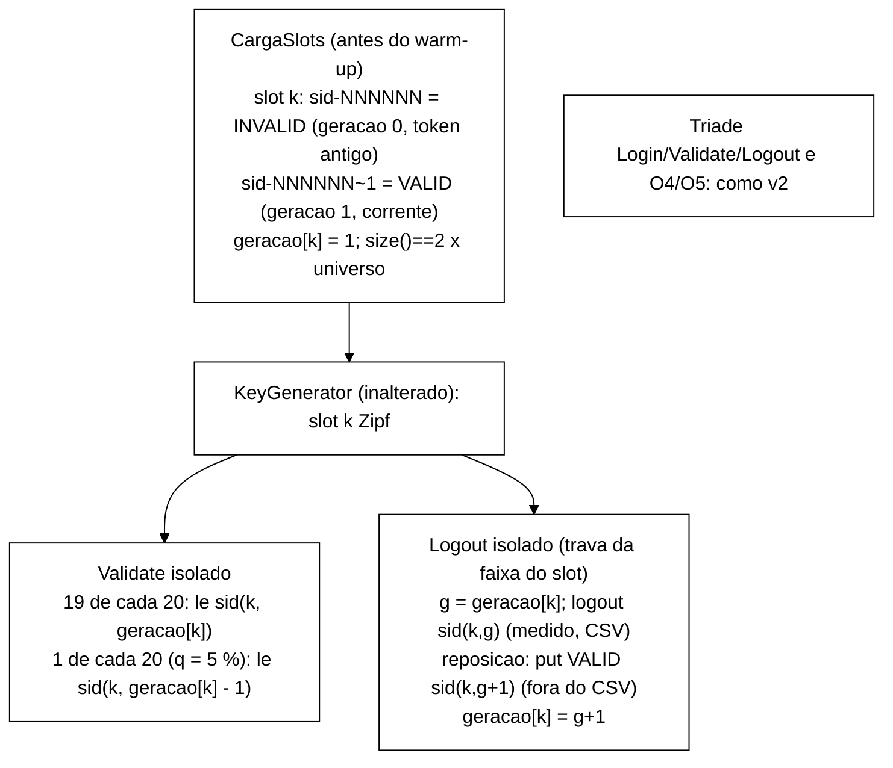

# Adendo à V-B43.2: prompt do B-43.7, mistura S1/S2 v3 "*slot*-geração" (2026-10-22)

> Senior, 2026-10-22. Adendo a `validacao-b43-2-2026-10-22.md` (`a6fc0e4`). Decisões do Gestor de
> 22/10: A2 opção (c) aprovada como **B-43.7**, com c1 (versão `v3`, v2 mantida para regressão), c2
> (reposição dentro do Logout, fora do CSV), c3 (q = 5 % declarado como premissa) e c4 (mapa
> *slot*→geração compartilhado entre *threads*). Renumeração: a correção do auditor é **B-43.6**
> (`fix/b43-6-auditor-i1-concorrencia`), e B-43.5 fica com a reprodutibilidade de `--seed`.
> Este adendo só contém o prompt. Nada foi despachado. Commit local, sem push.

## 1. Desenho em uma figura



Consequências de desenho que o prompt fixa e que o Gestor deve conhecer:

- **Estacionária desde o primeiro evento.** A geração 0 de **todo** *slot* já nasce INVALID na
  carga. A leitura de *token* antigo sempre encontra uma sessão invalidada, então a fração INVALID
  dos Validate isolados é q mais a corrida, do início ao fim. Sem isso, a fração começaria em
  q × (massa Zipf dos *slots* já deslogados) e repetiria a deriva de v2 em escala menor. Custo: a
  carga dobra (2 × 10⁵ `put`, cerca de 2 s no *host*).
- **Logout isolado sempre escreve.** A trava por faixa de *slot* serializa Logout × Logout no mesmo
  *slot*: nunca há dois *logouts* da mesma geração, e o Logout isolado é sempre uma invalidação real
  (`logout_noop` isolado = 0). O Validate não pega a trava. **Isso é um artefato declarado do
  *workload*:** Logouts no mesmo *slot* não são concorrentes entre si.
- **Ordem `put` da geração nova e depois `geracao[k] = g+1`.** Um Validate que vê a geração nova
  encontra a sessão já gravada, então não há NOT_FOUND espúrio. Um Validate que leu `g` antes do
  avanço pode ler INVALID: é uma corrida legítima, contada como INVALID e estimada em ≤ 0,6 p.p. em S1
  e ≤ 0,1 p.p. em S2.
- **Sem ressurreição.** A reposição escreve sempre uma chave nova (`g+1`), nunca uma chave já
  invalidada. Com o auditor de B-43.6, I1 = I4 = 0 é exigido no *smoke*.
- **Carga extra no *cluster*.** Cada Logout isolado vira 2 escritas (invalidação medida e reposição
  não medida): +10 % de operações em S1 e +1 % em S2, fora do CSV. Isso tem de entrar na Metodologia
  junto com a premissa q.

## 2. Base

O B-43.7 depende dos dois blocos em curso:

- **B-43.6** muda `SessionOps.validate`/`logout`, os mesmos métodos que a mistura v3 chama. Sem ele, a
  exigência de I1 = 0 do *smoke* não é verificável: a corrida de A1 geraria falsos positivos, agora
  também nas reposições.
- **B-43.4** põe `INVALID` no CSV. O critério de estacionariedade é medido **no CSV**, por terços da
  janela, e precisa disso. O contador de desfechos só dá o total.

**A base é a integração, não a ponta de um deles:** `feature/controlador-integracao` depois de
integrados, nesta ordem, B-43.6 e B-43.4, ambos validados. O Gestor preenche o SHA `<SHA-INTEG-B436-B434>`
no despacho. Se B-43.3a-i já estiver integrado nessa ponta, o verificador sai da própria base. Se
não, constrói-se o jar de `a8f5549`, como em B-43.2. Partir da ponta de B-43.6 ou de B-43.4 obrigaria
a integrar o outro depois, com conflito em `WorkloadMain`/`SessionOps`/testes.

## 3. Prompt para o Worker: B-43.7

````md
Você é o WORKER. Uma entrega, B-43.7 (mistura S1/S2 v3 "slot-geração"), com commits só locais.
**Não faça push.** Não use a VM. Branch `fix/b43-7-mistura-v3-slot-geracao` a partir de
`<SHA-INTEG-B436-B434>` (ponta de `feature/controlador-integracao` com B-43.6 e B-43.4 integrados).
Worktree nova `wt-b43-7`. Subdiretório PRÓPRIO do scratchpad (`b437/`) desde o primeiro comando.

Não edite: `tcc-escrita/`, `scripts/`, `analysis/` (exceto o script de análise do smoke em `runs/`),
`spec/`, o golden `workload/src/test/resources/golden-8e2e815/`, `KeyGenerator`, `Scenario`,
`OpResult`, `CargaInicial` (é da v2), `Armazem` nem `FakeCaches`. Nenhum teste existente editado ou
removido: só acréscimos, em arquivos novos. Em particular, `SequenciaMisturaV2Test`, `MisturaV2Test`,
`CliMisturaTest` (que fixa o padrão `v2`) e os testes de B-43.6/B-43.4 ficam como estão. TDD com o
vermelho registrado antes do verde. Mensagens `feat:|fix:|test:|docs:`. Diagramas em Mermaid.

Contexto obrigatório: `wt-plano-ctrl/docs/validacao-b43-2-2026-10-22.md` (seção 6, A2: modelo,
números e opções) e este adendo (`validacao-b43-2-adendo-b43-7-2026-10-22.md`, seções 1 e 2).
Comando: `mvn -f workload/pom.xml clean test`, somando os `TEST-*.xml` antes e depois de CADA commit.
Registre o "antes" medido na base.

Desenho exigido:
1. `VersaoMistura.V3` e `--mix v1|v2|v3`. **O padrão continua `v2`** (CliMisturaTest fixa isso). P-b
   vale para v3 (v3 + `--reset-state off` ⇒ saída 2 em `validar()`, com a mesma dispensa no dry-run e
   em S3). Dry-run e linha `Mistura: mix=v3 q=0.05`. `Cli.toString()` NÃO muda.
2. Classe NOVA `SlotsGeracao` (estado compartilhado por todas as threads da repetição):
   - `AtomicIntegerArray geracao` de tamanho universo+1, todas as posições começam em 1 depois da carga;
   - `static String chave(int k, int g)`: `g == 0` ⇒ `sid-%06d` (o mesmo formato de
     `KeyGenerator.nextSessionKey`, com `KeyGenerator.PREFIXO_SID`); `g >= 1` ⇒ `sid-%06d~g`;
   - `static int slotDe(String sid)` (inverso, para testes e análise);
   - `Object trava(int k)`: 1024 faixas (`k mod 1024`);
   - identidade da sessão do slot k em QUALQUER geração = `IdentidadesMistura.identidadeDaCarga(k, threads)`.
3. Classe NOVA `CargaSlots` (no padrão de `CargaInicial`, sem alterá-la): para k = 1..universo, grava
   `chave(k,0)` como `SessionState.criar(...).invalidar(Motivo.LOGOUT, agora)` e `chave(k,1)` como
   VALID, em `putAll` de 1000. Depois espera `size() == 2 × universo` (prazo 10 s, intervalo 100 ms,
   relógio e sono injetáveis). Falhas ⇒ `CargaInicialException` (saída 5), `carga-rep-NNN.json` com
   `mix=v3`, `universo`, `tamanho_final`, `entradas_por_slot=2`. Linha
   `Carga: mix=v3 cache=<nome> slots=<U> entradas=<2U> lotes=<l> ms=<t>`. Roda onde a carga v2 roda
   (depois de `prepararEstado`, antes de `long inicioMs`), só com v3 e fora do S3, na forma literal
   `rcm.getCache(cli.replicacao.cacheSessoes())`.
4. `WorkloadMain.executarOperacao` com v3 (v1/v2 inalterados):
   - o `sid` Zipf sorteado a cada iteração (`chaves.nextSessionKey()`, sem mudança) dá o slot
     `k = SlotsGeracao.slotDe(sid)`;
   - VALIDATE isolado: contador POR THREAD de Validates isolados (NÃO usa o `Random`); se
     `contador % 20 == 19`, lê `chave(k, geracao[k] − 1)` (token antigo), senão lê
     `chave(k, geracao[k])`. Constante `PERIODO_TOKEN_ANTIGO = 20` (q = 1/20, premissa c3);
   - LOGOUT isolado: `synchronized (trava(k))` { `g = geracao[k]`; `ops.logout(chave(k,g))` (medido,
     CSV como hoje); reposição `ops.reporSessao(chave(k,g+1), identidade)`; `geracao.set(k, g+1)` },
     nesta ordem. Se o logout der `ERROR_*`, NÃO há reposição nem avanço (conte em `reposicao_omitida`);
   - tríade, IncrementFailure e ResetFailures: como v2 (`IdentidadesMistura`).
5. `SessionOps.reporSessao(String sid, String identidade)`: `sessions.put` de uma sessão VALID, SEM
   `emitir` (fora do CSV), SEM `latency.record` e SEM passar pelo auditor. Conta, na janela de medição
   (a mesma `WarmupPolicy`), em `reposicoes` e `reposicao_erro`. É a única mudança em `SessionOps`, e
   não toca nas regras de B-43.6.
6. Stdout no fim da repetição (S1/S2 v3): `Mistura v3: validate_isolados=<a> token_antigo=<b>
   logout_isolados=<c> reposicoes=<d> reposicao_omitida=<e> reposicao_erro=<f>`, todos na janela de
   medição.

Testes (arquivos novos, na ordem do TDD):
 T1 `SlotsGeracaoTest`: formato e inverso de `chave` (g = 0, 1, 12); gerações começam em 1; 1024 faixas;
    a identidade do slot é a mesma em todas as gerações.
 T2 `TokenAntigoTest`: exatamente 1 de cada 20 Validates isolados por thread lê `g − 1`; a contagem não
    depende do `Random` (dois `Random` diferentes dão a mesma posição dos tokens antigos).
 T3 `SequenciaMisturaV3Test` (golden): com `new Random(42)` e `KeyGenerator(42)`, as 2000 primeiras
    operações de S1 e de S2 executadas em v3 são as de `golden-8e2e815/sequencia-s1-s2-seed42.txt`,
    e os slots das 500 primeiras iterações (`slotDe` da chave usada, para Validate/Logout isolados)
    são os números das 500 chaves do golden. Lido como recurso, sem editar.
 T4 `CargaSlotsTest`: 2U entradas; geração 0 INVALID(LOGOUT) e geração 1 VALID para todo slot;
    `size()==2U`; chega na k-ésima consulta ⇒ OK; nunca chega ⇒ exceção no prazo, saída 5, JSON FALHA,
    sem `rep-001.csv`; tamanho maior ⇒ falha imediata; último lote parcial gravado.
 T5 `MisturaV3Test` (fakes, 4 threads simuladas em sequência, 10⁴ operações, S1 e S2): Login OK/Login
    = 1; NOT_FOUND = 0; INVALID entre os Validate isolados = token_antigo exatamente (sem
    concorrência não há corrida) e = 5 % ± 0,1 p.p.; INVALID por terço da execução com diferença
    ≤ 0,5 p.p.; todo Logout isolado invalida uma sessão VALID (nenhum no-op); reposicoes =
    logout_isolados; no fim, para todo slot tocado, a geração corrente é VALID e todas as anteriores
    são INVALID.
 T6 `MisturaV3ConcorrenciaTest` (threads reais sobre um `Armazem` com `ConcurrentHashMap`):
    (a) determinístico, com latch: um Validate que lê `geracao[k]` logo depois do avanço encontra a
    sessão nova (nunca NOT_FOUND); (b) determinístico: dois Logouts no mesmo slot se serializam (a
    segunda invalida g+1, não repete g); (c) estocástico, 4 threads × 2,5·10⁴ operações em S1: NOT_FOUND
    = 0, I1 = I4 = 0 (auditor de B-43.6), gerações monotônicas e o invariante do fim de T5.
 T7 `CliMisturaV3Test`: `--mix v3` aceito; `V3`/`3` rejeitados; padrão continua v2; P-b em v3; dry-run
    com `mix=v3`; `toString()` igual.
 T8 posição: com o `DetectorFonte` existente (sem editar o arquivo; acrescente um detector novo se
    precisar), `CargaSlots` vem depois de `prepararEstado(` e antes de `long inicioMs`, fora de
    `try`/`if (false)`, e só com v3 e não S3.
 T9 `CsvMisturaV3Test`: num fake com `EventCsvWriter`, o CSV de v3 só contém as operações da mistura
    (`Login`, `Validate`, `Logout`, `IncrementFailure`, `ResetFailures`; em S2 sem `ResetFailures`):
    nenhuma linha para a reposição; `registrados = operações + 2 × logins OK`; o
    `VerificadorSanidade` (classe da base, se integrada; se não, a regra equivalente reimplementada no
    teste) dá OK sobre esse CSV.
 T10 todos os testes existentes, inclusive o `GoldenS1S2Test`, `SequenciaMisturaV2Test`,
    `MisturaV2Test` e os de B-43.6/B-43.4, verdes SEM edição.

Mutações (aplicar com script que exige 1 ocorrência, Surefire completo, reverter; nenhuma commitada;
todas precisam morrer):
 V1 o token antigo sorteado por `r.nextInt(20)` (mata T2/T3); V2 período 10 em vez de 20 (mata T2/T5);
 V3 a reposição emite um evento no CSV (`emitir(OP_LOGIN, …)`) (mata T9); V4 `geracao.set` ANTES da
 reposição (mata T6a); V5 sem a trava (mata T6b); V6 a geração 0 da carga gravada VALID (mata T4/T5);
 V7 o token antigo lê `g` em vez de `g − 1` (mata T5); V8 `geracao` por thread em vez de compartilhada
 (mata T5/T6c); V9 a reposição feita mesmo com o logout em `ERROR_*` (teste novo com o logout falhando:
 sem avanço e `reposicao_omitida = 1`); V10 a carga v3 também com `--mix v2` (mata T8 ou um teste de
 v2-sem-CargaSlots).

Smoke local (Podman `b437-isnN`, `podman ps -a` antes e depois, máquina Podman devolvida ao estado
inicial, SEM VM, `$JAVA_HOME/bin/java`). No MESMO cluster, `--threads 4 --reset-state on --mix v3`,
`--csv-dir` por execução:
 Q1 S1 sync 120 s; Q2 S2 sync 120 s; Q3 S1 async 120 s; Q4 S2 async 120 s;
 L1 S1 sync **600 s**; L2 S1 async **600 s** (S1 tem 10× mais Logouts que S2: é o caso mais difícil);
 L0 (contraste, documental, NÃO é critério) S1 sync v2 600 s, para medir a deriva prevista na V-B43.2
    (INVALID entre os isolados de cerca de 86 % na janela e 92 % no último décimo).
Use o *warm-up* padrão (`--warmup-min-sec` padrão) em L0/L1/L2 e 10 s em Q1..Q4. Os CSV de 600 s são
grandes: só JSON, manifesto e o script de análise são versionados.

Critérios (CSV de contrato v2 de B-43.4, janela de medição; "Validate isolado" = Validate com chave
começando em `sid-`, e "da tríade" = chave UUID):
 C1 estacionariedade, em Q1..Q4 e L1/L2: divida a janela em três terços iguais por `start_ns`. A
    fração INVALID entre os Validate isolados difere no máximo **1,0 p.p.** entre o 1º e o 3º terço.
    Em L1/L2, também por décimos: máximo − mínimo ≤ **2,0 p.p.**;
 C2 nível: a fração INVALID entre os Validate isolados fica em **[4,5 %; 6,5 %]** (q = 5 % mais a
    corrida estimada em ≤ 0,6 p.p. em S1; abaixo de 4,5 % indica token antigo perdido, acima de
    6,5 % indica deriva ou corrida maior que a prevista);
 C3 `token_antigo / validate_isolados` (stdout) = 5,00 % ± 0,10 p.p.; `validate_isolados` do stdout =
    Validate isolados do CSV (diferença 0 ou a de fronteira já documentada);
 C4 Validate `NOT_FOUND` = 0; Login OK/Login ≥ 0,99; `(registrados + descartados)/operações > 1` e a
    identidade `registrados + descartados − operações = 2 × logins OK`, que prova que a reposição não
    gerou eventos;
 C5 Logout isolado sempre escreve: `logout_isolados` = `reposicoes` + `reposicao_omitida`;
    `reposicao_erro = 0` sem falha; `logout_isolados` = Logout com chave `sid-` no CSV; nenhum Logout
    isolado no-op (registre como mediu: o histograma `logout_noop` mistura tríade e isolados, então use
    um contador próprio se precisar);
 C6 I1 = I4 = 0 e a linha `Auditor:` de B-43.6 registrada;
 C7 verificador de sanidade (o da base, ou o jar `a8f5549`): exit 0 e veredito OK em Q1..Q4/L1/L2,
    nenhum exit 2 (nenhuma operação fora da mistura). Registre as métricas, sem ajustar limiares;
 C8 carga: `tamanho_final = 200000`, `ms=` registrado; reset com `antes` ≥ 2·10⁵ em Q2/Q4/L1/L2,
    `ms=` registrado;
 C9 todos com exit 0.
Escreva com destaque: "smoke local, 4 threads: as latências NÃO são evidência; o smoke prova a mistura
v3 estacionária, com q = 5 % de token antigo como premissa declarada e a reposição fora do CSV".
Brutos em `runs/b43-7-smoke/` com `MANIFEST.sha256` e o script de análise (terços/décimos por
`start_ns`) versionado ao lado.

Relatório `docs/relatorio-b43-7-<data>.md` (resultado, Surefire por commit, arquivo:linha antes e
depois, testes, mutações, smoke com a tabela por terço e por décimo de L1/L2 e o contraste L0,
custo da carga e da reposição, desvios, pontos para o Gestor). Ao terminar, liste os SHAs, a
worktree e o `git status`, e pare. Não integre nem faça push.
````

## 4. Efeito no *golden*

Nenhum. `KeyGenerator`, `Scenario`, `EventCsvWriter` e os recursos `golden-8e2e815/` não mudam, e o
`GoldenS1S2Test` fica verde sem edição. A sequência de operações e de sorteios Zipf por semente é a
mesma de v1/v2 (T3 prova isso para v3). O que muda em v3 é a **chave efetiva** dos Validate/Logout
isolados (`sid-NNNNNN~g`) e o estado inicial (2 entradas por *slot*). Isso não é coberto pelo
*golden*, por desenho, e T1/T3 travam o novo contrato. A v2 continua coberta pelo
`SequenciaMisturaV2Test`.

## 5. Compatibilidade com o verificador de sanidade

- O CSV de v3 tem só as operações da mistura. A reposição não chama `emitir` (T9, V3). A regra
  "operação fora da mistura ⇒ saída 2" (V-B43.3a-i-R) e `MISTURA_DESVIO` continuam valendo sem mudança:
  as frações por evento são as de v2.
- `VALIDATE_VALID_ZERO` passa a ser significativo com o contrato v2 (cerca de 95 % VALID nos isolados,
  100 % na tríade). `VALIDATE_AUSENTE_ALTO` exige `NOT_FOUND` = 0, e v3 não o produz.
- Proposta para a parte ii do B-43.3a (fora deste bloco): uma regra `INVALID_FORA_DE_Q`, com a fração
  INVALID entre os Validate isolados fora de [q − 0,5; q + 1,5] p.p. ⇒ FALHA, e o q lido do `meta`.
  Ela trava a premissa nas execuções da matriz.

## 6. Pontos que exigem decisão do Gestor

1. **Base = integração** (`feature/controlador-integracao` com B-43.6 e B-43.4 integrados e
   validados). O SHA é preenchido no despacho.
2. **Padrão do `--mix` continua `v2`.** Mudar para v3 exigiria editar cerca de 9 testes existentes
   (`CliMisturaTest`, `WorkloadMainCargaTest`, que G7 da V-B43.2 mostrou). Recomendo manter v2 como
   padrão e fazer o B-42.3/B-43.3b passar `--mix v3` explicitamente, com o *dry-run* mostrando a
   versão. A alternativa é autorizar essas edições num commit `test:` próprio.
3. **Trava por faixa de *slot* no Logout isolado** (seção 1): necessária para o Logout sempre
   escrever e para a reposição nunca ressuscitar uma chave. É um artefato declarado: Logouts no mesmo
   *slot* não são concorrentes entre si.
4. **Geração 0 INVALID na carga** (estacionária desde o primeiro evento, carga de 2 × 10⁵): aprovar.
5. **Tolerâncias:** C1 (≤ 1,0 p.p. entre terços; ≤ 2,0 p.p. entre décimos nas longas) e C2
   ([4,5 %; 6,5 %]) são propostas do Senior, a partir da corrida estimada. Se aprovadas, registrar em
   `decisoes-tecnicas.md` antes do *smoke*, como pré-registro.
6. **Metodologia:** premissa q = 5 % (*token* antigo), reposição (+10 % de escritas em S1, +1 % em S2,
   fora do CSV), trava por *slot* e carga com geração 0 invalidada. O resumo para os agentes
   acadêmicos sai depois do relatório de B-43.7.
