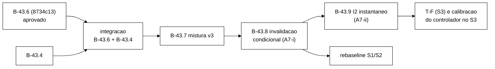

# Validação V-B43.6: auditor I1/I4 sem corrida (2026-10-22)

> Senior, 2026-10-22. Validação independente da entrega do Worker na branch
> `fix/b43-6-auditor-i1-concorrencia` (worktree `wt-b43-6`), commits `2335d29..8734c13` sobre
> `8ee2deb`, relatório `docs/relatorio-b43-6-2026-10-22.md`, brutos `runs/b43-6-smoke/`.
> Especificação: seção 9.1 de `validacao-b43-2-2026-10-22.md` (lá chamado "B-43.5"; renumerado para
> B-43.6 pelo Gestor), com N1 e N9 da seção 8. Surefire e mutantes rodaram em cópias `git archive`
> (`workload` + `cluster`) no *scratchpad*, removidas no fim. Nada foi alterado em `wt-b43-6`.
> Nenhum *cluster* subiu e a VM não foi usada. Commit local nesta branch, sem push.

## 1. Veredito

**APROVADA.** A correção faz exatamente o que a regra pede: uma leitura só é acusada de I1/I4 contra
uma confirmação que já existia antes de ela começar. Todas as alegações medidas conferem. Os controles
positivos (leitura velha posterior à confirmação) continuam acusando I1 e I4, e os testes existentes
ficaram verdes sem edição. Dos meus 8 mutantes, os 8 morrem. Há uma observação para o B-43.8: dois deles (E1, E2) só morrem pelos testes de diagnóstico A7, que fixam o comportamento atual (seção 3).

No *cluster* real, a corrida de A1 reapareceu uma vez em R2 (SYNC) e uma vez em R4 (ASYNC), e foi
contada em `i1_concorrentes` em vez de virar I1. Isso confirma de forma independente o diagnóstico da
V-B43.2.

O diagnóstico A7 do Worker está correto e mostra dois problemas novos, ambos do S3: a atualização
perdida `logout` × `block` e a mistura de corrida do observador com janela real no I2. Recomendações
na seção 5. **Nenhum dos dois bloqueia o B-43.7. Um deles (A7-i) deve entrar antes do *rebaseline*,
porque muda o custo do Logout em todos os cenários.**

## 2. Medido × alegado

| Alegação do Worker | Medido pelo Senior | Confere? |
|---|---|---|
| Base `8ee2deb`: 373/0/0/0, 52 | exit 0, 373/0/0/0, 52 | sim |
| `2335d29` 377/54 · `7b085b9` 386/55 · `eb45006` 389/56 · `9de1881` 394/57 | idênticos, exit 0, 0/0/0 | sim |
| `bf8a398` e `8734c13`: 394/0/0/0, 57 | idênticos | sim |
| Nenhum teste existente editado | `git diff --name-status 8ee2deb 8734c13 -- workload/src/test`: só `A` | sim |
| *Golden* intacto; nada em `scripts/`, `analysis/`, `spec/`, `cluster/`, `OpResult` | `git diff --quiet` com saída 0; `--stat` vazio | sim |
| N1 morto | reaplicado na ponta: 394/1, `LacoDeRepeticoesTest.lacoSemCaptura` | sim |
| N9, U1b, U2, U3, U4 mortos | não reaplicados (amostra: U1a, U5 e N1 conferidos) | não medido |
| U1a morto (394/3) | 394/3: `validateConcorrenteComLogoutNaoEViolacao`, `motivoConcorrenteNaoEViolacao`, `somaInstanciasDoMapaCompartilhado` | sim |
| U5 morto (394/6) | 394/6: os controles positivos A3 (I1 e I4), A4 com confirmação anterior, A5, `S3SimulacaoTest.invalidacoesCompartilhadas` e `leituraNaJanelaDoVencedorVeI4` | sim |
| R1..R4 com exit 0 | `exits.txt` | sim |
| I1 = I4 = 0 em R1..R4 | stdout `Violacoes detectadas: 0` nas quatro; `violacoes-rep-001.csv` só com o cabeçalho | sim |
| `i1_concorrentes = 1` em R2 e R4, 0 em R1 e R3 | linhas `Auditor:` do `stdout.log` de cada execução | sim |
| Linhas do CSV = `registrados`; desfechos = Validate do CSV | contei nos CSV: 412 976 / 420 406 / 419 169 / 491 252 linhas, iguais; Validate 206 139 / 210 221 / 209 200 / 245 472, iguais às somas dos desfechos | sim |
| Reset e carga | R2 `antes=182410,36 ms=23`, R3 `antes=187388,36 ms=16`; carga de 750 a 1 077 ms | sim |
| `MANIFEST.sha256` 40 OK | `sha256sum -c`: 40 OK, 0 falhas | sim |
| `podman ps -a` idêntico; 0 ` ERROR ` | `diff` vazio; 0/0/0 nos três logs | sim |

## 3. Mutantes do Senior

Mesmo método das validações anteriores (o *script* exige 1 ocorrência do trecho), sobre `8734c13`, com
o Surefire completo e `-Dsurefire.timeout=240`.

| ID | Mutação | Resultado | Teste que mata |
|---|---|---|---|
| E1 | `logout`: confirmação no mapa ANTES do `sessions.put` (quebra "confirmação visível ⇒ escrita reconhecida") | morta, 394/2 | só `AuditorDiagnosticoS3Test.logoutVenceBlock` e `leituraNaJanelaDoVencedorVeI4` |
| E2 | o mesmo na cascata de `block` | morta, 394/2 | só `AuditorDiagnosticoS3Test.i2DentroDaCascata` e `blockVenceLogout` |
| E3 | sem o incremento de `i4_concorrentes` | morta, 394/1 | `motivoConcorrenteNaoEViolacao` |
| E4 | primeira observação com `put` em vez de `putIfAbsent` | morta, 394/1 | `motivoConcorrenteNaoEViolacao` |
| E5 | S3 sem `instanciasAuditor.addAll(clientes.instancias())` | morta, 394/1 | `AuditorLinhaTest.workloadMainImprime` |
| E6 | `linhaAuditor` soma só a primeira instância | morta, 394/1 | `somaInstanciasDoMapaCompartilhado` |
| E7 | `i1_concorrentes` conta toda leitura VALID sem confirmação prévia | morta, 394/7 | `AuditorCorridaTest` (4), `AuditorDiagnosticoS3Test` (2), `AuditorLinhaTest` (1) |
| E8 | `logout` sem checar I1 antes de invalidar | morta, 394/3 | `leituraVelhaPosteriorEI1`, `sequencialB23`, `logoutsConcorrentesNaoSaoViolacao` |

**Observação sobre E1/E2.** A ordem `put` e depois confirmação, que é o argumento central da
correção, só está protegida pelos testes de **diagnóstico** A7, que fixam o comportamento atual de
propósito. Se o B-43.8 reescrever esses testes (seção 5.1), a proteção some. O B-43.8 deve trazer um
teste dedicado: uma leitura cujo instantâneo é tirado entre a confirmação e o `put` não pode virar I1.
Esse teste mata E1/E2 independentemente do diagnóstico.

## 4. Leitura do código

- A regra está nos três pontos de leitura: o instantâneo em `validate` e `logout` antes do `get`, e a
  cópia do mapa em `block` antes de `entrySet()`. A ordem `sessions.put` e depois
  `invalidacoesConfirmadas.put` está comentada nos dois escritores. É ela que sustenta o argumento
  "confirmação visível ⇒ escrita reconhecida".
- Ramo `confirmadoAntes == null` com leitura INVALID: `putIfAbsent`, e `i4_concorrentes` se outra
  confirmação com motivo diferente chegou antes. Ramo com leitura VALID: `i1_concorrentes` só se o mapa
  já tem confirmação depois da leitura. As duas coisas estão corretas.
- O tipo do mapa compartilhado, os construtores e o *snapshot* não mudaram (`MundoS3` intacto).
- D1..D13 do Worker: **todos aceitos**. D3 (portas 11232..11234) e D8 (o caso D3 do diagnóstico com um
  `SessionOps` extra sobre o mesmo *grid*/mapa/auditor) são adequados. D9 (cópia do mapa O(n) por
  `block`): aceitável no S3, mas o tamanho do mapa num S3 de 600 s deve ser registrado na T-F. D11
  (contadores sem janela): ver A7-iii.

## 5. Recomendações para o diagnóstico A7

### 5.1 (i) Atualização perdida `logout` × `block`: **defeito do *workload***, escrita condicional por versão

Recomendo tratar como defeito, não como efeito a medir.

- **O objeto de estudo é o *grid*, não a aplicação.** A I4 de D1/D2 nasce de um *read-modify-write*
  sem condição no `SessionOps`, e acontece igual em SYNC e em ASYNC, com o *grid* perfeitamente
  consistente. Se ela fosse medida, o `S_viol` (que inclui I4) levaria o controlador ao CONSERVADOR
  por um artefato que o SYNC não resolve. E as comparações H-A0/H-A1 (ASYNC × SYNC) teriam um termo
  comum que só dilui o efeito procurado.
- **Medir de forma estável seria caro e enganoso.** Seria preciso detectar o vencedor contra a
  confirmação do perdedor, e o resultado contaria corridas da aplicação como violações do *grid*.
- **Uma aplicação correta usa escrita condicional.** Com o Hot Rod: `getWithMetadata` e depois
  `replaceWithVersion`. A primeira invalidação vence, e o motivo é imutável, que é a própria I4 do lado
  da aplicação. Quem perde relê, encontra INVALID e vira no-op. Depois disso, I4 no S3 mede só o que o
  *grid* faz: por exemplo, um *merge* depois de partição com motivos divergentes
  (`merge-policy=PREFERRED_NON_NULL`), que é exatamente o caso de interesse de H-A1.

**Bloco:** **B-43.8** "invalidação condicional por versão" (`fix/b43-8-invalidacao-condicional`).
Escopo:

- `logout` e a cascata de `block` usam leitura com versão e `replaceWithVersion`. Falha de versão ⇒
  reler; se INVALID ⇒ no-op (contador `invalidacao_perdida_para_concorrente`), senão tentar de novo
  (máximo 3; depois disso, `ERROR_*`).
- O `Armazem` não muda: vai uma interface nova `ArmazemVersionado` com adaptador de produção, e um
  teste de guarda garante que a produção sempre usa o caminho versionado.
- A confirmação no mapa passa a ser escrita só pelo vencedor.
- Critérios:
  - os casos D1/D2/D3 do `AuditorDiagnosticoS3Test` passam a terminar com o motivo do **primeiro**
    invalidador, sem I4. Os testes de diagnóstico existentes fixam o comportamento antigo, então
    **precisam de autorização para edição** (ou de um teste novo que documente o novo comportamento,
    deixando o antigo marcado `@Disabled` com motivo, também uma edição);
  - um mutante que volta ao `put` sem condição tem de morrer;
  - *smoke* S3 curto sem I4;
  - *smoke* S1 v3 com os critérios C1..C9 do B-43.7 mantidos.
- Investigar no mesmo bloco, só como diagnóstico: o TOCTOU `login` × `block`. O `login` lê a identidade
  OPEN, o `block` faz a cascata, e o `login` grava uma sessão VALID que a cascata não viu. O resultado
  é uma sessão VALID permanente sob identidade BLOCKED, que vira I2 classificado REAL por um defeito da
  aplicação.

**Efeito no Logout de todos os cenários:** passa a custar uma leitura com metadados e uma escrita
condicional. Isso muda a latência medida do Logout em S1/S2/S3. **Por isso B-43.8 tem de entrar antes
do *rebaseline*,** para que o *rebaseline* e a T-F meçam o mesmo Logout. Não bloqueia o B-43.7: ele
pode ser desenvolvido e integrado antes, e o B-43.8 repete os critérios C1..C9 de v3 no próprio
*smoke*.

### 5.2 (ii) I2: **sim, regra de instantâneo**, com três classes temporais

Recomendo aplicar a regra, mas sem perder a janela real da cascata (D4b), que é informação legítima.

- **D4a** (a sessão foi lida antes de o `block` confirmar a identidade) é corrida do observador, da
  mesma forma que A1. Hoje ela sai como I2 e é classificada **REAL** pelo rastro (`RastroCliente.classeDeI2`:
  bloqueio ADMINISTRATIVO ⇒ REAL), e por isso entra em `S_viol`. É o mesmo risco crítico de A1, agora
  no S3.
- **D4b** (`validate` dentro da cascata: identidade já BLOCKED, sessão ainda VALID) é uma janela real
  **da aplicação**, porque a cascata não é atômica. Ela existe em SYNC e em ASYNC, e o ASYNC pode
  alargá-la. É medida útil, mas não é anomalia do *grid*.
- **I2 depois da cascata concluída** (o `block` já retornou e uma leitura iniciada depois ainda vê a
  sessão VALID) é anomalia do *grid* ou invalidação perdida. Essa é a I2 que deve disparar R1.

Regra proposta: um mapa compartilhado de bloqueios por identidade, com dois marcos. O primeiro,
`identidade_confirmada`, é gravado depois do `identities.put` reconhecido (no `block` e no
`incrementFailure` que atinge o limite). O segundo, `cascata_concluida`, é gravado depois da última
invalidação da cascata. Tira-se um instantâneo antes do `sessions.get`, e a sessão lida VALID com a
identidade BLOCKED é classificada assim:

| Instantâneo antes da leitura | Classe | Entra em `S_viol`? |
|---|---|---|
| nenhum marco | `i2_concorrente` (contador, não violação) | não |
| só `identidade_confirmada` | `I2_JANELA_CASCATA` | não (medida própria, por fase) |
| `cascata_concluida` | I2 (e o rastro classifica REAL/ESPERADA/INCERTA como hoje) | sim, se REAL |

O bloqueio por limite (POR_LIMITE, sem cascata) mantém a classificação ESPERADA-POR-DESENHO.

**Bloco:** **B-43.9** "I2 com instantâneo e janela da cascata" (`fix/b43-9-i2-instantaneo`), a partir
de B-43.8, porque mexe na mesma cascata. Precisa de uma decisão no plano do controlador: `S_viol` passa
a ser `Δ(I1 + I4 + I2_REAL)`, e o `I2_REAL` passa a exigir a cascata concluída.
`I2_JANELA_CASCATA` vai para o JSON da janela como métrica secundária. **Não bloqueia o B-43.7 nem o
*rebaseline* S1/S2:** em S1/S2 (v2 e v3) as identidades de login nunca são bloqueadas e as `lim-<tid>`
não têm sessão, então I2 não ocorre. **Bloqueia a T-F (S3) e a calibração do controlador no S3.**

### 5.3 (iii) `i1_concorrentes` / `i4_concorrentes` fora de `S_viol`: **de acordo**

São medida do observador, não do *grid*. Recomendações:

- ficam fora de `S_viol` e de qualquer gatilho;
- entram, junto com `i2_concorrentes` de B-43.9, no JSON da janela do controlador como canal de
  diagnóstico (`viol.concorrentes`), para que um aumento anormal (sinal de mudança no próprio auditor)
  seja visível;
- passam a ter janela: hoje contam a repetição inteira (D11). Basta contar só quando
  `WarmupPolicy.deveRegistrar()`, como nos desfechos, mais um total sem janela para conferência.

**Onde:** a regra "fora de `S_viol`" é uma linha no `plano-implementacao-controlador` (seção dos
sinais), registrada em `decisoes-tecnicas.md`. O código da janela entra no B-26.x/B-28.x (agregador),
e o contador com janela entra no B-43.9. Não bloqueia nada.

### 5.4 Ordem resultante

| Item | Bloco | Bloqueia B-43.7? | Bloqueia o *rebaseline* S1/S2? | Bloqueia a T-F/S3? |
|---|---|---|---|---|
| A7-i atualização perdida | B-43.8 | não | **sim** (muda o custo do Logout em todos os cenários) | sim |
| A7-ii I2 instantâneo | B-43.9 | não | não (I2 não ocorre em S1/S2) | **sim** |
| A7-iii concorrentes fora de `S_viol` | plano do controlador + B-26.x/B-28.x; janela no B-43.9 | não | não | não |

## 6. Pontos para o Gestor

1. **Aprovar o B-43.6** (`2335d29..8734c13`) para integração, junto com o B-43.4 quando validado.
2. **A7-i:** aprovar a invalidação condicional por versão (B-43.8), antes do *rebaseline*, e autorizar
   a edição dos testes de diagnóstico D1..D3 do `AuditorDiagnosticoS3Test`, que fixam o comportamento
   antigo de propósito.
3. **A7-ii:** aprovar a regra de três classes para I2 (B-43.9) e a mudança correspondente na definição
   de `I2_REAL` em `S_viol`.
4. **A7-iii:** registrar em `decisoes-tecnicas.md` que os contadores `*_concorrentes` ficam fora de
   `S_viol` e entram como diagnóstico na janela.
5. **Texto acadêmico:** a Metodologia vai descrever a regra temporal do auditor (I1/I4 e, depois,
   I2), a escrita condicional das invalidações e a classe `I2_JANELA_CASCATA`.
6. Integração e push continuam pendentes de aprovação explícita. Nada foi publicado.
