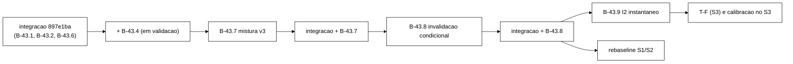

# Adendo à V-B43.6: prompts do B-43.8 e do B-43.9 (2026-10-22)

> Senior, 2026-10-22. Adendo a `validacao-b43-6-2026-10-22.md` (`6226e84`). Decisões do Gestor de
> 22/10:
>
> - A7-i vira **B-43.8** (invalidação condicional por versão), antes do *rebaseline*, com autorização
>   para reescrever D1..D3 de `AuditorDiagnosticoS3Test`, exigido um teste dedicado à ordem
>   confirmação/`put` e incluído o diagnóstico do TOCTOU `login` × `block`;
> - A7-ii vira **B-43.9** (instantâneo para I2, três classes), pré-requisito da T-F e da calibração no
>   S3;
> - A7-iii: `*_concorrentes` só como diagnóstico.
>
> As decisões estão registradas em `docs/decisoes-tecnicas.md` (DT-001..DT-005), criado nesta branch.
> Só os prompts. Nada foi despachado. Commit local, sem push.

## 1. Bases e ordem



| Bloco | Base | Por quê |
|---|---|---|
| B-43.7 | `<SHA-INTEG-B434>`: integração com B-43.4 integrado (hoje `897e1ba` já tem o B-43.6) | como no adendo do B-43.7 |
| **B-43.8** | **`<SHA-INTEG-B437>`**: integração com B-43.7 integrado e validado | o B-43.8 muda o Logout, que a v3 usa com reposição e trava. O *smoke* do B-43.8 tem de repetir C1..C9 de v3 (DT-004), o que exige v3 na base. Partir antes do B-43.7 obrigaria a resolver conflito em `SessionOps`/`WorkloadMain` na integração |
| **B-43.9** | **`<SHA-INTEG-B438>`**: integração com B-43.8 integrado e validado | o B-43.9 mexe na mesma cascata de `block` e em `validate`. Em paralelo com o B-43.8 haveria conflito garantido |

O *rebaseline* S1/S2 depende do B-43.8 (DT-003), não do B-43.9 (I2 não ocorre em S1/S2). A T-F
depende dos dois.

**Observação para o Gestor:** o S3 nunca rodou contra o Infinispan real (RAST-S3-3 do B-33). Os
*smokes* S3 do B-43.8 e do B-43.9 serão as primeiras execuções reais do S3. Isso adianta parte do
primeiro passo da T-F, mas não o substitui: os parâmetros da T-F (`--s3-users` etc.) continuam por
pré-registrar.

## 2. Prompt para o Worker: B-43.8 (invalidação condicional por versão)

````md
Você é o WORKER. Uma entrega, B-43.8, com commits só locais. **Não faça push.** Não use a VM.
Branch `fix/b43-8-invalidacao-condicional` a partir de `<SHA-INTEG-B437>` (ponta de
`feature/controlador-integracao` com B-43.7 integrado). Worktree nova `wt-b43-8`. Subdiretório PRÓPRIO
do scratchpad (`b438/`) desde o primeiro comando.

Não edite: `tcc-escrita/`, `scripts/`, `analysis/`, `spec/`, o golden `golden-8e2e815/`, `OpResult`
(contrato CSV v2 de B-43.4), `Armazem`, `FakeCaches`, `KeyGenerator`, `Scenario` nem a mistura v3.
Nenhum teste existente editado ou removido, com UMA exceção autorizada pelo Gestor (DT-003): os
testes D1 `blockVenceLogout`, D2 `logoutVenceBlock` e D3 `leituraNaJanelaDoVencedorVeI4` de
`AuditorDiagnosticoS3Test`, que fixam de propósito o comportamento antigo. Eles são reescritos para o
comportamento novo num commit `test:` próprio, com o diff no relatório. Qualquer outro teste existente
que falhar: PARE e relate. TDD com o vermelho registrado. Mensagens `feat:|fix:|test:|docs:`.
Diagramas em Mermaid.

Contexto obrigatório: `wt-plano-ctrl/docs/validacao-b43-6-2026-10-22.md` (seções 3 e 5.1),
`docs/decisoes-tecnicas.md` (DT-003, DT-004) e o relatório do B-43.6 (seção 7.1, D1..D3).
Comando: `mvn -f workload/pom.xml clean test`, somando os `TEST-*.xml` antes e depois de CADA commit.
Registre o "antes" medido na base.

Desenho exigido:
1. Interface NOVA `ArmazemVersionado<V> extends Armazem<V>`:
   `Versionado<V> lerComVersao(String chave)` (record `valor`, `versao`; `null` se ausente) e
   `boolean substituirSeVersao(String chave, V novo, long versao)`. Adaptador de produção
   `ArmazemVersionado.de(RemoteCache<String, V>)` com `getWithMetadata(k)` (`MetadataValue.getVersion()`)
   e `replaceWithVersion(k, novo, versao)`. Em produção, o `SessionOps` usa SEMPRE esse adaptador para
   o cache de sessões.
2. `SessionOps.logout(sid)`, caminho versionado (quando o armazém de sessões é `ArmazemVersionado`):
   a) instantâneo `confirmadoAntes` (regra de B-43.6) e `v = lerComVersao(sid)` como A leitura da
      operação (substitui o `get`); `null` ⇒ NOT_FOUND como hoje;
   b) INVALID ⇒ `verificarI1I4` e no-op, como hoje;
   c) VALID ⇒ `verificarI1I4`; `substituirSeVersao(sid, invalidada, v.versao)`;
      - sucesso ⇒ a confirmação `invalidacoesConfirmadas.put(sid, LOGOUT)` vem DEPOIS, só para o
        vencedor (mesma ordem de B-43.6); `logout_ok`;
      - falha de versão ⇒ novo instantâneo, nova `lerComVersao`, e: INVALID ⇒ no-op, contador
        `invalidacaoPerdida` (`LongAdder`), `verificarI1I4` sobre essa releitura, NADA escrito no
        mapa; VALID ⇒ tenta de novo, no máximo 3 tentativas no total; esgotou ⇒ contador
        `conflitoEsgotado` e o resultado de erro que o `ClassificadorDeErro` der para uma
        `IllegalStateException("conflito de versao esgotado")`, registrado como hoje.
3. Cascata de `block`: a varredura (`entrySet`) só seleciona as candidatas (identidade alvo e VALID).
   Para cada candidata: instantâneo por entrada, `lerComVersao`, e a mesma lógica de 2c com
   ADMIN_BLOCK. A cópia do mapa de B-43.6 tirada antes da varredura continua sendo usada para a
   checagem I1 do valor da varredura.
4. Caminho não versionado (armazém comum, como o `FakeCaches` dos testes existentes): comportamento
   de B-43.6 INALTERADO. Só os testes usam esse caminho.
5. Stdout: a linha `Auditor:` ganha `invalidacao_perdida=<n> conflito_esgotado=<m>`. Mantenha o
   prefixo e os dois campos existentes na mesma ordem, se algum teste existente checar a linha; se
   checar a linha inteira, imprima uma linha NOVA `Invalidacao: perdida=<n> conflito_esgotado=<m>`.
   São só diagnóstico (DT-001).
6. Diagnóstico TOCTOU `login` × `block` (SEM corrigir): o `login` lê a identidade OPEN; antes do
   `put` da sessão, um `block` completo roda (identidade BLOCKED, a cascata não vê a sessão ainda não
   gravada); o `login` grava a sessão VALID. Teste com latch que documenta o estado final (sessão VALID
   permanente sob identidade BLOCKED) e o que o auditor e o rastro fazem com um `validate` posterior
   (I2? classe REAL?). Relate e proponha a correção, por exemplo a dupla checagem: depois do `put`, o
   `login` relê a identidade e, se BLOCKED, invalida a própria sessão com ADMIN_BLOCK. NÃO implemente:
   é decisão do Gestor, para o B-43.9.

Testes (arquivos novos, salvo a reescrita autorizada):
 W1 `OrdemConfirmacaoTest` (o teste dedicado exigido pelo Gestor; mata E1/E2 da V-B43.6 sem depender
    do diagnóstico): um armazém (versionado E comum, um caso para cada) cujo `substituirSeVersao`/`put`
    pausa ANTES de aplicar a escrita (latch). Durante a pausa: (a) o mapa NÃO contém a confirmação;
    (b) um `validate` de outra thread lê VALID e NÃO gera I1. Para `logout` e para a cascata de `block`.
 W2 D1 reescrito `blockPerdeParaLogoutAnterior`: o `block` lê VALID na varredura; um `logout` completo
    invalida; o `block` tenta e perde a versão ⇒ releitura INVALID(LOGOUT), no-op. Estado final
    LOGOUT, mapa LOGOUT, 0 violações, `invalidacaoPerdida == 1`; a `VarreduraFinal` não acusa I4.
 W3 D2 reescrito `logoutPerdeParaBlockAnterior`: espelho de W2. Final ADMIN_BLOCK, mapa ADMIN_BLOCK.
 W4 D3 reescrito: a leitura de outro servidor entre a escrita e a confirmação do vencedor não vê
    motivo divergente; 0 I4.
 W5 conflito com VALID persistente (fake que muda a versão sem mudar o estado): 3 tentativas, depois
    `conflitoEsgotado == 1` e resultado de erro; nada escrito no mapa.
 W6 guarda de produção: no fonte sem comentários (`DetectorFonte`), o `SessionOps` de produção
    constrói o armazém de sessões com `ArmazemVersionado.de(`; o adaptador chama `getWithMetadata` e
    `replaceWithVersion` (texto).
 W7 controle positivo de B-43.6 no caminho versionado: uma leitura velha iniciada depois da
    confirmação continua dando I1/I4.
 W8 TOCTOU (item 6), só documentação do comportamento atual.
 W9 existentes (exceto D1..D3 autorizados), golden, testes de B-43.6/B-43.7 verdes sem edição.

Mutações (todas precisam morrer): Y1 `substituirSeVersao` trocado por `put` incondicional (mata
W2/W3); Y2 confirmação antes da escrita no `logout` versionado (W1); Y3 o mesmo na cascata (W1);
Y4 o perdedor também escreve no mapa (W2/W3, asserção do mapa); Y5 sem releitura após o conflito
(o perdedor devolve `logout_ok`) (W2); Y6 tentativas ilimitadas, ou 1 em vez de 3 (W5); Y7 a produção
usa `Armazem.de` comum (W6); Y8 instantâneo por entrada da cascata tirado DEPOIS da `lerComVersao`
(W7 ou um caso de corrida na cascata). Reaplique também E1 e E2 da V-B43.6 sobre o caminho comum:
têm de morrer por W1, não só pelo diagnóstico.

Smoke local (Podman `b438-isnN`, portas que não colidam com outro cluster ativo, `podman ps -a` antes
e depois, máquina Podman devolvida ao estado inicial, SEM VM, `$JAVA_HOME/bin/java`):
 P1 S1 sync v3 120 s; P2 S1 async v3 120 s (`--mix v3 --threads 4 --reset-state on`);
 P3 S3 sync 300 s e P4 S3 async 300 s (`--scenario S3 --sweep`, padrões de B-33). São as PRIMEIRAS
    execuções reais do S3: registre tudo (`s3-acoes`, `s3-resumo`, violações, linha `Auditor:`).
Critérios:
 - P1/P2: C1..C9 do B-43.7 (DT-004) continuam atendidos; `invalidacao_perdida` e `conflito_esgotado`
   = 0 (Logouts no mesmo slot são serializados pela trava de v3); compare p50/p99 de `logout_ok` com
   o smoke do B-43.7 e registre a diferença como custo da escrita condicional (documental, não
   critério);
 - P3/P4: exit 0; I4 = 0 (o caso D1/D2 deixa de existir; se aparecer I4, investigue e relate antes de
   concluir); `conflito_esgotado` = 0; `invalidacao_perdida` registrado; a `VarreduraFinal` (`--sweep`)
   sem I4; I1 = 0 em SYNC. I1/I2 em ASYNC são registrados e analisados, não critério (H-A0 é da T-F);
 - todos com exit 0.
Brutos em `runs/b43-8-smoke/` com `MANIFEST.sha256`. Destaque: "smoke local: as latências NÃO são
evidência; o smoke prova a invalidação condicional e é a primeira execução real do S3, não a T-F".

Relatório `docs/relatorio-b43-8-<data>.md` (resultado, Surefire por commit, arquivo:linha antes e
depois, testes, diff dos três testes reescritos, mutações, smoke, diagnóstico TOCTOU com a correção
proposta, desvios, pontos para o Gestor). Ao terminar, liste os SHAs, a worktree e o `git status`, e
pare. Não integre nem faça push.
````

## 3. Prompt para o Worker: B-43.9 (I2 com instantâneo e janela da cascata)

````md
Você é o WORKER. Uma entrega, B-43.9, com commits só locais. **Não faça push.** Não use a VM.
Branch `fix/b43-9-i2-instantaneo` a partir de `<SHA-INTEG-B438>` (ponta de
`feature/controlador-integracao` com B-43.8 integrado). Worktree nova `wt-b43-9`. Subdiretório
PRÓPRIO do scratchpad (`b439/`).

Não edite: `tcc-escrita/`, `scripts/`, `analysis/`, `spec/`, o golden, `OpResult`, `Armazem`,
`FakeCaches`, `MundoS3`, a mistura nem o plano do controlador. Nenhum teste existente editado ou
removido. Se um existente falhar: PARE e relate. TDD com o vermelho registrado. Diagramas em Mermaid.

Contexto obrigatório: `wt-plano-ctrl/docs/validacao-b43-6-2026-10-22.md` (seção 5.2),
`docs/decisoes-tecnicas.md` (DT-001, DT-002), o relatório do B-43.6 (seção 7.2, D4a/D4b) e o
relatório do B-43.8 (diagnóstico TOCTOU).
Comando: `mvn -f workload/pom.xml clean test`, somando os `TEST-*.xml` antes e depois de cada commit.

Regra (DT-002). Uma leitura de sessão VALID cuja identidade é lida BLOCKED (o candidato a I2 de
hoje) é classificada pelo instante `t0` em que a leitura da SESSÃO começou (`System.nanoTime()` antes
do `get`/`lerComVersao`), contra os marcos do bloqueio daquela identidade:
 - `marcoIdentidadeNs`: gravado DEPOIS de o `identities.put(BLOCKED)` ser reconhecido, no `block`
   (ADMIN) e no `incrementFailure` que atinge o limite (LIMITE);
 - `marcoCascataNs`: gravado DEPOIS da última invalidação da cascata do `block`. No LIMITE (sem
   cascata) é igual a `marcoIdentidadeNs`;
 - `unblock`: remove os marcos da identidade DEPOIS do `put(OPEN)` reconhecido.
 Classes:
 - sem marco para a identidade ⇒ comportamento atual (I2 registrado como hoje) e contador
   `i2SemMarco`. Em produção (mapa compartilhado) esse contador tem de dar 0. Ele existe para manter
   o comportamento dos testes antigos que montam BLOCKED direto no fake;
 - `t0 < marcoIdentidadeNs` ⇒ `i2Concorrentes` (contador; NÃO é violação, DT-001);
 - `marcoIdentidadeNs ≤ t0 < marcoCascataNs` ⇒ registro `I2_JANELA_CASCATA` no auditor (aparece em
   `violacoes-rep-NNN.csv` com esse rótulo e com a fase, mas FORA de `S_viol`);
 - `t0 ≥ marcoCascataNs` ⇒ I2, como hoje (o rastro continua classificando REAL/ESPERADA/INCERTA).

Desenho:
1. Mapa compartilhado NOVO `ConcurrentHashMap<String, MarcoBloqueio>` (record `tipo`,
   `marcoIdentidadeNs`, `marcoCascataNs`), com o mesmo ciclo de vida do mapa de invalidações: um por
   repetição em S1/S2 e um compartilhado por `S3Clientes` entre servidores e admin. Construtores
   novos; os existentes continuam valendo (criam um mapa próprio). `MundoS3` não muda.
2. `validate`: capture `t0Sessao` imediatamente antes da leitura da sessão e aplique a regra.
3. Stdout: a linha `Auditor:` (ou uma linha nova, se um teste existente fixar a linha inteira) ganha
   `i2_concorrentes=<n> i2_janela_cascata=<m> i2_sem_marco=<k>`. Todos os contadores `*_concorrentes`
   passam a contar SÓ na janela de medição (`WarmupPolicy.deveRegistrar()`), mais um total sem janela
   para conferência (`*_total`). Isso fecha o D11 do B-43.6.
4. [Depende da decisão do Gestor sobre o TOCTOU, relatório do B-43.8] Se aprovada a dupla checagem:
   o `login`, depois do `put` da sessão, relê a identidade e, se BLOCKED, invalida a própria sessão
   com ADMIN_BLOCK (escrita condicional de B-43.8) e devolve `BLOCKED`. Contador
   `login_revertido_por_bloqueio`. Se NÃO aprovada: não faça este item, e o critério de I2 REAL do
   smoke vira "toda ocorrência explicada pelo TOCTOU no relatório".

Testes (arquivos novos):
 Z1 D4a convertido (arquivo novo, o de B-43.6 não muda): a sessão é lida antes de o `block` confirmar
    a identidade ⇒ 0 I2, `i2Concorrentes == 1`.
 Z2 D4b convertido: `validate` inteiro dentro da cascata ⇒ 1 `I2_JANELA_CASCATA`, 0 I2.
 Z3 controle positivo: cascata concluída; depois, uma leitura iniciada depois disso vê a sessão VALID
    (fake "velho") ⇒ 1 I2, classe REAL pelo rastro.
 Z4 LIMITE: `incrementFailure` atinge o limite; sessão VALID lida depois ⇒ I2 classificada
    ESPERADA-POR-DESENHO, como hoje.
 Z5 `unblock` remove os marcos: depois do desbloqueio, nenhuma classificação usa marco velho; um
    novo `block` grava marcos novos.
 Z6 sem marco (BLOCKED montado direto no fake) ⇒ I2 como hoje, `i2SemMarco == 1`.
 Z7 S3: os marcos são compartilhados entre servidores e admin (o admin bloqueia, um servidor de
    aplicação classifica com os marcos do admin).
 Z8 janela de medição: corridas no warm-up não contam no contador com janela, só no total.
 Z9 [se o item 4] TOCTOU: o roteiro do B-43.8 passa a terminar com a sessão INVALID(ADMIN_BLOCK) e
    `login_revertido_por_bloqueio == 1`, sem I2.
 Z10 existentes e golden verdes SEM edição (inclusive `AuditorDiagnosticoS3Test` como deixado pelo
    B-43.8, `SessionOpsRastroTest`, `VarreduraFinalTest`).

Mutações (todas precisam morrer): K1 `t0Sessao` capturado DEPOIS da leitura da sessão (Z1); K2
`marcoIdentidadeNs` gravado ANTES do `put(BLOCKED)` (Z1 com latch entre os dois); K3 `marcoCascataNs`
gravado no início da cascata (Z2); K4 `I2_JANELA_CASCATA` registrado como `I2` (Z2); K5 `unblock` sem
remover os marcos (Z5); K6 mapa de marcos por instância no S3 (Z7); K7 contador concorrente sem
janela (Z8); [se o item 4] K8 dupla checagem sem a releitura (Z9).

Smoke local (Podman `b439-isnN`, `podman ps -a` antes e depois, SEM VM): Q1 S3 sync 300 s; Q2 S3 async
300 s (`--scenario S3 --sweep`, padrões de B-33); Q3 S1 sync v3 120 s (regressão: I2 não ocorre em
S1/S2, `i2_*` = 0).
Critérios: exit 0; `i2_sem_marco = 0` em todos (prova de que produção grava os marcos); em SYNC, I2
pós-cascata REAL = 0 (se o item 4 foi feito) ou cada ocorrência explicada pelo TOCTOU; os valores de
`i2_concorrentes` e `I2_JANELA_CASCATA` registrados por fase; I1 = I4 = 0 em SYNC; Q3 com C1..C9 de
DT-004. Brutos em `runs/b43-9-smoke/` com `MANIFEST.sha256`. Destaque: "smoke local, não é a T-F".

Relatório `docs/relatorio-b43-9-<data>.md` (resultado, Surefire por commit, arquivo:linha, testes,
mutações, smoke por classe de I2, desvios, pontos para o Gestor, incluindo a mudança necessária no
agregador do controlador para `S_viol` ignorar `I2_JANELA_CASCATA` e os `*_concorrentes`). Ao
terminar, liste os SHAs, a worktree e o `git status`, e pare. Não integre nem faça push.
````

## 4. O que ainda depende do Gestor

1. **SHAs de base**, no despacho: `<SHA-INTEG-B437>` para o B-43.8 e `<SHA-INTEG-B438>` para o B-43.9.
   Os dois dependem das validações e integrações anteriores (o B-43.4 está em validação).
2. **TOCTOU `login` × `block`:** decidir, depois do diagnóstico do B-43.8, se o B-43.9 implementa a
   dupla checagem no `login` (item 4 do prompt). Sem ela, o I2 REAL do S3 pode ter ocorrências causadas
   pela aplicação, o que contamina `S_viol` na T-F.
3. **Agregador do controlador (B-26.x/B-28.x):** precisa de um item que implemente DT-001 e DT-002
   (excluir `*_concorrentes` e `I2_JANELA_CASCATA` de `S_viol`), com um teste. Hoje isso está só
   registrado em `decisoes-tecnicas.md`.
4. **Primeiras execuções reais do S3** nos *smokes* do B-43.8 e do B-43.9: aceitar que elas aconteçam
   antes da T-F, só como *smoke* (os parâmetros da T-F continuam por pré-registrar).
5. Integração e push continuam pendentes de aprovação explícita. Nada foi publicado.
