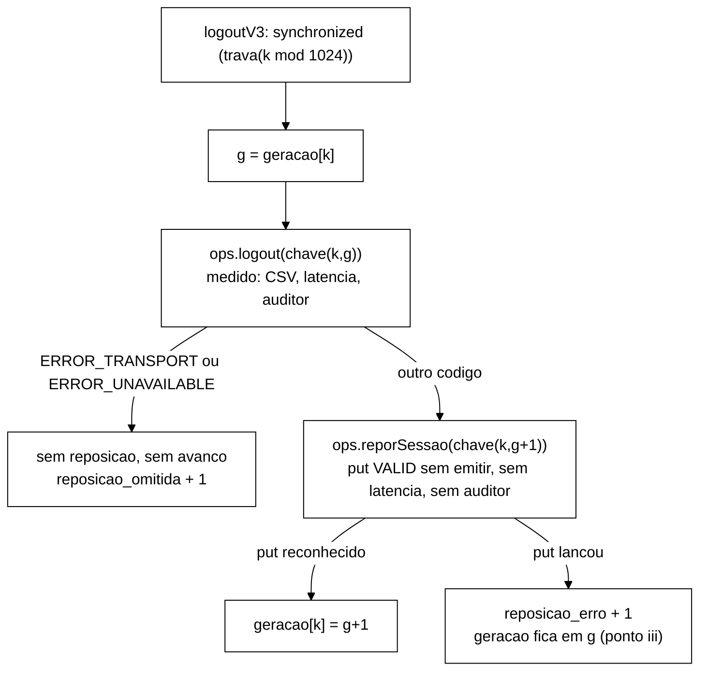

# Validação V-B43.7: mistura S1/S2 v3 "*slot*-geração" (2026-10-22)

> Senior, 2026-10-22. Objeto: entrega do Worker para o B-43.7, branch
> `fix/b43-7-mistura-v3-slot-geracao`, worktree `wt-b43-7`, base `7977f8f` (ponta de
> `feature/controlador-integracao`), ponta `e599818`. Especificação: seção 3 de
> `validacao-b43-2-adendo-b43-7-2026-10-22.md`. Tolerâncias: DT-004 (pré-registro, não relaxadas).
> Padrão do `--mix`: DT-005. Tudo o que está abaixo foi medido de novo pelo Senior, sem usar os
> números do relatório como fonte. Nada foi integrado e nada foi enviado com push.

## 1. Veredito

**APROVADO.** A entrega cumpre o desenho, os testes T1..T10, os mutantes e os critérios C1..C9 nas
seis execuções v3, dentro das tolerâncias de DT-004 e com folga grande. Não há divergência numérica
com o relatório do Worker. As observações da seção 6 são de documentação e não bloqueiam a
integração.

## 2. Histórico e escopo

| Verificação | Resultado |
|---|---|
| Linear sobre `7977f8f`, sem *merge commits* | OK: `cd7e6db` test, `1e9f925` feat, `8c08b24` feat, `5a07d54` feat, `b0caeb0` test, `e599818` docs |
| `test:` de P1 antes de qualquer `feat:` | OK (`cd7e6db`) |
| `git diff 7977f8f..e599818` em testes existentes | Só `CliMisturaTest.java` (linha 58, `@DisplayName`, e linha 60, o vetor) e `IdentidadesMisturaTest.java:109`, `"v3"` → `"v4"`. São as 3 linhas autorizadas. Os outros 11 arquivos de teste são novos (`A`) |
| Arquivos proibidos | Sem diferença em `KeyGenerator`, `Scenario`, `OpResult`, `CargaInicial`, `EventCsvWriter`, `golden-8e2e815/`, `scripts/`, `spec/`, `analysis/` |
| Vermelho antes de cada `feat:` | Registrado como falha de compilação (os testes de cada `feat:` entram no mesmo commit que as classes). O vermelho comportamental está nos mutantes. Aceito, ver a observação O1 |
| `git status` da worktree | Limpo |

## 3. Testes

- `mvn -f workload/pom.xml clean test` em `e599818`, com a soma dos `TEST-*.xml`: **675 testes,
  0 falhas, 0 erros, 1 ignorado**. `BUILD SUCCESS`. O ignorado é o mesmo da base. O
  `GoldenS1S2Test`, o `SequenciaMisturaV2Test` e o `MisturaV2Test` passaram sem edição.
- Python (`analysis/`, `python -m unittest discover`): **15 testes OK**.
- Mutantes reaplicados pelo Senior numa worktree descartável (`git worktree add --detach`, removida
  depois), só com as classes de teste da v3:

| Mutante | Falhas medidas | Relatório do Worker |
|---|---|---|
| V5, sem a trava (`synchronized (new Object())`) | 2 | 2 |
| V4, `definirGeracao` antes da reposição | 3 | 3 |
| V1, token antigo por `r.nextInt(20) == 19` | 4 | 4 |

- Instabilidade: `MisturaV3ConcorrenciaTest` (T6a/b/c, com *threads* reais) passou **8 de 8**
  repetições seguidas.

## 4. *Smoke*

### 4.1 Integridade

- `sha256sum -c MANIFEST.sha256` em `runs/b43-7-smoke/`: **88 de 88 OK**, 0 falhas.
- `exits.txt`: Q1..Q4, L1, L2 e L0 com saída 0.
- `analise.py` executado de novo pelo Senior, com a saída redirecionada para fora da worktree: o JSON
  gerado é **idêntico** ao `analise.json` versionado. Todas as seis execuções v3 deram
  `todos_ok=True`.

### 4.2 Conferência independente em L1 (S1 sync, 600 s)

Script próprio do Senior sobre `L1/rep-001.csv` (contrato v2), sem reaproveitar `analise.py`.
A janela é o intervalo `[min, max]` de `start_ns` do CSV, dividido em partes iguais.

| Medida | Senior | DT-004 | Situação |
|---|---|---|---|
| Linhas do CSV | 4 011 530 (= `registrados` do stdout) | - | OK |
| Validate isolados (chave `sid-`) | 1 338 556, dos quais 70 049 INVALID | - | - |
| **C2**, fração INVALID | **5,2332 %** | [4,5 %; 6,5 %] | OK |
| **C1**, terços | 5,241 / 5,231 / 5,228 %; 1º − 3º = **0,013 p.p.** | ≤ 1,0 p.p. | OK |
| **C1**, décimos | 5,205 a 5,244 %; máximo − mínimo = **0,039 p.p.** | ≤ 2,0 p.p. | OK |
| **C3**, `token_antigo / validate_isolados` (stdout) | 66 927 / 1 338 556 = **4,99994 %** | 5,00 % ± 0,10 p.p. | OK |
| **C3**, `validate_isolados` stdout − CSV | 1 338 556 − 1 338 556 = **0** | 0 ou fronteira | OK |
| **C5**, `logout_isolados` = `reposicoes` + `reposicao_omitida` | 267 638 = 267 638 + 0 | igualdade | OK |
| **C5**, Logout `sid-` no CSV | 267 638, todos com `return_code` NONE (nenhum NOT_FOUND) | = `logout_isolados` | OK |
| **C5**, `reposicao_erro` | 0 | 0 | OK |
| **C5**, `logout_noop` (limite superior) | sem nenhuma amostra, nem na janela nem no *warm-up* (a linha não aparece no stdout) | n = 0 | OK |
| **C4**, Validate NOT_FOUND | 0 (no CSV e no stdout) | 0 | OK |
| **C6** | `Violacoes detectadas: 0`, `violacoes-rep-001.csv` só com o cabeçalho; `Auditor: i1_concorrentes=765 i4_concorrentes=0` | I1 = I4 = 0 e linha registrada | OK |
| **C8** | carga `tamanho_final = 200000`, `ms = 1214`; reset com `antes = 247385` | ≥ 2·10⁵ | OK |

O NOT_FOUND do Logout é gravado como `NOT_FOUND` no contrato v2, enquanto a invalidação e o no-op
saem como `NONE`. Por isso o CSV separa o NOT_FOUND, mas não separa o no-op, e o C5 usa o histograma
`logout_noop` como limite superior, como o Gestor decidiu.

### 4.3 As seis execuções v3 (do `analise.json` regenerado)

| Exec. | C2 fração | C1 1º − 3º | C1 décimos | C3 `token_antigo` | stdout − CSV | `logout_noop` | Logout `sid-` NOT_FOUND |
|---|---|---|---|---|---|---|---|
| Q1 S1 sync 120 s | 5,2471 % | 0,0604 p.p. | - | 5,0003 % | 0 | 0 | 0 |
| Q2 S2 sync 120 s | 5,0466 % | 0,0071 p.p. | - | 5,0001 % | 0 | 0 | 0 |
| Q3 S1 async 120 s | 5,1895 % | 0,0331 p.p. | - | 4,9999 % | 0 | 0 | 0 |
| Q4 S2 async 120 s | 5,0324 % | 0,0021 p.p. | - | 5,0001 % | 0 | 0 | 0 |
| L1 S1 sync 600 s | 5,2332 % | 0,0126 p.p. | 0,0392 p.p. | 4,9999 % | 0 | 0 | 0 |
| L2 S1 async 600 s | 5,1852 % | 0,0058 p.p. | 0,0336 p.p. | 4,9999 % | 0 | 0 | 0 |

A corrida Validate × Logout no mesmo *slot* soma de 0,03 a 0,25 p.p. sobre q. A estimativa do adendo
era de até 0,6 p.p. em S1 e até 0,1 p.p. em S2. O contraste L0 (v2, documental) reproduz a deriva:
85,38 % de INVALID na janela, 77,15 % no 1º décimo e 90,01 % no último.

## 5. Revisão de código

| Item | Onde | Parecer |
|---|---|---|
| Trava por *slot* e ordem Logout medido → reposição → avanço | `WorkloadMain.logoutV3` | Correto. O avanço só acontece depois do `put` reconhecido, então um Validate que vê `g+1` encontra a sessão (T6a, V4) |
| Reposição fora do CSV e do auditor | `SessionOps.reporSessao` | Correto. Não chama `emitir`, `latency.record` nem `verificarI1I4`. As regras de B-43.6 ficaram intactas. A identidade `reg. + desc. − oper. = 2 × logins OK` fechou exata nas seis execuções |
| Token antigo sem consumir o `Random` | `MisturaV3.Cliente.proximoEhTokenAntigo` | Correto. É um contador por *thread*, `c % 20 == 19`. T2 e T3 (golden) garantem a mesma sequência de operações de v1/v2 (V1 morre) |
| Carga com geração 0 INVALID e geração 1 VALID | `CargaSlots.carregar` | Correto. `invalidar(LOGOUT)` na geração 0, `size() == 2U` com prazo, falha imediata se `size() > 2U` (V6 morre) |
| Saída 5 na falha da carga | `prepararCargaSlots` relança `CargaInicialException` | Correto. `codigoDeSaida` = 5, JSON `FALHA`, sem `rep-001.csv` (teste T4 em `WorkloadMainCargaSlotsTest`) |
| v3 exige `--reset-state on` | `Cli.validar` | Correto, com mensagem própria. Dispensado no *dry-run* e em S3, como em v2 |
| v2 continua padrão | `Cli.mix = V2`, `defaultValue = "v2"` | Correto. `CliMisturaTest` (padrão v2) verde, golden verde sem edição |
| Posição da carga | `executarRepeticao`, depois de `prepararCarga` e antes de `long inicioMs` | Correto (T8, V10) |

## 6. Observações (não bloqueiam)

- **O1, vermelho só de compilação.** Os três `feat:` trazem os testes no mesmo commit, e o vermelho
  registrado é a falha de compilação (50, 40 e 6 símbolos ausentes). Os dez mutantes mortos dão o
  vermelho comportamental de cada regra. Aceito, porque é o mesmo padrão já aceito em blocos
  anteriores. Nos próximos blocos, quando a regra puder ser testada contra uma classe já existente,
  o ideal é um commit `test:` vermelho separado.
- **O2, a trava é por faixa, não por *slot*.** Com 1024 faixas, Logouts isolados de *slots* com o
  mesmo `k mod 1024` também se serializam no cliente. A Metodologia deve dizer "faixa de *slot*".
  A espera pela trava fica fora da latência medida, porque `t0` é tomado dentro de `ops.logout`.
- **O3, q é determinístico.** O *token* antigo é o 20º de cada bloco de 20 Validates isolados de cada
  *thread*, e não um sorteio de Bernoulli com p = 0,05. Por isso C3 sai com erro menor que 10⁻⁴ p.p.
  A Metodologia deve dizer "1 em cada 20, por *thread*".
- **O4, `i1_concorrentes` sobe com v3** (69 a 1628). Pela DT-001 isso não entra em `S_viol`. Fica só
  registrado.
- **O5, integração.** O B-43.8 (invalidação condicional, adendo da V-B43.6) também mexe em
  `SessionOps.logout`. O `reporSessao` não depende do caminho interno do `logout`, mas o C5 da v3
  (nenhum no-op isolado, reposições = Logouts isolados) deve ser repetido no *smoke* do B-43.8.

## 7. Pontos que o Worker levou ao Gestor

| Ponto | Recomendação do Senior |
|---|---|
| (i) A mensagem de falha de carga na `main` mostra `mix=<versão>` em vez do `mix=v2` fixo | **Aceitar.** Corrige um texto que ficaria falso em v3. Nenhum teste existente verificava essa *string*, e o código de saída (5) não muda |
| (ii) `analise.py` tolera até 4 eventos (o número de *threads*) na fronteira da janela em C3/C5 | **Aceitar, com registro.** O adendo já previa "diferença 0 ou a de fronteira já documentada". Os contadores de janela são avaliados em instantes diferentes do evento do CSV, então até uma operação por *thread* pode cair de lados diferentes. O valor medido foi 0 nas seis execuções. Ao registrar em DT-004, deixar claro que a margem é igual ao número de *threads*, que não é tolerância de C1/C2 e que a diferença medida sempre aparece no relatório |
| (iii) Se a reposição falhar, a geração não avança | **Aceitar.** É a única escolha que mantém Validate NOT_FOUND = 0 e não ressuscita chave. O custo é que o próximo Logout do *slot* vira um no-op (a sessão `g` já está INVALID). Isso aparece em `logout_noop` e é contado em `reposicao_erro`. Com isso, `reposicao_erro = 0` continua sendo condição de C5 nas execuções sem falha injetada. Em execuções com falha injetada, `reposicao_erro` e `logout_noop` passam a ser métricas reportadas, não critério |
| (iv) Registro metodológico | **Aceitar e registrar.** O texto deve conter: q = 5 % como premissa, aplicado de forma determinística (1 em cada 20 Validates isolados, por *thread*); reposição fora do CSV e da latência, com +10,0 % de escritas em S1 (L1: 267 638 / 2 675 756) e +0,99 % em S2 (Q2), medidos; trava por faixa de *slot* (`k mod 1024`), em que Logouts isolados da mesma faixa não são concorrentes entre si; carga com geração 0 INVALID e geração 1 VALID (2 × 10⁵ entradas, 1,1 a 1,9 s, fora da janela); e corrida medida de 0,03 a 0,25 p.p. acima de q. O resumo para os agentes acadêmicos (`docs/resumos-para-tcc/`) sai depois da aprovação do Gestor |

## 8. Perguntas ao Gestor

1. **Integrar o B-43.7 em `feature/controlador-integracao`** (*fast-forward* local de `7977f8f` para
   `e599818`, sem push)? Recomendação: sim, depois do aceite deste parecer.
2. **DT-004:** acrescentar a margem de fronteira de (ii) e a redação "1 em cada 20, por *thread*" de
   O3? Recomendação: sim, como esclarecimento, sem mudar nenhuma tolerância.
3. **DT-005:** acrescentar que a trava é por faixa (`k mod 1024`, O2) e que a reposição que falha não
   avança a geração (iii)? Recomendação: sim.
