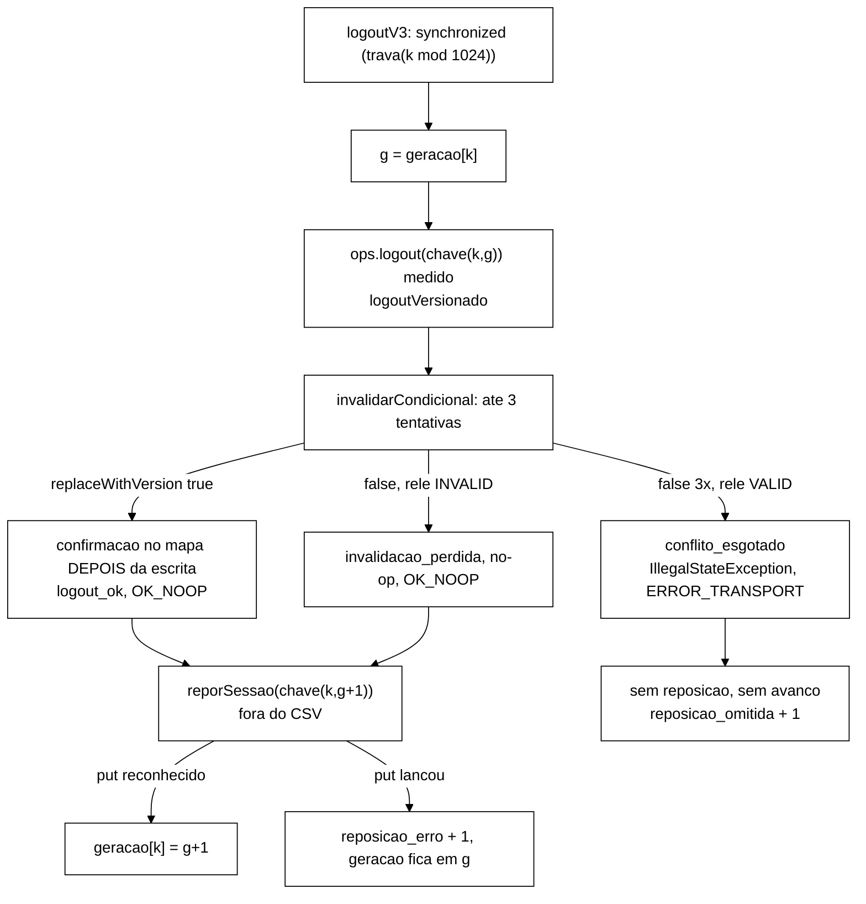

# Validação V-B43.8: invalidação condicional por versão (2026-10-22)

> Senior, 2026-10-22. Objeto: entrega do Worker para o B-43.8, branch
> `fix/b43-8-invalidacao-condicional`, worktree `wt-b43-8`, base `e599818` (ponta de
> `feature/controlador-integracao`, com B-43.6, B-43.4 e B-43.7), ponta `0215964`. Especificação:
> seção 2 de `validacao-b43-6-adendo-b43-8-b43-9-2026-10-22.md`, DT-003 e DT-004. Relatório do Worker:
> `wt-b43-8/docs/relatorio-b43-8-2026-10-22.md`. Tudo o que está abaixo foi medido de novo pelo Senior,
> sem usar os números do relatório como fonte. Nada foi integrado e nada foi enviado com push.

## 1. Veredito

**APROVADO.** A entrega cumpre o desenho (itens 1 a 6), os testes W1..W9, os mutantes Y1..Y8 e E1/E2
e os critérios do *smoke*. Os números que recalculei batem com o relatório; a única diferença é de
arredondamento (seção 4.2). Os pontos levados ao Gestor estão na seção 6. Nenhum deles bloqueia a
integração; dois (TOCTOU e dupla I1) definem o escopo do B-43.9.

## 2. Histórico e escopo

| Verificação | Resultado |
|---|---|
| Linear sobre `e599818`, sem *merge commits* | OK. 9 commits: `02e5f06` feat, `00aef96` feat, `be07809` feat, `41e4ac0` test, `019fd20` feat, `4c29da0` test, `a210482` test, `8bcf50c` test, `0215964` docs. `git log --merges e599818..0215964` vazio |
| Testes existentes editados | Só `AuditorDiagnosticoS3Test.java` (`M`). Os outros 9 arquivos de teste são novos (`A`). No arquivo editado mudaram os métodos D1, D2 e D3, o parágrafo do javadoc da classe que os descrevia, dois `import` que deixaram de ser usados (`Map`, `Set`) e um auxiliar privado novo (`mundoVersionado()`). D4a/D4b, `mundo()` e os demais auxiliares estão byte a byte iguais. Fica dentro da autorização (DT-003): o javadoc, os `import` e o auxiliar são consequência direta da reescrita |
| Arquivos proibidos | `git diff --stat e599818..0215964` vazio para `Armazem`, `OpResult`, `KeyGenerator`, `Scenario`, `MisturaV3`, `SlotsGeracao`, `CargaSlots`, `ClassificadorDeErro`, `FakeCaches`, `src/test/resources` (golden), `scripts/`, `analysis/`, `spec/`, `cluster/` |
| Produção alterada | `ArmazemVersionado.java` (novo, 50 linhas), `SessionOps.java` (só 3 linhas removidas: os dois `Armazem.de(` de sessões e um javadoc; o resto é acréscimo), `WorkloadMain.java` (+1 linha, a `Invalidacao:`) |
| `git status` da worktree | Limpo antes e depois da validação |

## 3. Testes

- `mvn -o -f workload/pom.xml clean test` em `0215964`, somando os `TEST-*.xml`: **95 arquivos, 697
  testes, 0 falhas, 0 erros, 1 ignorado**, `exit 0`. Bate com 675/0/0/1 → 697/0/0/1 do relatório (o
  ignorado é o mesmo da base).
- Python (`analysis/`, `python -m unittest discover`): **15 testes OK**.
- Instabilidade: `OrdemConfirmacaoTest`, `CascataCondicionalTest`, `LogoutCondicionalTest`,
  `ToctouLoginBlockTest`, `AuditorDiagnosticoS3Test` e `MisturaV3ConcorrenciaTest` (os que usam
  *threads* reais e *latches*) passaram **6 de 6** rodadas seguidas.
- Mutantes reaplicados pelo Senior numa worktree descartável (`git worktree add --detach` em
  `0215964`, removida depois), Surefire completo, com a lista de testes que falharam:

| Mutante | Mutação aplicada | Falhas medidas | Relatório | Quem matou |
|---|---|---|---|---|
| Y1 | `substituirSeVersao(sid, nova, v.versao())` → `put(sid, nova) != null \|\| true` | **13** | 13 | W2, W3, W4, W1 versionado (2), W5 (2), `logoutSimples`, `logoutPerdeParaOutroLogout`, `cascataSimples`, `corridaNaCascata`, `conflitoEsgotadoNaCascata`, `linhaInvalidacao` |
| Y5 | `return Desfecho.ESCRITA` logo depois da falha de versão, sem releitura | **9** | 9 | W2, W3, W4, W5 (3), `logoutPerdeParaOutroLogout`, `corridaNaCascata`, `linhaInvalidacao` |
| Y7 | os dois construtores de produção com `Armazem.de(` | **1** | 1 | W6 `producaoUsaVersionado` |

A lista de testes mortos é a mesma do relatório nos três casos.

## 4. *Smoke*

### 4.1 Integridade

- `sha256sum -c MANIFEST.sha256` em `runs/b43-8-smoke/`: **76 de 76 OK**.
- `exits.txt`: P1..P5 com saída 0.
- `analise.py` executado de novo a partir de uma cópia no *scratchpad* (só o caminho de saída
  trocado): o JSON gerado é **idêntico** ao `analise.json` versionado (`cmp` sem diferença). As cinco
  execuções deram `todos_ok=True`.
- Logs dos servidores: `ISPN006010` aparece **1 vez por nó** (3 no total), como o relatório diz.

### 4.2 Conferência independente em P5 (S1 v3 sync, 600 s)

Script próprio do Senior sobre `P5/rep-001.csv` (contrato v2), sem reaproveitar `analise.py`. A janela
é o intervalo `[min, max]` de `start_ns` do CSV, dividido em partes iguais.

| Medida | Senior | DT-004 | Situação |
|---|---|---|---|
| Linhas do CSV | 3 975 138 (= `registrados` do stdout) | - | OK |
| Validate isolados (chave `sid-`) | 1 323 706: 1 254 364 VALID, 69 342 INVALID, 0 NOT_FOUND | - | - |
| **C2**, fração INVALID | **5,2385 %** | [4,5 %; 6,5 %] | OK |
| **C1**, terços | 5,2317 / 5,2328 / 5,2507 %; \|1º − 3º\| = **0,019 p.p.** | ≤ 1,0 p.p. | OK |
| **C1**, décimos | 5,213 a 5,262 %; máximo − mínimo = **0,0485 p.p.** | ≤ 2,0 p.p. | OK |
| **C3**, `token_antigo / validate_isolados` (stdout) | 66 185 / 1 323 706 = **4,99998 %** | 5,00 % ± 0,10 p.p. | OK |
| **C3**, `validate_isolados` stdout − CSV | 1 323 706 − 1 323 706 = **0** | ≤ 4 (fronteira) | OK |
| **C5**, `logout_isolados` = `reposicoes` + `reposicao_omitida` | 264 645 = 264 645 + 0 | igualdade | OK |
| **C5**, Logout `sid-` no CSV | 264 645, todos `NONE` (nenhum NOT_FOUND) | = `logout_isolados` | OK |
| **C5**, `reposicao_erro` / `logout_noop` | 0 / sem linha `logout_noop` no stdout (n = 0) | 0 | OK |
| **C4**, Validate NOT_FOUND | 0 (CSV e `Desfechos Validate: ... not_found=0`) | 0 | OK |
| **C6** | `Violacoes detectadas: 0`; `Auditor: i1_concorrentes=651 i4_concorrentes=0` | I1 = I4 = 0 | OK |
| B-43.8 | `Invalidacao: perdida=0 conflito_esgotado=0` | 0 / 0 | OK |

Divergência com o relatório: só de arredondamento. O relatório dá a fração como 5,239 % e o
máximo − mínimo dos décimos como 0,048 p.p.; medi 5,2385 % e 0,0485 p.p. A diferença de terços sai
negativa no meu cálculo (1º − 3º = −0,019 p.p.) e o relatório dá o valor absoluto. O critério é sobre
o módulo.

### 4.3 S3 (P3, P4)

Conferido no stdout: `Violacoes detectadas: 0`, `Auditor: i1_concorrentes=0 i4_concorrentes=0`,
`Invalidacao: perdida=0 conflito_esgotado=0` e `Varredura final: ... achados=0; REAL={}` nas duas. O
caminho do perdedor não foi exercido no cluster (`invalidacao_perdida = 0`); a prova dele são os
testes W2..W4 e os mutantes Y1/Y4/Y5.

## 5. Revisão de código

| Item | Onde | Parecer |
|---|---|---|
| Adaptador Hot Rod | `ArmazemVersionado.de` | Correto. `getWithMetadata` devolve `null` para chave ausente e a versão vem de `MetadataValue.getVersion()`; `replaceWithVersion` devolve `false` para versão diferente ou chave ausente, e o chamador distingue os dois casos pela releitura |
| Desvio só pelo tipo do armazém | `SessionOps` construtor, `sessions instanceof ArmazemVersionado` | Correto. O caminho comum ficou com o texto de B-43.6 (o `else` sem reindentação prova isso no *diff*). Em produção os dois construtores usam `ArmazemVersionado.de` (W6, Y7) |
| Ordem confirmação-depois-da-escrita | `invalidarCondicional`, `invalidacoesConfirmadas.put` só no ramo `true` | Correto. A confirmação só existe se a escrita condicional foi reconhecida. O perdedor não grava o próprio motivo (Y4). A única escrita do perdedor no mapa é o `putIfAbsent` de primeira observação feito por `verificarI1I4` sobre a releitura, que só pode gravar o motivo do vencedor (D3 do relatório; aceito na seção 7) |
| Releitura e 3 tentativas | laço `for (tentativa = 1; ; tentativa++)` | Correto e melhor que o pedido: depois de cada falha, inclusive a 3ª, há instantâneo novo, releitura e `verificarI1I4`. Assim `conflito_esgotado` fica restrito a VALID persistente com versão mudando. Revisei os escritores do cache de sessões: só `login` e `reporSessao` criam sessões VALID, sempre com chave nova; nenhuma operação reescreve uma sessão VALID existente. Em operação normal o ramo esgotado é inalcançável, e só um efeito do *grid* (versão trocada sem mudança de estado, por exemplo depois de *failover*) o atinge |
| Instantâneo antes da leitura | `logoutVersionado` e `invalidarPorBloqueio` | Correto, nas duas leituras e em cada releitura (Y8 morre) |
| Resultado do Logout | vencedor e perdedor devolvem `OK_NOOP`; ausente `NOT_FOUND`; esgotado `ERROR_TRANSPORT` | Igual ao contrato anterior para os três casos que já existiam. O CSV não muda de formato |
| Semântica da v3 | `WorkloadMain.logoutV3` sem mudança (o arquivo tem só +1 linha, a `Invalidacao:`) | **Preservada.** Logout medido → reposição fora do CSV → avanço só com a reposição reconhecida. Logout em `ERROR_*` (inclusive o conflito esgotado) não repõe nem avança. Reposição que falha não avança. O perdedor (`OK_NOOP`) repõe e avança, como um no-op hoje; na v3 ele não ocorre, porque a trava de faixa serializa os Logouts do mesmo *slot* e a cascata não existe em S1/S2 |
| Cascata | `block`, ramo versionado | Correto. A varredura só seleciona; cada candidata passa por `invalidarPorBloqueio`. Um conflito esgotado propaga a exceção e o `block` termina em `ERROR_TRANSPORT` com cascata parcial (ponto 5) |
| Linha nova do stdout | `linhaInvalidacao`, impressa logo depois de `Auditor:` | Correto. A `Auditor:` não mudou (é fixada inteira por teste) |

## 6. Recomendações sobre os pontos levados ao Gestor

| Ponto | Recomendação do Senior |
|---|---|
| **(1) `ISPN006010`** (`replaceWithVersion` em cache não transacional) | **Aceitar a proposta do Worker: manter os caches não transacionais e registrar na Metodologia.** Tornar os caches transacionais mudaria o sistema medido, e todo o pré-registro (DT-003, DT-004, *rebaseline*) pressupõe a configuração atual. O texto da Metodologia deve dizer três coisas: os caches são não transacionais; o *workload* usa escrita condicional por versão sobre eles; e, sob falha (partição, queda de nó, *merge*), o Infinispan não garante a atomicidade da escrita condicional, de modo que uma I4 ou uma invalidação perdida observada na T-F depois do B-43.8 é atribuída ao *grid* e não à aplicação. Acrescento um critério de sanidade: nos *smokes* e no *rebaseline*, `ISPN006010` deve aparecer no máximo uma vez por nó (aviso de primeira ocorrência); mais do que isso é investigado |
| **(2) Dupla checagem no `login`** (TOCTOU `login` × `block`) | **Aprovar no B-43.9, em todos os cenários.** Uma ocorrência gera uma sessão VALID permanente sob BLOCKED e uma rajada de I2 REAL (≈ 20 por ocorrência com os padrões do S3), que dispararia R1 do controlador por defeito da aplicação. A exposição local é pequena (≈ 0,002 por execução de 300 s, 0 sobreposições medidas), mas a estimativa com 100 ms de RTT (≈ 0,1 por execução) é alta demais para a T-F, que é onde o S3 importa. Aplicar só no S3 faria o Login medir coisas diferentes entre cenários, e a classificação no rastro só esconderia o defeito. O custo é um `get` de identidade a mais por Login OK. Consequência: o *rebaseline* S1/S2 passa a depender também do B-43.9, para que meça o mesmo Login. Em ASYNC, a releitura pode ver uma réplica atrasada; o que sobrar volta a ser medida do *grid* (H-A0) |
| **(3) Duas I1 por sessão velha na cascata** (D5) | **Não aceitar a contagem dupla. No B-43.9, deduplicar: no máximo uma I1 e uma I4 por (operação, `sid`).** As duas checagens continuam (a da varredura pega a reversão vista no `entrySet` mesmo quando a leitura versionada já vê INVALID), mas a segunda não registra se a primeira já registrou para o mesmo `sid` na mesma operação. A mesma regra vale para as releituras do `logout`. Isso mantém a unidade de `S_viol` coerente com o Validate (uma leitura, no máximo uma violação por invariante) e evita que a I1 de cascata pese o dobro em ASYNC. Exige editar `CascataCondicionalTest.java:106` (`List.of("I1:s1", "I1:s1")` → `List.of("I1:s1")`), que passa a ser teste existente depois da integração |
| **(4) `invalidacao_perdida` na cascata** (D6) | **Manter como está: o contador só sobe depois de uma falha de versão.** A candidata VALID na varredura e INVALID na leitura versionada pode ser corrida com outra invalidação, mas em ASYNC também pode ser só a varredura lendo uma réplica atrasada. Contá-la misturaria duas coisas. A definição fica registrada: "invalidação que perdeu a escrita condicional e releu INVALID". Teste que fixa isso: `CascataCondicionalTest.java:133` |
| **(5) Conflito esgotado no `block`** | **Aceitar, com registro.** Termina em `ERROR_TRANSPORT` com cascata parcial, como qualquer erro na cascata desde B-33, e `OpResult`/`ClassificadorDeErro` não podem mudar. Pela revisão da seção 5, o ramo só é alcançável por efeito do *grid*. Registrar na Metodologia que `ERROR_TRANSPORT` inclui o conflito de versão esgotado e que o contador `conflito_esgotado` separa os dois na análise. Pedir ao B-43.9 um teste que confirme como o rastro classifica um `validate` VALID sob BLOCKED depois de um `block` em erro (esperado: não REAL, porque a cascata não foi concluída, DT-002) |

## 7. Desvios D1..D11 do relatório

| Desvio | Parecer |
|---|---|
| D1, `mvn -o` | Aceito. Não muda o resultado; reproduzi com `-o` |
| D2, releitura depois da 3ª falha | Aceito. É mais correto que o texto do prompt: a 3ª falha causada por outra invalidação vira no-op, e `conflito_esgotado` fica só para VALID persistente |
| D3, `putIfAbsent` de primeira observação pelo perdedor | Aceito. É a regra do auditor de B-43.6, grava só o motivo do vencedor e não pode criar I4. O "nada escrito no mapa" do prompt deve ser lido como "nenhuma confirmação do próprio motivo". Registrar assim em `docs/implementacao.md` na integração |
| D4, vermelho com o ramo desligado | Aceito, com a mesma ressalva de O1 da V-B43.7. O vermelho comportamental está também nos mutantes |
| D5, duas I1 na cascata | Ver ponto (3): deduplicar no B-43.9 |
| D6, primeira leitura INVALID na cascata sem contar perdida | Ver ponto (4): manter |
| D7, ramo comum sem reindentar e auxiliar órfão `concorrentesI1` | Aceito para este bloco. O auxiliar órfão é inofensivo; removê-lo é edição de teste existente e fica para um `refactor/` próprio depois da T-F, se o Gestor quiser. A reindentação também |
| D8, P5 de 600 s a mais | Aceito. Era pedido do despacho |
| D9, latência do B-43.7 lida de outra worktree | Aceito. A tabela 7.3 é documental. Para reprodutibilidade, o relatório de integração deve citar o SHA do `MANIFEST.sha256` do B-43.7 que foi lido |
| D10, `MANIFEST.sha256` e CRLF | Aceito. Proponho um `chore/` próprio com `.gitattributes` (`runs/**/*.json text eol=lf`, idem `*.sha256`, `*.py`, `*.xml`, `*.yml`), que vale para B-43.7 e B-43.8. Depende de aprovação |
| D11, documentação no commit de integração | Aceito. `docs/implementacao.md`, `docs/testes.md` e `docs/configuracao-infinispan.md` (este com o `ISPN006010` e a nota de cache não transacional do ponto 1) entram no `docs:` de integração |

## 8. Perguntas ao Gestor

1. **Integrar o B-43.8** em `feature/controlador-integracao` por *fast-forward* local de `e599818` para
   `0215964`, sem push? Recomendação: sim.
2. **Ponto (1):** manter os caches não transacionais e registrar na Metodologia? Recomendação: sim.
3. **Ponto (2):** dupla checagem no `login` no B-43.9, em todos os cenários, com o *rebaseline*
   depois do B-43.9? Recomendação: sim.
4. **Ponto (3):** deduplicação de I1/I4 por (operação, `sid`) no B-43.9, com autorização para editar
   `CascataCondicionalTest.java:106`? Recomendação: sim.
5. **Pontos (4) e (5):** manter como estão, com registro? Recomendação: sim.
6. **D10:** abrir `chore/gitattributes-runs`? Recomendação: sim, depois das integrações em curso.
