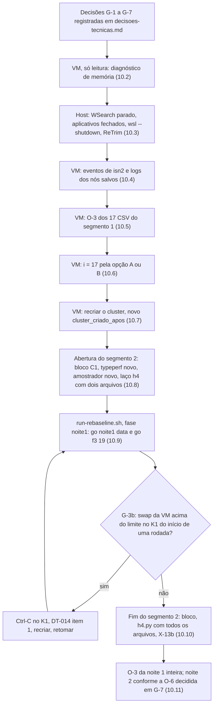

# X-13: leitura da noite 1 do *rebaseline* (parada em i = 17) e proposta de retomada (Senior, 2026-11-05)

> Parecer do Senior, feito só por leitura dos brutos no host e com Python leve, num bloco H2 (host com outros Workers,
> sem VM, sem cluster e sem Maven). Nenhum arquivo congelado foi alterado e nada foi executado na VM. As contas
> independentes estão no *scratchpad* da sessão (`x13/scripts/`). Referências: PR §5, §6 e §8
> (`pre-registro-rebaseline-aprovado-2026-10-23.md`), complemento 1 §1.2 e §1.3, complemento 3 §3 a §6, DT-013, DT-014,
> DT-017, DT-018 e DT-019, plano de execução contínua §4 (A-1, A-5), parecer do piloto (`validacao-piloto-2026-11-05.md`)
> e roteiro da noite 1 (`roteiro-noite1-2026-11-05.md`).
>
> **A retomada depois de uma parada (c) não está pré-autorizada** (a A-5 cobre só a parada (h)). Este parecer classifica,
> propõe e lista o que o Gestor precisa decidir. Onde uma regra nova seria necessária, ela aparece como **proposta**, com
> o fundamento, e não como regra.

## Siglas usadas

| Sigla | Significado |
|---|---|
| PR | pré-registro aprovado do *rebaseline* (DT-009) |
| C1, C3 | complementos 1 e 3 do pré-registro |
| DT | decisão técnica registrada em `decisoes-tecnicas.md` |
| K1..K10 | critérios de recusa e de parada por execução (PR §6) |
| (a)..(h) | paradas automáticas da fase (PR §6 e C1 §1.2) |
| h4, h4a, h4b, h4c | critério de travamento de E/S ou pausa da VM (C3): janela de 10 s com ≥ 1,5 s de espera de disco, intervalo ≥ 3 s, cobertura incompleta |
| PSI | *pressure stall information*: medida do kernel Linux do tempo em que tarefas ficaram paradas esperando disco (`io`), memória (`memory`) ou CPU. "`full`" = todas as tarefas paradas ao mesmo tempo |
| JVM | máquina virtual Java (cada nó do Infinispan e o *workload* rodam numa) |
| GC | coleta de lixo da JVM; as pausas dela param todas as *threads* da JVM |
| SSD NVMe | disco de estado sólido do host |
| CSV | arquivo de eventos da execução (`rep-001.csv`) |
| *Hot Rod* | protocolo cliente-servidor do Infinispan; o cliente do *workload* tem *timeout* de 2 000 ms por operação |

## 0. Veredito

1. **A noite 1 parou por uma falha de preparação, não por violação.** Na i = 17 (S2-sync-none), o *reset* de estado
   (`clear()` do cache `sessions`, com 1 000 128 entradas) estourou o *timeout* de 2 000 ms do cliente nas três tentativas.
   O *workload* saiu com 5 antes da carga e antes do aquecimento, sem nenhuma operação e sem CSV. O `rebaseline.py`
   congelado tratou a falta do CSV de violações numa célula SYNC sem falha como K9 não satisfeito, e K9 tem papel de
   parada nessas células. Daí a parada (c). Não há violação a investigar, porque não houve operação.
2. **A causa provável é falta de memória na VM**, não o disco do host. No instante do `clear()`, a VM lia do disco
   (~485 MB em 9 s) com a PSI de memória `full` em 0,05 a 0,72 s/s, e o `swap` da VM chegou a 1 980 MB no fim da fase
   (143 MB na abertura). O disco do host estava 13 a 19 % ocioso, com latência de escrita de até 13 ms. O mesmo mecanismo explica
   o *reset* de 7,3 s da i = 16 e, com boa probabilidade, as pausas de ~2,7 s que recusaram a i = 15.
3. **As duas execuções h4 (i = 2 e i = 5) vieram de travamentos do disco do host**, ambos logo depois de rajadas de
   escrita do **indexador do Windows Search (`SearchIndexer`)**, que ficou ativo da abertura até ~06:36Z e depois
   silenciou. Depois disso nenhum episódio caiu dentro de uma janela de medição.
4. **Pelas regras registradas, a parada não é "de infraestrutura"** (não é (g), (h) nem h4). É uma parada (c) por K9 sem
   dados, e a retomada é do Gestor. As regras existentes permitem uma saída sem regra nova (opção A, seção 7.3).
5. **Retomar o *runner* do jeito que está não funciona.** Ele pula i = 0..17 e roda a i = 18, mas o `rebaseline.py
   estado` volta a ler a PARADA da i = 17 e para a fase depois da i = 18. O mesmo bloqueio vale para a noite 2 e para as
   reposições. A i = 17 precisa ser tratada no disco da VM antes de qualquer retomada (seção 7.3).
6. **Não retomar sem antes aliviar a memória da VM** (recriar o *cluster*) e sem tirar o indexador do host da noite.
   Sem isso, a próxima S2-*-none e as SYNC sem falha tendem a repetir os mesmos defeitos.

## 1. Brutos lidos e integridade

| Item | Valor |
|---|---|
| Pacote no host | `dados-vm/rebaseline-2026-11/noite1-20261105/noite1-pacote.tar`, 4 379 545 600 bytes, SHA-256 `cfe372b1f6f04602bdd00faf44a50ced077db427d38d4da6dc0051115ab6ecbe` (calculado pelo Senior; conferir com o do coordenador) |
| `noite1/MANIFEST.sha256` | SHA-256 `eea2d470…`. 232 linhas: 1 do próprio `.tmp` (defeito conhecido, parecer do piloto §8), 230 arquivos OK e `matriz.tsv`, que não veio no pacote. A linha dela (`8654900c…`) confere com a cópia do pacote do piloto. Conjunto listado = conjunto em disco, tirando `estado.json` e `h4/`, que ficam fora por desenho |
| `estado.json` | `afd8edf3…`, gravado depois da i = 16 (17 execuções de campanha, 15 aceitas, 2 recusas, `parada: false`). A i = 17 não entrou nele porque o *runner* parou no `checar` |
| Amostrador h4 | `noite1-20261105T055638Z/amostras-final.txt`, SHA-256 `9558ab66…` (confere com o `.sha256` e com o `h4-noite1.json`), 9 302 amostras, 05:56:43 a 08:31:44Z, `atrasos_ge_1_5s=0`; espelho idêntico byte a byte |
| `h4/h4-noite1.tsv` e `.json` | `b9032759…` e `831a7461…` |
| Blocos da VM (C1 §1.3) | `noite1-inicio-20261105T055616Z.txt` e `noite1-fim-20261105T083143Z.txt` |
| Host | `typeperf` por processo a 2 s desde 05:55:25Z (`diag-io/host-proc-io-noite1.csv`, ainda rodando quando li); covariáveis de abertura `noite1-host-inicio-20261105T055525Z.txt`; log do TaskScheduler exportado sem elevação (418 eventos, 05:50 a 08:40Z) |
| Faltam | bloco de fim do host; `noite1-eventos-isn2.json` (eventos de `isn2` com código de saída, roteiro §3.2); `h4-noite1.sha256` |

Linha do tempo: `go noite1 2026-11-05` às 05:57:24.039Z e `go f3 4` às 06:23:33.325Z, os dois pelo `goloop-n1.sh` sob a
A-1 (`gates.json`). `FIM exit=10 motivo=parada (c): checar PARADA em i=17` às 07:49:40.909Z.

## 2. Execuções 0 a 17

| i | Célula | Veredito do código | h4 (pior janela de 10 s) | Observação |
|---|---|---|---|---|
| 0 | S2-sync-F1 | ACEITA | ok (0,08; segmento do F1 0,40) | |
| 1 | S1-sync-F1 | ACEITA | ok (0,07) | |
| 2 | S1-sync-none | ACEITA | **h4a (3,44)** | travamento do disco do host 06:14:37-06:15:38 |
| 3 | S2-sync-none | ACEITA | ok (0,79) | |
| 4 | S1-async-F3 | ACEITA | ok (**1,43**) | quase h4, também depois de rajada do `SearchIndexer` (06:26:47) |
| 5 | S1-async-none | **RECUSADA** (K5: C4) | **h4a (7,10)** | travamento do disco do host 06:34:40-06:35:32 |
| 6 | S2-async-none | ACEITA | ok (0,07) | |
| 7 | S1-sync-F3 | ACEITA | ok (0,34) | |
| 8 | S2-async-F3 | ACEITA | ok (0,37) | |
| 9 | S1-async-F1 | ACEITA | ok (0,56) | 1 violação I5 (ASYNC sob F1, reportada, como na 1008 do piloto) |
| 10 | S2-sync-F3 | ACEITA | ok (0,09) | |
| 11 | S2-async-F1 | ACEITA | ok (0,08) | o `lvextend -r` (+6 GiB) caiu no K1 dela, às 07:08:20; nenhum efeito visível |
| 12 | S1-async-F3 | ACEITA | ok (0,11) | |
| 13 | S2-sync-F1 | ACEITA | ok (0,06) | último F1 da fase |
| 14 | S1-async-none | ACEITA | ok (0,24) | |
| 15 | S1-sync-none | **RECUSADA** (K5: C5 e B438) | ok (0,36) | |
| 16 | S2-async-none | ACEITA | ok (0,22) | *reset* de 7,3 s; âncora a +9,9 s do lançamento (normal: ~2 s) |
| 17 | S2-sync-none | **PARADA** (K9 sem dados; K1, K2 e K3 a K6 também falsos) | sem âncora | *reset* falhou |

Nas 17 execuções com dados: K1 (portão) passou em todas; K6 do F1 com `ExitCode=137` nos cinco `injetor.log`; K7 sem
par repetido; K8 sem parada; K9 ok nas SYNC sem falha (i = 2, 3, 15). C3 agregado das aceitas: k = 1 373 338,
n = 27 440 591, 5,0048 % ± 0,0137 p.p., dentro do intervalo.

## 3. Causa da parada da i = 17

### 3.1 O que o *workload* fez

`stdout.log` e `estado-rep-001.json` da i = 17:

- Lançado às 07:49:28.669Z. O cliente sobe às 07:49:28-29.
- `size()` inicial OK: `sessions` = 1 000 128 entradas, `counters` = 36.
- `clear()` de `sessions` falha: `ISPN004007: Exception encountered. Retry 3 out of 3`,
  `ClearOperation{sessions, ..., connection=127.0.0.1/127.0.0.1:11223} timed out after 2000 ms`, registrado às 07:49:37.
  Só a última tentativa aparece no log, contra a porta 11223 (`isn2`). As duas anteriores não são registradas nesse nível
  de log, e o *Hot Rod* pode tê-las mandado a outro nó.
- `duracao_ms = 8041`, `veredito = FALHA`. Saída 5 às 07:49:38.212Z. Pelo código (`WorkloadMain.executar`), o *reset*
  vem antes da carga, antes da âncora e antes de criar as *threads* e os três geradores semeados (DT-012). **A semente
  51 700 não gerou nada.**

Para o `rebaseline.py checar`: K1 falso (`reset_depois = null`), K2 falso (`workload_exit = 5`, sem CSV), K3 a K6 falsos
por falta de dados, e K9 falso porque `violacoes_csv_presente = false`. Em SYNC sem falha, K9 tem papel de parada, então
o veredito é PARADA. O código não distingue "violação" de "sem dados".

### 3.2 O que a VM mostrava

Amostrador da VM, segundo a segundo:

| Trecho | Leitura de disco da VM | PSI `io full` | PSI memória `full` | O que é |
|---|---|---|---|---|
| 07:49:29-07:49:38 (tentativas de `clear()`) | 11 a 111 MB/s, ~485 MB no total | 0,21 a 0,77 s/s | 0,05 a 0,72 s/s | leitura sob falta de memória (*swap* e páginas de arquivo devolvidas) |
| 07:49:41-07:49:48 (depois do FIM) | 700 a 1 060 MB/s, ~4 GB | 0,18 a 0,84 s/s | ~0 | o *runner* calculando o `MANIFEST.sha256` da fase |

**Correção ao fato do coordenador.** A subida da PSI de E/S "07:49:33-44Z" mistura dois eventos. As tentativas de
`clear()` acabaram às ~07:49:37. A partir de 07:49:41 a leitura é do *hash* do manifesto, depois da linha FIM, e não tem
relação com a causa.

Memória da VM (`free -m` dos blocos C1 §1.3; 7 940 MB no total):

| Momento | Disponível | Livre | *Swap* usado |
|---|---|---|---|
| Abertura do piloto (04:02Z, *cluster* recém-criado) | 6 669 MB | 5 576 MB | 0 MB |
| Fim do piloto (05:21Z) | 2 126 MB | 397 MB | 6 MB |
| Abertura da noite 1 (05:56Z) | 2 238 MB | 1 645 MB | 143 MB |
| Fim da noite 1 (08:31Z, 42 min depois da parada) | 1 504 MB | 119 MB | **1 980 MB** |

A PSI de memória acumulou **42,4 s** na noite 1 (0,21 s no piloto inteiro). Ela se concentra em dois trechos: 06:06 a 06:41Z
e 07:31 a 07:49Z. Entre 07:01 e 07:26Z ficou em zero. Nesse intervalo houve três F1 seguidos (o F1 reinicia a JVM de
`isn2` e libera a memória dela) e execuções F3, de vazão baixa.

Duração do *reset* (linha `Reset:`), que cresce com o número de entradas e com a pressão de memória:

| i | Cache | Entradas antes | Duração |
|---|---|---|---|
| 3 | `sessions` | 992 344 | 1 890 ms |
| 11 | `sessions-async` | 1 146 925 | 2 037 ms |
| 15 | `sessions` | 353 536 | 847 ms |
| 16 | `sessions-async` | 1 328 122 | **7 323 ms** (leitura de 37 a 164 MB/s e PSI de memória de 0,2 s/s no mesmo trecho) |
| 17 | `sessions` | 1 000 128 | **falhou** (8 041 ms) |

Em ASYNC, o `clear()` volta logo e o *reset* espera o `size()` zerar (prazo de 10 s). Por isso a i = 16 passou com 7,3 s.
Em SYNC, o `clear()` só volta quando os donos terminam, e o *timeout* de 2 000 ms por tentativa se aplica.

### 3.3 O host no mesmo instante

`typeperf` às 07:49:30-07:49:36: disco `C:` 13 a 19 % ocioso, leitura de 22 a 92 MB/s (a da VM), latência de escrita de
até 13 ms. **O disco do host não estava travado.** TaskScheduler: nenhuma tarefa entre 07:43:03 (`OneSettings\RefreshCache`)
e 07:50:01 (`SoftLanding`).

### 3.4 Conclusão

A i = 17 falhou porque o `clear()` de ~1 milhão de entradas, numa VM em falta de memória (com *swap*), passou do *timeout*
de 2 s do cliente três vezes seguidas. É uma hipótese bem apoiada (PSI de memória, leituras, *swap*, *reset* da i = 16), mas
o amostrador não registra *swap* por processo nem as pausas das JVMs. A leitura proposta na seção 10.2 confirma ou derruba.

Hipótese sobre a origem da memória, a conferir: o `podman-compose.yml` não fixa limite de memória nem tamanho de *heap* nos
três nós, e o *workload* (OpenJDK 17, *heap* padrão de 25 % da RAM, ~2 GB) guarda os eventos em memória e grava o CSV
no fim. Três servidores que crescem sem limite mais um cliente de ~2 GB não cabem em 7,9 GB. `isn1` e `isn3` nunca
reiniciam; `isn2` reinicia a cada F1.

## 4. K5 da i = 15 (S1-sync-none): o que são C5 e B438 aqui

- **C5** falhou só por `logout_noop_janela = 7` (tem de ser 0 sem falha injetada). O resto do C5 passou:
  `reposicao_erro = 0`, `logout_isolados = reposicoes = 195 971`, fronteira de 1 evento (≤ 4) e nenhum Logout isolado
  NOT_FOUND.
- **B438** (critério do B-43.8: `invalidacao_perdida = conflito_esgotado = 0`) falhou por `invalidacao_perdida = 8`.
- C4 passou (nenhum Validate NOT_FOUND) e K9 passou (nenhuma violação, `Auditor I2` toda em zero).

**Mecanismo.** Uma invalidação é "perdida" quando a escrita condicional por versão (`substituirSeVersao`, DT-003) falha
e a releitura já mostra a sessão INVALID. O Logout que perde vira `logout_noop`. Sem falha injetada, isso não deveria
acontecer. O CSV mostra **55 operações com latência ≥ 1 s, 50 delas ≥ 2 s**, em 19 grupos espaçados de 20 a 40 s pela
janela inteira, quase sempre com ~2,71 s e com as quatro *threads* paradas juntas. Com *timeout* de 2 000 ms, o cliente
*Hot Rod* refaz a operação (a i = 17 prova que ele refaz até 3 vezes). Uma escrita condicional cuja primeira tentativa foi
aplicada no servidor e cuja resposta chegou tarde é refeita, encontra outra versão e conta como perdida. 7 *no-op* e 8
perdidas casam com isso. As tentativas intermediárias não aparecem no log, então é a explicação compatível, não provada.

Nesses instantes a PSI da VM não sobe e o disco do host está livre. Pausas periódicas de 1 a 3 s com todas as *threads*
paradas têm o padrão de pausa de GC numa JVM de servidor. Elas não são novas: a última execução do piloto (1011,
S1-sync-none) já tinha 63 operações ≥ 1 s em 16 grupos, mas nenhuma ≥ 2 s; a primeira execução sem falha do piloto (1003)
não tinha nenhuma. Na noite 1: i = 2 com 62 / 1 (≥ 1 s / ≥ 2 s), i = 3 com 60 / 5, i = 14 com 50 / 3, i = 16 com 0 / 0 e
i = 15 com 55 / 50. Na i = 15 as pausas passaram do *timeout* de 2 s.

**Pelas regras registradas, a i = 15 é uma recusa K5 comum**: não é h4 (pior janela 0,36 s), não é (h), e nenhuma regra
a reclassifica. A memória é contexto para as decisões da seção 11, não motivo para mudar o rótulo.

## 5. K5 da i = 5 (S1-async-none): C4

- C4 falhou por **1 Validate NOT_FOUND** (`validate_not_found = 1`). O resto de C4, C5 e B438 passou.
- O CSV tem 18 operações com latência ≥ 1 s (17 ≥ 2 s), **todas entre 06:34:39 e 06:35:30**, dentro do travamento do disco
  do host (06:34:40 a 06:35:32, `C:` 0 % ocioso, latência de escrita de até 222 ms, e uma lacuna de 8,5 s no próprio
  `typeperf` às 06:35:24).
- O NOT_FOUND é um Validate de tríade (chave UUID, não `sid-`) às 06:35:29.679, com latência de 2,001 s, ou seja, o
  *timeout* de 2 000 ms seguido de nova tentativa. Em ASYNC, a nova tentativa pode cair num dono que ainda não recebeu a
  escrita do Login, que estava atrasada pelo mesmo travamento.
- A execução também é **h4a** (pior janela de 7,10 s às 06:35:33Z).

Pelo C3 §4.1: "quando o código também recusou a execução, ela é tratada como h4 na análise, e a reposição é a do próprio
*runner*". Para o código, a recusa conta nas paradas (a) e (b).

## 6. Cruzamento com h4, `typeperf` e TaskScheduler

### 6.1 Os travamentos do disco do host

Trechos em que o `C:` ficou abaixo de 10 % ocioso por mais de uma amostra, de 05:55 a 07:50Z:

| Trecho | Escrita no disco | Latência máxima | O que veio antes | Efeito na VM |
|---|---|---|---|---|
| 05:55:48-05:56:43 | 11 a 14 MB/s | 271 ms (escrita), 375 ms (leitura) | `SearchIndexer` ativo | antes do GO |
| **06:14:37-06:15:38** (61 s) | ~19 MB/s (~1,1 GB no trecho) | 165 ms / 1 014 ms | **`SearchIndexer` escreveu ~4,3 GB (contador do processo, que inclui o que vai para o *cache*) de 06:14:05 a 06:14:36; o disco gravou ~3,0 GB nesse meio minuto, com pico de 610 MB/s às 06:14:32** | **h4a da i = 2** |
| 06:23:09-06:23:17 | 65 MB/s | 229 ms | fim da i = 3 (CSV) com o `SearchIndexer` ativo | fora de janela |
| **06:34:40-06:35:32** (52 s) | ~11 MB/s (~0,5 GB no trecho) | 222 ms | **`SearchIndexer` escreveu ~0,5 GB de 06:34:30 a 06:34:44, quase tudo no *cache* (o disco gravou só 0,09 GB nesses 14 s)** | **h4a e recusa C4 da i = 5** |
| 07:33:51-07:34:25 (34 s) | ~12 MB/s | **761 ms** | a própria VM gravando o CSV da i = 14 (8 a 18 MB/s no disco da VM) | fora de janela (23 s depois do fim) |
| 07:47:42-07:48:04 (22 s) | ~16 MB/s | 522 ms | a própria VM gravando o CSV da i = 16 (o host registrou 338 MB/s às 07:47:40) | fora de janela (10 s depois do fim) |

O quase-h4 da i = 4 (1,43 s) tem a mesma origem: rajada do `SearchIndexer` às 06:26:47-49 (~0,8 GB escritos), `C:` a
7,8 % ocioso às 06:26:55 e PSI `io full` da VM de 0,67 s/s no mesmo segundo.

### 6.2 Qual processo trava o disco

- **Os dois travamentos dentro de janela de medição vieram depois de rajadas do `SearchIndexer`** (serviço `WSearch`,
  indexador do Windows Search). Nas três rajadas grandes dele durante janelas, a VM sentiu: i = 2 (3,44 s), i = 4
  (1,43 s) e i = 5 (7,10 s).
- O `SearchIndexer` rodou em surtos a cada ~30 s desde a abertura e **parou por completo às ~06:36Z** (em 10 min: 36,6 GB
  lidos, a maior parte do *cache*, e 4,6 GB escritos de 06:10 a 06:20). Depois disso, em 1 h 14 min e 11 execuções com
  janela (i = 6 a 16), nenhum episódio caiu em janela. A abertura do host registra "exclusões de índice `C:\Hyper-V` e `tcc` feitas pelo
  Gestor" em 05/11, com o serviço ligado. Mudar o escopo do índice faz o Windows Search reprocessar o índice, o que
  explicaria a atividade concentrada no começo da noite. Isso é hipótese: o `typeperf` não diz o que o indexador fazia.
- **Durante o travamento nenhum processo registra E/S**, e isso é o esperado: o contador por processo conta a escrita
  quando ela entra no *cache* do Windows, e o esvaziamento do *cache* para o disco não é atribuído a ninguém. O volume
  gravado durante os dois travamentos (~1,1 GB e ~0,5 GB) é da ordem do que o indexador tinha acabado de escrever e o disco
  ainda não tinha gravado. Nesses trechos, o disco fica 0 % ocioso escrevendo só 11 a 19 MB/s, com latências de 30 a
  760 ms. É o padrão de um SSD que esgotou o *cache* de escrita depois de uma rajada e passa a gravar devagar. O disco é um
  `XrayDisk 512GB SSD` NVMe, com 82,5 GB livres na abertura e 61,5 GB agora. Ocupação alta piora esse comportamento em
  SSDs de baixo custo. Não verifiquei o tipo de memória flash.
- A própria VM provoca o mesmo travamento ao gravar o CSV de ~400 MB no fim das execuções sem falha (07:33:51 e
  07:47:42). Como o CSV é gravado depois de +300 s, esses travamentos caem fora da janela de medição.
- **TaskScheduler:** nenhuma associação consistente. As tarefas da noite foram `SoftLanding` (a cada 15 min), atualizadores
  do Edge, Google e Brave, `OneSettings\RefreshCache` e tarefas isoladas. A mais próxima de um travamento foi
  `UpdateOrchestrator\UIEOrchestrator`, 37 s antes do de 06:34:40, uma vez só. Os surtos do indexador de 30 em 30 s
  existiam antes e independem delas. A hipótese da "tarefa de ~27 min" do ensaio continua sem apoio.

### 6.3 Covariáveis do host na abertura (C3 §7)

- Esperado vazio, mas havia **Discord** (6 processos) e **Riot Client** abertos desde 01:05Z. O `typeperf` também
  enumerou Blitz, Wallpaper Engine, Edge, Spotify e uma VM do WSL (`vmmemWSL`), que saiu por volta de 05:57Z. Nenhum
  desses processos mostrou E/S relevante, mas o H0 estrito pede que não estejam abertos.
- `WSearch` ligado (`Running`, `Automatic`), com exclusões. A G-2(c) do piloto (parar o serviço) não foi adotada.
- Log do TaskScheduler ligado, ASPM 0, exclusão do Defender e *checkpoint* mantidos (declarados).
- O piloto rodou com um jogo aberto (R-1 do X-11) e mediu vazão menor: o diretório médio de uma execução sem falha teve
  228,5 MB no piloto e 394 MB na noite 1. Por isso o tamanho por rodada medido no piloto (1,56 GB) subestimou o da noite 1
  (2,87 GB, seção 9.3).

## 7. Classificação pelas regras registradas

### 7.1 h1, h2 e h3 (C1 §1.3)

- **h1 ok:** `boot_id` `f9e98b74-bf1f-4192-9770-b40285877292` na abertura, no fim e no fim do piloto; nenhum *boot* novo.
- **h2 ok:** `StartedAt` de `isn1` (04:01:24.765810852) e `isn3` (04:01:27.745419488) iguais na abertura e no fim; nenhum
  evento deles.
- **h3 ok:** cinco pares `died`/`start` de `isn2`, cada um dentro de um F1 (i = 0, 1, 9, 11 e 13, o `died` de 0,18 a
  0,33 s depois do disparo); o
  `StartedAt` final (07:23:55.219Z) é o do último F1 (i = 13). `ExitCode=137` nos cinco `injetor.log`. O JSON de eventos
  com o código de saída (roteiro §3.2) não foi gerado; colher antes de recriar o *cluster* (seção 10.4).

### 7.2 A parada da i = 17

| Pergunta | Resposta pela regra registrada |
|---|---|
| É (g), erro de infraestrutura do *runner*? | Não. O *runner* tratou a saída 5 do *workload* pelo caminho normal (K2) e saiu com 10, não com 6 |
| É (h)? | Não. h1, h2 e h3 ok |
| É h4? | Não. Sem âncora não há janela h4 (C3 §3.1); o `h4.py` dá "sem-ancora", que não é h4 |
| É execução interrompida (DT-014)? | Não. Ninguém interrompeu; o *workload* saiu sozinho. Além disso, há `stdout.log`, e por isso o item 1 da DT-014 (sem `stdout.log`) não se aplica pela letra |
| Então é o quê? | **Parada (c) por K9**, que o PR chama de "parada para investigar" |
| Resultado da investigação | Nenhuma violação. K9 falhou por **ausência de dados**: zero operações, sem CSV de eventos, sem CSV de violações, sem linha `Auditor I2`. A causa é a falha do *reset* antes da carga |
| O que o PR diz de um *reset* que falha | PR §6, K1: "depois da execução, linha `Reset:` com os dois caches em 0 antes da carga", papel **recusa** em todas as células |
| A retomada está pré-autorizada? | Não. A A-5 cobre só a parada (h) |

Leitura do Senior: em substância, é uma falha de preparação causada por recurso da VM (memória), sem nenhum desfecho
medido. Pela letra, é uma parada (c) que o código produziu porque não separa "violação" de "sem dados". Pela letra, o
critério que de fato falhou primeiro (K1, *reset*) é de recusa. A decisão de retomar é do Gestor.

### 7.3 O que as regras permitem para a i = 17 e para retomar

**Fato técnico que vale para qualquer escolha.** O `rebaseline.py estado` lê todos os `exec-*/checagem.json` da saída
(menos os `.abortada-*`). Enquanto o `checagem.json` da i = 17 disser PARADA, toda retomada para:
- `--fase noite1`: pula i = 0..17 (`ja executada e checada; pulando`, sem chamar o `estado`), roda a i = 18 inteira e,
  no `estado` depois dela, sai com `parada: rebaseline.py estado (paradas a..d, R-S3) depois de i=18`;
- `--fase noite2`: roda a i = 60 e para do mesmo jeito;
- `--fase reposicoes`: nem começa (`parada: estado da campanha antes das reposicoes`).

Logo, alguma alteração no diretório da i = 17 na VM é inevitável. As duas opções abaixo só usam caminhos que o código
congelado já tem.

**Opção A, sem regra nova (recomendada).** A i = 17 vira **RECUSADA por K1 e K2**, como o PR §6 manda para um *reset* que
falha. K9 fica registrado como "não avaliável, sem dados", com a investigação desta seção. Como há `stdout.log`, a
reposição segue o critério da DT-014 item 2: **próximo i livre e semente nova**, no fim da campanha.
- Como fazer o código chegar lá: mover o `checagem.json` original para um nome que o código não lê (ele fica nos brutos)
  e gravar um `interrompida.json` com o motivo verdadeiro. Na retomada, o *runner* encontra o diretório sem
  `checagem.json` e com `stdout.log`, aplica o ramo da DT-014 item 2, preserva o `interrompida.json` já existente e o
  `checar` grava RECUSADA com o motivo `interrompida (DT-014): <motivo gravado>`. O rótulo "interrompida" é um artefato
  do procedimento; o parecer e o registro da decisão dão o motivo real (K1 e K2), como o C1 §1.2 já prevê para rótulos do
  código.
- Efeito nas paradas: S2-sync-none passa a ter 1 recusa; total de 3 (limite: mais de 6).

**Opção B, proposta de regra nova (DT-020, decisão do Gestor).** Texto proposto:

> *Falha do reset de estado antes da carga* (workload com saída 5, `estado-rep-001.json` com `veredito = FALHA`, sem
> `carga-rep-001.json`, sem âncora e sem CSV) recebe o tratamento da DT-014 item 1: o diretório é renomeado
> `exec-<i>-<celula>.abortada-<UTC>`, fica nos brutos, e o **mesmo i roda de novo com a mesma semente**. Não conta como
> recusa nem para as paradas (a) e (b).

- Fundamento: a razão da DT-014 item 1 é que a semente "nunca mediu nada", e o critério operacional "sem `stdout.log`" é
  um indicador disso. Aqui a semente também não mediu nada: o *reset* roda antes da carga, da âncora, das *threads* e dos
  três geradores semeados (DT-012), e o `stdout.log` só tem a configuração e o erro. A regra olha só o estágio em que a
  execução morreu, nunca um desfecho medido, porque não existe nenhum.
- Contra: é regra escrita depois de o caso acontecer, e muda a contagem das paradas (a) e (b) a favor da continuidade.
  Por isso só vale com decisão expressa do Gestor, registrada antes da retomada.

Recomendo a **opção A**: ela sai das regras que já existiam e gasta só uma recusa, numa célula que tem zero. A opção B é
tecnicamente sólida e preserva a célula, se o Gestor preferir não consumir a recusa.

## 8. Reposições, índices, sementes e a regra das duas recusas

Pelo código, as reposições de recusa são numeradas no `--fase reposicoes` (depois da noite 2), a partir de i = 120, na
ordem do i recusado, uma por célula. As recusas futuras terão i ≥ 18. Por isso estas três ficam fixadas:

| Execução | Situação | Reposição | i | Semente (`50 000 + 100·i`) |
|---|---|---|---|---|
| i = 5, S1-async-none | RECUSADA (K5/C4) e h4a | pelo *runner* (C3 §4.1) | **120** | **62 000** |
| i = 15, S1-sync-none | RECUSADA (K5/C5 e B438) | pelo *runner* | **121** | **62 100** |
| i = 17, S2-sync-none | opção A: RECUSADA (K1/K2) | pelo *runner* | **122** | **62 200** |
| i = 17, S2-sync-none | opção B: abortada | roda de novo na própria noite 1 | 17 | 51 700 |
| i = 2, S1-sync-none | ACEITA e h4a | `h4.py repor`, depois das reposições de recusa | próximo livre (123 se não houver outra recusa; com B, 122) | `50 000 + 100·i` |

A i = 2 (h4) e a i = 15 (recusa) são da mesma célula. Pelo C3 §4.1 a reposição h4 não conta para o limite de uma
reposição por célula, então as duas são repostas.

**A regra das duas recusas na mesma célula (parada (a)) ficou a uma recusa de disparar em duas células** (três com a
opção A):
- **S1-sync-none:** 1 recusa (i = 15), que não é h4. Uma segunda recusa nas 8 execuções que faltam dessa célula é parada
  (a) de verdade. O mecanismo da i = 15 (pausas acima de 2 s) piora com o tempo de vida das JVMs, então o risco não é
  aleatório.
- **S1-async-none:** 1 recusa (i = 5), que também é h4. Uma segunda recusa dispara (a) no código, mas essa parada "só
  existe por causa de execução h4". Vale o C1 §1.2 e o C3 §4.1: o Senior declara isso no parecer e o Gestor decide.
- **S2-sync-none:** 1 recusa só na opção A.
- Parada (b): 2 recusas hoje, 3 na opção A; o limite é mais de 6.

## 9. Episódios por hora, noite 2 e teto de reposições

### 9.1 Os 6,58 episódios por hora

O `h4.py` conta **trechos** (pela letra do C3 §6): 17 em 2,58 h = 6,58 por hora. A fusão da DT-019 (trechos separados por
menos de 60 s viram um episódio) dá **8 episódios, 3,10 por hora**. A exclusão R1 (segmento do F1) não retira nenhum.

| Episódio (fundido) | Trecho | Origem | Dentro de janela? |
|---|---|---|---|
| A | 06:14:57-06:15:36 | disco do host depois do `SearchIndexer` | **sim, i = 2** |
| B | 06:23:04-06:23:26 | fim da i = 3 (CSV) com o indexador ativo | não (4 s depois do fim) |
| C | 06:34:42-06:36:23 | disco do host depois do `SearchIndexer`, mais o CSV da i = 5 | **sim, i = 5** |
| D | 07:01:53-07:02:02 | CSV da i = 9 | não |
| E | 07:33:53-07:34:38 | CSV da i = 14, disco do host saturado | não (23 s depois) |
| F | 07:41:08-07:41:15 | CSV da i = 15 com pressão de memória | não |
| G | 07:42:26-07:42:36 | *reset* da i = 16 (memória) | não (antes da âncora) |
| H | 07:47:43-07:49:52 | CSV da i = 16, portão da i = 17, *reset* que falhou e *hash* do manifesto | não |

Seis dos oito episódios são gerados pela própria VM na fronteira das execuções (gravação do CSV depois de +300 s, *reset*,
manifesto) e não podem cair numa janela de medição. Os dois que caíram vieram do host, com o indexador na origem.

A barreira de 3,5 por hora do C3 §6 era condição de entrada da noite 1, medida no piloto. **Não há regra registrada que
use essa taxa para a noite 2.** A regra que vale durante as noites é a parada h4 por execuções (C3 §4.3: 5 entre as
últimas 12, ou 4 seguidas, ou um h4c), e ela não chegou perto: 2 em 18, nenhuma nas últimas 12.

### 9.2 Viabilidade da noite 2 e teto de 30 reposições h4

- Fração h4 medida: 2 em 17 execuções com âncora, **11,8 %** (intervalo de 95 %, de Clopper-Pearson: 1,5 % a 36 %).
  É o valor pessimista do C3 §6 (12 %).
- Chance de parada h4 numa noite de 60 execuções (simulação da regra do C3 §4.3, 20 000 noites): 11,6 % com p = 11,8 %;
  0,7 % com p = 6 %; 55 % com p = 20 %; 81 % com p = 25 %.
- Reposições h4 esperadas na campanha com p ≈ 12 %: ~15 a 16 (C3 §6), abaixo do teto de 30 (C3 §4.4). Hoje há 1 (i = 2), mais a i = 5,
  reposta pelo caminho da recusa.
- **A noite 2 é viável quanto ao h4**, desde que o indexador não volte. Sem ele, a noite 1 teve 0 h4 em 11 execuções com
  janela (i = 6 a 16; intervalo de 95 %: 0 a 28 %).

### 9.3 O que mais pesa na noite 2: memória e disco

- **Memória:** é a causa da parada e, provavelmente, da recusa da i = 15. Sem alívio, uma noite inteira de 60 execuções
  no mesmo *cluster* repete o quadro. A pressão de memória apareceu na 14ª execução depois da criação do *cluster*
  (contando as 12 do piloto) e voltou, mais forte, entre a 26ª e a 29ª.
- **Disco da VM:** a noite 1 mediu **2,87 GB por rodada** (diretório médio: sem falha 394 MB, F1 310 MB, F3 13 MB), igual
  ao cenário alto (2,86 GB) do roteiro da VM §7.2, e não ao central (1,62 GB) que o piloto sugeriu. Uma noite 2 de 5 rodadas
  dá ~14,3 GB, mais as reposições (~2 GB). Pela regra de 1,5 × (≥ ~24 GB livres), ela **não cabe** na VM mesmo depois da
  O-3 de toda a noite 1 (estimo ~15 a 18 GB livres, contando os 2,47 GiB que restam no grupo de volumes). Pela §7.5 do
  roteiro, o cenário alto leva à O-6 (noites menores), que é DT nova. Com 3 rodadas (8,6 GB, 1,5 × = 12,9 GB) ou
  2 rodadas mais as reposições (~7,7 GB, 1,5 × = 11,6 GB), cabe.

### 9.4 O que mudar antes de retomar

No host (Gestor, PowerShell elevado onde indicado):
1. **Parar o `WSearch`** durante cada fase (`Stop-Service WSearch`) e religar de dia, se quiser. As exclusões não bastaram.
2. **H0 estrito de verdade:** fechar Discord, Riot Client, Blitz, Wallpaper Engine, Spotify e Edge; `wsl --shutdown`.
3. `Optimize-Volume -DriveLetter C -ReTrim` antes da fase (mitigação M3 já usada em 04/11) e evitar cópias duplicadas no
   `C:`. Hoje há 61,5 GB livres, contra 82,5 GB na abertura.
4. Manter o `typeperf` (reiniciado antes da abertura, para enumerar os processos) e o log do TaskScheduler.

Na VM:
5. **Recriar o *cluster*** antes de retomar (mesmo XML `6d52413b…`, mesma imagem, mesmo `podman-compose.yml`, com novo
   `cluster_criado_apos` registrado). Libera as JVMs e o *swap*. Não muda nenhum fixo do PR §2. Muda a idade das JVMs,
   que já era uma covariável não controlada, e isso é declarado.
6. Ler a memória (seção 10.2) antes de recriar, para confirmar a hipótese e dimensionar a cadência (G-3b).

## 10. Sequência de retomada



### 10.1 O *runner* aceita retomar a fase?

Sim, pelo próprio código (`run-rebaseline.sh` `d95305fe…`, função `rodar_execucao`):
- uma `exec-*` com `checagem.json` é pulada sem nova checagem;
- uma `exec-*` sem `checagem.json` e sem `stdout.log` vira `.abortada-<UTC>`, e o mesmo i roda de novo (DT-014 item 1);
- uma `exec-*` sem `checagem.json` e com `stdout.log` vira RECUSADA "interrompida" (DT-014 item 2);
- o *gate* `go noite1 <data>` é pedido de novo, com a data UTC da VM no instante do *gate*;
- o *gate* `go f3` é pedido antes da **primeira F3 executada** na retomada. As F3 puladas (4, 7, 8, 10 e 12) não contam.
  Nas duas opções, a primeira F3 é a **i = 19**: o pedido será `go f3 19`;
- `runner.log` recebe as linhas novas no fim; `gates.json` ganha uma segunda entrada; `ambiente.md` ganha um segundo bloco
  de pré-voo; `resumo.*` e `MANIFEST.sha256` são regravados no fim. As versões do segmento 1 estão no host, com *hash*.

A ressalva é a da seção 7.3: sem tratar a i = 17, a fase para depois da i = 18.

### 10.2 VM, só leitura: diagnóstico de memória (coordenador, H2)

```bash
date -Is; free -m; swapon --show; cat /proc/pressure/memory
sudo podman ps --format '{{.ID}} {{.Names}}'
for p in $(pgrep -x java); do
  echo "== pid $p cgroup=$(grep -o 'libpod-[0-9a-f]\{12\}' /proc/$p/cgroup | head -1)"
  tr '\0' '\n' < /proc/$p/cmdline | grep -E '^-Xm[sx]|RAMPercentage|^-XX:\+Use[A-Za-z]*GC' | tr '\n' ' '; echo
  grep -E 'VmRSS|VmSwap' /proc/$p/status
done 2>&1 | tee ~/rebaseline-infra/memoria-pos-noite1-seg1-$(date -u +%Y%m%dT%H%M%SZ).txt
```

Sem `podman stats` (R9). O que interessa: `VmSwap` de cada JVM de servidor, e se o *heap* máximo é fixo ou proporcional à
RAM. Se `isn1` e `isn3` tiverem centenas de MB em *swap*, a hipótese da seção 3.4 fica confirmada.

### 10.3 Host, antes do H0 (Gestor)

```powershell
Stop-Service WSearch                 # elevado; o estado vira covariável no bloco de abertura
wsl --shutdown
Optimize-Volume -DriveLetter C -ReTrim -Verbose   # elevado
```

Fechar os aplicativos do usuário. Depois disso, o coordenador reinicia o `typeperf` com saída nova
(`host-proc-io-noite1-seg2.csv`) e grava `noite1-seg2-host-inicio-<UTC>.txt`, com o mesmo bloco do roteiro §1.0.

### 10.4 VM: registros que a recriação apagaria

O `podman-compose down` apaga os *logs* dos contêineres. Antes dele:

```bash
cd ~/rebaseline-infra
sudo podman events --since "$(cat abertura-noite1-iso.txt)" --until "$(date -Is)" \
  --filter container=isn2 --filter event=died --filter event=start --format json > noite1-eventos-isn2.json
grep -o '"[Cc]ontainerExitCode":[0-9]*' noite1-eventos-isn2.json | sort | uniq -c   # esperado: 137 nos 5 died
for n in isn1 isn2 isn3; do sudo podman logs "$n" > "logs-seg1-$n.txt" 2>&1; done
sha256sum noite1-eventos-isn2.json logs-seg1-isn*.txt | tee logs-seg1.sha256
```

### 10.5 VM: O-3 dos 17 CSV do segmento 1

A cópia de referência está no host e foi conferida (seção 1). Mesmo procedimento do `o3-piloto.sh`, trocando a lista:

```bash
cd ~/rb/rb-20805b0/runs/rebaseline
O3=~/rebaseline-infra/o3-noite1-seg1-$(date -u +%Y%m%dT%H%M%SZ); mkdir -p "$O3"
grep -E '^[0-9a-f]{64}  exec-00(0[0-9]|1[0-6])-[A-Za-z0-9-]+/rep-001\.csv$' noite1/MANIFEST.sha256 > "$O3/csv.sha256"
wc -l < "$O3/csv.sha256"                       # esperado 17 (i = 0..16; a i = 17 nao tem CSV)
# daqui em diante, igual ao o3-piloto.sh: df antes, sha256sum -c (17 OK), gzip -1 -k com conferencia, rm do original,
# sha256sum dos .gz, sudo fstrim -v /, df depois
```

Ganho esperado: ~3,3 GB (as 17 execuções somam 4,37 GB, quase tudo CSV, que o `gzip -1` reduz a 21-24 %). O segmento 2
escreve ~10,0 GB (42 execuções; 10,4 GB na opção B), e a regra de 1,5 × pede ≥ ~15,1 GB livres. A VM tinha ~14 a 15 GB no
fim do segmento 1 (`df -h` mostra "14G", em GiB); com a O-3 passa de ~17 GB. Conferir em bytes
(`df -B1 --output=avail /` ≥ 15 100 000 000; ≥ 15 600 000 000 na opção B). A análise final (`rebaseline.py tabelas`) roda
sobre a cópia do host, que guarda os CSV originais.

### 10.6 VM: i = 17 (escrita sobre brutos, depois da decisão G-2)

Opção A:

```bash
cd ~/rb/rb-20805b0/runs/rebaseline/exec-0017-S2-sync-none
sha256sum checagem.json                         # esperado 652ca79f913075240e8cfa1fd97088d9b5d1f11909f70f1e531906dff88022f6
mv -n checagem.json checagem-parada-k9-original.json
printf '{"utc":"%s","motivo":"reset de estado falhou antes da carga (workload exit 5; clear() de sessions com timeout de 2000 ms nas 3 tentativas); PARADA (c) por K9 sem dados encerrada pelo Gestor em <ref da decisao>; recusa por K1 e K2 (PR 6)"}\n' \
  "$(date -u +%FT%T.%3NZ)" > interrompida.json
ls
```

Opção B (só com a DT-020 aprovada):

```bash
cd ~/rb/rb-20805b0/runs/rebaseline
mv -n exec-0017-S2-sync-none exec-0017-S2-sync-none.abortada-$(date -u +%Y%m%dT%H%M%SZ)
```

### 10.7 VM: recriar o *cluster* (se G-3a for aprovada)

```bash
echo "cluster_criado_apos=$(date -u +%FT%TZ)" | tee ~/rebaseline-infra/cluster-criado-apos-seg2.txt
bash ~/rebaseline-infra/recriar-rb-20805b0.sh ~/rebaseline-infra/recriacao-seg2-$(date -u +%Y%m%dT%H%M%SZ)
#   esperado: down rc=0, up rc=0, "ESTAVEL size=3 HEALTHY", timers tcc-heal 0, qdisc sem netem nos 3 netns
free -m                                      # o swap deve cair perto de zero
```

### 10.8 Abertura do segmento 2 (C1 §1.3) e vigilância h4

```bash
cd ~/rb/rb-20805b0
source ~/rebaseline-infra/bloco.sh
date -Is > ~/rebaseline-infra/abertura-noite1-seg2-iso.txt
bloco ~/rebaseline-infra/noite1-seg2-inicio-$(date -u +%Y%m%dT%H%M%SZ).txt
#   boot_id f9e98b74-...; StartedAt novos dos 3 nos (os da recriacao); free -m; df
export ID2=noite1-$(date -u +%Y%m%dT%H%M%SZ); echo "$ID2" > ~/rebaseline-infra/id-noite1-seg2.txt
bash scripts/amostrador-infra.sh iniciar --id "$ID2"
cp -p runs/rebaseline/h4/h4-noite1.tsv runs/rebaseline/h4/h4-noite1-seg1.tsv
cp -p runs/rebaseline/h4/h4-noite1.json runs/rebaseline/h4/h4-noite1-seg1.json
```

**O `vigia-h4.sh` congelado não serve no segmento 2.** Ele passa ao `h4.py` só o arquivo do amostrador novo. As
execuções 0 a 16 ficariam sem amostras, seriam classificadas h4c, e a regra 2 do C3 §4.3 gravaria uma `PARADA-H4` falsa
no primeiro ciclo. O `h4.py` congelado aceita vários `--amostras`. Proposta (G-5): no lugar do vigia, um laço do
coordenador que chama o mesmo `h4.py` com os dois arquivos.

```bash
cat > ~/rebaseline-infra/vigia-n1s2.sh <<'EOF'
#!/bin/bash
# Laco do coordenador no lugar do vigia-h4.sh no segmento 2 da noite 1: o mesmo h4.py congelado, com os dois arquivos.
A1=~/rebaseline-infra/noite1-20261105T055638Z/amostras-final.txt
ID2=$(cat ~/rebaseline-infra/id-noite1-seg2.txt); A2=/run/tccdiag/$ID2/amostras.txt; D=~/rebaseline-infra/$ID2
while :; do
  out=$(python3 -I ~/rb/rb-20805b0/analysis/h4.py fase --amostras "$A1" --amostras "$A2" \
        --saida ~/rb/rb-20805b0/runs/rebaseline --fase noite1 2>&1); rc=$?
  echo "[$(date -u +%FT%TZ)] h4.py exit $rc: $(printf '%s\n' "$out" | tail -n 1)"
  if [ "$rc" -eq 30 ]; then printf '%s\n' "$out" > "$D/PARADA-H4"; echo "PARADA-H4 gravada"; fi
  systemctl is-active --quiet "tcc-amostrador-$ID2" || { echo "unit inativa" > "$D/PARADA-H4"; echo "PARADA-H4: unit inativa"; }
  sleep 300
done
EOF
bash -n ~/rebaseline-infra/vigia-n1s2.sh && sha256sum ~/rebaseline-infra/vigia-n1s2.sh
```

Aceite antes do GO: rodar o laço uma vez (ou o `h4.py` à mão com os dois arquivos). As linhas de i = 0..16 do
`h4-noite1.tsv` têm de sair iguais às do `h4-noite1-seg1.tsv`, e o `exit` tem de ser 0. Qualquer diferença: parar e
chamar o Senior. Se a G-3b levar a outra recriação no meio do segmento, o amostrador segue o mesmo (a VM não reinicia) e
o laço não muda.

Laço de GO (sob a A-1), cópia do `goloop-n1.sh` mudando só o padrão:

```bash
sed -e 's#goloop-n1.log#goloop-n1s2.log#' -e 's#go f3 4)#go f3 19)#' \
  ~/rebaseline-infra/goloop-n1.sh > ~/rebaseline-infra/goloop-n1s2.sh
diff ~/rebaseline-infra/goloop-n1.sh ~/rebaseline-infra/goloop-n1s2.sh; bash -n ~/rebaseline-infra/goloop-n1s2.sh
```

### 10.9 *Runner*

```bash
cd ~/rb/rb-20805b0
# RB, SAIDA, MATRIZ, MATRIZ_SHA, JAR, JAR_SHA e RB_PASSWORD como no roteiro da noite 1, §1.1
export CRIADO_APOS=$(sed -n 's/^cluster_criado_apos=//p' ~/rebaseline-infra/cluster-criado-apos-seg2.txt)
bash scripts/run-rebaseline.sh --matriz "$MATRIZ" --matriz-sha256 "$MATRIZ_SHA" \
  --jar "$JAR" --jar-sha256 "$JAR_SHA" --fase noite1 --cluster-criado-apos "$CRIADO_APOS" \
  --saida "$SAIDA"; echo "RUNNER_RC=$? $(date -u +%FT%TZ)"
```

Sem recriação, `CRIADO_APOS` continua `2026-11-05T04:01:07Z`. GOs esperados: `go noite1 <data UTC da VM>` e
`go f3 19`. No `runner.log`, esperado:
- `exec i=0 ...` a `exec i=16 ...: ja executada e checada; pulando`;
- i = 17: na opção A, `interrompida depois do lancamento do workload (DT-014); conta como RECUSADA` e `checar RECUSADA
  (segue)`; na opção B, a i = 17 roda com a semente 51 700;
- depois, i = 18 (S1-sync-F1) em diante.

Duração: 42 execuções (opção A) ou 43 (opção B) × 392 s (média medida nesta noite) ≈ **4 h 34 min a 4 h 41 min**.

Acompanhamento de hora em hora (só leitura), além do roteiro §2.5: `free -m` e `cat /proc/pressure/memory` na VM.

Se a G-3(b) disparar no K1 da primeira execução de uma rodada (i = 24, 36 ou 48): Ctrl-C na janela 0 durante o portão,
como no roteiro §2.6 (o *runner* sai com 130 e a execução sem `stdout.log` volta com o mesmo i e a mesma semente,
DT-014 item 1); recriar como em 10.7, com novo `cluster-criado-apos`; novo `goloop` com `go f3 <primeira F3 que falta>`;
mesmo comando do *runner* com o `CRIADO_APOS` novo. O amostrador e o laço h4 continuam, porque a VM não reinicia.

### 10.10 Fim do segmento 2

Roteiro §3 inteiro, com três ajustes:
- bloco de fim e eventos de `isn2` a partir de `abertura-noite1-seg2-iso.txt`. Se houve recriação pela G-3(b), os
  eventos dela (`died` e `start` dos três nós) aparecem na lista e são conferidos contra o registro do coordenador. Não
  são (h), porque foram decididos antes e feitos fora de execução;
- leitura h4 final com todos os arquivos: `python3 -I analysis/h4.py fase --amostras <final do segmento 1> --amostras
  <final do segmento 2> --saida ... --fase noite1`;
- bloco de fim do host.

O X-13b (parecer do segmento 2) confere K1 a K10, h1 a h4 e a memória.

### 10.11 Depois: O-3 da noite 1, noite 2 e reposições

1. O-3 da noite 1 inteira, de dia.
2. Noite 2 conforme a G-7: recomendo a O-6, com uma noite 2a (rodadas 6 a 8, i = 60..95, ~3 h 55 min) e uma noite 2b
   (rodadas 9 e 10, i = 96..119, ~2 h 37 min), cada uma com O-3 antes, *cluster* recriado na abertura e GO próprio. O
   *runner* só conhece `noite2` como fase: a noite 2a termina por interrupção planejada no K1 da i = 96 (DT-014 item 1),
   e a 2b é a retomada da mesma fase. Isso entra na DT da O-6.
3. Reposições, na ordem do C3 §5: `run-rebaseline.sh --fase reposicoes` (recusas: i = 120, 121 e 122 na opção A),
   `h4.py repor`, e `--fase reposicoes` de novo.

## 11. Pontos para o Gestor

| # | Pergunta | Recomendação do Senior |
|---|---|---|
| G-1 | Encerra a parada (c) da i = 17 com o resultado da investigação (nenhuma violação; K9 falhou por falta de dados, porque nenhuma operação rodou) e autoriza a retomada da noite 1? | **Sim**, depois de G-3 e G-4 |
| G-2 | Como a i = 17 entra na campanha: (A) RECUSADA por K1 e K2, reposta com i = 122 e semente 62 200, contando para (a) e (b); ou (B) DT-020: abortada, roda de novo como i = 17 com a semente 51 700, sem contar como recusa? | **A**, porque não pede regra nova. B só com a DT-020 registrada antes da retomada |
| G-3 | Memória da VM: (a) recriar o *cluster* antes de retomar, com o mesmo XML, imagem e *compose* e novo `cluster_criado_apos` registrado; (b) cadência: no K1 da primeira execução de cada rodada, se `free -m` mostrar *swap* ≥ 1 GiB, interromper nesse K1 (DT-014 item 1), recriar e retomar, pré-autorizado. O limiar é provisório e pode ser revisto pelo diagnóstico 10.2, antes de qualquer dado novo | (a) **sim**; (b) **sim**, como regra operacional nova registrada antes da retomada. Ela lê só o estado da VM, nunca um desfecho |
| G-4 | Host durante as fases: `WSearch` parado, aplicativos do usuário fechados, `wsl --shutdown`, ReTrim antes de cada fase, tudo declarado como covariável | **Sim**. O indexador está na origem dos dois h4 |
| G-5 | Vigilância h4 no segmento 2 pelo laço do coordenador com o `h4.py` congelado e os dois arquivos, no lugar do `vigia-h4.sh` | **Sim**. Sem isso, o vigia grava uma parada h4 falsa no primeiro ciclo |
| G-6 | Pré-autorização: se outro *reset* falhar antes da carga depois do alívio de memória, aplicar a classificação escolhida em G-2 e retomar sem esperar o Gestor, **uma vez**. Uma segunda ocorrência para e chama o Gestor | **Sim**, só se G-3(a) for aprovada |
| G-7 | Noite 2: o volume medido (2,87 GB por rodada, cenário alto) não cabe numa noite de 5 rodadas pela regra de 1,5 ×. Adota a O-6 (noite 2a com 3 rodadas e noite 2b com 2), por DT nova, antes da noite 2? | **Sim** |
| G-8 | Toma ciência das covariáveis da noite 1 que diferem do registrado: Discord e Riot Client abertos, `WSearch` ligado com exclusões, LV ampliado em +6 GiB às 07:08:20 (no K1 da i = 11), jogo aberto no piloto (vazão e tamanho menores), e a recriação do *cluster* se aprovada | Registrar no parecer e na tabela de covariáveis |

## Análise do Senior (formato da frente prática)

### Contexto identificado no TCC
O *rebaseline* substitui as Tabelas 5 e 6 da monografia (p99 por operação sob F1 e F3, em DIST_SYNC e DIST_ASYNC). A noite 1
cobre as rodadas 1 a 5 (i = 0..59) e parou na i = 17, com 15 aceitas, 2 recusadas e 1 parada.

### Requisitos práticos identificados
Classificar a parada pelo PR §6, C1 §1.2, C3 e DT-014, sem regra criada depois do fato; achar a causa nos brutos; saber se
o *runner* congelado retoma a fase; manter a vigilância h4 válida numa fase em dois segmentos; garantir memória e disco
para o resto da campanha.

### Planejamento proposto
Seção 10: diagnóstico de memória, registros da recriação, O-3 do segmento 1, tratamento da i = 17 (A ou B), recriação
do *cluster*, abertura do segmento 2 com host em H0 de verdade, *runner* `--fase noite1`, X-13b, O-3 da noite 1 e noite 2
pela O-6.

### Branches sugeridas
Nenhuma agora, porque os arquivos do *bundle* estão congelados. Depois da campanha: `fix/runner-manifest-tmp` (já
listada), `fix/rebaseline-k9-sem-dados` (separar "sem dados" de "violação" em K9), `fix/vigia-h4-varios-arquivos` (vigia
com mais de um `--amostras`) e `fix/workload-reset-clear-timeout` (o `clear()` de ~1 milhão de entradas não pode depender
do *timeout* de 2 s por operação).

### Critérios de aceite
Para a retomada: decisões G-1 a G-7 registradas; diagnóstico 10.2 gravado; 17 CSV comprimidos com a conferência 17/17; `df`
≥ 1,5 × o volume do segmento; o laço h4 reproduzindo as linhas de i = 0..16; bloco de abertura com o `boot_id` e os
`StartedAt` novos. Para o fim do segmento 2: linha `FIM exit=0 motivo=fase noite1 concluida`, manifesto com só a linha do
`.tmp` falhando, `h4.py fase` com todos os arquivos, blocos de fim da VM e do host.

### Pontos que precisam de validação do gestor
G-1 a G-8 (seção 11).

### Próxima tarefa sugerida para o Worker
Nenhuma antes do fim da campanha. Os quatro `fix/` acima entram depois, cada um com teste por *shims*, sem tocar no que foi
medido.
