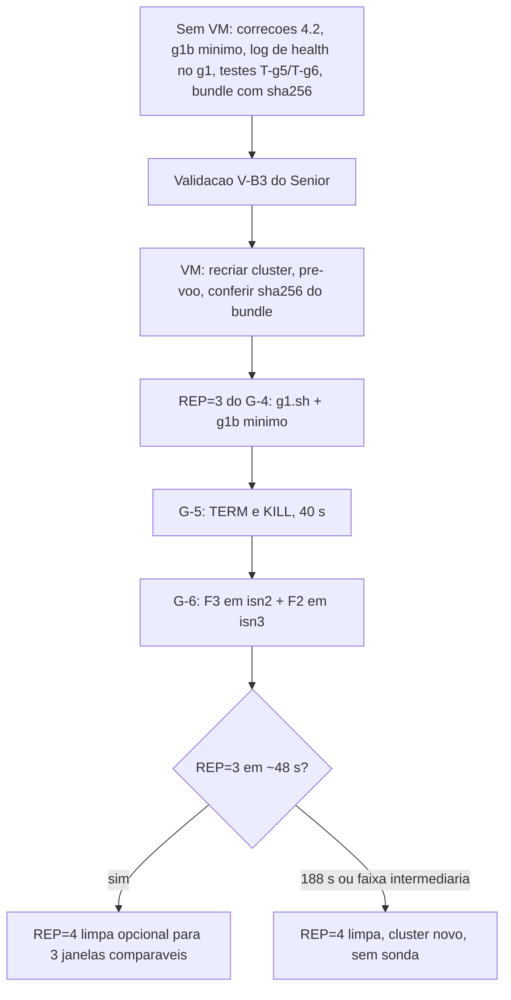

# Validacao V-B2: REP=2 do G-4, g5.sh, g6.sh e sequencia restante - 2026-10-16

Senior. Base: commit 8394843 (`test/b29-gate-vm`), brutos em `runs/gate-b29/g1-rep2/`, `g1-rep1/`, `g1b-rep2.log`, `g1-console-rep2.log`, `go.log`. Nada foi executado na VM; so leitura dos brutos locais. Nenhum script foi alterado.

## 1. Conferencia independente dos numeros do relatorio

Todos recalculados a partir dos brutos (epoch ns e timestamps de log).

| Item do relatorio | Conferido | Observacao |
|---|---|---|
| t_split maioria 45,0 s | OK | isn1 06:49:02,320 / isn2 ,316 menos start 06:48:17,310 = 45,01 / 45,01 |
| t_split isn3 46,1 s | OK | 06:49:03,411 menos start = 46,10; DEGRADED sessions/counters 03,413-,414 (topologia 23) |
| Vista fundida 45,0 s | OK | MergeView `[isn2-19096\|6] (3)` 06:50:38,319-,320; event=end 06:49:53,351; delta 44,97 |
| t_merge_s=188 | OK | `t_merge.txt`; 06:49:53,351 + 188 = 06:53:01,35 a 06:53:02,34, coerente com os `Finished rebalance` das 06:53:02,097-,112 |
| Janela real | 96,04 s nas duas REP | REP1 96,0423 s, REP2 96,0412 s: a duracao da janela NAO explica a diferenca |
| Rebalance isn3 | OK | sessions 06:52:17,949; counters 06:52:29,996; internos (CONFIG, COUNTER, protobuf, hotRodTopology, TX_TABLE) 06:53:02,097-,112 |
| ingress=51 / egress=301 | OK | `inj.log`; tabela por filtro do relatorio confere linha a linha (+82 s: 134/160 e 38/12) |
| rc das sondas | OK | `isn3->isn1:7800` rc=124 nas 5 amostras; `isn1->isn2:7800` rc=0 nas 5 |
| 8 de 60 coletas REST de isn3 com 200 | OK | 8 x 200 (health +0,6 e +12,7; stats-sessions +4,6/+16,7/+32,7; avail-sessions +4,6; avail-counters +24,7/+40,8); ultimo 200 em +40,8 s, antes da vista (+45,0/+46,1) |
| HEALTHY_REBALANCING | OK, mas so 2 amostras | 11222/11223 em +161 e +185 s (06:50:58, 06:51:22); a coleta parou em +185 s. Os ~143 s vem dos logs, nao de leituras REST |
| Tabela de excecoes Hot Rod | OK | ver 1.2 |

### 1.1 Correcoes ao relatorio (nao mudam conclusoes)

1. Secao 3.4 diz que o primeiro 000 de 11224 e o `get-availability` de counters em +8,7 s e que 52 deram 000 "de +24,7 s ate o fim". O indice mostra outra ordem: o primeiro 000 e `GET /caches` em **+0,6 s** (REST de isn3 pendura desde o primeiro segundo, antes da deteccao), depois `stats-counters` em +4,7 e `avail-counters` em +8,7; `health` so passa a 000 a partir de +24,7. Os 52 000 se distribuem por todas as 6 rotas (10 de cada, menos os 8 que deram 200).
2. Secao 2 diz HEALTHY "~06:53:01"; o instante certo e o intervalo 06:53:01,35 a 06:53:02,34 (resolucao inteira do `date +%s%N`/1e9).
3. O G-1 "Hot Rod devolve erro, nao timeout" fica melhor descrito como: **a primeira sondagem de `sessions` apos o DEGRADED** (+59,3 s) ja deu erro imediato. A sonda alterna `sessions`/`counters` com ciclo de ~28 s por cache, logo +59,3 s e o primeiro ciclo de `sessions` depois de +46,1 s, nao uma latencia de 13 s do servidor. A resolucao temporal do achado e de ~28 s.
4. Nenhuma escrita da sonda em isn3 teve sucesso durante toda a particao (as 16 linhas `OK` de isn3 sao `get`/`entrySet` pos-fusao). Os dados falsos (`sonda-isn1`) so existem no lado majoritario; isn3 nao divergiu por escrita. Isto elimina "volume de dados divergentes" como causa: sao 1 a 2 chaves de ~500 bytes.

### 1.2 Tabela de excecoes (confere)

- Timeout: `TransportException` (SocketTimeoutException 2000 ms) em put/get/remove, ~4,0 s (2 tentativas); `RuntimeException` no entrySet, ~2,0 s. Vale da janela +1 s ate +55 s, todo `counters` ate +141,6 s, e put/remove pos-fusao.
- Erro imediato (0,00 s), so `sessions` DEGRADED, de +59,3 a +131,6 s: `HotRodClientException` com `AvailabilityException` ISPN000306 (put/get/remove) e ISPN000305 (entrySet). get tambem e negado em DEGRADED (particao DENY_READ_WRITES).
- Pos-fusao (+145,6 a +205,7 s, isn1 e isn3): put/remove em timeout ate o fim da sonda (o rebalance de `sessions` so terminou em +240,6 s); get/entrySet OK a partir de +149,6 s.
- SIGTERM (+205-209 s): `InterruptedException`, artefato do encerramento.

## 2. Diagnostico dos 188 s

### 2.1 O que os logs mostram (fato)

1. O atraso e **todo depois da vista fundida**. Vista em 45,0 s (igual a REP1, 46,4 s); o JGroups se comportou igual. Os ~143 s extras estao na camada de topologia de cache do Infinispan.
2. No coordenador (isn2), `sessions` resolveu conflitos em 70 ms (06:50:38,396, ISPN100013), mas **`counters` falhou a resolucao de conflitos apos exatamente 60 s**: 06:50:38,326 `ISPN100012 Starting conflict resolution` e 06:51:38,327 `ISPN000524 ... java.util.concurrent.TimeoutException` em `DefaultConflictManager$ReplicaSpliterator.tryAdvance` (`ISPN100014 Failed conflict resolution ... topology id 28`). So o rebalance de `counters` so comecou em 06:51:38,329 (+60 s).
3. Em isn3, `counters` acumula `ISPN000638 Timeout waiting for topology 22 transaction data` (27 ocorrencias, de 06:49:22 a 06:52:05), isto e, comandos em isn3 esperando o dado transacional da topologia 22 que o cache nunca instalou. `sessions` nao tem isto. O `ReplicaSpliterator` da resolucao pede segmentos a isn3; a hipotese coerente e que o pedido ficou preso na mesma espera (ver 2.2).
4. State transfer: `sessions` terminou so em 06:52:17,949 (99,6 s depois de iniciar), `counters` em 06:52:29,996 (51,7 s), e as tarefas `state-transfer-*` dos caches internos (sem dados de aplicacao) so **iniciaram** em 06:53:02,097, 32 s depois de counters. Os caches internos nao tem comandos de cliente nem dados de teste, e mesmo assim esperaram: o rebalance de isn3 parece serializado por cache e preso ao mais lento.
5. Ultima perturbacao externa: sonda terminada em ~06:51:46 (+209 s) e coleta REST em ~06:51:22. O rebalance continuou ate 06:53:02, **76 s depois de a sonda parar**. Portanto a carga ativa da sonda/coleta no momento do rebalance nao e a explicacao suficiente.
6. Requisicoes REST de isn3 ficaram represadas e foram liberadas em bloco em 06:52:29,996 (fim do rebalance de counters) e 06:53:02,101 (fim dos internos): o REST de isn3 depende de estado do cache manager que fica travado durante o rebalance, inclusive `GET /caches` e `health`.
7. Em REP1 todo o rebalance foi de 14 ms (05:13:26,456 a ,718) com caches vazios, sem sonda, sem comando algum em andamento.

### 2.2 Hipoteses (nao provadas) e o que as distingue

REP2 difere de REP1 em **tres fatores ao mesmo tempo** e a REP=2 nao os separa:

| Fator | Hipotese | Suporte | Contra |
|---|---|---|---|
| H1 sonda (comandos Hot Rod em isn1/isn3, em especial `counters`) | comandos pendentes contra `counters` em isn3 mantem a espera pela topologia 22, travam a resolucao de conflitos (60 s) e depois o state transfer | ISPN000638 so em `counters` e so no caminho de comando; CR preso em `counters`; erro de cliente em `counters` o tempo todo | a sonda parou 76 s antes do fim; ISPN000638 pode ser consequencia, nao causa |
| H2 coleta REST extra (`/caches`, `?action=stats`, `?action=get-availability`) | stats/availability cluster-wide em isn3 entram em RPC com membros inalcancaveis e deixam trabalho pendente | REST de isn3 pendurado desde +0,6 s; `stats-counters` e `avail-counters` entre os primeiros 000 | `stats-sessions`/`avail-sessions` deram 200 e `sessions` convergiu; REST pendente tambem pode ser sintoma |
| H3 historico do cluster | REP2 foi a 3a particao da mesma instancia (mesmos JVMs `isn3-5889` etc.; G-0, REP1, REP2); topologia 22-23 contra 10-11 na REP1 | ids de topologia mais altos; conflito/estado acumulado | nenhuma evidencia direta |

Dados falsos e volume foram descartados (1.1.4). Duracao da janela tambem (96,04 s nas duas).

### 2.3 Achado cientifico ou artefato?

Nem uma coisa nem outra, ainda. Pode-se afirmar: **a convergencia pos-fusao de 48 s da REP1 vale para cluster ocioso e vazio**; com trafego de cliente durante a particao (mesmo uma chave por no) ela chegou a 188 s, com timeout de 60 s na resolucao de conflitos de um cache. Se H1 se confirmar, isso nao e artefato: um cliente real faz as mesmas operacoes, e o limite de convergencia que o modelo e o controlador assumem (~48 s) subestima o caso com trafego. Se H2 ou H3 se confirmarem, e artefato da instrumentacao (H2) ou do reuso do cluster (H3), e a REP=2 so serve de alerta. Ate separar, tratar como **observacao com causa nao isolada**, nao reportar 188 s como t_merge do G-4 e nao descartar.

## 3. Decisoes de procedimento

### 3.1 A REP=2 conta?

- **G-4 (tempo)**: e uma medicao valida e preservada, mas em outro estrato (sonda + coleta REST completa + 3a particao da instancia). **Nao entra no mesmo conjunto das janelas de referencia** (REP1: 48 s). O criterio de "ao menos 3 janelas" do G-4 passa a ser lido como 3 janelas comparaveis; hoje ha 1 (REP1). O relatorio do G-4 reporta os estratos em separado, sem media.
- **Lacuna do Hot Rod (erro x timeout)**: **parcialmente valida**. Valida e limpa para `sessions` em DEGRADED (ISPN000306/305, 0,00 s, +59,3 a +131,6 s). Confundida para `counters` (timeout o tempo todo, que pode ser o mesmo estado preso) e para o intervalo anterior a deteccao (timeout esperado: escrita sincrona esperando dono inalcancavel). Serve ao C-2 para o caso de `sessions`; nao fecha a lacuna para `counters` nem mede latencia ate o primeiro erro com resolucao melhor que ~28 s.

### 3.2 O que muda para a REP=3

1. **g1b.sh variante minima**: `/health` nas 3 portas + sondas (as duas JVMs, `sessions,counters`); **sem** `/caches`, `?action=stats`, `?action=get-availability`. Habilitar por variavel (por exemplo `COLETA=minima`), com teste sem VM. Remove H2 e mantem o dado Hot Rod. A coleta completa fica para o estrato REP=2.
2. **Cluster recriado antes da REP=3** (mesmo procedimento do pre-voo da REP1/G-0, estado inicial com topologia baixa). Remove H3: sem isso, uma REP=3 lenta seria ambigua entre H1 e H3. E a unica mudanca que exige ciencia do Gestor alem do que ele autorizou (nova acao na VM, reversivel, so afeta dados de teste).
3. **g1.sh**: registrar em arquivo, a cada 2 s, o `health` das 3 portas com timestamp (hoje e descartado no `until`). Da `HEALTHY_REBALANCING` com resolucao de 2 s e t_merge por porta. Pequeno, com teste sem VM.
4. Mantida a janela de 90 s em isn3, o mesmo injetor, o mesmo limite de parada (150 s).

Por que a variante minima e nao "REP=3 sem sonda": com cluster novo, a minima muda um fator (sonda) em relacao a REP1 e e informativa nos dois resultados. ~48 s: sonda inocente, causa em H2 ou H3, e o dado Hot Rod fica limpo. ~188 s: H1 confirmada. Faixa intermediaria: ambigua, pede REP=4. Uma REP=3 sem sonda so seria a segunda janela limpa e nao daria dado novo sobre o Hot Rod nem sobre a causa.

**REP=4 (limpa, sem sonda, sem coleta extra, cluster novo)**: condicional. Necessaria se a REP=3 sair em 188 s (para ter janelas limpas comparaveis com REP1) ou em faixa intermediaria. Se a REP=3 sair ~48 s, a REP=4 vira opcional para chegar a 3 janelas comparaveis (REP1, REP3, REP4). Pedir ao Gestor ja agora um go condicional para ela.

## 4. Revisao de g56-lib.sh, g5.sh, g6.sh

`bash -n` OK nos tres e em g-lib.sh; `--dry-run` de g5 e g6 imprime o plano. sha256 do estado revisado:

- g56-lib.sh `51b40468a5be032d47cd0f5ecf8d770cf96fc393e87d86d13fe754a7c701fd98`
- g5.sh `b0ef73cf4e1f1ee6c90579ec26a375559c2e59e1cf3427f8e2657bd37c1fa5d4`
- g6.sh `b17fe7a5cc97c6f8711a5c39be38c8256f3f6b12ff26760b32f305d637fd8095`

Qualquer alteracao exigida abaixo muda estes hashes; o bundle final tem de listar os novos.

### 4.1 O que esta correto

- Guarda de netns: `pid_de` (g-lib) recusa pid vazio/0, readlink vazio e netns igual ao do PID 1; g5 usa `PID3` guardado; g6 guarda isn1/isn2/isn3 e compara isn2 x isn3. `T` nao tem guarda propria, mas so e chamado com pids guardados.
- `exigir_go` exige terminal (ou `G_TESTE=1`) e grava `go.log`; vem antes de qualquer acao nas duas.
- g5 arma o dead-man **dentro de `fase`**, antes do injetor, para TERM e para KILL; so desarma depois da verificacao de cada fase, e `abortar` deixa o dead-man armado. Cobre o KILL, o caso em que nenhum trap age. O filho orfao (`sleep`) segura o flock do isn3 ate acabar; o script o registra e o aguarda, e `--heal` nao toma lock.
- g5 usa janela de 40 s com sinal em +15 s: abaixo da deteccao (~40 s), sem mudanca de vista, risco baixo. Os logs de vista dessa execucao nao mostrarao split, isso e esperado.
- g6: F3 sobe antes da F2; os dois dead-men sao armados antes de qualquer injecao; limpeza de cada injetor so no proprio no (`clsact` em isn3, `root` em isn2); o teste afirma que a limpeza da F2 nao removeu o netem de isn2.
- Riscos do jitter em isn2 (20 ms +/- 13 ms, p99 ~50 ms, saida): ordens de grandeza abaixo dos timeouts do FD (~40 s) e do heartbeat; nao deve afetar a eleicao nem o canal isn1<->isn2. Pode reordenar pacotes, absorvido pelo TCP do JGroups. Os tempos de split e merge do G-6 **nao** sao pontos do G-4 e nao devem ser agregados com ele.

### 4.2 Defeitos a corrigir antes da VM

1. **g6, amostra +80 s pode cair depois do fim da F2 (falso FAIL).** A F2 dura 90 s apos o start (clsact sai em ~+96 s); a REP=2 mostrou REST de isn3 pendurado (52/60 timeouts de 4 s). Cada amostra roda `health` (ate 3 x 5 s) e o `timeout 3` antes de a checagem de estado das linhas 64-65, que pode ocorrer depois de a F2 acabar e dar "isn3 sem clsact". Correcao: checar o estado (`qd`) **antes** das sondas lentas, e trocar a ultima amostra para +70 s; limitar `health`/`ssh` com `timeout`.
2. **g6, `qd ... | grep -q` com `pipefail`**: `grep -q` encerra cedo e pode dar 141 no produtor. Nas formas negadas (`! qd | grep -q clsact`) isso vira falso PASS. Praticamente impossivel com saida de uma escrita, mas trocar por `out=$(qd ...); grep -q ... <<<"$out"` (como `tem_clsact` ja faz em g5).
3. **g6, `abortar` sem `PID2`** se a falha vier antes da linha 24: com `set -u` o trap quebra. Inicializar `PID1= PID2= PID3=` antes do `trap`, e no abort so tocar `tc` se o pid estiver setado.
4. **Guarda de netns dentro do `inject-partition.sh`**: o fix A2 (`0f79256`, branch `fix/b29-guarda-netns-particao`, T-par-18) **nao esta** em `8394843` nem no bundle da REP=2. Os alvos continuam protegidos pela guarda do harness (`pid_de`), mas o `--heal` do dead-man roda como root sem ela. Recomendo incluir o fix no bundle (comportamento de exit code inalterado para rc 143/137/0), rodando antes a suite T-par na VM.
5. **Dead-man do netem (`armar_netem`)**: o corpo `bash -c` com guarda inline nao tem teste. Exigir teste com shims que execute o corpo para (a) pid de netns distinto e (b) pid no netns do host, e confirmar que em (b) nao chama `tc`.
6. Menores: `T0` de `g5` e `g6` sao os de antes do `armar`, bom; manter `LIMPO=1` so no fim; `espera_saudavel` deve imprimir o tempo a partir do **fim da F2** no G-6 (hoje conta a partir do fim do F3, ~35 s depois), para o dado de convergencia ser comparavel.

### 4.3 Testes sem VM exigidos (shims de podman/nsenter/tc/systemd-run/flock, como `inject-partition.test.sh`)

- T-g5-1 caminho TERM: injetor shim sai 143 com marcador end e sem clsact; PASS.
- T-g5-2 caminho KILL: shim deixa clsact, sem end; `--heal` o remove; PASS.
- T-g5-3 sem `event=start` em 40 s: FAIL e `abortar` chama `--heal`.
- T-g5-4 clsact ausente antes do sinal: FAIL e heal.
- T-g5-5 rc diferente de 137 na fase KILL: FAIL.
- T-g5-6 ordem de chamadas: `systemd-run` (dead-man) **antes** do injetor nas duas fases; `systemctl stop` so apos sucesso; abort nao desarma.
- T-g5-7 sem GO: nenhuma chamada a `tc`/`nsenter`/`systemd-run`.
- T-g6-1 ordem: dois dead-men antes de qualquer injecao; F3 antes de F2.
- T-g6-2 netns de isn2 = isn3: aborta sem injecao.
- T-g6-3 coexistencia PASS: log de `tc` por pid mostra `clsact` so no pid de isn3 e `root` so no pid de isn2; limpeza de cada uma toca so o seu pid.
- T-g6-4 F3 termina antes da F2: FAIL e abort limpa os dois.
- T-g6-5 amostra tardia (saude lenta simulada): sem falso FAIL apos a correcao 4.2.1.
- T-g6-6 abort antes de `PID2` definido: sem erro de variavel nao definida.
- T-g6-7 corpo do dead-man do netem (4.2.5).
- Regressao: `inject-partition.test.sh` e `inject-jitter.test.sh` verdes; testes do g1b minimo e do log de health do g1.

### 4.4 Bundle

`git bundle` de um unico HEAD, com `sha256sum` do arquivo do bundle, do HEAD (40 hex) e de `g1.sh`, `g1b.sh`, `g56-lib.sh`, `g5.sh`, `g6.sh`, `inject-partition.sh`, `inject-jitter.sh` registrados no relatorio e **conferidos na VM** antes do primeiro `go`. `g1b.sh` ainda nao esta no branch `test/b29-gate-vm` (so em `feature/b33-2-sonda-hotrod` e no bundle da REP=2): trazer para o branch com a variante minima.

## 5. Sequencia recomendada e go

Ordem: REP=3 primeiro, logo depois da recriacao do cluster, para que G-5 e G-6 nao acrescentem historico antes dela. G-5 antes de G-6 (menor risco, sem mudanca de vista). Em cada execucao, uma de cada vez, parando na primeira regra de parada.

Go necessario:
- REP=3 com g1b minimo: o go ja dado cobre (e subconjunto da coleta autorizada, mesma injecao, mesma janela).
- Recriar o cluster antes da REP=3: **pedir ciencia/OK explicito ao Gestor** (acao nova na VM; sem ela a REP=3 fica ambigua entre H1 e H3).
- G-5 e G-6: o go dado cobre, **desde que** o bundle seja o revisado (hashes novos). Se a execucao incluir o fix A2 no `inject-partition.sh`, avisar o Gestor na ordem de execucao.
- REP=4 limpa: **go condicional novo**, pedido ja agora.

Nada vai para `origin/*` sem aprovacao explicita.
