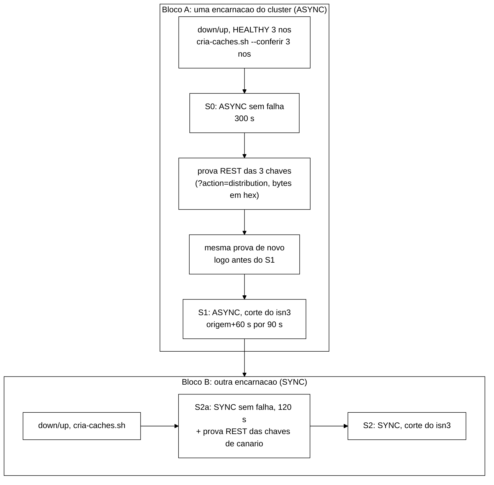

# Validação V-W4: sonda de defasagem S_lag e *caches* `canario*` (2026-11-05)

> Nota da integração (Worker, 05/11, `feature/controlador-integracao`): os números de problema do W-4 citados
> aqui eram P-39 e P-40 na branch dele; no registro integrado são P-43 e P-44 (o W-2a já tinha P-39..P-42).
> Só os números foram trocados; o parecer não mudou.

> Senior, 2026-11-05. Branch `feature/w4-sonda-defasagem`, worktree `wt-w4`, ponta `a180a6a` sobre `9695511` (ponta
> do W-2a). Primeira rodada `603947d`, `133212d`, `0aba464`; segunda `bf59e6e`, `aadbaa3`, `4ed28a3`, `13154c4`,
> `0db755f`, `5da6767`, `a180a6a`. Especificação: prompt W-4 em `docs/plano-execucao-2026-11-04.md` §9 (`wt-plano-ctrl`),
> §4.2 de `docs/plano-alinhamento-objetivos-2026-11-04.md`, §3.1, §5 e §6 de `docs/acoes-controlador-cluster-2026-11-05.md`
> e as decisões do coordenador de 05/11 registradas no TD-012 (`docs/implementacao.md`), no P-43/P-44
> (`docs/registro-de-problemas.md`) e no `docs/testes.md`.
>
> **Validação feita só por leitura.** A VM mede a noite 1 até ~12:20Z e o host está em H0. Não rodei Maven, `javac`,
> testes, Python de projeto, Podman nem *cluster*. Li código, *diffs*, documentos e brutos de B-44.1/B-44.1b. Os únicos
> cálculos foram comparações de JSON com `python -I` e a leitura do *constant pool* dos `.class` do cliente Hot Rod
> 15.0.0 no `~/.m2` (sem JVM), para conferir assinaturas. O que precisa ser executado está na seção 9.

## Veredito

**APROVADO COM RESSALVAS.** O código faz o que o W-4 e o §4.2 pedem, com as oito decisões do coordenador aplicadas.
Não achei defeito que leve a ação errada nem violação do P-5. A conta da rodada, o lag de par e de nó, o suspeito e a
agenda estão corretos. Os JSON `canario*` são byte a byte o corpo de *caches* que o B-44.1b já criou e leu de volta.

As ressalvas são quatro de peso e cinco menores. R1 (o recuo para a chave simples tem de ser fatal) é mudança pequena de
código e precisa entrar antes da calibração. R2 é de medida: a prova por `?action=distribution` só vale se a chamada
REST endereçar os mesmos bytes da chave Hot Rod, porque os *caches* não têm `encoding`. R3 é um risco novo, só em SYNC,
que a escolha do primário não cobre. R4 é uma restrição sobre W que o B-40 precisa conhecer. Nada disso impede a H2.

A liberação para a calibração depende de: Surefire 1036/0/0/1 e `cria-caches.test.sh` 26/0 medidos na H2, R1
implementada com teste vermelho antes, e o *smoke* da seção 9 aprovado.

## 1. O que conferi

| Ponto | Resultado |
|---|---|
| Histórico | linear, 10 commits sobre `9695511`, sem *merge*, nenhum em `origin/*` (`git branch -r --contains 603947d` vazio), árvore limpa; pares TDD na ordem `603947d`→`133212d`, `aadbaa3`+`4ed28a3`→`0db755f`, `13154c4`→`5da6767`; *trailer* `Co-Authored-By` em 10/10 |
| Contagem de testes | 12 arquivos novos com 62 `@Test` (47 da primeira rodada + 15 da segunda), arquivos de teste de 133 para 145. Bate com o `testes.md` (974 + 62 = 1036). Os 974 do W-2a ainda não foram medidos |
| P-43 (`bf59e6e`) | duas edições: literal `1.1`→`1.2` em `LacoDeControleTest` e pares novos em `PERMITIDOS` do R-C1. Nenhuma asserção retirada |
| Credenciais | nenhuma no *diff*; `cria-caches.sh` só lê a senha do ambiente e a passa por stdin |
| Fonte do passo | `leituras/CAND-099-Wada-ConsistencyCloud-CIDR-2011.txt:109-112`: "in most experiments reading happens 50 times every second", logo 20 ms. A origem declarada no arquivo de calibração está certa |
| API do cliente 15.0.0 | no `infinispan-client-hotrod-15.0.0.Final.jar`: `ChannelFactory.getHashAwareServer(Object, byte[])`, `getServers(byte[])`, `RemoteCacheManager.getChannelFactory()`, `DataFormat.keyToBytes(Object)` e `isObjectStorage()`, todos públicos. Versão fixa no `pom.xml` (sem faixa) |
| JSON `canario*` | comparados com os brutos de B-44.1 e B-44.1b (seção 5) |
| *Encoding* | os servidores do B-44.1b logam `ISPN000599` ("does not define the encoding") para os quatro *caches* da carga. Os `canario*` seguem igual. Isso pesa na R2 |

## 2. Rodada, lag de par e de nó, suspeito e janela (item 1)

**Rodada** (`SondaDefasagem.java:315-420`). Para cada nó X uma tarefa escreve `chave(X) = <nonce>:<rodada>` pelo cliente
de X; para cada Y ≠ X outra tarefa espera a escrita voltar por no máximo um passo e lê a cada `passoLeituraMs` até ver o
valor ou até o prazo. O prazo é `t0 + teto`, com `teto = c.prazoHotRodMs()` (`LigacaoControlador.java:436`), isto é,
`--hotrod-timeout-ms`, que a R7 do W-2a já iguala a `politica.tetoLagMs`. Lag do par = fim da leitura que viu − início
da rodada (método de `wada_consistency_cloud_2011` §2). Não visto vale exatamente o teto, e o construtor de
`RodadaDefasagem` recusa outra coisa (`RodadaDefasagem.java:111`). No prazo as tarefas que restam são interrompidas.
Está correto.

Uma precisão de custo. "3 escritas e 6 leituras sem falha" é o mínimo. Em ASYNC a escrita volta assim que o primário
grava, e o leitor que é a cópia lê localmente; se a replicação ainda não chegou, ele lê de novo 20 ms depois. O esperado
sem falha em ASYNC é de 6 a 9 leituras por rodada, com lag de ~20 ms nesses pares. Não é defeito, porque o custo real vai
a `custo.leituras` e `defasagem_leituras`, mas o contrato (`contrato-jsonl-controlador-v1.md:168`) e o TD-012 devem dizer
"no mínimo 6".

**Lag de nó** = menor lag entre os pares em que o nó escreve ou lê (`RodadaDefasagem.java:127-139`); `lagMaxMs` = maior
lag de nó; `noSuspeito` = o nó que o atinge se for único, `null` em empate (`:185-200`). Com o corte de C e as chaves do
P-44, os quatro pares de C ficam no teto e os dois da maioria são vistos, então lag(C) = teto, os outros ficam baixos e o
suspeito é C. Enlace lento, corte parcial ou nó lento só como escritor não levam ninguém ao teto. Os testes de
`SondaDefasagemResumoTest` cobrem esses casos.

O `noSuspeito` sai preenchido em toda rodada, inclusive nas calmas (máximo único entre números pequenos). O P1 só o usa
com `lagMax ≥ tetoLagMs` (`PoliticaPorAssinatura.java:197`), então as decisões não mudam. Quem lê o JSONL tem de filtrar
por `lag_max_ms = teto_ms`; o contrato deve dizer isso e o critério do *smoke* foi escrito assim.

**Janela.** A agenda segue a grade `origem + i·W` (`SondaDefasagem.java:562-595`). Uma rodada só começa se o atraso não
passa de `W − teto` (`cabeNaJanela`, `:557-560`) e se nenhuma tarefa da anterior está em voo; senão é pulada, contada, e a
janela fica `INDETERMINADA` (`resumir` com lista vazia). Antes da origem as rodadas aquecem os clientes e não entram em
janela nem no JSONL. Está correto. Dois detalhes de contrato: (a) uma rodada que termina depois do fechamento da sua
janela entra na seguinte e conta em `defasagem_rodadas_atrasadas`, o que o texto de `lag.amostras` ("rodadas com início
na janela") não diz; (b) `defasagem_rodadas_puladas` também conta instantes pulados antes da origem, então a análise deve
contar as puladas depois da origem pelas janelas com `amostras = 0`, e não pelo contador.

Latente e de baixa prioridade: `vistoEm` usa −1 como sentinela e testa `visto >= 0` (`:396`) sobre `System.nanoTime`, que
a especificação do Java permite negativo. No HotSpot em Linux e Windows o valor é positivo desde o *boot*, então não há
efeito hoje; um vetor booleano tira a dependência.

## 3. P-5 (item 2)

- No caminho da medida só há `CanalCanario.escrever/ler`, que viram `RemoteCache.put/get` (`CanalCanarioHotRod.java:375-385`).
  Nenhum processo, nenhum arquivo. `ArquiteturaDefasagemTest` e `CanarioArquiteturaTest` varrem as fontes atrás de
  `ProcessBuilder`, `Runtime`, `.exec(`, `java.nio.file` e `java.io.File`.
- `entregar` (`SondaDefasagem.java:504-523`) põe a rodada no *buffer* e manda a linha a uma *thread* gravadora única, com
  fila em memória (uma linha por W). A rodada nunca espera o ouvinte.
- `ouvinteLentoNaoAtrasaRodada` (`SondaDefasagemRodadaTest.java:246-274`): o ouvinte trava 1 s na primeira linha; aos
  700 ms nenhuma linha foi gravada e já houve ao menos 3 rodadas. Isso prova que a rodada não espera o disco. Não prova que
  ela continua na grade; falta `assertEquals(0, s.rodadasPuladas())` no mesmo ponto (R6).
- Resíduo que não é do W-4: `TrilhaJsonl.escrever` é `synchronized`, então uma gravação travada da gravadora segura o
  monitor e a próxima linha do laço espera junto. Isso já valia para as linhas do próprio laço (W-3) e é assunto do W-2b.
- Os clientes fixados e o cliente *topology-aware* da escolha de chave nascem na abertura, antes do *warm-up*, fora do
  caminho crítico.

## 4. Escolha de chave do P-44 (item 3)

A busca (`CanalCanarioHotRod.java:165-178`) testa `lag:<X>`, `lag:<X>#1`, ... e fica com a primeira cujo primário, no
hash consistente que o cliente recebeu, seja X. O primário vem de `getHashAwareServer` sobre `keyToBytes(k)` (ou sobre a
chave, se o servidor guardar objetos), que é o mesmo cálculo com que o cliente roteia (`:248-249`). A leitura da API está
certa e as assinaturas existem na 15.0.0.

**Limite de 10 000.** Se X é primário de ao menos 1 dos 64 segmentos, cada candidata cai num segmento dele com
probabilidade ≥ 1/64, e a chance de não achar é ≤ (63/64)^10000 = e^−157,5 ≈ 4×10^−69 < 10^−60. A conta e o teste
`limiteDaBusca` estão certos. Na prática cada nó é primário de ~21 segmentos e a busca acaba em ~3 candidatas. O pior caso
custa 30 000 serializações na abertura, nada durante a execução.

**Recuo.** Sem topologia, nó fora da topologia anunciada, sem achar ou com exceção, fica `lag:<X>` com o motivo em
`defasagem_chaves` (`LigacaoControlador.java:547-556`). O caso `fora-da-topologia` é fácil de provocar sem perceber: o
`podman-compose.yml` anuncia `127.0.0.1:1122x` (`external-host`), e quem passar `localhost` em `--servers` e
`--controller-admin` (a correspondência entre os dois continua válida) perde a escolha nos três nós sem erro nenhum. Isso
sustenta a R1.

**O que a escolha resolve.** Em ASYNC, com o primário no escritor X, a escrita é local, o leitor que não é dono busca no
primário e o leitor que é cópia recebe de X; nada depende do nó cortado C. O empate no teto some.

**O que ela não resolve (R3, novo).** Em SYNC, a chave de X tem cópia em C com chance de ~1/2. A escrita de X espera a
confirmação de C, e não está estabelecido se o valor fica visível em X antes dela. O B-44.1 observou o contrário num caso
parecido: escrita SYNC que expirou com o valor na cópia e ausente no primário (`wt-b44-1/docs/b44-1-reconfiguracao-infinispan.md:204`).
Se o valor não aparece em X, o par X→Y vai ao teto; com as duas chaves da maioria com cópia em C (~1/4 das execuções), os
três nós empatam e o P1 não dispara. A célula SYNC F2 é de referência (plano de execução §5.2) e a calibração tem
SYNC F2 × 3, então o comportamento do P1 em SYNC precisa ser medido, não suposto. Se falhar, a saída é uma chave por par
ordenado com donos {escritor, leitor} (6 escritas por rodada); a decisão é do Gestor.

O limite (3) do P-44 (a leitura de um não dono vai primeiro ao primário) só o *smoke* confirma. O critério da seção 9 mede
o lag dos pares da maioria durante o corte: valores perto do atraso de leitura escalonada, e não de dezenas de ms, seriam
sinal de que a leitura bateu em C primeiro.

## 5. JSON `canario*` e `cria-caches.sh` (item 4)

| Arquivo | Igual, byte a byte, a | Situação no bruto |
|---|---|---|
| `cluster/caches/canario.json` | `wt-b44-1/runs/b44-1b/corpos/json/B0-cria-counters-b.json` | POST com HTTP 200 (`chamadas.tsv`, 22:09:18.093Z) e leitura de volta `B0-cfgf-counters.txt` = `{"counters":<arquivo>}` |
| `cluster/caches/canario.json` | corpo interno de `wt-b44-1/runs/b44-1/corpos/config-sessions-isn1.txt` | leitura de volta do `sessions` do XML |
| `cluster/caches/canario-async.json` | corpo interno de `B0-cfgf-counters-async.txt` e de `runs/b44-1/corpos/config-sessions-async-isn1.txt` | leituras de volta de ASYNC |

Logo a comparação do script (`{"<nome>":<arquivo>}` contra `?action=config`, byte a byte) deve passar. O que o bruto não
cobre é um POST de ASYNC sem o envoltório do nome; o risco é baixo e o *smoke* fecha.

`cria-caches.sh`: a senha só vem de `CRIA_CACHES_SENHA`, é escrita pelo `printf` embutido do bash num `curl -K -` (stdin),
com o mesmo escape de `HealthRest.configCurl`, e nunca aparece em argv. O teste C1 confere argv e stdin. Os códigos de
saída estão coerentes e a leitura de volta é feita em cada URL de `--conferir`. Três observações para o W-6: `--conferir` é
opcional e, sem ele, o script cria sem conferir, então o orquestrador tem de passar sempre os três nós; um POST de *cache*
existente sai com 3, o que está documentado; não há prazo curto por padrão, como pede o §6.4 do `cc08644`, e o alerta acima
de 8,0 s fica com o W-6.

## 6. Esquemas observáveis 1.2 e decisões 1.2 (item 5)

`observaveis` passa de 1.1 a 1.2 de forma aditiva: `parametros_defasagem` só na `meta` de `observaveis`
(`FormatoJsonl.java`, guarda por `ESQUEMA_OBSERVAVEIS`), a linha `defasagem` por rodada, os contadores `defasagem_*` e
`defasagem_chaves` no `fim`. `decisoes` continua na 1.2 do W-2a; o W-4 só muda o valor de `sonda_defasagem` na `meta`.
Nenhum consumidor fixa `1.1` (busca em `.py`, `.sh` e `.java` de produção). **Aprovo a 1.2 dos dois, antes de qualquer
dado**, com os ajustes de texto da R5.

## 7. As três perguntas

### 7.1 Depender de `ChannelFactory`, do pacote `impl`

Aceitável, nas condições abaixo. A alternativa pela API pública (`getCacheTopologyInfo().getSegmentsPerServer()`) devolve
todos os segmentos de cada servidor, primários e cópias, e não diz quem é o primário; reproduzir o cálculo do segmento
com `MurmurHash3` duplicaria lógica interna do cliente, o que é pior que chamá-la.

1. A versão do cliente fica fixa em 15.0.0.Final no `pom.xml` até o fim do TCC. Trocar a versão reabre esta validação.
2. A chamada fica num único método (`escolherPelaTopologia`), só na abertura, fora da medida.
3. A chamada não pode falhar em silêncio, o que depende da R1. Hoje um `NoSuchMethodError` (outra versão do jar) não
   é pego pelo `catch (RuntimeException)` e derruba a abertura, o que é aceitável como falha rápida; o recuo silencioso é que não é.
4. A prova independente do lado do servidor (seção 9, A7) é obrigatória antes da calibração. Ela mostra que o hash do
   cliente 15.0.0 e o do servidor 15.0.21 dão o mesmo primário. Como o cálculo é estrutural, três chaves com três primários
   diferentes, mais o comportamento sob corte, bastam; não precisa repetir por execução.
5. O limite (1) do P-44 continua declarado no texto do TCC como escolha de implementação, não como resultado.

### 7.2 O recuo para a chave simples deve ser fatal?

Sim, e não só no braço B. Recomendo que seja fatal em toda execução com o bloco `defasagem`, nos dois braços, na
calibração e na avaliação, na abertura, antes do *warm-up*. Motivos:

- No braço B, o recuo devolve o risco do P-44 (~11 % das partições sem P1 em ASYNC) e dilui o efeito do tratamento sem
  que ninguém veja. Pior, o caso `fora-da-topologia` vem de configuração (seção 4), não do acaso.
- Fatal só no braço B criaria uma regra de exclusão que depende do braço. Fatal nos dois, antes de qualquer dado, a
  exclusão não depende do braço nem do desfecho; a execução vai como de infraestrutura (DT-014) e é refeita pela regra
  de blocos.
- Na calibração, o lag com o primário no escritor tem outra distribuição que o lag com a chave simples (em ASYNC a escrita
  deixa de ser encaminhada). Misturar as duas contamina o `lagIn` que sai do quantil de 99 %.

Implementação sugerida: uma função pura `exigirPrimario(List<Chave>)` chamada em `CanalCanarioHotRod.abrir` logo depois de
`escolherPelaTopologia`, que fecha os clientes e lança `IllegalStateException` com o rótulo e o motivo de cada nó que não
ficou com `primario`. Teste vermelho antes. `defasagem_chaves` fica no `fim` como registro de auditoria.

### 7.3 `lagOutMs` = 1000 provisório, sem derivação

Aceitável só na calibração, e com as condições abaixo. O `lagOut` não muda o lag medido; só decide o nível
`INTERMEDIARIA`/`CALMA` da janela, que alimenta R3/R4 do núcleo, cujas decisões o braço A apenas registra. Com
`lagIn` = 2000 = teto, `ALTA` na calibração equivale a "algum nó no teto", que é o degrau do P1. A faixa
`INTERMEDIARIA` (1000 a 2000 ms) só aparece com nó cujos pares estão todos lentos, coisa rara sem F2/F4.

1. Nenhuma grandeza derivada da calibração pode usar o `nivel` da janela nem as decisões do braço A que dependam dele. O
   contrato já diz que `lagIn` e `lagOut` saem do lag bruto (`lag_max_ms` das linhas `defasagem`); `m`, `T_estavel` e
   `T_hold_viol` saem de sinais e violações, não de decisões. Mantido isso, os provisórios não contaminam nada.
2. O `lagOut` definitivo sai da regra de θ_out do plano de alinhamento §3.6, com o `m` medido, antes do commit do B-40.
3. A avaliação recusa qualquer `origem` que comece com `provisorio` (guarda no W-6 ou no carregamento com a fase de
   avaliação; R8).

## 8. Ressalvas

| # | Peso | O quê | Quando |
|---|---|---|---|
| R1 | alto | recuo para a chave simples fatal em toda execução com o bloco `defasagem` (seção 7.2), teste vermelho antes | antes da calibração; pode ser feito agora, sem executar |
| R2 | alto | a prova por `?action=distribution` tem de usar os bytes da chave Hot Rod em hexadecimal e exigir `contains_key = true` (seção 9, A7); com a chave em texto puro a REST endereça outros bytes, porque os *caches* não têm `encoding` (`ISPN000599`) e o cliente usa `JavaSerializationMarshaller` | no *smoke* |
| R3 | médio | P1 em SYNC não coberto pela escolha do primário (seção 4); medir com uma execução SYNC com corte | no *smoke* (bloco B) |
| R4 | médio | o carregamento exige `--hotrod-timeout-ms` < W (`ParametrosDefasagem.validarContra`), e `cabeNaJanela` precisa de folga `W − teto` maior que o atraso de início das rodadas. A regra W = ⌈n_lat/λ₅⌉ do plano de alinhamento §3.5 não conhece isso: com λ₅ ≥ 50 eventos/s, W ≤ 2 s e a execução é recusada. O B-40 precisa fixar W ≥ teto + o maior atraso de início medido na calibração (`t_inicio_ns` − início da janela, nas linhas `defasagem`) | no texto do B-40 |
| R5 | baixo | texto: no contrato, "no mínimo 6 leituras"; semântica do `no_suspeito` (só com `lag_max_ms = teto_ms`); `lag.amostras` com as atrasadas; `defasagem_rodadas_puladas` inclui o aquecimento; a conservação das leituras também desconta `defasagem_rodadas_nao_gravadas`, `defasagem_erros_ouvinte` e linhas perdidas; histórico "aguarda validação" → "validado em V-W4". Javadoc de `ParametrosDefasagem.java:36-38` ainda diz "Sem fonte no projeto" para o passo; de `CanalCanario.chaveNoPrimario`, "só registro", que muda com a R1 | junto com a R1 |
| R6 | baixo | `ouvinteLentoNaoAtrasaRodada`: acrescentar `assertEquals(0, s.rodadasPuladas())` aos 700 ms | junto com a R1 |
| R7 | baixo | relatório `docs/relatorio-w4-<data>.md` com comandos e números conferidos contra os brutos (regra comum do §9 do plano) | depois da H2 |
| R8 | baixo, W-6 | guarda que recusa `origem` `provisorio*` fora da calibração; o mesmo `--controller-config` (com `politica` e `defasagem`) nos dois braços, para o tráfego da sonda ficar simétrico; `cria-caches.sh` sempre com `--conferir` dos três nós; falha de abertura do controlador com código de saída próprio, para o K1..K10 classificar como infraestrutura | no W-6 |
| R9 | baixo | sentinela −1 de `vistoEm` sobre `System.nanoTime` (seção 2) | quando convier |

## 9. *Smoke* de aceite para a janela H2

Cluster local, sem VM. Antes do *smoke*, na mesma janela: Surefire (esperado 1036/0/0/1, 145 arquivos, ou o novo total
com a R1) e `bash scripts/cria-caches.test.sh` (26/0), com os números copiados dos XML do Surefire e da saída do script.
Todas as execuções em `--controller shadow` (o AC-5 não executa), `--scenario S3`, `--duration 300`,
`--warmup-min-sec 30`, `--controller-config cluster/controlador/controlador-calibracao-s3.json`,
`--servers 127.0.0.1:11222,127.0.0.1:11223,127.0.0.1:11224` e `--controller-admin` com as mesmas três URLs `http://`.
O corte do `isn3` usa o isolamento por nftables do B-44.1 local (`runs/b44-1/scripts/particao-nft.sh`, porque a máquina
WSL não tem `tc`), começando 60 s depois da origem e durando 90 s, acima da detecção local medida (46,8 s).



O S0 e o S1 rodam na **mesma encarnação** do *cluster*, sem recriar entre eles. A escolha da chave é determinística dado o
hash consistente, e a prova REST só pode ser feita com as chaves já escritas e antes de qualquer mudança de topologia;
depois do corte e da fusão o hash muda. Por isso a prova é feita depois do S0, repetida logo antes do S1, e o S1 tem de
escolher as mesmas chaves. O nonce novo do S1 impede que valores do S0 contem como vistos.

**Prova independente por `?action=distribution` (R2).** Os *caches* não têm `encoding` e o cliente serializa a chave com
`JavaSerializationMarshaller`. Os bytes de uma `String` ASCII são `ACED0005` (cabeçalho do fluxo), `74` (TC_STRING), o
comprimento em 2 bytes *big-endian* e os caracteres. A chamada, com a credencial por stdin como no `cria-caches.sh`:

```bash
k='lag:127.0.0.1:11222#3'   # a chave do no, lida de defasagem_chaves
hex="ACED000574$(printf '%04X' "${#k}")$(printf '%s' "$k" | od -An -tx1 | tr -d ' \n' | tr 'a-f' 'A-F')"
printf 'user = "%s"\n' "admin:${SENHA}" | curl -s --digest -K - \
  -H 'Key-Content-Type: application/octet-stream; encoding=hex' \
  "http://127.0.0.1:11222/rest/v2/caches/canario-async/0x${hex}?action=distribution"
```

O formato da chave em hexadecimal está em `leituras/CAND-091-Infinispan15-REST-API.txt:366-376`, e a resposta
(`contains_key`, `owners[].node_name`, `owners[].primary`) em `:1314-1348`. O `node_name` do primário é ligado ao rótulo
pelo `podman-compose.yml` (`isn1` → 11222, `isn2` → 11223, `isn3` → 11224). Se `contains_key` vier `false`, a chamada
endereçou outros bytes e a prova **não foi obtida**; os donos dessa resposta não valem nada, e a validação volta ao Senior.

### Critérios

| Id | Execução | Critério |
|---|---|---|
| A1 | criação | `cria-caches.sh` sai com 0; 2 POST com 200 e 6 leituras de volta idênticas; durações registradas |
| A2 | S0 | `meta` de `observaveis` com `esquema` 1.2, `sonda_defasagem = true` e `parametros_defasagem` = 2000/1000/20 com as origens do arquivo |
| A3 | S0 | todo par de toda linha `defasagem` com `visto = true`; nenhuma rodada no teto; `lag_max_ms` máximo < `lagOutMs` (1000), logo nenhuma janela `ALTA` ou `INTERMEDIARIA`. Relatar mediana, p99 e máximo de `lag_max_ms` e dos pares |
| A4 | S0 | uma rodada por janela depois da origem: nenhuma janela com `lag.amostras = 0`; `defasagem_rodadas_atrasadas` = 0 |
| A5 | S0 | `defasagem_escritas` = 3 × `defasagem_rodadas`; leituras por rodada ≥ 6 em toda rodada (relatar a distribuição; esperado de 6 a 9); erros de escrita e de leitura = 0 |
| A6 | S0 | `defasagem_chaves` com 3 entradas, `primario = true`, `motivo = primario`, chaves distintas, `no` = rótulo canônico |
| A7 | S0 | prova REST das 3 chaves: `contains_key = true` e o primário de cada chave é o nó da entrada; os três primários são distintos. Corpos guardados |
| A8 | S0 | nenhuma linha `politica` P1 e nenhuma `acao` AC-5 em `decisoes` (sem falso positivo); nenhuma chave `lag:` no CSV de eventos; contadores do auditor sem nada de `canario` |
| A9 | S1 | `defasagem_chaves` igual à do S0 e a prova REST repetida logo antes do S1 dá os mesmos primários |
| A10 | S1 | em toda rodada com `t_inicio_ns` ≥ `t_corte` e `t_ns` < `t_vista`: `lag_max_ms = teto_ms` (2000), `no_suspeito = 127.0.0.1:11224`, os pares 11222→11223 e 11223→11222 com `visto = true` e os quatro pares com 11224 com `visto = false` |
| A11 | S1 | linha `politica` P1 com `no = 127.0.0.1:11224` e `acao` AC-5 `PREVISTA` para ele com instante < `t_vista` |
| A12 | S1 | lag dos pares da maioria durante o corte: relatar o máximo. Acima de 1000 ms é indício de leitura escalonada batendo no `isn3` primeiro (limite 3 do P-44) e vai ao Senior |
| A13 | S1 | custo sob corte: leituras por rodada (esperado ~200, dois pares lidos a cada 20 ms até o prazo); máximo ≤ 600; nenhuma rodada pulada antes de `t_vista` |
| A14 | S2a/S2 | os mesmos A6, A7 e A10 em SYNC (`canario`). Aqui o A10 é **medida, não condição de aceite**: se os pares da maioria forem ao teto e o suspeito sair `null`, é o caso R3, e vai ao Gestor com a proporção de rodadas |

### Instantes a registrar (S1 e S2)

| Instante | Fonte |
|---|---|
| `t_corte`, `t_cura` | *log* do script de corte, em UTC com ms |
| `t_lag` | `t_inicio_ns` da primeira rodada com `lag_max_ms = teto_ms` e `no_suspeito = 127.0.0.1:11224` |
| `t_P1` | instante da linha `politica` P1 em `decisoes` |
| `t_vista_sonda` | primeira linha `topologia` em que algum nó informa menos de 3 membros |
| `t_vista_log` | primeira `ISPN000094` com 2 membros no `isn1` ou no `isn2` (`podman logs --timestamps`) |
| `t_volta` | primeira rodada depois de `t_cura` com todos os pares vistos |

`t_vista` = o menor entre `t_vista_sonda` e `t_vista_log`, registrando os dois. Relatar `t_lag − t_corte` (esperado
≤ W mais o atraso de início, ~5 s, porque `t_lag` é o início da rodada), `t_P1 − t_corte` (esperado ≤ 3W mais um
*tick*, 16 s com W = 5 s e k = kLag = 2: a primeira janela inteira depois do corte e a seguinte precisam estar no teto) e
`t_vista − t_corte` (~47 s local). São esses os dois instantes que o prompt pede (suspeito e mudança de vista).

**Evidência.** `runs/w4-smoke/{A,B}/` com o comando de cada execução, o SHA-256 do *jar*, os dois JSONL, o CSV de
eventos, stderr, os *logs* dos servidores, o *log* do corte, os corpos REST, o TSV do `cria-caches.sh` e um
`MANIFEST.sha256`. O relatório (R7) cita os números a partir desses arquivos.

**Opcional, se a janela couber:** uma execução ASYNC com o `isn3` parado (`podman stop`), para medir as leituras com erro
por rodada (o leitor do nó parado tenta a cada 20 ms até o prazo) e o volume de stderr do cliente Hot Rod nesse caso. É o
cenário do F1 da avaliação (`isn2`), e um *log* volumoso por rodada seria assunto do P-5.

## 10. Pontos que precisam de validação do Gestor

1. **R1:** recuo fatal em toda execução com o bloco `defasagem` (recomendação do Senior) ou só no braço B (como foi
   perguntado). O Senior não recomenda a segunda forma, pela regra de exclusão dependente do braço.
2. **R3:** se o S2 mostrar o P1 perdido em SYNC, escolher entre declarar a limitação na célula SYNC F2 (referência sem
   teste) ou chave por par ordenado com donos {escritor, leitor}, que dobra as escritas e usa mais do pacote `impl`.
3. **R4:** a regra de W no B-40 passa a respeitar W ≥ `--hotrod-timeout-ms` + o maior atraso de início medido na
   calibração.
4. **7.1:** aceitar a dependência de `ChannelFactory` como limitação declarada, nas cinco condições.

## 11. Próxima tarefa sugerida para o Worker

Na mesma branch, sem executar nada até a H2: (1) R1 com teste vermelho antes (`exigirPrimario` pura, chamada em
`CanalCanarioHotRod.abrir`); (2) R5 e R6; (3) `testes.md` com o novo total esperado. Na H2: Surefire,
`cria-caches.test.sh`, o *smoke* da seção 9 e o relatório da R7. Nenhum *push*.
