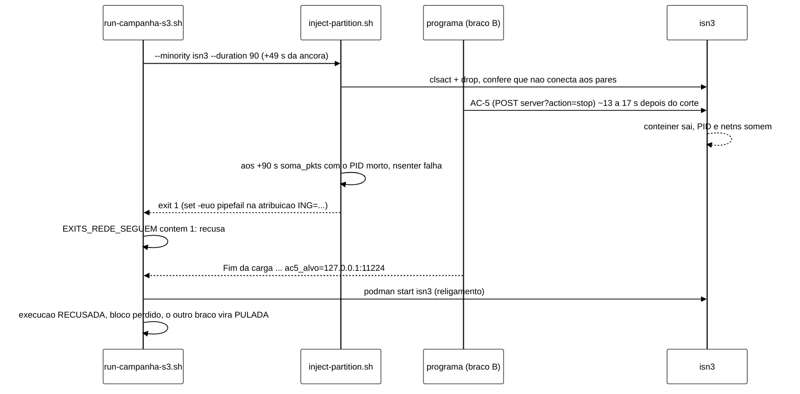
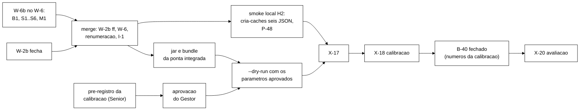

# Validação V-W6 do orquestrador das campanhas S3 (W-6, B-46 e B-25.1) (2026-11-05)

Senior, validação independente por leitura e Python leve. Não subi *cluster*, não rodei Maven nem as suítes de
*shell* (o `HOST-PERFIL.txt` não existe em `tcc/`, então não sei se o *host* está em H0; preferi não arriscar um bloco
de medição). Rodei só Python de poucos segundos e um `--dry-run` do orquestrador, que não chama `java`, `podman`,
`sudo` nem `tty`.

- Branch `feature/w6-orquestrador-s3`, worktree `wt-w6`, ponta `0a7b891`, 23 commits sobre `17f2bd4`
  (`int/2026-11-05-fix`), árvore limpa.
- Especificação: prompt W-6 de `docs/plano-execucao-2026-11-04.md` §9 (lido em `wt-plano-ctrl`, ponta `afd9cf5`);
  `docs/acoes-controlador-cluster-2026-11-05.md` §5.1 e §6; os 8 requisitos do coordenador; o I-3b
  (`wt-w4/runs/i3b/`, seção I-3b de `wt-w4/docs/testes.md`) e os pedidos que vieram depois dele (religamento antes do
  teto, `convergencia_estado`, pareamento com a mesma semente, arquivo `NUL`).
- **O relatório do Worker com os 12 pontos não está em `wt-w6/docs/`.** Não há `relatorio-w6-*.md`, o `git status`
  está limpo e não há arquivo ignorado em `docs/`. Procurei na árvore toda de `tcc/` e não achei. Usei o TD-014
  (`docs/implementacao.md`), a seção W-6 de `docs/testes.md`, o registro de problemas e as mensagens de commit. Os 12
  pontos da seção 4 são os 8 requisitos mais 4 itens do pedido de validação. Se a lista do Worker for outra, o
  coordenador faz o cruzamento.

**Parecer: APROVADO COM RESSALVAS para a integração, NÃO liberado para o X-17.** Os 8 requisitos estão implementados
e testados. Nada congelado mudou, e as constantes novas têm origem conferida. Há um defeito que derruba o braço B nas
células F2 e F4 (achado B1, seção 5.1): quando o AC-5 para o nó em que a falha foi injetada, o injetor real sai com 1
(F2) ou 6 (F4), o orquestrador classifica isso como recusa, e o bloco se perde sempre. A suíte não pega o caso porque os
dublês de F2 e F4 não reproduzem o injetor real. O X-17 previsto (1 F2 `shadow` + 1 F2 `active`) mostraria o defeito
gastando VM. A calibração (só braço A) não é afetada. Há também um risco que só aparece na integração com o W-2b
(achado I-1, seção 5.2).

## 1. O que conferi

| # | Verificação | Resultado |
|---|---|---|
| 1 | Diff `17f2bd4..0a7b891` | 37 arquivos, +5584/−14. Li inteiros `run-campanha-s3.sh` (1271 linhas), `campanha_s3_conferir.py`, `campanha_s3_matriz.py`, `campanha_s3_h4.py`, o diff Java (`Religamento`, `Cli`, `WorkloadMain`, `LigacaoControlador`, `ExecutorDeAcoes`), o diff do `inject-crash.sh` e a suíte `run-campanha-s3.test.sh` (S1..S21, shims e dublês) |
| 2 | Lista `003814e9` do *rebaseline* | intacta onde vale: em `20805b0` e no `rb-20805b0.tar` a lista de 7 linhas (com o jar `5eced136…`) dá `003814e93929…2133a4`. Em `0a7b891` o `scripts/inject-crash.sh` mudou (B-25.1, autorizado): `5b4d5719…` → `531a98a1…`. Os outros 5 arquivos versionados da lista são iguais em `20805b0`, `17f2bd4` e `0a7b891` |
| 3 | Lista `e9c44819` do h4 | igual em `17f2bd4`, `0a7b891` e na árvore de trabalho (`e9c4481989f1…57664a6`). `h4-amostrador-aec1812.tar` = `45d1d589…` |
| 4 | Injetores validados no *gate* | `inject-netdegrade.sh` = `4ebdd8a3…`, o hash que o `s5.sh` exige; `inject-partition.sh`, `cria-caches.sh` e `collect-resources.sh` iguais a `17f2bd4` |
| 5 | Testes Python novos | rodados agora: `test_campanha_s3_matriz` 15 OK, `test_campanha_s3_conferir` 21 OK, `test_campanha_s3_h4` 11 OK |
| 6 | Surefire 1100/0/0/1 | não rodei. Os relatórios em `workload/target/surefire-reports` dão 155 classes, 1100 testes, 0 falhas, 0 erros, 1 *skip*, o mais novo às 07:59, depois do último commit que toca `workload/` (`474b1ce`, 07:42; nada em `workload/` muda depois dele). É evidência, não reprodução |
| 7 | `run-campanha-s3.test.sh` 193/0, `inject-crash.test.sh` 141/0, `run-rebaseline.test.sh` R7/R13/R14 19/0, `analysis` 370 OK | não rodei (seção de abertura). Li os casos críticos (seção 4) |
| 8 | `--dry-run` | rodado com um arquivo de parâmetros de rascunho e uma matriz de calibração de 26 execuções no *scratchpad*: exit 0, 26 linhas `PLANO`, `timeout -k 26s 1080s` (21 + folga 5), senha mascarada, nenhum diretório criado |
| 9 | Arquivo `campanha-s3/1` | 19 nomes em `PARAMETROS`, todos obrigatórios, sem padrão, nenhum nome a mais aceito, `origem` não vazia exigida. Seção 3 |
| 10 | Seis JSON dos *caches* | os quatro da carga são **byte a byte iguais** aos `canario*` (SYNC: `2887f3f4…`, 336 bytes; ASYNC: `04d15c4a…`, 312 bytes). Os `canario*` já fizeram ida e volta pelo `cria-caches.sh` com leitura de volta nos três nós num 15.0.21 real (`wt-w4/runs/w4-smoke/B/cria-caches.tsv`, `wt-w4/runs/i3b/*/cria-caches.tsv`, rc=0) |
| 11 | XML e compose sem *caches* | o compose difere do `podman-compose.yml` só no volume do XML (e no comentário do topo), sem `restart:`. O XML é o `infinispan-cluster.xml` sem os `distributed-cache`; o resto difere só em comentários |

## 2. Nada congelado mudou

O runner congelado (`run-rebaseline.sh` `d95305fe…`), `rebaseline.py`, `rebaseline_matriz.py`, `inject-jitter.sh` e a
matriz do *rebaseline* não mudaram. O `inject-crash.sh` mudou no repositório, o que o B-25.1 pede, mas o *rebaseline*
roda do `rb-20805b0.tar`, cuja lista confere com `003814e9`. Daí sai uma regra operacional para depois da integração:
**nenhum *bundle* do *rebaseline* pode ser regerado de `int/*` ou da ponta integrada**. Retomadas e reposições do
*rebaseline* usam só o `rb-20805b0.tar`. Com o injetor novo, um *bundle* regerado não passaria no `sha256sum -c` da
lista. Registrar isso no roteiro da noite 2.

Os três arquivos do h4 (`amostrador-infra.sh`, `vigia-h4.sh`, `analysis/h4.py`) não mudaram. O
`campanha_s3_h4.py` importa o `h4.py` e troca só a janela e o reinício padrão do F1, restaurando as globais depois de
cada execução.

## 3. Parâmetros novos e origem

**Constantes do orquestrador** (`run-campanha-s3.sh:78-91`). Conferi cada origem citada:

| Constante | Valor | Origem citada | Conferida em |
|---|---|---|---|
| K1 | 60 s / 5 s / 600 s | PR §6 | `run-rebaseline.sh:59` |
| volta do F1 | 180 s / 5 s | PR §6 (e), P-35 | `run-rebaseline.sh:60` |
| recriação | 180 s / 2 s | `recriar.sh` do *gate* | `wt-gate-v4` (`test/b29-gate-v4`, `f3dc0b0`), `runs/gate-b29/recriar.sh:10,16` |
| âncora, laço | 120 s, 0,2 s | runner | `run-rebaseline.sh:61` |
| GO | 3600 s | runner | `run-rebaseline.sh:62` |
| prazo REST do orquestrador | 5 s | `curl --max-time 5` do runner | `run-rebaseline.sh:553` |
| dead-man | duração + 90 s, `AccuracySec=1s` | `l-lib.sh`, `g5b.sh` | `wt-gate-v4`, `runs/gate-netdegrade/l-lib.sh:33` e `runs/gate-b29/g5b.sh:15-17` (os dois fora da árvore do W-6; o orquestrador cita o caminho do *gate*) |
| `T_ENC_PIOR_S` | 21 s | contrato v1.2, P-42 | `docs/contrato-jsonl-controlador-v1.md:110-119` |
| aviso de criação | 8,0 s | ações §6.4 | `acoes-controlador-cluster-2026-11-05.md` §6, item 4 |
| fator de disco | 1,5 | prompt W-6, item 4 | `plano-execucao-2026-11-04.md` §9 |
| passo do religamento | 2 s | `P_sonda`, B-26.2 | `Religamento.java:37` = `LigacaoControlador.PERIODO_SONDA_NS` |

Nenhuma constante nova sem origem. `--rejoin-timeout-sec` não tem padrão e é obrigatório com `active` +
`--convergence`.

**Os 19 números do `campanha-s3/1`** ainda não têm valor: quem os fixa é o pré-registro da calibração (seção 8). O
esquema está certo. Duas coerências são conferidas: cada falha acaba antes do fim da carga, e
`exec_teto_s ≥ duracao_s + religamento_prazo_s + convergencia_teto_s`. **Ressalva M1:** a segunda coerência não conta
o `T_enc` (até 21 s, entre o fim da carga e a linha `Fim da carga:`) nem o tempo entre o lançamento e a âncora (cerca
de 20 s no I-3b: lançamento 10:24:46,6, fim da carga 320 s depois, para 300 s de carga). Um `exec_teto_s` posto no
mínimo aceito estoura numa execução que não converge (o laço vai até o teto), e a execução vira RECUSADA em vez de
ACEITA com aviso. O pré-registro tem de fixar o teto com essas parcelas explícitas. A troca no código é barata
(`parametros --t-enc-pior-s 21`, somando `T_enc` na coerência) e entra na lista do Worker (seção 9).

## 4. Os 12 pontos

### Ponto 1: *cluster* sem *caches*, com os seis criados pela REST

`podman-compose down/up` com o XML sem *caches* antes de **toda** execução, três HEALTHY em até 180 s, `StartedAt`
de cada nó posterior à recriação, `cria-caches.sh` com os seis e leitura de volta byte a byte nos três nós
(`run-campanha-s3.sh:780-808`), camada 3 antes da carga (qualquer divergência sai com 6) e depois dela (atributo de
*cache* diferente do JSON vira DESCARTADA-INFRA; rebalanceamento ou disponibilidade vira aviso, porque a próxima
execução recria). Testes S4 e S12; `ClusterSemCachesXmlTest`, `CachesCargaJsonTest`.
**Recomendação: aprovar.** O risco de a leitura de volta dos quatro *caches* da carga divergir num servidor real é
baixo, porque o corpo é o mesmo dos `canario*`, que já voltou igual (seção 1, item 10). O *smoke* local da seção 7
fecha a questão por 20 a 30 min.

### Ponto 2: `timeout -k` com K maior que 21 s mais folga

`K = T_ENC_PIOR_S (21) + encerramento_folga_s`, com a folga inteira ≥ 1, logo K ≥ 22 s. O teto vem de `exec_teto_s`.
Na parada pedida, o orquestrador manda SIGTERM ao `timeout`, que o repassa à JVM e arma o SIGKILL K s depois (o
`timeout` do coreutils arma o `-k` ao receber qualquer sinal); o orquestrador só manda SIGKILL próprio depois de
K + 2 s. Testes S1, S4 e S7. **Recomendação: aprovar.** Ressalva menor: o S7 exige o SIGKILL depois de 2000 ms reais,
e K na escala do teste é 2300 ms. O limite deveria ser 2300.

### Ponto 3: guarda do braço B, inclusive `p2_habilitada = false`

Pré-voo: com braço B na fase, o bloco `politica` é obrigatório. Em toda fase, `politica.p2Habilitada` tem de ser
`false` e `tetoLagMs` igual a `hotrod_timeout_ms` (R7). Na âncora, a `meta` da trilha é conferida nos dois braços:
modo certo, `param_sha256` igual ao do `--controller-config`, `p2_habilitada = false`. No B, também atuador diferente
de `nulo`, política diferente de `nenhuma` e `parametros_politica` não nulo. Se a `meta` falhar, a carga para, a
execução vira DESCARTADA-INFRA e a fase sai com 6 (erro de configuração, que se repetiria). Testes S2, S6 e S18.
**Recomendação: aprovar**, com o achado I-1 resolvido na integração.

### Ponto 4: religamento com `t_religamento_ns` e `convergencia_estado`

O programa imprime `Fim da carga: rep=… t_fim_carga_ns=… ac5_alvo=<host:porta|->` depois do encerramento do
controlador, com o alvo lido do executor em memória (a mesma regra de `ac5_aplicada`). O orquestrador faz o
`podman start` na mesma volta do laço em que a linha chega (até 0,2 s mais o `podman start`). O programa espera a
topologia completa por até `--rejoin-timeout-sec`, grava `t_religamento_ns` e só então começa o laço de convergência.
O resumo ganha seis campos, e `convergencia_estado` fica `convergiu`, `divergente` ou `sem_rodada_valida`. Sem
`t_religamento_ns`, ou com `sem_rodada_valida`, a execução fica ACEITA com aviso. Um nó parado sem AC-5 APLICADA é
religado e a execução vira DESCARTADA-INFRA. Testes S5 e S21; `ReligamentoTest` (11), `ConvergenciaEstadoTest` (5),
`ConvergenciaResumoReligamentoTest`, `ExecutorAc5AplicadoTest`, `WorkloadMainReligamentoFonteTest`. O teste
`ReligamentoTest` liga o formato Java da linha à expressão regular do orquestrador. **Recomendação: aprovar.**
Ressalva S3 (seção 5.3): se a carga morrer sem a linha de fim depois de um AC-5, ninguém religa o nó, e a pós-checagem
para a fase com 10.

### Ponto 5: saúde depois do F1 pela REST

Depois que o `inject-crash.sh` sai, o orquestrador lê a saúde dos três nós a cada 5 s, até 180 s, e exige
`HEALTHY` com 3 nós nos três. Se o nó não voltar, a carga para e a fase sai com 10 (P-35). O exit do injetor só separa
recusa (1, 4) de infraestrutura (2, 3, 5). Teste S8. **Recomendação: aprovar.** Risco residual, baixo: um AC-5 por
falso positivo no braço B, logo depois do `podman start` do F1 e antes de os três ficarem HEALTHY, faria a volta
esgotar e pararia a fase. Anotar como coisa a observar no X-17 e na avaliação.

### Ponto 6: h4

`--h4-id` é obrigatório, a unit do amostrador é conferida no pré-voo e antes de cada execução, e o
`campanha_s3_h4.py fase` roda depois de cada execução com a janela tirada da linha `Warm-up ate +X; medicao a partir de
+Y; total Z` e com o reinício padrão do F1 em `inj_offset_s + f1_dur_s`. Execução h4 vira DESCARTADA-INFRA, e a parada do
C3 §4.3 sai com 10. Teste S13. **Recomendação: aprovar.** Sobre o P-45 do W-6 (P-47 depois da renumeração): **não
mexer no `amostrador-infra.sh`** enquanto o *rebaseline* não fechar. Nas campanhas S3 o amostrador é iniciado com
`--id diag-<UTC>`, que o `ID_RE` atual aceita e o orquestrador também, e o pré-registro da calibração registra isso.
Com `inj_offset_s = 49` e `f1_dur_s = 60`, o reinício padrão do F1 fica em 109 s, o mesmo `F1_REINICIO_PADRAO_S` do
`h4.py`.

### Ponto 7: F1, F2 e F4 com marcadores

F1 pelo `inject-crash.sh --marker` (B-25.1). O `start` é gravado antes do isolamento, o `end` depois do `podman start`,
inclusive pelo *trap*, no isolamento que não pegou e no ExitCode anômalo; não há `end` quando o `start` falha. F2 e F4
usam os marcadores que os injetores já gravavam. O programa lê o mesmo arquivo (`--marker`), e o `Marcadores.parse`
aceita `fault=F1`. Testes C16..C21 e S4/S16. **Recomendação: aprovar.**

### Ponto 8: GO por tty

`go <fase> <AAAA-MM-DD>` no início e `go rede <i>` antes da primeira F2/F4 da invocação, lidos de `/dev/tty` com
texto exato e prazo de 1 h, registrados em `gates.json`. Teste S3. **Recomendação: aprovar.** O `go rede` pode cair se
o Gestor achar que o primeiro GO basta; o Senior recomenda mantê-lo na X-17 e decidir depois dela.

### Ponto 9: pedidos depois do I-3b

O religamento sai antes do teto da convergência (S5 exige o `start` menos de 30 s virtuais depois da linha). O
pareamento é conferido no pré-voo e no `--dry-run`: um A e um B por bloco, mesma célula, mesma semente, senão exit 4
(S20). O arquivo `NUL` é removido de `runs/` e fica fora dos manifestos (S19). `sem_rodada_valida` vira aviso (S21).
**Recomendação: aprovar.**

### Ponto 10: congelados

Seção 2. **Recomendação: aprovar**, com a regra operacional do *bundle* do *rebaseline*.

### Ponto 11: parâmetros com origem

Seção 3. **Recomendação: aprovar**, com a ressalva M1 no pré-registro (e no código, se o coordenador quiser).

### Ponto 12: testes e números declarados

Reproduzi os três Python (47 testes). O Surefire 1100/0/0/1 bate com os relatórios deixados em `target/`. Não rodei as
suítes de *shell*. **Recomendação: aceitar os números declarados para a integração** e repetir tudo na ponta
integrada (seção 6). O achado B1 mostra o limite da suíte: os dublês de F2 e F4 (`inject-partition-falso.sh`,
`inject-netdegrade-falso.sh`) sempre saem com o código pedido, mesmo quando o nó-alvo foi parado pelo AC-5, e o
injetor real não faz isso.

## 5. Achados fora da lista

### 5.1 B1 (bloqueia o X-17 com braço B e a avaliação): F2 ou F4 no braço B com o AC-5 parando o nó da falha

Sequência numa execução ASYNC F2 do braço B (a mesma do I-3b, mas com o injetor real em vez do `nftables`):

- `inject-partition.sh:479-495`: com `set -euo pipefail` (`:51`), `ING="$(soma_pkts "${pid}" ingress 12)"` com o PID
  morto sai com o código do `nsenter` (1), e o *trap* faz a limpeza. Conferi a semântica do *bash* isoladamente (o
  *trap* recebe 1). Se o PID tiver sido reaproveitado, os contadores dão zero e o exit é 6. Nos dois casos o código está
  em `EXITS_REDE_SEGUEM` (`run-campanha-s3.sh:95`), e `concluir_injecao` (`:945-950`) registra recusa.
- `inject-netdegrade.sh` falha do mesmo jeito: na verificação por `ping` (exit 6, `:771,778`) se o AC-5 vier durante
  ela, ou nos contadores do fim (exit 6, `:809-821`).
- Efeito: toda execução F2 ou F4 do braço B em que o AC-5 age no nó da falha sai RECUSADA. O `repor` refaz o bloco, e a
  reposição tem o mesmo destino. A célula ASYNC F2, que é a célula de teste principal, fica sem blocos válidos. Na
  calibração não há braço B, então nada muda nela.
- Por que passou: o I-3b cortou por `nftables` (`particao-w4s.sh`), não pelo `inject-partition.sh`; o S5 da suíte usa
  dublê.
- **Correção recomendada, no orquestrador** (os injetores ficam como estão, porque o `inject-netdegrade.sh` tem o hash
  que o S5 do *gate* validou):
  1. Em `concluir_injecao`, para F2/F4 com exit 1 ou 6, ler `State.Status` do nó-alvo. Se ele não estiver `running`,
     não registrar recusa ainda: guardar o caso como pendente (`E_INJ_PARADO=<no>`) e registrar no log.
  2. Na pós-checagem, depois da linha de fim e da trilha: se o alvo do AC-5 APLICADA (linha e trilha concordam) for o
     nó da falha, a execução segue com o aviso "falha efetiva até a parada do nó pelo AC-5; contadores do injetor não
     lidos". Para F2, exigir também a linha `OK: <no> nao conecta a nenhum par` no `injetor.log`, que prova o corte antes
     da parada. Em qualquer outro caso, a recusa de antes.
  3. Na suíte, dublês fiéis: o de F2 sai com 1, e o de F4 com 6, quando o nó-alvo não está `running` no fim da janela.
     Casos novos: positivo (B com AC-5 no nó da falha, ACEITA com aviso), negativo (exit 1 com o nó de pé, RECUSADA),
     nó parado sem AC-5 na linha (RECUSADA e o religamento do O8, DESCARTADA-INFRA).
  4. O marcador `end` do F2 sai no *trap* do injetor aos +90 s. Para a análise, a janela da falha no braço B continua
     sendo a dos marcadores, e o nó parado depois do AC-5 é efeito da ação. O W-5 já trata o AC-5 como ativo até o
     fim. Nada muda no `comparar_bracos.py`.

### 5.2 I-1 (risco na integração com o W-2b): a `meta` da trilha passa a ser gravada por *thread*

No W-2b, a `TrilhaJsonl` grava por uma *thread* gravadora com fila (`wt-w2b`,
`controle/TrilhaJsonl.java:24-28`). A `meta` deixa de estar no disco quando o construtor do laço volta. O orquestrador
lê `decisoes-rep-001.jsonl` assim que vê a âncora (`run-campanha-s3.sh:1052`). Com o disco lento (o caso h4), a
primeira linha pode ainda não estar lá. O `campanha_s3_conferir.py meta` sai então com 4 (arquivo ausente ou primeira
linha ilegível), o orquestrador trata qualquer código diferente de zero como `meta` recusada, e a fase sai com 6. Na
ponta atual do W-6 a gravação ainda é síncrona, então o risco só nasce no *merge*. Correção, no *merge* ou num commit
logo depois dele: com exit 4, repetir a leitura a cada 0,2 s por até 5 s. Se ainda der 4, parar a carga, marcar
DESCARTADA-INFRA e seguir a fase, porque disco lento não é erro de configuração. O exit 6 da fase fica só para o
exit 5 (recusa de verdade). Teste novo com a `meta` aparecendo 1 s depois da âncora.

### 5.3 Ressalvas menores (Worker, na mesma branch)

| # | O quê | Onde | Correção |
|---|---|---|---|
| M1 | coerência do teto não conta `T_enc` nem o tempo até a âncora | `campanha_s3_conferir.py:140-143` | `--t-enc-pior-s` na coerência; no pré-registro, teto com as parcelas explícitas |
| S1 | o `--dry-run` não roda `conferir controlador` (bloco `politica`, `p2Habilitada`, `tetoLagMs`) | `run-campanha-s3.sh:312-333` | rodar a conferência no `--dry-run`, para o *dry-run* do pré-registro pegar o erro sem VM |
| S2 | o pré-voo não procura *timers* `tcc-heal-cs-*` que sobraram | pré-voo | hoje a sobra só aparece na pós-checagem da primeira execução (exit 6, uma execução gasta). Recusar no pré-voo (exit 4) |
| S3 | carga que morre sem a linha de fim depois de um AC-5 deixa o nó parado; a pós-checagem para a fase com 10 | `rodar_carga`, `pos_execucao` | sem a linha de fim, religar os nós parados como no O8 e marcar DESCARTADA-INFRA, sem parar a fase |
| S4 | `collect-resources.sh` fora da lista do *bundle* | `bundle_lista` | incluir |
| S5 | o S7 aceita o SIGKILL com 2000 ms reais (K = 2300 ms) | `run-campanha-s3.test.sh:680` | exigir ≥ 2300 |
| S6 | o `cat` que grava o `stdout.log` (substituição de processo) não é esperado antes do `MANIFEST` | `leitor_stdout` | guardar o PID e esperar. Na prática a pós-checagem leva segundos, então é só limpeza |

### 5.4 Pendências registradas pelo Worker que precisam de decisão

- **P-46 do W-6 (P-48 depois da renumeração), topologia velha do `rcm` principal no S3.** Li o código e o risco é real
  para os desfechos de convergência, não só uma curiosidade. `segmentosDoServidor` (`WorkloadMain.java:873-882`) escolhe
  os segmentos lidos de cada nó pela topologia do `rcm` principal. No S3 esse cliente só faz o *reset* e a carga
  inicial, então depois de um F1 ou de um religamento a posse de segmentos que ele conhece pode ser a da abertura. O
  I-3b `ativo-religar` convergiu com 0 chaves divergentes, o que não desmente o risco. Recomendação: conferir no
  *smoke* local (seção 7, item 3), lendo `getCacheTopologyInfo()` do principal antes e depois de um F1. Se estiver
  velha, a mitigação é uma operação barata pelo principal no início de cada rodada (por exemplo, `containsKey` de uma
  chave inexistente em cada *cache* lido), que traz a topologia nova na resposta. Isso precisa entrar **antes da
  calibração**, porque a calibração mede o maior Δ_conv. Não bloqueia o X-17.
- **Sementes.** O *rebaseline* usa `S0 = 50000`, passo 100, até o índice 1000 do piloto (semente 150000). Os
  pré-registros da calibração e do B-40 devem usar faixas disjuntas entre si e do *rebaseline* (proposta:
  calibração 300000 + 100·i, avaliação 400000 + 100·bloco).

## 6. Renumeração para a integração

Ordem: W-2b entra primeiro por *fast-forward* sobre `17f2bd4`; W-6 entra depois, por *merge*. Hoje o W-2b usa P-45
(o laço de convergência ainda cria um `curl` por rodada), P-46 (stderr do `shadow` com `ISPN004005`) e TD-014. A regra
é deslocar os números do W-6 para depois do último do W-2b. Se o W-2b fechar com mais algum P ou TD, o deslocamento
aumenta na mesma medida.

| No W-6 hoje | Na integração (W-2b fechando em P-46 e TD-014) | Assunto |
|---|---|---|
| TD-014 | **TD-015** | orquestrador S3 e religamento |
| P-45 | **P-47** | ID do amostrador h4 |
| P-46 | **P-48** | topologia do `rcm` principal no S3 |
| P-47 | **P-49** | CRLF do `python3` do Windows |
| P-48 | **P-50** | `grep -q` com `pipefail` na suíte |
| P-49 | **P-51** | evento perdido no `read -t`; carga sem âncora |
| P-50 | **P-52** | SIGSEGV do *bash* do Git Bash com SIGTERM no `read -t` |
| (B1, I-1 e as ressalvas da seção 5.3, se viram problema) | P-53 em diante | — |

Ocorrências a trocar no *merge* (conferidas com `grep`): `docs/registro-de-problemas.md` (6 títulos, "depois do P-50"
no corpo do P-49 e a nota "P-4x antes do rebase", que vira "P-4x na branch do W-6"); `docs/implementacao.md` (título do
TD-014 e "P-50", "P-49" no item 2); `README.md:126` (TD-014); `docs/testes.md:743,753` (P-50, P-49);
`scripts/run-campanha-s3.sh:1038` (P-50, P-49). Esta última muda o SHA-256 do orquestrador e, com ele, o do *bundle*.
Como nada rodou na VM ainda, isso não é problema. As mensagens de commit ficam com a numeração antiga; o commit de
*merge* traz a tabela acima.

Conflitos esperados no *merge*, todos de texto acrescentado: `implementacao.md` (o TD-015 do W-6 entra **acima** do
TD-014 do W-2b, porque a seção vai do mais novo para o mais velho), `registro-de-problemas.md` (seção do W-6 depois de
P-45/P-46 do W-2b), `contrato-jsonl-controlador-v1.md` e `testes.md` (manter os dois). Dois arquivos Java são tocados
pelos dois lados (`WorkloadMain.java`, `LigacaoControlador.java`). Na ponta integrada é preciso conferir que o esquema
continua `decisoes-controlador/1.2` (o W-2b não o muda até agora; se mudar, o `ESQUEMA_DECISOES` do
`campanha_s3_conferir.py` recusa toda `meta`) e que o `T_enc` do pior caso continua 21 s (a decisão 5 do W-2b fecha a
trilha dentro do `T_enc`, sem aumentá-lo). Aceite do *merge*: Surefire = contagem final do W-2b + 41 (os testes novos
do W-6: 1100 − 1059), 0 falhas, 1 *skip*; `run-campanha-s3.test.sh` completo; `inject-crash.test.sh` 141/0; os três
Python; `unittest discover -s analysis`.

## 7. O que falta antes do X-17

1. **W-6b** (Worker, mesma branch, TDD, H2): B1 com os dublês fiéis, S1 a S6, M1. **2 a 2,5 h.**
2. **Integração** (coordenador ou Worker, H2): W-2b por *fast-forward*, W-6 por *merge*, renumeração da seção 6, I-1
   com teste, Surefire completo e as suítes. **1,5 a 2 h**, depois que o W-2b fechar.
3. ***Smoke* local** (Podman, H2): subir `podman-compose-sem-caches.yml`, rodar `cria-caches.sh` com os seis JSON e
   `--conferir` nos três nós, ler `rebalancing_enabled` e `get-availability` como a camada 3, e conferir o P-48
   (`getCacheTopologyInfo()` do principal antes e depois de um F1 em S3, com um diagnóstico de uma linha no
   *smoke*, não no jar da campanha). **30 a 45 min.** O orquestrador não roda no *host* (`sudo`, `nsenter`,
   `systemd-run`), então o X-17 continua sendo o primeiro teste de verdade dele.
4. **Pré-registro da calibração** (Senior) e aprovação do Gestor. Seção 8.
5. **`--dry-run` com os parâmetros aprovados** e a matriz gerada com as sementes do pré-registro, já com o S1
   corrigido. **10 min.**
6. **Jar e *bundle* da ponta integrada**, com SHA-256, e na VM o compose sem *caches*. O X-17 descrito no plano
   ("recriar o *cluster* com o XML do W-4") fica obsoleto: com o W-6 quem recria é o orquestrador, antes de cada
   execução. O X-17 passa a ser uma matriz de avaliação de 1 bloco ASYNC F2 (A e B), com o amostrador h4 iniciado
   com `--id diag-<UTC>` e o GO por tty. Critérios a fixar antes: A ACEITA; B ACEITA com o aviso do B1 se o AC-5 agir;
   religamento antes do laço de convergência; `convergencia_estado` presente; tempo real por execução e volume medidos
   (eles alimentam `volume_exec_mb` e a duração da calibração).

O B-40 não bloqueia o X-17 nem a calibração. Bloqueia a avaliação (X-20).

## 8. Pré-registro da calibração e B-40

Os dois ainda não existem. **Escrevo os dois, logo depois deste parecer**, numa branch `docs/` própria a partir da
ponta de `wt-plano-ctrl`, com commit local e aprovação do Gestor antes de qualquer execução.

- **Pré-registro da calibração: cerca de 2 h para o rascunho.** Conteúdo: células e números do plano §5.1 (núcleo de 18
  execuções; intermediário de 26, com reposições até cerca de 29), braço A só, o mesmo jar e os mesmos JSON da
  avaliação, a mudança de infraestrutura (XML sem *caches*, ações §6.9), sementes disjuntas, o arquivo `campanha-s3/1`
  com os 19 valores e a origem de cada um, o arquivo de referência usado no `shadow`, o h4 com `diag-<UTC>`, as regras de
  derivação que a calibração alimenta (q̂, θ, `lag_in`, W, m, `T_estavel`, `T_hold_viol`, número de blocos, teto da
  convergência, `volume_exec_mb`) e o que vai para o B-40. Valores de partida que eu proporia, todos a confirmar:
  `duracao_s` 300 e `warmup_min_s` 30 (PR §2), `inj_offset_s` 49 (DT-011), `f1_no` isn2 e `f1_dur_s` 60 (PR §2),
  `f2_no` isn3 e `f2_dur_s` 90 (plano §5.2), `f4_severidade` N3 (plano §5.2), `hotrod_timeout_ms` 2000
  (`S3Parametros.java:117`, igual a `tetoLagMs`), `convergencia_teto_s` 600 e `convergencia_periodo_s` 5 (padrões do
  B-33), `religamento_prazo_s` 60 (`T_reb`, ações §5.1). Ficam para decisão: `f4_no`, `f4_direcao` e `f4_dur_s` (com a
  origem no S5 do *gate*), `w_recovery_s` (o 60 herdado do B-39 está sem origem, ponto 12 da V-W5),
  `encerramento_folga_s`, `exec_teto_s` (M1) e `volume_exec_mb` (I-3b: 2 a 7 MB por execução sem o `stdout.log`; o X-17
  mede).
- **B-40: cerca de 3 a 3,5 h para o rascunho completo.** Células e blocos do plano §5.2; interseção-união por célula;
  Holm sobre `p_IU`; o p mínimo atingível (7 blocos com diferença não nula para 2 ou 3 células); δ da vazão (10 %) e a
  expectativa declarada de que ela pode falhar por construção nas células F2 e F1; o efeito esperado do AC-5 e o risco
  de falso positivo; as regras de bloco perdido e reposição; o tratamento do aviso do B1; a mudança de infraestrutura.
  Os números que dependem da calibração (k, W, `lag_in`, θ, número de blocos entre 8 e 12) entram como **regras** de
  derivação fixadas agora. Os valores são preenchidos depois da X-18 e antes da N4, como o plano §5.2 manda.

## 9. Pontos que precisam do Gestor

1. Liberar a integração do W-6 depois do W-2b, com a renumeração da seção 6.
2. Confirmar que o X-17 só roda depois do W-6b (B1) e do I-1. A alternativa, rodar o X-17 antes, gasta 1,5 a 2 h de VM
   para ver o B1 acontecer.
3. P-47 (ex-P-45): h4 do S3 com `--id diag-<UTC>`, sem mexer no `amostrador-infra.sh` (recomendado), ou uma linha a mais
   no `ID_RE` depois do *rebaseline*.
4. P-48 (ex-P-46): aceitar a verificação no *smoke* local e, se a topologia estiver velha, a mitigação antes da
   calibração.
5. Autorizar o Senior a escrever agora o pré-registro da calibração e o rascunho do B-40 (seção 8).
6. Manter ou retirar o `go rede <i>` depois do X-17.

## 10. Próxima tarefa sugerida para o Worker (W-6b)

> Branch `feature/w6-orquestrador-s3`, worktree `wt-w6`, sobre `0a7b891`. Commits locais, TDD (`test:` vermelho antes
> de `fix:`), nada para `origin`. Antes de qualquer suíte de *shell*, Maven ou Podman, ler o `HOST-PERFIL.txt`.
>
> 1. **B1.** Em `concluir_injecao`, F2/F4 com exit 1 ou 6 e o nó-alvo fora de `running`: pendente, sem recusa. Na
>    `pos_execucao`, se a linha de fim e a trilha derem AC-5 APLICADA nesse nó (e, no F2, se o `injetor.log` tiver
>    `OK: <no> nao conecta a nenhum par`), segue com aviso. Em qualquer outro caso, a recusa de antes. Dublês fiéis
>    (F2 sai com 1 e F4 com 6 quando o alvo não está `running` no fim da janela). Casos novos: positivo, negativo com o
>    nó de pé e nó parado sem AC-5 na linha.
> 2. **S1** `--dry-run` com `conferir controlador`; **S2** *timers* `tcc-heal-cs-*` no pré-voo (exit 4); **S3** sem
>    linha de fim, religar os parados e DESCARTADA-INFRA sem parar a fase; **S4** `collect-resources.sh` no *bundle*;
>    **S5** S7 com 2300 ms; **S6** esperar o `cat` do `stdout.log`; **M1** `--t-enc-pior-s` na coerência do teto.
> 3. Não mexer em `inject-partition.sh`, `inject-netdegrade.sh`, `inject-crash.sh`, nos arquivos do h4 nem no runner do
>    *rebaseline*. Se algo fora desta lista precisar mudar, parar e reportar.
> 4. Aceite: `run-campanha-s3.test.sh` completo, 0 FAIL, com a contagem; `test_campanha_s3_conferir.py` com os casos do
>    M1; relatório `docs/relatorio-w6-2026-11-05.md` com os 12 pontos, comandos e contagens (o relatório que hoje falta).

## 11. Adenda (2026-11-05, durante a escrita dos pré-registros da calibração e do B-40)

Escrita com o *host* em silêncio, só por leitura.

- **B2 (novo, bloqueia a calibração e a avaliação nas células SYNC).** O orquestrador passa um único
  `--controller-reference "${REF}"` a todas as execuções da fase (`run-campanha-s3.sh:273`), e o programa recusa
  referência de outro perfil (`LigacaoControlador.java:204`: "referencia … e do perfil …"). A calibração tem SYNC F2 e
  SYNC sem falha, e o núcleo da avaliação tem SYNC F2, junto com células ASYNC. Toda execução SYNC falharia ao abrir, e
  o pré-voo 4 não pega o erro, porque roda o `--dry-run` do programa só com `async`. Correção (W-6b ou W-6c):
  `--referencia-async`/`--referencia-sync` com os SHA-256, a referência escolhida pelo modo da linha da matriz, ambas no
  *bundle*, e o pré-voo 4 rodando o `--dry-run` do programa em cada perfil presente na fase. Caso novo na suíte: fase
  com uma célula SYNC e uma ASYNC.
- **Correção da M1 (seção 3).** O tempo do programa até a âncora no I-3b não é "cerca de 20 s": os 20 s incluíam a
  recriação do *cluster* pelo *harness*. Do fim do `cria-caches.sh` (10:25:05,1Z) à âncora vista (10:25:07,5Z) são no
  máximo 2,4 s; do fim da convergência à saída do processo, 13,5 s (`wt-w4/runs/i3b/ativo-religar/fases.tsv`,
  `convergencia-resumo-rep-001.json`). A conclusão da M1 não muda: a coerência do teto não conta `T_enc` nem esses dois
  tempos. A fórmula está no pré-registro da calibração (§4.1, branch `docs/pre-registro-calibracao-s3`).
- **W-6c**, pedido pelos pré-registros: F3 no orquestrador e na matriz (`inject-jitter.sh` congelado, dead-man de 341 s,
  marcadores gravados pelo orquestrador, esquema `campanha-s3/2`), leitura do *swap* no K1 de cada execução com parada
  ≥ 1 GiB (se o Gestor aprovar a G-3), e a trilha (`fim` e `linhas_perdidas` = 0 nos dois braços) como condição de
  protocolo. Detalhes no B-40 (branch `docs/b40-pre-registro-avaliacao`), seções 4.3 e 9.
