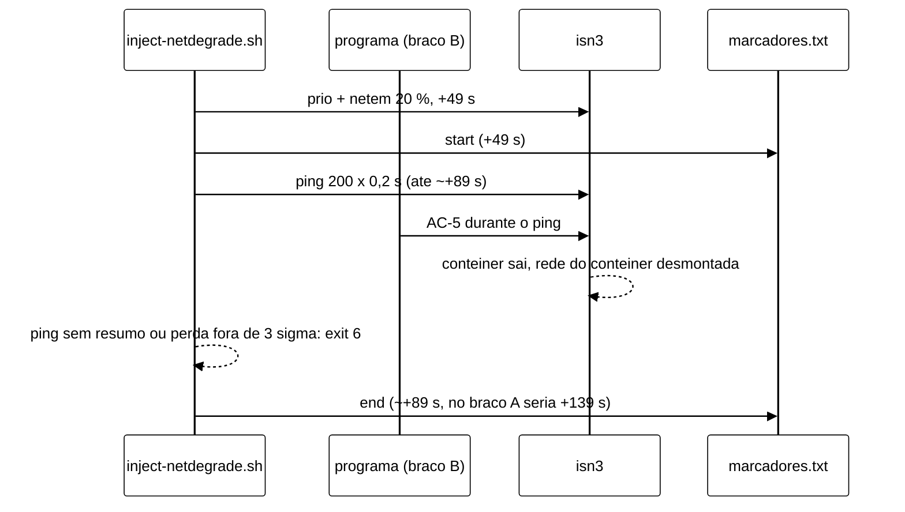

# Validação V-W6b do orquestrador das campanhas S3 (W-6b) (2026-11-05)

> Nota da integração (05/11, merge do W-6 em `feature/controlador-integracao`): os números de problema e de decisão
> técnica do W-6 foram deslocados para depois dos do W-2b (TD-014 → TD-015, P-45..P-53 → P-47..P-55). Este
> documento já usa os números da integração; onde o texto descreve a própria renumeração, ficam os dois.

Senior, validação independente das correções do W-6b sobre a V-W6 (`docs/validacao-w6-2026-11-05.md`, com a adenda
da seção 11). Fiz por leitura, pelas suítes leves com *shims* e por quatro mutações do orquestrador. Não rodei Maven,
Podman nem *cluster*. A VM estava no fim de uma campanha, com o *host* em silêncio até ~22:00Z, então rodei só *bash*
com *shims* e Python. Rodei tudo numa cópia `git archive` da ponta, fora da árvore do Worker, e não alterei código da
branch.

- Branch `feature/w6-orquestrador-s3`, worktree `wt-w6`, ponta `6f366ac`, árvore limpa. Histórico linear desde a
  V-W6: `449e757` (V-W6), `98149ca` (`test:`, vermelho), `a34aa36` (adenda do Senior), `4dec3df` (`test:`), `9c8a8b5`
  (`test:`, S25), `bef758e` (`feat:`) e `6f366ac` (`docs:`). O Worker não mexeu na adenda
  (`git diff a34aa36..6f366ac -- docs/validacao-w6-2026-11-05.md` vazio).
- Diff `449e757..6f366ac`: 10 arquivos. O código mudou só em `scripts/run-campanha-s3.sh` e
  `scripts/campanha_s3_conferir.py`, além das duas suítes. `workload/` e `cluster/` não mudam desde `474b1ce`, então o
  Surefire 1100/0/0/1 do W-6 continua valendo para a árvore Java.
- Relatório do Worker: `docs/relatorio-w6-2026-11-05.md`. Desta vez ele existe e cobre os 12 pontos.

**Parecer: APROVADO COM RESSALVAS para a integração. Nada bloqueia a integração.** B1, B2, S1 a S5, M1 e o P-55
(com o S25) estão fechados no código e presos por teste. A suíte completa deu 269/0, como o Worker declarou, e as
mutações que desfazem B1, P-55, S3 e S25 fazem a suíte falhar. O S25 só falha quando roda sozinho: com carga no
*host* ele passa mesmo sem a correção (R8). O S6 está certo por construção, mas nenhum teste o discrimina, o que é
aceitável para um item de limpeza. Os dublês de F2 e F4 saem com 1 e 6, como os injetores reais, mas o S22 depende
do relógio do Git Bash nos dois sentidos, e sob carga deu falhas espúrias no F4 (R3). A regra do B1 é segura para F2
e coerente com o B-40. Há um achado novo no F4 (seção 3.3, **N1**): numa execução do braço B aceita pelo B1, o
marcador `end` pode sair cerca de 50 s antes do fim nominal da janela, o que desloca a fase de recuperação e o Δ_rec
só nesse braço. V e L não mudam. Isso não bloqueia a integração, o X-17 nem a calibração, mas precisa de decisão antes
da análise das células F4 da avaliação. A margem do teto de 1005 s é menor que a declarada no pré-registro (seção 5),
o que se corrige no texto.

## 1. O que conferi

| # | Verificação | Resultado |
|---|---|---|
| 1 | Diff `a34aa36..6f366ac` do orquestrador (+180/−46 no `bef758e`), do `campanha_s3_conferir.py` e das duas suítes | lido inteiro; `concluir_injecao`, `alvo_rede_parado`, `religar_parados`, `tratar_sinal_fim`, `pos_execucao`, `resolver_injetor_parado`, `marcar_fila`, `conferir_referencias`, `leitor_stdout` e o pré-voo lidos no contexto do arquivo |
| 2 | `scripts/run-campanha-s3.test.sh` completo (S1..S25) na cópia da ponta | **269 PASS, 0 FAIL** (21:11 a 21:57Z, 2784 s), igual ao relatório (269/0 em 2373 s) |
| 3 | `test_campanha_s3_conferir.py`, `test_campanha_s3_matriz.py`, `test_campanha_s3_h4.py` | **30 OK, 15 OK, 11 OK** (iguais ao relatório) |
| 4 | `scripts/inject-crash.test.sh` | **141 PASS, 0 FAIL** (injetor sem mudança) |
| 5 | Quatro mutações do orquestrador (seção 2.1), rodadas em paralelo e o S25 de novo sozinho | as quatro detectadas; o S25 só quando roda sozinho |
| 6 | Injetores reais: código de saída com o nó-alvo parado no meio da janela | `inject-partition.sh` sai com 1 e `inject-netdegrade.sh` com 6 (seção 3.1); a semântica do *bash* (`set -euo pipefail`, atribuição com substituição de comando que falha, *trap* de `EXIT`) foi reproduzida à parte: o *trap* recebe 1 |
| 7 | Congelados | intactos (seção 7) |
| 8 | Referência real do I-3b contra o `campanha_s3_conferir.py referencia` e o `ArquivoReferencia.java` | `wt-w4/runs/i3b/config/referencia-S3-async.json` tem `esquema` `referencia-p99/1`, `cenario` `S3`, `perfil` `async` e `p99_ns`: passa nas duas conferências |
| 9 | Tempos do I-3b para a M1 (`fases.tsv` e `convergencia-*.csv` de `ativo-sem-religar`, `ativo-religar` e `controle-shadow`) | seção 5 |

## 2. Ponto a ponto contra a V-W6

| Item | Correção | Teste | Falharia sem a correção? | Dublê fiel? | Situação |
|---|---|---|---|---|---|
| **B1** | `concluir_injecao`: F2/F4 com exit 1 ou 6 e o alvo fora de `running` (ou já religado na linha de fim) ficam pendentes; `resolver_injetor_parado` aceita com aviso só se a linha de fim **e** a trilha põem o AC-5 APLICADA no nó da falha e, na F2, o `injetor.log` tem a linha `OK: <no> nao conecta a nenhum par` | S22: positivo F2, positivo F4, F2 sem a linha OK, exit 1 com o nó de pé, nó parado sem AC-5 | sim: com a mutação, o positivo F2 vira RECUSADA e `injetor_alvo_parado` fica vazio. O positivo F4 ficou inconclusivo sob carga (seção 2.1) | código de saída sim (F2 1, F4 6, seção 3.1); a linha OK tem o texto do real (`inject-partition.sh:470`). O tempo do F4 não: o dublê sai no fim da janela, e o real pode sair no fim do *ping* (N1) | **fechado**; ressalvas N1, R3 e R4 |
| **S1** | o `--dry-run` roda `conferir_controlador` e `conferir_referencias` | S1: bloco `politica` ausente com braço B, `tetoLagMs` ≠ 2000 e `p2Habilitada = true` saem com 4 sem chamar nada | sim: sem a chamada o `--dry-run` saía com 0 | usa o `campanha_s3_conferir.py` real | **fechado** |
| **S2** | pré-voo recusa *timer* `tcc-heal-cs-*` (exit 4) | S2 | sim: sem a recusa a fase seguia e parava com 6 na pós-checagem da primeira execução | o *shim* de `systemctl list-timers` lista o *timer*; a conferência é "saída não vazia", o mesmo padrão que o *runner* do *rebaseline* usa na VM (`run-rebaseline.sh:216`) | **fechado** |
| **S3** | sem a linha de fim, `pos_execucao` religa os nós parados e marca `DESCARTADA-INFRA`, sem parar a fase | S23 | sim: a mutação que desliga o religamento faz a saúde falhar e a fase sair com 10 | dublê de `java` com `java-sem-sinal-active` | **fechado** |
| **S4** | `collect-resources.sh` (`${COLETOR}`) no `bundle.sha256` | S4 | sim | — | **fechado** |
| **S5** | S7 exige o SIGKILL depois de 2300 ms reais | S7 | — (é o próprio teste) | — | **fechado** |
| **S6** | `leitor_stdout` guarda o PID da substituição de processo e espera o `cat` antes do `EOF` | S4 confere o `MANIFEST` com `sha256sum -c` | **não**: a janela da corrida é de milissegundos e a pós-checagem leva segundos, então o teste passaria sem a correção | — | **fechado por construção** (`wait $!` de substituição de processo vale desde o *bash* 4.4); aceito, é limpeza |
| **M1** | `parametros --t-enc-pior-s` obrigatório; mínimo = `duracao + 21 + religamento + convergencia_teto + convergencia_periodo` | `TetoComParcelas` (4) e S2, S7b | sim: os limites 1106/1105 e 986/985 mudam sem as parcelas | — | **fechado no código**; o número do pré-registro tem a ressalva R2 (seção 5) |
| **B2** | `--referencia-async`/`--referencia-sync`, cada uma com SHA-256; a referência vem do modo da linha; a de cada perfil da fila é obrigatória e conferida no pré-voo e no `--dry-run`; pré-voo 4 em cada perfil; `referencia_sha256` no `execucao.json`; as duas no *bundle* | S24 (fase SYNC + ASYNC, referências trocadas, referência faltando, opção antiga) e `Referencia` (5) | sim. O vermelho do commit `4dec3df` era em parte por nome de opção (exit 2), mas o S24 também prende o comportamento: o dublê de `java` recusa referência de outro perfil como `LigacaoControlador.java:204` | o dublê de `java` reproduz a recusa por perfil; o `campanha_s3_conferir.py` repete esquema, cenário e perfil do `ArquivoReferencia.java` e do `LigacaoControlador.java:198-207` | **fechado** |
| **P-55** | motivos de `E_INFRAS` com o prefixo `infra: ` | S22 (nó parado sem AC-5) e S23 | sim: com a mutação, o caso do nó parado sem AC-5 vira RECUSADA em vez de `DESCARTADA-INFRA`. No S23 o veredito continua `DESCARTADA-INFRA` (a trilha tem AC-5 e não há linha de fim, então a conferência da trilha já dá `infra`), e o que falha é o texto do motivo | — | **fechado** (seção 4) |
| **S25** | o O8 pula o nó de um F1 em curso | S25 | sim, rodando sozinho: o O8 religa `isn2` (dois `podman start`), e a execução vira `DESCARTADA-INFRA`. Sob carga, não (R8) | usa o `inject-crash.sh` real | **fechado** (seção 4) |

### 2.1 Mutações

Cada mutação troca uma condição da ponta por `false` (ou desfaz o prefixo) numa cópia própria e roda só os casos que
deveriam pegá-la. Rodei as quatro em paralelo, junto com o `inject-crash.test.sh`, e repeti o S25 sozinho. A carga do
paralelo é o que expôs a dependência do relógio (R3, R8).

| Mutação | Casos | Esperado | Obtido |
|---|---|---|---|
| sem o ramo do B1 em `concluir_injecao` | S22 | FAIL nos positivos F2 e F4 | **16 FAIL.** F2: RECUSADA em vez de ACEITA, `injetor_alvo_parado` vazio, braço A PULADA. F2 sem a linha OK e nó sem AC-5: `injetor_alvo_parado` vazio. F4 inconclusivo: sob carga, o AC-5 do dublê veio antes do disparo, a guarda de *netns* parou a fase com 6 (O1, seção 3.2) e o injetor nem rodou |
| sem o prefixo `infra: ` (P-55) | S22, S23 | FAIL no nó parado sem AC-5 e no S23 | **6 FAIL.** Nó parado sem AC-5: RECUSADA em vez de `DESCARTADA-INFRA`. S23: motivo sem `infra:`. Mais 3 FAIL espúrios no F4: a janela do dublê acabou antes do AC-5, e o injetor saiu com 0 (R3) |
| sem o desvio do F1 em curso no O8 (S25) | S25 | FAIL | **sozinha, 3 FAIL:** `DESCARTADA-INFRA`, `outros_parados` = `isn2`, dois `podman start`. **Com as outras três em paralelo, 0 FAIL em 2 de 2 rodadas:** o `inject-crash.sh` levou 105 s virtuais do disparo ao `podman kill`, e a linha de fim chegou 19 s virtuais antes do *kill*, com `isn2` ainda de pé (R8) |
| sem o religamento do S3 em `pos_execucao` | S23 | FAIL (exit 10) | **5 FAIL:** a fase sai com 10 ("sem 3 HEALTHY"), `isn3` fica parado e não há `podman start` |

## 3. B1: a regra é segura e coerente com o B-40?

### 3.1 O que os injetores reais fazem com o nó parado

- **F2** (`inject-partition.sh`). Com `set -euo pipefail` (`:51`), depois do `sleep` da janela (`:487`), a linha
  `ING="$(soma_pkts "${pid}" ingress 12)"` (`:495`) chama o `nsenter` com o PID morto. A *pipeline* sai com 1 e a
  atribuição derruba o *script*. O *trap* (`:386`) limpa e grava o `end`, e o exit é **1**. Com o PID reaproveitado, os
  contadores dão zero e o exit é **6** (`:502`). O `end` sai no fim nominal da janela.
- **F4** (`inject-netdegrade.sh`), N3 com saída de `isn3`. A verificação por *ping* se aplica (perda aleatória
  positiva, `:430-442`) e dura 200 × 0,2 s, cerca de 40 s (`:760`). Se o AC-5 parar o nó durante o *ping*, o resumo
  some ou a perda sai da tolerância, e o exit é **6** em cerca de +89 s (`:771`, `:778`). Se o AC-5 vier depois do
  *ping*, os contadores não são lidos no fim da janela, e o exit é **6** em +139 s (`:810`).

Os dublês reproduzem os códigos. O de F4 não reproduz o instante da saída, porque sai sempre no fim da janela.

### 3.2 Quando a regra aceita

A execução só passa a ACEITA com aviso se as quatro condições valem juntas:

1. o injetor saiu com 1 ou 6;
2. o nó da falha estava fora de `running` quando o injetor saiu;
3. a linha `Fim da carga:` e a trilha dão o AC-5 APLICADA nesse nó (`trilha` com exit 0 e `ac5_alvo` igual);
4. na F2, o `injetor.log` tem `OK: <no> nao conecta a nenhum par`.

O instante do AC-5 não é conferido, mas fica implícito. Um AC-5 antes do disparo nem chega ao injetor: a guarda de
*netns* do orquestrador (`run-campanha-s3.sh:1174`) não resolve o PID do nó parado, e a fase sai com 6 (observação
O1, abaixo). Se o AC-5 caísse nos milissegundos entre a guarda e a resolução do injetor, o injetor sairia com 4, e a
execução seria RECUSADA. Um AC-5 depois da janela não muda nada, porque o injetor já saiu com 0. Então só um AC-5
dentro da janela leva ao caminho do B1.

**O1 (observação, anterior ao W-6b).** Um AC-5 precoce no nó da falha, antes de +49 s, para a fase com 6, e não só
a execução. Isso é conservador: um falso positivo antes da falha é um achado que merece olhar humano, e o B-40 espera
zero. O custo é a noite parada. Se o Gestor preferir perder só o bloco, a mudança é barata e cabe no W-6c: na guarda,
com o nó fora de `running` no braço B, marcar RECUSADA ("nó da falha parado antes do disparo"), parar a carga e deixar
o religamento para a pós-checagem (S3 e O8). Recomendo manter como está até o X-17.

**F2: segura.** A linha OK é escrita depois de aplicar as regras com o mesmo PID vivo e de confirmar que o nó não abre
conexão TCP com os pares na porta 7800. Se o corte não mordesse, o injetor sairia com 6 nesse ponto (`:467`), com o nó
de pé, e a execução seria RECUSADA. Com a linha OK, o corte valeu desde o início até a parada pelo AC-5, que é
exatamente o que o aviso diz. Há um caso de borda: se o AC-5 viesse nos ~6 s da própria verificação, o `nsenter` com
o PID morto também "não conecta". Isso exige um AC-5 em menos de 6 s depois do corte, contra os 13,2 s medidos no I-3b.
O risco é desprezível.

**F4: aceitável, com evidência mais fraca.** O injetor não deixa prova da severidade quando o AC-5 corta o *ping*.
Restam o marcador `start`, a linha `degradacao aplicada: alvo <no>` e o próprio AC-5 no nó degradado. Para o AC-5
disparar sem a falha morder, seria preciso um falso positivo justo no alvo e dentro da janela, e o B-40 espera zero
AC-5 sem falha. Ressalva R4: exigir também, no F4, a linha `degradacao aplicada: alvo <no>` no `injetor.log` e o
`start` no `marcadores.txt`, o equivalente barato da linha OK, e declarar no B-40 que a severidade não é verificada
pelo injetor nessas execuções.

**Coerência com o B-40.** O §9 do rascunho diz que F2/F4 (e F3) no braço B com AC-5 no nó da falha seguem com o aviso
e não contam como perda. A regra do código é mais estrita, porque exige trilha e linha concordando e, na F2, a linha
OK. Ela é também a única coerente com a comparação por blocos. A parada do nó é o efeito do tratamento, e recusar
essas execuções descartaria o braço B justamente quando o controlador age, um descarte informativo e correlacionado
com o braço. O B-40 deve escrever as condições da seção 3.2, porque hoje cita só o aviso.

### 3.3 N1 (novo): no F4, o `end` do braço B pode sair cerca de 50 s antes

O `analysis/fases.py` e o `Marcadores.java` tomam o último `end` como fim da falha. Nessa execução, `durante` vai de
+49 a +89 s no braço B e de +49 a +139 s no braço A. **V e L não mudam**: a união `durante` + `recuperacao` vai até o
fim da carga nos dois braços, porque a recuperação se estende até a convergência, que vem depois do fim da carga, ou
até o fim com divergência persistente (`fases.py:39-44`). **Mudam** o Δ_rec, que é contado a partir do `end` e é o
primeiro secundário da família do B-40 §5.3, e os descritivos por fase. A diferença vai contra o braço B, por
construção. Na F2 isso não acontece, porque o `end` sai no fim nominal (+139 s). Na F3 do W-6c, se o injetor só falhar
na remoção, também não.

**Correção proposta.** O injetor fica como está. O orquestrador registra, no `execucao.json` de toda F2/F4, o fim
nominal (`inj_inicio_offset_s + f*_dur_s`) e o instante em que o injetor saiu, o que cabe no W-6c. O B-40 §9 decide a
regra da análise. A recomendação é usar, nas execuções com o aviso do B1, o fim nominal como fim da falha (no W-5b, o
`comparar_bracos.py` lê o máximo entre o `end` e o fim nominal). Não deve ser o orquestrador a escrever um `end`
sintético no `marcadores.txt`, porque o arquivo é do injetor. **Bloqueia só a análise das células F4 da avaliação**
(antes da N4), não a integração, o X-17 (F2) nem a calibração (só braço A).

## 4. P-55 e S25

- **O defeito existia.** O veredito procura `^(infra|h4)` nos motivos (`run-campanha-s3.sh:1381`). As cinco mensagens
  de `E_INFRAS` (`:1078`, `:1091`, `:1093`, `:1098`, `:1227`) não tinham o prefixo, e nenhuma mensagem de `E_INFRAS`
  já trazia `infra:`, então não há prefixo duplicado. A V-W6 (ponto 4) já dizia que o nó religado pelo O8 faz a
  execução virar `DESCARTADA-INFRA`, mas o código fazia outra coisa. A correção alinha o código à especificação.
- **O teste vermelho existia.** O `98149ca` já esperava `DESCARTADA-INFRA` e o texto `infra: no(s) parado(s)` no caso
  "nó parado sem AC-5". O P-55 apareceu ao escrever o teste e foi corrigido no `bef758e`. O O8 sozinho, sem outra
  recusa, não tem caso próprio, mas o caso do S22 discrimina: sem o prefixo, o veredito é RECUSADA.
- **S25 está certo.** Com `F1_ATIVA = 1`, o nó do F1 está parado pelo `inject-crash.sh`, que o religa e grava o `end`.
  Religá-lo no O8 seria um segundo `podman start`, que antecipa a volta e encurta a falha, e com o prefixo viraria
  `DESCARTADA-INFRA` sem desvio real. Não abre buraco: se o injetor não religar o nó, a volta pela REST (P-35) esgota em
  180 s e a fase para com 10, como antes. Na VM o F1 acaba em +109 s numa carga de 300 s, então o caso só aparece com o
  injetor travado. O teste, porém, depende do relógio: ele só prende a correção se a linha de fim chegar entre o
  `podman kill` e o `podman start` do F1. Rodando sozinho, chegou 12 s virtuais depois do *kill* e a mutação falhou.
  Sob carga, o *kill* atrasou e a mutação passou (R8).

## 5. M1: o teto de 1005 s

O código está certo como limite inferior: o mínimo com os números do pré-registro é 300 + 21 + 60 + 600 + 5 = 986 s.
A pergunta é se 1005 s cobre o pior caso real. O pior caso é o braço B com AC-5 em que o nó não volta. O programa
espera o religamento até o prazo, o laço de convergência roda inválido até o teto, e o fechamento faz a leitura final
com o nó ausente.

| Parcela | Valor | Origem |
|---|---|---|
| lançamento até a âncora (`t_pre`) | ≤ 2,4 s | adenda da V-W6 (I-3b `ativo-religar`) |
| carga | 300 s | `duracao_s` |
| `T_enc` | ≤ 21 s | contrato JSONL 1.2 (no I-3b, 0,013 s) |
| espera do religamento | ≤ 60 s mais uma leitura da sonda | `Religamento.esperar` (a última leitura é no prazo) |
| laço até o teto | ≤ 600 s + período (5 s) + uma rodada (0,05 a 0,09 s) | `ConvergenciaLoop.executar:124-143` (confere o teto depois de dormir); rodadas a cada 5,05 a 5,09 s no I-3b `controle-shadow` |
| leitura final e fechamento, divergente com o nó ausente | 7,3 s | I-3b `ativo-sem-religar` (teto 120 s): do *break*, última rodada mais 5 s, ao `carga exit`. O `t_fim_carga → exit` deu 128,1 s para 120 s de teto |
| **total** | **≈ 995,8 s** | margem de **≈ 9 s** sobre 1005 |

1005 s passa, com margem positiva mas fina (0,9 %), apoiada em medidas de n = 1. **Ressalva R2:** a derivação do
pré-registro (§4.1, `300 + 21 + 60 + 600 + 1,5 × (2,4 + 13,5)`) omite o `convergencia_periodo_s`, que o código agora
soma. Com ele, a mesma regra dá 1009,9 → **1010 s**, e o fator real sobre `t_pre + t_pos` com 1005 s é 1,19, não os
1,5 declarados. O `t_pos` de 13,5 s mede o caso convergente (duas rodadas a mais e o fechamento), que não é o caso que
estoura o teto. Ele é conservador, então pode ficar, mas o texto deve dizer isso. Proposta: corrigir a fórmula da
§4.1 e a regra 7.17 para incluir o período, e fixar 1010 s (C-6). O custo é de 5 s só no pior caso. Na calibração, que
é só braço A e não tem espera de religamento, o pior caso é ≈ 936 s, e 1005 s sobra com 69 s. Por isso a R2 não
bloqueia a calibração e se resolve no texto, antes da aprovação do C-6.

## 6. Troca de `--referencia` por `--referencia-async`/`--referencia-sync`

**Na branch: coerente.** O cabeçalho de uso do orquestrador, o `README.md:119-127`, o TD-015 item 19 e o fluxograma do
`docs/implementacao.md`, o P-54, o `docs/testes.md` (S24) e o relatório usam as opções novas. A opção antiga só aparece
como texto histórico ou na recusa com exit 2 (`run-campanha-s3.sh:150`). Os outros `--referencia-erro` são do
`comparar_bracos.py` e não têm relação com isso.

**Fora da branch, o que precisa mudar** (nenhum desses arquivos é do Worker):

| Onde | Hoje | Mudar para |
|---|---|---|
| pré-registro da calibração (`wt-prc-s3`, `254380a`), §2, linhas 70-71 | orquestrador "depois do W-6b ... e da correção B2"; SHA-256 da "referência" | B2 já está no W-6b (`bef758e`); SHA-256 das **duas** referências, passadas por `--referencia-async` e `--referencia-sync` |
| idem, §4.2 | referência SYNC "a criar no *bundle*" | arquivo de entrada com o seu SHA-256 em `--referencia-sync`, conferido pelo `campanha_s3_conferir.py referencia` (esquema `referencia-p99/1`, cenário S3, perfil `sync`); o orquestrador o põe no *bundle* |
| idem, §4.1, regra 7.17 e §8 | fórmula do teto sem o período; pior caso do `--dry-run` de 1245 s | R2 (seção 5); com 1010 s, 1250 s |
| idem, §5 (critérios por execução) | sem os casos novos | nó parado sem AC-5 na linha de fim (O8): `DESCARTADA-INFRA` (P-55); carga sem a linha de fim: religamento e `DESCARTADA-INFRA`, sem parar a fase (S3); *timer* `tcc-heal-cs-*` sobrando: pré-voo sai com 4 (S2) |
| idem, §9 itens 1, 2, 7 e 8 | W-6b e B2 pendentes; `--dry-run`; "referência SYNC inerte criada e no *bundle*" | W-6b e B2 feitos (falta o *merge* com o I-1); o `--dry-run` passa a conferir também o controlador (S1) e as referências; a SYNC inerte é criada e passada em `--referencia-sync` (o orquestrador a põe no *bundle*) |
| B-40 (`wt-b40`, `ebfee35`), §9 | só o aviso do B1 | as condições da seção 3.2, a regra do fim da falha (N1) e a limitação do F4 (R4) |
| idem, §13 item 2 | "a correção B2" como pré-requisito | feita no W-6b |
| roteiro do X-17 (ainda não existe no repositório) | — | linha de comando com `--referencia-async` (e `--referencia-sync` se a fase tiver SYNC) |

O `wt-b40` contém uma cópia do pré-registro da calibração, porque a branch nasce dele, e herda as mudanças no
*rebase*. Fora da troca de opção, o exemplo de matriz do `README.md:110-115` ainda tem `SYNC-F1` e
`ASYNC-none:descritiva:4`, que o B-40 tirou (B-5) e mudou (8 blocos). É cosmético e pode ser ajustado na integração.

## 7. Nada congelado mudou

| Arquivo | SHA-256 na ponta (árvore e objeto `6f366ac`) | Desde `449e757` |
|---|---|---|
| `scripts/run-rebaseline.sh` | `d95305fe…` | sem diff |
| `scripts/inject-netdegrade.sh` | `4ebdd8a3…` (o do S5 do *gate*) | sem diff |
| `scripts/inject-partition.sh` | `59dd2bee…` | sem diff (e desde `17f2bd4`) |
| `scripts/inject-crash.sh` | `531a98a1…` (B-25.1, já conferido na V-W6) | sem diff |
| `scripts/inject-jitter.sh` | `7e68962b…` | sem diff (e desde `17f2bd4`) |
| h4: `scripts/amostrador-infra.sh`, `scripts/vigia-h4.sh`, `analysis/h4.py` | `e4cc5c79…`, `1e7462f4…`, `53d7e7cb…` | sem diff (e desde `17f2bd4`) |
| `analysis/rebaseline.py`, `scripts/rebaseline_matriz.py`, `scripts/cria-caches.sh`, `scripts/collect-resources.sh` | — | sem diff |

Vale ainda a regra da V-W6 §2: nenhum *bundle* do *rebaseline* é regerado de `int/*`, e as retomadas usam o
`rb-20805b0.tar`.

## 8. Ressalvas

| # | O quê | Onde | Bloqueia | Quem |
|---|---|---|---|---|
| **N1** | no F4 do braço B aceito pelo B1, o `end` pode sair em ~+89 s em vez de +139 s; Δ_rec e descritivos por fase ficam assimétricos (V e L não) | seção 3.3 | a análise das células F4 da avaliação (decidir antes da N4) | Gestor decide a regra no B-40 §9; W-6c registra o fim nominal; W-5b o usa |
| **R2** | a derivação do teto no pré-registro omite o período da convergência; com ele, 1010 s | seção 5 | a aprovação do C-6 (texto) | Senior, no pré-registro |
| **R3** | o S22 depende do relógio do Git Bash nos dois sentidos. O AC-5 do dublê vem em +60 s do relógio do `java` e a janela nominal acaba em +50 s do relógio do orquestrador, então o caso só passa porque o disparo atrasa 10 s virtuais ou mais. Num Linux rápido, o injetor sairia com 0. Sob carga (seção 2.1), deu dois FAIL espúrios no F4: a janela acabou antes do AC-5 (injetor 0) e o AC-5 veio antes do disparo (fase com 6 pela guarda) | `run-campanha-s3.test.sh:1037`, `:1071` | nada (a suíte passa no *host* sem carga) | Worker: tirar o relógio do caso. O dublê de `java` para o nó só depois de ver o `start` da falha no `marcadores.txt`, e a janela fica com `f2_dur_s=60`/`f4_dur_s=60` |
| **R4** | no F4, nenhuma prova do injetor de que a degradação mordeu quando o AC-5 corta o *ping* | seção 3.2 | nada | Worker: exigir `degradacao aplicada: alvo <no>` e o `start`; Senior: limitação no B-40 |
| **R5** | o S6 não é discriminado por teste | seção 2 | nada | aceito |
| **R6** | documentos fora da branch | seção 6 | nada no código; o pré-registro e o B-40 antes da aprovação | Senior |
| **R7** | o `--help` corta o cabeçalho: `uso()` imprime as linhas 2 a 60 (`run-campanha-s3.sh:127`), e o comentário do W-6b empurrou "Variaveis" e "Exit codes" para as linhas 61 a 71. Conferido: `--help` não mostra mais os códigos de saída | `run-campanha-s3.sh:127` | nada (cosmético) | Worker: imprimir até a linha `set -euo pipefail` em vez de um número fixo |
| **R8** | o S25 só discrimina se a linha de fim cair entre o `podman kill` e o `podman start` do F1. Sozinho, caiu 12 s virtuais (0,6 s real) depois do *kill*. Com carga, o `inject-crash.sh` demorou mais a matar o nó, e a mutação passou em 2 de 2 rodadas | `run-campanha-s3.test.sh:1162-1172` | nada | Worker: arquivo de controle no dublê de `java` (por exemplo `java-espera-parado-isn2`) que segura a linha de fim até `status-isn2` sair de `running` |
| **O1** | AC-5 precoce no nó da falha, antes do disparo, para a fase com 6 (guarda de *netns*), não só a execução | seção 3.2 | nada | Gestor, se quiser perder só o bloco (W-6c) |

O que já estava fora do W-6b continua pendente, como a V-W6 definiu: o I-1 (leitura da `meta` com repetição) e a
renumeração entram no *merge* com o W-2b, antes do X-17. O P-48 (topologia do `rcm` principal) entra no *smoke* local,
antes da calibração.

## 9. Pontos que precisam do Gestor

1. Liberar a integração do W-6b (ponta `6f366ac`) junto com o W-2b, com a renumeração da V-W6 §6 deslocando também
   P-51..P-53, que passam a P-53..P-55.
2. N1: aprovar a regra "nas execuções F2/F4 com o aviso do B1, o fim da falha na análise é o nominal", com o registro
   no `execucao.json` pelo W-6c e o uso no W-5b. A alternativa é aceitar a assimetria e declará-la como limitação do
   Δ_rec nas células F4.
3. R2: fixar `exec_teto_s` = 1010 s no C-6 do pré-registro da calibração, com a fórmula corrigida.
4. O1: manter a parada da fase com 6 quando um AC-5 precoce derruba o nó da falha antes do disparo (recomendado até o
   X-17), ou trocá-la por RECUSADA no W-6c.

## 10. Próxima tarefa sugerida para o Worker

> Na W-6c (`feature/w6c-f3-memoria`, hoje em `6f366ac`), com TDD e commits locais:
> 1. Registrar no `execucao.json` de toda F2/F4 o fim nominal da falha (`inj_inicio_offset_s + f*_dur_s`) e o
>    instante de saída do injetor relativo à âncora (N1). Dublê de F4 que, com o alvo parado durante a verificação,
>    sai com 6 e grava o `end` em `start + 40 s` virtuais (como o real); caso novo que confere os dois campos.
> 2. R4: no caminho do B1 com F4, exigir a linha `degradacao aplicada: alvo <no>` no `injetor.log` e o `start` no
>    `marcadores.txt`; na F2, o `start` também. Caso negativo para cada um.
> 3. R3 e R8: tirar o relógio do S22 e do S25. No S22, o dublê de `java` para o nó só depois do `start` da falha, com
>    `f2_dur_s=60`/`f4_dur_s=60`. No S25, o dublê segura a linha de fim até o nó do F1 estar parado. Conferir que as
>    mutações da seção 2.1 falham também com a suíte rodando em paralelo com outra.
> 4. Estender o B1 à F3, como o B-40 §4.3 pede.
> 5. R7: `uso()` imprime o cabeçalho até a linha `set -euo pipefail`; caso que confere "Exit codes" no `--help`.
> Não mexer em injetores, h4 nem no *runner* do *rebaseline*. Aceite: suíte completa 0 FAIL, com contagem.
